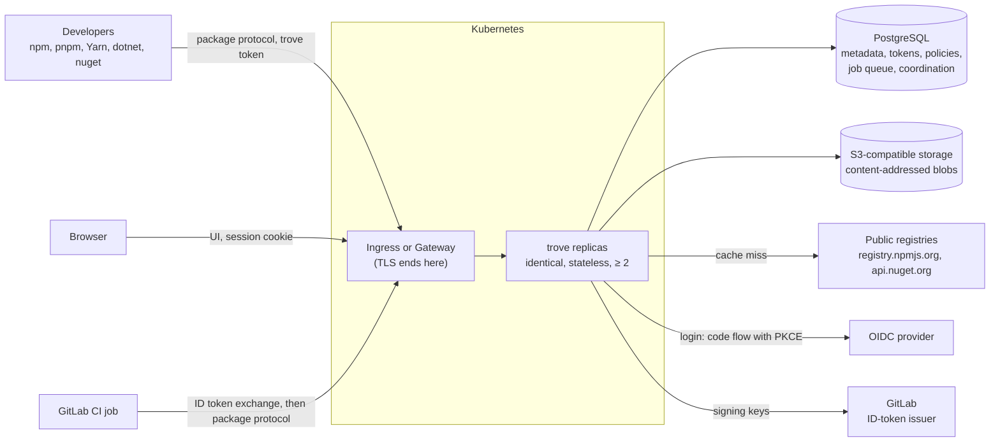

# trove

[](LICENSE)

> **Status: specification phase.** Nothing is implemented yet. There is no release, no container
> image and no Helm chart. Every interface, name and command on this page is the target design from
> [docs/spec/](docs/spec/README.md), not something you can run today.

trove is a self-hosted, highly available binary repository manager. It hosts your own packages,
proxies and caches public registries on demand (pull-through), and puts both behind one URL per
ecosystem. People sign in through your OpenID Connect provider. Access is denied by default and
granted through permission policies that reach down to package-name patterns. GitLab CI jobs need
no stored secret: a job trades its GitLab-issued ID token for a short-lived trove token whose
rights come from rules you define on the job's claims. npm and NuGet come first. trove is one Go
binary with an embedded Angular UI. It keeps metadata in PostgreSQL and binaries in S3-compatible
object storage, and it is deployed with a Helm chart.



## ✨ Key Features

All of these are planned: specified in [docs/spec/](docs/spec/README.md), not implemented.

- 📦 **npm and NuGet v3 first.** Local, remote and virtual repositories for npm, pnpm, Yarn, `dotnet`, nuget.exe and Visual Studio. See [npm](docs/spec/formats/npm.md) and [NuGet](docs/spec/formats/nuget.md).
- 🔁 **Pull-through proxy.** Fetch on a cache miss, a metadata period, a negative cache, stale metadata while the upstream is down, collapsed concurrent misses, and rewritten metadata URLs. See [repositories and proxy](docs/spec/repositories-and-proxy.md).
- 🧭 **Virtual repositories.** One URL over an ordered list of local and remote repositories, with namespace claims and pin rules against dependency confusion. See [repositories and proxy](docs/spec/repositories-and-proxy.md).
- 🔐 **OIDC login.** Authorization code flow with PKCE. Users are created just in time, groups come from a claim, and trove stores no user passwords. See [identity and authentication](docs/spec/identity-and-authentication.md).
- 🎟️ **trove's own tokens.** Personal, service-account and CI tokens. Each is prefixed and checksummed, stored only as a hash, scoped, expiring and revocable. See [identity and authentication](docs/spec/identity-and-authentication.md).
- 🛡️ **Fine-grained permissions.** Deny-by-default permission policies on repository, path and package-name patterns, plus package ownership. See [authorization](docs/spec/authorization.md).
- 🦊 **GitLab CI OIDC federation.** RFC 8693 token exchange; claim-based identity mappings and grants templated from claims. See [GitLab CI OIDC](docs/spec/gitlab-ci-oidc.md).
- 🗄️ **Content-addressed storage.** Deduplicated S3 blobs, garbage collection that is safe against concurrent uploads, and an integrity scrub. See [storage](docs/spec/storage.md).
- ⚖️ **Active-active high availability.** Replicas coordinate only through PostgreSQL. Expand/contract migrations allow rolling upgrades. See [HA and Helm](docs/spec/ha-and-helm.md).
- ⎈ **Helm chart.** It never creates a Secret and validates values fail-fast. It renders a PDB, HPA, NetworkPolicy and ServiceMonitor. See [HA and Helm](docs/spec/ha-and-helm.md).
- 📈 **Observability and audit.** Prometheus metrics, JSON logs, OpenTelemetry traces, and audit events stored in PostgreSQL. See [operations and observability](docs/spec/operations-and-observability.md).
- 🖥️ **API-first UI.** The Angular UI uses only the public OpenAPI 3.1 management API, and offers client setup instructions per repository. See [API and UI](docs/spec/api-and-ui.md).

## 📛 Naming conventions

Every name below is fixed by the spec page named in the last column. Values marked *example* are
illustrations, not defaults.

### Binary, commands and listeners

| Name | Pattern | Spec |
|---|---|---|
| Binary | `trove`, statically linked (`CGO_ENABLED=0`) | [R-ARCH-001](docs/spec/architecture.md) |
| Run a replica | `trove serve [--role all\|api\|worker]`, default `all` | [R-ARCH-001](docs/spec/architecture.md) |
| Schema migrations | `trove migrate [up\|status]` | [R-ARCH-001](docs/spec/architecture.md) |
| Bootstrap and recovery | `trove admin service-account create`, `trove admin token create\|revoke`, `trove admin break-glass status\|unlock\|end-sessions`, `trove admin user disable`, `trove admin sessions end` | [R-AUTH-015](docs/spec/identity-and-authentication.md) |
| Configuration check | `trove admin config validate [--config <file>]` | [R-OPS-028](docs/spec/operations-and-observability.md) |
| Operations and restore | `trove admin secrets status`, `trove admin storage check`, `trove admin storage verify`; restore procedure (P1, built for 1.0): `trove admin post-restore --restored-to <t>`, `trove admin storage restore-versions --before <t>`, `trove admin maintenance pause-deletions\|resume-deletions`; configuration as code (P1): `trove admin config diff\|apply -f <file>` | [R-ARCH-021](docs/spec/architecture.md), [R-STOR-035](docs/spec/storage.md), [R-HA-024](docs/spec/ha-and-helm.md), [R-HA-025](docs/spec/ha-and-helm.md), [R-OPS-030](docs/spec/operations-and-observability.md) |
| Client listener | `:8080` (`server.listen`) | [INV-6](docs/spec/README.md), [R-ARCH-005](docs/spec/architecture.md) |
| Operations listener | `:8081` (`server.ops_listen`), serving only `/healthz`, `/readyz`, `/metrics` | [INV-6](docs/spec/README.md), [R-ARCH-005](docs/spec/architecture.md) |

### URL paths

| Path | Purpose | Spec |
|---|---|---|
| `/api/v1/…` | Management REST API; contract at `/api/v1/openapi.json` (OpenAPI 3.1) | [INV-6](docs/spec/README.md), [R-API-002](docs/spec/api-and-ui.md) |
| `/api/<format>/<repoKey>/…` | Package protocols, e.g. `/api/npm/npm-all/`, `/api/nuget/nuget-all/v3/index.json` | [INV-6](docs/spec/README.md) |
| `/api/<format>/<repoKey>~cache/…`, `/files/<repoKey>~cache/<path>` | Cache view of a remote repository | [R-REPO-002](docs/spec/repositories-and-proxy.md) |
| `/files/<repoKey>/<path>` | Raw file access to any repository | [INV-6](docs/spec/README.md) |
| `/auth/…` | Browser login flow; OIDC redirect URI `<base URL>/auth/oidc/<providerId>/callback` | [R-AUTH-003](docs/spec/identity-and-authentication.md) |
| `/ui/{locale}/…` | Angular UI; `GET /` answers `302` to `/ui/` | [R-ARCH-004](docs/spec/architecture.md), [R-ARCH-005](docs/spec/architecture.md) |
| `POST /api/v1/auth/oidc/token` | CI token exchange (RFC 8693) | [R-CI-007](docs/spec/gitlab-ci-oidc.md) |
| `/api/v1/problems/<code>` | `type` URI of every problem-details error | [R-API-009](docs/spec/api-and-ui.md) |

### Repositories and principals

| Name | Pattern | Spec |
|---|---|---|
| Repository key | `^[a-z0-9][a-z0-9._-]{1,63}$`, no `..`, no trailing `.`, unique across all classes | [INV-5](docs/spec/README.md), [R-REPO-002](docs/spec/repositories-and-proxy.md) |
| Recommended key (not enforced) | `<team>-<format>-<purpose>-<class>` for local and remote (`billing-npm-release-local`); virtual drops the class (`billing-npm`) | [R-REPO-002](docs/spec/repositories-and-proxy.md) |
| Repository class | `local`, `remote`, `virtual` | [INV-5](docs/spec/README.md) |
| Format ID | `^[a-z][a-z0-9-]{1,31}$`, never `^v[0-9]+$` (reserved for API versions) | [R-ARCH-005](docs/spec/architecture.md) |
| OIDC provider ID | `^[a-z0-9][a-z0-9-]{0,31}$` | [R-AUTH-004](docs/spec/identity-and-authentication.md) |
| Principal reference | `user:<username>`, `group:<name>`, `sa:<name>`, `ci:<issuer>/<mapping>`, `authenticated` (every signed-in user, never a service account or CI token), `anonymous` | [R-AUTHZ-002](docs/spec/authorization.md), [R-AUTHZ-030](docs/spec/authorization.md) |
| Package owner identity | a principal reference, or `ci:<issuer>:project:<project_id>` for every CI token of that GitLab project | [R-AUTHZ-018](docs/spec/authorization.md), [R-CI-015](docs/spec/gitlab-ci-oidc.md) |
| Repository selector | a key, a pattern, or a class `@any-local`, `@any-remote`, `@any-virtual`, `@any`, optionally suffixed `:<format>` | [R-AUTHZ-004](docs/spec/authorization.md) |
| Permission policy name | `^[a-z0-9][a-z0-9._-]{0,127}$` | [R-AUTHZ-021](docs/spec/authorization.md) |
| Repository actions | `read`, `annotate`, `deploy`, `overwrite`, `delete`, `manage` | [INV-9](docs/spec/README.md) |
| System roles | `admin` (MVP); `security-admin`, `auditor`, `repository-admin`, `webhook-admin` (P1) | [R-AUTHZ-010](docs/spec/authorization.md) |
| Capabilities | `<area>:<verb>`, e.g. `policies:read`, `tokens:revoke`, `content:bypass` | [R-AUTHZ-010](docs/spec/authorization.md) |
| npm `whoami` name | user: username; service account: `sa:<name>`; CI token: `ci:<CI issuer name>/<mapping name>` | [R-AUTH-033](docs/spec/identity-and-authentication.md) |

### Credentials, cookies and headers

| Name | Pattern | Spec |
|---|---|---|
| Personal access token | `trv_pat_…` | [INV-8](docs/spec/README.md), [R-AUTH-022](docs/spec/identity-and-authentication.md) |
| Service-account token | `trv_sat_…` | same |
| CI token | `trv_cit_…` | same |
| Token layout | prefix + 43 base62 characters (32 random bytes) + 6 base62 characters (CRC-32), 57 characters in total | [R-AUTH-022](docs/spec/identity-and-authentication.md) |
| Secret-scanner pattern | `\btrv_(?:pat\|sat\|cit)_[0-9A-Za-z]{49}\b` | [R-AUTH-022](docs/spec/identity-and-authentication.md) |
| Token hint (shown in lists) | prefix + first 4 characters of the random part, e.g. `trv_pat_3kQ9` *(example)* | [R-AUTH-022](docs/spec/identity-and-authentication.md) |
| Cookie names | `__Host-trv_<name>` for every trove cookie: host-only, `Secure`, `Path=/`, no `Domain`, enforced by the browser | [R-AUTH-010](docs/spec/identity-and-authentication.md), [Q-AUTH-2](docs/spec/identity-and-authentication.md) |
| UI session cookie | `__Host-trv_session`; `Secure`, `HttpOnly`, `SameSite=Lax`, `Path=/` | [INV-8](docs/spec/README.md), [R-AUTH-010](docs/spec/identity-and-authentication.md) |
| CSRF cookie and header | cookie `__Host-trv_csrf` (`Secure`, `SameSite=Strict`, `Path=/`, not `HttpOnly` so the UI can read it), header `X-CSRF-Token` | [R-AUTH-012](docs/spec/identity-and-authentication.md) |
| OIDC login-binding cookie | `__Host-trv_oidc_binding`; `Secure`, `HttpOnly`, `SameSite=Lax`, `Path=/`, `Max-Age=600` | [R-AUTH-005](docs/spec/identity-and-authentication.md) |
| Token presentation | `Authorization: Bearer <token>`; HTTP Basic with the token as password (any username); `X-NuGet-ApiKey` for NuGet pushes | [INV-8](docs/spec/README.md), [R-AUTH-033](docs/spec/identity-and-authentication.md) |
| Fallback subject-token type (P2, off by default) | `urn:trove:token-type:gitlab-job-token` | [R-CI-007](docs/spec/gitlab-ci-oidc.md), [R-CI-022](docs/spec/gitlab-ci-oidc.md) |
| Signed content URL (P1) | query `trv_exp=<unix seconds>&trv_sid=<session row id>&trv_sig=v1.<key id>.<base64url HMAC-SHA-256>`, added only on the `303` hand-off of a session-cookie request to the content host | [R-ARCH-029](docs/spec/architecture.md) |
| Webhook signing secret (P1) | `whsec_…`; headers `webhook-id`, `webhook-timestamp`, `webhook-signature` (Standard Webhooks) | [R-OPS-040](docs/spec/operations-and-observability.md) |
| Response headers | `X-Request-Id` (every response), `X-Trove-Replica`, `Trove-Resolved-From` (virtual resolution), `Trove-Authz-Epoch` (policy writes) | [R-ARCH-005](docs/spec/architecture.md), [R-OPS-002](docs/spec/operations-and-observability.md), [R-REPO-019](docs/spec/repositories-and-proxy.md), [R-AUTHZ-021](docs/spec/authorization.md) |
| Request headers | `Trove-Deploy-By-Checksum: ?1` with `Repr-Digest`; `Trove-Properties` (properties at deploy time) | [R-STOR-008](docs/spec/storage.md), [R-STOR-009](docs/spec/storage.md) |

### Configuration and environment

| Name | Pattern | Spec |
|---|---|---|
| Configuration file | `/etc/trove/trove.yaml`; overridden by `--config` or `TROVE_CONFIG_FILE` | [INV-15](docs/spec/README.md), [R-OPS-028](docs/spec/operations-and-observability.md) |
| Key casing | `trove.yaml` keys are snake_case (`storage.gc.grace_period`); Helm values are camelCase (`secrets.databaseCA`); API JSON fields are lowerCamelCase | [R-ARCH-020](docs/spec/architecture.md), [R-API-003](docs/spec/api-and-ui.md), [R-HA-028](docs/spec/ha-and-helm.md) |
| Environment override | `TROVE_` + key path in upper case, segments joined by `_`; e.g. `log.request.enabled` → `TROVE_LOG_REQUEST_ENABLED` | [R-OPS-028](docs/spec/operations-and-observability.md) |
| Reserved variables | `TROVE_CONFIG_FILE`; `TROVE_CAC_*` for configuration-as-code secret references (P1) | [R-OPS-028](docs/spec/operations-and-observability.md) |
| Secret-typed keys | companion `<name>_file`; an inline secret in the file stops startup | [R-OPS-028](docs/spec/operations-and-observability.md) |
| Content origin (P1) | `server.content_base_url`: an `https` origin without a path whose host name differs from `server.base_url`'s, e.g. `https://trove-content.example.net` *(example)*; empty by default (proposed), which keeps one origin. `server.content_url_ttl`: lifetime of a signed content URL, `300s` by default (proposed) | [R-ARCH-029](docs/spec/architecture.md), [Q-ARCH-10](docs/spec/architecture.md) |
| Variables the chart sets | `TROVE_RUNTIME_MEMORY_LIMIT_BYTES`, `TROVE_RUNTIME_TERMINATION_GRACE_PERIOD`, `TROVE_DATABASE_PREFLIGHT_EXPECTED_REPLICAS`, `GOMAXPROCS` | [R-HA-030](docs/spec/ha-and-helm.md) |
| Client-side variables in the examples | `TROVE_TOKEN`, `TROVE_URL`, `TROVE_ID_TOKEN` *(example)*. These are for client machines and CI jobs only. The server rejects unknown `TROVE_` variables at startup, so do not set them in its environment. | [R-CI-028](docs/spec/gitlab-ci-oidc.md), [R-OPS-028](docs/spec/operations-and-observability.md) |

### Kubernetes and Helm

`<fullname>` is the release name, or `<release>-trove` when the release name does not contain
`trove`. `fullnameOverride` replaces it.

| Name | Pattern | Spec |
|---|---|---|
| Chart | `trove` in `deploy/helm/trove`; chart `version` = `appVersion` | [INV-13](docs/spec/README.md), [R-HA-028](docs/spec/ha-and-helm.md) |
| Deployments | `<fullname>`, or `<fullname>-api` and `<fullname>-worker` with `roleSplit.enabled` | [R-HA-028](docs/spec/ha-and-helm.md) |
| Services | `<fullname>` (port `http` 8080), `<fullname>-ops` (port `ops` 8081) | [R-HA-028](docs/spec/ha-and-helm.md) |
| ConfigMap | `<fullname>-config` holding `trove.yaml` | [R-HA-028](docs/spec/ha-and-helm.md) |
| Hook Jobs | `<fullname>-migrate`, `<fullname>-post-restore` | [R-HA-028](docs/spec/ha-and-helm.md) |
| Other objects | `<fullname>` for ServiceAccount, Ingress, HTTPRoute, NetworkPolicy, ServiceMonitor, PrometheusRule; `<fullname>-gateway` for a chart-created Gateway; PDB and HPA per Deployment | [R-HA-028](docs/spec/ha-and-helm.md) |
| Labels | `app.kubernetes.io/name: trove`; `app.kubernetes.io/component` ∈ `server`, `api`, `worker`, `migrate` | [R-HA-028](docs/spec/ha-and-helm.md) |
| Pod annotation | `checksum/config` (hash of the rendered ConfigMap) | [R-HA-028](docs/spec/ha-and-helm.md) |
| Secret mounts | `/var/run/secrets/trove/<name>/`, see below | [R-HA-030](docs/spec/ha-and-helm.md) |
| Trusted CA bundles | `/etc/trove/ca/` | [R-HA-030](docs/spec/ha-and-helm.md) |
| Image | `<registry>/<repository>`, multi-arch `linux/amd64`, `linux/arm64`; published as `ghcr.io/guided-traffic/trove` (`image.registry: ghcr.io`, `image.repository: guided-traffic/trove`) | [R-HA-047](docs/spec/ha-and-helm.md), [R-HA-031](docs/spec/ha-and-helm.md), [Q-HA-11](docs/spec/ha-and-helm.md) |
| Chart package | `oci://ghcr.io/guided-traffic/charts/trove`, signed with cosign from the release workflow | [R-HA-047](docs/spec/ha-and-helm.md) |

<details>
<summary>Secret mount paths (the chart never creates a Secret; every entry references an existing one)</summary>

| Value | Keys (default names) | Mount path | Configuration key the chart sets |
|---|---|---|---|
| `secrets.database` | `username`, `password` | `/var/run/secrets/trove/database/` | `database.username_file`, `database.password_file` |
| `secrets.databaseMigration` (migration Job only) | `username`, `password` | same path in the Job | same |
| `secrets.databaseCA` | `ca.crt` | `/var/run/secrets/trove/database-ca/` | `database.ssl_root_cert_file` |
| `secrets.databaseClientCert` | `tls.crt`, `tls.key` | `/var/run/secrets/trove/database-client/` | `database.ssl_cert_file`, `database.ssl_key_file` |
| `secrets.s3` (only with `credentials.source: static`) | `access-key-id`, `secret-access-key` | `/var/run/secrets/trove/s3/` | `storage.s3.credentials.access_key_id_file`, `…secret_access_key_file` |
| `secrets.oidc[]` (one per provider ID) | `client-secret` | `/var/run/secrets/trove/oidc-<id>/` | `client_secret_file` of that provider |
| `secrets.breakGlass` | `password` | `/var/run/secrets/trove/break-glass/` | `auth.break_glass.password_file` |
| `secrets.encryption` | the files listed in `secrets.encryption.keys` | `/var/run/secrets/trove/encryption/` | `secrets.encryption_key_files` (ordered) and `secrets.active_key_id` (the first entry) |
| `secrets.metricsToken` | `token` | `/var/run/secrets/trove/metrics/` | `metrics.bearer_token_file` |

Source: [R-HA-030](docs/spec/ha-and-helm.md).

</details>

<details>
<summary>Names of the local development profile (<code>deploy/dev/</code>)</summary>

| Object | Name |
|---|---|
| kind cluster, namespace, Helm release | `trove` |
| CloudNativePG cluster | `trove-db` (application Secret `trove-db-app`) |
| S3 store (SeaweedFS) | Service `trove-s3` (port 9000); buckets `trove-blobs` (versioning on) and `trove-pg-archive` (WAL archive) |
| Encryption key Secret | `trove-encryption-keys` |
| Break-glass Secret | `trove-break-glass` |
| Files | `deploy/dev/kind.yaml`, `deploy/dev/postgres.yaml`, `deploy/dev/s3.yaml`, `deploy/dev/values-dev.yaml` |

Source: [R-HA-051](docs/spec/ha-and-helm.md).

</details>

### Object storage

| Key family | Pattern | Spec |
|---|---|---|
| Blobs | `<prefix>/sha256/<h0h1>/<h2h3>/<64 hex>`; `<prefix>` defaults to `trove`, e.g. `trove/sha256/5b/e0/5be0c1d2…` *(example)* | [INV-4](docs/spec/README.md), [R-STOR-001](docs/spec/storage.md) |
| Upload-session chunks | `<prefix>/_uploads/<session-uuid>/<seq>` | [R-STOR-001](docs/spec/storage.md) |
| Probe objects | `<prefix>/_probe/<replica-id>` | [R-STOR-001](docs/spec/storage.md) |
| Revocation journal (P1) | `<prefix>/_journal/revocations/<yyyy>/<mm>/<dd>/<id>.json`; never deleted by trove | [R-STOR-001](docs/spec/storage.md), [R-HA-054](docs/spec/ha-and-helm.md) |

trove reports any other object below `<prefix>/` as foreign and never deletes it. Object keys never
contain a repository key, path or file name.

### PostgreSQL

| Name | Pattern | Spec |
|---|---|---|
| Database | `trove` *(example)* | [R-HA-014](docs/spec/ha-and-helm.md) |
| Schema | `trove` (`database.schema`) | [R-HA-014](docs/spec/ha-and-helm.md) |
| Roles, two-role mode | `trove_owner` (owns the schema, runs migrations), `trove_app` (holds the DML grants, no login), `trove_app_a` and `trove_app_b` (logins, alternated on rotation) | [R-HA-014](docs/spec/ha-and-helm.md), [R-HA-017](docs/spec/ha-and-helm.md) |
| `application_name` | `trove:<replica>:<pool>`, pool ∈ `main`, `notify`, `locks`, `migrate` | [R-ARCH-019](docs/spec/architecture.md) |
| `LISTEN/NOTIFY` channels | `trove_<area>`: `trove_jobs`, `trove_cache`, `trove_auth`, `trove_authz`, `trove_repo_config`, `trove_claims`, `trove_cache_invalidation`, `trove_proxy_fetch`, `trove_metadata_changed`, `trove_upstream_state`, `trove_system_state`, `trove_support`, `trove_webhooks`, `trove_events`, `trove_ci_issuer_keys`, `trove_ci_mappings` | [R-ARCH-018](docs/spec/architecture.md) |
| Advisory-lock categories | two-`int4` form, first key = category: `1` lease, `2` fetch, `3` migration, `4` config | [R-ARCH-017](docs/spec/architecture.md) |
| Job key of index rebuilds (`job.dedup_key`) | `index:<repository id>`, shared by the automatic rebuild (`coalesce`) and the manual reindex (`exclusive`), so the two never run at the same time | [R-ARCH-016](docs/spec/architecture.md), [R-REPO-016](docs/spec/repositories-and-proxy.md), [Q-ARCH-12](docs/spec/architecture.md) |

<details>
<summary>Tables, by the spec page that defines them</summary>

| Spec page | Tables |
|---|---|
| [architecture.md](docs/spec/architecture.md) | `job`, `secret_key_canary` |
| [storage.md](docs/spec/storage.md) | `repositories`, `blobs`, `items`, `item_properties`, `item_download_stats`, `packages`, `package_versions`, `property_sets`, `property_set_entries`, `property_set_repositories`, `upload_sessions`, `blob_gc_queue`, `repository_usage`, `storage_usage_deltas`, `retention_policies`, `retention_runs`, `retention_run_items` |
| [repositories-and-proxy.md](docs/spec/repositories-and-proxy.md) | `virtual_members`, `virtual_deploy_targets`, `virtual_pin_rules`, `virtual_pin_members`, `namespace_claims`, `remote_references`, `remote_cache_entries`, `remote_negative_entries`, `remote_upstream_state`, `remote_url_map`, `remote_cache_invalidations`, `repository_secrets`, `client_certificates`, `outbound_proxies` |
| [identity-and-authentication.md](docs/spec/identity-and-authentication.md) | `principal`, `app_user`, `user_identity`, `user_group`, `group_membership`, `service_account`, `service_account_owner`, `api_token`, `ui_session`, `oidc_login_flow`, `cli_login`, `auth_lockout`, `auth_settings` |
| [authorization.md](docs/spec/authorization.md) | `authz_epoch`, `authz_policy`, `authz_policy_selector`, `authz_policy_pattern`, `authz_policy_entry`, `authz_role_binding`, `package_ownership`, `package_owner`, `project`, `project_admin` |
| [gitlab-ci-oidc.md](docs/spec/gitlab-ci-oidc.md) | `ci_issuers`, `ci_issuer_keys`, `ci_mappings`, `ci_subject_token_uses`, `ci_token_issuances`, `ci_delegations` |
| [formats/npm.md](docs/spec/formats/npm.md) | `npm_packages`, `npm_versions`, `npm_tombstones`, `npm_remote_packages`, `npm_remote_versions` |
| [formats/nuget.md](docs/spec/formats/nuget.md) | `nuget_version`, `nuget_tombstone`, `nuget_symbol_package`, `nuget_symbol_file` |
| [ha-and-helm.md](docs/spec/ha-and-helm.md) | `schedule`, `schema_migration`, `schema_state`, `background_migration`, `revocation_outbox` (and sketches of `job` and `audit_policy`, which architecture.md and operations-and-observability.md own) |
| [operations-and-observability.md](docs/spec/operations-and-observability.md) | `replica`, `audit_event`, `audit_policy`, `storage_summary`, `system_state`, `support_bundle`, `support_bundle_part`, `config_document`, `config_managed_object`, `event_outbox`, `webhook_subscription`, `webhook_secret`, `webhook_delivery` |
| [api-and-ui.md](docs/spec/api-and-ui.md) | `api_idempotency_keys`, `user_preferences`, `package_readme_cache` |

</details>

### Observability

| Name | Pattern | Spec |
|---|---|---|
| Metric families | `trove_<subsystem>_…`, format-specific `trove_<format>_…`; base units in the name (`_seconds`, `_bytes`), `_total` on counters | [INV-16](docs/spec/README.md), [R-OPS-007](docs/spec/operations-and-observability.md) |
| Build info | `trove_build_info{version,revision,goversion}` | [R-OPS-007](docs/spec/operations-and-observability.md) |
| Capped label overflow | `repo="_other"`, counted in `trove_metrics_label_overflow_total` | [R-OPS-007](docs/spec/operations-and-observability.md) |
| Event type (CloudEvents, P1) | `trove.<event>`, e.g. `trove.package.published`; the prefix is fixed from the first release that ships webhooks (Q-OPS-5) | [R-OPS-036](docs/spec/operations-and-observability.md) |

## 📚 Documentation

| Document | What it holds |
|---|---|
| [docs/README.md](docs/README.md) | Map of the documentation and how the parts relate |
| [docs/features/](docs/features/README.md) | Feature catalog: what a full-featured repository manager does, entry by entry, with stable IDs and trove priorities |
| [docs/spec/](docs/spec/README.md) | Target design: owner constraints, design invariants `INV-1` to `INV-17`, and the requirements `R-<AREA>-nnn` |
| [docs/coverage/](docs/coverage/README.md) | Which catalog entries the spec covers, and the resulting work list |
| [docs/decisions.md](docs/decisions.md) | Architecture decision log |
| [docs/developer/](docs/developer/README.md) | Contributor entry point: ID schemes, how to add catalog entries and requirements, planned code layout |
| [docs/security/](docs/security/README.md) | Security architecture: form, planned perspectives, where the open gaps are recorded |
| [SECURITY.md](SECURITY.md) | How to report a vulnerability |

Upstream references: [npm registry API](https://github.com/npm/registry/blob/main/docs/REGISTRY-API.md),
[`.npmrc`](https://docs.npmjs.com/cli/v11/configuring-npm/npmrc),
[NuGet server API](https://learn.microsoft.com/en-us/nuget/api/overview),
[GitLab OIDC ID tokens](https://docs.gitlab.com/ci/secrets/id_token_authentication/),
[RFC 8693 token exchange](https://www.rfc-editor.org/rfc/rfc8693),
[OpenID Connect Core](https://openid.net/specs/openid-connect-core-1_0.html),
[Helm](https://helm.sh/docs/).

## 🚀 TL;DR fast start

> **Target, not yet available.** There is no installable build: no image, no chart, no binary.
> The steps below show the installation and client configuration that the spec defines. Use them
> to review the design, not to install anything.

**Prerequisites** ([R-HA-049](docs/spec/ha-and-helm.md)): Kubernetes, Helm 4 (or the latest Helm 3
while it is supported), PostgreSQL 16 or later, an S3-compatible bucket, an Ingress controller or
Gateway API, and optionally an OIDC provider. The break-glass administrator covers the first start.

**1. Create the Secrets** (the chart never creates one):

```shell
kubectl create namespace trove
kubectl -n trove create secret generic trove-db-app \
  --from-literal=username=trove --from-literal=password="$DB_PASSWORD"          # example
kubectl -n trove create secret generic trove-encryption-keys \
  --from-file=k2026-10.key=<(head -c 32 /dev/urandom | base64)                    # example
kubectl -n trove create secret generic trove-break-glass \
  --from-literal=password="$(head -c 24 /dev/urandom | base64)"                   # example
kubectl -n trove create secret generic trove-oidc-corp \
  --from-literal=client-secret="$OIDC_CLIENT_SECRET"                              # example
```

**2. Minimal values** (`values.yaml`):

```yaml
config:
  server:
    base_url: https://trove.example.com            # example; required, https
  database:
    host: trove-db-rw.trove.svc                  # example; required
  storage:
    s3:
      bucket: trove-blobs                          # example; required
      region: eu-central-1                           # example
  auth:
    oidc:
      providers:
        - id: corp                                   # example
          display_name: Corporate SSO                # example
          issuer: https://login.example.com/realms/acme  # example
          client_id: trove                         # example
secrets:
  database:
    existingSecret: trove-db-app                   # example; required
  encryption:
    existingSecret: trove-encryption-keys          # example; required
    keys: [k2026-10.key]                             # example; required, first = active
  breakGlass:
    existingSecret: trove-break-glass              # example; empty disables break-glass
  oidc:
    - providerId: corp                               # example
      existingSecret: trove-oidc-corp              # example
      key: client-secret                             # example
ingress:
  enabled: true                                      # example
  className: traefik                                 # example
  tls: [{secretName: trove-tls, hosts: [trove.example.com]}]  # example
```

**3. Install** (the migration Job runs as a pre-install hook, so the timeout is longer than Helm's
default):

```shell
helm upgrade --install trove deploy/helm/trove -n trove -f values.yaml --wait --timeout 30m
```

**4. Verify:**

```shell
kubectl -n trove port-forward svc/trove-ops 8081:8081 &
curl -fsS http://localhost:8081/readyz          # 200 once PostgreSQL and the bucket are reachable
```

**5. Create a bootstrap token and the npm and NuGet repositories** (each set is local + remote +
virtual; clients use the virtual repository):

```shell
kubectl -n trove exec deploy/trove -- trove admin service-account create bootstrap --admin
T=$(kubectl -n trove exec deploy/trove -- trove admin token create --service-account bootstrap)   # 15 min
api() { curl -fsS -H "Authorization: Bearer $T" -H 'Content-Type: application/json' \
  -X POST "https://trove.example.com/api/v1/$1" -d "$2"; }

api repositories '{"key":"npm-local","class":"local","format":"npm"}'
api repositories '{"key":"npm-remote","class":"remote","format":"npm","remote":{"url":"https://registry.npmjs.org/","cacheFillAction":"read"}}'
api repositories '{"key":"npm-all","class":"virtual","format":"npm","virtual":{"members":["npm-local","npm-remote"],"deployTarget":"npm-local"}}'
api repositories '{"key":"nuget-local","class":"local","format":"nuget"}'
api repositories '{"key":"nuget-remote","class":"remote","format":"nuget","remote":{"url":"https://api.nuget.org/v3/index.json","cacheFillAction":"read"}}'
api repositories '{"key":"nuget-all","class":"virtual","format":"nuget","virtual":{"members":["nuget-local","nuget-remote"],"deployTarget":"nuget-local"}}'

# Deny by default: IdP group "developers" may read all npm and NuGet repositories. With
# cacheFillAction "read" above, readers may also pull uncached packages through the remotes.
api permission-policies '{"name":"developers-read","resources":{"repositories":["@any:npm","@any:nuget"]},"entries":[{"principal":"group:developers","actions":["read"]}]}'
```

**6. npm** (`.npmrc`; create a personal token in the UI under *Profile → Tokens* and export it as
`TROVE_TOKEN`):

```ini
registry=https://trove.example.com/api/npm/npm-all/
//trove.example.com/api/npm/npm-all/:_authToken=${TROVE_TOKEN}
```

```shell
npm ping && npm install lodash
```

**7. .NET** (`dotnet` CLI; on Linux and macOS the password has to be stored in clear text):

```shell
dotnet nuget add source https://trove.example.com/api/nuget/nuget-all/v3/index.json \
  --name trove --username token --password "$TROVE_TOKEN" --store-password-in-clear-text
dotnet restore
dotnet nuget push bin/Release/Acme.Widgets.1.2.3.nupkg --source trove --api-key "$TROVE_TOKEN"
```

**8. GitLab CI** (no stored secret; an administrator first registers the GitLab issuer and an
identity mapping, see [the examples in gitlab-ci-oidc.md](docs/spec/gitlab-ci-oidc.md#examples)):

```yaml
publish:
  image: node:24-bookworm                            # example; the job needs curl and jq
  id_tokens:
    TROVE_ID_TOKEN:
      aud: https://trove.example.com               # example; an allowed audience of the CI issuer
  script:
    - |
      export TROVE_TOKEN="$(printf '%s' "$TROVE_ID_TOKEN" | curl -fsS \
        --data-urlencode 'grant_type=urn:ietf:params:oauth:grant-type:token-exchange' \
        --data-urlencode 'subject_token_type=urn:ietf:params:oauth:token-type:id_token' \
        --data-urlencode 'subject_token@-' \
        https://trove.example.com/api/v1/auth/oidc/token | jq -er .access_token)"
    # single quotes: npm expands ${TROVE_TOKEN} at run time, the token never reaches the file
    - echo '//trove.example.com/api/npm/npm-local/:_authToken=${TROVE_TOKEN}' >> .npmrc
    - npm publish --registry https://trove.example.com/api/npm/npm-local/
    # last step: the job revokes its own token; the 15-minute lifetime covers failed jobs (Q-CI-7)
    - printf 'Authorization: Bearer %s\n' "$TROVE_TOKEN" | curl -sS -X DELETE -H @- https://trove.example.com/api/v1/tokens/current
```

<details>
<summary>Upgrade and uninstall (target)</summary>

Upgrade: run the same `helm upgrade --install … --wait --timeout 30m`. The migration Job applies
only steps the previous release tolerates: expand steps, plus contract steps for objects the
previous release no longer uses. Replicas of both versions therefore serve side by side during the
rollout. `helm rollback` to the previous release is supported; going
further back needs a database restore ([R-HA-019](docs/spec/ha-and-helm.md),
[R-HA-020](docs/spec/ha-and-helm.md)).

Uninstall:

```shell
helm uninstall trove -n trove
kubectl -n trove delete configmap,serviceaccount,job \
  -l app.kubernetes.io/instance=trove,app.kubernetes.io/component=migrate
```

Uninstalling leaves the database, the bucket and the Secrets untouched. Removing data is a
separate, manual and irreversible step. Drop the database and roles first, then empty the bucket
including all object versions, then delete the database backups. Delete the encryption key Secret
last ([R-HA-048](docs/spec/ha-and-helm.md)).

</details>

## 📖 Full reference

The interfaces do not exist yet, so the spec pages are the reference. Each page lists every
setting with `# default (proposed)` or `# example`.

| Interface | Reference |
|---|---|
| Configuration file and environment mapping | [R-OPS-028](docs/spec/operations-and-observability.md) (rules and section owners); keys on the owning pages |
| Helm values (complete `values.yaml`) | [R-HA-031](docs/spec/ha-and-helm.md) |
| Management API | [api-and-ui.md](docs/spec/api-and-ui.md) part A (conventions) and part B (endpoint surface) |
| npm registry protocol | [formats/npm.md](docs/spec/formats/npm.md) |
| NuGet v3 protocol | [formats/nuget.md](docs/spec/formats/nuget.md) |
| Repository configuration documents | [repositories-and-proxy.md](docs/spec/repositories-and-proxy.md) (R-REPO-004, R-REPO-017, R-REPO-024) |
| Tokens, scopes and lifetimes | [identity-and-authentication.md](docs/spec/identity-and-authentication.md) (R-AUTH-022 to R-AUTH-032) |
| Permission policies and roles | [authorization.md](docs/spec/authorization.md) (R-AUTHZ-021, R-AUTHZ-022) |
| CI issuers, identity mappings, token exchange | [gitlab-ci-oidc.md](docs/spec/gitlab-ci-oidc.md) (R-CI-001 to R-CI-028) |
| Command line | [architecture.md](docs/spec/architecture.md) (R-ARCH-001), [identity-and-authentication.md](docs/spec/identity-and-authentication.md) (R-AUTH-015) |
| Metrics, logs, audit events | [operations-and-observability.md](docs/spec/operations-and-observability.md) (R-OPS-006 to R-OPS-017) |

**Security-relevant modes.** These switches change what an attacker gains, so pick them deliberately:

| Mode | Default (proposed) | What changes | Spec |
|---|---|---|---|
| Database credentials: two-role vs single-role | single-role unless `secrets.databaseMigration.existingSecret` is set | In single-role mode the runtime login owns the schema. A SQL injection would then have DDL rights, and the replica logs a warning. Two-role mode leaves the runtime login with DML only. | [R-HA-014](docs/spec/ha-and-helm.md) |
| Object-store credentials `storage.s3.credentials.source` | `default` (SDK chain, workload identity) | `static` puts long-lived keys into a Secret and onto every replica. `webIdentity` exchanges the pod's service-account token for temporary credentials, and so does `default` on EKS through workload identity; neither needs an S3 Secret. | [R-STOR-031](docs/spec/storage.md) |
| Break-glass administrator | enabled when `secrets.breakGlass.existingSecret` is set | While enabled, anyone who can read that Secret and reach the login page is administrator with a single factor (H-17). Leave it empty outside recovery. | [R-AUTH-014](docs/spec/identity-and-authentication.md) |
| Anonymous access | off (YAML ceiling `auth.anonymous.allowed: true`, runtime switch off) | When on, requests without a credential get exactly the grants that policies give `anonymous`; never writes on `/api/v1`, never roles | [R-AUTH-037](docs/spec/identity-and-authentication.md) |
| Basic token presentation `auth.clients.basic.enabled` | `true` | Turning it off removes the Basic form everywhere and breaks NuGet restore and `_auth` users. Basic with a password never works either way. | [R-AUTH-033](docs/spec/identity-and-authentication.md) |
| Metrics access `config.metrics.auth` | `none` | With `none`, any pod that reaches port 8081 reads the metrics, and only the NetworkPolicy limits that (H-41). `static` requires a bearer token. | [R-OPS-006](docs/spec/operations-and-observability.md) |
| Egress NetworkPolicy `networkPolicy.egress.enabled` | `false` | Without it, remote repositories can reach private networks (H-6) | [R-HA-042](docs/spec/ha-and-helm.md) |
| Separate content origin `server.content_base_url` (P1) | empty (one origin) | Empty: package files a browser can render are served on the UI's origin, and only the content headers the core sets keep them from running as script there; a proxy that strips those headers, or a browser that ignores both `attachment` and CSP `sandbox`, defeats them (H-3). Set: browser requests for content are handed to a second host that never receives the session cookie. A host on the UI's registrable domain is accepted but stays same-site, which start-up logs as a warning; a separate registrable domain is recommended. | [R-ARCH-007](docs/spec/architecture.md), [R-ARCH-029](docs/spec/architecture.md) |
| `CI_JOB_TOKEN` fallback (P2) | off; not built until a pipeline population needs it (Q-CI-5), and until then `ci.job_token_fallback.enabled: true` stops startup. Once built it needs that key and the issuer's flag | When on, trove receives a live GitLab credential (H-28) and cannot recognize fork pipelines (H-29). Grants are capped to `read`. | [R-CI-022](docs/spec/gitlab-ci-oidc.md) |

## 🛠 Development

Nothing to build yet. The repository holds documentation only. Toolchain pins, verified on
2026-10-28:

| Tool | Version | Verified by |
|---|---|---|
| Go | `go1.27.3` | local `go version`; current stable on the go.dev download list |
| Angular | 22 (`@angular/core` dist-tag `latest` = 22.2.3) | `npm view @angular/core dist-tags.latest` |

Planned layout ([R-ARCH-003](docs/spec/architecture.md), [R-ARCH-004](docs/spec/architecture.md)):
`cmd/trove/` (the binary), `internal/` (all Go code, one package per bounded context),
`api/openapi.yaml` (API contract), `web/` (Angular workspace, embedded into the binary),
`deploy/helm/trove/` (chart), `deploy/dev/` (local profile), `test/integration/`, `test/e2e/`,
`perf/`.

Planned commands, from the spec's acceptance criteria. No task runner has been chosen yet:

```shell
go build ./cmd/trove                        # works without Node.js; UI placeholder is committed
go generate ./... && git diff --exit-code     # generated code is committed and must not drift
(cd web && npm ci && npx ng build)            # UI build, embedded by the release build
helm lint deploy/helm/trove
```

See [docs/developer/](docs/developer/README.md) for the ID schemes, how to add catalog entries and
requirements, and how coverage is measured.

## License

[Apache License 2.0](LICENSE)
