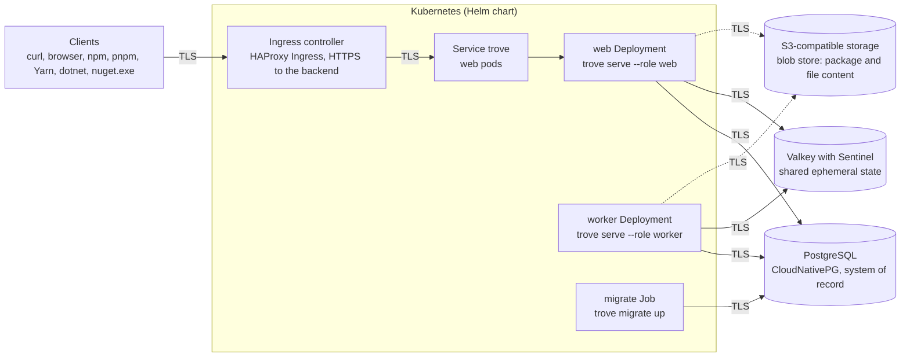

# trove

[](https://github.com/guided-traffic/trove/actions)
[](https://github.com/guided-traffic/trove)
[](https://goreportcard.com/report/github.com/guided-traffic/trove)
[](LICENSE)

> **Status: pre-release. Phases 1 to 3 are built (milestones M0 to M2); phase 4, NuGet (M3), is built and open for the findings of its reviews.** The platform: the binary, its configuration, the PostgreSQL
> and Valkey connections, replica coordination, the S3 blob layer, the TLS of every connection, the system API, the ops endpoints
> and the Helm chart. The access core: OIDC login, own tokens, permission policies, endpoints and exposure rules, generic
> repositories with raw transfer, audit, the admin UI and the in-app manual. The npm registry: local, remote (pull-through) and
> virtual repositories, the package screens, client setup, npm on customer endpoints, the security audit and the in-app guides. The npm load in the drain and failover tests runs nightly and is not reliable yet; phase 7 owns it.
> The NuGet registry: local, remote and virtual repositories, symbol package push, the package screens, client setup and guides,
> NuGet on customer endpoints, the forwarded search, and the format contract frozen at version 1; the findings of its reviews and
> security audits are fixed but for the open ones ([open findings](docs/projektplan/promt.md#8--open-findings)).
> GitLab CI OIDC federation (M4) is built; its end-to-end tests run in the `ci` set. Vulnerability scanning (M4b, beta phase 6) is
> built: trove's own advisory mirror (the OSV archives of npm and NuGet, which carry the GitHub Advisory Database and the OpenSSF
> malicious packages, and the CISA KEV catalog), findings with triage, download blocking (malicious versions by default, any other
> version when a triager blocks its finding), `npm audit`, `pnpm audit`, `yarn npm audit` and NuGet's `VulnerabilityInfo` answered
> from trove's data, and the report in the API and the UI; the client runs and the browser journeys run in the end-to-end sets `vuln` and
> `vuln-long` ([vulnerability scanning](docs/developer/vulnerabilities.md)). The mirror mode of remote repositories (beta phase 6b) is
> built: a remote can mirror the npm or NuGet packages its upstream offers in the background, bounded by its patterns and a byte
> bound, throttled by the upstream's rate limits and pre-empted by client fetches ([mirror](docs/developer/mirror.md)). Backup and
> restore with the revocation journal (the backup lane of M5) is built: `trove backup create`, `list`, `verify`, `delete`, `prune` and
> `restore` against an S3 target of its own, the chart's backup CronJob (off by default, `backup.enabled`), restore Job and post-restore
> hook Job, and the journal of revocations that a restore replays; the restore drill, the drain and the journal scenarios run in the
> end-to-end set `backup`, nightly and on dispatch ([backup](docs/developer/backup.md)). The OCI (Docker) registry (phase T-16) is
> built: local, remote and virtual repositories for container images at `/v2/<projectKey>/<repoKey>/`, the token service and registry
> tokens, the mirror mode of a registry and the Docker Engine mirror on a bound host; it passes the distribution conformance suite
> v1.1.1 and its end-to-end rows with real Docker and Podman clients run on several replicas ([OCI](docs/developer/oci.md)). The APT
> registry for Debian and Ubuntu (phase T-17) is built: local, remote and virtual repositories at `/api/deb/<projectKey>/<repoKey>/`,
> uploads with suites and components, indexes built and signed by a job with a key of each repository's own and its rotation, the
> pull-through and mirror of an APT archive whose release is checked against the archive's keys, and virtual repositories that merge
> verified member indexes and sign them again; its end-to-end rows run the real APT of Debian 13 and 12 and Ubuntu 24.04 and 22.04
> ([Debian](docs/developer/deb.md)). Not built yet: the HA hardening of phase 7.
> Everything else is the target design in [docs/spec/](docs/spec/README.md). `v0.1.0` is the last release made before the switch to
> the organisation's CI and release standard; it was published to `ghcr.io`. Releases from now on are cut by Semantic Release from
> the conventional commits on `main`, and published to Docker Hub and to the chart repository ([releasing](docs/developer/releasing.md)).

trove is a self-hosted, highly available binary repository manager. Its target: host your own packages, proxy and cache public
registries on demand (pull-through), and put both behind one URL per ecosystem. People sign in through your OpenID Connect
provider. Access is denied by default and granted through permission policies that reach down to package-name patterns. GitLab CI
jobs need no stored secret: a job trades its GitLab-issued ID token for a short-lived trove token. npm and NuGet come first.

trove is one Go binary with an embedded Angular UI, deployed with a Helm chart in two roles, `web` and `worker`. `web` replicas
answer HTTP requests behind a Kubernetes Service that spreads them at random, without session affinity. `worker` replicas run
background jobs. No replica keeps state between requests. PostgreSQL is the system of record; Valkey with Sentinel holds shared
ephemeral state. Every connection can run TLS, trove's own listeners included, and certificates are reloaded without a
restart.



## ✨ Key Features

Built (M0):

- 🧱 **One binary, roles by configuration.** `trove serve --role api|packages|worker|web|all`: `api` serves the UI, the management API and the CI exchange and holds the sessions and login secrets, `packages` the package protocols and raw files with tokens only, `worker` the jobs, `web` both halves in one process (the bridge of the upgrade across the cut, the chart still renders it as the only serving Deployment until phase 6a is complete), `all` for development;, `trove migrate`, `trove admin config validate`. See [R-ARCH-001](docs/spec/architecture.md).
- ⚙️ **One configuration file, environment overrides, strict validation.** `/etc/trove/trove.yaml`, every key overridable with `TROVE_<SECTION>_<KEY>`, secrets only as files, a redacted effective view. See [R-OPS-028](docs/spec/operations-and-observability.md).
- 🔒 **TLS on every connection trove makes or accepts.** Listeners, endpoints, PostgreSQL, Valkey and Sentinels, the object store and outbound HTTP; certificates picked by SNI and reloaded without a restart. Plain HTTP is an explicit chart setting. See [transport encryption](docs/security/transport-encryption.md) and [INV-20](docs/spec/README.md#design-invariants).
- 🌐 **Endpoints.** One client listener per endpoint, identified by the listener, not by the `Host` header; a foreign host answers `421`. See [endpoints](docs/developer/endpoints.md) and [ADR-128](docs/decisions.md#adr-128--endpoints-one-listener-each-identified-by-the-listener-with-exposure-rules-as-a-ceiling).
- 🗃️ **Migrations with a compatibility gate.** Embedded in the binary, applied under an advisory lock; a replica waits, not ready, until the schema is current. See [R-ARCH-026](docs/spec/architecture.md).
- 🔁 **Cross-replica coordination.** A PostgreSQL change log that every replica polls, Valkey Pub/Sub as an early eviction path, and singleton work under session advisory-lock leases with fencing. See [isolation and coordination](docs/security/isolation-and-coordination.md).
- 🧰 **Durable job queue.** A PostgreSQL job table with leases, heartbeats, attempts and a scheduler for maintenance tasks. See [R-ARCH-016](docs/spec/architecture.md).
- 🟥 **Valkey client with Sentinel discovery.** Finds the primary through Sentinel, follows failovers, a circuit breaker, a degraded but ready mode, and refusal of unsupported server versions. See [R-ARCH-031](docs/spec/architecture.md).
- 🔑 **Stored-secret key ring.** Keys from files, sealed values under AES-256-GCM with row and column bound as additional data, and redaction of secrets in log records, span attributes and error texts. See [data and secret flow](docs/security/data-and-secret-flow.md).
- 🛡️ **Egress address policy.** Outbound clients refuse denied addresses after DNS resolution, zoned IPv6 always, and the NAT64 forms of denied IPv4. See [egress](docs/security/egress.md).
- 🪣 **S3 blob layer.** Content-addressed keys, a spool, digests, a circuit breaker, and a conformance suite run against SeaweedFS. See [R-STOR-001](docs/spec/storage.md) for the layout.
- 🩺 **Health, metrics and the system API.** `/healthz`, `/readyz` and `/metrics` on the ops port; ping, version, info and the replica registry on the client port. See [R-OPS-001](docs/spec/operations-and-observability.md) and [R-API-038](docs/spec/api-and-ui.md).
- ⎈ **Helm chart.** Separate `api`, `packages` and `worker` Deployments with path and worker pools, the edge split by path prefix, a migration hook Job, Services, Ingress with backend TLS, NetworkPolicies, PodDisruptionBudgets and a fail-fast values check. See [HA and Helm](docs/spec/ha-and-helm.md).
- 🧪 **Local HA profile on kind.** PostgreSQL with a standby, Valkey with a replica and three Sentinels, SeaweedFS, and failure scripts. See [local profile](docs/developer/local-profile.md).

Built (M1, access core):

- 🔐 **OIDC login with PKCE.** Providers under `auth.oidc.providers`, the authorization-code flow with PKCE, a server-side session per browser login, CSRF protection and logout. See [login](docs/developer/login.md) and [login and sessions](docs/security/login-and-sessions.md).
- 🆘 **Break-glass administrator.** One local account whose password comes from a file: a plaintext password of at least 20 characters or an Argon2id hash; lockout and a rotation hold. See [login](docs/developer/login.md).
- 🎟️ **Own tokens.** Personal (`trv_pat_`) and service-account (`trv_sat_`) tokens with lifetimes, rotation, revocation, a per-address failed-credential throttle. See [identity](docs/developer/identity.md) and [tokens and credentials](docs/security/tokens-and-credentials.md).
- 🖼️ **User avatars.** A user uploads a PNG, JPEG or WebP of at most 1 MiB for their own record; the server decodes it, bounds its size before decoding and stores a new 256 x 256 PNG (no metadata, no animation, never SVG) as a blob, served by the `api` role with image headers; users without one get a generated avatar in the UI ([security](docs/security/user-avatars.md), R-API-055).
- 🛂 **Permission policies.** Deny by default; allow-only policies over repository and package-name patterns, five system roles and role bindings; a grant index per replica that is consistent through an epoch. See [authorization](docs/developer/authorization.md) and [permissions](docs/security/permissions.md).
- 🪪 **Role bindings from the Helm values.** `authz.role_bindings` makes an IdP group the administrator or the auditor from a GitOps repository: `trove migrate` applies the list, the API and the UI show it read-only. See [sign-in and identity](docs/manual/admin/sign-in-and-identity.md#administrators-from-the-helm-values).
- 🔎 **Auditor.** Reads the configuration, the audit log and the metadata of every repository (package lists, documents, search, package pages) and downloads, publishes and changes nothing. See [permissions](docs/security/permissions.md#the-auditor).
- 🗂️ **Projects, members and roles.** Every repository belongs to exactly one project and is addressed inside it (`/api/<format>/<projectKey>/<repoKey>/`), its key unique within the project; users and groups are members with the role Reader, Developer, Maintainer or Owner, which grants the project's repositories through the member's session and personal tokens; the Owner administers the project: members, repositories of every class, a move to another project it owns, policies, service accounts of external partners with their tokens and CI mappings, all named within the project (`sa:<projectKey>/<name>`) and never reaching beyond it. An administrator creates projects and names their first Owners. See [projects](docs/developer/projects.md), [delegated administration](docs/security/delegated-administration.md) and the [manual](docs/manual/admin/projects.md).
- 🚪 **Endpoints and exposure rules.** Further endpoints on their own listeners and hosts; exposure rules are a ceiling on what each endpoint serves. See [endpoints](docs/developer/endpoints.md) and [endpoints and exposure](docs/security/endpoints-and-exposure.md).
- 📦 **Generic repositories.** Local repositories with flat paths; raw transfer under `/files/{projectKey}/{repoKey}/{path}` with `PUT`, `GET` (with `Range`), `HEAD` and `DELETE`; folders and the items API. See [files](docs/developer/files.md) and [repository model](docs/security/repository-model.md).
- 🧾 **Audit.** An event registry, transactional and asynchronous recording, a PostgreSQL journal with partitions and retention, and the query and export API. See [audit](docs/developer/audit.md) and [audit trail](docs/security/audit.md).
- 🧭 **Management API.** Under `/api/v1/`, described by [api/openapi.yaml](api/openapi.yaml): problem+json errors, cursor paging, ETags with `If-Match`, idempotency keys, and a permission declared on every operation. See [API families](#management-api).
- 🖥️ **Admin UI.** The Angular application, embedded in the binary: sign-in, the file tree, repositories, users, groups, service accounts, tokens, policies, endpoints, audit and the system status, in a light and a dark scheme. See [web UI](docs/developer/web-ui.md) and [design language](docs/developer/design-language.md).
- 🔍 **One search for every user.** The top bar's field suggests the repositories, packages and projects you may read while you type, grouped by kind, offers your frequently visited places when it opens, and Enter lists every match; `/` and Ctrl+K reach it, and only an administrator's pick of a suggestion marked **Admin area** leads into the admin area. See [the search](docs/manual/user/search.md) and [web UI](docs/developer/web-ui.md#the-search).
- ❓ **Manual in the product.** The user and administrator manual is embedded in the binary and opens from **Documentation** in the top bar, on the page of the current screen. See [docs/manual](docs/manual/README.md).

Built (M2, npm registry):

- 📦 **npm local repositories.** Publish, package documents, dist-tags, unpublish, `whoami` and `ping`, for npm, pnpm, Yarn Classic and Yarn Berry. See [npm](docs/developer/npm.md).
- 🔁 **npm remote repositories.** A pull-through proxy of the public npm registry, with tarball URL rewriting, request collapsing through Valkey, metadata and negative caches, and stale metadata while the upstream is down. See [proxy](docs/developer/proxy.md).
- 🧩 **npm virtual repositories.** Merged package documents and dist-tags over several members, writes through one deployment target, namespace claims against dependency confusion. See [virtual](docs/developer/virtual.md).
- 🛡️ **npm security audit.** `npm audit`, `pnpm audit` and `yarn npm audit` on every class. While vulnerability scanning is on and the OSV source is not `off`, a repository that does not set `npm.audit.mode` answers from trove's own advisory data and sends nothing out (`mode: local`, M4b); `npm.audit.mode: forward` keeps the forward of remote and virtual repositories to the provider (the upstream by default), never cached ([Q-ARCH-341](docs/spec/architecture.md#q-arch-341--code-shaped-only-by-the-compatibility-rules-is-cleaned-up-the-cluster-minimum-version-stays). See [npm](docs/developer/npm.md) and [client audits](docs/security/vulnerability-scanning.md#client-audits).
- 🌐 **npm on customer endpoints.** Package documents and dist-tags list only the versions an endpoint exposes; a hidden version answers `404`. See [endpoints](docs/developer/endpoints.md).
- 🖼️ **Package screens and client setup.** The package list and detail with the README, an install panel, client setup snippets, and repository settings rendered from the format's schema. See [packages](docs/developer/packages.md) and [web UI](docs/developer/web-ui.md).
- 📖 **In-app guides.** A guide for every npm variant (local, remote and virtual) with npm, pnpm, Yarn Berry and Yarn Classic, in the UI's guides area. See [npm](docs/developer/npm.md) and [web UI](docs/developer/web-ui.md).

Built (M3, NuGet; the phase is open for its [remaining findings](docs/projektplan/promt.md#8--open-findings)):

- 🐳 **OCI (Docker) local repositories.** `docker push` and `podman push` of images, multi-platform indexes from Buildx and Podman, and any OCI artifact to `<host>/<projectKey>/<repoKey>/<name>:<tag>`: chunked and monolithic blob uploads that any replica continues (the session lives in PostgreSQL and the object store, never in Valkey), the cross-repository mount, manifests stored byte for byte and pulled by tag or digest, a moved tag that keeps its old manifest pullable by digest, the tags list, the referrers API, deletion with a cascade and an hourly sweep of unreferenced blobs, and a restore that withholds a deleted image until `trove admin oci reinstate`. It passes the distribution conformance suite v1.1.1. Repository and project keys follow the OCI component grammar for every format. See [OCI](docs/developer/oci.md) and [container images](docs/manual/user/container-images.md).
- 🎟️ **Registry tokens.** `docker login` and `podman login` take a trove token; the token service at `/v2/_token` answers with a short-lived `trv_rgt_` registry token that names the trove token and narrows it to the scopes asked, so revoking the trove token ends it, and every request is decided again on the current grants. See [OCI registry](docs/security/oci-registry.md).
- 🔁 **OCI remote repositories.** Docker Hub (with the `library/` mapping), GHCR or any registry as an upstream: the token handshake with the upstream's realm, a `HEAD` per stale tag instead of a pull from the quota, every manifest and layer verified against its digest, the quota answer of Docker Hub honoured, and the tags list and referrers passed through. See [OCI remote](docs/security/oci-remote.md).
- 🧩 **OCI virtual repositories.** One image address over local and remote members: a tag from the first member that has it, a digest from wherever the bytes are, unions of tags lists and referrers, claims against a public image of an internal name, and pushes to the deployment target with the layers a remote member cached linked in. See [OCI virtual](docs/security/oci-virtual.md).
- 🪞 **Registry mirror and Docker Engine mirror.** A remote OCI repository in mode `mirror` keeps the tags (`oci.mirror.tags`, `excludeTags`) and platforms (`oci.mirror.platforms`) it selects, so they stay pullable while the registry is gone; a host bound to a repository (`host_roots`) is the distribution API of that repository, for a Docker Engine's `registry-mirrors`. See [container repositories](docs/manual/admin/container-repositories.md).
- 🧱 **NuGet format registered.** The format `nuget` for local repositories, with the settings `deleteMode` and `forwardSearch`, the `nuget.archive`, `nuget.registration` and `nuget.search` configuration keys, the NuGet v3 route table, the service index at its three spellings, the native one-line error shape and the 404 that points a NuGet v2 client at the v3 service index. The other operations answer `501` until they are built. See [NuGet](docs/developer/nuget.md).
- 📦 **NuGet push, unlist, relist and delete.** `dotnet nuget push` and `nuget push` store a package byte for byte with its generated `.nuspec`; a version never changes, a removed version number is blocked for good by a tombstone, and the identical package pushed again is accepted without a change, so a client's retry after a lost answer succeeds. `dotnet nuget delete` unlists by default, or removes with `deleteMode: delete`. Every change is audited in its transaction and journaled for a restore. See [NuGet](docs/developer/nuget.md#the-write-side) and [NuGet publishing](docs/security/nuget-publish.md).
- 🔣 **NuGet symbol packages.** `dotnet nuget push` of a `.nupkg` with its `.snupkg` stores both: the symbol package is validated (the entry types, the `.pdb` signatures), stored byte for byte next to its package and indexed by a `nuget-symbol-index` job on the `worker`; serving the symbols to a debugger is not built yet. See [NuGet](docs/developer/nuget.md#symbol-packages).
- 📄 **NuGet documents and package files.** The version list of the flat container, the `.nupkg` and the `.nuspec` of a version, and the registration index, pages and leaves in the three hives (SemVer 1, SemVer 1 gzip, SemVer 2 gzip), with a weak `ETag` that gzip and identity share, `304` on `If-None-Match`, paging at 64 versions per page and inlined below 128 versions, and the filter of an endpoint with exposure rules, where the `ETag` of a local, remote or virtual document follows only what the endpoint shows. See [NuGet](docs/developer/nuget.md#rendered-documents-and-package-files).
- 🔁 **NuGet remote repositories.** A pull-through proxy of a NuGet v3 feed (nuget.org by default): the service index is read as the discovery document and the resources may live on several hosts, the registration is rendered again with trove's paging and addresses in the three hives (an upstream's gzip-coded hive is read within a bound), the version list and the packages are cached, every package is held to the ID and version of its request before it is stored (`502 upstream_package_mismatch` otherwise), and a cached package gets the rows of origin `cache`. Request collapsing, stale metadata and the gone-ID rule come from the engine. Search is forwarded to the upstream (`nuget.forwardSearch`, on by default) and answered with its download counts, owners and `verified` under the remote's addresses, filtered for patterns, claims and the caller's reads on every use and kept per replica for `nuget.search.remote_result_ttl`; a query that names a protected package is answered from the cache, as is every search when the upstream fails. See [NuGet](docs/developer/nuget.md#the-remote-class) and [NuGet remote repositories](docs/security/nuget-remote.md).
- 🪞 **Remote full mirror.** A remote repository in mode `mirror` discovers what its upstream offers (npm: the public registry's change feed and key ranges, or exact names; NuGet: the catalog, the search listing, or exact IDs; OCI: a registry's catalog or exact image names, with the tags, the tag bound and the platforms of `oci.mirror`, so that the selected images stay pullable when the registry is gone) and stores it in the background on the queue `mirror`, within its include and exclude patterns, the version bounds and `maxBytes`; a well-known public upstream is refused without a bound. Passes resume from a cursor after a drain or a failure, honour `429`, `503` with `SlowDown` and quota headers with back-off and a halving window, never move the clients' circuit, and give way to client fetches on every replica. Status, pause, resume and a pass on request in the API and in the Mirror section of the repository's settings. See [mirror](docs/developer/mirror.md) and [mirror security](docs/security/mirror.md).
- 📦 **Import from the registry you leave.** `trove admin import npm`, `trove admin import nuget` and `trove admin import ansible` copy the packages of an existing registry into a local repository through the target's own publish protocol: permissions, digests, immutability, the audit event, the vulnerability evaluation and the quota apply to every version, the strongest digest the source announces is verified before a byte is sent, a version with other content is a reported conflict and never overwritten, and a cut run resumes. For Ansible Galaxy the collections are copied and the roles are named in the report. See [R-IMP-001](docs/spec/import.md) and the [manual](docs/manual/admin/import.md).
- 🧭 **A new repository in one form.** A page of format tiles opens one form named after the format ("New OCI (Docker) repository"): the class, a suggested key, the description, the visibility and, for a remote, the upstream with the well-known registries and Test connection, or, for a virtual repository, its members; every other setting waits in a closed Advanced settings section, and the settings page is one column of sections with a save each. See [repositories](docs/manual/admin/repositories.md).
- 🔀 **NuGet virtual repositories.** One source for local packages and, nuget.org through a remote: the service index, the version list and the registration documents are the union of the members that remain after permissions, pin rules and claims; a version two members hold comes from the first one, and its package is the one the registration describes (`Trove-Resolved-From`). A push, unlist, relist or delete addressed to the virtual repository runs on its deployment target. Search merges the members (exact ID first, then member by member, window `nuget.search.virtual_merge_window`), four at a time, with the include and exclude patterns of the virtual repository and of each member; a remote member contributes its forwarded search, withheld for the names the virtual repository's claims and pin rules protect. A remote member's registration is merged whole, gzip-coded and paged as nuget.org serves it, and shows the same entries as the remote (Q-NUGET-82). See [NuGet](docs/developer/nuget.md#virtual-repositories).
- 🌐 **NuGet on customer endpoints.** Version lists, registrations and search list only the versions an endpoint exposes, and a search term meets only those, so `totalHits` tells nothing of a hidden version; through a virtual repository the virtual repository's rules decide, also for a token scoped to it. `dotnet add package` of a hidden version fails with `NU1102`, and the endpoint offers no push (`403`). See [endpoints](docs/developer/endpoints.md) and [NuGet virtual repositories](docs/security/nuget-virtual.md).
- 🖥️ **NuGet package screens, setup and guides.** The package pages of NuGet repositories, setup snippets for `dotnet`, nuget.exe and `nuget.config` with the token in each shell's spelling, and a guide for local, remote and virtual repositories with the .NET CLI, nuget.exe and Visual Studio. See [NuGet](docs/developer/nuget.md) and [web UI](docs/developer/web-ui.md).
- 🪪 **GitLab CI OIDC federation (M4).** A GitLab job exchanges its ID token for a `trv_cit_` token that lives minutes: issuers with discovery and rotating signing keys, ordered mappings with claim conditions, templated grants and ownership binding, replay protection, issuance records, revocation (also by the job itself as its last step), the dry run and the claim tester, and the admin screens. The reference pipeline runs with the real npm and .NET clients against an issuer double on kind. See [GitLab CI pipelines](docs/manual/user/gitlab-ci-pipelines.md), [GitLab CI federation](docs/manual/admin/gitlab-ci.md) and [ci-oidc.md](docs/developer/ci-oidc.md).
- 🔒 **Format contract frozen.** The contract between the core and a format is at version 1, its surface is recorded and checked, and npm and NuGet pass all eleven conformance checks; every later change is an ADR ([ADR-141](docs/decisions.md#adr-141--the-format-contract-is-frozen-at-version-1)). See [formats](docs/developer/formats.md).

Built (T-17, the APT registry for Debian and Ubuntu; [spec](docs/spec/formats/debian.md), [contracts](docs/developer/deb.md), [security](docs/security/deb-signing.md)):

- 📦 **Debian local repositories.** `curl --upload-file` of a `.deb` to `/api/deb/<projectKey>/<repoKey>/upload/<file>.deb?distribution=<suite>&component=<component>` stores it at its pool path with its suites and components (`201`, or `200` when the identical bytes only gain coordinates); a package, version and architecture is stored once (`409 deb_version_exists`); `PUT …/deb/coordinates` moves a file between suites (adding needs deploy, removing delete); the control data is read under strict bounds and a package trove cannot index is refused. See [Debian](docs/developer/deb.md#the-local-class).
- 🗂️ **Signed indexes built by a job.** The job `deb-index` builds `Packages.gz` (and `Packages.xz`), `Release`, `InRelease` and `Release.gpg` of each suite from one snapshot of the rows and publishes the whole suite in one transaction, with every index file also by hash, so `apt-get update` sees one generation on any replica; `GET …/deb/index?waitFor=<suite>:<changeSeq>` waits for an upload, `POST …/reindex` rebuilds. See [index builds](docs/security/deb-index.md).
- 🔑 **A signing key per repository, and its rotation.** Every local and virtual repository gets an EdDSALegacy key in the transaction that creates it, sealed with the stored-secret key ring and opened only to sign; a next key co-signs until it is promoted, so clients replace their key file without an outage; imported keys, and a restore that withholds a retired key instead of reviving it. See [signing keys](docs/security/deb-signing.md).
- 🔁 **Debian and Ubuntu archives through a remote.** A pull-through cache of an APT archive (`https://deb.debian.org/debian/` by default) that passes the archive's signed release files through byte for byte, serves only the index files that release lists, checks package files against the parsed indexes and, with `deb.upstreamKeys`, stores only releases a key of the archive verifies and never an older one. See [Debian remote](docs/security/deb-remote.md).
- 🪞 **Mirror of an APT archive.** A remote in mode `mirror` keeps the suites, components and architectures of `deb.mirror` so that `apt-get install` keeps working with the archive unreachable. See [Debian mirror](docs/security/deb-mirror.md) and [Debian (APT) repositories](docs/manual/admin/apt-repositories.md).
- 🧩 **Debian (APT) virtual repositories.** One APT source over local and remote repositories: a job merges the members' indexes, in member order, with the first member keeping a version two members share, the claims of a local member keeping an internal name away from a remote one, and signs the result with the virtual repository's own key. Every package file is fetched from the member whose paragraph the client read (`members/<member>/pool/…`, `Trove-Resolved-From`); a remote member's release is merged only while a current upstream key verifies it, it has not expired and is not older than the last one merged, and a build that cannot merge a member keeps the last index and says why (`GET …/deb/index`). Reading the index needs `read` on every member; an upload goes to the deployment target. `apt-get update` and `apt-get install` are proven from `debian:13` and `ubuntu:22.04`. See [Debian](docs/developer/deb.md#the-virtual-class) and [Debian virtual repositories](docs/security/deb-virtual.md).
- 🖥️ **Debian screens, setup and guides.** The package pages, the tabs **Signing keys** and **Index** of a local or virtual repository, setup snippets for APT that install the key under `Signed-By` and the token in `/etc/apt/auth.conf.d/`, and a guide per class. See [Debian packages with APT](docs/manual/user/apt-packages.md).

Built (M4b, vulnerability scanning, beta phase 6; [spec](docs/spec/vulnerability-scanning.md), [contracts](docs/developer/vulnerabilities.md), [security](docs/security/vulnerability-scanning.md)):

- 🗄️ **Own advisory mirror and offline import.** The `worker` role copies the OSV archives of npm and NuGet (GitHub Advisory Database, OpenSSF malicious packages) and the CISA KEV catalog into PostgreSQL, incrementally every 15 minutes and in full weekly, behind guards for digest, size, shrink and invalid records; an installation without internet access imports the same files from a generic local repository (`mode: repository`). See [advisory sources](docs/manual/admin/vulnerability-sources.md).
- 🔍 **Matching and findings with triage.** A stored version is matched by name and version, never by its bytes, in its commit and again when the data changes; public advisories never apply to a claimed internal name. A finding is `needs_triage`, `confirmed`, `blocked`, `dismissed` or `resolved`, changed one by one or in bulk by holders of `vulnerabilities:triage`, with history and audit. See [vulnerabilities](docs/manual/user/vulnerabilities.md).
- ⛔ **Download blocking.** An open malicious finding blocks its version (`blockMalicious`, on by default); any other finding blocks only when a triager blocks it, and `onMissingData: block` refuses what cannot be evaluated yet (`vulnerability_data_missing`); `403 vulnerability_blocked` on the format routes, `/files/`, the cache view and every virtual tier, and a blocked remote miss is never fetched. `vulnerabilities.enforcement: report` only counts. See [download block](docs/security/vulnerability-scanning.md#download-block).
- 🧾 **NuGet audit warnings from trove's data.** `nuget.vulnerabilityInfo` (local by default while scanning is on) lists `VulnerabilityInfo/6.7.0` in the service index and serves `vulnerabilities/index.json` and `trove.json`, so `dotnet restore` reports NU1901 to NU1904; internal names are left out. See [client audits](docs/security/vulnerability-scanning.md#client-audits).
- 📊 **Vulnerability report and package-page tab.** The Vulnerabilities screen (counts, trend, filters, CSV export, finding, advisory and advisory-source pages), the API under `/api/v1/vulnerabilities/`, and a Vulnerabilities tab on the package page, each narrowed to the findings the caller can read. See [vulnerabilities](docs/manual/user/vulnerabilities.md).
- 🚨 **Alerts.** Twelve `trove_vuln_*` metric families and the chart's PrometheusRule (`metrics.prometheusRule.enabled`) with `TroveVulnerabilityDataStale`, `TroveVulnerabilitySyncFailing` and `TroveVulnerabilityClaimedNameMalicious`, the last for a malicious advisory that names a claimed internal name. See [operations](docs/security/vulnerability-scanning.md#operations-what-an-operator-sees-and-what-a-restore-leaves).

Built (M5, the backup lane; [spec](docs/spec/backup-and-restore.md), [contracts](docs/developer/backup.md), [security](docs/security/backup-and-restore.md)):

- 💾 **Consistent backups into a target of their own.** `trove backup create` exports every table from one PostgreSQL snapshot as zstd-compressed `COPY` files and copies the blobs that snapshot references into a content-addressed pool that every backup of the target shares, so the next backup copies only new content; a garbage-collection hold keeps a blob from being collected before the run has copied it, and a target marker refuses a target that another installation writes (exit `4`). See [R-BAK-002](docs/spec/backup-and-restore.md#r-bak-002--target-layout-backup-id-and-target-marker).
- 🗂️ **List, verify and retention.** `trove backup list` reads the target, `verify` checks the files and pool objects of a backup (`--deep` downloads and hashes each one), and `prune` and every `create` keep the newest `retention.keep_last` backups (and those younger than `keep_within`) and sweep the pool objects no remaining backup lists.
- ⏪ **Restore into an empty installation.** `trove backup restore <id>` checks eight preconditions before it writes (the key ring must open the backup's canary rows, the database and the blob prefix must be empty), copies the blobs, loads the tables in one transaction, rebuilds derived state, gives the installation a new incarnation and Valkey keyspace, and resumes where it stopped after an eviction. The chart's restore Job runs it with every role at zero.
- 📜 **Revocation journal.** Every change that removes access (a revoked token, a disabled user, a removed binding or policy entry, a withdrawn package version) is written to an outbox in its own transaction, shipped by a job to `<storage.s3.prefix>/_journal/revocations/`, and replayed after a restore, so a restore does not bring back what was revoked after its snapshot; a replay never grants access and never deletes content. See [the revocation journal](docs/security/backup-and-restore.md#the-revocation-journal).
- 🩹 **Platform restores.** After a point-in-time restore of PostgreSQL by the platform, `trove admin post-restore --restored-to <t>` (the chart's `postRestore` hook Job) puts running jobs back in the queue, gives the installation a new keyspace and replays the journal from `t`; `trove admin backup check` and the daily task `backup-check` verify the platform protection that `backup.recovery_window` and `backup.object_versioning` declare.
- 📈 **Run visibility.** The Backups screen under System status, `GET /api/v1/system/backups` with the summary and its overdue mark, the `trove_backup_*` and `trove_revocation_journal_*` metric families and the backup alerts of the chart's PrometheusRule. See [Backups](docs/manual/admin/operations.md#backups).

Not built yet (see the [roadmap](docs/coverage/roadmap.md)): the symbol server of NuGet; the P1 parts of vulnerability scanning
(exploit-probability enrichment, time-limited dismissals, vulnerabilities in NuGet registrations: R-VULN-030 to R-VULN-032) and the
pass-through of an upstream's NuGet vulnerability information (`vulnerabilityInfo: upstream`, R-NUGET-023); the P1 parts of the
backup (client-side encryption of the database files, R-BAK-027, and a restore onto an existing blob store, R-BAK-025); the HA
hardening of phase 7; remote and virtual repositories for the generic format; the UI screens of search, trash, builds and webhooks;
for OCI the exposure adapter (an endpoint with exposure rules serves no container images), redirects of blob downloads to the
object store, retention of untagged manifests, mirroring of referrers and the end-to-end rows with real clients; for Debian the nightly set `deb-long`,
uploads of source packages, snapshots of a suite, and a trigger of a virtual repository's build on a change of claims (H-725).

## 📛 Naming conventions

Built names are the ones the code produces. *Planned* marks a name the spec fixes that no code uses yet.

### Binary, commands and listeners

| Name | Value | Source |
|---|---|---|
| Binary | `trove`, static (`CGO_ENABLED=0`); `make build` writes `bin/trove` | `Makefile`, `cmd/trove` |
| Roles | `web`, `worker`, `all` (`all` is for local runs outside the chart) | `cmd/trove/serve.go`, `internal/config/process.go` |
| Default client listener | `:8080` (`server.listen`) | `internal/config/server.go` |
| Ops listener | `:8081` (`server.ops_listen`) | `internal/config/server.go` |
| Further endpoint listener | any free port, one per endpoint, name `^[a-z][a-z0-9-]{0,19}$` (`server.endpoints.<name>.listen`) | `internal/config/endpoints.go` |
| Endpoint name in metrics, logs and spans | `default` for the default endpoint, the configured name otherwise; a name outside the configured set folds into `_other` | `internal/observability` |
| Backup commands | `trove backup create`, `list`, `verify`, `delete`, `prune`, `restore`; commands of the binary, not roles: they serve nothing and open no port but the ops port of a `create` run, which exports its counters for as long as it lasts | `cmd/trove/backup*.go` |
| Recovery commands of the backup lane | `trove admin post-restore`, `trove admin backup check`, `trove admin storage verify`, `trove admin storage restore-versions`, `trove admin maintenance pause-deletions` and `resume-deletions`, `trove admin npm reinstate`, `trove admin oci reinstate`, `trove admin deb reinstate` | `cmd/trove/admin_postrestore.go`, `admin_backupcheck.go`, `admin_storage.go`, `admin_npm.go`, `admin_oci.go`, `admin_deb.go` |
| Backup ID | `<yyyymmdd>T<hhmmss>Z-<4 lower-case hex>`, the UTC start of the run and 16 random bits, for example `20261028T020000Z-7f3a`; lexical order is chronological | `internal/backup/format/id.go` |
| Backup actor | `system:backup`, the actor of the `system.backup.*` audit events | `internal/audit/events_backup.go` |

### URL paths

| Path | Method | Built |
|---|---|---|
| `/api/v1/system/ping`, `/api/v1/system/version`, `/api/v1/system/info`, `/api/v1/system/replicas` | GET | yes |
| `/api/v1/openapi.json`, `/api/v1/openapi.yaml` | GET | yes, from [api/openapi.yaml](api/openapi.yaml) |
| `/api/v1/problems/{code}` | GET | yes; the `type` of every problem is this path |
| `/healthz`, `/readyz`, `/metrics` | GET, ops listener | yes (`/metrics` unless `metrics.enabled: false`) |
| `/files/{projectKey}/{repoKey}/{path}` | GET, HEAD, PUT, DELETE | yes (M1; [files](docs/developer/files.md)); a path without the project key, or with a `%` in the project or repository segment, is no repository address |
| `/auth/oidc/{providerId}/start`, `/auth/oidc/{providerId}/callback` | GET | yes (M1; [login](docs/developer/login.md)) |
| `/auth/local/login`, `/auth/logout` | POST | yes (M1; the break-glass login and logout) |
| `/api/v1/…` (the management API) | see the [API families](#management-api) | yes (M1; [api/openapi.yaml](api/openapi.yaml)) |
| `/api/<format>/<projectKey>/<repoKey>/…` | per route (npm: GET, PUT, DELETE, POST; NuGet: GET, HEAD, PUT, DELETE, POST) | yes, npm (M2) and NuGet (M3; [dispatcher](internal/api/dispatch/dispatcher.go)); the OCI format is not served here (`/api/oci/…` answers nothing), it is served below `/v2/` |
| `/v2`, `/v2/` | GET, HEAD | yes (T-16): the version check of the distribution API, `200 {}`; an anonymous caller without a registry token gets `401` with `WWW-Authenticate: Bearer realm="<base URL>/v2/_token",service="<host>"` ([ping.go](internal/api/registry/ping.go)) |
| `/v2/_token?service=&scope=` | GET, POST (the OAuth 2.0 form) | yes: the token service; takes one trove token as Basic, as `Bearer`, or as the password of the form, answers `{"token", "access_token", "expires_in", "issued_at"}` with a `trv_rgt_` registry token for the scopes the caller may hold; the route is not authenticated by the chain ([token.go](internal/api/registry/token.go)) |
| `/v2/_catalog?n=&last=` | GET | yes: the image names the caller may read, in byte order over the repositories, pages with `Link`; a virtual repository lists no names ([catalog.go](internal/api/registry/catalog.go)) |
| `/v2/<projectKey>/<repoKey>/<name>/manifests/<tag>` or `…/manifests/sha256:<hex>` | GET, HEAD, PUT, DELETE | yes: pull and push of a manifest or index, `DELETE` of a tag or a manifest; a push needs deploy, a moved tag overwrite as well ([routes.go](internal/formats/oci/routes.go)) |
| `/v2/<projectKey>/<repoKey>/<name>/blobs/sha256:<hex>` | GET, HEAD, DELETE | yes: a layer or configuration of the image name; `Range` works |
| `/v2/<projectKey>/<repoKey>/<name>/blobs/uploads/` (`?digest=` monolithic, `?mount=<digest>&from=<projectKey>/<repoKey>/<name>` mount), `…/blobs/uploads/<uuid>` | POST; PATCH, PUT (`?digest=`), GET, DELETE | yes: blob uploads in chunks across replicas and the cross-repository mount (local and virtual repositories) |
| `/v2/<projectKey>/<repoKey>/<name>/tags/list?n=&last=`, `…/<name>/referrers/sha256:<hex>?artifactType=` | GET | yes: the tags list in byte order and the referrers index |
| `/v2/<projectKey>/<repoKey>~cache/<name>/…` | GET, HEAD | yes: the cache view of a remote OCI repository, what it has stored, without asking the upstream |
| `/v2/<name>/…` on a host bound with `host_roots` | as above | yes (R-OCI-029): the distribution API of the bound OCI repository with the image name as sent, the token service and the version check of that host; a binding to a repository that does not exist or is of another format is no binding |
| `/api/nuget/<projectKey>/<repoKey>/v3`, `…/v3/`, `…/v3/index.json` | GET, HEAD | yes, the service index of a local or virtual repository (M3 skeleton; the same body at the three spellings) |
| `/api/nuget/<projectKey>/<repoKey>/v3/flatcontainer/{id}/index.json`, `…/{version}/{id}.{version}.nupkg`, `…/{version}/{id}.nuspec` | GET, HEAD | yes, the version list, the package and the `.nuspec` of a local repository (M3; [documents](docs/developer/nuget.md#rendered-documents-and-package-files)) |
| `/api/nuget/<projectKey>/<repoKey>/v3/{registration,registration-gz,registration-semver2}/{id}/index.json`, `…/page/{lower}/{upper}.json`, `…/{version}.json` | GET, HEAD | yes, the registration index, page and leaf in three hives; the gzip hives compress for a client that accepts it |
| `/api/nuget/<projectKey>/<repoKey>/v3/search?q=&skip=&take=&prerelease=&semVerLevel=&packageType=` | GET, HEAD | yes, the search of a local repository (R-NUGET-010) and the merged search of a virtual one (R-NUGET-018): terms, phrases and the fields `id`, `packageid`, `version`, `title`, `tags`, `author`, `description`, `summary`; `totalHits` counts the packages the caller may read ([NuGet](docs/developer/nuget.md#search)) |
| `/api/nuget/<projectKey>/<repoKey>/v3/{autocomplete,symbols}/…` | GET | routed, answers `501 nuget_not_implemented` until its work package lands ([NuGet](docs/developer/nuget.md#the-routes)) |
| `/api/nuget/<projectKey>/<repoKey>/v3/package` | PUT | yes, the push of a package to a local repository (a multipart form whose first part is the package, or the bare package); `201`, `400`, `403`, `409` ([NuGet](docs/developer/nuget.md#the-write-side)) |
| `/api/nuget/<projectKey>/<repoKey>/v3/symbolpackage` | PUT | yes, the push of a `.snupkg` to a local repository after its package (R-NUGET-020); `201` (also for the identical package again), `400`, `403`, `404` (no such package), `409` `nuget_symbol_package_exists`; one `nuget-symbol-index` job per symbol package ([NuGet](docs/developer/nuget.md#symbol-packages)) |
| `/api/nuget/<projectKey>/<repoKey>/v3/package/{id}/{version}` | DELETE, POST | yes, DELETE unlists (or removes, with `deleteMode: delete`) and answers `204`, POST lists again and answers `200` |
| `/api/nuget/<projectKey>/<repoKey>/v3/…` of a remote repository (and `<projectKey>/<repoKey>~cache`, the cache view) | GET, HEAD | yes, the service index, version list, registrations and package files of a cached NuGet feed; a push, unlist or delete answers `405` ([NuGet](docs/developer/nuget.md#the-remote-class)) |
| `/api/nuget/<projectKey>/<repoKey>/v3/vulnerabilities/index.json`, `…/v3/vulnerabilities/trove.json` | GET, HEAD | yes (M4b), every class: the index of the `VulnerabilityInfo/6.7.0` resource and its one page, trove's NuGet advisory data keyed by the lower-case ID, `Cache-Control: private, max-age=1800`; listed in the service index while `nuget.vulnerabilityInfo` is `local` and the NuGet data is complete; a request answers `404` when the mode is not `local`, on the cache view and on an endpoint with exposure rules, and `503 vulnerability_data_unavailable` before the data is complete ([vuln_documents.go](internal/formats/nuget/vuln_documents.go)) |
| any other path below `/api/nuget/<projectKey>/<repoKey>/` (every NuGet v2 shape) | any | `404 nuget_v2_unsupported`, the message names `…/v3/index.json` of the repository |
| `/api/deb/<projectKey>/<repoKey>/dists/<suite>/…`, `…/by-hash/SHA256/<hex>`, `pool/…`, `signing-key.asc`, `members/…` (a virtual repository's member paths) | GET, HEAD | yes (T-17): a local or virtual repository serves its published generation (`InRelease`, `Release`, `Release.gpg`, `Packages.gz`, `Packages.xz` with `deb.compression: ["xz"]`, the by-hash copies) and its package files; a remote serves its archive's files (also `SHA512` by-hash paths, pdiffs and every other file of any suite) and the flat-repository paths of a source line `<dir>/` or `./`; `Packages.bz2` and every variant a local repository does not build answer `404`, a path a remote's stored release does not list `404 deb_not_in_release`; a virtual repository serves a package file at `members/<memberKey>/<Filename>` from that member (`Trove-Resolved-From`), and its generated files need `read` on every member (`403 deb_members_unreadable`) ([Debian](docs/developer/deb.md#the-routes)) |
| `/api/deb/<projectKey>/<repoKey>/upload/<file>.deb?distribution=&component=`, `…/pool/…` | PUT; DELETE | yes: the upload of a package file to a local repository (`201`, `200` for the identical bytes) and its deletion; a remote answers `405`; through a virtual repository both go to its deployment target, and without one the decision point answers `403` |
| `/api/v1/projects/{projectKey}/repositories/{repoKey}/deb/{signing-keys, signing-keys/promote, signing-keys/{fingerprint}, signing-keys/{fingerprint}/reinstate, coordinates, index}`, `…/reindex` | GET, POST, PUT, DELETE | yes (T-17): the signing keys, the coordinates of a file, the index state with `waitFor` and the rebuild ([the operations](#management-api)) |
| `/api/npm/<projectKey>/<repoKey>/-/npm/v1/security/advisories/bulk` | POST | yes: the bulk audit, answered from trove's data (mode `local`, M4b) or forwarded (`npm.audit.mode: forward`, M2); `…/-/npm/v1/security/audits` and `…/audits/quick` answer `501 npm_audit_unavailable` in every mode ([routes.go](internal/formats/npm/routes.go)) |
| `/api/v1/vulnerabilities/findings`, `…/findings/export`, `…/findings/{id}`, `…/findings/set-status`, `…/advisories/{ecosystem}/{id}`, `…/summary`, `…/trend`, `…/sources`, `…/claimed-name-matches` | GET; PATCH on `…/findings/{id}`, POST on `…/set-status` | yes (M4b; [the operations](#management-api)) |
| `/api/v1/packages/{packageId}/vulnerabilities`, `/api/v1/packages/{packageId}/versions/{version}/vulnerabilities`, `/api/v1/projects/{projectKey}/repositories/{repoKey}/vulnerabilities/rescan` | GET; POST for the rescan | yes (M4b) |
| `/api/v1/projects/{projectKey}/repositories/{repoKey}/mirror`, `/api/v1/projects/{projectKey}/repositories/{repoKey}/mirror/run` | GET; POST | yes (phase 6b): the status of a remote repository's mirror and a request for a pass now ([mirror_api.go](internal/api/v1/mirror_api.go)); both answer `400 not_applicable` for a local or virtual repository |
| `/api/v1/system/backups`, `/api/v1/system/backups/summary`, `/api/v1/system/backups/{runId}` | GET | yes (M5; [backups_api.go](internal/api/v1/backups_api.go)): the runs of the backup job from `backup_run`, the status of the job, one run; no path starts, deletes, verifies or restores a backup |
| `/api/v1/avatars/{digest}` | GET | yes (R-API-055): the avatar image of a user, `{digest}` the 64 lower-case hex characters of the SHA-256 of the stored PNG; the `avatarUrl` of a user record is this path |
| `/ui/{locale}/…` | GET, HEAD | yes, locales `en` and `de` ([webui](internal/webui/webui.go)) |
| `/ui/{locale}/vulnerabilities`, `…/vulnerabilities/findings/{id}`, `…/vulnerabilities/advisories/{ecosystem}/{id}`, `…/vulnerabilities/sources` | GET, HEAD | yes (M4b): the report, a finding, an advisory and the advisory sources ([vulnerabilities.routes.ts](web/src/app/features/vulnerabilities/vulnerabilities.routes.ts)) |
| `/ui/{locale}/admin/system/backups` | GET, HEAD | yes (M5): the Backups screen, `settings:read` ([system.routes.ts](web/src/app/features/system/system.routes.ts)) |

### NuGet remote cache paths

The canonical paths under which a NuGet remote repository stores what it fetched (also the paths of its cache view and of the management item API). `{id}` is the ID with its ASCII letters lowercased, `{version}` the URL form of the version.

| Path | Holds |
|---|---|
| `.nuget/index.json` | the upstream's service index (the discovery document) |
| `{id}/index.json` | the upstream's version list |
| `{id}/.registration/index.json` | the upstream's registration index |
| `{id}/.registration/page/{lower}/{upper}.json` | a registration page the index does not inline, by its bounds |
| `{id}/{version}/{id}.{version}.nupkg`, `{id}/{version}/{id}.nuspec` | the package and its `.nuspec` |

### OCI image references and registry names

What a container client, a token and the storage see of an OCI repository ([names.go](internal/formats/oci/names.go),
[paths.go](internal/formats/oci/paths.go), [setup.go](internal/formats/oci/setup.go)).

| Name | Value | Built |
|---|---|---|
| Image reference | `<host>/<projectKey>/<repoKey>/<name>[:<tag>\|@sha256:<hex>]`, for example `trove.example.com/web/docker-local/team/app:1.0`; the login target of the setup snippets is `<host>/<projectKey>/<repoKey>` | yes |
| Image reference on a bound host | `<bound host>/<name>[:<tag>]`, the host an endpoint's `host_roots` binds to `<projectKey>/<repoKey>` | yes |
| Cache view of a remote | `<host>/<projectKey>/<repoKey>~cache/<name>`: what the remote has stored, without asking the upstream | yes |
| Image name | components `^[a-z0-9]+(?:(?:[._]\|__\|-+)[a-z0-9]+)*$` joined by `/`; `<projectKey>/<repoKey>/<name>` at most 255 bytes; the package of the package screens | yes |
| Tag | `^[a-zA-Z0-9_][a-zA-Z0-9._-]{0,127}$`; the version of the package screens | yes |
| Digest | `sha256:` and 64 lower-case hexadecimal digits; nothing else is a digest (`400 DIGEST_INVALID`), and a push with a `digest-algorithm` other than `sha256` answers `400 UNSUPPORTED` | yes |
| Storage layout of a local repository | `<name>/_manifests/sha256:<hex>` (a manifest), `<name>/_tags/<tag>` (the bytes of the manifest the tag points at), `<name>/_blobs/sha256:<hex>` (a layer or configuration), seen through `/files/` and the item API | yes |
| Registry token | `trv_rgt_` + base64url(`1:<key id>:<claims JSON>`) + `.` + MAC, at most 4 KiB, lifetime `oci.token_lifetime` (default `300s`), never beyond the trove token it names; MAC keys derived from the stored-secret key ring with info `trove registry token v1` ([token.go](internal/auth/registrytoken/token.go)) | yes |
| Token realm and service | realm `<response base URL>/v2/_token`, service the host of that base URL with its port | yes |
| Scope of a token request | `repository:<projectKey>/<repoKey>/<name>:<actions>` with the actions `pull`, `push`, `delete` or `*`, and `registry:catalog:*`; on a bound host `repository:<name>:…`; at most 16 entries | yes |
| Login user name | any; recorded and ignored, the snippets use `trove` | yes |
| Upload session | `Location: /v2/<projectKey>/<repoKey>/<name>/blobs/uploads/<uuid>`, `Docker-Upload-UUID: <uuid>`; staged at `<storage.s3.prefix>/_uploads/<session id>/data` | yes |
| Client IDs and setup snippets | `docker` (Docker CLI with Buildx), `podman`; snippets `docker.shell.configure`, `docker.kubernetes.configure` (the image pull secret `trove-registry`), `podman.shell.configure`, `docker.install`, `podman.install`, `docker.publish`, `docker.buildx.publish`, `podman.publish` | yes |
| Repository document member | `oci.mirror` (remote repositories only; below) | yes |
| Configuration keys | `oci.token_lifetime`, `oci.unreferenced_blob_grace` ([configuration](#configuration-keys)) | yes |

### OCI remote cache and mirror paths

The canonical paths under which an OCI remote repository stores what it fetched, in a pass of a mirror as for a client (the cache view and the item API show them). `{name}` is the image name as the upstream knows it (a one-component name on Docker Hub is `library/{name}`), `{digest}` is `sha256:` and 64 lower-case hexadecimal digits.

| Path | Holds |
|---|---|
| `{name}/_tags/{tag}` | the manifest or index a tag pointed at when last fetched (a cache entry; a mirror reads it with a `HEAD` and fetches it again only when the tag moved) |
| `{name}/_manifests/{digest}` | a manifest by digest: the one a tag names, a child of an index, an attestation manifest |
| `{name}/_blobs/{digest}` | a configuration or layer |
| `{name}/_taglist` | the upstream's tags list, for a client's `tags/list` |

The settings of a mirror of a registry are the member `oci.mirror` of the repository document, next to `remote.mirror` (an Owner of a project cannot change either):

| Setting | Default | Meaning |
|---|---|---|
| `oci.mirror.tags` | `["latest"]` | tag patterns (`*`, `?`); a tag without a wildcard is always kept |
| `oci.mirror.excludeTags` | `[]` | tag patterns never mirrored |
| `oci.mirror.platforms` | `[]` | `os/arch` or `os/arch/variant` of the index entries to keep; empty is all, `linux/arm64` includes `linux/arm64/v8` |

### Debian (APT) names and paths

What an APT client, a token and the storage see of a Debian repository ([names.go](internal/formats/deb/names.go),
[paths.go](internal/formats/deb/paths.go), [setup_local.go](internal/formats/deb/setup_local.go), [setup_remote.go](internal/formats/deb/setup_remote.go)).

| Name | Value | Built |
|---|---|---|
| Repository address | `<base URL>/api/deb/<projectKey>/<repoKey>/`, the URI of a source line; APT appends `dists/<suite>/…` and the `Filename` of an index entry | yes |
| Package | `^[a-z0-9][a-z0-9+.-]{1,127}$`, the `Package` field; upper case is refused, never folded; the package of permissions, patterns, claims and ownership | yes |
| Version | `[<epoch>:]<upstream>[-<revision>]` (epoch `[0-9]{1,9}`, upstream starting with a digit, at most 128 characters), ordered by dpkg's rules; no pre-release marker | yes |
| Architecture | `^[a-z0-9][a-z0-9-]{0,31}$`; `all` for architecture-independent packages; `any` and wildcards are refused | yes |
| Suite and component of a local repository | `^[a-z0-9][a-z0-9._+-]{0,63}$`, no `/`; a remote serves any suite name its archive has, `<dir>/` of a flat repository and `./` | yes |
| Pool path of a stored file | `pool/<prefix>/<source>/<package>_<version without epoch>_<architecture>.deb`; `<source>` is the `Source` field or the package, `<prefix>` its first character, or its first four for a source starting with `lib` (`pool/h/hello/hello_2.10-3_amd64.deb`, `pool/libx/libxml2/…`) | yes |
| Generated files of a local repository | `dists/<suite>/InRelease`, `Release`, `Release.gpg`, `dists/<suite>/<component>/binary-<arch>/Packages.gz` (`.xz` with `deb.compression: ["xz"]`), and each index file at `<directory>/by-hash/SHA256/<hex>`; package-less generated items, written only by the job `deb-index` | yes |
| Public keys | `signing-key.asc` below the repository address: a local repository's primary and next key, a remote's `deb.upstreamKeys` (`404 deb_no_upstream_keys` without them) | yes |
| Signing key | OpenPGP v4, algorithm 22 (EdDSALegacy) over Ed25519, user ID `trove <projectKey>/<repoKey>`, no expiry, created an hour before the creating transaction; states `primary`, `next`, `withheld`, `retired` | yes |
| Client ID and setup snippets | `apt` ("APT (apt, apt-get)"); snippets `apt.shell.configure`, `apt.list.configure`, `apt.install`, `apt.curl.publish`, and for a remote without upstream keys `apt.shell.configure.upstream-keyring`; the variant of a configure snippet is the suite, `stable` without one | yes |
| Files the setup writes | `/etc/apt/keyrings/trove-<projectKey>-<repoKey>.asc` (the keys, named in `Signed-By`), `/etc/apt/sources.list.d/trove-<projectKey>-<repoKey>.sources` (deb822) or `….list` (the one-line form), `/etc/apt/auth.conf.d/trove-<projectKey>-<repoKey>.conf` (mode `0600`, `machine <host>/api/deb/<projectKey>/<repoKey>/`); a remote without keys names `/usr/share/keyrings/debian-archive-keyring.gpg` (Ubuntu: `ubuntu-archive-keyring.gpg`) | yes |
| Read-only properties | `deb.package`, `deb.version`, `deb.architecture`, `deb.source`, `deb.coordinate` (the coordinates as `<distribution>/<component>`, sorted, comma-separated) | yes |
| Repository document member | `deb`: `architectures`, `compression`, `origin`, `label` (local), `suites`, `components` (virtual), `upstreamKeys`, the read-only `upstreamKeyFingerprints` and `mirror.{suites,components,architectures,translations,sources}` (remote); [the reference](#configuration-keys) | yes |
| Member path of a virtual repository | `members/<memberKey>/<Filename of the member's index entry>`, the `Filename` a merged index lists (`members/deb-local/pool/h/hello/hello_2.10-3_amd64.deb`); served from that member, named in `Trove-Resolved-From` | yes |
| Codes of a virtual repository | `403 deb_members_unreadable` (an index read without `read` on every member), `422 deb_member_unverified` (a remote member without `deb.upstreamKeys`); the reasons of a failed build in the index state: `member_unverified: <key>`, `member_expired: <key>`, `member_rollback: <key>`, `member_unavailable: <key>` | yes |
| Configuration keys | `deb.index_delay`, `deb.virtual_index_interval`, `deb.by_hash_keep`, `deb.index_wait_max` ([configuration](#configuration-keys)) | yes |
| Job kinds and task | `deb-index` (key `index:<repository id>`), `deb-remote-parse`, the task `deb-index-refresh` ([job kinds](#job-kinds-and-tasks)) | yes |
| Admin command | `trove admin deb reinstate <projectKey>/<repoKey> <path>` | yes |

### Debian remote cache paths

A remote Debian repository stores what it fetched at the path the client asked for, relative to `remote.url`, and requests the same path upstream; the `./` of a flat root is dropped. The cache view and the item API show these paths.

| Path | Holds |
|---|---|
| `dists/<suite>/InRelease`, `Release`, `Release.gpg`; `<dir>/InRelease` … of a flat repository, `InRelease` … of a flat root | the archive's release files, byte for byte (metadata documents, revalidated after the metadata period) |
| `dists/<suite>/<path the release lists>`, `<dir>/<index name>` | an index file, served only while it is the file the stored release lists |
| `<directory>/by-hash/SHA256/<hex>`, `…/by-hash/SHA512/<hex>` | an index file by its digest, immutable; `MD5Sum` and `SHA1` paths answer `404` without an upstream request |
| `<directory>/<name>.diff/…` | a pdiff patch, passed through as content |
| `pool/…`, any other path of a flat directory | a package or source file, immutable, checked against the digest of the newest parsed index that lists it |

### Ansible Galaxy names and paths

What an `ansible-galaxy` client, a token and the storage see of an Ansible Galaxy repository ([routes.go](internal/formats/ansible/routes.go),
[paths.go](internal/formats/ansible/paths.go), [setup.go](internal/formats/ansible/setup.go), [view.go](internal/formats/ansible/view.go)).

| What | Name or pattern | Built |
|---|---|---|
| Repository address | `<base URL>/api/ansible/<projectKey>/<repoKey>/`, the `url` of a server in `ansible.cfg`; the address itself answers the discovery document (`available_versions`: `v3`, and `v1` on a remote) | yes |
| Collection routes | `v3/collections/<namespace>/<name>/`, `…/versions/`, `…/versions/<version>/`, `v3/artifacts/collections/<namespace>-<name>-<version>.tar.gz` | yes |
| Publish and its task | `POST v3/artifacts/collections/` (multipart `file` and `sha256`, either order; `202` with the task address); `GET v3/imports/collections/<task id>/` | yes (local) |
| Role routes (remote only) | `v1/roles/?owner__username=<owner>&name=<role>`, `v1/roles/<id>/versions/`, `v1/roles/archives/<id>/<ref>.tar.gz` | yes |
| Collection name and version | `<namespace>.<name>`, each part lower case `[a-z0-9_]`, 1 to 64 characters; a semantic version, newest first by precedence with build metadata ignored | yes |
| Stored path of an archive | `collections/<namespace>/<name>/<namespace>-<name>-<version>.tar.gz` (lower case); a remote also stores `collections/<namespace>/<name>/collection.json`, `versions.json` (variant `offset=<n>`), `<version>.json`, `api-root.json` and below `roles/` | yes |
| Authorization schemes | `Authorization: Token <token>` (the scheme of `ansible-galaxy`, accepted on the routes of this format only), `Bearer`, and `Basic` with the token as the password | yes |
| Files the setup writes | `ansible.cfg` (`[galaxy] server_list = trove`, `[galaxy_server.trove] url=`), the variable `ANSIBLE_GALAXY_SERVER_TROVE_TOKEN` in the shell, `~/.netrc` (`machine <host> login trove password …`, appended by a command, needed for roles), `requirements.yml` | yes |
| Snippet ids | `ansible-galaxy.configure.{ansible-cfg,token-env,token-env-powershell,token-env-cmd,netrc}`, `ansible-galaxy.install.{collection,requirements}`, `ansible-galaxy.publish.collection` | yes |
| Repository document member | `ansible`: `authUrl` and `clientId` (remote only; the hub's token exchange is not built) | yes |
| Management API | `GET …/repositories/<repoKey>/ansible/imports`, `GET …/ansible/tombstones`, `DELETE …/ansible/tombstones/<collection>/<version>` | yes |
| Configuration keys | `ansible.max_archive_bytes`, `ansible.role_archive_max_bytes`, `ansible.import_task_keep` ([configuration](#configuration-keys)) | yes |
| Job kinds and task | `ansible-reindex`, the task `ansible-import-task-sweep` | yes |
| Audit events | `ansible.version.deleted` (a deleted version and its tombstone), `ansible.tombstone.cleared` | yes |
| Client images of the tests | `trove-e2e-ansibleclients-<core217\|core221>:dev`, the pods `trove-e2e-ansible-<core217\|core221>` in the namespace `trove-e2e-ansible` | yes |

### Headers

| Header | Value | Built |
|---|---|---|
| `X-Request-Id` | every response; the same value is `requestId` in problem bodies and the trace ID of the request | yes (`internal/httpserver/chain.go`) |
| `X-Trove-Replica` | the instance name, on responses where `server.replica_header` allows it (default `authenticated`) | yes (`internal/httpserver/chain.go`) |
| `X-Forwarded-For` or `Forwarded` | the family the edge rewrites: exactly one, chosen by `server.forwarded_header`; the other is never read | yes (`internal/httpserver/clientaddr.go`) |
| `Authorization` | `Bearer <token>` with a `trv_pat_`, `trv_sat_` or `trv_cit_` value (the CI token of the exchange); a `trv_bst_` value (a Bastion token) is `401 invalid_token` on every route but the Bastion interface. Below `/v2/` also `Bearer trv_rgt_…` (a registry token, accepted nowhere else) or a trove token as the password of Basic; never the session cookie there. The status code of a refused value is not restated here | yes (`internal/auth/stage.go`) |
| `WWW-Authenticate` below `/v2/` | `Bearer realm="<base URL>/v2/_token",service="<host>"[,scope="repository:<name>:<actions>"][,error="invalid_token"\|"insufficient_scope"]`; the challenge of a mount also names `pull` on the source | yes ([challenge.go](internal/auth/registrytoken/challenge.go)) |
| `Docker-Distribution-API-Version` | `registry/2.0` on every answer below `/v2/` | yes (`internal/api/registry/route/route.go`) |
| `Docker-Content-Digest`, `ETag` of a manifest or blob | `sha256:<hex>`; the `ETag` is `"sha256:<hex>"` and `If-None-Match` gives `304` | yes (`internal/formats/oci`) |
| `Docker-Upload-UUID`, `OCI-Chunk-Min-Length`, `Range` of an upload | the session ID; the part size of the session (`storage.uploads.part_size`, default 16 MiB); `0-<received-1>` | yes (`internal/formats/oci/handlers_upload.go`) |
| `OCI-Filters-Applied` | `artifactType` on a referrers answer that applied the filter | yes |
| `Trove-Resolved-From` | the key of the member of a virtual NuGet or OCI repository that answered | yes |
| `X-NuGet-ApiKey` | `<token>` or `<any>:<token>`, read first and only on a route that declares the API key (NuGet's push, delete, relist and symbol push) while `auth.clients.nuget_api_key_header` is on; a value without a well-formed token, such as `az`, is ignored and `Authorization` applies | yes (`internal/auth/stage.go`); the NuGet routes are not registered yet |
| `X-CSRF-Token` | the value of the `__Host-trv_csrf` cookie, on a state-changing request that the session cookie authenticates; with a same-origin `Origin` or `Sec-Fetch-Site`. Failure: `403 csrf_failed` | yes (`internal/auth/session`) |
| `Idempotency-Key` | on a create: a replay answers the stored outcome; the same key with another body answers `422 idempotency_key_reused`, a concurrent duplicate `409 idempotency_in_progress` | yes (`internal/api/v1/idempotency.go`) |
| `If-Match`, `If-None-Match` | the ETag of a resource on `PUT` and `PATCH`; `If-Match` is required there, and `If-Match: *` is the explicit blind write. `If-None-Match: *` on `/files/` makes a deploy create-only | yes (`internal/api/v1`, `internal/api/rawfiles/conditional.go`) |
| `ETag` of a repository read | `"<config_version>.<µs>"`; the consumer view has a tag of its own | yes (`internal/api/v1/repositories_api.go`) |
| `Trove-Authz-Epoch` | the authorization epoch a write produced, on the answer of the write | yes (`internal/authz/errors.go`) |
| `Trove-Authz-Min-Epoch` | a decimal integer from 1: the replica waits until its grant index has reached that epoch; an epoch the database has not reached answers `412 authz_epoch_unknown` | yes (`internal/authz/wait.go`) |

### Cookies and credential prefixes

| Name | Value | Built |
|---|---|---|
| Session cookie | `__Host-trv_session` (`internal/auth/session/cookie.go`); a browser login, `Secure`, `Path=/`, no `Domain` | yes |
| CSRF cookie | `__Host-trv_csrf`, readable by the UI; its value goes into `X-CSRF-Token` | yes |
| Login-flow binding cookie | `__Host-trv_oidc_binding`, `Path=/`, `HttpOnly`, about 10 minutes; it binds a callback to the browser that started the login (Q-AUTH-2) | yes |
| Personal token prefix | `trv_pat_` (`internal/auth/token/token.go`, `TypePAT`) | yes |
| Service-account token prefix | `trv_sat_` | yes |
| CI token prefix | `trv_cit_` (`TypeCIT`); issued by the GitLab CI exchange `POST /api/v1/auth/oidc/token` only | yes ([GitLab CI OIDC](docs/spec/gitlab-ci-oidc.md)) |
| Registry token prefix | `trv_rgt_` (`internal/auth/registrytoken`); issued by the token service `/v2/_token` for a `trv_pat_`, `trv_sat_` or `trv_cit_` token, accepted as `Bearer` below `/v2/` only, not stored anywhere | yes ([OCI registry](docs/security/oci-registry.md)) |
| Bastion token prefix | `trv_bst_` (`TypeBST`, 57 characters like every token); issued by `POST /api/v1/bastions/{name}/tokens` or `trove admin bastion token create`; refused as `401 invalid_token` on every route but the Bastion interface | yes ([R-BAS-004](docs/spec/bastion.md), [identity](docs/developer/identity.md#bastion-registrations-and-tokens-r-bas-004-r-bas-005)) |

### Environment variables

| Name | Pattern | Built |
|---|---|---|
| Configuration override | `TROVE_<SECTION>_<KEY>`, e.g. `TROVE_AUDIT_RETENTION_DAYS` (the `x-trove-env` of [schema.json](internal/config/schema.json)) | yes |
| Configuration file | `/etc/trove/trove.yaml`, or `--config`, or `TROVE_CONFIG_FILE` (an explicit path must exist) | yes (`internal/config/load.go`) |
| Reserved names | `TROVE_CAC_*` and `TROVE_TEST_*` (ignored by the strict check), `TROVE_CONFIG_FILE`, `TROVE_POD_NAME`, `TROVE_POD_NAMESPACE`, `TROVE_NODE_NAME`, `TROVE_POOL_NAME` | yes |
| Tokens of the import command | `TROVE_IMPORT_TOKEN` (the trove token of the target) and `TROVE_IMPORT_SOURCE_PASSWORD` (the source's password or token), read when no file is given; the command has no flag that takes a secret ([R-IMP-002](docs/spec/import.md)) | yes (`cmd/trove/admin_import.go`) |
| Instance name | `TROVE_POD_NAME`, then `POD_NAME`, then `HOSTNAME` inside Kubernetes, otherwise `<hostname>-<pid>` | yes (`internal/app/identity.go`) |
| Pool name | `TROVE_POOL_NAME`, set by the chart on every pool Deployment (the pool's name, `ep-<name>` for an endpoint pool; unset on the main Deployments) | yes (`deploy/helm/trove/templates/_deployment.tpl`) |
| Job of a backup run | `TROVE_JOB_NAME`, set by the chart on the backup CronJob's pods from the label `job-name` and recorded in `backup_run`: the retry pod of the same Job waits for its predecessor's lease instead of exiting `3` ([R-BAK-010](docs/spec/backup-and-restore.md#r-bak-010--one-target-writing-operation-at-a-time)). Empty outside a Job | yes (`_backup.tpl`, `cmd/trove/backup_create.go`) |
| Scratch of the backup, restore and post-restore pods | `TMPDIR=/tmp`, an `emptyDir` of `backup.tmpSizeLimit` (the commands use at most 64 MiB of it) | yes (`_backup.tpl`) |
| Worker queues | `TROVE_JOBS_QUEUES='["vuln"]'` on a worker pool, `TROVE_JOBS_EXCLUDE_QUEUES='["index","vuln"]'` on the main worker beside pools (JSON lists) | yes (`_deployment.tpl`) |
| Object-store settings from a Secret | `TROVE_STORAGE_S3_BUCKET`, `TROVE_STORAGE_S3_ENDPOINT`, `TROVE_STORAGE_S3_REGION`, each read from a key of `secrets.s3` when that key is set | yes (`deploy/helm/trove/templates/_endpoints.tpl`) |
| Dev profile | `TROVE_DEV_HTTP_PORT` (edge port, default `8080`), `TROVE_PROFILE` (`default` or `scatter`) | yes (`deploy/dev/`) |
| M1 settings | `TROVE_<SECTION>_<KEY>` for `auth`, `authz`, `api`, `repositories`, with nested keys joined by `_`: `TROVE_AUTH_BREAK_GLASS_PASSWORD_FILE`, `TROVE_API_RATE_LIMITS_EXEMPT_ADMINS` (the rule of the configuration override above) | yes |

### TLS material

| Name | Value | Built |
|---|---|---|
| Listener certificate mount | `/var/run/secrets/trove/tls/` (`tls.crt`, `tls.key`; only in pods that load the pair, see `tls.ops`) | yes (`_secrets.tpl`) |
| Listener client CA mount | `/var/run/secrets/trove/tls-client-ca/ca.crt` (the pods that open :8080: `api`, `packages` and their path pools) | yes |
| Ops listener certificate mount | `/var/run/secrets/trove/tls-ops/` | yes |
| Endpoint certificate mount | `/var/run/secrets/trove/endpoints/<name>/<n>/` (`tls.crt`, `tls.key`; `n` is the position in `tls.certificates`), client CA at `…/<name>/client-ca/ca.crt` | yes (`_endpoints.tpl`) |
| PostgreSQL CA and client pair | `/var/run/secrets/trove/database-ca/ca.crt`, `/var/run/secrets/trove/database-client/tls.{crt,key}` | yes |
| Object-store CA | `/var/run/secrets/trove/s3-ca/ca.crt` (`secrets.s3CA`; renders `storage.s3.ca_file`) | yes |
| Trusted CA bundle | `/etc/trove/ca/<key>` for each file of `trustedCA.keys` (default `ca-bundle.crt`), from a Secret or ConfigMap, in every pod of the release; listed in `proxy.outbound.tls.ca_files` after the operator's own, and with `trustedCA.useForObjectStore` the one file is `storage.s3.ca_file` | yes (`_secrets.tpl`, `_helpers.tpl`) |
| Break-glass password mount | `/var/run/secrets/trove/break-glass/password` (`secrets.breakGlass`; renders `auth.break_glass.password_file`; `api` pods only) | yes (`_secrets.tpl`) |
| OIDC client secret mount | `/var/run/secrets/trove/oidc-<providerId>/client-secret` (`secrets.oidc[]`; renders `auth.oidc.providers.<providerId>.client_secret_file`; `api` pods only) | yes |
| Valkey CA and client pair | `/var/run/secrets/trove/valkey-ca/ca.crt`, `/var/run/secrets/trove/valkey-client/tls.{crt,key}` | yes |
| Backup target keys | `/var/run/secrets/trove/backup-target/{access-key-id,secret-access-key}`, and `session-token` with `secrets.backupTarget.sessionTokenKey` (`secrets.backupTarget`, with `config.backup.target.credentials.source: static`; renders `backup.target.credentials.*_file`; backup and restore pods only) | yes (`_secrets.tpl`, `_helpers.tpl`) |
| Backup target CA | `/var/run/secrets/trove/backup-target-ca/ca.crt` (`secrets.backupTargetCA`; renders `backup.target.ca_file`, the target's whole trust store; backup and restore pods only) | yes |
| Blob read login of the backup | `/var/run/secrets/trove/backup-source/{access-key-id,secret-access-key}` (`secrets.backupSource`, with `config.storage.s3.credentials.source: static` and `backup.enabled`; renders `backup.source`; backup pods only, in place of `secrets.s3`) | yes |
| Journal reader | `/var/run/secrets/trove/journal-reader/{access-key-id,secret-access-key}` (`secrets.journalReader`, with `journalCredentials.source: static`), named by the credentials file `/etc/trove/restore/credentials.yaml` or `/etc/trove/post-restore/credentials.yaml` (ConfigMap `<fullname>-restore`, `<fullname>-post-restore`); restore and post-restore pods only | yes (`_backup.tpl`) |
| Kubernetes Service port of an endpoint | `<fullname>-ep-<name>`, port from `endpoints.<name>.port` | yes (`endpoint-services.yaml`) |
| Metric families | `trove_tls_certificate_expiry_timestamp_seconds`, `trove_tls_reloads_total`, `trove_tls_reload_errors_total`, labels `kind`, `listener`, `name` | yes (`internal/tlsfiles/metrics.go`) |

### Valkey

| Name | Pattern | Built |
|---|---|---|
| Key prefix | `valkey.key_prefix`, default `trove:`, must end in `:` | yes |
| Keyspace | the first 12 hex digits of `system_state.keyspace_id`, dashes removed | yes (`internal/app/wire_valkey.go`) |
| Key shape | `<key_prefix><keyspace>:<mechanism>:v<version>[:<part>…]`; a part matches `^[A-Za-z0-9_-]{1,128}$` | yes (`internal/cluster/valkey_keys.go`) |
| Health probe | `trove:<ks>:probe:v1:<instance>`, expires after 30 s | yes (`internal/cluster/valkey.go`) |
| Change channel | `trove:<ks>:inv:v1` | yes (`internal/cluster/changelog*.go`) |
| Client names | `trove:<instance>:pubsub` (Pub/Sub), `trove:<instance>:probe` (Sentinel probe) | yes (`internal/cluster/valkey_pubsub.go`, `valkey_sentinel.go`) |
| Rate limits | `<key_prefix><keyspace>:rl:v1:<…>`, family `rl` with a 24 h expiry (`internal/cluster/valkey_keys.go`, `valkey_ratelimit.go`) | yes |
| Token-seen markers | `<key_prefix><keyspace>:tokseen:v1:<…>`, family `tokseen`, expiry bounded by `MaxTokenSeenWindow` (`valkey_keys.go`) | yes |
| Negative cache, flight locks, fill channel | `…:neg:v1:…`, `…:lock:fetch:v1:…`, the `fill` channel | yes ([valkey_keys.go](internal/cluster/valkey_keys.go)) |
| Bastion key prefix | `trove-bastion:<valkey.key_prefix>:` (the Bastion's own `valkey` section; empty means the host of `server.base_url`); the Bastion's client has no keyspace segment | yes ([bastion_role.go](internal/config/bastion_role.go), `WithoutKeyspace`) |
| Bastion block list, level, timeout | `<bastion prefix>block:v1:<address>`, `block:level:v1:<address>`, `timeout:v1:<address>`; the address is an IPv4 address or an IPv6 `/64`, written with `:` as `_` and `.` and `/` as `-` (`203-0-113-7`, `2001_db8_1_2__-64`) | yes ([valkey_bastion.go](internal/cluster/valkey_bastion.go)) |
| Bastion answers, sweep lease, fetch lock | `<bastion prefix>ans:v1:<kind>:<sha256>` (signed), `sweep:v1`, `lock:fetch:v1:<sha256 of the cache key>` | yes (same file, [valkey_flight.go](internal/cluster/valkey_flight.go)) |
| Bastion limiters | `bastion.requests_authenticated`, `bastion.requests_anonymous`, `bastion.misses_authenticated`, `bastion.misses_anonymous`, `bastion.failed_auth`, `bastion.refusals` (the `limiter` label of `trove_ratelimit_*`; counters under `rl:v1:bastion-<name>:…`) | yes ([guard/instance.go](internal/bastion/guard/instance.go)) |

### Object storage

| Name | Pattern | Built |
|---|---|---|
| Blob object | `<prefix>/sha256/<h0h1>/<h2h3>/<64 hex>`; `<prefix>` defaults to `trove` (`storage.s3.prefix`) | yes (`internal/blob/key.go`); npm publish, the generic `/files/` writes and the pull-through cache store their content here |
| Readiness probe | `<prefix>/_probe/health`, a `HEAD` | yes (`internal/app/wire_blob.go`) |
| Revocation journal | `<prefix>/_journal/revocations/<yyyy>/<mm>/<dd>/<entry id>.json`, one object per entry, the date the UTC date of the change; written by the job `revocation-journal-ship`, listed and read by a restore and by `trove admin post-restore` | yes ([internal/journal/object.go](internal/journal/object.go), R-HA-054) |
| Restore probe | `<prefix>/_probe/<pod>`, written and deleted by a restore's check 7 | yes (`internal/backup/restore/ports.go`, `checks.go`) |
| Upload staging | `<prefix>/_uploads/…` | planned ([R-STOR-001](docs/spec/storage.md)) |

### Backup target

The objects `trove backup` writes below `backup.target.prefix` (default `trove`) in `backup.target.bucket`
([R-BAK-002](docs/spec/backup-and-restore.md#r-bak-002--target-layout-backup-id-and-target-marker),
[layout.go](internal/backup/format/layout.go)). Nothing under `backups/<id>/` or `pool/` is ever modified; a backup exists if and
only if its `manifest.json` exists.

| Object | Pattern | Holds |
|---|---|---|
| Target marker | `<prefix>/trove-backup-target.json` | `format`, `installationId`, `incarnation`, `createdAt`, `adoptedAt`; written by the first run on an empty prefix, read by every `create` and `delete` |
| Blob pool | `<prefix>/pool/sha256/<h0h1>/<h2h3>/<64 hex>` | one object per blob, shared by every backup of the target, the fan-out of the blob store |
| Table file | `<prefix>/backups/<backup id>/db/<table>.copy.zst` | one zstd-compressed PostgreSQL `COPY` text file per exported table |
| Blob list | `<prefix>/backups/<backup id>/blobs.idx.zst` | `<64 hex> <size>` per line, sorted by digest |
| Manifest | `<prefix>/backups/<backup id>/manifest.json` | written last; its schema is [manifest.schema.json](internal/backup/format/manifest.schema.json) |

### PostgreSQL

| Name | Value | Built |
|---|---|---|
| Schema | `trove` (`database.schema`) | yes |
| Migration records | `schema_migration`, `schema_state` (the runtime login may only read them) | yes (`internal/meta/postgres/migrations/`) |
| Migration file headers | `-- trove:phase expand\|contract`, `-- trove:no-transaction`, `-- trove:requires-app >= <version>` and `-- trove:requires-background <name>` (contract steps) | yes (`internal/meta/postgres/steps.go`) |
| Background data migrations | job kind `data_migration_<name>`, listed as `<name>` by `GET /api/v1/system/migrations`: `nuget_semver2` | yes (`internal/app/migration_report.go`); R-HA-022's table `background_migration` is planned |
| Job kinds | `gc`, `gc-full`, `repository-delete`, `items-delete` (one job per deletion), `token-cleanup`, `token-expiry-notice`, `session-cleanup`, `audit-retention`, `idempotency-cleanup`, `secrets-reencrypt` (manual only), `nuget-symbol-index` (one job per symbol package), `deb-index` (one coalescing job per Debian repository), `deb-remote-parse`, `deb-index-refresh` (task), `data_migration_nuget_semver2` (a background data migration, once per installation), `vuln-sync-osv`, `vuln-sync-osv-full`, `vuln-sync-kev`, `vuln-evaluate`, `vuln-rescan` (one job per repository), `vuln-findings-retention`, `backup-check` (task), `revocation-journal-ship` (enqueued while the outbox holds a row), `cluster-change-prune`, `replica-registry-prune`, `system.probe`. The list of the registrations is in the [job kinds](#job-kinds-and-tasks) reference | yes (`internal/app/wire_*.go`, `internal/jobs`) |
| `system_state` keys | `installation_id`, `keyspace_id`, `incarnation` (the first migration writes them; a restore and a post-restore write a new keyspace and incarnation); `nuget_semver2_recomputed`, the completion of `data_migration_nuget_semver2`; the backup lane's: `restore_in_progress` (the marker of a running restore, with its phase), `restored_from` (the installation, incarnation, backup ID and snapshot a restore came from), `restored_at`, `post_restore_in_progress`, `deletions_paused_at` and `deletions_paused_reason` (the deletion pause a post-restore sets), `journal_quarantined` (outbox rows the shipper could not encode), `journal_suppressed_bindings` (role bindings a replay removed), `backup_role` (the role `trove migrate` granted the backup's privileges to) and `backup_check` (the newest report of the task `backup-check`) | yes (`internal/meta/postgres/migrations/00001_foundation.sql`, `internal/formatdata/nuget/semver2.go`, `internal/backup/fixup/system_state.go`, [journal.sql](internal/meta/postgres/queries/journal.sql), [backup_restore.sql](internal/meta/postgres/queries/backup_restore.sql)) |
| Backup tables | `backup_run` (one row per `create`, `delete` or `verify` run: state, lease, heartbeat, progress, result; at most one active `create` or `delete`), `backup_blob_pin` (the blobs a running backup still has to copy, kept from garbage collection); both export class `transient`. `revocation_outbox` (the journal entries not yet shipped, written in the transaction of the change; export class `data`) | yes (migrations 00006, 00046; [tables_backup.go](internal/meta/postgres/tables_backup.go)) |
| Upload session tables | `upload_sessions` (one row per multi-request upload: the repository written to, the repository addressed, the format's binding, the principal, the received count, the hash state, the multipart upload, the tail, the writer claim and the state) and `upload_session_parts`; both export class `transient`: staged bytes are not backed up, a client restarts its upload after a restore | yes (migration 00054, [tables_uploads.go](internal/meta/postgres/tables_uploads.go)); the sessions that use them are not built yet |
| OCI tables | `oci_manifests` (a row per manifest of an image name), `oci_references` (a manifest's references to manifests and blobs of the same name; the platform of an index entry is on the edge) and `oci_tombstones` (a manifest the journal replay withheld after a restore); export class `data`. Migration 00055 also adds `remote_cache_entries.media_type` | yes (migration 00055, [tables.go](internal/formatdata/oci/tables.go)); the data port answers `not_implemented` until its work package lands |
| Debian tables | `deb_suites` (a suite of a local or virtual repository with `change_seq`, `built_seq`, the published generation and its state), `deb_binaries` (a stored package file with its normalized control paragraph), `deb_coordinates` (the suites and components a file is listed in), `deb_generations`, `deb_tombstones` (a package file the journal replay withheld), `deb_signing_keys` (a repository's signing keys; `private_key` is a sealed column, `secrets-reencrypt` walks it) and the remote's cache rows `deb_remote_releases`, `deb_remote_files`, `deb_remote_indexes`, `deb_remote_entries`; export class `data`; `deb_suites.change_seq` and `built_seq` are revision columns | yes (migrations 00060 to 00065, [tables_deb.go](internal/formatdata/deb/tables_deb.go)); every group of the data port is built |
| Key grammar | `repositories.key` and `project.key` carry the checks of the OCI component grammar (`repositories_key_check`, `project_key_check`), and the checks of the composite names that embed a project key (`principal_check`, `authz_policy_name_check`, `ci_mappings_tier_check`) follow it; the step is a contract step (`requires-app >= 0.1.0`, so the compatibility floor does not move: pre-alpha, no replica of an older release has to keep serving) and stops at a key it refuses | yes (migration 00056) |
| Mirror tables | `mirror_state` (one row per remote in mode `mirror`: the pass in progress with its fence `pass_job_id` and `pass_holder`, the cursor of the last complete pass, failures, rate-limit waits, the bound; export class `data`), `mirror_pending` (the names a pass has discovered and not filled; export class `transient`) | yes (migration 00040) |
| Advisory-lock categories | two-`int4` form: `1` lease, `2` fetch (retired, never reused), `3` migration, `4` configuration | yes (`internal/cluster/locks.go`) |
| Roles and `application_name` | `trove_owner`, `trove_app`, `trove:<replica>:<class>` | planned ([R-HA-014](docs/spec/ha-and-helm.md)) for the role names; the `application_name` is built |

### Change-log areas

Names of the areas of the PostgreSQL change log ([internal/cluster/areas.go](internal/cluster/areas.go)). A replica polls the log; a Valkey message only evicts early.

| Area | What it invalidates | Built |
|---|---|---|
| `auth` | the principal, session, token and settings caches (payload kinds: Q-AUTH-22) | yes |
| `authz` | the compiled grant index and its epochs | yes |
| `repo_config` | the repository snapshot and the repository configuration | yes |
| `jobs`, `cache` | the job queue and the in-process caches of M0 | yes |
| `ci_mappings` | the in-process copies of the CI issuers and their mappings ([R-CI-002](docs/spec/gitlab-ci-oidc.md), R-CI-009; the exchange compares versions in its transaction and does not wait for it) | yes: every issuer and mapping write notifies it |
| `ci_issuer_keys` | the in-process copy of a CI issuer's signing key set ([R-CI-003](docs/spec/gitlab-ci-oidc.md)); notified only when the content changed | contract: the area and its epoch row exist, no producer yet |
| `vuln_data` | the per-replica copy of `vuln_source_state` (cache `vuln_source_state`, safety TTL 60 s) and the rendered NuGet vulnerability page (cache `vuln_nuget_page`); payload `{"ecosystem": "npm", "epoch": 42}`, written once per sync run that changed records or the state, never per request (R-VULN-027) | yes (M4b; epoch row from migration 00035) |

### Metrics

Built families, all with the `trove_` prefix:

| Family | Labels |
|---|---|
| `trove_build_info` | build information, with the role |
| `trove_http_requests_total`, `trove_http_request_duration_seconds` | `listener`, `endpoint`, `handler`, `method`, `code` (and `le` for the histogram) |
| `trove_http_requests_in_flight` | `listener`, `endpoint` |
| `trove_http_requests_shed_total` | `endpoint`, `reason` (`in_flight`, `memory_slots`, `heap`): requests answered `503 server_busy` by the replica's load protection |
| `trove_http_memory_slots` | none; the downloads of a large object the replica's memory admits beside the bytes its caches hold, `0` without a known memory limit |
| `trove_endpoint_listener_up`, `trove_endpoint_misdirected_total`, `trove_endpoint_forwarded_host_ignored_total` | `endpoint` |
| `trove_ready` | none; 1 while `/readyz` answers 200 |
| `trove_tls_certificate_expiry_timestamp_seconds`, `trove_tls_reloads_total`, `trove_tls_reload_errors_total` | `kind` (`listener`, `database`, `valkey`, `objectstore`, `outbound`), `listener` (`client`, `client:<endpoint>`, `ops`, or empty), `name` (the configured file) |
| `trove_cluster_changes_applied_total` | `area`, `source` (`poll`, `message`, `local`) |
| `trove_cluster_changes_published_total`, `trove_cluster_changes_dropped_total` | `area` |
| `trove_cluster_poll_errors_total`, `trove_cluster_poll_last_success_timestamp_seconds` | counter, gauge |
| `trove_cluster_signals_published_total`, `trove_cluster_signals_dropped_total` | `area` |
| `trove_cache_flushes_total` | `cache`, `reason` |
| `trove_valkey_pubsub_subscribed` | gauge |
| `trove_outbound_requests_total`, `trove_outbound_request_duration_seconds`, `trove_outbound_egress_denied_total` | `kind` (the purpose of the outbound client; `vuln_source` for the advisory sources, [sync/service.go](internal/vuln/sync/service.go)) |
| `trove_storage_s3_requests_total`, `trove_storage_s3_request_duration_seconds` | `operation`, `outcome` |
| `trove_metrics_label_overflow_total` | `family`, `label` |
| `trove_tracing_spans_dropped_total` | none |
| `trove_auth_attempts_total`, `trove_auth_ratelimited_total`, `trove_auth_throttle_exempt_total`, `trove_auth_cache_bypassed_total`, `trove_auth_cache_invalidations_total`, `trove_auth_group_claim_missing_total`, `trove_auth_lastused_flush_failures_total` | the labels of `internal/auth/principal/gate.go` | yes |
| `trove_auth_session_touch_failures_total`, `trove_auth_csrf_failures_total` | the labels of `internal/auth/session/metrics.go` | yes |
| `trove_authz_decisions_total`, `trove_authz_evaluation_seconds`, `trove_authz_epoch`, `trove_authz_min_epoch_total`, `trove_authz_stale_waits_total`, `trove_authz_index_rebuilds_total`, `trove_authz_index_rebuild_seconds`, `trove_authz_index_staleness_seconds`, `trove_authz_index_builds_discarded_total`, `trove_exposure_rules`, `trove_exposure_hidden_total` | the labels of `internal/authz/metrics.go` | yes |
| `trove_api_rate_limited_total`, `trove_ratelimit_decisions_total` | the labels of `internal/api/v1/ratelimit.go` and `internal/cluster/limiter.go` | yes |
| `trove_jobs_claimed_total`, `trove_jobs_completed_total`, `trove_jobs_running`, `trove_jobs_duration_seconds`, `trove_jobs_claim_errors_total` | the labels of `internal/jobs/metrics.go` | yes |
| `trove_cache_requests_total`, `trove_cache_entries`, `trove_cache_bytes` | the labels of `internal/cache/metrics.go` | yes |
| `trove_ci_exchanges_total`, `trove_ci_exchange_duration_seconds`, `trove_ci_signing_keys_refresh_total`, `trove_ci_mapping_set_stale_total`, `trove_ci_job_token_lookups_total`, `trove_ci_job_token_lookup_duration_seconds` | `issuer` and, as the name says, `outcome`, `reason`, `trigger` ([internal/ci/metrics.go](internal/ci/metrics.go), R-CI-020); `trove_ci_signing_keys_refresh_total` counts key fetches by `trigger` (`scheduled`, `unknown_kid`, `admin`) and `outcome` (`success`, `error`) since the key store exists; `trove_ci_exchanges_total` counts every exchange by `issuer` (empty before an issuer was resolved), `outcome` (`success`, `denied` for a 400 or 429, `error` for a 5xx) and `reason` (empty on success), `trove_ci_exchange_duration_seconds` times it by `issuer`, `trove_ci_mapping_set_stale_total` counts the exchanges whose copy lagged and evaluated again from PostgreSQL; the two job-token series stay at zero (R-CI-022, P2) |
| `trove_ci_signing_keys_age_seconds`, `trove_ci_tokens_active` | `issuer`; gauges read from PostgreSQL once per `metrics.db_gauge_interval`, aggregate with `max`; `trove_ci_tokens_active` is 0 for an issuer without a live token ([internal/app/wire_ci.go](internal/app/wire_ci.go), [internal/ci/issuances.go](internal/ci/issuances.go)) |
| `trove_oci_registry_tokens_total` | `outcome` (`issued`, `anonymous`, `denied`): answers of the OCI registry's token service ([internal/auth/registrytoken/metrics.go](internal/auth/registrytoken/metrics.go), R-OCI-034) | yes |
| `trove_oci_sweep_blobs_removed_total` | none: blob items of an image name that no manifest referenced after `oci.unreferenced_blob_grace`, removed by the job `oci-sweep` ([wire_formats.go](internal/app/wire_formats.go)) | yes |
| `trove_deb_index_builds_total`, `trove_deb_index_build_seconds`, `trove_deb_index_delay_seconds` | `class` (`local`, `virtual`: the class of the repository built), `outcome` (`published`, `unchanged`, `failed`) on the counter: the builds of the indexes of a Debian suite, their duration and the delay from the first unpublished change to the commit of the generation that lists it ([wire_deb_index.go](internal/app/wire_deb_index.go), R-DEB-010, R-DEB-033) | yes |
| `trove_deb_upstream_signature_failures_total`, `trove_deb_release_rollbacks_total`, `trove_deb_unverified_fills_total` | `repo` and, on the first, `reason` (`bad_signature`, `key_invalid`, `signature_expired`, `future`, `weak_hash`, `hash_header`, `unknown_key`, `malformed`, `no_signature`, `too_many`): releases of a Debian remote that failed the verification against `deb.upstreamKeys`, older releases kept out below a verified one, package files stored without a digest to check them against ([bind.go](internal/formats/deb/bind.go), R-DEB-019, R-DEB-020, R-DEB-022) | yes; a failure only a job meets is logged and not counted ([H-738](docs/security/deb-remote.md#h-738--a-failed-verification-is-written-once-an-hour-per-replica-and-only-where-a-client-meets-it)) |
| `trove_deb_remote_parse_total` | `outcome` (`parsed`, `skipped`, `failed`): runs of `deb-remote-parse` (R-DEB-033) | *Planned*: the spec names it, no code counts it yet |
| `trove_storage_upload_sessions_total` | `outcome` (`completed`, `aborted`, `expired`): multi-request upload sessions (OCI blob uploads) by how they ended ([internal/blob/metrics.go](internal/blob/metrics.go)) | yes |
| `trove_oci_upstream_token_requests_total` | `repo`, `outcome` (`ok`, `denied`, `failed`): token handshakes of OCI remote repositories with their upstream's realm (R-OCI-034) | *Planned*: the spec names it, no code counts it yet |
| `trove_nuget_push_replayed_total` | `repo`: pushes of the identical package of a stored version, answered `201` without a change | yes |
| `trove_nuget_remote_unparseable_packages_total` | `repo`: content a NuGet remote cached that is no NuGet package at all (no ZIP archive, no `.nuspec`, a `.nuspec` that is not XML) and served without NuGet rows | yes |
| `trove_nuget_virtual_member_skipped_total` | `repo`, `reason` (`unavailable`): answers of a virtual NuGet repository that left out a member that could not be asked | yes |
| `trove_nuget_search_withheld_total` | `repo`: searches a NuGet remote answered from its cache because the query names a package an exclude pattern, a claim or a pin rule protects | yes |
| `trove_nuget_search_forward_failures_total` | `repo`: forwarded searches of a NuGet remote the upstream did not answer usefully, answered from the cache | yes |
| `trove_lease_held`, `trove_lease_lost_total` | the labels of `internal/cluster/lease_manager.go` | yes |
| `trove_bastion_interface_requests_total`, `trove_bastion_forwarded_requests_total` | `bastion` (the registration name), and `operation` (`handshake`, `check`, `feed`, `downloads`) with `outcome` (`ok`, `invalid_token`, `interface_mismatch`, `refused`, `error`, `not_implemented`), or `class` (`artifact`, `shared`, `private`, `absent`, `pass`, `probe`): the main installation's side of the Bastion, [internal/bastionmain/metrics.go](internal/bastionmain/metrics.go) (R-BAS-008); a request whose token names no registration counts under `unknown`; the forwarded counter is filled by the marking (R-BAS-013) | `trove_bastion_interface_requests_total` yes |

The families of the vulnerability scanning (M4b), defined once in [internal/vuln/metrics](internal/vuln/metrics/metrics.go) (R-VULN-024); no label carries a package name, an advisory identifier or a repository key. The five gauges are read from PostgreSQL once per `metrics.db_gauge_interval`; aggregate them with `max`, not `sum`, across replicas:

| Family | Labels |
|---|---|
| `trove_vuln_source_last_success_timestamp_seconds`, `trove_vuln_source_records`, `trove_vuln_source_consecutive_failures` | `source` (`osv`, `kev`), `ecosystem`; gauges: the last run that ended changed or unchanged, the stored records, the failed runs in a row |
| `trove_vuln_sync_runs_total` | `source`, `ecosystem`, `kind` (`full`, `incremental`), `outcome` (`changed`, `unchanged`, `failed`, `cancelled`) |
| `trove_vuln_sync_records_total` | `source`, `ecosystem`, `result` (`written`, `skipped`, `rejected`, `deleted`) |
| `trove_vuln_unevaluable_ranges_total` | `ecosystem`: advisory ranges the format's version order cannot evaluate |
| `trove_vuln_evaluations_total`, `trove_vuln_evaluation_duration_seconds` | `trigger` (`publish`, `fill`, `miss`, `advisory`, `full`, `rescan`) |
| `trove_vuln_findings` | `severity`, `status`, `kind`; gauge |
| `trove_vuln_downloads_blocked_total` | `format`, `reason` (`malicious`, `triage`, `missing_data`), `mode` (`enforce`, `report`: the would-be refusals of `vulnerabilities.enforcement: report`) |
| `trove_vuln_audit_requests_total` | `format`, `mode` (`local`, `forward`, `disabled`), `outcome` (`ok`, `refused`, `unavailable`, `error`): the npm bulk audits of every mode ([handlers_audit.go](internal/formats/npm/handlers_audit.go)); the NuGet vulnerability documents are not counted |
| `trove_vuln_claimed_name_matches` | `ecosystem`, `kind` (`vulnerability`, `malicious`); gauge: public advisories that name a claimed internal name |

The families of the mirror mode (twelve, phase 6b, [R-REPO-057](docs/spec/repositories-and-proxy.md), defined in [internal/mirror/metrics.go](internal/mirror/metrics.go)); the label `repo` is the repository key, one value per mirrored repository, and no label carries a package name. The counters and `trove_mirror_concurrency` belong to the process that runs the pass and exist from the first pass attempt at 0; the gauges read from PostgreSQL and the interval gauge are exported by every process of every role (the area `mirror` is on all of them), through the database gauge source, once per `metrics.db_gauge_interval`, so that a mirror that nobody runs is still seen.

| Family | Labels |
|---|---|
| `trove_mirror_passes_total` | `repo`, `kind` (`full`, `incremental`), `outcome` (`complete`, `partial`, `bound_reached`, `offline`, `stopped`, `failed`, `deferred`): pass attempts by how they ended |
| `trove_mirror_items_total` | `repo`, `result` (`stored`, `present`, `bounded`, `failed`, `preempted`, `refused`): the artifacts of the plans |
| `trove_mirror_bytes_total` | `repo`: bytes the passes stored |
| `trove_mirror_rate_limited_total` | `repo`, `reason` (`too_many_requests`, `slow_down`, `retry_after`, `quota_header`): every rate-limit answer |
| `trove_mirror_rate_limit_wait_seconds_total` | `repo`: seconds the passes waited for rate limits |
| `trove_mirror_concurrency` | `repo`; gauge: the running pass's window, 0 when no pass runs in the process |
| `trove_mirror_preempted_total` | `repo`: background fetches a client pre-empted |
| `trove_mirror_pending_packages` | `repo`; gauge from PostgreSQL: the pending names a pass still takes, 0 without a pass in progress |
| `trove_mirror_last_complete_pass_timestamp_seconds` | `repo`; gauge from PostgreSQL: the end of the last pass that ended `complete`, `partial` or `bound_reached`; no series before the first |
| `trove_mirror_interval_seconds` | `repo`; gauge: the configured `intervalSeconds` of a mirrored repository, from the snapshot |
| `trove_mirror_consecutive_failures` | `repo`; gauge from PostgreSQL: failed pass attempts in a row; no series for a paused or disabled mirror |
| `trove_mirror_next_pass_timestamp_seconds` | `repo`; gauge from PostgreSQL: when the mirror next acts (a due pass, or the last write of the pass in progress); no series for a paused or disabled mirror |

The families of the backup lane (M5, [R-BAK-014](docs/spec/backup-and-restore.md#r-bak-014--run-visibility-api-metrics-alerts-and-audit), defined in
[internal/backup/metrics.go](internal/backup/metrics.go) and [internal/journal/metrics.go](internal/journal/metrics.go)). The gauges are
read from PostgreSQL by every replica, once per `metrics.db_gauge_interval` with one evaluation of `backup_run` reused for 30 seconds, so every
replica reports the same value and dashboards use `max`; the two counters marked "backup pod" exist only in the pod of a `create` run, on
its ops port, for as long as the run lasts:

| Family | Labels |
|---|---|
| `trove_backup_last_success_timestamp_seconds`, `trove_backup_last_failure_timestamp_seconds` | none; no series until a create run succeeded or failed; an `interrupted` run (a drain) is no failure |
| `trove_backup_expected_interval_seconds` | none; `backup.expected_interval` of the replica's configuration, the threshold of `TroveBackupStale` |
| `trove_backup_last_duration_seconds`, `trove_backup_last_database_bytes`, `trove_backup_last_blob_bytes`, `trove_backup_last_copied_bytes`, `trove_backup_source_blobs_damaged` | none; from the newest successful create run |
| `trove_backup_running` | `operation` (`create`, `delete`), `state`; 1 for the active run with a valid lease |
| `trove_backup_running_seconds`, `trove_backup_pinned_blobs`, `trove_backup_snapshot_open_seconds` | none; of the active run, 0 without one |
| `trove_backup_gc_hold` | `mode` (`all`, `pinned`); 1 while a valid hold of that mode exists |
| `trove_backup_last_verify_timestamp_seconds`, `trove_backup_last_verify_findings` | none; the newest `verify` run |
| `trove_backup_copied_objects_total`, `trove_backup_copied_bytes_total` | `mode` (`server`, `stream`); backup pod |
| `trove_backup_check_ok` | `check` (`archive_mode`, `object_versioning`, `noncurrent_expiry`, `grace_period`); 1 when a declared platform protection holds, 0 when not, no series for a check that is not declared or not readable |
| `trove_gc_candidates_held_total` | none; collection candidates a backup hold kept ([internal/blob/metrics.go](internal/blob/metrics.go)) |
| `trove_revocation_journal_pending` | none; outbox rows not yet shipped |
| `trove_revocation_journal_quarantined_total` | none; outbox rows that could not be encoded and were set aside: each one is a change missing from the journal |

The label sets of the M1 families are not restated per family in this pass; read the file named in each row.

### Kubernetes and Helm

`<fullname>` is the release name, or `fullnameOverride` ([_helpers.tpl](deploy/helm/trove/templates/_helpers.tpl)).

| Name | Value | Built |
|---|---|---|
| Chart | `deploy/helm/trove` | yes |
| Sizing profiles | `deploy/helm/trove/profiles/small.yaml`, `medium.yaml`, `large.yaml` (R-HA-050), layered before your own values file | yes |
| Deployments | `<fullname>-api` (`--role api`), `<fullname>-packages` (`--role packages`), `<fullname>-worker` (`--role worker`) | yes |
| Pools | `<fullname>-api-<pool>`, `<fullname>-packages-<pool>` (path pools, with a Service of the same name), `<fullname>-worker-<pool>` (label `trove/pool: <pool>`) | yes (`_units.tpl`) |
| Endpoint pools | `<fullname>-packages-ep-<name>` and `<fullname>-api-ep-<name>`, label `trove/pool: ep-<name>`, for an endpoint with `endpoints.<name>.pool.enabled` (one per role its surface holds) | yes (`_units.tpl`) |
| Upgrade bridge | `<fullname>-web` (`--role web`) and the Service `<fullname>`, only with `web.enabled` | yes |
| Endpoint objects | `<fullname>-ep-<name>` (and `<fullname>-api-ep-<name>` for a surface over both roles) for the Services and the Ingress of a further endpoint | yes |
| Disruption budgets, autoscalers | one per Deployment, named as the Deployment | yes |
| Migration hook Job | `<fullname>-migrate`; not rendered while `restore.enabled`, because the restore applies the migrations itself | yes |
| ConfigMap | `<fullname>-config`, holding `trove.yaml` | yes |
| Services | `<fullname>-api`, `<fullname>-packages` (client port), `<fullname>-ops` (ops port) | yes |
| Network policies | one per Deployment, named as it (ingress only, a rule per port), and `<fullname>-migrate`, `<fullname>-backup`, `<fullname>-restore`, `<fullname>-post-restore` with their Jobs (no rule: those pods accept nothing) | yes |
| Edge | per host: `/` and `/api/v1` to `<fullname>-api`; `/api`, `/files`, `/v2`, `/.well-known` to `<fullname>-packages`; the paths of path pools to their Services | yes |
| PrometheusRule | `<fullname>`, group `<fullname>`, with `metrics.prometheusRule.enabled` (needs the Prometheus operator's CRDs); 32 alerts: 26 always (`TroveReplicasNotReady`, `TroveDatabaseUnreachable`, `TroveObjectStoreUnreachable`, `TroveObjectStoreUnreachableSingleReplica`, `TroveDatabasePoolSaturated`, `TroveControlConnectionWaits`, `TroveJobsStuck`, `TroveLeaseLost`, `TroveMixedVersions`, `TroveSpoolNearlyFull`, `TroveVulnerabilityDataStale`, `TroveVulnerabilitySyncFailing`, `TroveVulnerabilityClaimedNameMalicious`, `TroveMirrorFailing`, `TroveMirrorStale`, `TroveBridgeLeftOn`, `TroveBlobMissing`, `TroveGCStale`, `TroveBackupCheckFailed`, `TroveRevocationJournalBacklog`, `TroveRevocationJournalQuarantined`, `TroveValkeyUnavailable`, `TroveValkeyUnavailableSingleReplica`, `TroveValkeySentinelsDegraded`, `TroveValkeyFailoverFlapping`, `TroveValkeyPrimaryDisagreement`) and the six run alerts of the backup only with `backup.enabled` (`TroveBackupStale`, `TroveBackupFailed`, `TroveBackupRunningLong`, `TroveBackupGlobalHoldLong`, `TroveBackupSourceDamage`, `TroveBackupVerifyFindings`), every selector scoped to the release namespace | yes (R-HA-045; [prometheusrule.yaml](deploy/helm/trove/templates/prometheusrule.yaml), [_rules.tpl](deploy/helm/trove/templates/_rules.tpl)) |
| Backup CronJob | `<fullname>-backup` with `backup.enabled` (default `false`), `trove backup create --trigger schedule`, `concurrencyPolicy: Forbid`; the controller names its Jobs `<fullname>-backup-<10 digits>`, so the render fails when `<fullname>-backup` exceeds 52 characters; a manual run is `kubectl create job --from=cronjob/<fullname>-backup <name>` | yes ([backup.yaml](deploy/helm/trove/templates/backup.yaml)) |
| Restore Job | `<fullname>-restore` with `restore.enabled`, `trove backup restore <restore.backupId>`; an ordinary Job, not a Helm hook | yes ([restore.yaml](deploy/helm/trove/templates/restore.yaml)) |
| Post-restore Job | `<fullname>-post-restore-<the first 8 hex digits of the SHA-256 of postRestore.restoredTo>` with `postRestore.enabled`, annotation `trove/restored-to`, a `post-install,post-upgrade` hook; one Job per restore point | yes ([post-restore.yaml](deploy/helm/trove/templates/post-restore.yaml)) |
| ServiceAccounts of the Jobs | `<fullname>-backup`, `<fullname>-restore`, `<fullname>-post-restore` (`<key>.serviceAccount.name` overrides), without a token; one per Job, so a workload identity maps each to a cloud role of its own | yes ([_helpers.tpl](deploy/helm/trove/templates/_helpers.tpl)) |
| Journal credentials ConfigMaps | `<fullname>-restore`, `<fullname>-post-restore`, key `credentials.yaml`, when `journalCredentials.source` is not `runtime` and the journal is not skipped | yes ([_backup.tpl](deploy/helm/trove/templates/_backup.tpl)) |
| Labels of the Job pods | `app.kubernetes.io/component` `backup`, `restore` or `post-restore`; no `trove/serve` label, so no Service selects them; annotation `cluster-autoscaler.kubernetes.io/safe-to-evict: "false"` | yes |
| Dev profile objects of the OCI e2e set | the namespace `trove-e2e-clients` (Pod Security level `privileged`), its pods `trove-e2e-oci-<i>` (containers `docker` and `podman`) and the ConfigMap `trove-e2e-oci-ca`; in the release namespace the Services `ocistub`, `ocistub-auth` and `ocistub-cdn` of the counting OCI test upstream and the endpoint `ocimirror` (port 8444, host `oci-mirror.trove.localhost`, bound to the repository `e2e/oci-engine-mirror`, Services `<fullname>-ep-ocimirror`); images `trove-e2e-ociclients-docker:dev`, `trove-e2e-ociclients-podman:dev`, `trove-e2e-ocistub:dev` | dev profile only ([e2e.md](docs/developer/e2e.md#the-oci-clients)) |
| Dev profile objects of the Debian e2e set | the namespace `trove-e2e-apt` (Pod Security level `baseline`), its pods `trove-e2e-apt-<debian13\|debian12\|ubuntu2404\|ubuntu2204>` (container `apt`) and the ConfigMap `trove-e2e-apt-ca`; in the release namespace the Service `debstub` of the counting Debian test upstream (the Deployment and Secret `trove-debstub`); images `trove-e2e-aptclients-<debian13\|debian12\|ubuntu2404\|ubuntu2204>:dev`, `trove-e2e-debstub:dev` | dev profile only ([e2e.md](docs/developer/e2e.md#the-apt-clients)) |
| Bastion chart | `deploy/helm/trove-bastion`, released with the chart `trove` at the same version; its own `<fullname>` (release name, or `<release>-trove-bastion`) | yes (phase 5b) |
| Bastion workload | `<fullname>` (Deployment, or StatefulSet with `cacheVolume.type: persistent`), `--role bastion`, ports `https` 8443 and `ops` 8081 | yes |
| Bastion objects | ConfigMap `<fullname>-config`, Services `<fullname>` and `<fullname>-ops`, Ingress, NetworkPolicy, PodDisruptionBudget, HorizontalPodAutoscaler, ServiceMonitor and PrometheusRule `<fullname>`; Certificate `<fullname>-tls` (cert-manager); no Secret, Role or RoleBinding | yes |
| Bastion Ingress annotations | `haproxy-ingress.github.io/` `limit-rps`, `limit-connections`, `limit-whitelist` (edge limit), `balance-algorithm`, `assign-backend-server-id`, `config-backend` (routing by path), `secure-backends`, `secure-sni`, `secure-verify-ca-secret` | yes |

### GitLab CI OIDC

| Name | Pattern | Rule |
|---|---|---|
| CI issuer name | `^[a-z0-9][a-z0-9._-]{1,63}$` | unique; immutable; the handle in the API, the audit and the metrics |
| Mapping name | `^[a-z0-9][a-z0-9._-]{1,63}$` | unique within the issuer and the tier (the system tier, or one project's tier `project:<projectKey>`); immutable |
| Mapping principal | `<issuer>/<mapping>` for the system tier, `<issuer>/<projectKey>/<mapping>` for a project's tier (kind `ci_mapping`); API reference `ci:<issuer>/<mapping>`, `ci:<issuer>/<projectKey>/<mapping>` | created and deleted with the mapping; the principal set of a CI token ([Q-AUTHZ-214](docs/spec/authorization.md)) |
| Package owner identity of a CI project | `ci:<issuer>:project:<project_id>` | the immutable project ID with the issuer; stored by issuer ID ([R-CI-015](docs/spec/gitlab-ci-oidc.md)) |
| CI token | `trv_cit_…` | issued by `POST /api/v1/auth/oidc/token`; `created_via` `ci-exchange`; owner is the mapping principal; its grants are `api_token.ci_context` |
| Limiters | `ci_exchange_address`, `ci_exchange_subject` | cluster scope ([R-CI-021](docs/spec/gitlab-ci-oidc.md)) |
| Tasks | `ci-keys-refresh` (`*/5 * * * *`), `ci-replay-cleanup` (`7 * * * *`), `ci-issuance-retention` (`40 3 * * *`) | exclusive, `maintenance.tasks.<name>` |
| Tables | `ci_issuers`, `ci_issuer_keys` (transient in backups), `ci_mappings`, `ci_subject_token_uses`, `ci_token_issuances` | migrations 00026 to 00031 |

### Bastion registrations

| Name | Pattern | Rule |
|---|---|---|
| Registration name | `^[a-z][a-z0-9-]{0,19}$` | unique; immutable; the handle in the API, the audit trail and the `bastion` label of the metrics; at most `bastions.max_registrations` exist |
| Registration principal | kind `bastion`; API reference `bastion:<name>` | holds no policy entry, role, ownership or membership: every such write answers `422 principal_not_allowed` |
| Bastion token | `trv_bst_…` (57 characters) | owner is the registration; always expires; at most `auth.tokens.max_active_per_principal.bst` unrevoked per registration; `created_via` `api`, `ui` or `admin-cli`; hint `trv_bst_` and four characters |
| Commands | `trove admin bastion create <name>`, `trove admin bastion token create <name> [--ttl <duration>]`, `trove admin bastion token revoke <name> <token-id>` | from a `web` pod, actor `admin-cli` |
| Tables | `bastion`, `bastion_contact` (transient) | migrations 00032 to 00034 |
| Limiter of the download intake | `bastion.download_events`, bucket `bastion:<registration ID>`, a batch charged by its events in units of 100 (`bastions.downloads.events_per_second`, `events_burst`) | cluster scope ([R-BAS-016](docs/spec/bastion.md)) |

### Projects

| Name | Pattern | Rule |
|---|---|---|
| Project key | `^[a-z][a-z0-9]*(?:-+[a-z0-9]+)*$`, 2 to 32 characters | unique; immutable ([qname.ValidProjectKey](internal/qname/qname.go)) |
| Repository key | `^[a-z0-9]+(?:(?:[._]|__|-+)[a-z0-9]+)*$`, 2 to 64 characters (the OCI component grammar: no `..`, no trailing separator, no mixed separators); `batch-create`, `batch-update`, `batch-get`, `batch-delete` and `quick-setup` reserved | unique within its project (`UNIQUE (project_id, key)`); the same key may exist in several projects |
| Qualified repository name | `<projectKey>/<repoKey>` | the name outside the project: global policies, token scopes, exposure rules, `host_roots`, `vulnerabilities.sources.*.repository`, job targets, audit events, the `repo` label of metrics |
| Repository addresses | `/api/<format>/<projectKey>/<repoKey>/…`, `/files/<projectKey>/<repoKey>/…`, `/api/v1/projects/<projectKey>/repositories/<repoKey>…`; the cache view `<repoKey>~cache` | change with a move to another project (R-REPO-060) |
| Selector in an instance context | `<projectKey>/<repoKey>`, `<projectGlob>/<keyGlob>[:<format>]`, `@any`, `@any-local`, `@any-remote`, `@any-virtual` `[:<format>]` | global policies, token scopes, the system CI tier, exposure rules, configuration; `*` and `?` never cross the `/`; a bare key is refused (422 `invalid_pattern`, 400 `invalid_scope` in a token scope) |
| Selector in a project context | `<repoKey>`, `<keyGlob>[:<format>]`, a class | project policies, a project's CI tier, a virtual repository's members and deployment target; a `/` is refused (422 `invalid_pattern`) |
| Member | `user:<name>`, `group:<name>` with the role `reader`, `developer`, `maintainer` or `owner` | users and groups only (422 `principal_not_allowed`); a project keeps one Owner unless an administrator removes it (409 `last_owner`) |
| Project policy | stored as `<projectKey>/<name>`, shown and addressed as `<name>` under `/api/v1/projects/<projectKey>/policies/` | unique within the project; the same name may exist in another project and once instance-wide |
| Project service account | stored as `<projectKey>/<name>`, referenced as `sa:<projectKey>/<name>`, addressed under `/api/v1/projects/<projectKey>/service-accounts/` | unique within the project; an instance-wide one is `sa:<name>` |
| Source of a role in a decision | `role:<projectKey>:<role>` | the role's actions on every repository of the project (`read` and `manage` only on a virtual repository); decided from the membership, not stored as a grant |
| Database guards | SQLSTATE `AI002`, `AI003`, `AI004`, `AI005` | project service account in a group; stored name and project of a service account; entry of a project policy in the table of global grants; project service account in a role binding or an entry of a global policy (the writes map it to 422 `role_not_allowed` and `principal_outside_project`) |

### Vulnerability scanning

| Name | Value | Rule |
|---|---|---|
| Capability | `vulnerabilities:triage` | held by the roles `admin`, `security-admin` and `auditor`; no repository action grants it; a system scope item, so a token's scope can carry it; effective only with `read` on the finding's repository ([authz.go](internal/authz/authz.go), [roles.go](internal/authz/roles.go)) |
| Repository member | `vulnerabilities` (`enabled`, `matchPublicAdvisories`, `blockMalicious`, `onMissingData`) | local and remote npm and NuGet repositories; a virtual repository or another format answers `422 not_applicable` at `/vulnerabilities` ([settings.go](internal/vuln/settings.go)) |
| Finding statuses | `needs_triage`, `confirmed`, `blocked`, `dismissed`, `resolved` | `resolved` is set by trove only (`422 status_not_settable`) |
| Advisory sources | `osv` (ecosystems `npm`, `NuGet`, as OSV spells them), `kev` | the `source` and `ecosystem` labels, the rows of `GET /api/v1/vulnerabilities/sources` |
| Mirror repository paths (`mode: repository`) | `osv/<ecosystem>/all.zip`, `kev/known_exploited_vulnerabilities.json` | in a generic local repository named by `vulnerabilities.sources.<source>.repository` |
| Tasks | `vuln-sync-osv` (`*/15 * * * *`), `vuln-sync-osv-full` (`17 3 * * 0`), `vuln-sync-kev` (`41 */6 * * *`), `vuln-findings-retention` (`50 3 * * *`) | `maintenance.tasks.<name>`; the defaults are in [internal/vuln/jobs.go](internal/vuln/jobs.go) and the default of `maintenance.tasks` |
| Rescan dedup key | `vuln-rescan:<repository id>` | one rescan per repository queued or running |
| Outbound purpose | `vuln_source` | the `kind` label of `trove_outbound_*` and the purpose of the upstream log |
| Caches | `vuln_source_state` (safety TTL 60 s), `vuln_nuget_page` (the rendered NuGet page, at most four entries, safety TTL 15 min) | per replica; the change area `vuln_data` empties both, `claims` and `repo_config` the page too ([coordination.go](internal/vuln/coordination.go), [audits_pages.go](internal/vuln/store/audits_pages.go)) |
| NuGet page | `@name` `trove`, at `<feed>/vulnerabilities/trove.json` | the one entry of `<feed>/vulnerabilities/index.json` |
| Alerts | `TroveReplicasNotReady`, `TroveDatabaseUnreachable`, `TroveObjectStoreUnreachable`, `TroveObjectStoreUnreachableSingleReplica`, `TroveDatabasePoolSaturated`, `TroveControlConnectionWaits`, `TroveJobsStuck`, `TroveLeaseLost`, `TroveMixedVersions`, `TroveSpoolNearlyFull`, `TroveGCStale`, `TroveValkeyUnavailable`, `TroveValkeyUnavailableSingleReplica`, `TroveValkeySentinelsDegraded`, `TroveValkeyFailoverFlapping`, `TroveValkeyPrimaryDisagreement`, `TroveVulnerabilityDataStale`, `TroveVulnerabilitySyncFailing`, `TroveVulnerabilityClaimedNameMalicious`, `TroveMirrorFailing`, `TroveMirrorStale`, `TroveBridgeLeftOn`, `TroveBlobMissing` | the names `metrics.prometheusRule.disabledAlerts` accepts |
| Tables | `vuln_source_state`, `vuln_advisory`, `vuln_affected`, `vuln_pending_evaluation`, `vuln_kev`, `vuln_claimed_match`, `vuln_finding`, `vuln_finding_event`, `vuln_sync_touched` | migrations 00035 to 00039; `vuln_finding` and `vuln_finding_event` are data in an export, the others transient ([tables_vuln.go](internal/meta/postgres/tables_vuln.go)) |

### Audit event types

The names of the event registry ([internal/audit](internal/audit/)). Each event carries an actor and a source; the registry says which types the journal always keeps. The list is read from the `events_*.go` files, not from the running system.

<details>
<summary>Event types by area</summary>

| Area | Event types |
|---|---|
| Login | `auth.login.succeeded`, `auth.login.failed`, `auth.breakglass.login`, `auth.breakglass.locked`, `auth.breakglass.unlocked`, `auth.logout`, `auth.session.ended`, `auth.csrf_failed`, `auth.credential.rejected` |
| Authorization | `authz.denied`, `authz.read.allowed`, `authz.write.allowed`, `authz.policy.created`, `authz.policy.updated`, `authz.policy.deleted`, `authz.project.created`, `authz.project.updated`, `authz.project.deleted`, `authz.project.member_added`, `authz.project.member_changed`, `authz.project.member_removed`, `authz.role.bound`, `authz.role.unbound`, `authz.settings.changed`, `authz.ownership.claimed`, `authz.ownership.added`, `authz.ownership.removed`, `authz.ownership.released` |
| Tokens | `token.created`, `token.rotated`, `token.revoked`, `token.expiring`, `token.rejected`; for a Bastion token (type `bst`) `token.created` and `token.revoked` carry `resource_type` `bastion` and the registration in the data (`token.revoked` keeps its journal entry) |
| Bastion registrations | `bastion.created`, `bastion.updated` (the description), `bastion.disabled`, `bastion.enabled`, `bastion.deleted` ([internal/audit/events_bastion.go](internal/audit/events_bastion.go)); `bastion.disabled` and `bastion.deleted` carry the journal entry, so a restore keeps the registration disabled |
| CI federation | `ci.exchange.succeeded`, `ci.exchange.denied`, `ci.exchange.replayed`, `ci.exchange.repeated`, `ci.token.revoked`, `ci.issuer.created`, `ci.issuer.updated`, `ci.issuer.disabled`, `ci.issuer.enabled`, `ci.issuer.deleted`, `ci.mapping.created`, `ci.mapping.updated`, `ci.mapping.disabled`, `ci.mapping.enabled`, `ci.mapping.deleted`, `ci.keys.refreshed`, `ci.keys.refresh_failed`, `ci.package_ownership.claimed`, `ci.package_ownership.conflict`, `ci.job_token.lookup` ([internal/audit/events_ci.go](internal/audit/events_ci.go)); `ci.token.revoked` and the `.updated`, `.disabled` and `.deleted` events of issuers and mappings carry the journal entry |
| Users | `user.created`, `user.updated`, `user.renamed`, `user.rename_conflict`, `user.disabled`, `user.enabled`, `user.deleted`, `user.dormancy_warning`, `user.avatar.set`, `user.avatar.removed`, `user.groups.synced`, `user.groups.claim_missing` |
| Groups and service accounts | `group.created`, `group.updated` (journaled with the auto-join flag before and after), `group.deleted`, `group.members.changed`, `serviceaccount.created`, `serviceaccount.updated`, `serviceaccount.disabled`, `serviceaccount.deleted`; a disable that revokes tokens and every deletion of a user or service account write one journaled `token.revoked` per token |
| Settings | `settings.auth.changed` |
| Repositories and endpoints | `repository.created`, `repository.updated`, `repository.disabled` (an update that sets `disabled`, journaled), `repository.deleted` (journaled: a restore brings the repository back disabled), `repository.moved` (a move to another project, journaled as a narrowing), `endpoint.exposure.created`, `endpoint.exposure.updated`, `endpoint.exposure.deleted` |
| Mirror | `mirror.pass_requested` (transactional, the caller; `full` and the `job` it enqueued; [internal/audit/events_mirror_api.go](internal/audit/events_mirror_api.go)) |
| Files | `artifact.deployed`, `artifact.deleted`, `artifact.downloaded` |
| OCI | `oci.manifest.deleted` (transactional; a manifest deleted by a `DELETE`, the cascade of a tag, a raw delete or a removal without a request, with `name`, `digest` and the number of items the cascade removed; carries the journal entry `{"repository", "name", "digest"}`, so a restore's replay withholds the manifest), `oci.reinstate` (transactional, `trove admin oci reinstate`; not journaled) ([internal/audit/events_oci.go](internal/audit/events_oci.go)); `auth.registry_token.denied` (asynchronous: a token request whose credential the stage refused, with `reason` `invalid_token`, `credentials_required` or `principal_disabled` and the form of the credential, deduplicated per client address, endpoint, reason and credential within `audit.token_rejection_dedup_window`; no event per issued token, [internal/audit/events_registry_token.go](internal/audit/events_registry_token.go)) |
| Debian | `deb.package.deleted`, `deb.coordinates.removed`, `deb.signing_key.promoted` and `deb.signing_key.retired` (transactional, journaled: a restore's replay withholds the file or the key and never deletes or erases, R-DEB-032), `deb.coordinates.changed`, `deb.signing_key.created`, `deb.signing_key.reinstated`, `deb.reinstate`, `deb.upstream_signature_invalid` (async, security); the replay handlers of all four are built; [internal/audit/events_deb.go](internal/audit/events_deb.go) |
| Packages (NuGet) | `package.published`, `package.deleted`, `package.metadata_changed`; `package.published` and `package.deleted` carry the journal entry `{"repository", "id", "version", "sha512"}` of a local NuGet repository |
| System and audit | `system.task_triggered`, `system.job.cancelled`, `audit.exported`, `system.maintenance_mode_changed` (`from`, `to`, `message`; [internal/audit/events_maintenance.go](internal/audit/events_maintenance.go)), `system.banner_changed` (`changes`: the names of the members that changed, never the text) |
| Backup and restore | `system.backup.completed`, `system.backup.failed`, `system.backup.deleted` (`reason` `retention` or `manual`), `system.backup.target_adopted`, written by the backup commands as `system:backup` into the source database through `backup_record_event()`; `system.restored` (`source` `backup` or `pitr`) and `system.restore.journal_replayed` (the counts per outcome), written into the restored database ([internal/audit/events_backup.go](internal/audit/events_backup.go)); `system.deletions_paused`, `system.deletions_resumed` and `system.storage.versions_restored`, written by the maintenance commands as `system:admin` ([internal/audit/events_maintenance.go](internal/audit/events_maintenance.go)) |
| Bastion interface | `bastion.contact` (a Bastion replica reported for the first time or a reported value changed, R-BAS-010), `bastion.downloads.dropped` (a batch of download events reported or lost events, R-BAS-016); `artifact.downloaded` carries `origin: bastion`, `bastion` and `replica` for a download a Bastion served from its cache |
| Mirror mode | `mirror.pass_completed` (a pass attempt ended `complete`, `partial`, `bound_reached`, `offline` or `stopped`), `mirror.pass_failed`, `mirror.bound_reached` (once per transition), `mirror.rate_limited` (at most once per pass and hour); all asynchronous with the system as actor ([internal/audit/events_mirror.go](internal/audit/events_mirror.go)); the details hold counts, codes and the upstream's host name, never a URL; `mirror.pass_requested` (transactional, the caller) belongs to the run operation |
| Vulnerability scanning | `vulnerability.finding.status_changed` (a triager's change, each change of a bulk `set-status` with one `bulk` identifier), `vulnerability.finding.reopened` (trove reopens a dismissed finding), both transactional and carrying the journal entry when the change sets a download block; `vulnerability.download_blocked` (asynchronous, at most once a minute per repository, version and client address on each replica, `enforced: false` in mode `report`), `vulnerability.claimed_name_match` (asynchronous, once per advisory and name), `vulnerability.source.failed` (asynchronous, at most once an hour per source and ecosystem), `vulnerability.source.imported` (an import of mode `repository`, with the digest and `deployedBy`, or a run with `acceptShrink`), `vulnerability.advisory.kind_changed` (an alias group's canonical record changed kind) ([internal/audit/events_vuln.go](internal/audit/events_vuln.go)); `repository.updated` of a write that weakens the member `vulnerabilities` carries `block: lifted` and the members in `weakened` |

</details>

### Error codes

The code registry is [internal/errs/codes.go](internal/errs/codes.go). Every problem answer carries one of these values as `code`. The HTTP status of each code is in the registry.

<details>
<summary>Error codes (242 codes in the registry, grouped as the file groups them)</summary>

- Audit (M1): `invalid_audit_range`
- General: `internal`, `malformed_request`, `validation_failed`, `unauthenticated`, `not_implemented`, `forbidden`, `not_found`, `method_not_allowed`, `conflict`, `precondition_failed`, `payload_too_large`, `unsupported_media_type`, `rate_limited`, `insufficient_storage`, `unavailable`, `upstream_failed`, `upstream_timeout`, `repository_not_found`, `database_unavailable`, `egress_denied`, `key_ring_incompatible`, `object_store_unavailable`, `shutting_down`, `server_busy`, `database_timeout`, `misdirected_request`, `invalid_cursor`, `invalid_header`, `already_exists`, `idempotency_in_progress`, `idempotency_key_reused`, `precondition_required`, `reserved_name`, `managed_by_config`
- Tokens: `invalid_token`, `credentials_required`, `invalid_credentials`, `principal_disabled`, `invalid_scope`, `invalid_ttl`, `ttl_exceeds_maximum`, `default_above_maximum`, `exceeds_ceiling`, `non_expiring_not_allowed`, `non_expiring_restricted`, `pat_not_allowed`, `ci_token_restricted`, `token_already_issued`, `token_limit_reached`, `derivation_exceeds_parent`, `description_required`, `not_a_token`
- Identities and login: `managed_by_scim`, `last_admin`, `anonymous_not_allowed`, `auto_join_admin_conflict`, `auto_join_member_conflict`, `username_invalid`, `session_expired`, `reauthentication_required`, `csrf_failed`, `browser_mismatch`, `flow_expired`, `provider_unavailable`, `break_glass_restricted`, `break_glass_immutable`, `break_glass_rotating`, `local_login_disabled`, `break_glass_locked`, `too_many_pending_logins`
- Authorization: `authz_stale`, `authz_epoch_unknown`, `role_not_allowed`, `unknown_role`, `authenticated_write_action`, `anonymous_write_action`, `anonymous_dynamic_selector`, `action_not_allowed`, `invalid_action`, `invalid_pattern`, `unknown_principal`, `unknown_repository`, `unknown_format`, `duplicate_principal`, `virtual_action_not_applicable`, `role_binding_managed_by_configuration`, `repository_outside_project`, `unknown_project`, `principal_outside_project`, `principal_not_allowed`, `project_account_not_groupable`, `project_not_empty`, `repository_in_use` (`409`, a move while an object of the source project names the repository; the member `references` lists them), `secret_value_required`, `outbound_path_restricted`
- Repositories and formats: `repository_disabled`, `repository_referenced`, `invalid_key`, `invalid_member`, `invalid_document`, `not_applicable`, `unsupported_class`, `unsupported_layout`, `batch_too_large`, `not_a_package`, `no_deploy_target`
- Files: `invalid_path`, `not_admitted`, `path_conflict`, `content_unavailable`, `range_not_satisfiable`
- Endpoints and exposure: `endpoint_read_only`, `invalid_version_range`, `dimension_not_supported`, `format_not_exposable`, `endpoint_not_configured`, `exposure_rule_limit_reached`
- Package ownership and populating (M2): `package_owned_by_other_owner`, `last_owner` (also the last Owner of a project, `409`), `populate_not_permitted`
- npm (M2): `npm_invalid_name`, `npm_invalid_version`, `npm_invalid_range`, `npm_invalid_tag`, `npm_bad_publish`, `npm_manifest_mismatch`, `npm_too_large`, `npm_class_not_writable`, `npm_version_exists`, `npm_version_unpublished`, `npm_stale_rev`, `npm_not_implemented`, `npm_audit_unavailable`, `npm_invalid_upstream_document`
- Debian (APT, T-17): `deb_distribution_required`, `deb_invalid_coordinate`, `deb_invalid_file_name`, `deb_members_unreadable`, `deb_not_in_release`, `deb_no_upstream_keys`, `deb_version_exists`, `deb_filename_conflict`, `deb_withheld`, `deb_no_next_key`, `deb_key_in_use`, `deb_key_state`, `deb_invalid_archive`, `deb_invalid_control`, `deb_unsupported_compression`, `deb_key_unsupported`, `deb_upstream_keys_required`, `deb_member_unverified`, `deb_mirror_suites_required`, `deb_not_implemented` (`501`), `deb_upstream_signature_invalid`, `deb_release_invalid`, `deb_index_mismatch` (`502`); `generated_item` and `reindex_running` (`409`) are not the format's
- OCI registry (T-16): `oci_name_invalid`, `oci_tag_invalid`, `oci_digest_invalid`, `oci_name_unknown`, `oci_manifest_unknown`, `oci_blob_unknown`, `oci_blob_upload_unknown`, `oci_blob_upload_invalid`, `oci_manifest_invalid`, `oci_manifest_blob_unknown`, `oci_size_invalid`, `oci_referenced` (`409`, `DENIED` in the registry's shape: a removal of a manifest an index lists or of a blob a manifest references), `oci_unsupported`, `oci_insufficient_scope` (`401`, a registry token whose grant lacks the request's scope); the registry's own error shape carries the distribution specification's code next to each
- NuGet (M3): `nuget_invalid_package`, `nuget_invalid_version`, `nuget_invalid_version_range`, `nuget_invalid_id`, `nuget_version_exists`, `nuget_version_deleted`, `nuget_version_reserved`, `nuget_symbol_package_exists`, `nuget_v2_unsupported`, `nuget_not_implemented`, `upstream_package_mismatch`, `nuget_invalid_upstream_document`
- Remote repositories (M2): `upstream_rate_limited` (`503`, the upstream answered 429; `Retry-After` is its wait), `upstream_secret_unavailable`, `source_network_unavailable`, `foreign_host_denied`; the proxy's `not_cached_offline`, `upstream_assumed_offline`, `upstream_auth_failed`, `upstream_error`, `upstream_unreachable`, `upstream_unexpected_status`, `upstream_item_too_large`, `upstream_integrity_mismatch`, `upstream_digest_missing`, `upstream_content_type_blocked`, `tls_untrusted`, `too_many_redirects`, `insecure_redirect`, `fetch_queue_timeout`, `not_cached_only_if_cached`
- Mirror mode (phase 6b): `mirror_rate_limited` (`409`, the run operation while the upstream's wait lies ahead, extension `until`), `mirror_unbounded` and `mirror_restricted` (`422`, members of `errors[]` at `/remote/mode` and `/remote/mirror`, R-REPO-050 to R-REPO-052), `mirror_pass_running` (`409`, a pass of the repository is queued or running; the extension `job` names it), `mirror_off` (`409`, the remote runs in mode `pullThrough`), `mirror_paused` (`409`, `remote.mirror.paused` is set)
- Virtual repositories (M2): `shadows_remote_package`, `shadow_check_unavailable`
- Package content (M2): `content_refused`
- Bastion interface (phase 5b): `bastion_token_invalid` (`401`, the Bastion token of a request is invalid, on every path as problem details), `bastion_interface_mismatch` (`400`, with the member `interfaceVersion`), `invalid_cursor` (`400`, a feed cursor that does not parse), `rate_limited` (`429`, an address with too many rejected Bastion tokens, or a batch of download events beyond the registration's budget) and `not_found` (`404`, a forward of a path outside `/api/<format>/` and `/files/`); the registry also holds `bastion_read_only`, `bastion_not_served`, `bastion_base_url_unknown`, `bastion_not_implemented` and `principal_not_allowed`, and the Bastion's own refusals of R-BAS-029 (`main_failed`, `main_unreachable`, `bastion_busy`, `main_timeout`, `auth_timeout`, `address_blocked`)
- Vulnerability scanning (M4b): `vulnerability_blocked` (`403`, a finding blocks the version), `vulnerability_data_missing` (`403`, the repository sets `onMissingData: block` and the ecosystem's data was never imported completely), `vulnerability_data_unavailable` (`503`, the npm audit or the NuGet vulnerability documents before the data is complete), `vulnerability_weakening_refused` (`403`, a write of an Owner without `repositories:write-config` or `vulnerabilities:triage` that weakens the member `vulnerabilities`), `finding_not_confirmed` (`409`, `blocked` on a finding that is not confirmed), `finding_resolved` (`409`), `status_not_settable` (`422`, a person sets `resolved`), `export_too_large` (`422`, above `vulnerabilities.export.max_rows`); the codes of a failed sync run, recorded in `vuln_source_state.last_error` and never an answer to a request: `archive_too_large`, `archive_digest_mismatch`, `archive_limit`, `too_many_invalid_records`, `shrink_refused`, `mirror_repository_invalid`, and for a run that ended before its sync `sync_lease_lost`, `sync_panicked`, `sync_interrupted` and `sync_cancelled` (an operator's cancel, which does not count as a failure)
- Mirror passes (phase 6b): the codes of a failed pass attempt, recorded in `mirror_state.last_error_code`, in `mirror.pass_failed` and in the status, and never an answer to a request: `discovery_unavailable` (the method that `discovery` names is not offered), `discovery_failed`, `discovery_stalled`, `cursor_too_large`, `not_applicable`, `upstream_unavailable`, `internal`
- GitLab CI OIDC (M4): `ci_not_implemented`, `pin_required`, `pin_claim_not_immutable`, `public_issuer_required`, `kind_not_available`, `issuer_managed_by_configuration`, `discovery_unreachable`, `issuer_mismatch`, `no_usable_keys`, `algorithms_not_offered`, `condition_invalid`, `catch_all_condition`, `unprotected_write`, `unpinned_write`, `empty_grant`, `template_invalid`, `template_unanchored`, `unknown_policy`, `unknown_group`, `mapping_limit_reached`, `priority_taken`, `job_token_fallback_not_available`, `groups_not_allowed_in_project`, `policy_outside_project`, `mappings_unpinned`; the exchange's own `reason` values are in [internal/ci/reason](internal/ci/reason/reason.go) and answer in the OAuth error shape (R-CI-008): `malformed_request`, `unsupported_content_type`, `unsupported_subject_token_type`, `unsupported_requested_token_type`, `actor_token_not_supported`, `subject_token_malformed`, `wrong_subject_token_type`, `unknown_issuer`, `issuer_disabled`, `issuer_mismatch`, `algorithm_not_allowed`, `token_type_not_allowed`, `unknown_signing_key`, `signature_invalid`, `audience_invalid`, `audience_not_exclusive`, `token_expired`, `token_not_yet_valid`, `issued_in_future`, `required_claim_missing`, `subject_token_replayed`, `subject_token_predates_restore`, `cross_project_source_denied`, `no_matching_mapping`, `grant_render_failed`, `subject_token_expires_too_soon`, `ttl_below_minimum`, `job_token_rejected` (P2), `job_not_running` (P2) (all `400 invalid_request`); `grant_type_unsupported` (`unsupported_grant_type`); `scope_malformed`, `scope_not_granted` (`invalid_scope`); `audience_not_this_server` (`invalid_target`); `rate_limited` (`429 slow_down`); `signing_keys_unavailable`, `gitlab_unreachable` (P2), `database_unavailable`, `configuration_changed` (`503 temporarily_unavailable`); `internal` (`500 server_error`)

</details>

### Job kinds and tasks

Registrations at start-up, in `internal/app/wire_*.go` and in the packages that own a kind. A task is a kind with a cron schedule in UTC; the `maintenance.tasks` key of the configuration sets its schedule and whether it runs.

<details>
<summary>Kinds and tasks (M1)</summary>

| Kind or task | Registered by | Schedule or trigger |
|---|---|---|
| `gc`, `gc-full` | `internal/app/wire_jobs.go` (blob GC) | tasks: `*/30 * * * *`, `0 2 * * 0` |
| `repository-delete` | `internal/repository/delete.go` | one job per repository deletion, exclusive |
| `items-delete` | `internal/files/delete.go` | one job per delete of a large subtree, exclusive |
| `nuget-symbol-index` | `internal/formatdata/nuget/symbols.go` | one job per symbol package, enqueued by the symbol push in its transaction, queue `index`, exclusive per symbol package |
| `data_migration_nuget_semver2` | `internal/app/wire_formats.go`, `internal/formatdata/nuget/semver2.go` | queued by a `worker` or `all` replica at start-up until its completion is recorded, queue `maintenance`, coalesce; recomputes `is_semver2` of the NuGet versions stored by 0.9.0 and older ([Q-NUGET-93](docs/spec/formats/nuget.md#q-nuget-93--the-versions-stored-before-the-semver-2-classification-counted-dependency-ranges-are-recomputed-once-by-a-background-job-in-go)) |
| `token-cleanup`, `token-expiry-notice` | `internal/app/wire_identity.go`, `internal/auth/token/tasks.go` | tasks (`maintenance` queue, 3 attempts) |
| `ci-keys-refresh`, `ci-replay-cleanup`, `ci-issuance-retention` | `internal/app/wire_ci.go` | tasks (`maintenance` queue, exclusive, 3 attempts): `*/5 * * * *`, `7 * * * *`, `40 3 * * *`; `ci-keys-refresh` fetches the due issuers, the other two succeed and do nothing until their services are built ([R-CI-030](docs/spec/gitlab-ci-oidc.md)) |
| `vuln-sync-osv`, `vuln-sync-osv-full`, `vuln-sync-kev` | `internal/app/wire_vuln_sync.go` | tasks (`maintenance` queue, exclusive, 1 attempt): `*/15 * * * *`, `17 3 * * 0`, `41 */6 * * *`; the two OSV tasks share the dedup key `vuln-sync-osv`, so one OSV sync runs at a time and a colliding slot is postponed; a failed run waits for the next slot. A manual run of an OSV task takes `{"acceptShrink": true}` ([advisory sources](docs/manual/admin/vulnerability-sources.md#the-tasks)) |
| `vuln-evaluate` | `internal/app/wire_vuln_eval.go` | queue `default`, coalesce; enqueued by a sync run that changed data; reads its work from tables, not from its arguments |
| `vuln-rescan` | `internal/app/wire_vuln_eval.go` | queue `default`, exclusive per repository (`vuln-rescan:<repository id>`); enqueued in the transaction of a change of the repository's `vulnerabilities.enabled`, `matchPublicAdvisories` or upstream URL, and by `POST /api/v1/projects/{projectKey}/repositories/{repoKey}/vulnerabilities/rescan` |
| `mirror-pass` | `internal/app/wire_mirror.go` (kind), `internal/api/v1/mirror_api.go` (enqueue) | queue `mirror`, exclusive per repository (`mirror-pass:<repository id>`), 1 attempt; arguments `{"repository": "<projectKey>/<repoKey>", "repositoryId": <id>, "full": <bool>}`, the job's target the qualified name; enqueued by `POST /api/v1/projects/{projectKey}/repositories/{repoKey}/mirror/run` in the transaction that records the request in `mirror_state.pass_requested_*` and writes `mirror.pass_requested`, listed by `GET /api/v1/system/jobs?kind=mirror-pass`; the engine runs it as below |
| `vuln-findings-retention` | `internal/app/wire_vuln_eval.go` | task (`maintenance` queue, exclusive, 3 attempts), `50 3 * * *`: deletes the resolved findings older than `vulnerabilities.findings.resolved_retention` |
| `mirror-dispatch` | `internal/app/wire_mirror.go` | task, queue `maintenance` (so that passes holding the slots of the queue `mirror` cannot starve it), exclusive, 1 attempt, `* * * * *`; ensures a `mirror_state` row for every remote in mode `mirror` and enqueues `mirror-pass` for each that is due; `maintenance.tasks.mirror-dispatch` overrides the schedule |
| `mirror-pass` | `internal/app/wire_mirror.go`, `internal/mirror/pass.go` | queue `mirror`, exclusive per repository (`mirror-pass:<repository id>`), 1 attempt, no timeout; enqueued by the dispatch and by the run operation; a failed, released or crashed attempt is continued by the next dispatch; the result is `{"outcome", …}`, `{"deferred": "rate_limited", "until"}` or `{"skipped": "repository_gone" \| "not_mirror" \| "paused" \| "invalid_document" \| "rate_limited"}` |
| `oci-sweep` | `internal/formatdata/oci/sweep.go` (kind), `internal/app/wire_formats.go` (on a replica that claims jobs) | task (`maintenance` queue, exclusive, 3 attempts), `0 * * * *`: removes the blob items of an image name in a local OCI repository that no manifest references and no open upload session can still reference, once they are older than `oci.unreferenced_blob_grace`, as the system actor `removal` (R-OCI-019) |
| `deb-index` | `internal/formatdata/deb/jobs.go` (kind), `internal/formatdata/deb/build.go` (handler) | queue `index`, coalesce under the key `index:<repository id>`, 5 attempts, 30 minutes; the build of a local Debian repository's indexes (R-DEB-010): one snapshot, signed, published through the publication port in one transaction per suite; for a remote repository the re-verification of its stored releases and the removal of the by-hash files no remembered release names; for a virtual repository the merge of its members' indexes, signed with its own key (R-DEB-025, R-DEB-026) |
| `deb-remote-parse` | `internal/formatdata/deb/jobs.go`, `internal/formatdata/deb/remote_parse.go` | queue `index`, coalesce per repository, release directory and index path, 5 attempts, 10 minutes (R-DEB-023): reads the `Packages` (and a mirror's `Sources`) index the stored release of a remote names into rows, at most 1 GiB and 1,000,000 paragraphs; without an index path it fetches the release of its directory and queues the parses of its scope |
| `deb-index-refresh` | `internal/formatdata/deb/jobs.go`, `internal/formatdata/deb/refresh.go` | task (`maintenance` queue, exclusive, 3 attempts), `* * * * *`: enqueues what is due and deletes nothing (Q-DEB-33); also enqueues the virtual repositories whose check is due and runs the remote part of its registry (`RemoteHandlers.Refresh`) |
| `session-cleanup` | `internal/auth/session/cleanup.go` | task |
| `audit-retention` | `internal/app/wire_audit.go` | task |
| `idempotency-cleanup` | `internal/api/v1/cleanup.go` | task, `13 * * * *` |
| `secrets-reencrypt` | `internal/app/wire_api.go` | manual only (`POST /api/v1/system/tasks/{name}/run`); walks the repository secrets and the private keys of the Debian signing keys |
| `backup-check` | `internal/app/wire_backup_check.go` | task (`maintenance` queue, exclusive, 3 attempts), `40 5 * * *`: checks the platform protection that `backup.recovery_window` and `backup.object_versioning` declare (`archive_mode`, bucket versioning, the expiry of noncurrent versions, the garbage-collection grace period) and stores the report in `system_state` `backup_check`, which every replica exports as `trove_backup_check_ok`; a failed check is a result, not a failed job |
| `revocation-journal-ship` | `internal/jobs/journal.go`, `internal/app/wire_journal.go` | not a task: a replica with job loops enqueues it every `backup.revocation_journal.ship_interval` while the outbox holds a row; queue `maintenance`, coalesce, 3 attempts, 5 minutes; writes the outbox rows to `<storage.s3.prefix>/_journal/revocations/` and deletes them |
| `cluster-change-prune`, `replica-registry-prune` | `internal/jobs/builtin.go` | tasks, `*/10 * * * *` |
| `system.probe` | `internal/jobs/probe.go` | probe kind |

</details>

## 📚 Documentation

| Document | What it holds |
|---|---|
| [docs/manual/](docs/manual/README.md) | The user and administrator manual; the binary embeds it and the UI shows it behind **Documentation** in the top bar |
| [docs/developer/](docs/developer/README.md) | Contributor entry point; the M1 pages: [login](docs/developer/login.md), [identity](docs/developer/identity.md), [authorization](docs/developer/authorization.md), [files](docs/developer/files.md), [m1-contracts](docs/developer/m1-contracts.md), [audit](docs/developer/audit.md), [repositories](docs/developer/repositories.md); the package screens: [packages](docs/developer/packages.md); projects: [projects](docs/developer/projects.md) |
| [docs/developer/deb.md](docs/developer/deb.md) | The Debian (APT) format for contributors, in the order of a request: the address and the routes, the files, the upload and the coordinates of the local class, the index builder, the signing keys and the OpenPGP library, the remote class and its jobs, the mirror, the virtual class, the restore, the screens, the tests and the counting stub archive (R-DEB-001 to R-DEB-035) |
| [docs/security/deb-signing.md](docs/security/deb-signing.md), [deb-index.md](docs/security/deb-index.md), [deb-remote.md](docs/security/deb-remote.md), [deb-mirror.md](docs/security/deb-mirror.md), [deb-virtual.md](docs/security/deb-virtual.md) | The Debian format's security: the custody, rotation and restore of the signing keys; what turns rows into a signed index; what a remote checks of its archive; what a mirror stores; what a virtual repository merges and signs; and the gaps of each |
| [docs/manual/user/apt-packages.md](docs/manual/user/apt-packages.md), [docs/manual/admin/apt-repositories.md](docs/manual/admin/apt-repositories.md) | User manual: APT on Debian and Ubuntu against trove, uploads, suites, key rotation and the client's errors; administrator manual: local, remote and virtual repositories, upstream keys, the mirror, signing keys, the index state and a restore |
| [docs/developer/ansible.md](docs/developer/ansible.md), [ansible-remote.md](docs/developer/ansible-remote.md), [docs/security/ansible.md](docs/security/ansible.md), [ansible-remote.md](docs/security/ansible-remote.md) | The Ansible Galaxy format for contributors and its security perspectives: the routes, the leaf packages, the local and remote classes, the counting stub, the credentials and the untrusted archives |
| [docs/manual/user/ansible-collections.md](docs/manual/user/ansible-collections.md), [docs/manual/admin/ansible-repositories.md](docs/manual/admin/ansible-repositories.md) | User manual: `ansible-galaxy` against a trove repository (the configuration, the token, the netrc line for roles, install, publish, errors); administrator manual: the classes, the settings, the limits, import tasks and tombstones |
| [docs/spec/formats/ansible.md](docs/spec/formats/ansible.md) | Target design of the Ansible Galaxy format: R-ANS-001 to R-ANS-032 and the decisions |
| [docs/developer/oci.md](docs/developer/oci.md) | The OCI (Docker) registry for contributors: the registry root and its dispatch, the token service and registry tokens, manifests and the push path, uploads and the mount, removal and the sweep, the remote, mirror and virtual classes, the tests, the conformance suite and the counting stub registry |
| [docs/security/oci-registry.md](docs/security/oci-registry.md), [oci-uploads.md](docs/security/oci-uploads.md), [oci-content.md](docs/security/oci-content.md), [oci-remote.md](docs/security/oci-remote.md), [oci-virtual.md](docs/security/oci-virtual.md) | The OCI registry's security: what a client presents and what a registry token is worth; the upload routes and the mount; removal, the sweep and a restore; what an upstream registry can make a remote store and show, and the mirror; how a virtual repository decides and where a push goes |
| [docs/manual/user/container-images.md](docs/manual/user/container-images.md), [docs/manual/admin/container-repositories.md](docs/manual/admin/container-repositories.md) | User manual: Docker, Podman, Buildx and Kubernetes against trove; administrator manual: local, remote (Docker Hub, GHCR) and virtual OCI repositories, the mirror and the Docker Engine mirror |
| [docs/developer/ci-oidc.md](docs/developer/ci-oidc.md) | GitLab CI OIDC: the contracts laid for beta phase 5 (schema, packages, the token and evaluation seam, API, configuration, events), the work packages and their files |
| [docs/developer/vulnerabilities.md](docs/developer/vulnerabilities.md) | Vulnerability scanning (M4b): the packages and layers, the ports, the download policy, the format contract's addition, the schema, the API, the configuration and the work packages with their files |
| [docs/security/](docs/security/README.md) | Security architecture, one page per perspective, with the open gaps of each page: trust boundaries, transport encryption, data and secret flow, privilege footprint, isolation and coordination, egress, login and sessions, tokens and credentials, permissions, delegated administration, endpoints and exposure, repository model, file transfer, audit, vulnerability scanning, backup and restore |
| [docs/security/vulnerability-scanning.md](docs/security/vulnerability-scanning.md) | The download block, the client audits and what they reveal, who reads and triages findings, the advisory data as untrusted input, who decides the data in mode `repository`, and the open gaps of the scanning |
| [docs/spec/import.md](docs/spec/import.md), [docs/manual/admin/import.md](docs/manual/admin/import.md), [docs/developer/import.md](docs/developer/import.md), [docs/security/import.md](docs/security/import.md) | Import tooling: copying the packages of an existing npm registry or NuGet feed into a local repository (R-IMP-001 to R-IMP-009): the command, the road of a publish, what is kept and not, conflicts and resume, the credentials and their scope |
| [docs/security/mirror.md](docs/security/mirror.md) | The mirror engine: the fence of a pass, what a pass takes from an upstream and what bounds it, what its state and messages show, what a restore leaves, and the gaps H-527 to H-529 |
| [docs/security/search.md](docs/security/search.md) | The search field's suggestions: what each kind shows across projects and how it is decided, what a request can make the database do, the admin-area rule, what the browser keeps |
| [docs/security/user-avatars.md](docs/security/user-avatars.md) | The avatar upload: the order of the checks on an untrusted image, the bounds, what is stored (a new PNG made from the pixels), what a request can read, who can set and remove one |
| [docs/developer/mirror.md](docs/developer/mirror.md) | The mirror mode: the work packages, the engine's files, how a pass runs and ends, what the status reads, the tests |
| [docs/spec/backup-and-restore.md](docs/spec/backup-and-restore.md) | Target design of the backup lane: R-BAK-001 to R-BAK-029 (the format and target layout, the snapshot, the blob pool and the garbage-collection hold, the job and its exit codes, retention, list and verify, the restore and what it rebuilds, encryption and keys) and the decisions `Q-BAK-<n>`; the revocation journal and the platform restore are R-HA-054 and R-HA-023 to R-HA-026 of [ha-and-helm.md](docs/spec/ha-and-helm.md) |
| [docs/developer/backup.md](docs/developer/backup.md) | The backup lane for contributors: the packages and their files, the create pipeline, the target operations, the restore and its fix-ups, the revocation journal and its producers, the read side, the tests |
| [docs/security/backup-and-restore.md](docs/security/backup-and-restore.md) | Who holds which credential (backup pod, restore Job, post-restore Job, replicas), how the chart keeps the split, what a create run does to the source, the revocation journal and its replay rules, what a restore trusts, and the open gaps of the lane |
| [docs/manual/admin/operations.md#backups](docs/manual/admin/operations.md#backups) | Administrator manual: the Backups screen, the run states, the stored backups and the manual run; [limitations](docs/manual/admin/limitations.md#backup-and-restore) lists the narrowings without a journal entry, which a restore brings back |
| [docs/developer/helm-chart.md](docs/developer/helm-chart.md#the-backup-and-restore-jobs) | The chart side of the backup lane: the CronJob, the restore and post-restore Jobs, their Secrets per scope, the checks of the values, and the target of the dev profile |
| [docs/manual/admin/vulnerability-sources.md](docs/manual/admin/vulnerability-sources.md) | Administrator manual: the advisory sources, their tasks, refused archives, the import for installations without internet access, the settings and the checks |
| [docs/manual/user/vulnerabilities.md](docs/manual/user/vulnerabilities.md) | User manual: the vulnerability report, a finding, triage and the package page's tab |
| [docs/spec/vulnerability-scanning.md](docs/spec/vulnerability-scanning.md) | Target design of the scanning: R-VULN-001 to R-VULN-032 (R-VULN-030 to R-VULN-032 are P1 and not built) and the decisions `Q-VULN-<n>` |
| [SECURITY.md](SECURITY.md) | How to report a vulnerability, the supported versions and the pointer to the known gaps |
| [docs/spec/](docs/spec/README.md) | Target design: owner constraints, invariants `INV-1` to `INV-20`, requirements `R-<AREA>-nnn`, open gaps `H-<n>` |
| [docs/coverage/](docs/coverage/README.md) | Which catalog entries the spec covers, and which requirements have passing tests |
| [docs/coverage/roadmap.md](docs/coverage/roadmap.md) | Milestones, exit criteria, the open decisions for the owner's walkthrough, and the next milestones |
| [docs/decisions.md](docs/decisions.md) | Architecture decision records |
| [docs/features/](docs/features/README.md) | The feature catalog that the spec covers |
| [Full reference](#-full-reference) | Every command, configuration key, system endpoint and Helm value of this README |
| Upstream | [Go](https://go.dev/doc/), [PostgreSQL 18](https://www.postgresql.org/docs/18/), [Valkey Sentinel](https://valkey.io/topics/sentinel/), [Helm](https://helm.sh/docs/), [kind](https://kind.sigs.k8s.io/), [CloudNativePG](https://cloudnative-pg.io/documentation/), [HAProxy Ingress](https://haproxy-ingress.github.io/), [cert-manager](https://cert-manager.io/docs/), [RFC 9457](https://www.rfc-editor.org/rfc/rfc9457), [OpenAPI 3.1](https://spec.openapis.org/oas/v3.1.0) |

The production platform is the owner's stack: guided-traffic operators, and the upstream projects they run on. The chart consumes
them and does not bundle them:

| Need | Component | What trove reads from it |
|---|---|---|
| Ingress with TLS to the backend | HAProxy Ingress (chart `haproxy-ingress`, `haproxy-ingress.github.io/` annotations) | the Ingress and the `secure-*` backend keys the chart renders |
| PostgreSQL | [CloudNativePG](https://cloudnative-pg.io/documentation/) | the application Secret with `username` and `password`, and `ca.crt` for verification |
| Valkey with Sentinel, TLS only | [guided-traffic valkey-operator](https://github.com/guided-traffic/valkey-operator) | the password Secret and the CA; Sentinel addresses and the primary name. *Pending: ACL users, a separate Sentinel password and `maxmemory` are not in the operator yet; see [Q-HA-15](docs/spec/ha-and-helm.md#q-ha-15--valkey-with-sentinel-in-the-local-profile-and-ci)* |
| Generated Secrets (passwords, key ring) | [guided-traffic internal-secrets-operator](https://github.com/guided-traffic/internal-secrets-operator) | Secrets whose keys the chart reads; trove reads a 32-byte raw key file or base64 text, the `bytes` type gives raw bytes |
| Buckets and object-store credentials | [guided-traffic stackit-s3-provisioner](https://github.com/guided-traffic/stackit-s3-provisioner) (STACKIT); SeaweedFS in the local profile | a Secret with `AWS_ACCESS_KEY_ID`, `AWS_SECRET_ACCESS_KEY`, `S3_BUCKET`, `S3_REGION`, `S3_ENDPOINT` |
| OIDC client credentials (M1) | [guided-traffic dex-operator](https://github.com/guided-traffic/dex-operator) | the client ID and secret of trove's OIDC client. *Not used before M1* |
| Certificates | [cert-manager](https://cert-manager.io/docs/) | the `kubernetes.io/tls` Secret of the listeners, with `ca.crt` |

The local profile uses the same operators where they exist; [local-profile.md](docs/developer/local-profile.md) states which
parts are in place today and which are pending.

## 🚀 TL;DR fast start

**Prerequisites.** The pins are in [tools/versions.env](tools/versions.env) (kind, kubectl, Helm, golangci-lint and more), in
`go.mod` (Go 1.27.4) and in `web/.nvmrc` (Node.js 26.13.0). Install Docker, Go, Node.js and GNU Make 3.81 or later, plus the pinned
kind, kubectl and Helm for the dev profile. `make versions-check` reports any installed tool that differs from its pin.

**Install a release.** The image is `docker.io/guidedtraffic/trove` on Docker Hub, and the chart is in its own repository.
The chart needs its values and the existing Secrets of [the Helm values](#helm-values):

```shell
helm repo add trove https://guided-traffic.github.io/trove/
helm repo update trove
helm install trove trove/trove -n trove -f values.yaml --version <v>   # example: <v> from helm search repo trove --versions
helm status trove -n trove                                             # example: STATUS: deployed
```

**1. Start the local profile** (a kind cluster, CloudNativePG PostgreSQL with a standby, Valkey with a replica and three
Sentinels over TLS, SeaweedFS, the Ingress controller and the chart with `web` and `worker`):

```shell
make dev-up                          # example: TROVE_DEV_HTTP_PORT=18080 make dev-up if 8080 is taken
```

The profile runs the owner's stack: HAProxy Ingress as the edge, cert-manager with the dev CA, CloudNativePG, the valkey-operator
and internal-secrets-operator. The edge serves HTTPS on `localhost` with a certificate of the dev CA, written to `.dev/pki/ca.crt`.
The state of each part, and what is still pending, is in [local-profile.md](docs/developer/local-profile.md).

**2. Verify through the edge** on `https://localhost:8080` (or your `TROVE_DEV_HTTP_PORT`), trusting the dev CA in `.dev/pki/ca.crt`.
The dev values set `system.bootstrap_anonymous_read`, a development-only switch, so the replica list reads without a credential:

```shell
curl -s --cacert .dev/pki/ca.crt -o /dev/null -w '%{http_code}\n' https://localhost:8080/api/v1/system/ping   # example: 200
curl -s --cacert .dev/pki/ca.crt https://localhost:8080/api/v1/system/replicas                                 # example: the web and worker replicas
```

Trusting the CA system-wide is your choice; [local-profile.md](docs/developer/local-profile.md#trusting-the-dev-ca) shows the command.

**First sign-in, first repository, first file (M1).** These steps use a release install with the login values below. The
password and the client secret are files of existing Secrets; the chart never creates them.

```yaml
config:
  server:
    base_url: https://trove.example.com   # example; the redirect URI at the provider is <base_url>/auth/oidc/corp/callback
  auth:
    oidc:
      providers:
        corp:                             # example: the provider ID
          display_name: Corporate sign-in # example
          issuer: https://id.example.com  # example
          client_id: trove                # example
secrets:
  breakGlass:
    existingSecret: trove-break-glass     # example; the key `password`: plaintext of at least 20 characters or an Argon2id PHC hash
    key: password                         # default
  oidc:
    - providerId: corp                    # example: must be a key of config.auth.oidc.providers
      existingSecret: trove-oidc-corp     # example
      key: client-secret                  # default
```

Sign in as the break-glass administrator with a cookie jar, create a project and a generic repository in it, mint a personal
token, then upload and download a file. Every repository belongs to a project, and its addresses carry the project key. The
`__Host-trv_csrf` cookie goes back as `X-CSRF-Token` on each change, with a same-origin `Origin`:

```shell
curl -s -c jar.txt -b jar.txt -H 'Content-Type: application/json' \
  -d '{"username":"admin","password":"<the password>"}' https://trove.example.com/auth/local/login       # example
CSRF=$(awk '$6 == "__Host-trv_csrf" {print $7}' jar.txt)
curl -s -b jar.txt -H "X-CSRF-Token: $CSRF" -H 'Origin: https://trove.example.com' -H 'Content-Type: application/json' \
  -d '{"key":"demo","displayName":"Demo"}' https://trove.example.com/api/v1/projects                        # example
curl -s -b jar.txt -H "X-CSRF-Token: $CSRF" -H 'Origin: https://trove.example.com' -H 'Content-Type: application/json' \
  -d '{"key":"generic-local","class":"local","format":"generic"}' \
  https://trove.example.com/api/v1/projects/demo/repositories                                             # example
curl -s -b jar.txt -H "X-CSRF-Token: $CSRF" -H 'Origin: https://trove.example.com' -H 'Content-Type: application/json' \
  -d '{"description":"laptop","ttlSeconds":2592000,"scope":{"inherit":true}}' https://trove.example.com/api/v1/tokens  # example
TOKEN=trv_pat_...                                     # example: the value the token answer carries once
curl -s -H "Authorization: Bearer $TOKEN" -H 'If-None-Match: *' --data-binary @hello.txt \
  https://trove.example.com/files/demo/generic-local/docs/hello.txt                                        # example
curl -s -H "Authorization: Bearer $TOKEN" https://trove.example.com/files/demo/generic-local/docs/hello.txt   # example
```

To hand the project to a team, add its group as Owner: `PUT /api/v1/projects/demo/members/group:<name>` with
`{"role": "owner"}` ([projects](docs/manual/admin/projects.md#members-and-roles)). Verify the session and the principal:
`curl -s -b jar.txt https://trove.example.com/api/v1/auth/whoami` answers the principal, and its `principal.kind` is `break_glass` for this account (the kinds are listed in Q-AUTH-44 of [the identity spec](docs/spec/identity-and-authentication.md#q-auth-44--the-shape-of-whoami)).

Not verified in this pass: no stack was started for these steps. The request shapes come from the OpenAPI document and the
login code. The dev edge serves HTTPS (`tls.enabled: true` in the dev values), which the `__Host-` cookies need. Whether a break-glass session may
mint a personal token is not checked against its code path.

**3. Run the integration tests** against their own stack (PostgreSQL, PgBouncer, Valkey with Sentinel, SeaweedFS), not
against the dev profile. The stack runs its connections over TLS, verified against one test CA; the tests that check the refusal
of plaintext keep their own settings on purpose:

```shell
make integration-up && make test-integration
```

**4. Use trove from GitLab CI** (no stored secret). Register the GitLab instance once, give the pipelines of one project a mapping, and let
the job exchange its ID token (the steps are those of [GitLab CI pipelines](docs/manual/user/gitlab-ci-pipelines.md)):

```shell
curl -s -H "Authorization: Bearer $ADMIN_TOKEN" -H 'Content-Type: application/json' -d '{"name":"gitlab-main","kind":"gitlab","issuer":"https://gitlab.example.com"}' \
  https://trove.example.com/api/v1/ci/issuers                                                             # example
curl -s -H "Authorization: Bearer $ADMIN_TOKEN" -H 'Content-Type: application/json' -d @mapping.json \
  https://trove.example.com/api/v1/ci/issuers/gitlab-main/mappings                                        # example: mapping.json as in docs/spec/gitlab-ci-oidc.md
```

```yaml
.trove:
  id_tokens:
    TROVE_ID_TOKEN: {aud: "https://trove.example.com"}                                                    # example: trove's base URL
  before_script:
    - |
      TROVE_TOKEN="$(printf '%s' "$TROVE_ID_TOKEN" | curl -sS --retry 3 \
        --data-urlencode 'grant_type=urn:ietf:params:oauth:grant-type:token-exchange' \
        --data-urlencode 'subject_token_type=urn:ietf:params:oauth:token-type:id_token' \
        --data-urlencode 'subject_token@-' https://trove.example.com/api/v1/auth/oidc/token | jq -er .access_token)"
      export TROVE_TOKEN
```

Verify with the claim tester (**Admin area › CI identity**, the issuer, **Test with claims**) before the first pipeline runs, and with
`GET /api/v1/ci/issuances?jobId=<CI_JOB_ID>` afterwards.

**5. Check the vulnerability scanning.** It is on by default; the `worker` fetches the advisory data on its first slot (every 15
minutes), or at once through the task API. The source list needs `settings:read`, the findings list returns what the caller can read:

```shell
curl -s -X POST -H "Authorization: Bearer $ADMIN_TOKEN" https://trove.example.com/api/v1/system/tasks/vuln-sync-osv/run    # example: 202 with the job
curl -s -H "Authorization: Bearer $ADMIN_TOKEN" https://trove.example.com/api/v1/vulnerabilities/sources                  # example: state "complete" per source and ecosystem
curl -s -H "Authorization: Bearer $TOKEN" 'https://trove.example.com/api/v1/vulnerabilities/findings?severity=critical'   # example
```

An installation without internet access sets `vulnerabilities.sources.osv.mode: repository` and uploads the archives instead
([advisory sources](docs/manual/admin/vulnerability-sources.md#installations-without-internet-access)).

**6. Turn on the backup.** It is off by default. It needs a bucket of its own, in another account or project if you can, and a
credential that may write there. Keep a copy of the key ring (`secrets.encryption`) outside the cluster too: a backup holds sealed
values only, and a restore refuses a key ring that does not open them ([R-BAK-028](docs/spec/backup-and-restore.md#r-bak-028--stored-secret-key-ring-and-key-escrow)):

```yaml
backup:
  enabled: true                           # default: false; renders the CronJob trove-backup, daily at 02:00 UTC
config:
  backup:
    target:
      bucket: trove-backups               # example; required with backup.enabled; not the blob bucket
      region: eu-central-1                # example
      credentials:
        source: static                    # example: the keys of secrets.backupTarget; the default chain instead takes a workload identity of the ServiceAccount trove-backup
secrets:
  backupTarget:
    existingSecret: trove-backup-target   # example; keys access-key-id and secret-access-key
  backupSource:
    existingSecret: trove-blob-reader     # example; required while config.storage.s3.credentials.source is static: a login that may only read the blob bucket
```

```shell
kubectl -n trove create job --from=cronjob/trove-backup trove-backup-manual-$(date +%s)                     # a backup now, beside the schedule
curl -s -H "Authorization: Bearer $ADMIN_TOKEN" https://trove.example.com/api/v1/system/backups/summary   # example: lastSuccessAt, overdue false
kubectl -n trove create job trove-backup-verify --from=cronjob/trove-backup --dry-run=client -o json \
  | jq '.spec.template.spec.containers[0].args = ["backup", "verify", "--latest"]' | kubectl -n trove create -f -
kubectl -n trove wait --for=condition=complete job/trove-backup-verify --timeout=1h && kubectl -n trove logs job/trove-backup-verify
```

**Restore** into a new installation with an empty database schema, an empty blob prefix and the source's key ring:

```shell
helm install trove trove/trove -n trove -f values.yaml --version <v> \
  --set api.replicaCount=0 --set api.autoscaling.enabled=false \
  --set packages.replicaCount=0 --set packages.autoscaling.enabled=false \
  --set worker.replicaCount=0 --set worker.autoscaling.enabled=false \
  --set restore.enabled=true --set restore.backupId=20261028T020000Z-7f3a   # example: an ID of storedBackups in the summary
kubectl -n trove wait --for=condition=complete job/trove-restore --timeout=24h       # repeat when the timeout passes: the Job keeps running
helm upgrade trove trove/trove -n trove -f values.yaml --version <v>                 # your normal values: restore off, the roles start
```

A pool in the values needs `replicaCount: 0` as well; the render names every replica it refuses. The restore drill of the
end-to-end set `backup` runs this sequence ([restore-ns.sh](deploy/dev/restore-ns.sh)), and its tests override the arguments with
the same `jq` step ([backup_env_test.go](test/e2e/backup_env_test.go)); the commands above were not run for this README. After a
point-in-time restore of PostgreSQL by your platform, run `postRestore` instead ([the Helm values](#helm-values)).

**7. Push and pull container images with Docker.** Create a local OCI repository, a remote one for Docker Hub and a virtual one
over both in the project `demo`, sign the Docker CLI in with a trove token, then push to the local repository and pull through the
virtual one. The Docker daemon has to trust trove's certificate (`/etc/docker/certs.d/<host>/ca.crt` for a certificate of your
own authority):

```shell
for body in '{"key":"docker-local","class":"local","format":"oci"}' \
            '{"key":"docker-hub","class":"remote","format":"oci"}' \
            '{"key":"docker","class":"virtual","format":"oci","virtual":{"members":["docker-local","docker-hub"],"deployTarget":"docker-local"}}'; do
  curl -s -H "Authorization: Bearer $ADMIN_TOKEN" -H 'Content-Type: application/json' -d "$body" \
    https://trove.example.com/api/v1/projects/demo/repositories                                           # example
done                                                                                                       # docker-hub: the upstream defaults to https://registry-1.docker.io/
curl -s -u "trove:$TOKEN" https://trove.example.com/v2/                                                   # example: {}
printf '%s' "$TOKEN" | docker login trove.example.com --username trove --password-stdin                   # example: Login Succeeded
docker tag myapp:1.0 trove.example.com/demo/docker-local/myapp:1.0                                         # example
docker push trove.example.com/demo/docker-local/myapp:1.0
docker pull trove.example.com/demo/docker/myapp:1.0                                                        # from the local member
docker pull trove.example.com/demo/docker/alpine:3.20                                                      # Docker Hub's library/alpine through the remote member
```

Podman takes the same commands (`podman login`, `podman push`, `podman pull`); the Client setup page of the UI gives the snippets
of your installation, a Kubernetes image pull secret among them ([container images](docs/manual/user/container-images.md)). A
Docker Hub remote without credentials shares the anonymous pull allowance of trove's address; give it an account
([container repositories](docs/manual/admin/container-repositories.md#a-remote-repository-for-docker-hub)). Not verified in this
pass: no stack was started for these steps; the same requests run in the e2e set `oci` with real Docker and Podman clients
([e2e.md](docs/developer/e2e.md#the-oci-tests)), the protocol tests of `test/integration/oci` and the conformance suite.

**8. Serve Debian packages to APT.** Create a local Debian repository in the project `demo`, upload a `.deb`, wait until its
index lists it, and configure a Debian or Ubuntu client with the repository's key and a credential file; then add a remote of the
Debian archive whose releases trove checks against the archive's keys:

```shell
curl -s -H "Authorization: Bearer $ADMIN_TOKEN" -H 'Content-Type: application/json' \
  -d '{"key":"deb-local","class":"local","format":"deb"}' https://trove.example.com/api/v1/projects/demo/repositories   # example; the first signing key is made with it
curl -fsS -u "trove:$TOKEN" --upload-file ./hello_2.10-3_amd64.deb \
  'https://trove.example.com/api/deb/demo/deb-local/upload/hello_2.10-3_amd64.deb?distribution=stable&component=main'   # example: 201, "index":[{"distribution":"stable","changeSeq":1,…}]
curl -s -u "trove:$TOKEN" \
  'https://trove.example.com/api/v1/projects/demo/repositories/deb-local/deb/index?waitFor=stable:1'                   # example: returns once publishedSeq reaches 1

# on the Debian or Ubuntu client, with TROVE_TOKEN set
sudo install -d -m 0755 /etc/apt/keyrings
curl -fsSL -u trove:"${TROVE_TOKEN}" https://trove.example.com/api/deb/demo/deb-local/signing-key.asc \
  | sudo tee /etc/apt/keyrings/trove-demo-deb-local.asc >/dev/null
printf 'Types: deb\nURIs: %s\nSuites: stable\nComponents: main\nSigned-By: %s\n' https://trove.example.com/api/deb/demo/deb-local/ \
  /etc/apt/keyrings/trove-demo-deb-local.asc | sudo tee /etc/apt/sources.list.d/trove-demo-deb-local.sources >/dev/null
sudo install -m 0600 /dev/null /etc/apt/auth.conf.d/trove-demo-deb-local.conf
printf 'machine %s\nlogin trove\npassword %s\n' trove.example.com/api/deb/demo/deb-local/ "${TROVE_TOKEN}" \
  | sudo tee /etc/apt/auth.conf.d/trove-demo-deb-local.conf >/dev/null
sudo apt-get update --error-on=any && sudo apt-get install hello

# a remote of deb.debian.org with the archive's keys, exported on a Debian machine with gpg installed
gpg --no-default-keyring --keyring /usr/share/keyrings/debian-archive-keyring.gpg --export --armor > debian-archive.asc
jq -n --rawfile k debian-archive.asc '{key:"debian",class:"remote",format:"deb",deb:{upstreamKeys:$k}}' | \
  curl -s -H "Authorization: Bearer $ADMIN_TOKEN" -H 'Content-Type: application/json' -d @- \
  https://trove.example.com/api/v1/projects/demo/repositories                                                        # example; remote.url defaults to https://deb.debian.org/debian/

# one source over both: a virtual repository that merges the local and the remote member and signs the result with its own key
curl -s -H "Authorization: Bearer $ADMIN_TOKEN" -H 'Content-Type: application/json' \
  -d '{"key":"apt","class":"virtual","format":"deb","virtual":{"members":["deb-local","debian"],"deployTarget":"deb-local"},"deb":{"suites":["trixie"]}}' \
  https://trove.example.com/api/v1/projects/demo/repositories                                                        # example; the first build runs at once
# on the client: the configure snippet of apt (key file trove-demo-apt.asc); stable merges deb-local's stable with Debian's, trixie is Debian's alone
```

The Client setup page gives these snippets for your repository and suite, and for the remote a source whose `Signed-By` is the
remote's `signing-key.asc`, which serves the archive's keys ([Debian packages with APT](docs/manual/user/apt-packages.md)). Compare the
fingerprints of `deb.upstreamKeys` with the ones Debian publishes before you trust them
([Debian (APT) repositories](docs/manual/admin/apt-repositories.md#upstream-keys)). Not verified in this pass: no stack was started for
these steps. The local path (upload with `curl` from the client, the index wait, the rendered snippets, `apt-get update --error-on=any`
and `apt-get install`) runs in the e2e set `deb` on Debian 13 and 12 and Ubuntu 24.04 and 22.04 ([e2e.md](docs/developer/e2e.md#the-debian-tests));
the virtual repository over a local and a remote member is the integration case `TestR_DEB_025_AptGetUpdateAndInstallThroughAVirtualRepository`
(`debian:13`, `ubuntu:22.04`) against the counting stub archive. Whether the remote of `deb.debian.org` ran against the real archive is recorded in
the closing section of [apt-work-packages.md](docs/projektplan/apt-work-packages.md#24--closing).

<details>
<summary>Upgrade, uninstall and the failure scripts</summary>

- Upgrade: there is no in-place upgrade of the dev profile. Stop it with `make dev-down`, then run `make dev-up` again.
- Uninstall: `make dev-down` deletes the dev cluster; `make integration-down` stops the integration stack and removes its volumes.
- Failure scripts, under load: `make dev-failover` (PostgreSQL switchover), `make dev-valkey-failover`, `make dev-valkey-kill`,
  `make dev-valkey-outage DURATION=60s`, `make dev-drain`.
- A production install is the chart with existing Secrets: `helm upgrade --install trove deploy/helm/trove -n trove -f values.yaml`.
  The chart never creates a Secret, so the Secrets of [the Helm values](#helm-values) must exist first.

</details>

## 📖 Full reference

Every public interface of M0 and M1 is listed once here: the command line, every configuration key of `internal/config`, the
management API by family, the system API and the ops endpoints, and the Helm values. The backup lane of M5 is listed in full: the
`trove backup` and recovery commands with their exit codes, the `backup` configuration section, the backup operations of the API, and
the chart's `backup`, `restore`, `postRestore` and backup Secret values. The configuration keys are generated from the struct tags in
[internal/config](internal/config/); [schema.json](internal/config/schema.json) is the generated JSON Schema. A value marked
`# default` is the default of its struct tag or of the code path that applies it; a value marked `# example` is illustrative. The vulnerability scanning of M4b is listed here in full: its configuration section and repository members, its operations and its chart values. The M2 keys of the remote engine, the virtual engine and npm are in [configuration.md](docs/developer/configuration.md#m2-keys), and the npm routes in [npm.md](docs/developer/npm.md).

### Command line

`trove <command> [flags]`

| Command | Flags | Behaviour |
|---|---|---|
| `trove serve` | `--role api\|packages\|worker\|web\|all` (overrides `process.role`, which has no default), `--config <file>`, `--log-level <level>` | Runs one replica until `SIGTERM` or `SIGINT`. A second signal ends the process at once. |
| `trove migrate [up\|status]` | `--config <file>`, `--log-level <level>` | `up` (the default) applies the embedded migrations under the migration lock. `status` prints the state as JSON. |
| `trove admin config validate` | `--format table\|json` (default `table`), `--config <file>`, `--log-level <level>` | Validates the file and the environment and prints the effective configuration with each value's source. Secrets are redacted. A map or a list prints as one JSON value, such as `server.endpoints`. |
| `trove version`, `trove --version` | none | Version, commit and build date |
| `trove help`, `-h`, `--help` | none | Usage |
| `trove admin break-glass …` | `status`, `unlock`, `end-sessions`; `--user`, `--all` for ending sessions | Recovery of the break-glass account (R-AUTH-015). Source: [cmd/trove/admin_login.go](cmd/trove/admin_login.go). The nesting of the subcommands is read from that file, not restated here. |
| `trove admin service-account …` | `create` with `--description`, `--admin` (bind the admin role); `revoke` | Bootstrap and recovery of service accounts. Source: [cmd/trove/admin_identity.go](cmd/trove/admin_identity.go). |
| `trove admin token …` | `--service-account`, `--ttl` (default 15m, at most the SAT maximum), `--scope-file`, `--id`, `--value-stdin` | Flags of the token command; the subcommand names are in the source. Source: [cmd/trove/admin_identity.go](cmd/trove/admin_identity.go). |
| `trove admin user …` | `--keep-tokens` | Keeps the user's tokens when the user is disabled; they then fail with `principal_disabled`. Source: [cmd/trove/admin_identity.go](cmd/trove/admin_identity.go). |
| `trove backup create` | `--trigger schedule\|manual` (default `manual`; the chart's CronJob passes `schedule`), `--exclude-remote-caches` (also `backup.exclude.remote_caches`), `--no-prune` (skips retention and the pool sweep), `--adopt-target` (chart: `backup.adoptTarget`) | Writes one backup to `backup.target` ([R-BAK-009](docs/spec/backup-and-restore.md#r-bak-009--trove-backup-create-phases-and-run-record)): the snapshot and the table files, the blob list, the copy into the pool, the manifest, then retention. Prints the backup ID, the outcome, the blobs and bytes copied and the damaged blobs. One `create` or `delete` runs at a time per installation (exit `3`); a target another installation writes is refused (exit `4`); a target in the blob store's bucket on the same endpoint is refused without `backup.target.allow_same_bucket` (exit `2`). |
| `trove backup list` | `--all` (also the incomplete directories, which have no manifest) | Lists the backups of the target, newest first ([R-BAK-018](docs/spec/backup-and-restore.md#r-bak-018--listing-backups)); reads the target, not the database. |
| `trove backup verify` | exactly one of `<id>`, `--latest`, `--all`; `--deep` (download every pool object and recompute its SHA-256), `--bytes-per-second N` (default `0`, unlimited; throttles `--deep`) | Checks backups without changing them ([R-BAK-019](docs/spec/backup-and-restore.md#r-bak-019--verifying-backups)) and prints one line per finding; exit `5` with findings, `6` for an unknown manifest format. The run is recorded in `backup_run` when the database can be reached. |
| `trove backup delete <id>` | `--yes` (no confirmation; without it the command asks on the terminal), `--allow-last` (allow deleting the only complete backup) | Deletes one backup, manifest first, then sweeps the pool ([R-BAK-016](docs/spec/backup-and-restore.md#r-bak-016--retention-and-deletion-of-backups)). |
| `trove backup prune` | none | Applies `backup.retention` and sweeps the pool ([R-BAK-017](docs/spec/backup-and-restore.md#r-bak-017--pool-sweep)); prints the backups, incomplete directories and pool objects deleted. |
| `trove backup restore <id>` | `--check` (run the preconditions only, exit `0` or `6`), `--skip-revocation-journal` (only when the source's bucket is gone), `--journal-credentials-file <path>` (a credential that lists the source's journal when the blob-store credential cannot), `--identity-file <path>` (refused with exit `2`: client-side encrypted backups are not built, R-BAK-027) | Restores a backup into an empty installation ([R-BAK-020](docs/spec/backup-and-restore.md#r-bak-020--restore-preconditions), [R-BAK-021](docs/spec/backup-and-restore.md#r-bak-021--restore-procedure)): eight checks, then the schema up to the backup's step, the blobs, the load, the remaining migrations, the fix-ups and the journal replay; a second run of the same backup resumes, a finished one answers "already restored". Needs the owner database login and the key ring. |
| `trove admin post-restore` | `--restored-to <RFC 3339 time>` (required), `--credentials-file <path>` (a credential that may list object versions, so a delete marker cannot hide a journal entry), `--skip-revocation-journal`, `--json` | The clean-up after a point-in-time restore of PostgreSQL by the platform ([R-HA-025](docs/spec/ha-and-helm.md)): jobs back to the queue, a new keyspace and incarnation, the deletion pause, `restored_at`, the journal replay from the restore point; prints one line per step and the quarantined outbox rows. A repeat for the same point runs no step again. Source: [cmd/trove/admin_postrestore.go](cmd/trove/admin_postrestore.go). |
| `trove admin storage verify` | `--since <RFC 3339 time>` (default: every `live` blob row; limits the run to rows created or changed at or after the time), `--concurrency N` (`16`, simultaneous existence checks), `--max-items N` (`20`, items listed per damaged blob), `--json` | Asks the object store for the object of every `live` blob row and prints one line per item that references a blob without its object or with an object of another size (`item <project>/<repository>:<path>`, `(trashed)` marked), then the totals ([R-STOR-027](docs/spec/storage.md#r-stor-027--integrity-scrub), [R-HA-025](docs/spec/ha-and-helm.md)). Read-only: it runs with the replicas' own database role and object-store credential, writes no status and no audit event, and reads the table in pages, so its memory does not grow with it. Exit `5` with a finding, `75` when the store did not answer for some blob and nothing is damaged. Source: [cmd/trove/admin_storage.go](cmd/trove/admin_storage.go). |
| `trove admin storage restore-versions` | `--before <RFC 3339 time>` (required, the time *t* the platform restore went to), `--credentials-file <path>` (example: `/etc/trove/post-restore/credentials.yaml`; a credential with `s3:ListBucketVersions` and `s3:DeleteObjectVersion`, which the runtime credential lacks; default: the blob store's credential), `--dry-run` (`false`), `--concurrency N` (`16`), `--json` | Step 5 of the [restore procedure](docs/spec/ha-and-helm.md) (R-HA-025): runs the check of `storage verify` over every live blob, and for each blob without an object removes the delete markers younger than *t* from its key, so that the version before the marker is current again (`restored`; `no_delete_marker` and `no_version` are left and reported). It deletes delete markers only, never an object version, and writes `system.storage.versions_restored` when it removed any. Exit `5` while a blob is still without an object, `75` when the store did not answer, `2` for a usage or credential error (a store that refuses the version listing included). Source: [cmd/trove/admin_restoreversions.go](cmd/trove/admin_restoreversions.go). |
| `trove admin maintenance pause-deletions` | `--reason <text>` (required), `--json` | Sets the deletion pause in `system_state`: garbage collection, the orphan sweep, retention and cap enforcement delete nothing until it is cleared; for a planned restore drill. A pause that is already set keeps its time and reason. Writes `system.deletions_paused`. Source: [cmd/trove/admin_maintenance.go](cmd/trove/admin_maintenance.go). |
| `trove admin maintenance resume-deletions` | `--json` | Step 7 of the restore procedure: clears the deletion pause that a post-restore or `pause-deletions` set, prints when and why it had been set, and writes `system.deletions_resumed`; a repeat changes nothing and exits `0`. Run it after the restored installation is verified. Source: [cmd/trove/admin_maintenance.go](cmd/trove/admin_maintenance.go). |
| `trove admin backup check` | `--json` | Runs the checks of the declared platform protection (`backup.recovery_window`, `backup.object_versioning`) and prints one line per check; changes and stores nothing (the task `backup-check` stores its report). Exit `5` when a declared protection does not hold. Source: [cmd/trove/admin_backupcheck.go](cmd/trove/admin_backupcheck.go). |
| `trove admin npm reinstate <projectKey>/<repoKey> <name>@<version>` | `--config <file>`, `--log-level <level>` | Puts back an npm version that a journal replay withheld, while the version is stored with the integrity of the replay's tombstone; writes `npm.reinstate` (R-NPM-047). Source: [cmd/trove/admin_npm.go](cmd/trove/admin_npm.go). |
| `trove admin import npm\|nuget --from <source> --to <repository>` | `--package <name>` (repeatable), `--packages-file <file>`, `--search <text>`, `--source-auth none\|basic\|bearer` (`none`), `--source-username <name>`, `--source-password-file <file>`, `--source-extra-host <pattern>` (repeatable), `--token-file <file>`, `--state <file>`, `--report <file>`, `--concurrency N` (`2`), `--rate N` (`5`, requests per second to the source), `--max-package-bytes N` (`536870912`), `--spool-dir <dir>`, `--dry-run`, `--config <file>`, `--log-level <level>` | Copies the packages of an existing npm registry or NuGet feed into a local repository of trove through the target's own publish protocol with a trove token, so permissions, digests, immutability, the audit event, the vulnerability evaluation and the quota apply to every version. Verifies the strongest digest the source announces before it sends a byte, never overwrites a version with other content (reports a `conflict`), skips what is identical, reports per package, and resumes from the target and an optional state file. The tokens come from `--token-file` or `TROVE_IMPORT_TOKEN` and `--source-password-file` or `TROVE_IMPORT_SOURCE_PASSWORD`, never from an argument. Exit `0` when every package is complete, `1` with a conflict, a failure or a stop, `2` for a usage error ([R-IMP-001](docs/spec/import.md)). Source: [cmd/trove/admin_import.go](cmd/trove/admin_import.go), [internal/importer](internal/importer). |
| `trove admin deb reinstate <projectKey>/<repoKey> <path>` | `--config <file>`, `--log-level <level>` | Puts back a Debian package file that a journal replay withheld after a restore, while the file is stored with the digest of the replay's mark; raises the file's suites so the next build lists it again, and writes `deb.reinstate` (R-DEB-032). Source: [cmd/trove/admin_deb.go](cmd/trove/admin_deb.go) |
| `trove admin oci reinstate <projectKey>/<repoKey> <name>@sha256:<hex>` | `--config <file>`, `--log-level <level>` | Puts back an OCI manifest that a journal replay withheld after a restore, while the manifest and its item are stored with that digest; writes `oci.reinstate` (R-OCI-033). Source: [cmd/trove/admin_oci.go](cmd/trove/admin_oci.go). |

Every `trove backup` command, `trove admin post-restore`, `trove admin storage verify`, `restore-versions`, `trove admin maintenance` and `trove admin backup check` take `--config <file>`, `--log-level <level>` and
`--json` (the result as one JSON document). They load the configuration without a role and never open Valkey; every `trove backup`
command needs `backup.target.bucket`, the three admin commands need no target. `SIGTERM` or `SIGINT` ends a run cleanly within
the pod's grace period: a `create` sets its run `interrupted`, releases its pins and exits `75`.

Exit status of the other commands: `0` success, `1` failed command, `2` usage error. The backup commands, `trove admin post-restore`,
`trove admin storage verify` and `trove admin backup check` use the codes of [R-BAK-013](docs/spec/backup-and-restore.md#r-bak-013--exit-codes-interruption-and-resumption),
which the chart's Jobs read as their failure policy:

| Code | Meaning | Job |
|---|---|---|
| `0` | success, also `completed_with_warnings` | complete |
| `1` | failed: an error the run could not handle (`hold_lost`, `superseded`, `pool_damaged`, a store or database error after retries) | retried within `backoffLimit` |
| `2` | usage or configuration error | failed, no retry |
| `3` | another `create` or `delete` run is alive | failed, no retry |
| `4` | the target belongs to another installation or incarnation, or an adoption's condition does not hold | failed, no retry |
| `5` | `verify` or `backup check` found something | (not run by the chart) |
| `6` | a restore or format precondition does not hold | failed, no retry |
| `75` | temporary: database or target unreachable, a lock or migration wait timed out, a restore in progress, a stall, `SIGTERM` | retried within `backoffLimit`; an eviction or drain never counts |

### Configuration keys

Keys are snake_case in `trove.yaml`; the environment override is `TROVE_` plus the key path in upper case
(`database.ssl_mode` → `TROVE_DATABASE_SSL_MODE`). A map key takes JSON in the environment (`TROVE_SERVER_ENDPOINTS`,
`TROVE_MAINTENANCE_TASKS`). A key without a default is required by the command that uses it. A key marked as a secret in the
struct tags (for example `database.password_file`) takes a file path only, read where the key says; the value is never inline.

<details>
<summary>Process and server (listeners, endpoints, TLS, forwarding)</summary>

```yaml
process:
  role: ""                              # no default: api, packages, worker, web or all; required by serve
server:
  listen: ":8080"                       # default: the default endpoint's listener
  ops_listen: ":8081"                   # default
  read_header_timeout: 10s              # default; at least 1s
  idle_timeout: 120s                    # default
  transfer_stall_timeout: 60s           # default
  max_header_bytes: 65536               # default; at least 4096
  max_in_flight: 4096                   # default: concurrent requests per replica; the memory slots of runtime.memory_limit_bytes bound them too
  shutdown_timeout: 0s                  # default: 0 derives it from runtime.termination_grace_period
  tls:                                  # the default endpoint's client listener; empty certificates = plain HTTP
    certificates: []                    # default; example: [{cert_file: /var/run/secrets/trove/tls/tls.crt, key_file: /var/run/secrets/trove/tls/tls.key}]
    client_ca_file: ""                  # default; required unless client_auth is none
    client_auth: none                   # default: none | verify_if_given | require
    min_version: "1.2"                  # default: 1.2 | 1.3
    reload_interval: 10s                # default; at least 1s
  ops_tls:                              # the ops listener
    inherit: true                       # default: serve server.tls's pairs with no client certificate; false = the keys below
    certificates: []                    # default; with inherit false only
    client_ca_file: ""                  # default; with inherit false only
    client_auth: none                   # default; with inherit false only
    min_version: "1.2"                  # default; with inherit false only
    reload_interval: 10s                # default; with inherit false only
  content_base_url: ""                  # default: empty = one origin (planned, P1)
  content_url_ttl: 300s                 # default
  base_url: ""                          # default: empty for development only; example: https://trove.example.com
  trusted_proxies: []                   # default: no proxy is trusted; example: ["10.244.3.17", "10.244.5.9"]; a /0 prefix is refused
  forwarded_header: x-forwarded-for     # default: x-forwarded-for | forwarded
  additional_base_urls: []              # default; origins the forwarded scheme and host may select
  replica_header: authenticated         # default: authenticated | always | never
  endpoints: {}                         # default: only the default endpoint; see the entry below
  endpoint_rate_limits:                 # default
    external: {requests_per_second: 50, burst: 200, key: principal}
runtime:
  memory_limit_ratio: 0.85              # default; 0.1 to 1; the Go memory limit is ratio × memory_limit_bytes unless GOMEMLIMIT is set
  memory_limit_bytes: 0                 # default: 0 = none known, and no memory guard; the chart sets it from limits.memory
  termination_grace_period: 0s          # default: 0s = unknown
```

Further endpoints, one entry per name (`server.endpoints.<name>`; at most 16 further endpoints; the name `default` tunes the
default endpoint with `hosts`, `wildcard_host`, `host_roots`, `surface`, `auth`, `exposure`, `cache_fill`,
`rate_limit_class` and `replica_header` only):

```yaml
server:
  endpoints:
    customers:                          # example
      listen: ":8443"                   # example; required; its own port
      base_url: https://packages.example.com   # example; required; an origin
      hosts: []                         # default: the host of base_url only; example: [pkgs.example.org]
      wildcard_host: ""                 # default: none; example: "*.registry.example.com"
      host_roots: {}                    # default; example: {pkgs.example.org: web/docker-hub}; an exact host of the endpoint -> a repository's qualified name <projectKey>/<repoKey>; for an OCI repository /v2/<name>/… on that host is its distribution API (R-OCI-029), any other binding has no effect
      trusted_proxies: []               # default: server.trusted_proxies
      pool: ""                          # default: served by the main web Deployment; example: ep-customers
      max_in_flight: 1024               # default, per replica and endpoint
      tls:
        certificates: []                # default: the pair(s) of server.tls; example: [{cert_file: /var/run/secrets/trove/endpoints/customers/0/tls.crt, key_file: /var/run/secrets/trove/endpoints/customers/0/tls.key}]
        client_ca_file: ""              # default: no client certificates; set = require and verify, never inherited
      surface: [packages]               # default for a further endpoint: ui | api | ci_exchange | packages | files; ui is refused
      auth:
        token_types: [sat]              # default for a further endpoint: pat | sat | cit
        bound_tokens_only: true         # default for a further endpoint
        anonymous: false                # default for a further endpoint
      exposure: rules                   # default for a further endpoint: all | rules
      cache_fill: false                 # default for a further endpoint
      rate_limit_class: external        # default for a further endpoint; names an entry of endpoint_rate_limits
      replica_header: never             # default for a further endpoint: authenticated | always | never
    default:                            # example: tunes the default endpoint only
      hosts: [trove.example.com]        # example; the default endpoint's defaults: surface all five, token_types [pat, sat, cit], bound_tokens_only false, anonymous true, exposure all, cache_fill true
```

</details>

<details>
<summary>Database, pool and migrations</summary>

```yaml
database:
  host: ""                              # no default, required; example: trove-db-rw.trove.svc
  port: 5432                            # default
  session_host: ""                      # default: empty = host; the lease pool and the migration use it
  session_port: 0                       # default: 0 = port
  control_host: ""                      # default: empty = host
  control_port: 0                       # default: 0 = port
  control_name: ""                      # default: empty = name
  name: ""                              # no default, required; example: trove
  schema: trove                         # default
  backup_role: ""                       # default: empty = no grants; example: trove_backup, the login of secrets.databaseBackup, to which trove migrate grants the backup's privileges
  username_file: /var/run/secrets/trove/database/username   # default; file only
  password_file: /var/run/secrets/trove/database/password   # default; file only; read again on every new connection
  ssl_mode: verify-full                 # default: verify-full | verify-ca | require | disable | allow | prefer
  ssl_root_cert_file: ""                # default: empty = the system roots; required by verify-ca
  ssl_cert_file: ""                     # default: client certificate, read on every new connection
  ssl_key_file: ""                      # default; file only; set together with ssl_cert_file
  allow_insecure: false                 # default; needed for disable, allow and prefer, and for require without a root file
  connect_timeout: 5s                   # default; at least 100ms
  target_session_attrs: read-write      # default: read-write | primary | any
  lease_pool_size: 4                    # default: concurrent singleton leases per replica
  lease_check_interval: 5s              # default; at least 1s
  pooler:
    mode: none                          # default: none | session | transaction
    server_connections: 0               # default
  pool:
    max_conns: 20                       # default; at least 2
    min_conns: 2                        # default
    max_conn_lifetime: 30m              # default
    max_conn_lifetime_jitter: 5m        # default
    max_conn_idle_time: 5m              # default
    health_check_period: 30s            # default
  session:
    statement_timeout: 30s              # default
    lock_timeout: 5s                    # default
    idle_in_transaction_session_timeout: 60s   # default
  retry:
    initial_backoff: 100ms              # default
    max_backoff: 2s                     # default
    max_elapsed: 30s                    # default; request deadlines may cut it shorter
  keepalive:
    idle: 15s                           # default
    interval: 5s                        # default
    count: 3                            # default
    user_timeout: 30s                   # default
  server_keepalive:                     # idle + interval x count is also the idle_session_timeout of the lease sessions; at least 3 x lease_check_interval
    idle: 60s                           # default
    interval: 10s                       # default
    count: 6                            # default
  preflight:
    connection_budget: enforce          # default: enforce | warn
    reserved_connections: 10            # default
    allow_superuser: false              # default
    expected_serving_replicas: 0        # default; the replicas of api and packages together, set by the chart on the migration Job
    expected_web_replicas: 0            # default; deprecated alias of expected_serving_replicas, read while that is 0 (start-up warning)
    expected_worker_replicas: 0         # default; set by the chart on the migration Job
migrate:
  advisory_lock_wait: 5m                # default
  ddl_lock_timeout: 5s                  # default
  ddl_lock_retries: 20                  # default
```

**Running a transaction-mode pooler** (`database.pooler.mode: transaction`) puts requirements on the installation that the chart cannot install or check ([R-HA-058](docs/spec/ha-and-helm.md), [R-HA-059](docs/spec/ha-and-helm.md) rule 5):

- The login needs role defaults for the four session settings, because a pooler cannot pass them as startup parameters: `ALTER ROLE <login> IN DATABASE <name> SET statement_timeout = '30s'` (and `lock_timeout = '5s'`, `idle_in_transaction_session_timeout = '60s'`, `search_path = <schema>`, with the configured values). Start-up refuses to proceed, naming the login and the setting, when one differs.
- `database.session_host` and `database.control_host` must be set (a direct host, and a second pooler for the control connection); the pooler's server certificate must name the pooler Services for `verify-full`.
- Each pooler runs at least two instances on different nodes with a PodDisruptionBudget. A stopping instance must outwait trove's connections: a `preStop` sleep of at least `max_conn_lifetime + max_conn_lifetime_jitter + health_check_period` (390 s with `5m`, `1m` and the default `30s`), and a termination grace period longer than the sleep. The CloudNativePG pooler does not wait for clients on `SIGTERM`, so without the sleep every drain drops the connections of the instance and some requests fail.

</details>

<details>
<summary>Valkey</summary>

```yaml
valkey:
  mode: sentinel                        # default: sentinel | standalone (development only)
  sentinel:
    addresses: []                       # default; required in sentinel mode; example: ["trove-valkey-sentinel-0.trove-valkey-sentinel-headless.trove.svc.cluster.local:36379"]
    primary_name: ""                    # default; required in sentinel mode; the name in the Sentinels' monitor line, example: trove-valkey
    username_file: ""                   # default; file only; empty = no Sentinel user
    password_file: ""                   # default; file only; empty = no Sentinel password
    tls: true                           # default: use valkey.tls for the Sentinel connections too
    refresh_interval: 5s                # default; at least 1s
  address: ""                           # default; standalone mode only; example: trove-valkey:6379
  database: 0                           # default
  key_prefix: "trove:"                  # default; must end in ":"
  username_file: ""                     # default; file only; empty = the default user
  password_file: ""                     # default; file only
  tls:
    mode: verify-full                   # default: verify-full | verify-ca | disable
    ca_file: ""                         # default: empty = system roots (verify-full only); required by verify-ca
    cert_file: ""                       # default: client certificate, read on every handshake
    key_file: ""                        # default; file only; set together with cert_file
    server_name: ""                     # default: empty = the host name of each address
  allow_insecure: false                 # default; required for tls.mode disable and for sentinel.tls false
  connect_timeout: 2s                   # default; at least 10ms
  command_timeout: 500ms                # default; at least 10ms
  sentinel_query_timeout: 300ms         # default; per Sentinel tried
  max_conn_lifetime: 30m                # default
  health_check_interval: 5s             # default; at least 100ms
  reconnect:
    initial_backoff: 100ms              # default
    max_backoff: 5s                     # default
  circuit_breaker:
    failure_threshold: 5                # default
    open_duration: 5s                   # default
```

</details>

<details>
<summary>Storage: object store, spool, uploads, downloads, garbage collection</summary>

```yaml
storage:
  s3:
    endpoint: ""                        # default: empty = AWS endpoint resolution for the region; a host without scheme means https://
    region: ""                          # default; required when no region is in the environment
    bucket: ""                          # default; required to serve; example: trove-blobs
    prefix: trove                       # default: letters, digits and !_.*'()/- ; no leading or trailing /
    force_path_style: false             # default; true for SeaweedFS, MinIO and Ceph RGW
    allow_insecure_endpoint: false      # default; needed for an http:// endpoint
    ca_file: ""                         # default: empty = the outbound trust store (system roots plus proxy.outbound.tls.ca_files); set = the whole trust store of the object-store client. The chart sets it through secrets.s3CA
    storage_class: ""                   # default
    payload_checksum: sha256            # default: sha256 | md5 | none
    startup_check: true                 # default: object-store conformance check before the first readiness
    checksums:
      request_calculation: when_supported   # default: when_supported | when_required
      response_validation: when_supported   # default: when_supported | when_required
    credentials:
      source: default                   # default: default | webIdentity | static
      role_arn: ""                      # default
      web_identity_token_file: ""       # default; file only; required with source webIdentity
      sts_endpoint: ""                  # default
      access_key_id_file: ""            # default; file only; required with source static
      secret_access_key_file: ""        # default; file only; required with source static
      session_token_file: ""            # default; file only
    sse:
      mode: none                        # default: none | s3 | kms
      kms_key_id: ""                    # default; required with mode kms
      bucket_key: true                  # default
    http:
      max_connections: 256              # default; at least 1
      dial_timeout: 5s                  # default; at least 100ms
      tls_handshake_timeout: 5s         # default; at least 100ms
      response_header_timeout: 30s      # default; at least 1s
      idle_conn_timeout: 90s            # default
      idle_transfer_timeout: 60s        # default
      receive_window: 256KiB            # default; 16KiB to 1GiB; HTTP/2 only: how far the store may send ahead of one download
      proxy_url: ""                     # default: empty = the environment; no user information
      proxy_credentials_file: ""        # default; file only; refused until the outbound layer can send it
      no_proxy: ""                      # default
    retry:
      max_attempts: 5                   # default
      max_backoff: 20s                  # default; at least 100ms
    circuit_breaker:
      failure_threshold: 5              # default
      open_duration: 10s                # default; at least 100ms
    multipart:
      threshold: 100MiB                 # default; at least 5MiB
      part_size: 16MiB                  # default; at least 5MiB; not above threshold
      concurrency: 4                    # default: parallel parts per upload
      max_concurrent_parts: 64          # default: per replica
    presign:
      endpoint: ""                      # default: empty = storage.s3.endpoint
      ttl: 60s                          # default; at least 1s
      min_size: 1MiB                    # default
  spool:
    dir: /var/lib/trove/spool           # default
    max_bytes: 50GiB                    # default; at least 1MiB; the budget shared by the uploads of a replica
    min_free_bytes: 2GiB                # default
    memory_threshold: 1MiB              # default: content below it stays in memory
    warn_percent: 80                    # default: 1 to 100
  upload:
    max_size: 10GiB                     # default; at least 1MiB; must not exceed spool.max_bytes on web and all
    commit_attempts: 5                  # default
    commit_deadline: 1h                 # default; below orphans.min_age / 2
    blob_wait_timeout: 120s             # default; above 2 times gc.delete_settle
  uploads:                              # multi-request upload sessions (R-STOR-011)
    part_size: 16MiB                    # default; 5MiB to 5GiB; storage.upload.max_size must not exceed 10,000 parts of it
    writer_lease: 60s                   # default
    session_ttl: 4h                     # default
    session_max_age: 20h                # default; below orphans.multipart_max_age
  deploy_by_checksum:
    enabled: true                       # default
    max_candidates: 100                 # default
  sidecars:
    pending_ttl: 1h                     # default
  download:
    buffer_size: 256KiB                 # default; at least 4KiB; one pooled buffer per download, a smaller file takes a buffer of its size
    verify: true                        # default
    hold_back: 64KiB                    # default; at least 1KiB; 0 would release bytes before the digest check
  stats:
    flush_interval: 10s                 # default
  delete:
    max_sync_items: 10000               # default
    batch_size: 5000                    # default
  properties:
    max_values_per_item: 1000           # default
    max_recursive_items: 100000         # default
  usage:
    fold_interval: 5s                   # default
  gc:
    grace_period: 24h                   # default
    delete_settle: 30s                  # default; at least 1s; also bounds the insertion of a blob row (half of it)
    handover_delay: 10m                 # default; above jobs.lease_duration plus twice delete_settle
    batch_size: 1000                    # default
    batch_delete: true                  # default; false for stores without DeleteObjects
    delete_concurrency: 8               # default
  orphans:
    min_age: 24h                        # default
    multipart_max_age: 24h              # default
  scrub:
    check_interval: 168h                # default; at least 1h
    deep_interval: 2160h                # default; at least 1h
    deep_bytes_per_second: 50MiB        # default
```

</details>

<details>
<summary>Jobs, cluster, cache, health, secrets, system</summary>

```yaml
jobs:
  workers:                              # default: concurrent jobs per queue
    default: 4
    maintenance: 1
    index: 2
    delivery: 8                         # webhook deliveries (P1)
    mirror: 2                           # the passes of mirrored remote repositories
    vuln: 1                             # the advisory sync (vuln-sync-osv, vuln-sync-osv-full, vuln-sync-kev)
  queues: []                            # default: every queue; the queues this worker claims, for example ["index"] on a worker pool
  exclude_queues: []                    # default: none; the queues this worker does not claim; not together with queues. As variables: TROVE_JOBS_QUEUES='["index"]' (one JSON list)
  poll_interval: 2s                     # default; at least 100ms; below health.watchdog_timeout
  lease_duration: 60s                   # default; at least 3 times heartbeat_interval
  heartbeat_interval: 15s               # default
  schedule_tick: 10s                    # default; below health.watchdog_timeout
  retention: 720h                       # default: how long finished jobs are kept
  background_migrations:                # default
    batch_size: 1000
    pause_between_batches: 100ms
cluster:
  lease_retry_interval: 15s             # default
  epoch_poll_interval: 1s               # default; below health.watchdog_timeout
  epoch_max_staleness: 20s              # default; at least 15s
  change_retention: 1h                  # default; at least 1m
  signal_coalesce_window: 50ms          # default
  flight_lock_ttl: 30s                  # default; at least 3s
cache:
  rendition_bytes: 256MiB               # default: rendered package documents, per replica
  snapshot_safety_ttl: 5m               # default; at least 10s
  unknown_repo_keys: 10000              # default: negative cache of unknown repository keys, per replica
repositories:
  lookup_wait: 5s                       # default; at least 100ms: wait for the change-log poll on a key the snapshot does not know yet
health:
  check_interval: 5s                    # default
  check_timeout: 2s                     # default; not above check_interval
  failure_threshold: 2                  # default
  success_threshold: 1                  # default
  require_object_store: false           # default; true gates readiness on the object store continuously
  watchdog_timeout: 2m                  # default: bound for the watched loops of liveness
  shutdown_drain_delay: 5s              # default; must exceed the edge's endpoint removal time
  database_outage_grace: 20s            # default; below database.retry.max_elapsed; 0 disables it
secrets:
  encryption_key_files: []              # default; example: [/var/run/secrets/trove/encryption/2026-10.key]; 32 random bytes, raw or base64; the file name without .key is the key ID
  active_key_id: ""                     # default; example: 2026-10; must name one of the listed files
system:
  public_version: false                 # default
  bootstrap_anonymous_read: false       # default; development only; refused with an https base URL that is not localhost
  heartbeat_interval: 10s               # default; at least 1s
  heartbeat_stale_after: 30s            # default; at least 2 times heartbeat_interval
```

</details>

<details>
<summary>Logs, metrics, tracing, audit, maintenance, outbound</summary>

```yaml
log:
  format: json                          # default: json | text
  level: info                           # default: debug | info | warn | error
  levels: {}                            # default; per component, example: {proxy: debug}
  add_source: false                     # default
  ring_buffer_records: 5000             # default: records kept in memory per replica
  ring_buffer_bytes: 8MiB               # default: bytes kept in memory per replica; a record above 16 KiB is kept as a stub
  override_max_duration: 24h            # default; at least 1m
  request:
    enabled: true                       # default
    ops_listener: false                 # default: also log probe and metrics requests
    redact_query_params: [token, access_token, password, secret, sig, signature, X-Amz-Signature, X-Amz-Credential, X-Amz-Security-Token]   # default
  upstream:
    enabled: true                       # default
metrics:
  enabled: true                         # default
  auth: none                            # default: none | static
  bearer_token_file: ""                 # default; file only; required with auth static; read on each request
  label_limits:
    repository: 500                     # default
    subscription: 100                   # default
  repository_label_include: []          # default; example: [web/npm-*, "*/nuget-*"]: selectors of an instance context whose repositories keep a repo series of their own; a bare key stops the start
  slow_query_threshold: 500ms           # default
  db_query_histograms: false            # default
  native_histograms: false              # default
  db_gauge_interval: 30s                # default; at least 1s
tracing:
  enabled: false                        # default
  endpoint: ""                          # default; https:// unless allow_insecure; no user information; not required when OTEL_EXPORTER_OTLP_ENDPOINT or OTEL_EXPORTER_OTLP_TRACES_ENDPOINT is set
  protocol: http/protobuf               # default: grpc | http/protobuf
  ca_file: ""                           # default; read once, at start; refused with an http:// endpoint
  allow_insecure: false                 # default: the endpoint must be https://; true accepts http:// and OTEL_EXPORTER_OTLP_INSECURE=true (spans cross the network in plaintext)
  headers_file: ""                      # default; file only; one "Name: value" per line
  sample_ratio: 0.1                     # default: 0 to 1
  incoming_context: trusted_peers       # default: trusted_peers | all | none
  trusted_peers: []                     # default: empty = no incoming trace context is continued; example: ["10.42.0.0/24"]; a catch-all prefix is refused
  propagate_to_upstreams: false         # default
  queue_size: 2048                      # default; at least 1
audit:
  retention_days: 365                   # default; 0 keeps every event
  async_buffer: 10000                   # default; at least 1
  denial_dedup_window: 1m               # default
  token_rejection_dedup_window: 5m      # default
  record_anonymous_denials: false       # default
  record_downloads: false               # default
maintenance:
  tasks:                                # default: the built-in tasks and their five-field cron schedules (UTC)
    gc:               {enabled: true, schedule: "*/30 * * * *"}
    gc-full:          {enabled: true, schedule: "0 2 * * 0"}
    orphan-sweep:     {enabled: true, schedule: "0 5 * * 6"}
    scrub:            {enabled: true, schedule: "0 4 * * *"}
    storage-summary:  {enabled: true, schedule: "17 * * * *"}
    remote-cache-cleanup: {enabled: true, schedule: "0 3 * * *"}
    backup-check:         {enabled: true, schedule: "40 5 * * *"}     # the declared platform protection (backup.recovery_window, backup.object_versioning)
    vuln-sync-osv:        {enabled: true, schedule: "*/15 * * * *"}   # incremental OSV sync (M4b)
    vuln-sync-osv-full:   {enabled: true, schedule: "17 3 * * 0"}     # full OSV sync
    vuln-sync-kev:        {enabled: true, schedule: "41 */6 * * *"}   # CISA KEV catalog
    vuln-findings-retention: {enabled: true, schedule: "50 3 * * *"}
    oci-sweep:            {enabled: true, schedule: "0 * * * *"}      # removes the blob items of an image name that no manifest references after oci.unreferenced_blob_grace (R-OCI-019)
    deb-index-refresh:    {enabled: true, schedule: "* * * * *"}      # enqueues the index builds, checks and housekeeping that are due (R-DEB-010, Q-DEB-33); deletes nothing itself
proxy:
  outbound:
    proxy_from_environment: false       # default
    tls:
      use_system_roots: true            # default
      ca_files: []                      # default: CA bundles added to the trust store, reloaded on use
      min_version: "1.2"                # default: 1.2 | 1.3
    address_policy:
      deny_cidrs: [127.0.0.0/8, ::1/128, 0.0.0.0/8, ::/128, ::/96, 169.254.0.0/16, fe80::/10, fd00:ec2::254/128, 100.100.100.200/32, 168.63.129.16/32, 224.0.0.0/4, ff00::/8, 255.255.255.255/32]   # default
      allow_cidrs: []                   # default; permitted even inside a denied range; zoned IPv6 is refused regardless
```

</details>

<details>
<summary>Backup, restore and the revocation journal: the backup section (M5)</summary>

The section of [internal/config/backup.go](internal/config/backup.go) ([R-BAK-011](docs/spec/backup-and-restore.md#r-bak-011--configuration)).
Of this section the replicas use `expected_interval`, `manual_run`, `revocation_journal`, `recovery_window` and `object_versioning`;
the target is used by the backup and restore pods alone, and its credential files exist only there.

```yaml
backup:
  target:                               # the S3 location of the backups; a client and a credential of its own, never storage.s3's
    endpoint: ""                        # default: empty = AWS endpoint resolution for the region; a host without a scheme means https://
    region: ""                          # default; example: eu-central-1
    bucket: ""                          # default: empty; required by every trove backup command; example: trove-backups
    prefix: trove                       # default; in the blob store's bucket it must neither contain storage.s3.prefix nor lie inside it
    force_path_style: false             # default; true for SeaweedFS, MinIO and Ceph RGW
    allow_insecure_endpoint: false      # default: an http:// endpoint is refused
    ca_file: ""                         # default: empty = the system trust store; else the whole trust store of the target client; the chart sets it from secrets.backupTargetCA
    storage_class: ""                   # default: empty = the store's default class; example: STANDARD_IA
    allow_same_bucket: false            # default; true accepts the blob store's bucket on the same endpoint, for single-bucket evaluation setups only, with a warning on every run
    credentials:
      source: default                   # default: default | webIdentity | static
      role_arn: ""                      # default
      web_identity_token_file: ""       # default; file only; required with webIdentity
      sts_endpoint: ""                  # default
      access_key_id_file: ""            # default; file only; required with static; the chart sets it from secrets.backupTarget
      secret_access_key_file: ""        # default; file only; required with static
      session_token_file: ""            # default; file only
    sse:
      mode: s3                          # default: s3 | kms | none (unlike storage.s3.sse, whose default is none)
      kms_key_id: ""                    # default; required with kms
      bucket_key: true                  # default
  source:                               # the credential the backup reads the blob bucket with; it never writes or deletes there
    separate_credentials: false         # default: false = storage.s3.credentials; the chart sets true with static S3 keys and secrets.backupSource
    credentials: {source: default}      # default; the keys of backup.target.credentials; static needs access_key_id_file and secret_access_key_file
  database:
    parallel: 2                         # default: export connections besides the snapshot connection
    lock_timeout: 60s                   # default: the wait for the table locks of the snapshot
    migration_wait: 15m                 # default: the wait for a running migration's lock; must stay below stall_timeout
    part_size: 16MiB                    # default; at least 5MiB: the multipart part size of the table files
  copy:
    concurrency: 16                     # default
    server_side: auto                   # default: auto | always | never; a server-side copy needs read access on the blob bucket for the target credential
    part_size: 256MiB                   # default; at least 5MiB, raised so that an object fits 10,000 parts
    check_existing: auto                # default: auto | always | never; always on a target with Object Lock, so a copy again makes no extra version
    bytes_per_second: 0                 # default: 0 = unlimited; a transfer cap per run
  compression_level: 3                  # default: 1 to 19, the zstd level of the table files and the blob list
  exclude:
    remote_caches: false                # default; true leaves out blobs that only the caches of remote repositories reference (as --exclude-remote-caches)
  retention:
    keep_last: 7                        # default; at least 1
    keep_within: 0s                     # default: 0s = count only; a backup is deleted only outside both keep_last and keep_within
    sweep_interval: 168h                # default: a full pool sweep at least this often
  expected_interval: 24h                # default; at least 1m; TroveBackupStale and the overdue mark of the API and the UI fire after 1.5 times this value
  manual_run:                           # chart-managed with backup.enabled: the CronJob the manual-run command of the UI names
    namespace: ""                       # default
    cronjob: ""                         # default
  lease_duration: 5m                    # default; at least 4 times heartbeat_interval and more than 2 times finalize_timeout
  heartbeat_interval: 15s               # default; at least 1s
  stall_timeout: 30m                    # default; at least 1m: a run without progress for this long cancels itself and exits 75
  finalize_timeout: 30s                 # default: the request deadline of the manifest write
  verify_sample: 1000                   # default: pool objects HEAD-checked before each manifest
  run_history: 2160h                    # default; at least 1h: backup_run rows older than this are deleted by the next run
  revocation_journal:
    enabled: true                       # default; false deletes the outbox rows without writing them, and a restore then has no journal to replay
    ship_interval: 5s                   # default; at least 1s
    replay_margin: 5m                   # default: entries newer than the restore point minus this margin are replayed; longer than any transaction
  recovery_window: 0s                   # default: 0s = undeclared; the point-in-time window the platform keeps. A replica refuses to start when it exceeds storage.gc.grace_period without object_versioning
  object_versioning: false              # default; asserts that the blob bucket is versioned and keeps noncurrent versions for at least recovery_window
```

The chart sets `backup.manual_run`, `backup.source`, `backup.target.ca_file` and `access_key_id_file`, `secret_access_key_file` and
`session_token_file` of `backup.target.credentials`; setting them under `config` fails the render. Client-side encryption of the table files (`backup.encryption`, R-BAK-027) is not built
and has no key.

</details>

<details>
<summary>Full list of the keys without a default in the tables above</summary>

These keys are required by the command that uses them, and have no default in the struct tags:
`process.role` (by `serve`), `database.host`, `database.name`, `valkey.sentinel.addresses` and `primary_name` (in sentinel mode),
`valkey.address` (in standalone mode), `storage.s3.bucket` (to serve), `secrets.encryption_key_files` and `active_key_id` (to
serve and to restore), `backup.target.bucket` (by every `trove backup` command). The chart sets the secret-file paths and `storage.spool.dir` of the pods; those keys must not be set under `config`
(the comment of [values.yaml](deploy/helm/trove/values.yaml) says so, R-HA-029).

</details>

<details>
<summary>M1 sections: auth, authz, api, repositories</summary>

The keys come from the struct tags of [internal/config/m1.go](internal/config/m1.go), [login.go](internal/config/login.go),
[auth_identity.go](internal/config/auth_identity.go) and [authz.go](internal/config/authz.go). A value marked `# default` is the
`default` tag of the field; a field without one is marked as such. Ranges are the `validate` tags.

```yaml
auth:
  revocation_bound: 2s                  # default; 500ms to 10s; at least 2 times cluster.epoch_poll_interval
  tokens:
    cache_ttl: 15s                      # default; 1s to 60s
    retention_after_end: 2160h          # default; at least 1h: token-cleanup deletes a row this long after expiry or revocation
    expiry_notice: 168h                 # default; at least 1h; one token.expiring event per token in this period
    last_used_granularity: 5m           # default; 1s to 24h; a token's last-used time is written at most once per this period
    pat:
      default_ttl: 2160h                # default; at least 1m
      max_ttl: 8760h                    # default
      allowed_groups: []                # default: empty = every user may create personal tokens
    sat:
      default_ttl: 2160h                # default
      max_ttl: 8760h                    # default
      allow_non_expiring: false         # default: an administrator may create a non-expiring service-account token only when true
    cit:
      max_ttl: 6h                       # default; 1m to 6h; hard ceiling
    bst:
      default_ttl: 8760h                # default; at least 1h, at most bst.max_ttl: the lifetime of a Bastion token when the request names none
      max_ttl: 9480h                    # default; at least 1h: the ceiling of a Bastion token's lifetime (400 invalid_ttl above it)
    max_active_per_principal:
      pat: 50                           # default
      sat: 20                           # default
      bst: 3                            # default; unrevoked Bastion tokens per registration, so that a renewal's overlap fits (409 token_limit_reached)
  clients:
    basic:
      enabled: true                     # default; off breaks NuGet restore and _auth users
    nuget_api_key_header: true          # default; X-NuGet-ApiKey is a credential on the routes that declare it (push, delete, relist)
  rate_limit:
    failures_per_address: 300           # default; rejected credentials per minute and client address, cluster-wide
    starts_per_address: 30              # default; requests to the unauthenticated row-creating endpoints per minute and address
    device_code_failures: 5             # default; wrong device user codes per user within auth.cli_login.ttl
    recent_token_window: 10m            # default; 1s to 1h
    max_pending_flows: 100000           # default
    exempt_cidrs: []                    # default; example: ["10.42.0.0/24"]
  login_page:
    auto_redirect: true                 # default: redirect to the provider when exactly one is configured; /ui/login?auto_sign_in=false shows the page anyway
  oidc:
    providers: {}                       # default; a map keyed by the provider ID (example: corp)
    # per provider (no default in the tags; the doc of the field names R-AUTH-004, R-AUTH-007 and R-AUTH-008):
    #   display_name, issuer, client_id, client_secret_file (file only; the chart renders it), client_secret_env,
    #   client_auth_method, scopes, extra_auth_params, allowed_signing_algs, trusted_audiences, clock_skew,
    #   max_id_token_age, use_user_info, discovery_refresh, rp_initiated_logout, claims {username, email, display_name, groups},
    #   username_prefix, sync_username, jit, require_verified_email, login_requires_groups, public_issuer,
    #   order (sorts the login page), group_sync {enabled, on_missing_claim, create_groups,
    #   rules [{match | match_regex, group}]}
  sessions:
    idle_timeout: 1h                    # default; 5m to 24h
    absolute_timeout: 12h               # default; 5m to 168h
    max_per_user: 20                    # default; 1 to 1000; one more ends the oldest
    recent_auth_window: 1h              # default; 1m to 24h: credential-minting actions need an interactive login this recent
  break_glass:
    enabled: true                       # default; the account is unusable without password_file (Q-AUTH-33)
    username: admin                     # default
    password_file: ""                   # default; file only; the chart renders /var/run/secrets/trove/break-glass/password
    show_on_login_page: false           # default
    idle_timeout: 15m                   # default; 1m to 24h
    absolute_timeout: 1h                # default; 1m to 168h
    rotation_hold: 2m                   # default; 0 to 1h: local login refused this long after a rotation is noticed
    max_concurrent_verifications: 2     # default; 1 to 64
    lockout:
      threshold: 5                      # default; 1 to 1000
      window: 15m                       # default; 1m to 24h
      duration: 15m                     # default; 1m to 24h
    check_interval: 10s                 # default; 1s to 5m: how often an api replica (web, all) looks at the password file
authz:
  hide_existence: true                  # default: a refused read answers 404, as for a missing resource
  cache:
    max_staleness: 10s                  # default; at least 1s: no decision on an index unconfirmed for longer
    safety_ttl: 10m                     # default; at least 10s: a full rebuild of the grant index, jittered by 10 percent
  audit:
    reads: denied                       # default: none | denied | all
  role_bindings: []                     # default: no declaration; trove migrate applies the list and removes what it no longer holds (R-AUTHZ-010)
  # role_bindings:                      # example: a system role and exactly one of group, user, service_account per entry
  #   - {role: admin, group: gh-wds18-k8s-main-admins}     # a missing group is created; a missing user or service account fails the run
api:
  page_size_default: 50                 # default: the limit of a list request that sends none
  page_size_max: 500                    # default; a larger limit is clamped to it
  idempotency_retention: 24h            # default; at least 1m
  max_request_body_bytes: 1MiB          # default; at least 1KiB; larger answers 413
  max_configuration_body_bytes: 4MiB    # default; at least 1KiB
  cors:
    allowed_origins: []                 # default: CORS is off; example: ["https://ui.example.com"]; exact origins, no wildcard
  rate_limits:
    enabled: true                       # default
    exempt_admins: false                # default: callers who hold the admin capability bypass the limits
    read: {requests_per_second: 50, burst: 200}        # default (safe methods)
    write: {requests_per_second: 10, burst: 50}        # default (unsafe methods)
    anonymous: {requests_per_second: 5, burst: 20}     # default (requests without credentials, per address)
    package_read: {requests_per_second: 200, burst: 1000}     # default (safe methods on /api/<format>/)
    package_write: {requests_per_second: 10, burst: 50}       # default (unsafe methods on /api/<format>/)
    package_anonymous: {requests_per_second: 20, burst: 100}  # default (package requests without credentials, per address; not those on a repository whose artifacts are not public, which are challenged)
repositories:
  lookup_wait: 5s                       # default; at least 100ms: wait for the change-log poll on a key the snapshot does not know
ci:                                     # GitLab CI OIDC (docs/spec/gitlab-ci-oidc.md, docs/developer/ci-oidc.md)
  signing_keys:
    default_refresh_interval: 1h        # default; 1m to 168h: next refresh when the response carries no Cache-Control max-age
    min_refresh_interval: 5m            # default; 10s to 24h: lower clamp, and the retry delay after a failed fetch
    max_refresh_interval: 24h           # default; 1m to 168h: upper clamp
    unknown_kid_refresh_interval: 60s   # default; 1s to 1h: at most one on-demand fetch per issuer and replica
    max_stale: 24h                      # default; 1m to 720h, at least max_refresh_interval: older key sets fail closed (503 signing_keys_unavailable)
    fetch_timeout: 5s                   # default; 1s to 60s
    max_response_bytes: 1048576         # default; 4096 to 16777216
    cache_safety_ttl: 10m               # default; 10s to 24h: SafetyTTL of the in-process key sets
  exchange:
    enabled: true                       # default
    expose_reason: true                 # default: false leaves `reason` out of the 400 answers
    max_body_bytes: 65536               # default; 1024 to 1048576
    max_subject_token_bytes: 16384      # default; 512 to 65536, at most max_body_bytes
    rate_limit:
      per_client_ip_per_minute: 600     # default; cluster-wide
      per_client_ip_burst: 100          # default
      per_subject_per_minute: 300       # default; per issuer and subject (the first pin claim), cluster-wide
      per_subject_burst: 100            # default
      exempt_cidrs: []                  # default; example: ["10.20.0.0/16"], a runner network behind NAT; skips the per-address limiter only
      # per_issuer_per_second:          # retired: refused at start-up with the names of its replacements (R-CI-021)
  mappings:
    max_per_issuer: 1000                # default; 1 to 100000
    cache_safety_ttl: 10m               # default; 10s to 24h: SafetyTTL of the in-process issuers and mappings
  token:
    default_ttl: 15m                    # default; 30s to 6h, at most max_ttl
    max_ttl: 1h                         # default; 30s to 6h, at most auth.tokens.cit.max_ttl (both keys are named when it is larger)
    min_ttl: 30s                        # default; 1s to 1h: a subject token with less left answers subject_token_expires_too_soon, a lower ttl or bound ttl_below_minimum
  replay:
    retention_after_expiry: 15m         # default; 0s to 168h: how long a recorded jti outlives the subject token
    warn_after_exchanges: 10            # default; at least 1: from here every further exchange of one subject token records ci.exchange.repeated
  issuances:
    retention: 8760h                    # default; 24h to 87600h: one year; Go durations have no day unit
  job_token_fallback:
    enabled: false                      # default; true is refused: the CI_JOB_TOKEN fallback is not built (R-CI-022)
  issuers: []                           # default: no declaration; trove migrate applies the list (read-only in the API and the UI, Q-CI-16)
  # issuers:                            # example: the fields of the issuer API in snake_case; a key left out takes the default of R-CI-001
  #   - name: gitlab-main               # required: ^[a-z0-9][a-z0-9._-]{1,63}$
  #     kind: gitlab                    # required: gitlab (github and generic are not available)
  #     issuer: https://gitlab.example.com   # required: https, exactly the iss of the ID tokens
  #     public_issuer: false            # example: an instance without open sign-up; default true
  #     allowed_audiences: ["https://packages.example.com"]   # example; default: the base URL and npm:<host name>
  #     ca_bundle_ref: file:/var/run/secrets/gitlab-ca/ca.crt # example: an instance behind a private CA
bastions:                               # the main installation's side of the Bastion (docs/spec/bastion.md; the Bastion's own tree is a separate file)
  max_registrations: 16                 # default; 1 to 256; also bounds the bastion label of the interface metrics (R-BAS-004)
  trusted_proxies: []                   # default; example: ["198.51.100.20/32"], the address a Bastion connects from; its forwarded client address and host count only for a request with a valid Bastion token (R-BAS-017); never list it in server.trusted_proxies
  downloads:
    max_batch: 1000                     # default; events one request of the intake accepts (R-BAS-016)
    max_age: 720h                       # default; older events are counted as dropped
    events_per_second: 200              # default; download events one registration may report per second across the replicas; beyond it 429 and the Bastion sends again
    events_burst: 2000                  # default; at least 100 and holds max_batch; charged in units of 100 events
  # check and feed: the bounds of the check and the revocation feed (R-BAS-011, R-BAS-015)
ui:
  readme:
    max_source_bytes: 512KiB            # default; 1KiB to 16MiB: a longer README is cut and flagged `truncated`
    external_image_origins: []          # default: every external README image is shown as a link; example: ["https://img.shields.io"]; exact https origins, no path, no wildcard, none of this installation's own origins; they also become the img-src of the UI's Content-Security-Policy
  client_setup:
    token_env_var: TROVE_TOKEN          # default; the variable the credentials=env setup snippets read the token from
    token_ttl: 720h                     # default; the lifetime the setup dialog asks for; at most auth.tokens.pat.max_ttl
oci:                                    # the OCI registry (R-OCI-005, R-OCI-019); the per-repository settings are the repository member oci.mirror, the upload sessions storage.uploads
  token_lifetime: 300s                  # default; 60s to 3600s; the lifetime of a registry token, never beyond the expiry of the trove token it was issued for
  unreferenced_blob_grace: 24h          # default; at least 1m and above storage.uploads.session_max_age; the age a blob of an image name needs before the sweep removes it for being referenced by no manifest
deb:                                    # the Debian (APT) format (R-DEB-010, R-DEB-012, R-DEB-014, R-DEB-026); the per-repository settings are the repository member deb
  index_delay: 2s                       # default; 1s to 60s; the wait after the first change of a suite before its build starts
  virtual_index_interval: 60s           # default; 10s to 1h; the least time between two builds of a virtual repository that a local member's publication triggers
  by_hash_keep: 1h                      # default; 10m to 168h; how long the files of a superseded index generation stay served by hash
  index_wait_max: 30s                   # default; 1s to 120s; the longest wait of an index state read with waitFor
```

</details>

<details>
<summary>Vulnerability scanning: the vulnerabilities section (M4b)</summary>

The keys come from the struct tags of [internal/config/vulnerabilities.go](internal/config/vulnerabilities.go) (R-VULN-025); the
four tasks are keys of `maintenance.tasks` (above). The behaviour is in [advisory sources](docs/manual/admin/vulnerability-sources.md)
and [vulnerabilities.md](docs/developer/vulnerabilities.md).

```yaml
vulnerabilities:
  enabled: true                         # default; false: no sync, no evaluation, no block, and no client-audit mode local; the stored findings stay as they are
  enforcement: enforce                  # default: enforce | report; report blocks nothing anywhere and counts the would-be blocks (mode="report")
  stale_after: 24h                      # default; 1m to 8760h: older data shows a banner and fires TroveVulnerabilityDataStale; never affects readiness
  sources:
    osv:
      mode: online                      # default: online | repository | off; only the worker role fetches; off keeps the stored data, which ages
      base_url: https://osv-vulnerabilities.storage.googleapis.com/   # default; https only; the sync requests <ecosystem>/all.zip, <ecosystem>/modified_id.csv and <ecosystem>/<id>.json below it
      ecosystems: []                    # default: every ecosystem with a vulnerability adapter (npm, NuGet); may only narrow; another name stops the start-up
      repository: ""                    # default; required with mode repository; example: ops/vuln-mirror, the qualified name <projectKey>/<repoKey> of a generic local repository holding osv/<ecosystem>/all.zip
      full_resync_threshold: 2000       # default; at least 1: changed records above which an incremental run turns into a full one
      overlap: 1h                       # default; 0 to 168h: subtracted from the download start to set the watermark
      max_shrink: 0.2                   # default; 0 to 1: the share of stored records a full sync may delete; above it the run fails with shrink_refused
      timeout: 10m                      # default; 10s to 24h: one archive download; a record or a part of the change file has 30s
      max_archive_size: 1GiB            # default; at least 1MiB; the worker's spool budget must hold it (the chart refuses a smaller one)
      max_record_size: 8MiB             # default; 1KiB to 64MiB: in the archive uncompressed and as a single record; a larger record is rejected and counted, the run goes on
    kev:
      mode: online                      # default: online | repository | off; off keeps every known-exploited flag as last computed
      url: https://www.cisa.gov/sites/default/files/feeds/known_exploited_vulnerabilities.json   # default; https only
      repository: ""                    # default; required with mode repository; the qualified name <projectKey>/<repoKey> (kev/known_exploited_vulnerabilities.json)
    epss:
      mode: "off"                       # default; only off is accepted in this build (R-VULN-030, P1); see the terms note below
      url: https://epss.empiricalsecurity.com/epss_scores-current.csv.gz   # default; https only; not fetched while off
      repository: ""                    # default
  matching:
    public_upstreams:                   # default; per format ID, the hosts of the public registries; setting it replaces the whole map
      npm: [registry.npmjs.org]
      nuget: [api.nuget.org, www.nuget.org]
  findings:
    resolved_retention: 9600h           # default (400 days); 1h to 87600h: vuln-findings-retention deletes older resolved findings and their events
  export:
    max_rows: 100000                    # default; at least 1: a larger export answers 422 export_too_large before anything is streamed
```

Security notes:

- `enforcement: report` turns every block off for the whole installation, malicious versions included; the would-be refusals are
  counted in `trove_vuln_downloads_blocked_total{mode="report"}` and recorded as `vulnerability.download_blocked` with
  `enforced: false`. It is the switch for an emergency and for measuring a policy before enforcing it.
- `enabled: false` also drops the default of the npm audit to the mode of a repository without the scanning: a remote or virtual
  npm repository that does not set `npm.audit.mode` then forwards the audited names to its upstream.
- `sources.*.mode: repository`: whoever holds `deploy` on the named repository decides the advisory data of the installation
  (what is reported, and which malicious versions are blocked). Every import is audited with its digest and `deployedBy`.
- `base_url`, `url`: `https` only, also for a source whose mode is not `online` when the URL is set; the refusal names the key. The
  requests go through the outbound client with the purpose `vuln_source`, under `proxy.outbound.address_policy`.
- `matching.public_upstreams`: a remote whose upstream host is listed gets public advisories with `matchPublicAdvisories: auto`.
  Listing the host of a private feed applies public advisories, and the malicious block, to its packages.
- `epss`: the operator who switches it on decides whether the data's terms permit the installation's use. FIRST publishes the EPSS
  scores without a stated licence, its site reads "All Rights Reserved", and it asks for attribution in products that use the
  scores; trove makes no statement about what that permits ([Q-VULN-21](docs/spec/vulnerability-scanning.md#q-vuln-21--epss-is-an-operator-option-whose-terms-the-operator-decides)).

</details>

<details>
<summary>Vulnerability scanning: the repository document members (M4b)</summary>

Members of the repository document of `POST /api/v1/projects/{projectKey}/repositories`, `PUT` and `PATCH /api/v1/projects/{projectKey}/repositories/{repoKey}` (JSON, shown as YAML), not keys of
`trove.yaml`. Sources: [internal/vuln/settings.go](internal/vuln/settings.go), the schemas
[npm/settings.schema.json](internal/formats/npm/settings.schema.json) and
[nuget/settings.schema.json](internal/formats/nuget/settings.schema.json). A member that sets some fields takes the defaults of the
others.

```yaml
vulnerabilities:                        # local and remote npm and NuGet repositories; a virtual repository or another format answers 422 not_applicable
  enabled: true                         # default; false: neither evaluated nor blocked; the open findings resolve, and return with their statuses when it is on again
  matchPublicAdvisories: auto           # default: auto | always | never (R-VULN-010)
  blockMalicious: true                  # default: refuse the versions an open malicious finding names
  onMissingData: allow                  # default: allow | block; block refuses a version of an ecosystem whose data was never imported completely
npm:
  audit:                                # every class (R-NPM-038, R-VULN-017)
    local: true                         # example; left out (the default): local while vulnerabilities.enabled is true, the OSV source is not off and mode is not set
    mode: forward                       # example: forward | disabled, used while local is not true; left out: forward on remote and virtual, disabled on local repositories
    providerURL: null                   # default: the remote's upstream URL; mode forward only; https, no user info, query or fragment
    timeout: 30s                        # default; 1s to 300s; mode forward only
    maxBodySize: 1MiB                   # default; 1KiB to 10MiB as sent, ten times that decompressed; larger bodies answer 413
nuget:
  vulnerabilityInfo: local              # example: local | off (upstream is refused, R-NUGET-023); left out (the default): local while vulnerabilities.enabled is true and the OSV source is not off, else off
```

| `matchPublicAdvisories` | remote repository | local repository |
|---|---|---|
| `auto` | matched when the upstream host is in `vulnerabilities.matching.public_upstreams` | matched unless a namespace claim of a local repository of the format without `always` covers the name (an internal name) |
| `always` | matched | matched, claimed names included |
| `never` | not covered | internal |

A change of `enabled`, `matchPublicAdvisories` or the upstream URL enqueues a `vuln-rescan` of the repository in the same
transaction; `blockMalicious` and `onMissingData` act from the repository snapshot without a job.

</details>

<details>
<summary>OCI registry: the repository document of an OCI repository, the token service and the registry API (T-16)</summary>

An OCI repository is created like any other (`POST /api/v1/projects/{projectKey}/repositories`, `format: oci`). What is particular
to the format, as a document (JSON, shown as YAML). Sources: the descriptor in [format.go](internal/formats/oci/format.go), the
schema [oci/settings.schema.json](internal/formats/oci/settings.schema.json), the remote rules in
[validate_remote.go](internal/repository/validate_remote.go) and [validate_mirror.go](internal/repository/validate_mirror.go).

```yaml
key: docker-hub                         # example; the key is a component of every image reference
class: remote                           # example: local | remote | virtual
format: oci
local:
  packageOwnership: enforce             # default for OCI: the first push of an image name records its owners
remote:
  url: https://registry-1.docker.io/    # default; a path is a namespace prefix: https://ghcr.io/acme serves app from ghcr.io/acme/app
  authMode: none                        # default: none | basic | bearer; bearer sends the password as a static token and runs no handshake
  username: ""                          # default; basic only
  password: {value: "<access token>"}   # example; write-only, a read shows {"set": true}
  extraHosts: [{pattern: auth.docker.io, sendCredentials: true}]   # default for the Docker Hub URL only: its token realm; another registry gets []
  cache:
    metadataTtlSeconds: 300             # default for OCI: a tag is revalidated with a HEAD after this period
    notFoundTtlSeconds: 300             # default for OCI
  mode: pullThrough                     # default: pullThrough | mirror
  mirror:
    discovery: auto                     # default: auto | listing (the registry's catalog) | names (the include patterns without a wildcard); OCI has no change feed
    maxBytes: null                      # default; a mirror of https://registry-1.docker.io/ needs this or include patterns with a literal prefix
oci:
  mirror:                               # remote repositories only (422 not_applicable for another class); read in mode mirror
    tags: ["latest"]                    # default; 1 to 64 patterns with * and ?, each ^[a-zA-Z0-9_.*?-]{1,128}$; a tag without a wildcard is always kept
    excludeTags: []                     # default; at most 64 patterns
    platforms: []                       # default: every platform; at most 32 of os/arch or os/arch/variant; linux/arm64 includes linux/arm64/v8
virtual:
  members: [docker-local, docker-hub]   # example; local and remote OCI repositories of the same project, in order
  deployTarget: docker-local            # example; the local member that receives pushes, uploads and mounts; null: no push (403 DENIED)
```

An Owner of the project without `repositories:write-config` cannot change `oci.mirror` (`422 mirror_restricted`), as for
`remote.mirror`. The other members of `remote` and of `virtual` are those of every format ([manual](docs/manual/admin/repositories.md#settings-that-are-set-through-the-api)).

The token service and the registry API, as a client reaches them:

| Request | Answer |
|---|---|
| `GET /v2/_token?service=<host>&scope=repository:<projectKey>/<repoKey>/<name>:pull,push` with `Authorization: Basic <any user>:<trove token>` | `200 {"token": "trv_rgt_…", "access_token": "trv_rgt_…", "expires_in": 300, "issued_at": "<RFC 3339>"}` (`expires_in` is `oci.token_lifetime`, less when the trove token expires sooner); the grant holds the actions of each scope the caller may hold, and nothing for the others. Without a credential: an anonymous token where anonymous access is on, else `401` |
| `POST /v2/_token` with `grant_type=password&username=<any>&password=<trove token>&service=…&scope=…` (containerd) | the same |
| a malformed request (a wrong `service`, a bad form) | `400` with one body for both kinds of client: the distribution list `{"errors": [{"code": "UNSUPPORTED", …}]}` and OAuth 2.0's `error` and `error_description` |
| a repository route with a registry token that lacks the action | `401` `UNAUTHORIZED` with `error="insufficient_scope"`, so the client asks for a new token |
| a repository route with a token that holds the action, but no permission | `403` `DENIED`; a repository the caller may not see answers `404` `NAME_UNKNOWN`, the same as one that does not exist |

The errors of the registry routes are the distribution specification's list, `{"errors": [{"code": "MANIFEST_UNKNOWN", "message": …, "detail": null}]}`
([errors.go](internal/formats/oci/errors.go)); the message carries what a person needs, and the `oci_*` codes of [the registry](internal/errs/codes.go)
map onto these codes. The table of codes and statuses is R-OCI-008 of [formats/oci.md](docs/spec/formats/oci.md).

</details>

<details>
<summary>Debian (APT): the repository document, the signing keys, the coordinates and the index state (T-17)</summary>

A Debian repository is created like any other (`POST /api/v1/projects/{projectKey}/repositories`, `format: deb`); the classes are
`local`, `remote` and `virtual`. What is particular to the format, as a document (JSON, shown as YAML).
Sources: the descriptor in [format.go](internal/formats/deb/format.go), the schema
[deb/settings.schema.json](internal/formats/deb/settings.schema.json), the rules in [validate_deb.go](internal/repository/validate_deb.go)
and [validate_deb_mirror.go](internal/repository/validate_deb_mirror.go).

```yaml
# a local repository
key: deb-local                          # example
class: local
format: deb
local:
  packageOwnership: enforce             # default for Debian: the first upload of a package name records its owners
deb:                                    # a change of any member rebuilds every suite at once
  architectures: [amd64, arm64]         # default; 1 to 32 of ^[a-z0-9][a-z0-9-]{0,31}$, not all; the architectures of stored files are added
  compression: []                       # default; [xz] adds Packages.xz beside the Packages.gz that is always built
  origin: trove                         # default; the Origin of every Release, 1 to 64 printable ASCII characters without ':'
  label: deb-local                      # default: the repository key; the Label of every Release, same rule
---
# a remote repository
key: debian                             # example
class: remote
format: deb
remote:
  url: https://deb.debian.org/debian/   # default; the root of the archive (the directory holding dists/ and pool/); example: http://archive.ubuntu.com/ubuntu/
  cache:
    metadataTtlSeconds: 600             # default for Debian: a release file is revalidated after this period
    notFoundTtlSeconds: 300             # default for Debian
  integrity:
    checksumPolicy: verify-if-available # example; require refuses a package file no parsed index lists (502 upstream_digest_missing)
  mode: pullThrough                     # default: pullThrough | mirror
  mirror:
    maxBytes: null                      # default; a mirror of https://deb.debian.org/debian/ needs this or include patterns with a literal prefix (422 mirror_unbounded)
deb:
  upstreamKeys: null                    # default: the releases are stored unverified; an ASCII-armored block of 1 to 32 public certificates, at most 256 KiB
  upstreamKeyFingerprints: []           # read-only: the fingerprints of upstreamKeys, derived on save
  mirror:                               # present in both modes, read in mode mirror
    suites: []                          # default; 1 to 32, required in mode mirror (422 deb_mirror_suites_required); example: [trixie, trixie-updates]
    components: [main]                  # default; 1 to 32
    architectures: [amd64]              # default; 1 to 16, not all (always kept)
    translations: [en]                  # default; at most 16 languages of i18n/Translation-<language>
    sources: false                      # default; true keeps the Sources indexes and the source package files
---
# a virtual repository
key: apt                                # example
class: virtual
format: deb
virtual:
  members: [deb-local, debian]          # example; local and remote Debian repositories of the same project, in merge order; a remote member needs deb.upstreamKeys (422 deb_member_unverified)
  deployTarget: deb-local               # example; the local member that receives uploads and deletions; null: none (403)
deb:
  suites: []                            # default; suites served besides those of the local members, at most 32; example: [trixie]
  components: [main]                    # default; the components merged, 1 to 32
  architectures: [amd64, arm64]         # default; as for a local repository, plus binary-all
  compression: []                       # default; [xz] adds Packages.xz
  origin: trove                         # default
  label: apt                            # default: the repository key
```

- `deb.upstreamKeys` is checked on save: a block that does not parse (only `PGP PUBLIC KEY BLOCK` armor), holds secret key material, or
  holds a revoked, expired or non-signing key or an RSA key below 2048 bits answers `422 invalid_value` at `/deb/upstreamKeys`. A
  remote without keys carries the warning `deb_upstream_unverified` and cannot be a mirror (`422 deb_upstream_keys_required`). An
  update that removes fingerprints is journaled as the part `debUpstreamKeysRemoved` of `repository.narrowed`.
- A virtual repository gets its own signing key at its creation and its first build at once; later builds follow a member's publication (at most
  every `deb.virtual_index_interval`), a change of the repository or its members, and the refresh task. A build that cannot merge a member
  (`member_unverified`, `member_expired`, `member_rollback`, `member_unavailable`) publishes nothing and keeps the last generation.
- An Owner of the project without `repositories:write-config` cannot change `deb.mirror` (`422 mirror_restricted`), as for
  `remote.mirror`. The other members of `local` and `remote` are those of every format
  ([manual](docs/manual/admin/repositories.md#settings-that-are-set-through-the-api)).

The management operations of the format, below `/api/v1/projects/{projectKey}/repositories/{repoKey}`
([deb_keys.go](internal/api/v1/deb_keys.go), [deb_coordinates.go](internal/api/v1/deb_coordinates.go),
[deb_index.go](internal/api/v1/deb_index.go), [reindex.go](internal/api/v1/reindex.go)); a remote repository answers the key
operations with `400 not_applicable` and the reindex with `405 not_applicable`; a virtual repository has keys, an index state and a reindex (which
reads the members again); a package moves between suites in the local member that holds it:

| Request | Permission | Answer |
|---|---|---|
| `GET deb/signing-keys` | `read` | `200 {"keys": [{"fingerprint", "algorithm" (1 or 22), "bits", "keyCreatedAt", "boundSince", "state" (primary, next, withheld, retired), "origin" (generated, imported), "publicKey", "createdAt", "promotedAt", "withheldAt", "retiredAt"}]}`; never a private key |
| `POST deb/signing-keys` with `{"generate": true}`, or `{"privateKey": "<armored secret key>", "passphrase": "…"}` (at most 64 KiB and 1 KiB; the passphrase is used once) | `manage` | `201` with the next key; from the next build every suite is signed by the primary and the next key. `409 deb_key_state` while a next key exists, `409 deb_key_in_use` for a fingerprint known in any state of any repository, `422 deb_key_unsupported` for a key the import rules refuse (only EdDSALegacy over Ed25519 or RSA of at least 3072 bits, no expiry, no signing subkey, created and bound no later than the request) |
| `POST deb/signing-keys/promote` | `manage` | `200` with the new primary; the old primary is retired and its private key erased; journaled `deb.signing_key.promoted`. `409 deb_no_next_key` without a next key |
| `DELETE deb/signing-keys/{fingerprint}` | `manage` | `204`: the next key is retired, or the retirement of a withheld key is confirmed; the private key is erased; journaled `deb.signing_key.retired`. The primary answers `409 deb_key_state` |
| `POST deb/signing-keys/{fingerprint}/reinstate` | `manage` | `200`: a withheld key returns to `primary` when there is none, else to `next` when there is none, else `409 deb_key_state`; `deb.signing_key.reinstated` |
| `PUT deb/coordinates` with `{"path": "pool/…", "coordinates": [{"distribution", "component"}]}` | an added coordinate `deploy`, a removed one `delete`, both with ownership | `200` with the body of an upload; `422 validation_failed` for an empty list (`invalid_value`) or a crossed bound (`out_of_range`: 64 suites per repository, 32 components per suite, 32 coordinates per file); `409 deb_withheld`; `409 conflict` when the coordinates changed while the request was decided; a removed coordinate is journaled (`deb.coordinates.removed`) |
| `GET deb/index[?waitFor=<suite>:<changeSeq>[,…]]` | `read` | `200 {"suites": [{"distribution", "changeSeq", "publishedSeq", "generation", "releaseDate", "state" (pending, current, failed), "reason" (failed only: no_signing_key, key_too_young, interrupted, build_error), "signedBy"}]}`; with `waitFor` (at most 64 suites) after every named suite published its number or `deb.index_wait_max` passed; the wait holds no transaction. A virtual repository answers its state with the member reasons (`member_unverified: <key>` …) and refuses `waitFor` (`422 validation_failed`) |
| `POST reindex` (optional `Idempotency-Key`) | `manage` | `202` with the job: every suite rebuilt from the rows, suites without files dropped, rows of items that no longer exist removed; a waiting automatic build becomes this full build; `409 reindex_running` naming a reindex that waits or runs |

The format's own route answers a client, below `/api/deb/{projectKey}/{repoKey}/`: `PUT upload/<file>.deb?distribution=<suite>[&component=<component>]`
(both repeatable or comma-separated, at most 16 each; `component` defaults to `main`) answers `201` or `200` with
`{"path", "package", "version", "architecture", "sha256", "coordinates", "index": [{"distribution", "changeSeq", "publishedSeq"}]}`,
and the problem details of R-ARCH-023 with the `deb_*` codes of [error codes](#error-codes) otherwise. `Cache-Control` is
`private, max-age=0, must-revalidate` on `InRelease`, `Release`, `Release.gpg`, the plain index paths and `signing-key.asc`, and
`private, max-age=31536000, immutable` on by-hash and package files; the table of codes and headers is R-DEB-005 of
[formats/debian.md](docs/spec/formats/debian.md#r-deb-005--errors-and-response-headers).

</details>

### Security-relevant settings

| Setting | Default | What changes | Decision |
|---|---|---|---|
| `database.ssl_mode`, `database.allow_insecure` | `verify-full`, `false` | `disable`, `allow` and `prefer` need `allow_insecure: true`; `require` without a root file needs it too; `verify-ca` needs `ssl_root_cert_file`. A session connection behind a transaction-mode pooler is refused, not retried. | [transport encryption](docs/security/transport-encryption.md), [Q-ARCH-23](docs/spec/architecture.md) |
| `valkey.tls.mode`, `valkey.sentinel.tls`, `valkey.allow_insecure` | `verify-full`, `true`, `false` | `disable` and plaintext Sentinel connections are refused without `allow_insecure`; `verify-ca` needs `ca_file`. Sentinel without a password and verification against the system roots are warned about at start. | [H-64](docs/security/transport-encryption.md), [Q-HA-30](docs/spec/ha-and-helm.md) |
| `server.tls.certificates`, `client_auth` | empty, `none` | Empty is plain HTTP. A client certificate is verified against `client_ca_file`; `require` refuses a client without one in the handshake. | [transport encryption](docs/security/transport-encryption.md), [Q-ARCH-32](docs/spec/architecture.md) |
| `server.trusted_proxies`, `server.forwarded_header` | `[]`, `x-forwarded-for` | The edge's addresses may set the client address through one header family. A wider list lets a client choose its address. A `/0` prefix is refused. | [roles and trust boundaries](docs/security/roles-and-trust-boundaries.md), [R-ARCH-006](docs/spec/architecture.md) |
| `bastions.trusted_proxies` | `[]` | The Bastions' egress addresses: their forwarded client address and host count only for a request that carries a valid Bastion token. Listed in `server.trusted_proxies` instead, the address would be believed for any request from it, Bastion token or not. A `/0` prefix is refused. | [Bastion](docs/security/bastion.md), [Q-BAS-116](docs/spec/bastion.md) |
| `tracing.incoming_context`, `tracing.trusted_peers` | `trusted_peers`, `[]` | No incoming trace context is continued by default; only the listed peers can choose the trace ID. `server.trusted_proxies` grants no trace trust. | [roles and trust boundaries](docs/security/roles-and-trust-boundaries.md), [Q-OPS-32](docs/spec/operations-and-observability.md) |
| `server.base_url` | empty | Empty is for development only. Set the `https` origin of the edge. | [R-OPS-005](docs/spec/operations-and-observability.md) |
| `system.bootstrap_anonymous_read` | `false` | `true` lets anonymous callers read the installation facts and the replica list on the client port. Startup refuses it with an `https` base URL that is not localhost. | [H-63](docs/security/roles-and-trust-boundaries.md), [Q-API-14](docs/spec/api-and-ui.md) |
| `metrics.auth` | `none` | With `none`, whoever reaches port 8081 reads the metrics; the chart's NetworkPolicy limits that. `static` requires a bearer token file. | [H-41](docs/spec/operations-and-observability.md), [R-OPS-006](docs/spec/operations-and-observability.md) |
| `storage.s3.allow_insecure_endpoint`, `storage.s3.ca_file` | `false`, empty | An `http://` object-store endpoint is refused without the first; the second replaces the system roots for the object-store client. | [transport encryption](docs/security/transport-encryption.md), [Q-STOR-14](docs/spec/storage.md) |
| `storage.s3.credentials.source` | `default` | `default` uses the SDK's chain, which can reach node metadata; `static` and `webIdentity` read files. | [H-74](docs/security/privilege-footprint.md) |
| `proxy.outbound.address_policy` | loopback, link-local, metadata, multicast denied; private ranges allowed | Upstream clients refuse denied addresses after DNS resolution; zoned IPv6 always; the object store and span export are not checked. | [egress](docs/security/egress.md), [H-6](docs/spec/repositories-and-proxy.md) |
| `secrets.encryption_key_files` | empty (required) | Keys are read once at start-up; a rotated key file takes effect after a restart. | [H-55](docs/spec/architecture.md), [data and secret flow](docs/security/data-and-secret-flow.md) |
| `auth.break_glass.enabled`, `auth.break_glass.password_file` | `true`, empty | Without a password file the account is unusable, not open. With `secrets.breakGlass` it is the local administrator that holds system administration without a role binding. The password is a file, never inline. | [login](docs/developer/login.md), [Q-AUTH-33](docs/spec/identity-and-authentication.md#q-auth-33--an-enabled-break-glass-account-without-a-password-file) |
| `auth.clients.basic.enabled` | `true` | Basic authentication for NuGet restore, the `_auth` users and the OCI token service, which takes the trove token as Basic or as the password of the OAuth 2.0 form (Q-OCI-57). Off breaks those clients, Docker, Podman and containerd included; a Basic request with a password is refused either way. | [identity](docs/developer/identity.md), [OCI registry](docs/security/oci-registry.md) |
| `auth.clients.nuget_api_key_header` | `true` | A token in `X-NuGet-ApiKey` is the credential of a push, delete or relist and decides over `Authorization`; a rejected one is `401` without fallback. Off, only `Authorization` counts there. A damaged key falls back to the source credentials. | [tokens and credentials](docs/security/tokens-and-credentials.md#credential-sources-and-precedence), [H-332](docs/security/tokens-and-credentials.md#h-332--a-broken-token-in-the-api-key-header-falls-back-to-the-source-credentials) |
| `authz.role_bindings` | `[]` | Each entry binds a system role in `trove migrate`; whoever controls the membership of a declared IdP group holds the role, and the API cannot remove the binding (409). A removal that would leave no active administrator while break-glass is off stops the run. | [permissions](docs/security/permissions.md#role-bindings-from-the-configuration), [Q-AUTHZ-170](docs/spec/authorization.md#q-authz-170--system-role-bindings-declared-in-the-configuration) |
| `authz.hide_existence` | `true` | A refused read answers 404, indistinguishable from a missing resource. `false` answers 403 for a resource that exists, for troubleshooting only. A repository's `hideExistence` overrides it. | [permissions](docs/security/permissions.md) |
| `api.rate_limits.exempt_admins` | `false` | Callers who hold the admin capability bypass the rate limits. | [API edge](docs/security/api-edge.md) |
| `server.endpoints.<name>.auth`, `…exposure` | further endpoints: `token_types: [sat]`, `bound_tokens_only: true`, `anonymous: false`; `exposure: rules` | Which credentials an endpoint accepts, and the ceiling on what it serves (exposure rules are a ceiling, never a grant). | [endpoints and exposure](docs/security/endpoints-and-exposure.md), [ADR-128](docs/decisions.md#adr-128--endpoints-one-listener-each-identified-by-the-listener-with-exposure-rules-as-a-ceiling) |
| `vulnerabilities.enforcement` | `enforce` | `enforce` refuses the downloads the findings block (`403`, `Cache-Control: no-store`). `report` refuses nothing anywhere, malicious versions included; each would-be refusal is counted with `mode="report"` and recorded with `enforced: false`. | [download block](docs/security/vulnerability-scanning.md#download-block), [R-VULN-015](docs/spec/vulnerability-scanning.md#r-vuln-015--download-blocking) |
| `vulnerabilities.enabled` | `true` | `false` stops sync, evaluation and every block, and an npm repository without an explicit audit setting falls back to the forward of its remote and virtual class, which sends the audited names to the upstream. | [client audits](docs/security/vulnerability-scanning.md#client-audits) |
| `vulnerabilities.sources.osv.mode`, `…kev.mode`, `….repository` | `online`, empty | `online`: the `worker` fetches over the outbound client (`vuln_source`). `repository`: the files come from a generic local repository, and whoever holds `deploy` on it decides the installation's advisory data, so what is reported and which malicious versions are blocked; each import is audited with its digest and deployer. `off`: the stored data stays and ages. | [who decides the data](docs/security/vulnerability-scanning.md#who-decides-the-data-in-mode-repository), [H-309](docs/spec/vulnerability-scanning.md#h-309--advisory-data-is-not-signed) |
| `vulnerabilities.sources.osv.base_url`, `…kev.url`, `…epss.url` | the public sources | `https` only; a refusal at start-up names the key. The address policy of `proxy.outbound` applies when the worker connects; the guards (digest, `max_shrink`, the 1 % invalid share, `max_archive_size`) bound a damaged source, not a malicious one. | [who fetches it](docs/security/vulnerability-scanning.md#who-fetches-it-and-over-what), [H-478](docs/security/vulnerability-scanning.md#h-478--the-integrity-guards-bound-a-damaged-source-not-a-malicious-one) |
| `vulnerabilities.sources.epss.mode` | `off` | Only `off` is accepted in this build. The operator who switches it on later decides whether the data's terms permit the use. | [Q-VULN-21](docs/spec/vulnerability-scanning.md#q-vuln-21--epss-is-an-operator-option-whose-terms-the-operator-decides) |
| Repository member `vulnerabilities.blockMalicious` | `true` | `false` serves a version with an open malicious finding. A write that weakens the member (`enabled` off, a `matchPublicAdvisories` that matches fewer advisories, `blockMalicious` off, `onMissingData` from `block` to `allow`) needs `repositories:write-config` or `vulnerabilities:triage`: the role Owner of the project alone answers `403 vulnerability_weakening_refused`. Its `repository.updated` event carries `block: lifted` and `weakened`. | [Q-VULN-69](docs/spec/vulnerability-scanning.md#q-vuln-69--weakening-the-vulnerabilities-member-needs-the-triage-capability-or-repositorieswrite-config) |
| Repository member `vulnerabilities.onMissingData` | `allow` | `allow` serves versions of an ecosystem whose data was never imported completely, unevaluated. `block` refuses them with `403 vulnerability_data_missing` until the first complete import, claimed names of a local repository included (H-502). | [R-VULN-015](docs/spec/vulnerability-scanning.md#r-vuln-015--download-blocking), [H-502](docs/security/vulnerability-scanning.md#h-502--a-claimed-name-in-a-local-repository-that-blocks-missing-data-is-refused-until-the-first-import-completes) |
| Repository member `vulnerabilities.matchPublicAdvisories` | `auto` | `always` on a local repository applies public advisories to its claimed names: a public package published under an internal name can then make trove report, and with `blockMalicious` block, the internal package, and the name is no longer withheld from the audits. | [R-VULN-010](docs/spec/vulnerability-scanning.md#r-vuln-010--which-stored-versions-public-advisories-apply-to) |
| Repository member `npm.audit.mode` (`local`, `forward`, `disabled`) | left out: `local` while scanning is on | `local` answers from trove's data and sends nothing out; withheld internal names are counted in `npm-notice`, so a reader can tell them apart (H-486). `forward` sends the audited names that nothing marks internal to the provider. | [client audits](docs/security/vulnerability-scanning.md#client-audits), [H-486](docs/security/vulnerability-scanning.md#h-486--a-reader-of-an-npm-repository-can-tell-internal-names-from-the-audit) |
| Repository member `nuget.vulnerabilityInfo` | left out: local while scanning is on | `local` serves the public NuGet advisory set, without internal names, to every reader of a NuGet repository; the absences tell internal names apart (H-487). `off` lists nothing. | [H-487](docs/security/vulnerability-scanning.md#h-487--the-nuget-pages-absences-tell-internal-names-apart) |
| Repository member `deb.upstreamKeys` (Debian remote) | `null` | Without keys a Debian remote stores the release files its archive sends unchecked and only the clients verify them; it cannot be a mirror. With keys it stores only releases a key of the set verifies and never an older one than it verified; removing a key is journaled and re-verifies what it verified. Compare the fingerprints (`deb.upstreamKeyFingerprints`) through a second channel. | [Debian remote](docs/security/deb-remote.md), [H-623](docs/spec/formats/debian.md#h-623--a-pull-through-remote-without-upstream-keys-stores-what-its-upstream-sends) |
| `backup.target.allow_same_bucket` | `false` | `true` accepts a target in the blob store's bucket on the same endpoint: the backups then share the bucket's failure modes (a deleted bucket, a lifecycle rule, a compromised runtime credential), and every run warns. The prefixes still must not contain each other, or the orphan sweep of the blob store would delete the backups. | [R-BAK-002](docs/spec/backup-and-restore.md#r-bak-002--target-layout-backup-id-and-target-marker) |
| `backup.target.allow_insecure_endpoint`, `backup.target.ca_file`, `backup.target.sse.mode` | `false`, empty, `s3` | An `http://` target is refused without the switch; `ca_file` is the target client's whole trust store; every write repeats the server-side encryption, and a preflight compares what the store reports with it. | [who holds what](docs/security/backup-and-restore.md#who-holds-what), [R-BAK-026](docs/spec/backup-and-restore.md#r-bak-026--encryption-in-transit-and-at-rest-on-the-target) |
| `backup.revocation_journal.enabled` | `true` | `false` deletes the journal entries unshipped, so a restore brings back the revoked tokens, disabled users and removed permissions of everything after its snapshot. | [the revocation journal](docs/security/backup-and-restore.md#the-revocation-journal) |
| `backup.recovery_window`, `backup.object_versioning` | `0s`, `false` | A declared window longer than `storage.gc.grace_period` stops a replica from starting unless the bucket keeps deleted objects (`object_versioning: true`): a restore to an older point could otherwise reference a deleted blob. The task `backup-check` and `TroveBackupCheckFailed` report a declared protection that does not hold. | [R-HA-023](docs/spec/ha-and-helm.md), [R-HA-024](docs/spec/ha-and-helm.md) |

### Management API

The operations below are the paths of [api/openapi.yaml](api/openapi.yaml), grouped by family, as the document declares them. The
document is the source: `GET /api/v1/openapi.json` serves it, and the operations declare their capability in an
`x-trove-permission` block; `Document.CheckRoutes` checks the routes against the document at start-up. The table lists every operation with its
`x-trove-permission`, whether it requires a recent sign-in (`x-trove-recent-auth`, R-API-007), and whether a token must inherit its owner's
rights because the operation acts on the caller's own account (`x-trove-owner-rights`, R-API-021).

"or Owner of the project" and "or a member of the project" are the second way in of a declaration with `project: path.projectKey` and `projectRole: owner` or `reader` (R-AUTHZ-026, Q-AUTHZ-207): the shared step admits the holder of the capability, or a member of the project the path names whose role is at least the declared one; the Owner's administration needs a session or a token with `admin: true`, through any other token an Owner counts as a Maintainer. A project the caller is no member of answers `404` like a missing one, a role below the declared one `403`. The repository-content operations declare their action on `path.projectKey`/`path.repoKey` and are decided with the roles, the policies and the token scope.

<details>
<summary>Every operation with its permission (generated from api/openapi.yaml)</summary>

**system**

| Method and path | Operation | Permission |
|---|---|---|
| `GET /api/v1/system/ping` | `getPing` | public |
| `GET /api/v1/system/version` | `getVersion` | authenticated, public with `system.public_version` |
| `GET /api/v1/system/info` | `getSystemInfo` | `settings:read` |
| `GET /api/v1/system/replicas` | `listReplicas` | `settings:read` |
| `GET /api/v1/system/migrations` | `getMigrationStatus` | `settings:read` |
| `GET /api/v1/system/overview` | `getSystemOverview` | `settings:read` |
| `GET /api/v1/system/encryption` | `getEncryptionStatus` | `settings:read` |
| `GET /api/v1/system/backups` | `listBackupRuns` | `settings:read`; filters `operation`, `state`, `trigger`, `startedFrom`, `startedTo`; cursor paging, `includeTotal` |
| `GET /api/v1/system/backups/summary` | `getBackupSummary` | `settings:read` |
| `GET /api/v1/system/backups/{runId}` | `getBackupRun` | `settings:read` |

**meta**

| Method and path | Operation | Permission |
|---|---|---|
| `GET /api/v1/openapi.json` | `getOpenApiJson` | public |
| `GET /api/v1/openapi.yaml` | `getOpenApiYaml` | public |
| `GET /api/v1/problems/{code}` | `getProblemType` | public |

**audit**

| Method and path | Operation | Permission |
|---|---|---|
| `GET /api/v1/audit/events` | `listAuditEvents` | `audit:read` |
| `GET /api/v1/audit/events/export` | `exportAuditEvents` | `audit:read` |
| `GET /api/v1/audit/events/{id}` | `getAuditEvent` | `audit:read` |

**jobs**

| Method and path | Operation | Permission |
|---|---|---|
| `GET /api/v1/system/jobs` | `listJobs` | authenticated |
| `GET /api/v1/system/jobs/{id}` | `getJob` | authenticated |
| `POST /api/v1/system/jobs/{id}/cancel` | `cancelJob` | authenticated; `settings:write`, or the starter through a session or an inheriting token, decided in the handler |
| `GET /api/v1/system/tasks` | `listTasks` | `settings:read` |
| `POST /api/v1/system/tasks/{name}/run` | `runTask` | `settings:write`; the body `{"acceptShrink": true}` overrides the shrink guard of `vuln-sync-osv` and `vuln-sync-osv-full` once |

**users**

| Method and path | Operation | Permission |
|---|---|---|
| `GET /api/v1/users` | `listUsers` | `identities:read` |
| `POST /api/v1/users` | `createUser` | `identities:write` |
| `GET /api/v1/users/me` | `getCurrentUser` | authenticated |
| `PUT /api/v1/users/me/avatar` | `setAvatar` | authenticated; the body is a PNG, JPEG or WebP of at most 1 MiB, stored as a new 256 x 256 PNG ([security](docs/security/user-avatars.md)) · a session or an inheriting token (`x-trove-owner-rights`) |
| `DELETE /api/v1/users/me/avatar` | `removeAvatar` | authenticated · a session or an inheriting token (`x-trove-owner-rights`) |
| `DELETE /api/v1/users/{username}/avatar` | `removeUserAvatar` | `identities:write` |
| `GET /api/v1/avatars/{digest}` | `getAvatar` | authenticated; `image/png`, immutable private cache |
| `GET /api/v1/users/{username}` | `getUser` | `identities:read` |
| `PATCH /api/v1/users/{username}` | `updateUser` | `identities:write` |
| `DELETE /api/v1/users/{username}` | `deleteUser` | `identities:write` |
| `POST /api/v1/users/{username}/disable` | `disableUser` | `identities:write` |
| `POST /api/v1/users/{username}/enable` | `enableUser` | `identities:write` |
| `PATCH /api/v1/users/{username}/groups` | `patchUserGroups` | `identities:write` |
| `POST /api/v1/users/{username}/unlock` | `unlockBreakGlass` | role `admin` |

**groups**

| Method and path | Operation | Permission |
|---|---|---|
| `GET /api/v1/groups` | `listGroups` | `identities:read` |
| `POST /api/v1/groups` | `createGroup` | `identities:write` |
| `GET /api/v1/groups/{name}` | `getGroup` | `identities:read` |
| `PATCH /api/v1/groups/{name}` | `updateGroup` | `identities:write` |
| `DELETE /api/v1/groups/{name}` | `deleteGroup` | `identities:write` |
| `GET /api/v1/groups/{name}/members` | `listGroupMembers` | `identities:read` |
| `PATCH /api/v1/groups/{name}/members` | `patchGroupMembers` | `identities:write` |

**service-accounts**

| Method and path | Operation | Permission |
|---|---|---|
| `GET /api/v1/service-accounts` | `listServiceAccounts` | `identities:read` |
| `POST /api/v1/service-accounts` | `createServiceAccount` | `identities:write` |
| `GET /api/v1/projects/{projectKey}/service-accounts` | `listProjectServiceAccounts` | `identities:read` or Owner of the project |
| `POST /api/v1/projects/{projectKey}/service-accounts` | `createProjectServiceAccount` | `identities:write` or Owner of the project |
| `GET /api/v1/service-accounts/{name}` | `getServiceAccount` | `identities:read` |
| `PATCH /api/v1/service-accounts/{name}` | `updateServiceAccount` | `identities:write` |
| `DELETE /api/v1/service-accounts/{name}` | `deleteServiceAccount` | `identities:write` |
| `GET /api/v1/projects/{projectKey}/service-accounts/{name}` | `getProjectServiceAccount` | `identities:read` or Owner of the project |
| `PATCH /api/v1/projects/{projectKey}/service-accounts/{name}` | `updateProjectServiceAccount` | `identities:write` or Owner of the project |
| `DELETE /api/v1/projects/{projectKey}/service-accounts/{name}` | `deleteProjectServiceAccount` | `identities:write` or Owner of the project |
| `POST /api/v1/service-accounts/{name}/disable` | `disableServiceAccount` | `identities:write` |
| `POST /api/v1/projects/{projectKey}/service-accounts/{name}/disable` | `disableProjectServiceAccount` | `identities:write` or Owner of the project |
| `POST /api/v1/service-accounts/{name}/enable` | `enableServiceAccount` | `identities:write` |
| `POST /api/v1/projects/{projectKey}/service-accounts/{name}/enable` | `enableProjectServiceAccount` | `identities:write` or Owner of the project |

**tokens**

| Method and path | Operation | Permission |
|---|---|---|
| `GET /api/v1/tokens` | `listTokens` | authenticated; a token that does not inherit its owner's rights lists only itself and its derived tokens |
| `POST /api/v1/tokens` | `createToken` | authenticated · recent sign-in |
| `GET /api/v1/tokens/current` | `getCurrentToken` | authenticated |
| `DELETE /api/v1/tokens/current` | `revokeCurrentToken` | authenticated |
| `POST /api/v1/tokens/current/rotate` | `rotateCurrentToken` | authenticated |
| `POST /api/v1/tokens/revoke` | `revokeTokenByValue` | public |
| `GET /api/v1/tokens/{id}` | `getToken` | authenticated; a token that does not inherit its owner's rights sees only itself and its derived tokens (404 otherwise) |
| `DELETE /api/v1/tokens/{id}` | `revokeToken` | authenticated; the owner, a holder of `tokens:revoke` or an Owner of the account's project, decided in the handler; a token that does not inherit its owner's rights revokes only itself and its derived tokens (404 otherwise) |
| `POST /api/v1/tokens/{id}/rotate` | `rotateToken` | authenticated; a token that does not inherit its owner's rights rotates only itself and its derived tokens · recent sign-in |
| `DELETE /api/v1/users/me/tokens` | `revokeOwnTokens` | authenticated · a session or an inheriting token (`x-trove-owner-rights`) |
| `DELETE /api/v1/users/{username}/tokens` | `revokeUserTokens` | `tokens:revoke` |
| `POST /api/v1/service-accounts/{name}/tokens` | `createServiceAccountToken` | authenticated; an administrator, or a token of the account itself, decided in the handler · recent sign-in |
| `DELETE /api/v1/service-accounts/{name}/tokens` | `revokeServiceAccountTokens` | `tokens:revoke` |
| `POST /api/v1/projects/{projectKey}/service-accounts/{name}/tokens` | `createProjectServiceAccountToken` | authenticated; an administrator, an Owner of the project, or a token of the account itself, decided in the handler; an Owner's token always expires, has `admin: false` and no `system` item, and is not self-rotatable · recent sign-in |
| `DELETE /api/v1/projects/{projectKey}/service-accounts/{name}/tokens` | `revokeProjectServiceAccountTokens` | `tokens:revoke` or Owner of the project |

**auth-settings**

| Method and path | Operation | Permission |
|---|---|---|
| `GET /api/v1/settings/auth` | `getAuthSettings` | `settings:read` |
| `PATCH /api/v1/settings/auth` | `updateAuthSettings` | `settings:write` · recent sign-in |

**visibility** (R-API-056, R-API-057)

| Method and path | Operation | Permission |
|---|---|---|
| `GET /api/v1/settings/visibility` | `getVisibilitySettings` | `settings:read` |
| `PATCH /api/v1/settings/visibility` | `updateVisibilitySettings` | `security-settings:write` · recent sign-in |
| `PUT /api/v1/projects/{projectKey}/visibility` | `setProjectVisibility` | `projects:write` · recent sign-in |

**auth**

| Method and path | Operation | Permission |
|---|---|---|
| `GET /api/v1/auth/login-options` | `getLoginOptions` | public; reports `publicContent` |
| `GET /api/v1/auth/whoami` | `getWhoami` | authenticated |

**sessions**

| Method and path | Operation | Permission |
|---|---|---|
| `GET /api/v1/users/me/sessions` | `listOwnSessions` | authenticated · a session or an inheriting token (`x-trove-owner-rights`) |
| `DELETE /api/v1/users/me/sessions` | `endOwnSessions` | authenticated · a session or an inheriting token (`x-trove-owner-rights`) |
| `DELETE /api/v1/users/me/sessions/{id}` | `endOwnSession` | authenticated · a session or an inheriting token (`x-trove-owner-rights`) |
| `GET /api/v1/users/{username}/sessions` | `listUserSessions` | `identities:read` |
| `DELETE /api/v1/users/{username}/sessions` | `endUserSessions` | `identities:write` |

**preferences**

| Method and path | Operation | Permission |
|---|---|---|
| `GET /api/v1/users/me/preferences` | `getPreferences` | authenticated |
| `PATCH /api/v1/users/me/preferences` | `updatePreferences` | authenticated · a session or an inheriting token (`x-trove-owner-rights`) |

**permissions**

| Method and path | Operation | Permission |
|---|---|---|
| `GET /api/v1/permission-policies` | `listPermissionPolicies` | `policies:read` |
| `POST /api/v1/permission-policies` | `createPermissionPolicy` | `policies:write` · recent sign-in |
| `GET /api/v1/projects/{projectKey}/policies` | `listProjectPermissionPolicies` | `policies:read` or Owner of the project |
| `POST /api/v1/projects/{projectKey}/policies` | `createProjectPermissionPolicy` | `policies:write` or Owner of the project · recent sign-in |
| `GET /api/v1/permission-policies/{name}` | `getPermissionPolicy` | `policies:read` |
| `PUT /api/v1/permission-policies/{name}` | `replacePermissionPolicy` | `policies:write` · recent sign-in |
| `PATCH /api/v1/permission-policies/{name}` | `patchPermissionPolicy` | `policies:write` · recent sign-in |
| `DELETE /api/v1/permission-policies/{name}` | `deletePermissionPolicy` | `policies:write` · recent sign-in |
| `GET /api/v1/projects/{projectKey}/policies/{name}` | `getProjectPermissionPolicy` | `policies:read` or Owner of the project |
| `PUT /api/v1/projects/{projectKey}/policies/{name}` | `replaceProjectPermissionPolicy` | `policies:write` or Owner of the project · recent sign-in |
| `PATCH /api/v1/projects/{projectKey}/policies/{name}` | `patchProjectPermissionPolicy` | `policies:write` or Owner of the project · recent sign-in |
| `DELETE /api/v1/projects/{projectKey}/policies/{name}` | `deleteProjectPermissionPolicy` | `policies:write` or Owner of the project · recent sign-in |
| `POST /api/v1/authz/validate-policy` | `validatePermissionPolicy` | authenticated; `policies:read`, or for a policy of a project (`"project"` in the body) an Owner of it, decided in the handler |
| `GET /api/v1/roles` | `listRoles` | authenticated |
| `GET /api/v1/role-bindings` | `listRoleBindings` | `roles:read` |
| `PUT /api/v1/role-bindings/{role}/{principalRef}` | `bindRole` | `roles:write` · recent sign-in |
| `DELETE /api/v1/role-bindings/{role}/{principalRef}` | `unbindRole` | `roles:write` · recent sign-in |
| `GET /api/v1/authz/me` | `getAuthzMe` | authenticated |
| `POST /api/v1/authz/check` | `checkPermissions` | authenticated |

**projects**

| Method and path | Operation | Permission |
|---|---|---|
| `GET /api/v1/projects` | `listProjects` | `projects:read` or a member of a project (its own projects) |
| `POST /api/v1/projects` | `createProject` | `projects:write`; `owners` names the first Owners (users and groups) |
| `GET /api/v1/projects/{projectKey}` | `getProject` | `projects:read` or a member of the project |
| `PUT /api/v1/projects/{projectKey}` | `replaceProject` | `projects:write` or Owner of the project · recent sign-in |
| `DELETE /api/v1/projects/{projectKey}` | `deleteProject` | `projects:write` · recent sign-in |
| `GET /api/v1/projects/{projectKey}/members` | `listProjectMembers` | `projects:read` or a member of the project |
| `PUT /api/v1/projects/{projectKey}/members/{principalRef}` | `setProjectMember` | `projects:write` or Owner of the project; the body `{"role": "<role>"}` with `reader`, `developer`, `maintainer` or `owner`; `201` added, `200` changed; `409 last_owner` unless the caller holds `projects:write` · recent sign-in |
| `DELETE /api/v1/projects/{projectKey}/members/{principalRef}` | `removeProjectMember` | `projects:write` or Owner of the project; `409 last_owner` unless the caller holds `projects:write` · recent sign-in |
| `GET /api/v1/projects/{projectKey}/principals` | `lookupProjectPrincipals` | `identities:read` or Owner of the project |

**ci**

The operations of GitLab CI federation ([docs/developer/ci-oidc.md](docs/developer/ci-oidc.md), [admin manual](docs/manual/admin/gitlab-ci.md)). A CI token is refused on every operation of this document except the repository-content operations and `GET` and `DELETE /api/v1/tokens/current` (`403 ci_token_restricted`). The operations under `/api/v1/projects/{projectKey}/ci/` manage the mappings of the tier `project:<projectKey>`, named within the project (`ci:<issuer>/<projectKey>/<mapping>`, Q-AUTHZ-214).

| Method and path | Operation | Permission |
|---|---|---|
| `GET /api/v1/ci/issuers` | `listCiIssuers` | `ci:read` |
| `POST /api/v1/ci/issuers` | `createCiIssuer` | `ci:write` · recent sign-in |
| `GET /api/v1/ci/issuers/{name}` | `getCiIssuer` | `ci:read` |
| `PUT /api/v1/ci/issuers/{name}` | `replaceCiIssuer` | `ci:write` · recent sign-in |
| `DELETE /api/v1/ci/issuers/{name}` | `deleteCiIssuer` | `ci:write` · recent sign-in |
| `GET /api/v1/ci/issuers/{name}/keys` | `getCiIssuerKeys` | `ci:read` |
| `POST /api/v1/ci/issuers/{name}/keys/refresh` | `refreshCiIssuerKeys` | `ci:write` |
| `GET /api/v1/ci/issuers/{issuer}/mappings` | `listCiMappings` | `ci:read` |
| `POST /api/v1/ci/issuers/{issuer}/mappings` | `createCiMapping` | `ci:write` · recent sign-in |
| `GET /api/v1/ci/issuers/{issuer}/mappings/{name}` | `getCiMapping` | `ci:read` |
| `PUT /api/v1/ci/issuers/{issuer}/mappings/{name}` | `replaceCiMapping` | `ci:write` · recent sign-in |
| `DELETE /api/v1/ci/issuers/{issuer}/mappings/{name}` | `deleteCiMapping` | `ci:write` · recent sign-in |
| `POST /api/v1/ci/issuers/{issuer}/evaluate` | `evaluateCiMappings` | `ci:read` |
| `GET /api/v1/ci/issuers/{issuer}/snippets/{kind}` | `getCiSnippet` | `ci:read` |
| `GET /api/v1/ci/issuances` | `listCiIssuances` | `tokens:read` |
| `GET /api/v1/ci/issuances/{tokenId}` | `getCiIssuance` | `tokens:read` |
| `POST /api/v1/ci/issuances/revoke` | `revokeCiIssuances` | `tokens:revoke` |
| `POST /api/v1/auth/oidc/token` | `exchangeCiToken` | public: the subject token is the credential; no trove credential, session or CSRF token is read |
| `GET /api/v1/projects/{projectKey}/ci/issuers` | `listProjectCiIssuers` | `ci:read` or Owner of the project |
| `GET /api/v1/projects/{projectKey}/ci/mappings` | `listProjectCiMappings` | `ci:read` or Owner of the project |
| `POST /api/v1/projects/{projectKey}/ci/mappings` | `createProjectCiMapping` | `ci:write` or Owner of the project · recent sign-in |
| `GET /api/v1/projects/{projectKey}/ci/mappings/{issuer}/{name}` | `getProjectCiMapping` | `ci:read` or Owner of the project |
| `PUT /api/v1/projects/{projectKey}/ci/mappings/{issuer}/{name}` | `replaceProjectCiMapping` | `ci:write` or Owner of the project · recent sign-in |
| `DELETE /api/v1/projects/{projectKey}/ci/mappings/{issuer}/{name}` | `deleteProjectCiMapping` | `ci:write` or Owner of the project · recent sign-in |
| `POST /api/v1/projects/{projectKey}/ci/issuers/{issuer}/evaluate` | `evaluateProjectCiMappings` | `ci:read` or Owner of the project |
| `GET /api/v1/projects/{projectKey}/ci/issuers/{issuer}/snippets/{kind}` | `getProjectCiSnippet` | `ci:read` or Owner of the project |
| `GET /api/v1/projects/{projectKey}/ci/issuances` | `listProjectCiIssuances` | `tokens:read` or Owner of the project |

**repositories**

| Method and path | Operation | Permission |
|---|---|---|
| `GET /api/v1/formats` | `listFormats` | public; also carries `baseUrl`, the configured base URL of the endpoint (`null` when none is configured); each format's `upstreamPresets`, the well-known registries of a remote |
| `GET /api/v1/repositories` | `listRepositories` | public; the repositories of every project the caller may see, each with its `project`; filters `project`, `name` (up to 50 qualified names, R-API-063), `q` (the key, `<project>/<key>` or the description) |
| `GET /api/v1/projects/{projectKey}/repositories` | `listProjectRepositories` | public; the repositories of the project the caller may see |
| `POST /api/v1/projects/{projectKey}/repositories` | `createProjectRepository` | `repositories:write-config` or Owner of the project |
| `GET /api/v1/projects/{projectKey}/repositories/{repoKey}` | `getRepository` | public; the full document for `repositories:read-config` or an Owner of the project, otherwise the consumer view |
| `PUT /api/v1/projects/{projectKey}/repositories/{repoKey}` | `replaceRepository` | `repositories:write-config` or Owner of the project |
| `PATCH /api/v1/projects/{projectKey}/repositories/{repoKey}` | `updateRepository` | `repositories:write-config` or Owner of the project |
| `DELETE /api/v1/projects/{projectKey}/repositories/{repoKey}` | `deleteRepository` | `repositories:write-config` or Owner of the project · recent sign-in |
| `POST /api/v1/projects/{projectKey}/repositories/{repoKey}/move` | `moveRepository` | `repositories:write-config` or Owner of the project; the body `{"project": "<target>"}`; an Owner must be Owner of the target too (`404` for a target it is no member of, `403` below Owner); `409 repository_in_use` with `references`, `409 already_exists` · recent sign-in |
| `GET /api/v1/projects/{projectKey}/repositories/{repoKey}/client-setup` | `getClientSetup` | action `read` on `path.projectKey`/`path.repoKey`; the publish snippets need `deploy` on the publish target; `bastion=<name>` renders on the address of a [Bastion](docs/manual/admin/bastion.md) and has no publish snippets |
| `GET /api/v1/projects/{projectKey}/repositories/{repoKey}/guide` | `getRepositoryGuide` | action `read` on `path.projectKey`/`path.repoKey` |
| `GET /api/v1/formats/{format}/guide` | `getFormatGuide` | public |
| `POST /api/v1/projects/{projectKey}/repositories/{repoKey}/cache/invalidate` | `invalidateRepositoryCache` | action `manage` on `path.projectKey`/`path.repoKey` |
| `GET /api/v1/projects/{projectKey}/repositories/{repoKey}/cache/entries` | `listCacheEntries` | authenticated; `repositories:read-config`, or `manage` on the repository, decided in the handler |
| `POST /api/v1/projects/{projectKey}/repositories/{repoKey}/upstream-test` | `testRepositoryUpstream` | `repositories:write-config` or Owner of the project; the saved settings of a remote repository |
| `POST /api/v1/projects/{projectKey}/upstream-tests` | `testUpstream` | `repositories:write-config` or Owner of the project; settings that are not saved; an Owner without `repositories:write-config` gives secrets as values (`secret_value_required`) |
| `GET /api/v1/projects/{projectKey}/repository-defaults` | `getRepositoryDefaults` | `repositories:write-config` or Owner of the project; `format` and `class` in the query; what a create of only key, class and format would store, and a free key |
| `GET /api/v1/projects/{projectKey}/repositories/{repoKey}/claims` | `getRepositoryClaims` | action `read` on `path.projectKey`/`path.repoKey` |
| `PUT /api/v1/projects/{projectKey}/repositories/{repoKey}/claims` | `putRepositoryClaims` | action `manage` on `path.projectKey`/`path.repoKey` |
| `GET /api/v1/projects/{projectKey}/repositories/{repoKey}/resolution` | `getRepositoryResolution` | action `read` on `path.projectKey`/`path.repoKey` |
| `GET /api/v1/projects/{projectKey}/repositories/{repoKey}/mirror` | `getRepositoryMirror` | authenticated; `repositories:read-config`, an Owner of the project, or `manage` on the repository, decided in the handler; `404` where the repository is hidden from the caller, `400 not_applicable` for a local or virtual repository |
| `POST /api/v1/projects/{projectKey}/repositories/{repoKey}/mirror/run` | `runRepositoryMirror` | authenticated; `repositories:write-config`, an Owner of the project, or `manage` on the repository, decided in the handler · idempotent; optional body `{"full": false}` (`MirrorRunRequest`); `202` with the `mirror-pass` job; `409 mirror_pass_running` naming it while one is queued or running, `409 mirror_off`, `409 mirror_paused`, `400 not_applicable` |
| `POST /api/v1/projects/{projectKey}/repositories/{repoKey}/reindex` | `reindexRepository` | action `manage` on `path.projectKey`/`path.repoKey` · idempotent; `202` with the job; `409 reindex_running`; `405 not_applicable` for a format without a job-built index and for a remote repository |

**items**

| Method and path | Operation | Permission |
|---|---|---|
| `GET /api/v1/projects/{projectKey}/repositories/{repoKey}/items` | `getItem` | action `read` on `path.projectKey`/`path.repoKey` |
| `DELETE /api/v1/projects/{projectKey}/repositories/{repoKey}/items` | `deleteItem` | action `delete` on `path.projectKey`/`path.repoKey` |
| `GET /api/v1/projects/{projectKey}/repositories/{repoKey}/children` | `listChildren` | action `read` on `path.projectKey`/`path.repoKey` |
| `GET /api/v1/projects/{projectKey}/repositories/{repoKey}/stats` | `getItemStats` | action `read` on `path.projectKey`/`path.repoKey` |

**files**

| Method and path | Operation | Permission |
|---|---|---|
| `GET /files/{projectKey}/{repoKey}/{path}` | `downloadFile` | action `read` on `path.projectKey`/`path.repoKey` |
| `HEAD /files/{projectKey}/{repoKey}/{path}` | `headFile` | action `read` on `path.projectKey`/`path.repoKey` |
| `PUT /files/{projectKey}/{repoKey}/{path}` | `deployFile` | action `deploy` on `path.projectKey`/`path.repoKey` |
| `DELETE /files/{projectKey}/{repoKey}/{path}` | `deleteFile` | action `delete` on `path.projectKey`/`path.repoKey` |
| `GET /api/v1/projects/{projectKey}/repositories/{repoKey}/content/{path}` | `downloadContent` | action `read` on `path.projectKey`/`path.repoKey` |
| `HEAD /api/v1/projects/{projectKey}/repositories/{repoKey}/content/{path}` | `headContent` | action `read` on `path.projectKey`/`path.repoKey` |
| `PUT /api/v1/projects/{projectKey}/repositories/{repoKey}/content/{path}` | `deployContent` | action `deploy` on `path.projectKey`/`path.repoKey` |

**endpoints**

| Method and path | Operation | Permission |
|---|---|---|
| `GET /api/v1/endpoints` | `listEndpoints` | `endpoints:read` |
| `GET /api/v1/endpoints/{endpoint}` | `getEndpoint` | `endpoints:read` |
| `GET /api/v1/endpoints/{endpoint}/exposure-rules` | `listExposureRules` | `endpoints:read` |
| `POST /api/v1/endpoints/{endpoint}/exposure-rules` | `createExposureRule` | `endpoints:write` · recent sign-in |
| `GET /api/v1/endpoints/{endpoint}/exposure-rules/{name}` | `getExposureRule` | `endpoints:read` |
| `PUT /api/v1/endpoints/{endpoint}/exposure-rules/{name}` | `replaceExposureRule` | `endpoints:write` · recent sign-in |
| `PATCH /api/v1/endpoints/{endpoint}/exposure-rules/{name}` | `patchExposureRule` | `endpoints:write` · recent sign-in |
| `DELETE /api/v1/endpoints/{endpoint}/exposure-rules/{name}` | `deleteExposureRule` | `endpoints:write` · recent sign-in |
| `POST /api/v1/endpoints/{endpoint}/check-exposure` | `checkExposure` | `endpoints:read` |

**packages**

| Method and path | Operation | Permission |
|---|---|---|
| `GET /api/v1/packages` | `listPackages` | public; lists and counts only the versions the caller may read |
| `GET /api/v1/packages/lookup` | `lookupPackage` | public; as above |
| `GET /api/v1/packages/{packageId}` | `getPackage` | public; as above |
| `GET /api/v1/packages/{packageId}/versions` | `listPackageVersions` | public; as above |
| `GET /api/v1/packages/{packageId}/versions/{version}` | `getPackageVersion` | public; as above |
| `GET /api/v1/packages/{packageId}/versions/{version}/readme` | `getPackageVersionReadme` | public; as above |

**search** (R-API-060 to R-API-064)

| Method and path | Operation | Permission |
|---|---|---|
| `GET /api/v1/search/suggestions` | `getSearchSuggestions` | public; the best matches of `q` per `kind` among what the caller may read, decided as the lists decide; `kind` `user` and `group` need `identities:read` ([security](docs/security/search.md)) |

**ownership**

| Method and path | Operation | Permission |
|---|---|---|
| `GET /api/v1/projects/{projectKey}/repositories/{repoKey}/packages/{packageName}/owners` | `getPackageOwners` | action `read` on `path.projectKey`/`path.repoKey`; `read` on the package in the handler |
| `POST /api/v1/projects/{projectKey}/repositories/{repoKey}/packages/{packageName}/owners` | `addPackageOwner` | authenticated; an owner (through a token that does not inherit, only where its scope lists `manage` on the name), `manage` or `content:bypass` in the handler · recent sign-in |
| `DELETE /api/v1/projects/{projectKey}/repositories/{repoKey}/packages/{packageName}/owners/{owner}` | `removePackageOwner` | authenticated; as adding, `release=true` needs `manage` · recent sign-in |
| `GET /api/v1/package-owners` | `listOwnedPackages` | authenticated; `policies:read`, or the caller's own identity or group |

**manual**

| Method and path | Operation | Permission |
|---|---|---|
| `GET /api/v1/manual` | `getManualContents` | public; anonymous only while some repository's artifacts are `public` (`publicContent`). The manual the binary embeds ([docs/manual](docs/manual/README.md)) |
| `GET /api/v1/manual/{section}/{page}` | `getManualPage` | public; as above |

**bastions**

| Method and path | Operation | Permission |
|---|---|---|
| `GET /api/v1/bastions` | `listBastions` | `endpoints:read` |
| `POST /api/v1/bastions` | `createBastion` | `endpoints:write` |
| `GET /api/v1/bastions/{name}` | `getBastion` | `endpoints:read` |
| `PATCH /api/v1/bastions/{name}` | `updateBastion` | `endpoints:write` · `If-Match` |
| `DELETE /api/v1/bastions/{name}` | `deleteBastion` | `endpoints:write` |
| `POST /api/v1/bastions/{name}/tokens` | `createBastionToken` | `endpoints:write` · recent sign-in · idempotent · the secret once |
| `DELETE /api/v1/bastions/{name}/tokens/{id}` | `revokeBastionToken` | authenticated; `endpoints:write` or `tokens:revoke`, decided in the handler |

**bastion**

| Method and path | Operation | Permission |
|---|---|---|
| `GET /api/v1/bastion/handshake` | `bastionHandshake` | a recognized Bastion (the Bastion interface) |
| `POST /api/v1/bastion/check` | `bastionCheck` | a recognized Bastion (the Bastion interface) |
| `GET /api/v1/bastion/feed` | `bastionFeed` | a recognized Bastion (the Bastion interface) |
| `POST /api/v1/bastion/downloads` | `bastionDownloads` | a recognized Bastion (the Bastion interface) |

**deb**

| Method and path | Operation | Permission |
|---|---|---|
| `GET /api/v1/projects/{projectKey}/repositories/{repoKey}/deb/signing-keys` | `listDebSigningKeys` | action `read` on `path.projectKey`/`path.repoKey` |
| `POST /api/v1/projects/{projectKey}/repositories/{repoKey}/deb/signing-keys` | `createDebSigningKey` | action `manage` on `path.projectKey`/`path.repoKey` |
| `POST /api/v1/projects/{projectKey}/repositories/{repoKey}/deb/signing-keys/promote` | `promoteDebSigningKey` | action `manage` on `path.projectKey`/`path.repoKey` |
| `DELETE /api/v1/projects/{projectKey}/repositories/{repoKey}/deb/signing-keys/{fingerprint}` | `retireDebSigningKey` | action `manage` on `path.projectKey`/`path.repoKey` |
| `POST /api/v1/projects/{projectKey}/repositories/{repoKey}/deb/signing-keys/{fingerprint}/reinstate` | `reinstateDebSigningKey` | action `manage` on `path.projectKey`/`path.repoKey` |
| `PUT /api/v1/projects/{projectKey}/repositories/{repoKey}/deb/coordinates` | `putDebCoordinates` | authenticated; `deploy` for an added coordinate and `delete` for a removed one, with ownership, decided in the handler |
| `GET /api/v1/projects/{projectKey}/repositories/{repoKey}/deb/index` | `getDebIndexState` | action `read` on `path.projectKey`/`path.repoKey`; `waitFor` |

**vulnerabilities**

The operations of the vulnerability scanning ([docs/developer/vulnerabilities.md](docs/developer/vulnerabilities.md#api), [who reads and who triages](docs/security/vulnerability-scanning.md#who-reads-and-who-triages-findings)). "Readable" means the findings of the repositories the caller holds `read` on, narrowed by the package patterns of the grant, in SQL; a cursor grants nothing.

| Method and path | Operation | Permission |
|---|---|---|
| `GET /api/v1/vulnerabilities/findings` | `listVulnerabilityFindings` | authenticated; the readable findings; without a `status` filter the resolved ones are left out |
| `GET /api/v1/vulnerabilities/findings/export` | `exportVulnerabilityFindings` | authenticated; the list's filters as CSV; above `vulnerabilities.export.max_rows` `422 export_too_large` |
| `POST /api/v1/vulnerabilities/findings/set-status` | `setVulnerabilityFindingsStatus` | `vulnerabilities:triage` and `read` on each finding · idempotent; up to 500 ids in one transaction, one result per id |
| `GET /api/v1/vulnerabilities/findings/{id}` | `getVulnerabilityFinding` | authenticated; `404` for a finding the caller cannot read |
| `PATCH /api/v1/vulnerabilities/findings/{id}` | `updateVulnerabilityFinding` | `vulnerabilities:triage` and `read` on the finding · `If-Match`; a JSON merge patch with `status`, `dismissalReason`, `comment` |
| `GET /api/v1/vulnerabilities/advisories/{ecosystem}/{id}` | `getVulnerabilityAdvisory` | authenticated; the advisory is public data, its findings are the readable ones |
| `GET /api/v1/vulnerabilities/summary` | `getVulnerabilitySummary` | authenticated; counted over the readable findings |
| `GET /api/v1/vulnerabilities/trend` | `getVulnerabilityTrend` | authenticated; as above, at most 400 days |
| `GET /api/v1/vulnerabilities/sources` | `listVulnerabilitySources` | `settings:read` |
| `GET /api/v1/vulnerabilities/claimed-name-matches` | `listClaimedNameMatches` | `repositories:read-config` |
| `GET /api/v1/packages/{packageId}/versions/{version}/vulnerabilities` | `getPackageVersionVulnerabilities` | authenticated; per readable repository that holds the version: evaluation, block and findings |
| `GET /api/v1/packages/{packageId}/vulnerabilities` | `getPackageVulnerabilities` | authenticated; the readable open findings per version |
| `POST /api/v1/projects/{projectKey}/repositories/{repoKey}/vulnerabilities/rescan` | `rescanRepositoryVulnerabilities` | action `manage` on `path.projectKey`/`path.repoKey` · idempotent; `202` with the `vuln-rescan` job, `409` while one is queued or running |

</details>

### System API

The OpenAPI 3.1 document is [api/openapi.yaml](api/openapi.yaml); the binary serves it at `/api/v1/openapi.json` and
`/api/v1/openapi.yaml`.

| Method and path | Purpose | Access in M0 |
|---|---|---|
| `GET /api/v1/system/ping` | Answers on the client port | as declared in [api/openapi.yaml](api/openapi.yaml) |
| `GET /api/v1/system/version` | Version and revision | public only with `system.public_version: true`, otherwise as declared |
| `GET /api/v1/system/info` | Installation facts: version, base URL, replicas per role, database and schema versions, Valkey facts, and `vulnerabilityData` (the enforcement mode and the state of each advisory source; never affects readiness) | the capability `settings:read` ([R-AUTHZ-010](docs/spec/authorization.md)); anonymous on the default endpoint only with `system.bootstrap_anonymous_read` |
| `GET /api/v1/system/replicas` | Replica registry: name, instance, node, version, revision, roles, state, checks, degraded checks, leases and the Valkey view of each replica | the same as `info` |
| `GET /api/v1/system/migrations` | Migration report: schema version and compatibility floor, the answering replica's binary, pending steps with what the contract guard checks, applied steps, background data migrations with their states; the report of `trove migrate status` | `settings:read`; never anonymous |
| `GET /api/v1/system/backups` | The runs of the backup job (`create`, `delete`, `verify`) from `backup_run`, newest first: state, trigger, pod, progress, result, error and `leaseExpired` for a run whose process is gone. What the runs recorded, not the live target: the replicas hold no target credential | `settings:read` |
| `GET /api/v1/system/backups/summary` | `expectedIntervalSeconds`, `lastSuccessAt`, `overdue` (the last success older than 1.5 times the interval, the condition of `TroveBackupStale`), `lastFailure`, `active`, `target`, `retention`, `storedBackups` (from the newest run that listed the target), `restoredFrom`, `manualRun` (the `kubectl` command of a manual run) | `settings:read` |
| `GET /api/v1/system/backups/{runId}` | One run | `settings:read` |
| `GET /api/v1/problems/{code}` | Description of a problem code | as declared |

Errors are `application/problem+json` (RFC 9457): `type` is `/api/v1/problems/<code>`, `code` is the stable identifier,
`requestId` equals `X-Request-Id`, and `errors` lists the fields of a `422`. A request that cannot be parsed answers
`400 malformed_request`. A replica at its concurrency bound answers `503 server_busy`, and a statement over its time limit
`503 database_timeout`. A foreign host on an endpoint answers `421 misdirected_request`. See [Q-API-13](docs/spec/api-and-ui.md).

### Ops listener

| Path | Answer |
|---|---|
| `GET /healthz` | Liveness: `200` while the replica's watched loops make progress |
| `GET /readyz` | Readiness: `200` once PostgreSQL, the TLS material and the process checks pass; `503` otherwise, including while the schema is behind. `?verbose=1` lists the check names and fixed reason codes, never addresses or raw errors. |
| `GET /metrics` | Prometheus text format, unless `metrics.enabled: false`; with `metrics.auth: static` a `Bearer` token is required |

The ops listener has no authentication of its own in M0. Limit it with a NetworkPolicy, which the chart renders
([H-41](docs/spec/operations-and-observability.md)).

### Helm values

The chart is [deploy/helm/trove](deploy/helm/trove/). The defaults below are from
[values.yaml](deploy/helm/trove/values.yaml); [values.schema.json](deploy/helm/trove/values.schema.json) refuses unknown keys.
The `config` object is rendered to `/etc/trove/trove.yaml`, with the chart-managed paths of the mounted Secrets filled in.
The chart never creates a Secret; every Secret named below must exist before the install.
[examples/production.yaml](deploy/helm/trove/examples/production.yaml) puts the values of a production installation together (autoscalers, disruption budgets,
topology spreading, the pooler, Ingress and HTTPRoute, ingress policies, ServiceMonitor and PrometheusRule, the backup); every name in it is an example.

<details>
<summary>Images, replicas, probes and the pod</summary>

```yaml
image:
  registry: docker.io                   # default: Docker Hub (build.yml publishes there)
  repository: guidedtraffic/trove       # default: the image of the release pipeline
  tag: ""                               # default: empty = the chart's appVersion
  digest: ""                            # default; example: sha256:<64 hex>; wins over tag
highAvailability:
  enforce: true                         # default: at least two replicas per role, a PDB, host spreading; Sentinel mode with three Sentinels
api:                                    # the UI, the management API, sign-in, the CI exchange; the login secrets mount here only
  replicaCount: 2                       # default; ignored when autoscaling.enabled
  terminationGracePeriodSeconds: 120    # default
  spool:
    sizeLimit: 5Gi                      # default; holds the UI's uploads, up to config.ui.deploy.max_upload_bytes (R-HA-029)
  resources:
    requests: {cpu: 500m, memory: 512Mi, ephemeral-storage: 1Gi}   # default
    limits: {memory: 1Gi}               # default; no CPU limit; required, at least 64 admitted requests (R-HA-029)
  autoscaling: {enabled: false, minReplicas: 2, maxReplicas: 4, targetCPUUtilizationPercentage: 70, targetMemoryUtilizationPercentage: 0, metrics: [], behavior: {}}   # default (behavior: slow scale-down, see values.yaml)
  podDisruptionBudget: {enabled: true, maxUnavailable: 1, minAvailable: null}   # default
  topologySpread: {enabled: true, nodeTaintsPolicy: Honor}     # default; zone ScheduleAnyway, host DoNotSchedule
  pools: []                             # default; example: [{name: admin, paths: [/api/v1/repositories], replicaCount: 2}]; every key of api may be overridden in an entry; routed: false renders the pool without its route, the first of two applies that add a pool, so the prefix is not routed before the pods are ready
packages:                               # the package protocols and raw files, tokens only
  replicaCount: 3                       # default; ignored when autoscaling.enabled
  terminationGracePeriodSeconds: 120    # default
  spool:
    sizeLimit: ""                       # default: empty = spool.sizeLimit
  resources:
    requests: {cpu: "1", memory: 1Gi, ephemeral-storage: 2Gi}   # default
    limits: {memory: 2Gi}               # default; no CPU limit; required: sizes the 1,204 requests the pod admits with the default caches, at least 64 (R-HA-029)
  autoscaling: {enabled: false, minReplicas: 3, maxReplicas: 8, targetCPUUtilizationPercentage: 70}   # default
  podDisruptionBudget: {enabled: true, maxUnavailable: 1, minAvailable: null}   # default
  topologySpread: {enabled: true, nodeTaintsPolicy: Honor}     # default; zone ScheduleAnyway, host DoNotSchedule
  pools: []                             # default; example: [{name: npm, paths: [/api/npm], replicaCount: 4}]; paths below /api (not /api/v1), /files, /v2 or /.well-known; routed: false as for api.pools
web:
  enabled: false                        # default; true for steps 1 and 2 of the three upgrade steps across the cut (R-HA-064); the keys of the releases before the cut stay as they were
  routed: true                          # default; false in step 2: the edge moves to api and packages while the bridge still runs (Q-HA-130)
worker:
  replicaCount: 2                       # default; at least 1; ignored when autoscaling.enabled
  terminationGracePeriodSeconds: 300    # default
  spool:
    sizeLimit: 5Gi                      # default
  autoscaling: {enabled: false, minReplicas: 2, maxReplicas: 4, targetCPUUtilizationPercentage: 80}   # default
  pools: []                             # default; example: [{name: vuln, queues: [vuln], replicaCount: 2}]; the main worker claims every queue no pool lists (queues: default, maintenance, index, delivery, mirror, vuln)
spool:
  type: emptyDir                        # default: emptyDir | ephemeral
  sizeLimit: 20Gi                       # default; the spool of a role or pool overrides it
  headroom: 2GiB                        # default; sizeLimit minus headroom is storage.spool.max_bytes
  medium: ""                            # default; "Memory" counts against the memory limit
tmp:
  sizeLimit: 1Gi                        # default
probes:
  startup: {enabled: true, path: /healthz, periodSeconds: 2, timeoutSeconds: 2, failureThreshold: 60}   # default; HTTPS when tls.enabled
  liveness: {enabled: true, path: /healthz, periodSeconds: 10, timeoutSeconds: 3, failureThreshold: 6}  # default
  readiness: {enabled: true, path: /readyz, periodSeconds: 5, timeoutSeconds: 3, failureThreshold: 1}   # default
podSecurityContext:
  runAsNonRoot: true                    # default
  runAsUser: 65532                      # default; null on OpenShift
  runAsGroup: 65532                     # default
  fsGroup: 65532                        # default
  seccompProfile: {type: RuntimeDefault}   # default
securityContext:
  allowPrivilegeEscalation: false       # default
  privileged: false                     # default
  readOnlyRootFilesystem: true          # default
  capabilities: {drop: [ALL]}           # default
serviceAccount:
  create: true                          # default
  name: ""                              # default: <fullname>
  annotations: {}                       # default; example (IRSA): {eks.amazonaws.com/role-arn: "arn:aws:iam::123456789012:role/trove-s3"}
  automountServiceAccountToken: false   # default: trove never calls the Kubernetes API
service:
  type: ClusterIP                       # default: ClusterIP | LoadBalancer | NodePort
  port: 8080                            # default
  opsPort: 8081                         # default
migrations:
  mode: hook                            # default: hook | disabled
  backoffLimit: 2                       # default
  activeDeadlineSeconds: 1800           # default
  ttlSecondsAfterFinished: 86400        # default
```

</details>

<details>
<summary>TLS on trove's listeners and the backend</summary>

```yaml
tls:
  enabled: true                         # default; false = plain HTTP inside the cluster (H-38)
  secretName: ""                        # required with tls.enabled; example: trove-tls (a kubernetes.io/tls Secret with tls.crt, tls.key and ca.crt)
  certKey: tls.crt                      # default
  keyKey: tls.key                       # default
  minVersion: "1.2"                     # default: 1.2 | 1.3 (server.tls.min_version)
  reloadInterval: 10s                   # default (server.tls.reload_interval)
  clientCA:                             # optional mutual TLS on :8080
    secretName: ""                      # default: empty = no client certificates; example: trove-edge-ca
    key: ca.crt                         # default
    auth: require                       # default: require | verify_if_given
  ops:                                  # a separate pair for :8081; empty = the same material as :8080 (inherit), which puts the :8080 private key into every pod. Set it when you run workers or endpoint pools (H-57)
    secretName: ""                      # default; example: trove-ops-tls
    certKey: tls.crt                    # default
    keyKey: tls.key                     # default
  backendTLSPolicy:                     # Gateway API: how the Gateway verifies trove; needs the BackendTLSPolicy CRD
    enabled: false                      # default
    caConfigMapName: ""                 # required when enabled; a ConfigMap with ca.crt
    hostname: ""                        # default: <fullname>.<namespace>.svc; must be a SAN of the certificate
ingress:
  enabled: false                        # default
  className: ""                         # default: the cluster's default IngressClass
  annotations: {}                       # default; controller settings; never cookie affinity
  hosts: []                             # default: empty = the host of server.base_url
  tls: []                               # default; example: [{secretName: trove-tls, hosts: [trove.example.com]}]
  backendTLS:                           # how the controller reaches trove over TLS
    controller: haproxy                 # default: haproxy | traefik | ingress-nginx | manual
    verify: true                        # default: the controller verifies the trove certificate; with true, caSecret is required (haproxy, ingress-nginx), also for the Ingress of an endpoint
    caSecret: ""                        # required with verify on haproxy and ingress-nginx; a Secret with ca.crt; example: trove-tls
    clientCertSecret: ""                # haproxy: a Secret with tls.crt and tls.key presented to trove; required with tls.clientCA
    serversTransport: ""                # traefik only: <namespace>-<name>@kubernetescrd; required with verify
```

With `controller: haproxy` the chart renders `haproxy-ingress.github.io/secure-backends`, `secure-verify-ca-secret`,
`secure-sni` and `secure-crt-secret`. Other controllers get their own annotations as listed in
[ingress.yaml](deploy/helm/trove/templates/ingress.yaml).

</details>

<details>
<summary>Gateway API: gateway.* (an HTTPRoute on an existing Gateway)</summary>

```yaml
gateway:
  enabled: false                        # default; true renders the HTTPRoute <fullname>; needs the Gateway API CRDs v1.2 or later (Standard channel), else the render fails; may run beside ingress.enabled
  parentRefs: []                        # required with enabled; example: [{name: shared, namespace: gateway-system, sectionName: https}]
  hostnames: []                         # default: empty = the host of server.base_url
  annotations: {}                       # default
  labels: {}                            # default
  timeouts:
    request: 3600s                      # default; on every rule
    backendRequest: 3600s               # default; must not exceed request (a request of 0s is no timeout)
  filters: []                           # default; HTTPRoute filters on every path rule
  extraRules: []                        # default; rules appended after the path rules
```

One rule per row of the Ingress's path table, each a `PathPrefix` match to the Service of its role. Body size and buffering are
implementation-specific policies the chart does not render. With `helm template`, pass
`--api-versions gateway.networking.k8s.io/v1/HTTPRoute`.

</details>

<details>
<summary>Secrets the chart reads (existing Secrets, never created by the chart)</summary>

```yaml
secrets:
  database:
    existingSecret: ""                  # required; example: trove-db-app (CloudNativePG application Secret)
    usernameKey: username               # default
    passwordKey: password               # default
  databaseMigration:
    existingSecret: ""                  # default: empty = single-role mode (R-HA-014); example: trove-db-owner
    usernameKey: username               # default
    passwordKey: password               # default
  databaseBackup:
    existingSecret: ""                  # default: empty = secrets.database; example: trove-db-backup, the login of config.database.backup_role. Backup pods only
    usernameKey: username               # default
    passwordKey: password               # default
  databaseCA:
    existingSecret: ""                  # example: trove-db-ca; only ca.crt is projected
    key: ca.crt                         # default
  databaseClientCert:
    existingSecret: ""                  # default: no client certificate
    certKey: tls.crt                    # default
    keyKey: tls.key                     # default
  s3:
    existingSecret: ""                  # default; required with credentials.source static; also the provisioner's Secret when a key below is set
    accessKeyIdKey: access-key-id       # default; the provisioner writes AWS_ACCESS_KEY_ID
    secretAccessKeyKey: secret-access-key   # default; the provisioner writes AWS_SECRET_ACCESS_KEY
    bucketKey: ""                       # default: empty = config.storage.s3.bucket; example: S3_BUCKET (set = TROVE_STORAGE_S3_BUCKET reads it)
    regionKey: ""                       # default: empty = config.storage.s3.region; example: S3_REGION
    endpointKey: ""                     # default: empty = config.storage.s3.endpoint; example: S3_ENDPOINT (a host without scheme, reached over https)
  valkey:
    existingSecret: ""                  # required; example: trove-valkey
    usernameKey: username               # default; empty = the default user, the file is not mounted
    passwordKey: password               # default
  valkeySentinel:
    existingSecret: ""                  # default: empty = Sentinels without a password; example: trove-valkey-sentinel
    usernameKey: ""                     # default: empty = no Sentinel user
    passwordKey: password               # default
  backupTarget:
    existingSecret: ""                  # default; required with config.backup.target.credentials.source static, whatever backup.enabled says; example: trove-backup-target. Backup and restore pods only
    accessKeyIdKey: access-key-id       # default
    secretAccessKeyKey: secret-access-key   # default
    sessionTokenKey: ""                 # default: empty = no session token
  backupSource:
    existingSecret: ""                  # default; required with backup.enabled and config.storage.s3.credentials.source static; example: trove-blob-reader, a login that may only read the blob bucket (s3:GetObject, s3:ListBucket). Backup pods only, in place of secrets.s3
    accessKeyIdKey: access-key-id       # default
    secretAccessKeyKey: secret-access-key   # default
  journalReader:
    existingSecret: ""                  # default; required with journalCredentials.source static of restore or postRestore; example: trove-journal-reader, a login that may list the object versions of the blob bucket (s3:ListBucketVersions). Those Jobs only
    accessKeyIdKey: access-key-id       # default
    secretAccessKeyKey: secret-access-key   # default
  backupTargetCA:
    existingSecret: ""                  # default: empty = the system trust store; example: trove-backup-target-tls. Renders backup.target.ca_file; backup and restore pods only
    key: ca.crt                         # default
  s3CA:
    existingSecret: ""                  # default: empty = the outbound trust store (system roots, config.proxy.outbound.tls.ca_files); example: trove-s3-tls
    key: ca.crt                         # default; mounted at /var/run/secrets/trove/s3-ca/ca.crt, renders storage.s3.ca_file (the whole trust store of the object-store client)
  valkeyCA:
    existingSecret: ""                  # default: empty = the system roots; example: trove-valkey-ca
    key: ca.crt                         # default
  valkeyClientCert:
    existingSecret: ""                  # default: no client certificate
    certKey: tls.crt                    # default
    keyKey: tls.key                     # default
  oidc: []                              # default: no client secrets. Web pods only, never worker, Job or backup pods (R-AUTH-042)
  #  - providerId: corp                 # example: the ID of a provider in config.auth.oidc.providers, ^[a-z0-9][a-z0-9-]{0,31}$; the render fails for a provider that does not exist
  #    existingSecret: trove-oidc-corp  # example; required
  #    key: client-secret               # default; mounted at /var/run/secrets/trove/oidc-<providerId>/client-secret, renders client_secret_file of that provider
  breakGlass:
    existingSecret: ""                  # default: empty = the chart renders auth.break_glass.enabled: false; example: trove-break-glass. Web pods only (R-AUTH-014, R-AUTH-042)
    key: password                       # default; plaintext of at least 20 characters or an Argon2id PHC hash; mounted at /var/run/secrets/trove/break-glass/password
  encryption:
    existingSecret: ""                  # required; example: trove-encryption-keys
    keys: []                            # required; ordered, first = active; example: [2026-10.key, 2026-04.key]
  metricsToken:
    existingSecret: ""                  # default; needed with config.metrics.auth static
    key: token                          # default
```

<details>
<summary>Trusted CA bundle and sizing profiles</summary>

```yaml
trustedCA:
  existingSecret: ""                    # default: empty = no bundle; at most one of existingSecret and existingConfigMap; example: corp-ca-bundle
  existingConfigMap: ""                 # default; example: corp-ca-bundle (a trust-manager Bundle target)
  keys: [ca-bundle.crt]                 # default; the files of the source that are mounted at /etc/trove/ca/, each a PEM bundle; a plain file name
  useForObjectStore: false              # default; true also sets storage.s3.ca_file to the one file of keys (exactly one key, not with secrets.s3CA)
```

The files are added to the system roots for every outbound TLS connection (upstreams, OIDC issuers, GitLab, webhooks) of every pod of the
release, the Jobs included, after the files that `config.proxy.outbound.tls.ca_files` already lists. They are mounted without `subPath`, so a
rotation of the source reaches the pods at the kubelet's pace and the binary reads the files again within 60 s
([R-HA-043](docs/spec/ha-and-helm.md), [H-804](docs/spec/ha-and-helm.md#h-804--a-change-of-the-ca-source-reaches-the-pods-at-the-kubelets-pace)).
Security: whoever can write the source can make trove accept a certificate it signs, so protect it like `tls.secretName`. PostgreSQL never uses
the bundle: the database connection trusts `secrets.databaseCA` only. With `useForObjectStore` the file is the object store's whole trust store.

Sizing profiles ([R-HA-050](docs/spec/ha-and-helm.md)) are values files of the chart; layer one before your own:

```shell
helm upgrade --install trove ./deploy/helm/trove -f deploy/helm/trove/profiles/medium.yaml -f my-values.yaml
```

| Profile | `packages` | `worker` | `packages` requests / memory limit | `config.database.pool.max_conns` | `packages` spool | The operator provides |
|---|---|---|---|---|---|---|
| `small` (up to 50 concurrent clients, 500 GB) | 3, no autoscaler | 2, no autoscaler | 500m, 512Mi / 1Gi | 10 | 10Gi | PostgreSQL 2 vCPU, 4 GiB, 3 instances, `max_connections` 150; Valkey `maxmemory` 256 MiB |
| `medium` (up to 300, CI-heavy) | 4, autoscaler 4 to 8 | 2, autoscaler 2 to 4 | 1, 1Gi / 2Gi | 20 | 20Gi | PostgreSQL 4 vCPU, 16 GiB, 3 instances, `max_connections` 500; Valkey 512 MiB |
| `large` (up to 1,000, several TB) | 6, autoscaler 6 to 16 | 3, autoscaler 3 to 6 | 2, 2Gi / 4Gi | 30 | 50Gi `ephemeral` claim | PostgreSQL 8 vCPU, 32 GiB, 3 instances behind the poolers of R-HA-058, `max_connections` 200; Valkey 1 GiB |

Every profile also sets `api` to 2 replicas (an autoscaler of 2 to 4 in `medium` and `large`) with 500m / 512Mi, a 1Gi limit and a 5Gi spool, and
`config.storage.upload.max_size` to the spool of a `packages` pod less `spool.headroom` (8, 18 and 48 GiB), because the chart refuses an upload limit
above the spool. The numbers are the starting points of the table in R-HA-050; no reference load test has measured them
([H-803](docs/spec/ha-and-helm.md#h-803--the-sizing-profiles-are-not-measured)). The profiles configure no database, pooler or Valkey: the chart deploys none of them.

</details>

Security notes on the login secrets:

- `secrets.breakGlass` is the password of an account that holds system administration without a role binding
  ([R-AUTH-014](docs/spec/identity-and-authentication.md)). Whoever can read the Secret, or `get` it through the Kubernetes API,
  is an administrator. Restrict that Secret with RBAC like the database credentials. A hash (Argon2id PHC) keeps the plaintext out of
  the cluster; a plaintext password is hashed in memory by each `web` replica. Without the value the account is off, not open.
- Both secrets are mounted as a directory of the Secret, read-only, without `subPath`, `defaultMode: 0440`, and only into `api`
  pods (the main Deployment, its pools and its endpoint pools, and the bridge's `web`): `packages`, `worker`, the migration Job and the backup pods never get them. A rotated Secret
  reaches the pods through the kubelet, trove notices the new file within `auth.break_glass.check_interval` and refuses the local
  login for `auth.break_glass.rotation_hold` (Q-AUTH-14) and ends the break-glass sessions.
- `config.auth.break_glass.password_file` and `config.auth.oidc.providers.<id>.client_secret_file` are chart-managed
  for a provider named in `secrets.oidc`; setting them inside `config` fails the render. `client_secret_env` stays free for
  installations that read the secret from the environment.

**First sign-in with the break-glass account.** Create the Secret before the install; the internal-secrets-operator
generates and, with `iso.gtrfc.com/rotate`, rotates the password (a rotation opens the 2-minute hold above):

```shell
kubectl -n trove apply -f - <<'EOF'
apiVersion: v1
kind: Secret
metadata:
  name: trove-break-glass                    # example
  annotations:
    iso.gtrfc.com/autogenerate: password     # the field to generate
    iso.gtrfc.com/length: "32"               # default: 32; trove needs at least 20
    # iso.gtrfc.com/rotate: 90d              # example: optional rotation; the operator's minimum is 5m
type: Opaque
EOF
helm upgrade --install trove trove/trove -n trove -f values.yaml --set secrets.breakGlass.existingSecret=trove-break-glass
kubectl -n trove get secret trove-break-glass -o jsonpath='{.data.password}' | base64 -d; echo
```

Open `/ui/login?auto_sign_in=false` on the installation's base URL (trove redirects it to the negotiated locale, `/ui/<locale>/login?auto_sign_in=false`) and sign in as `admin` (`auth.break_glass.username`, default `admin`) with that
password. Without the operator, `kubectl create secret generic trove-break-glass --from-literal=password="$(head -c 24 /dev/urandom | base64)"`
does the same once.

Secret keys the platform produces for these values: the provisioner of the object store writes `AWS_ACCESS_KEY_ID`,
`AWS_SECRET_ACCESS_KEY`, `S3_BUCKET`, `S3_REGION` and `S3_ENDPOINT`; the internal-secrets-operator generates values with the
`iso.gtrfc.com/autogenerate` annotation. Both are the owner's operators; see the table in [Documentation](#-documentation).

</details>

<details>
<summary>Endpoints in the chart, network policy and config overrides</summary>

```yaml
endpoints: {}                           # default: only the default endpoint; the entry default tunes it
#  customers:                           # example: the endpoint name, ^[a-z][a-z0-9-]{0,19}$
#    port: 8443                         # example; required; container and Service port; not 8080, 8081 or another endpoint's
#    baseUrl: https://packages.example.com   # example; required; an origin
#    hosts: []                          # default; example: [pkgs.example.org]
#    wildcardHost: ""                   # default; example: "*.packages.example.com"
#    hostRoots: {}                      # default; host -> qualified repository name <projectKey>/<repoKey>; binds the host's /v2/ to an OCI repository
#    surface: [packages]                # default: ui is refused on a further endpoint
#    auth: {tokenTypes: [sat], boundTokensOnly: true, anonymous: false}   # default
#    exposure: rules                    # default: rules | all
#    cacheFill: false                   # default
#    rateLimitClass: external           # default
#    replicaHeader: never               # default: authenticated | always | never
#    maxInFlight: 1024                  # default, per replica and endpoint
#    trustedProxies: []                 # default: config.server.trusted_proxies
#    tls:
#      existingSecret: ""               # default: empty = the pair of tls.secretName; example: trove-packages-tls
#      extraSecrets: []                 # default; further pairs, chosen by SNI; example: [trove-packages-wildcard-tls]
#      clientCaSecret: ""               # default: no client certificates; example: trove-customer-ca (key ca.crt)
#    pool:
#      enabled: false                   # default: true renders <fullname>-packages-ep-<name> and, with api families in the surface, <fullname>-api-ep-<name>
#      replicaCount: 2                  # default when enabled; every key of the role's values may be overridden here
#    service:
#      type: ClusterIP                  # default
#      loadBalancerSourceRanges: []     # default
#    ingress:
#      enabled: false                   # default
#      className: ""                    # default
#      tls: []                          # default
#      backendTLS: {}                   # default; any key given here wins for this endpoint
#    networkPolicy:
#      from: []                         # default: empty = from anywhere
networkPolicy:
  enabled: true                         # default: web and worker accept only the listed peers; the migration Job accepts nothing
  ingress:
    http:
      from: []                          # default: empty = port 8080 from anywhere; example: [{namespaceSelector: {matchLabels: {kubernetes.io/metadata.name: ingress-system}}}]
    ops:
      from:                             # default: port 8081 only from the monitoring namespace
        - namespaceSelector: {matchLabels: {kubernetes.io/metadata.name: monitoring}}
    probeCIDRs: []                      # default; example: ["10.0.0.0/16"]; where the CNI does not exempt kubelet probes
config:                                 # rendered to /etc/trove/trove.yaml; chart-managed keys (secret paths, spool dir) must not be set here
  server:
    base_url: ""                        # required; example: https://trove.example.com
    trusted_proxies: []                 # default; example: ["10.244.3.17", "10.244.5.9"] (the edge's addresses, never a whole pod CIDR)
    forwarded_header: x-forwarded-for   # default
  health:
    shutdown_drain_delay: 5s            # default
  database:
    host: ""                            # required; example: trove-db-rw.trove.svc
    name: trove                         # example
    ssl_mode: verify-full               # default
  valkey:
    mode: sentinel                      # default
    sentinel:
      addresses: []                     # required; example: ["trove-valkey-sentinel-0.trove-valkey-sentinel.trove.svc:26379"]
      primary_name: ""                  # required; example: trove
      tls: true                         # default
    tls:
      mode: verify-full                 # default
  storage:
    s3:
      bucket: ""                        # required; example: trove-blobs
      force_path_style: false           # default
  metrics:
    auth: none                          # default: none | static
```

</details>

<details>
<summary>Scheduling, extension points and migration Job</summary>

```yaml
highAvailability:
  enforce: true                         # default
api:                                    # the same keys under packages, worker and web
  affinity: {}                          # default
  nodeSelector: {}                      # default
  tolerations: []                       # default
  priorityClassName: ""                 # default
  topologySpreadConstraints: []         # default; a non-empty list replaces the generated constraints
worker:
  affinity: {}                          # default
  nodeSelector: {}                      # default
  tolerations: []                       # default
migrations:
  resources:
    requests: {cpu: 100m, memory: 128Mi}   # default
    limits: {memory: 512Mi}                # default
  podAnnotations: {}                    # default
  extraEnv: []                          # default
extraEnv: []                            # default; example: [{name: TROVE_LOG_LEVEL, value: debug}]
extraEnvFrom: []                        # default
extraVolumes: []                        # default
extraVolumeMounts: []                   # default
extraObjects: []                        # default; extra manifests, rendered with tpl
commonLabels: {}                        # default
commonAnnotations: {}                   # default
```

</details>

<details>
<summary>Backup CronJob, restore Job and post-restore Job (M5)</summary>

The three are Jobs of the binary's commands, not roles ([backup.yaml](deploy/helm/trove/templates/backup.yaml),
[restore.yaml](deploy/helm/trove/templates/restore.yaml), [post-restore.yaml](deploy/helm/trove/templates/post-restore.yaml),
[_backup.tpl](deploy/helm/trove/templates/_backup.tpl)): they serve nothing, have no probe, mount no volume but `/tmp`, the extra volumes of their own values and their
Secrets, take neither the global `extraEnv` nor `extraVolumes`, and run as a ServiceAccount of their own without a token. Their pod
failure policy ignores a disruption (a drain, a preemption) first, then fails the Job on exit `2`, `3`, `4` and `6`; `1` and `75`
are retried within `backoffLimit`.

```yaml
backup:
  enabled: false                        # default; true renders the CronJob <fullname>-backup and needs config.backup.target.bucket
  schedule: "0 2 * * *"                 # default; five fields or @yearly, @annually, @monthly, @weekly, @daily, @midnight, @hourly; no seconds field, no ?, L, W or #, day of week 0-6, no @every, no TZ= prefix
  timeZone: Etc/UTC                     # default; the zone of schedule
  suspend: false                        # default; rendered true while restore.enabled
  adoptTarget: false                    # default; true adds --adopt-target: a restored installation takes over the target of the installation it came from, once its marker names that lineage
  startingDeadlineSeconds: 3600         # default: a run missed by more than this is skipped, not started late
  successfulJobsHistoryLimit: 3         # default
  failedJobsHistoryLimit: 3             # default
  backoffLimit: 2                       # default; a drain or an eviction does not count
  activeDeadlineSeconds: 0              # default: 0 = not rendered; a first backup of a large installation takes hours, and a run without progress ends itself after config.backup.stall_timeout
  terminationGracePeriodSeconds: 60     # default; at least 30: the time to end a run as interrupted
  tmpSizeLimit: 256Mi                   # default: the /tmp emptyDir of the backup, restore and post-restore pods; the commands use at most 64 MiB
  resources:
    requests: {cpu: 500m, memory: 256Mi}   # default
    limits: {memory: 1Gi}               # default
  serviceAccount:
    create: true                        # default
    name: ""                            # default: <fullname>-backup
    annotations: {}                     # default; example (IRSA, read on the blob bucket, write on the target): {eks.amazonaws.com/role-arn: "arn:aws:iam::123456789012:role/trove-backup"}
  nodeSelector: {}                      # default
  tolerations: []                       # default
  affinity: {}                          # default
  priorityClassName: ""                 # default
  podAnnotations: {}                    # default; cluster-autoscaler.kubernetes.io/safe-to-evict: "false" is always added
  podLabels: {}                         # default
  extraEnv: []                          # default
  extraVolumes: []                      # default; the backup Job's own (the global extraVolumes reach the Deployments only)
  extraVolumeMounts: []                 # default
restore:
  enabled: false                        # default; true renders the Job <fullname>-restore, no migration Job and a suspended CronJob, and refuses any replica or autoscaler of a role, pool or the bridge
  backupId: ""                          # default; required with enabled; example: 20261028T020000Z-7f3a
  skipRevocationJournal: false          # default; true only when the source's blob bucket is gone: revocations after the snapshot then come back
  extraArgs: []                         # default; appended to trove backup restore; example: [--check], a run of the preconditions only
  journalCredentials:
    source: runtime                     # default: runtime (the blob store's credential, a plain listing) | default (the Job's workload identity lists object versions) | static (secrets.journalReader)
  backoffLimit: 2                       # default; a drain or an eviction does not count, and every retry resumes the restore
  activeDeadlineSeconds: 0              # default: 0 = not rendered
  terminationGracePeriodSeconds: 60     # default; at least 30
  serviceAccount:
    create: true                        # default
    name: ""                            # default: <fullname>-restore
    annotations: {}                     # default; example (IRSA, read on the target, write on the new blob prefix, read on the source's journal): {eks.amazonaws.com/role-arn: "arn:aws:iam::123456789012:role/trove-restore"}
  resources:
    requests: {cpu: "1", memory: 1Gi}   # default
    limits: {memory: 2Gi}               # default
  podAnnotations: {}                    # default; safe-to-evict: "false" is always added
  extraEnv: []                          # default
  extraVolumes: []                      # default; the restore Job's own (the global extraVolumes reach the Deployments only)
  extraVolumeMounts: []                 # default
postRestore:
  enabled: false                        # default; true renders the post-install, post-upgrade hook Job <fullname>-post-restore-<hash>; every role, pool and the bridge must have no replica
  restoredTo: ""                        # default; required with enabled: the time the platform restore went to, RFC 3339; example: "2026-10-28T09:15:00Z"
  skipRevocationJournal: false          # default; true only when the source's blob bucket is gone; journalCredentials.source must then stay runtime
  journalCredentials:
    source: runtime                     # default: runtime | default | static, as for restore
  backoffLimit: 2                       # default; a retry applies the clean-up again, its steps are safe to repeat
  activeDeadlineSeconds: 0              # default: 0 = not rendered
  terminationGracePeriodSeconds: 60     # default; at least 30
  serviceAccount:
    create: true                        # default
    name: ""                            # default: <fullname>-post-restore
    annotations: {}                     # default; example (IRSA, s3:ListBucketVersions on the blob bucket with journalCredentials.source default): {eks.amazonaws.com/role-arn: "arn:aws:iam::123456789012:role/trove-post-restore"}
  resources:
    requests: {cpu: 100m, memory: 128Mi}   # default
    limits: {memory: 512Mi}             # default
  podAnnotations: {}                    # default; safe-to-evict: "false" is always added
  extraEnv: []                          # default
  extraVolumes: []                      # default; the postRestore Job's own (the global extraVolumes reach the Deployments only)
  extraVolumeMounts: []                 # default
config:
  backup:                               # the keys the chart reads; the whole section is in the configuration reference above
    target:
      bucket: ""                        # default: empty; required with backup.enabled or restore.enabled; example: trove-backups
      endpoint: ""                      # default: AWS resolution; compared with config.storage.s3.endpoint for the same-bucket rule
      prefix: trove                     # default; in a shared bucket it must neither contain config.storage.s3.prefix nor lie inside it
      allow_same_bucket: false          # default
      credentials:
        source: default                 # default: default | webIdentity | static (secrets.backupTarget)
    expected_interval: 24h              # default; also the window of TroveBackupStale for a backup that never succeeded
```

What the render refuses ([_validate_backup.tpl](deploy/helm/trove/templates/_validate_backup.tpl)), each time naming the value:
`backup.enabled` or `restore.enabled` without `config.backup.target.bucket`; a `<fullname>-backup` longer than 52 characters; a
`backup.schedule` outside the dialect of trove's cron parser; the target in the blob store's bucket on the same endpoint without
`allow_same_bucket`, or with prefixes that contain each other (the orphan sweep of the blob store would delete the backups);
`config.backup.target.credentials.source: static` without `secrets.backupTarget`; `backup.enabled` with static S3 keys and no
`secrets.backupSource`; `restore.enabled` without `restore.backupId`; `restore.enabled` or `postRestore.enabled` with a replica or an
autoscaler on any role, pool, endpoint pool or the bridge; a `postRestore.restoredTo` that is not RFC 3339; `postRestore.enabled`
together with `restore.enabled`; `journalCredentials.source: static` without `secrets.journalReader`; `skipRevocationJournal` with a
`journalCredentials.source` other than `runtime`.

Security notes ([backup and restore](docs/security/backup-and-restore.md#who-holds-what)):

- **The backup pod** holds the target's credential, the backup's database login (`secrets.databaseBackup`, else the runtime login) and
  a read-only login of the blob bucket: `secrets.backupSource` with static S3 keys, otherwise the identity of the ServiceAccount
  `<fullname>-backup`. It never holds the key ring, a Valkey credential or, with static keys, the runtime credential of the blob bucket,
  so a compromised backup pod can read the installation's content but cannot write or delete a blob or a journal entry. Give the target
  credential no right to delete object versions, and the target bucket Object Lock where the store offers it: the backup then cannot
  destroy what the lock keeps.
- **The restore Job** holds the key ring (`secrets.encryption`, which check 3 opens against the backup), the owner login
  (`secrets.databaseMigration`, else `secrets.database`), the blob store's credential, the target and, with `journalCredentials.source:
  static`, the journal reader. It is the only Job with the key ring.
- **The post-restore Job** holds the owner login, the blob store's credential and, with `journalCredentials.source: static`, the journal
  reader; no key ring and nothing of the target.
- **The replicas** never receive a target credential: the shared `trove.yaml` names the paths, and nothing exists under them outside the
  backup and restore pods. The API shows what the runs recorded, never the target itself.
- **`journalCredentials.source: runtime`** lists the journal with the blob store's own credential, which can also delete there: a deletion
  or a delete marker made with it hides an entry from the replay. `default` or `static` lists object versions, which the runtime
  credential deliberately lacks.
- **`skipRevocationJournal`** restores without the replay: tokens revoked, users disabled and permissions removed after the snapshot come
  back until an administrator removes them again.
- **`allow_same_bucket`** puts the backups in the failure domain of the blobs they protect; it exists for single-bucket evaluation setups.

</details>

<details>
<summary>Monitoring, the alerts of the backup lane and the chart's checks of the vulnerability scanning</summary>

```yaml
metrics:
  serviceMonitor:                       # R-HA-045; scrapes the ops port of <fullname>-ops with the target labels role and pool
    enabled: false                      # default; needs the Prometheus operator's CRDs
    namespace: ""                       # default: the release namespace; with tls.enabled it must be the release namespace (the CA Secret is read from it)
    interval: 30s                       # default
    scrapeTimeout: 10s                  # default
    labels: {}                          # default; example: {release: kube-prometheus-stack}
    relabelings: []                     # default; appended after the fixed role and pool relabelings
    metricRelabelings: []               # default
  prometheusRule:                       # R-HA-045; 32 alerts, of which the six TroveBackup* run alerts only with backup.enabled
    enabled: false                      # default; true renders the PrometheusRule <fullname>; needs the Prometheus operator's CRDs
    labels: {}                          # default; example: {release: kube-prometheus-stack}
    disabledAlerts: []                  # default; example: [TroveVulnerabilitySyncFailing]; a name that is no alert of the chart fails the render
    extraRules: []                      # default; rules appended after the chart's alerts
config:
  vulnerabilities:
    stale_after: 24h                    # default; also the threshold of TroveVulnerabilityDataStale, so the alert and the report's banner agree
    sources:
      osv:
        max_archive_size: 1GiB          # default; must fit the worker spool budget (worker.spool.sizeLimit minus spool.headroom)
```

| Alert | Expression | Severity |
|---|---|---|
| `TroveVulnerabilityDataStale` | `time() - max by (source, ecosystem) (trove_vuln_source_last_success_timestamp_seconds) > stale_after` for 15m; a source that never synced fires too | warning |
| `TroveVulnerabilitySyncFailing` | `max by (source, ecosystem) (trove_vuln_source_consecutive_failures) >= 3` | warning |
| `TroveVulnerabilityClaimedNameMalicious` | `max(trove_vuln_claimed_name_matches{kind="malicious"}) > 0` | critical |
| `TroveMirrorFailing` | `max by (repo) (trove_mirror_consecutive_failures) >= 3`: three failed pass attempts in a row, the status's `failing`; a complete pass resets it | warning |
| `TroveMirrorStale` | `time() - max by (repo) (trove_mirror_next_pass_timestamp_seconds) > 3600` for 30m: the next pass was due an hour ago and nothing started it (no process claims the queue, a lost job), or the pass in progress has not written for an hour; a mirror that never completed a pass fires too; a paused mirror has no series | warning |
| `TroveBridgeLeftOn` | `count(trove_build_info{role="web"}) > 0` for 24h: `web.enabled` stayed true for a day: the third step of the upgrade across the cut has not run | warning |
| `TroveBackupCheckFailed` | `min(trove_backup_check_ok) == 0` for 1h: a platform protection that `backup.recovery_window` or `backup.object_versioning` declares does not hold; the label `check` names it, `trove admin backup check` prints the reason; an undeclared or unreadable check has no series | critical |
| `TroveRevocationJournalBacklog` | `max(trove_revocation_journal_pending) > 0` for 15m: the shipper does not write `_journal/revocations/` of the blob bucket, so a restore taken now would replay a journal without those entries | warning |
| `TroveRevocationJournalQuarantined` | `sum(increase(trove_revocation_journal_quarantined_total[1h])) > 0`: a change could not be written to the journal and was set aside in `system_state` `journal_quarantined`; `trove admin post-restore` prints it | critical |
| `TroveBackupStale` | with `backup.enabled`: `time() - max(trove_backup_last_success_timestamp_seconds) > 1.5 * max(trove_backup_expected_interval_seconds)`, or no success one `config.backup.expected_interval` after the replicas first reported; the condition of the overdue mark in the API and the UI | critical |
| `TroveBackupFailed` | with `backup.enabled`: `max(trove_backup_last_failure_timestamp_seconds) > (max(trove_backup_last_success_timestamp_seconds) or vector(0))`: the newest create run failed, was abandoned or lost its lease after the last success; a drain is no failure; resolves with the next success | critical |
| `TroveBackupRunningLong` | with `backup.enabled`: `max(trove_backup_running_seconds) > 0.5 * max(trove_backup_expected_interval_seconds)`: a create or delete run holds the target's slot and its pins for more than half an interval | warning |
| `TroveBackupGlobalHoldLong` | with `backup.enabled`: `max(trove_backup_gc_hold{mode="all"}) == 1` for 30m: the hold that stops the collection of every blob, meant to last minutes | warning |
| `TroveBackupSourceDamage` | with `backup.enabled`: `max(trove_backup_source_blobs_damaged) > 0`: the newest successful backup lacks blobs whose objects it could not copy correctly | critical |
| `TroveBackupVerifyFindings` | with `backup.enabled`: `max(trove_backup_last_verify_findings) > 0`: the newest `verify` found missing, damaged or mismatching objects | critical |

The six alerts marked "with `backup.enabled`" read gauges that every replica exports whether a backup runs or not, so without the
CronJob `TroveBackupStale` would fire one interval after the install; the chart renders them only while the CronJob is on. The other
alerts of the chart (replicas, database, object store, Valkey, jobs, leases, spool, versions) are described in
[operations](docs/manual/admin/operations.md#alerts).

Every selector carries `namespace="<release namespace>"`, so one Prometheus that scrapes several installations does not blend them.
The chart renders no ServiceMonitor; the scrape is the operator's.

The render fails while `config.vulnerabilities.enabled` is `true` (the default) and `sources.osv.mode` is not `off`, when
`max_archive_size` is larger than the worker's spool budget: the default `worker.spool.sizeLimit: 8Gi` minus `spool.headroom: 2GiB`
holds the default 1 GiB ([_validate.tpl](deploy/helm/trove/templates/_validate.tpl), [the chart check](docs/security/vulnerability-scanning.md#the-chart-refuses-a-spool-that-cannot-hold-the-archive)).
The `worker` pods need egress on port 443 to the hosts of the sources in mode `online`; the chart renders no egress policy.

</details>

The chart's values are checked by [values.schema.json](deploy/helm/trove/values.schema.json) and by `make chart-lint`. The
requirement of the chart is [HA and Helm](docs/spec/ha-and-helm.md).

### Development targets

| Target | What it does |
|---|---|
| `make build` | Static binary in `bin/trove` |
| `make web` | Angular build into `internal/webui/dist/` (needs Node.js 26.13.0) |
| `make ui-dev-up`, `make ui-dev-backend`, `make ui-dev-web`, `make ui-dev-down` | UI work with hot reload: backing containers, one trove on the host with a sign-in provider of its own, the Angular dev server on `https://localhost:4200/ui/` ([local UI development](docs/developer/web-ui.md#local-ui-development)) |
| `make ui-renders` | Every screen as pictures, as the three kinds of user, light and dark, at 1440, 1024 and 390 px, with a contact sheet in `.out/ui-renders/` ([renders](docs/developer/web-ui.md#renders-of-every-screen)) |
| `make generate`, `make generate-check` | Every `go:generate` directive; the check fails on any diff |
| `make lint`, `make fmt` | `golangci-lint` and `go vet`; the formatters of `.golangci.yml` |
| `make gosec` | gosec through the pinned golangci-lint, with the settings of `.golangci.yml` |
| `make vuln` | `govulncheck` (pinned) over the module |
| `make cyclo`, `make cyclo-report` | gocyclo (pinned): fails above `CYCLO_THRESHOLD`; the 20 most complex functions |
| `make malware-scan` | ClamAV over the source tree; needs `clamscan` on the `PATH` |
| `make test` | Unit tests with the race detector |
| `make coverage-report` | Merges the unit and integration profiles into `.out/coverage` (`coverage.txt`, `summary.md`, `coverage.json`) |
| `make test-release-tooling` | `npm ci`, `npm audit signatures`, and the release-notes check of `hack/verify-release-tooling.mjs` |
| `make chart-lint`, `make chart-test` | Helm lint over every value set; render assertions (`chart` build tag) |
| `make integration-up`, `make test-integration`, `make integration-down` | Integration stack and tests (`integration` build tag, `test/integration/<area>`) |
| `make coverage` | Regenerates the requirement checklist in `docs/coverage/` |
| `make dev-up`, `make dev-down`, `make e2e` | Local profile, its teardown, and the end-to-end suite (`e2e` build tag; `SET=access` runs the access-core tests, `SET=ci` the GitLab CI reference pipeline, `SET=ci-ha` its long legs, `SET=oci` the Docker and Podman client tests of the OCI registry in the namespace `trove-e2e-clients`, `SET=oci-closing` and `SET=oci-long` its closing and drain tests, `SET=deb` and `SET=deb-closing` the APT client tests of the Debian format and its closing run (a real APT of Debian 13 and 12 and Ubuntu 24.04 and 22.04 in the namespace `trove-e2e-apt`), `SET=upgrade` the upgrade across the cut and the rolling upgrade, `SET=backup` the backup drill with a restore into the namespace `trove-restore`, the drain of a backup and of a restore, and the journal across a restore). A second `dev-up` rolls the pods when the loaded image changed |
| `make dev-valkey-stop`, `make dev-valkey-start` | Stops Valkey and the Sentinels until the start target; the test holds the outage for a criterion of unknown length |
| `make oci-stub-image`, `make oci-clients-image` | The image of the counting OCI test upstream (`test/ocistub`, `OCI_STUB_IMAGE`); the two client images of the OCI e2e set, the pinned Docker Engine with Buildx and the pinned Podman (`test/e2e/ociclients`, pins in `tools/versions.env`) |
| `make deb-stub-image`, `make apt-clients-image` | The image of the counting Debian archive test upstream (`test/debstub`, `DEB_STUB_IMAGE`); the four client images of the Debian e2e set, the official Debian 13, Debian 12, Ubuntu 24.04 and Ubuntu 22.04 images with curl and a forwarder (`test/e2e/aptclients`, digest pins `E2E_APTCLIENTS_*_IMAGE` in `tools/versions.env`) |
| `make osv-stub-image` | The image of the test advisory source of the vulnerability-scanning tests (`test/osvstub`, `OSV_STUB_IMAGE`) |
| `make osv-expected`, `make osv-real-refresh`, `make osv-reference-refresh` | Freeze the results of the pinned osv-scanner over the real OSV records of `internal/vuln/match/testdata`; fetch those records again; record the public npm bulk answer for the reference lock file again (the last two need network) |

## 🛠 Development

Run `make help` for the list of targets. Before a change, run `make generate-check`, `make lint` and `make test`. Contributors
start at [docs/developer/README.md](docs/developer/README.md), which describes the repository layout, the test tiers and the
conventions. The security architecture is in [docs/security/](docs/security/README.md).

Commit messages follow [Conventional Commits](https://www.conventionalcommits.org/en/v1.0.0/). Semantic Release reads them on
`main` and cuts the version and the release, so nobody tags a release by hand ([releasing](docs/developer/releasing.md)).

## License

Apache License 2.0. See [LICENSE](LICENSE). The web UI bundles third-party software under its own licences; each installation serves their notices at `/ui/en/3rdpartylicenses.txt` (and `/ui/de/3rdpartylicenses.txt`).

The web UI names a package format with its ecosystem's logo where the logo's owner allows it: the Debian Open Use Logo (© 1999 Software in the Public Interest, Inc., CC BY-SA 3.0), the NuGet logo (the NuGet project, CC BY 2.0) and the Open Container Initiative logo (The Linux Foundation, Apache-2.0), each unchanged; [web/public/formats/NOTICE.txt](web/public/formats/NOTICE.txt) lists the sources. The logos and names are trademarks of their owners, used only to name the formats. trove is not affiliated with, sponsored or endorsed by any of them. *Debian* is a registered trademark owned by Software in the Public Interest, Inc.; Open Container Initiative® is a registered trademark of The Linux Foundation; npm is a registered trademark of npm, Inc.; Ansible is a trademark of Red Hat, LLC, registered in the United States and other countries; Docker is a trademark or registered trademark of Docker, Inc. in the United States and/or other countries.
