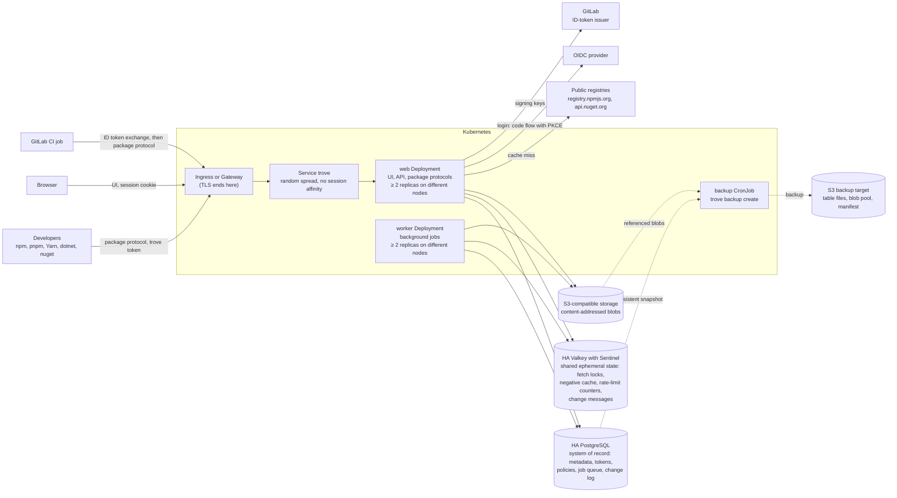

# trove

[](LICENSE)

> **Status: specification phase.** Nothing is implemented yet. There is no release, no container
> image and no Helm chart. Every interface, name and command on this page is the target design from
> [docs/spec/](docs/spec/README.md), not something you can run today.

trove is a self-hosted, highly available binary repository manager. It hosts your own packages,
proxies and caches public registries on demand (pull-through), and puts both behind one URL per
ecosystem. People sign in through your OpenID Connect provider. Access is denied by default and
granted through permission policies that reach down to package-name patterns. GitLab CI jobs need
no stored secret: a job trades its GitLab-issued ID token for a short-lived trove token whose
rights come from rules you define on the job's claims. npm and NuGet come first.

trove is one Go binary with an embedded Angular UI, deployed with a Helm chart in three roles.
`web` replicas answer every HTTP request; a Kubernetes Service spreads the requests over them at
random, with no session affinity. `worker` replicas run the background jobs. A `backup` CronJob
writes consistent backups to S3. The load is expected to exceed one replica, so each long-running
role scales out from the first release, runs at least two replicas on different nodes, and survives
a node drain without a failed request when it is sized for it. No replica keeps state between
requests. Highly available PostgreSQL is the system of record. Valkey with Sentinel holds shared
ephemeral state, so losing it costs performance, never data. Binaries live in S3-compatible object
storage. No volume is shared between pods.



## ✨ Key Features

All of these are planned: specified in [docs/spec/](docs/spec/README.md), not implemented.

- 📦 **npm and NuGet v3 first.** Local, remote and virtual repositories for npm, pnpm, Yarn, `dotnet`, nuget.exe and Visual Studio. See [npm](docs/spec/formats/npm.md) and [NuGet](docs/spec/formats/nuget.md).
- 🔁 **Pull-through proxy.** Fetch on a cache miss, a metadata period, a negative cache, stale metadata while the upstream is down, concurrent misses collapsed across replicas, and rewritten metadata URLs. See [repositories and proxy](docs/spec/repositories-and-proxy.md).
- 🧭 **Virtual repositories.** One URL over an ordered list of local and remote repositories, with namespace claims and pin rules against dependency confusion. See [repositories and proxy](docs/spec/repositories-and-proxy.md).
- 🔐 **OIDC login.** Authorization code flow with PKCE. Users are created just in time, groups come from a claim, and trove stores no user passwords. See [identity and authentication](docs/spec/identity-and-authentication.md).
- 🎟️ **trove's own tokens.** Personal, service-account and CI tokens. Each is prefixed and checksummed, stored only as a hash, scoped, expiring and revocable. See [identity and authentication](docs/spec/identity-and-authentication.md).
- 🛡️ **Fine-grained permissions.** Deny-by-default permission policies on repository, path and package-name patterns, plus package ownership. See [authorization](docs/spec/authorization.md).
- 🦊 **GitLab CI OIDC federation.** RFC 8693 token exchange; claim-based identity mappings and grants templated from claims. See [GitLab CI OIDC](docs/spec/gitlab-ci-oidc.md).
- 🗄️ **Content-addressed storage.** Deduplicated S3 blobs, garbage collection that is safe against concurrent uploads and running backups, and an integrity scrub. See [storage](docs/spec/storage.md).
- ⚖️ **Horizontal scale from the first release.** `web` and `worker` are separate Deployments, each with its own replica count and autoscaler; from P1 either can be split further into pools, for example package traffic behind its own Service (R-HA-062). No request depends on state that an earlier request left on a replica, so any request may reach any replica. See [architecture](docs/spec/architecture.md) (R-ARCH-001, R-ARCH-032).
- 🛟 **High availability that cannot be switched off.** HA PostgreSQL, HA Valkey with Sentinel and S3; at least two replicas per role on different nodes; a node drain without a failed request when the roles are sized for it; expand/contract migrations for rolling upgrades. See [HA and Helm](docs/spec/ha-and-helm.md) (R-HA-059).
- ⚡ **Valkey that is allowed to fail.** Valkey carries request collapsing across replicas, the negative cache, cluster-wide rate limits and fast change messages. No served content and no positive access decision is read from it, so an outage or failover degrades trove and raises an alert, but never fails a request or makes a replica unready. See [architecture](docs/spec/architecture.md) (R-ARCH-030) and [HA and Helm](docs/spec/ha-and-helm.md) (R-HA-057).
- 💾 **Backup job.** A CronJob writes a consistent backup, a PostgreSQL snapshot plus every blob it references, to a configurable S3 target, with incremental blob copies and retention. `trove backup restore` restores a backup into an empty installation and resumes after an interruption. See [backup and restore](docs/spec/backup-and-restore.md).
- ⎈ **Helm chart.** It never creates a Secret, validates values fail-fast, and needs no ReadWriteMany or persistent volume. It renders one Deployment per role, the backup CronJob, PDBs, HPAs, NetworkPolicies, a ServiceMonitor and a PrometheusRule. See [HA and Helm](docs/spec/ha-and-helm.md).
- 📈 **Observability and audit.** Prometheus metrics with alerts for Valkey, backups and drain safety, JSON logs, OpenTelemetry traces, and audit events stored in PostgreSQL. See [operations and observability](docs/spec/operations-and-observability.md).
- 🖥️ **API-first UI.** The Angular UI uses only the public OpenAPI 3.1 management API, offers client setup instructions per repository, and shows replicas by role with their drain safety. See [API and UI](docs/spec/api-and-ui.md).

## 📛 Naming conventions

Every name below is fixed by the spec page named in the last column. Values marked *example* are
illustrations, not defaults.

### Binary, commands and listeners

| Name | Pattern | Spec |
|---|---|---|
| Binary | `trove`, statically linked (`CGO_ENABLED=0`) | [R-ARCH-001](docs/spec/architecture.md) |
| Process roles | `web` (client listener: UI, management API, package protocols, raw files), `worker` (background jobs), `backup` (the backup and restore commands, run as CronJob or Job); `all` runs `web` and `worker` in one process, for a binary started outside the chart during development only | [INV-2](docs/spec/README.md), [R-ARCH-001](docs/spec/architecture.md) |
| Run a replica | `trove serve --role web\|worker\|all`; the flag overrides `process.role`, which has no default; the chart renders only `web` and `worker` | [R-ARCH-001](docs/spec/architecture.md), [R-HA-002](docs/spec/ha-and-helm.md) |
| Schema migrations | `trove migrate [up\|status]` | [R-ARCH-001](docs/spec/architecture.md) |
| Backup and restore | `trove backup create [--trigger schedule\|manual] [--exclude-remote-caches] [--no-prune] [--adopt-target] [--json]`, `trove backup list [--all] [--json]`, `trove backup verify <id> \| --latest \| --all [--deep] [--bytes-per-second N]`, `trove backup delete <id> [--yes]`, `trove backup prune`, `trove backup restore <backup-id> [--check] [--skip-revocation-journal]` | [R-BAK-009](docs/spec/backup-and-restore.md), [R-BAK-016](docs/spec/backup-and-restore.md), [R-BAK-018](docs/spec/backup-and-restore.md), [R-BAK-019](docs/spec/backup-and-restore.md), [R-BAK-021](docs/spec/backup-and-restore.md) |
| Backup exit codes | `0` success, `1` failed, `2` usage or configuration error, `3` another target-writing run is alive, `4` the target belongs to another installation or incarnation, `5` `verify` findings, `6` restore or format precondition not met, `75` temporary failure, retry later | [R-BAK-013](docs/spec/backup-and-restore.md) |
| Bootstrap and recovery | `trove admin service-account create`, `trove admin token create\|revoke`, `trove admin break-glass status\|unlock\|end-sessions`, `trove admin user disable`, `trove admin sessions end` | [R-AUTH-015](docs/spec/identity-and-authentication.md) |
| Configuration check | `trove admin config validate [--config <file>]` | [R-OPS-028](docs/spec/operations-and-observability.md) |
| Operations and restore | `trove admin secrets status`, `trove admin storage check`, `trove admin storage verify`; checks of the platform backup layer: `trove admin backup check`; point-in-time restore of the platform layer: `trove admin post-restore --restored-to <t>`, `trove admin storage restore-versions --before <t>`, `trove admin maintenance pause-deletions\|resume-deletions`; an npm version that a restore's journal replay withheld: `trove admin npm reinstate <repoKey> <name>@<version>`; configuration as code (P1): `trove admin config diff\|apply -f <file>` | [R-ARCH-021](docs/spec/architecture.md), [R-STOR-035](docs/spec/storage.md), [R-HA-023](docs/spec/ha-and-helm.md), [R-HA-024](docs/spec/ha-and-helm.md), [R-HA-025](docs/spec/ha-and-helm.md), [R-NPM-047](docs/spec/formats/npm.md), [R-OPS-030](docs/spec/operations-and-observability.md) |
| Client listener | `:8080` (`server.listen`), on `web` (and `all`) only | [INV-6](docs/spec/README.md), [R-ARCH-001](docs/spec/architecture.md), [R-ARCH-005](docs/spec/architecture.md) |
| Operations listener | `:8081` (`server.ops_listen`), serving only `/healthz`, `/readyz`, `/metrics`; a backup pod serves `/metrics` only, while its run lasts | [INV-6](docs/spec/README.md), [R-ARCH-001](docs/spec/architecture.md), [R-ARCH-005](docs/spec/architecture.md) |

### URL paths

| Path | Purpose | Spec |
|---|---|---|
| `/api/v1/…` | Management REST API; contract at `/api/v1/openapi.json` (OpenAPI 3.1) | [INV-6](docs/spec/README.md), [R-API-002](docs/spec/api-and-ui.md) |
| `/api/<format>/<repoKey>/…` | Package protocols, e.g. `/api/npm/npm-all/`, `/api/nuget/nuget-all/v3/index.json` | [INV-6](docs/spec/README.md) |
| `/api/<format>/<repoKey>~cache/…`, `/files/<repoKey>~cache/<path>` | Cache view of a remote repository | [R-REPO-002](docs/spec/repositories-and-proxy.md) |
| `/files/<repoKey>/<path>` | Raw file access to any repository | [INV-6](docs/spec/README.md) |
| `/auth/…` | Browser login flow; OIDC redirect URI `<base URL>/auth/oidc/<providerId>/callback` | [R-AUTH-003](docs/spec/identity-and-authentication.md) |
| `/ui/{locale}/…` | Angular UI; `GET /` answers `302` to `/ui/` | [R-ARCH-004](docs/spec/architecture.md), [R-ARCH-005](docs/spec/architecture.md) |
| `POST /api/v1/auth/oidc/token` | CI token exchange (RFC 8693) | [R-CI-007](docs/spec/gitlab-ci-oidc.md) |
| `GET /api/v1/system/replicas` | Replica registry: roles, node, state, readiness checks and each replica's view of Valkey | [R-API-038](docs/spec/api-and-ui.md), [R-OPS-003](docs/spec/operations-and-observability.md) |
| `GET /api/v1/system/backups`, `/api/v1/system/backups/{runId}`, `/api/v1/system/backups/summary` | Backup runs and the status of the backup job, read-only; no endpoint starts, deletes, verifies or restores a backup | [R-API-050](docs/spec/api-and-ui.md), [R-BAK-014](docs/spec/backup-and-restore.md) |
| `/api/v1/problems/<code>` | `type` URI of every problem-details error | [R-API-009](docs/spec/api-and-ui.md) |

### Repositories and principals

| Name | Pattern | Spec |
|---|---|---|
| Repository key | `^[a-z0-9][a-z0-9._-]{1,63}$`, no `..`, no trailing `.`, unique across all classes | [INV-5](docs/spec/README.md), [R-REPO-002](docs/spec/repositories-and-proxy.md) |
| Recommended key (not enforced) | `<team>-<format>-<purpose>-<class>` for local and remote (`billing-npm-release-local`); virtual drops the class (`billing-npm`) | [R-REPO-002](docs/spec/repositories-and-proxy.md) |
| Repository class | `local`, `remote`, `virtual` | [INV-5](docs/spec/README.md) |
| Format ID | `^[a-z][a-z0-9-]{1,31}$`, never `^v[0-9]+$` (reserved for API versions) | [R-ARCH-005](docs/spec/architecture.md) |
| OIDC provider ID | `^[a-z0-9][a-z0-9-]{0,31}$` | [R-AUTH-004](docs/spec/identity-and-authentication.md) |
| Principal reference | `user:<username>`, `group:<name>`, `sa:<name>`, `ci:<issuer>/<mapping>`, `authenticated` (every signed-in user, never a service account or CI token), `anonymous` | [R-AUTHZ-002](docs/spec/authorization.md), [R-AUTHZ-030](docs/spec/authorization.md) |
| Package owner identity | a principal reference, or `ci:<issuer>:project:<project_id>` for every CI token of that GitLab project | [R-AUTHZ-018](docs/spec/authorization.md), [R-CI-015](docs/spec/gitlab-ci-oidc.md) |
| Repository selector | a key, a pattern, or a class `@any-local`, `@any-remote`, `@any-virtual`, `@any`, optionally suffixed `:<format>` | [R-AUTHZ-004](docs/spec/authorization.md) |
| Permission policy name | `^[a-z0-9][a-z0-9._-]{0,127}$` | [R-AUTHZ-021](docs/spec/authorization.md) |
| Repository actions | `read`, `annotate`, `deploy`, `overwrite`, `delete`, `manage` | [INV-9](docs/spec/README.md) |
| System roles | `admin` (MVP); `security-admin`, `auditor`, `repository-admin`, `webhook-admin` (P1) | [R-AUTHZ-010](docs/spec/authorization.md) |
| Capabilities | `<area>:<verb>`, e.g. `policies:read`, `tokens:revoke`, `content:bypass` | [R-AUTHZ-010](docs/spec/authorization.md) |
| npm `whoami` name | user: username; service account: `sa:<name>`; CI token: `ci:<CI issuer name>/<mapping name>` | [R-AUTH-033](docs/spec/identity-and-authentication.md) |

### Credentials, cookies and headers

| Name | Pattern | Spec |
|---|---|---|
| Personal access token | `trv_pat_…` | [INV-8](docs/spec/README.md), [R-AUTH-022](docs/spec/identity-and-authentication.md) |
| Service-account token | `trv_sat_…` | same |
| CI token | `trv_cit_…` | same |
| Token layout | prefix + 43 base62 characters (32 random bytes) + 6 base62 characters (CRC-32), 57 characters in total | [R-AUTH-022](docs/spec/identity-and-authentication.md) |
| Secret-scanner pattern | `\btrv_(?:pat\|sat\|cit)_[0-9A-Za-z]{49}\b` | [R-AUTH-022](docs/spec/identity-and-authentication.md) |
| Token hint (shown in lists) | prefix + first 4 characters of the random part, e.g. `trv_pat_3kQ9` *(example)* | [R-AUTH-022](docs/spec/identity-and-authentication.md) |
| Cookie names | `__Host-trv_<name>` for every trove cookie: host-only, `Secure`, `Path=/`, no `Domain`, enforced by the browser | [R-AUTH-010](docs/spec/identity-and-authentication.md), [Q-AUTH-2](docs/spec/identity-and-authentication.md) |
| UI session cookie | `__Host-trv_session`; `Secure`, `HttpOnly`, `SameSite=Lax`, `Path=/` | [INV-8](docs/spec/README.md), [R-AUTH-010](docs/spec/identity-and-authentication.md) |
| CSRF cookie and header | cookie `__Host-trv_csrf` (`Secure`, `SameSite=Strict`, `Path=/`, not `HttpOnly` so the UI can read it), header `X-CSRF-Token` | [R-AUTH-012](docs/spec/identity-and-authentication.md) |
| OIDC login-binding cookie | `__Host-trv_oidc_binding`; `Secure`, `HttpOnly`, `SameSite=Lax`, `Path=/`, `Max-Age=600` | [R-AUTH-005](docs/spec/identity-and-authentication.md) |
| Token presentation | `Authorization: Bearer <token>`; HTTP Basic with the token as password (any username); `X-NuGet-ApiKey` for NuGet pushes | [INV-8](docs/spec/README.md), [R-AUTH-033](docs/spec/identity-and-authentication.md) |
| Fallback subject-token type (P2, off by default) | `urn:trove:token-type:gitlab-job-token` | [R-CI-007](docs/spec/gitlab-ci-oidc.md), [R-CI-022](docs/spec/gitlab-ci-oidc.md) |
| Signed content URL (P1) | query `trv_exp=<unix seconds>&trv_sid=<session row id>&trv_sig=v1.<key id>.<base64url HMAC-SHA-256>`, added only on the `303` hand-off of a session-cookie request to the content host | [R-ARCH-029](docs/spec/architecture.md) |
| Webhook signing secret (P1) | `whsec_…`; headers `webhook-id`, `webhook-timestamp`, `webhook-signature` (Standard Webhooks) | [R-OPS-040](docs/spec/operations-and-observability.md) |
| Response headers | `X-Request-Id` (every response), `X-Trove-Replica`, `Trove-Resolved-From` (virtual resolution), `Trove-Authz-Epoch` (policy writes) | [R-ARCH-005](docs/spec/architecture.md), [R-OPS-002](docs/spec/operations-and-observability.md), [R-REPO-019](docs/spec/repositories-and-proxy.md), [R-AUTHZ-021](docs/spec/authorization.md) |
| Request headers | `Trove-Deploy-By-Checksum: ?1` with `Repr-Digest`; `Trove-Properties` (properties at deploy time); `Trove-Authz-Min-Epoch: <n>` (any replica waits for a grant index at least that new, so a client sees its own permission change without session affinity) | [R-STOR-008](docs/spec/storage.md), [R-STOR-009](docs/spec/storage.md), [R-API-052](docs/spec/api-and-ui.md), [R-AUTHZ-032](docs/spec/authorization.md) |

### Configuration and environment

| Name | Pattern | Spec |
|---|---|---|
| Configuration file | `/etc/trove/trove.yaml`; overridden by `--config` or `TROVE_CONFIG_FILE` | [INV-15](docs/spec/README.md), [R-OPS-028](docs/spec/operations-and-observability.md) |
| Key casing | `trove.yaml` keys are snake_case (`storage.gc.grace_period`); Helm values are camelCase (`secrets.databaseCA`); API JSON fields are lowerCamelCase | [R-ARCH-020](docs/spec/architecture.md), [R-API-003](docs/spec/api-and-ui.md), [R-HA-028](docs/spec/ha-and-helm.md) |
| Environment override | `TROVE_` + key path in upper case, segments joined by `_`; e.g. `log.request.enabled` → `TROVE_LOG_REQUEST_ENABLED`, `backup.target.bucket` → `TROVE_BACKUP_TARGET_BUCKET` | [R-OPS-028](docs/spec/operations-and-observability.md), [R-BAK-011](docs/spec/backup-and-restore.md) |
| Reserved variables | `TROVE_CONFIG_FILE`; `TROVE_CAC_*` for configuration-as-code secret references (P1); `TROVE_POD_NAME`, `TROVE_POD_NAMESPACE`, `TROVE_NODE_NAME` (downward API, set by the chart in every trove pod); `TROVE_POOL_NAME` (P1, on each pool Deployment) | [R-OPS-028](docs/spec/operations-and-observability.md) |
| Secret-typed keys | companion `<name>_file`; an inline secret in the file stops startup. The Valkey and Sentinel credentials are file-only and re-read for every new connection | [R-OPS-028](docs/spec/operations-and-observability.md), [R-HA-056](docs/spec/ha-and-helm.md) |
| Process role | `process.role`: `web`, `worker` or `all`, no default; the chart passes `--role` per Deployment instead | [R-ARCH-001](docs/spec/architecture.md), [R-HA-030](docs/spec/ha-and-helm.md) |
| Valkey connection | `valkey.*`; every key is listed below | [R-HA-056](docs/spec/ha-and-helm.md), [R-ARCH-031](docs/spec/architecture.md) |
| Backup configuration | `backup.target.*` (the S3 target: `endpoint`, `region`, `bucket`, `prefix`, `allow_same_bucket`, `credentials.*`, `sse.*`), `backup.database.*`, `backup.copy.*`, `backup.exclude.remote_caches`, `backup.retention.*`, `backup.expected_interval`, `backup.manual_run.*` (chart-managed), `backup.stall_timeout` and the run lease keys | [R-BAK-011](docs/spec/backup-and-restore.md) |
| Content origin (P1) | `server.content_base_url`: an `https` origin without a path whose host name differs from `server.base_url`'s, e.g. `https://trove-content.example.net` *(example)*; empty by default (proposed), which keeps one origin. `server.content_url_ttl`: lifetime of a signed content URL, `300s` by default (proposed) | [R-ARCH-029](docs/spec/architecture.md), [Q-ARCH-10](docs/spec/architecture.md) |
| Variables the chart sets | per Deployment `TROVE_RUNTIME_MEMORY_LIMIT_BYTES`, `TROVE_RUNTIME_TERMINATION_GRACE_PERIOD`, `TROVE_STORAGE_SPOOL_MAX_BYTES`; for the migration Job `TROVE_DATABASE_PREFLIGHT_EXPECTED_WEB_REPLICAS`, `TROVE_DATABASE_PREFLIGHT_EXPECTED_WORKER_REPLICAS`; `GOMAXPROCS`; in every trove pod `TROVE_POD_NAME`, `TROVE_POD_NAMESPACE`, `TROVE_NODE_NAME` | [R-HA-030](docs/spec/ha-and-helm.md) |
| Client-side variables in the examples | `TROVE_TOKEN`, `TROVE_URL`, `TROVE_ID_TOKEN` *(example)*. These are for client machines and CI jobs only. The server rejects unknown `TROVE_` variables at startup, so do not set them in its environment. | [R-CI-028](docs/spec/gitlab-ci-oidc.md), [R-OPS-028](docs/spec/operations-and-observability.md) |

### Kubernetes and Helm

`<fullname>` is the release name, or `<release>-trove` when the release name does not contain
`trove`. `fullnameOverride` replaces it.

| Name | Pattern | Spec |
|---|---|---|
| Chart | `trove` in `deploy/helm/trove`; chart `version` = `appVersion` | [INV-13](docs/spec/README.md), [R-HA-028](docs/spec/ha-and-helm.md) |
| Deployments | `<fullname>-web` (`trove serve --role web`) and `<fullname>-worker` (`trove serve --role worker`), always both; per pool (P1) `<fullname>-web-<pool>`, `<fullname>-worker-<pool>` | [R-HA-002](docs/spec/ha-and-helm.md), [R-HA-028](docs/spec/ha-and-helm.md), [R-HA-062](docs/spec/ha-and-helm.md) |
| CronJob | `<fullname>-backup`, running `trove backup create --trigger schedule`; rendered while `backup.enabled` (default `true`) | [R-HA-060](docs/spec/ha-and-helm.md) |
| Jobs | hooks `<fullname>-migrate`, `<fullname>-post-restore`; restore Job `<fullname>-restore`, an ordinary resource rendered while `restore.enabled` | [R-HA-028](docs/spec/ha-and-helm.md), [R-HA-060](docs/spec/ha-and-helm.md) |
| Services | `<fullname>` (port `http` 8080, `web` pods only, `sessionAffinity: None`), `<fullname>-ops` (port `ops` 8081, `web` and `worker` pods); per web pool (P1) `<fullname>-web-<pool>` | [R-HA-028](docs/spec/ha-and-helm.md), [R-HA-062](docs/spec/ha-and-helm.md) |
| ServiceAccounts | `<fullname>` (`web`, `worker`), `<fullname>-backup`, `<fullname>-restore`, `<fullname>-migrate` (hook) | [R-HA-028](docs/spec/ha-and-helm.md) |
| ConfigMap | `<fullname>-config` holding `trove.yaml`, one file for every Deployment and Job | [R-HA-028](docs/spec/ha-and-helm.md), [R-HA-030](docs/spec/ha-and-helm.md) |
| NetworkPolicies | `<fullname>` (`web` and `worker`), `<fullname>-migrate`, `<fullname>-restore`, `<fullname>-backup` | [R-HA-028](docs/spec/ha-and-helm.md) |
| Other objects | `<fullname>` for Ingress, HTTPRoute, ServiceMonitor, PrometheusRule; `<fullname>-gateway` for a chart-created Gateway (P1); PDB and HPA per Deployment, none for Jobs | [R-HA-028](docs/spec/ha-and-helm.md) |
| Labels | `app.kubernetes.io/name: trove`; `app.kubernetes.io/component` ∈ `web`, `worker`, `migrate`, `restore`, `backup`; `trove/pool` (name proposed) on `web` and `worker` pods: the pool's name, empty on the main Deployments | [R-HA-028](docs/spec/ha-and-helm.md) |
| Metric target labels | `role` from `app.kubernetes.io/component`; `pool` from `trove/pool`, absent on series of the main Deployments | [R-HA-045](docs/spec/ha-and-helm.md) |
| Pod annotations | `checksum/config` (hash of the rendered ConfigMap); `cluster-autoscaler.kubernetes.io/safe-to-evict: "false"` on backup and restore pods | [R-HA-028](docs/spec/ha-and-helm.md), [R-HA-060](docs/spec/ha-and-helm.md) |
| Volumes | `/var/lib/trove/spool` (`emptyDir`, or a generic ephemeral ReadWriteOnce volume per pod), `/tmp` (`emptyDir`); never a PersistentVolumeClaim, a StatefulSet or ReadWriteMany | [R-HA-061](docs/spec/ha-and-helm.md) |
| Secret mounts | `/var/run/secrets/trove/<name>/`, see below | [R-HA-030](docs/spec/ha-and-helm.md) |
| Trusted CA bundles | `/etc/trove/ca/` | [R-HA-030](docs/spec/ha-and-helm.md) |
| Image | `<registry>/<repository>`, multi-arch `linux/amd64`, `linux/arm64`; published as `ghcr.io/guided-traffic/trove` (`image.registry: ghcr.io`, `image.repository: guided-traffic/trove`) | [R-HA-047](docs/spec/ha-and-helm.md), [R-HA-031](docs/spec/ha-and-helm.md), [Q-HA-11](docs/spec/ha-and-helm.md) |
| Chart package | `oci://ghcr.io/guided-traffic/charts/trove`, signed with cosign from the release workflow | [R-HA-047](docs/spec/ha-and-helm.md) |

<details>
<summary>Secret mount paths (the chart never creates a Secret; every entry references an existing one)</summary>

Each Secret is mounted only into the pods whose process reads it; the first column names the pods
where that set is narrower than every trove pod.

| Value | Keys (default names) | Mount path | Configuration key the chart sets |
|---|---|---|---|
| `secrets.database` | `username`, `password` | `/var/run/secrets/trove/database/` | `database.username_file`, `database.password_file` |
| `secrets.databaseMigration` (migration and restore Jobs only) | `username`, `password` | same path in the Jobs | same |
| `secrets.databaseBackup` (backup pods only; empty = `secrets.database`) | `username`, `password` | same path in the backup pod | same |
| `secrets.databaseCA` | `ca.crt` | `/var/run/secrets/trove/database-ca/` | `database.ssl_root_cert_file` |
| `secrets.databaseClientCert` | `tls.crt`, `tls.key` | `/var/run/secrets/trove/database-client/` | `database.ssl_cert_file`, `database.ssl_key_file` |
| `secrets.s3` (only with `credentials.source: static`) | `access-key-id`, `secret-access-key` | `/var/run/secrets/trove/s3/` | `storage.s3.credentials.access_key_id_file`, `…secret_access_key_file` |
| `secrets.valkey` (`web` and `worker` only) | `username` (optional), `password` | `/var/run/secrets/trove/valkey/` | `valkey.username_file`, `valkey.password_file` |
| `secrets.valkeySentinel` (same pods) | `username` (optional), `password` | `/var/run/secrets/trove/valkey-sentinel/` | `valkey.sentinel.username_file`, `valkey.sentinel.password_file` |
| `secrets.valkeyCA` (same pods) | `ca.crt` | `/var/run/secrets/trove/valkey-ca/` | `valkey.tls.ca_file` |
| `secrets.valkeyClientCert` (same pods) | `tls.crt`, `tls.key` | `/var/run/secrets/trove/valkey-client/` | `valkey.tls.cert_file`, `valkey.tls.key_file` |
| `secrets.backupTarget` (backup and restore pods; only with `source: static`) | `access-key-id`, `secret-access-key` | `/var/run/secrets/trove/backup-target/` | `backup.target.credentials.access_key_id_file`, `…secret_access_key_file` |
| `secrets.oidc[]` (one per provider ID; `web` pods only) | `client-secret` | `/var/run/secrets/trove/oidc-<id>/` | `client_secret_file` of that provider |
| `secrets.breakGlass` (`web` pods only) | `password` | `/var/run/secrets/trove/break-glass/` | `auth.break_glass.password_file` |
| `secrets.encryption` | the files listed in `secrets.encryption.keys` | `/var/run/secrets/trove/encryption/` | `secrets.encryption_key_files` (ordered) and `secrets.active_key_id` (the first entry) |
| `secrets.metricsToken` | `token` | `/var/run/secrets/trove/metrics/` | `metrics.bearer_token_file` |

Source: [R-HA-030](docs/spec/ha-and-helm.md).

</details>

<details>
<summary>Names of the local development profile (<code>deploy/dev/</code>)</summary>

| Object | Name |
|---|---|
| kind cluster, namespace, Helm release | `trove`; one control-plane and three worker nodes, labeled with three zones |
| trove Deployments | `trove-web` and `trove-worker`, two replicas each, `highAvailability.enforce: true` |
| CloudNativePG cluster | `trove-db`, two instances (application Secret `trove-db-app`) |
| Optional pooler overlay (`dev-up POOLER=1`) | CloudNativePG `Pooler` resources `trove-db-pooler-rw` and `trove-db-pooler-control`, transaction mode |
| Valkey with Sentinel | StatefulSet `trove-valkey` (two pods: primary and replica), StatefulSet `trove-valkey-sentinel` (three pods), primary name `trove`, ACL user `trove`, TLS only (`tls-port 6379`, Sentinel `tls-port 26379`) |
| Valkey Secrets | `trove-valkey` (ACL user), `trove-valkey-sentinel`, `trove-valkey-ca`, `trove-valkey-tls`; the dev CA lives in `.dev/valkey/` |
| S3 store (SeaweedFS) | Service `trove-s3` (port 9000); buckets `trove-blobs` (versioning on), `trove-pg-archive` (WAL archive) and `trove-backups` (backup target) |
| Encryption key Secret | `trove-encryption-keys` |
| Break-glass Secret | `trove-break-glass` |
| Files | `deploy/dev/kind.yaml`, `deploy/dev/postgres.yaml`, `deploy/dev/pooler.yaml`, `deploy/dev/valkey.yaml`, `deploy/dev/valkey-certs.sh`, `deploy/dev/s3.yaml`, `deploy/dev/values-dev.yaml` |

Source: [R-HA-051](docs/spec/ha-and-helm.md).

</details>

### Valkey

The keys and channels are shown with the default prefix `trove:`. Every key carries an expiry, and
every value is checked before use.

| Name | Pattern | Spec |
|---|---|---|
| Prefix | `valkey.key_prefix`, default `trove:` (must end in `:`); every key and channel starts with it, followed by the keyspace and `:`. Installations that share one Valkey use different prefixes and different ACL users | [R-ARCH-030](docs/spec/architecture.md), [R-HA-056](docs/spec/ha-and-helm.md) |
| Keyspace `<ks>` | the first 12 hex digits of `system_state.keyspace_id`; a restore assigns a new keyspace ID, so a restored installation never reads a key of the installation it was restored from | [R-ARCH-030](docs/spec/architecture.md), [R-BAK-022](docs/spec/backup-and-restore.md) |
| Name shape | `<key_prefix><ks>:<mechanism>:v1:…`; `v1` is the encoding version, raised when a value's encoding changes | [R-ARCH-030](docs/spec/architecture.md), [R-HA-056](docs/spec/ha-and-helm.md) |
| Fetch flight lock | key `trove:<ks>:lock:fetch:v1:<f>`, channel `trove:<ks>:fill:v1:<f>`; lifetime `cluster.flight_lock_ttl` (30 s), extended while the fetch runs | [R-ARCH-030](docs/spec/architecture.md), [R-ARCH-033](docs/spec/architecture.md) |
| Negative cache entry | `trove:<ks>:neg:v1:<repo id>:<f>` → `{"s": 404 or 410, "c": <time the upstream request was sent, Unix ms, replica clock>}`; lifetime the repository's `notFoundTtlSeconds` | [R-ARCH-030](docs/spec/architecture.md), [R-REPO-028](docs/spec/repositories-and-proxy.md) |
| Rate-limit counter | `trove:<ks>:rl:v1:<limiter>:<b>:<window>`; lifetime 2 × the window | [R-ARCH-030](docs/spec/architecture.md), [R-ARCH-034](docs/spec/architecture.md) |
| Throttle exemption marker | `trove:<ks>:tokseen:v1:<t>`; lifetime `auth.rate_limit.recent_token_window` (10 min) | [R-ARCH-030](docs/spec/architecture.md), [R-AUTH-038](docs/spec/identity-and-authentication.md) |
| Change messages | channel `trove:<ks>:inv:v1` (Pub/Sub; the PostgreSQL change log carries correctness) | [R-ARCH-030](docs/spec/architecture.md), [R-ARCH-018](docs/spec/architecture.md) |
| Signals | channel `trove:<ks>:sig:v1:<area>` (job wake-ups, remote metadata refreshes, outbox wake-up) | [R-ARCH-030](docs/spec/architecture.md), [R-ARCH-018](docs/spec/architecture.md) |
| Health probe | `trove:<ks>:probe:v1:<instance uid>`; lifetime 30 s | [R-ARCH-030](docs/spec/architecture.md), [R-ARCH-031](docs/spec/architecture.md) |
| Hashed segments | `<f>`: lowercase hex SHA-256 of `repository id ‖ 0x00 ‖ canonical path ‖ 0x00 ‖ variant`; `<b>`: lowercase hex of the first 16 bytes of the SHA-256 of the limiter's bucket key; `<t>`: lowercase hex of the first 16 bytes of SHA-256(`"tokseen"` ‖ 0x00 ‖ `secret_sha256`). Keys never hold package names, paths, principal names, token values or client addresses | [R-ARCH-030](docs/spec/architecture.md) |
| Client name | `trove:<pod name>:<purpose>` (`CLIENT SETNAME`); at most six connections per replica | [R-ARCH-031](docs/spec/architecture.md), [R-HA-056](docs/spec/ha-and-helm.md) |
| ACL rule (example) | `user trove on >… resetkeys ~trove:* resetchannels &trove:* -@all +get +set +delifeq +incr +expire +multi +exec +publish +subscribe +unsubscribe +ping +hello +role +client\|setname +client\|setinfo` | [R-ARCH-031](docs/spec/architecture.md) |
| Sentinel primary name | `valkey.sentinel.primary_name`: the name in `sentinel monitor`, e.g. `trove` *(example)* | [R-HA-056](docs/spec/ha-and-helm.md) |

<details>
<summary>Valkey configuration keys (<code>valkey.*</code>)</summary>

```yaml
valkey:
  mode: sentinel                     # default (proposed): sentinel | standalone (development only); endpoint is P1
  sentinel:
    addresses: []                    # required in sentinel mode; example: [trove-valkey-sentinel-0.trove-valkey-sentinel.trove.svc:26379, trove-valkey-sentinel-1.trove-valkey-sentinel.trove.svc:26379, trove-valkey-sentinel-2.trove-valkey-sentinel.trove.svc:26379]
    primary_name: ""                 # required in sentinel mode; example: trove (the name in "sentinel monitor")
    username_file: ""                # default (proposed): empty = Sentinels without ACL user; set by the chart
    password_file: ""                # default (proposed): empty = Sentinels without password; set by the chart
    tls: true                        # default (proposed): use valkey.tls for Sentinel connections too
    refresh_interval: 5s             # default (proposed): periodic reconciliation with the Sentinels (R-ARCH-031)
  address: ""                        # standalone mode only; example: localhost:6379
  database: 0                        # default (proposed)
  key_prefix: "trove:"               # default (proposed)
  username_file: ""                  # default (proposed): empty = the "default" user; set by the chart
  password_file: ""                  # set by the chart from secrets.valkey
  tls:
    mode: verify-full                # default (proposed): verify-full | verify-ca | disable
    ca_file: ""                      # default (proposed): empty = system roots plus trustedCA; set by the chart from secrets.valkeyCA
    cert_file: ""                    # default (proposed): no client certificate; set by the chart
    key_file: ""                     # default (proposed)
    server_name: ""                  # default (proposed): the host name of each address
  allow_insecure: false              # default (proposed); required for tls.mode disable
  connect_timeout: 2s                # default (proposed)
  command_timeout: 500ms             # default (proposed)
  sentinel_query_timeout: 300ms      # default (proposed), per Sentinel tried
  max_conn_lifetime: 30m             # default (proposed)
  health_check_interval: 5s          # default (proposed)
  reconnect:
    initial_backoff: 100ms           # default (proposed)
    max_backoff: 5s                  # default (proposed)
  circuit_breaker:
    failure_threshold: 5             # default (proposed): consecutive failed calls that open the circuit
    open_duration: 5s                # default (proposed)
```

Source: [R-HA-056](docs/spec/ha-and-helm.md). In the chart these keys sit under `config.valkey`;
the `*_file` keys are chart-managed and must not be set there
([R-HA-029](docs/spec/ha-and-helm.md)).

</details>

### Object storage

Blob store, below `storage.s3.prefix`:

| Key family | Pattern | Spec |
|---|---|---|
| Blobs | `<prefix>/sha256/<h0h1>/<h2h3>/<64 hex>`; `<prefix>` defaults to `trove`, e.g. `trove/sha256/5b/e0/5be0c1d2…` *(example)* | [INV-4](docs/spec/README.md), [R-STOR-001](docs/spec/storage.md) |
| Upload-session staging (P1) | `<prefix>/_uploads/<session-id>/data` (the session's S3 multipart upload) and `<prefix>/_uploads/<session-id>/tail-<writer>` (a tail shorter than one part); all deleted on finalize or abort | [R-STOR-001](docs/spec/storage.md), [R-STOR-011](docs/spec/storage.md) |
| Probe objects | `<prefix>/_probe/<replica-id>` | [R-STOR-001](docs/spec/storage.md) |
| Revocation journal | `<prefix>/_journal/revocations/<yyyy>/<mm>/<dd>/<id>.json`; never deleted by trove | [R-STOR-001](docs/spec/storage.md), [R-HA-054](docs/spec/ha-and-helm.md) |

trove reports any other object below `<prefix>/` as foreign and never deletes it. Object keys never
contain a repository key, path or file name.

Backup target, below `backup.target.prefix` (default `trove`), in its own bucket unless
`backup.target.allow_same_bucket: true`:

| Key family | Pattern | Spec |
|---|---|---|
| Target marker | `<prefix>/trove-backup-target.json`: `{"format": 1, "installationId": "…", "incarnation": "…", "createdAt": "…", "adoptedAt": null}` | [R-BAK-002](docs/spec/backup-and-restore.md) |
| Blob pool | `<prefix>/pool/sha256/<h0h1>/<h2h3>/<h0…h63>`, the blob store's fan-out; shared by every backup of the target and never modified | [R-BAK-002](docs/spec/backup-and-restore.md) |
| Table files | `<prefix>/backups/<backup-id>/db/<table>.copy.zst`: zstd-compressed PostgreSQL `COPY` text, one file per exported table | [R-BAK-002](docs/spec/backup-and-restore.md) |
| Blob list | `<prefix>/backups/<backup-id>/blobs.idx.zst`: one line `<64 lowercase hex> <size in bytes>` per blob, sorted by digest | [R-BAK-002](docs/spec/backup-and-restore.md) |
| Manifest | `<prefix>/backups/<backup-id>/manifest.json`, written last; a backup exists if and only if its manifest exists | [R-BAK-002](docs/spec/backup-and-restore.md), [R-BAK-003](docs/spec/backup-and-restore.md) |
| Backup ID | `<yyyymmdd>T<hhmmss>Z-<4 lowercase hex>`: the run's UTC start time and 16 random bits, e.g. `20261028T020000Z-7f3a` *(example)*; lexical order is chronological order | [R-BAK-002](docs/spec/backup-and-restore.md) |

### PostgreSQL

| Name | Pattern | Spec |
|---|---|---|
| Database | `trove` *(example)* | [R-HA-014](docs/spec/ha-and-helm.md) |
| Schema | `trove` (`database.schema`) | [R-HA-014](docs/spec/ha-and-helm.md) |
| Roles, two-role mode | `trove_owner` (owns the schema, runs migrations and restores), `trove_app` (holds the DML grants, no login), `trove_app_a` and `trove_app_b` (logins, alternated on rotation) | [R-HA-014](docs/spec/ha-and-helm.md), [R-HA-017](docs/spec/ha-and-helm.md) |
| Backup login | `database.backup_role`, e.g. `trove_backup` *(example)*: `SELECT` on every table, DML only on `backup_run` and `backup_blob_pin`, `INSERT` on `audit_event` | [R-HA-014](docs/spec/ha-and-helm.md), [R-BAK-015](docs/spec/backup-and-restore.md) |
| `application_name` | `trove:<replica>:<class>`, class ∈ `main` (`web`, `worker`), `lease` (`worker` only), `migrate`, `backup` | [R-ARCH-019](docs/spec/architecture.md) |
| Invalidation areas | names `^[a-z][a-z0-9_]{1,31}$`. Change areas, each a row of `cluster_epoch` plus its `cluster_change` log: `cache`, `auth`, `authz`, `repo_config`, `claims`, `cache_invalidation`, `upstream_state`, `system_state`, `support`, `webhooks`, `ci_issuer_keys`, `ci_mappings`. Signal areas, only on the Valkey channel `trove:<ks>:sig:v1:<area>`: `jobs`, `metadata_changed`, `events`, `deliveries`. trove issues no `LISTEN` and no `NOTIFY` | [R-ARCH-018](docs/spec/architecture.md) |
| Advisory-lock categories | two-`int4` form, first key = category: `1` lease, `2` fetch (retired, never reused), `3` migration, `4` config | [R-ARCH-017](docs/spec/architecture.md) |
| Job key of index rebuilds (`job.dedup_key`) | `index:<repository id>`, shared by the automatic rebuild (`coalesce`) and the manual reindex (`exclusive`), so the two never run at the same time | [R-ARCH-016](docs/spec/architecture.md), [R-REPO-016](docs/spec/repositories-and-proxy.md), [Q-ARCH-12](docs/spec/architecture.md) |

<details>
<summary>Tables, by the spec page that defines them</summary>

| Spec page | Tables |
|---|---|
| [architecture.md](docs/spec/architecture.md) | `job`, `secret_key_canary`, `cluster_epoch`, `cluster_change` |
| [storage.md](docs/spec/storage.md) | `repositories`, `blobs`, `items`, `item_properties`, `item_download_stats`, `packages`, `package_versions`, `property_sets`, `property_set_entries`, `property_set_repositories`, `upload_sessions`, `upload_session_parts`, `blob_gc_queue`, `repository_usage`, `storage_usage_deltas`, `storage_usage_totals`, `retention_policies`, `retention_runs`, `retention_run_items`, `retention_run_gate` |
| [repositories-and-proxy.md](docs/spec/repositories-and-proxy.md) | `virtual_members`, `virtual_deploy_targets`, `virtual_pin_rules`, `virtual_pin_members`, `namespace_claims`, `remote_references`, `remote_cache_entries`, `remote_upstream_state`, `remote_url_map`, `remote_cache_invalidations`, `proxy_offline_switch`, `repository_secrets`, `client_certificates`, `outbound_proxies` |
| [identity-and-authentication.md](docs/spec/identity-and-authentication.md) | `principal`, `app_user`, `user_identity`, `user_group`, `group_membership`, `service_account`, `service_account_owner`, `api_token`, `ui_session`, `oidc_login_flow`, `cli_login`, `auth_lockout`, `auth_settings` |
| [authorization.md](docs/spec/authorization.md) | `authz_policy`, `authz_policy_selector`, `authz_policy_pattern`, `authz_policy_entry`, `authz_role_binding`, `package_ownership`, `package_owner`, `project`, `project_admin` |
| [gitlab-ci-oidc.md](docs/spec/gitlab-ci-oidc.md) | `ci_issuers`, `ci_issuer_keys`, `ci_mappings`, `ci_subject_token_uses`, `ci_token_issuances`, `ci_delegations` |
| [formats/npm.md](docs/spec/formats/npm.md) | `npm_packages`, `npm_versions`, `npm_tombstones`, `npm_remote_packages`, `npm_remote_versions` |
| [formats/nuget.md](docs/spec/formats/nuget.md) | `nuget_version`, `nuget_tombstone`, `nuget_symbol_package`, `nuget_symbol_file` |
| [backup-and-restore.md](docs/spec/backup-and-restore.md) | `backup_run`, `backup_blob_pin` |
| [ha-and-helm.md](docs/spec/ha-and-helm.md) | `schedule`, `schema_migration`, `schema_state`, `background_migration`, `revocation_outbox` (and sketches of `job` and `audit_policy`, which architecture.md and operations-and-observability.md own) |
| [operations-and-observability.md](docs/spec/operations-and-observability.md) | `replica`, `audit_event`, `audit_policy`, `storage_summary`, `system_state`, `support_bundle`, `support_bundle_part`, `config_document`, `config_managed_object`, `event_outbox`, `webhook_subscription`, `webhook_secret`, `webhook_delivery` |
| [api-and-ui.md](docs/spec/api-and-ui.md) | `api_idempotency_keys`, `user_preferences`, `package_readme_cache` |

Negative cache entries are no longer a table: they live in Valkey (see above).

</details>

### Observability

| Name | Pattern | Spec |
|---|---|---|
| Metric families | `trove_<subsystem>_…`, format-specific `trove_<format>_…`; base units in the name (`_seconds`, `_bytes`), `_total` on counters | [INV-16](docs/spec/README.md), [R-OPS-007](docs/spec/operations-and-observability.md) |
| Families for Valkey, coordination and backup | `trove_valkey_…` (availability, circuit, Sentinels reachable, primary changes and views, errors, command duration, degraded fallbacks, Pub/Sub, cache lookups); `trove_cluster_…` (change-log poll, changes applied, signals); `trove_flight_lock_…` (fetches that went ahead without the cross-replica lock, lost locks); `trove_ratelimit_…` (decisions, per-replica fallback); `trove_backup_…` (run gauges read from PostgreSQL by every `web` and `worker` replica, counters from the backup pod, and `trove_backup_check_ok{check}` from the platform backup checks of R-HA-023) | [R-OPS-008](docs/spec/operations-and-observability.md), [R-OPS-045](docs/spec/operations-and-observability.md), [R-HA-057](docs/spec/ha-and-helm.md), [R-BAK-014](docs/spec/backup-and-restore.md) |
| Readiness | `trove_ready` (1 while `/readyz` answers `200`, degraded included); `/readyz` lists reported failures under `degraded`, e.g. `"degraded":["valkey"]` | [R-OPS-001](docs/spec/operations-and-observability.md), [R-OPS-008](docs/spec/operations-and-observability.md) |
| Alerts for this revision | `TroveValkeyUnavailable`, `TroveValkeyUnavailableSingleReplica`, `TroveValkeySentinelsDegraded`, `TroveValkeyFailoverFlapping`, `TroveValkeyPrimaryDisagreement`, `TroveControlConnectionWaits`, `TroveReplicasNotReady` (per Deployment), `TroveBackupStale` (renamed from `TroveBackupTooOld`), `TroveBackupFailed`, `TroveBackupRunningLong`, `TroveBackupGlobalHoldLong`, `TroveBackupSourceDamage`, `TroveBackupVerifyFindings` | [R-HA-045](docs/spec/ha-and-helm.md), [R-OPS-046](docs/spec/operations-and-observability.md) |
| Backup audit events | actor `system:backup`: `system.backup.completed`, `system.backup.failed`, `system.backup.deleted`, `system.backup.target_adopted`; a restore writes `system.restored` | [R-BAK-014](docs/spec/backup-and-restore.md) |
| Build info | `trove_build_info{version,revision,goversion,role}`; `role` is the process role (`web`, `worker`, `all`) | [R-OPS-007](docs/spec/operations-and-observability.md), [R-OPS-008](docs/spec/operations-and-observability.md) |
| Capped label overflow | `repo="_other"`, counted in `trove_metrics_label_overflow_total` | [R-OPS-007](docs/spec/operations-and-observability.md) |
| Event type (CloudEvents, P1) | `trove.<event>`, e.g. `trove.package.published`; the prefix is fixed from the first release that ships webhooks (Q-OPS-5) | [R-OPS-036](docs/spec/operations-and-observability.md) |

## 📚 Documentation

| Document | What it holds |
|---|---|
| [docs/README.md](docs/README.md) | Map of the documentation and how the parts relate |
| [docs/features/](docs/features/README.md) | Feature catalog: what a full-featured repository manager does, entry by entry, with stable IDs and trove priorities |
| [docs/spec/](docs/spec/README.md) | Target design: owner constraints, design invariants `INV-1` to `INV-19`, and the requirements `R-<AREA>-nnn` |
| [docs/coverage/](docs/coverage/README.md) | Which catalog entries the spec covers, and the resulting work list |
| [docs/decisions.md](docs/decisions.md) | Architecture decision log |
| [docs/developer/](docs/developer/README.md) | Contributor entry point: ID schemes, how to add catalog entries and requirements, planned code layout, the HA-shaped local profile |
| [docs/security/](docs/security/README.md) | Security architecture: form, planned perspectives including the Valkey trust boundary and the backup data flow, where the open gaps are recorded |
| [SECURITY.md](SECURITY.md) | How to report a vulnerability |

Upstream references: [npm registry API](https://github.com/npm/registry/blob/main/docs/REGISTRY-API.md),
[`.npmrc`](https://docs.npmjs.com/cli/v11/configuring-npm/npmrc),
[NuGet server API](https://learn.microsoft.com/en-us/nuget/api/overview),
[GitLab OIDC ID tokens](https://docs.gitlab.com/ci/secrets/id_token_authentication/),
[RFC 8693 token exchange](https://www.rfc-editor.org/rfc/rfc8693),
[OpenID Connect Core](https://openid.net/specs/openid-connect-core-1_0.html),
[Valkey Sentinel](https://valkey.io/topics/sentinel/),
[Helm](https://helm.sh/docs/).

## 🚀 TL;DR fast start

> **Target, not yet available.** There is no installable build: no image, no chart, no binary.
> The steps below show the installation and client configuration that the spec defines. Use them
> to review the design, not to install anything.

**Prerequisites** ([R-HA-049](docs/spec/ha-and-helm.md)): Kubernetes (1.34 to 1.37 tested), Helm 4
(or the latest Helm 3 while it is supported), an Ingress controller or Gateway API, optionally an
OIDC provider, and three platform services that the chart does not bundle:

- PostgreSQL 16 or later, highly available (CloudNativePG, Patroni, a managed service);
- Valkey 9.0 or later with Sentinel: a primary, at least one replica and at least three Sentinels,
  each on a different node ([R-HA-056](docs/spec/ha-and-helm.md));
- S3-compatible object storage: one bucket for blobs and one for backups, the second preferably in
  another account or project ([R-HA-060](docs/spec/ha-and-helm.md)).

No ReadWriteMany or other persistent volume is needed. The break-glass administrator covers the
first start.

**1. Create the Secrets** (the chart never creates one):

```shell
kubectl create namespace trove
kubectl -n trove create secret generic trove-db-app \
  --from-literal=username=trove --from-literal=password="$DB_PASSWORD"          # example
kubectl -n trove create secret generic trove-db-ca --from-file=ca.crt=db-ca.crt  # example
kubectl -n trove create secret generic trove-valkey \
  --from-literal=username=trove --from-literal=password="$VALKEY_PASSWORD"      # example; trove's own ACL user
kubectl -n trove create secret generic trove-valkey-sentinel \
  --from-literal=password="$SENTINEL_PASSWORD"                                   # example
kubectl -n trove create secret generic trove-valkey-ca --from-file=ca.crt=valkey-ca.crt  # example
kubectl -n trove create secret generic trove-encryption-keys \
  --from-file=k2026-10.key=<(head -c 32 /dev/urandom | base64)                    # example
kubectl -n trove create secret generic trove-break-glass \
  --from-literal=password="$(head -c 24 /dev/urandom | base64)"                   # example
kubectl -n trove create secret generic trove-oidc-corp \
  --from-literal=client-secret="$OIDC_CLIENT_SECRET"                              # example
```

Keep a copy of `trove-encryption-keys` outside the cluster and outside the backup target's
credential domain. A backup holds sealed values but never the key ring, so it cannot be restored
without that copy ([R-BAK-028](docs/spec/backup-and-restore.md)).

**2. Minimal values** (`values.yaml`):

```yaml
config:
  server:
    base_url: https://trove.example.com            # example; required, https
  database:                                        # HA PostgreSQL
    host: trove-db-rw.trove.svc                    # example; required: the read-write endpoint
  valkey:                                          # HA Valkey with Sentinel
    mode: sentinel                                 # default (proposed)
    sentinel:
      addresses:                                   # example; required, at least 3 with highAvailability.enforce
        - trove-valkey-sentinel-0.trove-valkey-sentinel.trove.svc:26379
        - trove-valkey-sentinel-1.trove-valkey-sentinel.trove.svc:26379
        - trove-valkey-sentinel-2.trove-valkey-sentinel.trove.svc:26379
      primary_name: trove                          # example; required: the name in "sentinel monitor"
    tls:
      mode: verify-full                            # default (proposed)
  storage:                                         # S3 blob store
    s3:
      bucket: trove-blobs                          # example; required
      region: eu-central-1                         # example
      credentials:
        source: default                            # default (proposed): SDK chain, workload identity
  backup:                                          # S3 backup target
    target:
      bucket: trove-backups                        # example; required while backup.enabled
      region: eu-central-1                         # example
  auth:
    oidc:
      providers:
        - id: corp                                 # example
          display_name: Corporate SSO              # example
          issuer: https://login.example.com/realms/acme  # example
          client_id: trove                         # example
secrets:
  database:
    existingSecret: trove-db-app                   # example; required
  databaseCA:
    existingSecret: trove-db-ca                    # example; database.ssl_mode verify-full is the default
  valkey:
    existingSecret: trove-valkey                   # example; required
  valkeySentinel:
    existingSecret: trove-valkey-sentinel          # example; empty = Sentinels without authentication
  valkeyCA:
    existingSecret: trove-valkey-ca                # example; empty = system roots plus trustedCA
  encryption:
    existingSecret: trove-encryption-keys          # example; required
    keys: [k2026-10.key]                           # example; required, first = active
  breakGlass:
    existingSecret: trove-break-glass              # example; empty disables break-glass
  oidc:
    - providerId: corp                             # example
      existingSecret: trove-oidc-corp              # example
      key: client-secret                           # example
serviceAccount:
  annotations:                                     # example (IRSA): the blob bucket for web and worker
    eks.amazonaws.com/role-arn: arn:aws:iam::123456789012:role/trove-s3
backup:
  enabled: true                                    # default (proposed)
  schedule: "0 2 * * *"                            # default (proposed)
  serviceAccount:
    annotations:                                   # example (IRSA): read on the blob bucket, write on the target
      eks.amazonaws.com/role-arn: arn:aws:iam::123456789012:role/trove-backup
ingress:
  enabled: true                                    # example
  className: traefik                               # example
  tls: [{secretName: trove-tls, hosts: [trove.example.com]}]  # example
```

The defaults render `trove-web` with 3 replicas and `trove-worker` with 2, each spread over nodes
with a PodDisruptionBudget. `highAvailability.enforce: true` (default) refuses fewer than two
replicas per role, a missing budget or spread constraint, a Valkey mode other than `sentinel` and
fewer than three Sentinel addresses ([R-HA-029](docs/spec/ha-and-helm.md)). Valkey asks for client
certificates by default (`tls-auth-clients yes`): mount one through `secrets.valkeyClientCert`, or
set `tls-auth-clients optional` on the Valkey side ([R-HA-056](docs/spec/ha-and-helm.md)).

**3. Install** (the migration Job runs as a pre-install hook, so the timeout is longer than Helm's
default):

```shell
helm upgrade --install trove oci://ghcr.io/guided-traffic/charts/trove -n trove -f values.yaml \
  --wait --timeout 30m
```

**4. Verify:**

```shell
kubectl -n trove get deploy,cronjob -l app.kubernetes.io/instance=trove   # trove-web 3/3, trove-worker 2/2, trove-backup
kubectl -n trove port-forward svc/trove-ops 8081:8081 &
curl -fsS http://localhost:8081/readyz          # 200 once PostgreSQL and the bucket are reachable
kubectl -n trove create job --from=cronjob/trove-backup trove-backup-first        # example name
kubectl -n trove wait --for=condition=complete job/trove-backup-first --timeout=30m  # example
```

An unreachable Valkey never makes `/readyz` fail: the replica answers `200` with
`"degraded":["valkey"]` and runs per replica until Valkey returns. A Valkey configuration error
(wrong password, primary name or CA) does keep a starting pod unready
([R-OPS-001](docs/spec/operations-and-observability.md)).

**5. Create a bootstrap token and the npm and NuGet repositories** (each set is local + remote +
virtual; clients use the virtual repository):

```shell
kubectl -n trove exec deploy/trove-web -- trove admin service-account create bootstrap --admin
T=$(kubectl -n trove exec deploy/trove-web -- trove admin token create --service-account bootstrap)   # 15 min
api() { curl -fsS -H "Authorization: Bearer $T" -H 'Content-Type: application/json' \
  -X POST "https://trove.example.com/api/v1/$1" -d "$2"; }

api repositories '{"key":"npm-local","class":"local","format":"npm"}'
api repositories '{"key":"npm-remote","class":"remote","format":"npm","remote":{"url":"https://registry.npmjs.org/","cacheFillAction":"read"}}'
api repositories '{"key":"npm-all","class":"virtual","format":"npm","virtual":{"members":["npm-local","npm-remote"],"deployTarget":"npm-local"}}'
api repositories '{"key":"nuget-local","class":"local","format":"nuget"}'
api repositories '{"key":"nuget-remote","class":"remote","format":"nuget","remote":{"url":"https://api.nuget.org/v3/index.json","cacheFillAction":"read"}}'
api repositories '{"key":"nuget-all","class":"virtual","format":"nuget","virtual":{"members":["nuget-local","nuget-remote"],"deployTarget":"nuget-local"}}'

# Deny by default: IdP group "developers" may read all npm and NuGet repositories. With
# cacheFillAction "read" above, readers may also pull uncached packages through the remotes.
api permission-policies '{"name":"developers-read","resources":{"repositories":["@any:npm","@any:nuget"]},"entries":[{"principal":"group:developers","actions":["read"]}]}'
```

**6. npm** (`.npmrc`; create a personal token in the UI under *Profile → Tokens* and export it as
`TROVE_TOKEN`):

```ini
registry=https://trove.example.com/api/npm/npm-all/
//trove.example.com/api/npm/npm-all/:_authToken=${TROVE_TOKEN}
```

```shell
npm ping && npm install lodash
```

**7. .NET** (`dotnet` CLI; on Linux and macOS the password has to be stored in clear text):

```shell
dotnet nuget add source https://trove.example.com/api/nuget/nuget-all/v3/index.json \
  --name trove --username token --password "$TROVE_TOKEN" --store-password-in-clear-text
dotnet restore
dotnet nuget push bin/Release/Acme.Widgets.1.2.3.nupkg --source trove --api-key "$TROVE_TOKEN"
```

**8. GitLab CI** (no stored secret; an administrator first registers the GitLab issuer and an
identity mapping, see [the examples in gitlab-ci-oidc.md](docs/spec/gitlab-ci-oidc.md#examples)):

```yaml
publish:
  image: node:24-bookworm                            # example; the job needs curl and jq
  id_tokens:
    TROVE_ID_TOKEN:
      aud: https://trove.example.com               # example; an allowed audience of the CI issuer
  script:
    - |
      export TROVE_TOKEN="$(printf '%s' "$TROVE_ID_TOKEN" | curl -fsS \
        --data-urlencode 'grant_type=urn:ietf:params:oauth:grant-type:token-exchange' \
        --data-urlencode 'subject_token_type=urn:ietf:params:oauth:token-type:id_token' \
        --data-urlencode 'subject_token@-' \
        https://trove.example.com/api/v1/auth/oidc/token | jq -er .access_token)"
    # single quotes: npm expands ${TROVE_TOKEN} at run time, the token never reaches the file
    - echo '//trove.example.com/api/npm/npm-local/:_authToken=${TROVE_TOKEN}' >> .npmrc
    - npm publish --registry https://trove.example.com/api/npm/npm-local/
    # last step: the job revokes its own token; the 15-minute lifetime covers failed jobs (Q-CI-7)
    - printf 'Authorization: Bearer %s\n' "$TROVE_TOKEN" | curl -sS -X DELETE -H @- https://trove.example.com/api/v1/tokens/current
```

<details>
<summary>Upgrade, restore and uninstall (target)</summary>

Upgrade: run the same `helm upgrade --install … --wait --timeout 30m`. The migration Job applies
only steps the previous release tolerates: expand steps, plus contract steps for objects the
previous release no longer uses. Replicas of both versions therefore serve side by side during the
rollout, one pod per role at a time. `helm rollback` to the previous release is supported; going
further back needs a database restore ([R-HA-019](docs/spec/ha-and-helm.md),
[R-HA-020](docs/spec/ha-and-helm.md)).

Restore a trove backup into an empty installation (a new, empty database and an empty blob prefix,
the Secrets in place, including the escrowed encryption keys). The restore Job resumes on its own
after an eviction or a crash ([R-HA-060](docs/spec/ha-and-helm.md),
[R-BAK-021](docs/spec/backup-and-restore.md)):

```shell
helm install trove oci://ghcr.io/guided-traffic/charts/trove -n trove -f values.yaml \
  --set web.replicaCount=0 --set web.autoscaling.enabled=false \
  --set worker.replicaCount=0 --set worker.autoscaling.enabled=false \
  --set highAvailability.enforce=false \
  --set restore.enabled=true --set restore.backupId=20261028T020000Z-7f3a   # example ID
kubectl -n trove wait --for=condition=complete job/trove-restore --timeout=24h
helm upgrade trove oci://ghcr.io/guided-traffic/charts/trove -n trove -f values.yaml   # normal values
```

The restored installation gets a new Valkey keyspace, so nothing in Valkey needs to be flushed. To
back up into the predecessor's target, set `backup.adoptTarget: true` once
([R-BAK-002](docs/spec/backup-and-restore.md)).

Uninstall:

```shell
helm uninstall trove -n trove
kubectl -n trove delete configmap,serviceaccount,job \
  -l app.kubernetes.io/instance=trove,app.kubernetes.io/component=migrate
```

`helm uninstall` removes the backup CronJob and its Jobs as well. It leaves the database, the
buckets, Valkey and the Secrets untouched. Removing data is a separate, manual and irreversible
step, in this order: drop the database and roles; empty the blob bucket including all object
versions; delete the trove backups in the target and the platform's PostgreSQL backups; delete
trove's Valkey keys (`valkey.key_prefix`) and its Valkey user, or let the keys expire; delete the
encryption key Secret last ([R-HA-048](docs/spec/ha-and-helm.md)).

</details>

## 📖 Full reference

The interfaces do not exist yet, so the spec pages are the reference. Each page lists every
setting with `# default (proposed)` or `# example`.

| Interface | Reference |
|---|---|
| Configuration file and environment mapping | [R-OPS-028](docs/spec/operations-and-observability.md) (rules and section owners); keys on the owning pages |
| Helm values (complete `values.yaml`) | [R-HA-031](docs/spec/ha-and-helm.md) |
| Process roles, drain and shutdown | [architecture.md](docs/spec/architecture.md) (R-ARCH-001, R-ARCH-024, R-ARCH-032); [ha-and-helm.md](docs/spec/ha-and-helm.md) (R-HA-002, R-HA-059, R-HA-062) |
| Valkey connection, topologies and degraded mode | [ha-and-helm.md](docs/spec/ha-and-helm.md) (R-HA-056, R-HA-057); what lives in Valkey: [architecture.md](docs/spec/architecture.md) (R-ARCH-030, R-ARCH-031) |
| Backup and restore: commands, configuration, target layout, restore procedure | [backup-and-restore.md](docs/spec/backup-and-restore.md) (R-BAK-002, R-BAK-009, R-BAK-011, R-BAK-021); chart side [ha-and-helm.md](docs/spec/ha-and-helm.md) (R-HA-060) |
| Management API | [api-and-ui.md](docs/spec/api-and-ui.md) part A (conventions) and part B (endpoint surface) |
| npm registry protocol | [formats/npm.md](docs/spec/formats/npm.md) |
| NuGet v3 protocol | [formats/nuget.md](docs/spec/formats/nuget.md) |
| Repository configuration documents | [repositories-and-proxy.md](docs/spec/repositories-and-proxy.md) (R-REPO-004, R-REPO-017, R-REPO-024) |
| Tokens, scopes and lifetimes | [identity-and-authentication.md](docs/spec/identity-and-authentication.md) (R-AUTH-022 to R-AUTH-032) |
| Permission policies and roles | [authorization.md](docs/spec/authorization.md) (R-AUTHZ-021, R-AUTHZ-022) |
| CI issuers, identity mappings, token exchange | [gitlab-ci-oidc.md](docs/spec/gitlab-ci-oidc.md) (R-CI-001 to R-CI-028) |
| Command line | [architecture.md](docs/spec/architecture.md) (R-ARCH-001), [identity-and-authentication.md](docs/spec/identity-and-authentication.md) (R-AUTH-015), [backup-and-restore.md](docs/spec/backup-and-restore.md) (R-BAK-009, R-BAK-013, R-BAK-016, R-BAK-018 to R-BAK-021) |
| Metrics, logs, audit events, alerts | [operations-and-observability.md](docs/spec/operations-and-observability.md) (R-OPS-006 to R-OPS-017, R-OPS-045, R-OPS-046); [ha-and-helm.md](docs/spec/ha-and-helm.md) (R-HA-045) |

**Security-relevant modes.** These switches change what an attacker gains, so pick them deliberately:

| Mode | Default (proposed) | What changes | Spec |
|---|---|---|---|
| Database credentials: two-role vs single-role | single-role unless `secrets.databaseMigration.existingSecret` is set | In single-role mode the runtime login owns the schema. A SQL injection would then have DDL rights, and the replica logs a warning. Two-role mode leaves the runtime login with DML only. | [R-HA-014](docs/spec/ha-and-helm.md) |
| Object-store credentials `storage.s3.credentials.source` | `default` (SDK chain, workload identity) | `static` puts long-lived keys into a Secret and onto every replica. `webIdentity` exchanges the pod's service-account token for temporary credentials, and so does `default` on EKS through workload identity; neither needs an S3 Secret. | [R-STOR-031](docs/spec/storage.md) |
| Valkey credentials `secrets.valkey` | required; without a `username` key trove connects as the `default` user | A dedicated ACL user limited to keys `~<key_prefix>*`, channels `&<key_prefix>*` and trove's command list cannot read or flush other applications' data. Whoever can write under trove's prefix, through the `default` user or a user shared with other applications, can deny service: hide remote packages behind negative entries, hold flight locks, raise or lift rate-limit counters. It gains no access, because a value read from Valkey can at most make trove refuse, never grant access or supply served content (H-49). | [R-HA-056](docs/spec/ha-and-helm.md), [R-ARCH-031](docs/spec/architecture.md) |
| Valkey TLS `config.valkey.tls.mode` | `verify-full`; `config.valkey.sentinel.tls: true` applies it to the Sentinels | `disable` needs `config.valkey.allow_insecure: true`, otherwise the replica refuses to start. Without TLS, an observer of the network sees the ACL password (H-49). | [R-HA-056](docs/spec/ha-and-helm.md), [R-ARCH-031](docs/spec/architecture.md) |
| Backup database credential `secrets.databaseBackup` with `config.database.backup_role` | empty: the backup pod uses the runtime credential and logs a warning | A dedicated login (`trove_backup`, *example*) reads every table but writes only `backup_run`, `backup_blob_pin` and audit events, never DDL. The backup pod also holds the target credentials and can read all data of the installation either way (H-47). | [R-BAK-015](docs/spec/backup-and-restore.md), [R-HA-014](docs/spec/ha-and-helm.md) |
| Backup target location `config.backup.target.allow_same_bucket` | `false` | `false` refuses a target on the blob store's endpoint and bucket. A bucket of its own in another account or project keeps the backups out of the replicas' reach: target credentials exist only in backup and restore pods, so a compromised replica can neither read nor delete backups. `true` is for single-bucket evaluation setups; the target then shares the blob bucket's failure modes, and every run logs a warning. | [R-BAK-002](docs/spec/backup-and-restore.md), [R-BAK-015](docs/spec/backup-and-restore.md), [R-HA-060](docs/spec/ha-and-helm.md) |
| Backup encryption at rest `config.backup.target.sse.mode` | `s3` | Server-side encryption is transparent to every principal that may read the target, so a reader of the target reads the database, token hashes and personal data included (H-48). `kms` with a key policy that names only the backup and restore identities narrows the readers; `none` logs a warning. Client-side encryption of the table files is P1 (R-BAK-027). A writer of the target can replace a backup with a consistent forgery (H-46), so restrict writers to the backup identity and use Object Lock. | [R-BAK-026](docs/spec/backup-and-restore.md), [R-BAK-015](docs/spec/backup-and-restore.md) |
| Break-glass administrator | enabled when `secrets.breakGlass.existingSecret` is set | While enabled, anyone who can read that Secret and reach the login page is administrator with a single factor (H-17). Leave it empty outside recovery. | [R-AUTH-014](docs/spec/identity-and-authentication.md) |
| Anonymous access | off (YAML ceiling `auth.anonymous.allowed: true`, runtime switch off) | When on, requests without a credential get exactly the grants that policies give `anonymous`; never writes on `/api/v1`, never roles | [R-AUTH-037](docs/spec/identity-and-authentication.md) |
| Basic token presentation `auth.clients.basic.enabled` | `true` | Turning it off removes the Basic form everywhere and breaks NuGet restore and `_auth` users. Basic with a password never works either way. | [R-AUTH-033](docs/spec/identity-and-authentication.md) |
| Metrics access `config.metrics.auth` | `none` | With `none`, any pod that reaches port 8081 reads the metrics, and only the NetworkPolicy limits that (H-41). `static` requires a bearer token. | [R-OPS-006](docs/spec/operations-and-observability.md) |
| Egress NetworkPolicy `networkPolicy.egress.enabled` | `false` | Without it, remote repositories can reach private networks (H-6), and the backup pod is not limited to the database, the blob store and the target (H-47) | [R-HA-042](docs/spec/ha-and-helm.md) |
| Separate content origin `server.content_base_url` (P1) | empty (one origin) | Empty: package files a browser can render are served on the UI's origin, and only the content headers the core sets keep them from running as script there; a proxy that strips those headers, or a browser that ignores both `attachment` and CSP `sandbox`, defeats them (H-3). Set: browser requests for content are handed to a second host that never receives the session cookie. A host on the UI's registrable domain is accepted but stays same-site, which start-up logs as a warning; a separate registrable domain is recommended. | [R-ARCH-007](docs/spec/architecture.md), [R-ARCH-029](docs/spec/architecture.md) |
| `CI_JOB_TOKEN` fallback (P2) | off; not built until a pipeline population needs it (Q-CI-5), and until then `ci.job_token_fallback.enabled: true` stops startup. Once built it needs that key and the issuer's flag | When on, trove receives a live GitLab credential (H-28) and cannot recognize fork pipelines (H-29). Grants are capped to `read`. | [R-CI-022](docs/spec/gitlab-ci-oidc.md) |

## 🛠 Development

Nothing to build yet. The repository holds documentation only. Toolchain pins, verified on
2026-10-28:

| Tool | Version | Verified by |
|---|---|---|
| Go | `go1.27.3` | local `go version`; current stable on the go.dev download list |
| Angular | 22 (`@angular/core` dist-tag `latest` = 22.2.3) | `npm view @angular/core dist-tags.latest` |

Planned layout ([R-ARCH-003](docs/spec/architecture.md), [R-ARCH-004](docs/spec/architecture.md)):
`cmd/trove/` (the binary with `serve`, `migrate`, `backup` and `admin`), `internal/` (all Go code,
one package per bounded context; `internal/cluster/` is the only package that talks to Valkey,
`internal/backup/` holds the backup and restore commands), `api/openapi.yaml` (API contract),
`web/` (Angular workspace, embedded into the binary), `deploy/helm/trove/` (chart), `deploy/dev/`
(HA-shaped local profile: kind with three worker nodes, PostgreSQL with a standby, Valkey with a
replica and three Sentinels, an S3 store), `test/integration/`, `test/e2e/`, `perf/`.

Planned commands, from the spec's acceptance criteria. No task runner has been chosen yet:

```shell
go build ./cmd/trove                        # works without Node.js; UI placeholder is committed
go generate ./... && git diff --exit-code     # generated code is committed and must not drift
(cd web && npm ci && npx ng build)            # UI build, embedded by the release build
helm lint deploy/helm/trove
```

See [docs/developer/](docs/developer/README.md) for the ID schemes, how to add catalog entries and
requirements, how coverage is measured, and the local profile.

## License

[Apache License 2.0](LICENSE)
