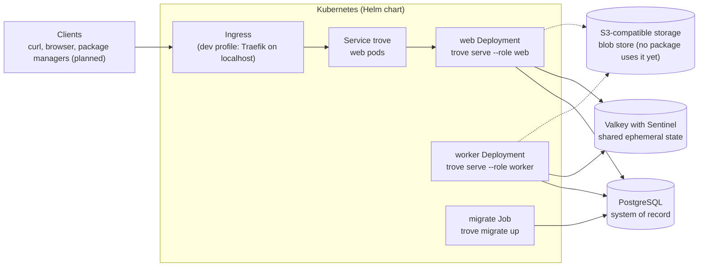

# trove

[](https://github.com/guided-traffic/trove/actions)
[](https://goreportcard.com/report/github.com/guided-traffic/trove)
[](LICENSE)

> **Status: pre-release, foundation milestone (M0): platform only, no package format yet.** The
> binary, its configuration, the PostgreSQL and Valkey connections, replica coordination, the
> S3 blob layer, the system API, the ops endpoints and the Helm chart skeleton are built and tested.
> There is no login, no repository, no package protocol and no backup yet. Everything else is the
> target design in [docs/spec/](docs/spec/README.md). There is no release and no published image.

trove is a self-hosted, highly available binary repository manager. Its target: host your own
packages, proxy and cache public registries on demand (pull-through), and put both behind one URL per
ecosystem. People sign in through your OpenID Connect provider. Access is denied by default and granted
through permission policies that reach down to package-name patterns. GitLab CI jobs need no stored
secret: a job trades its GitLab-issued ID token for a short-lived trove token. npm and NuGet come first.

trove is one Go binary with an embedded Angular UI, deployed with a Helm chart in two roles, `web` and
`worker`. `web` replicas answer HTTP requests behind a Kubernetes Service that spreads them at random,
without session affinity. `worker` replicas run background jobs. No replica keeps state between
requests. PostgreSQL is the system of record; Valkey with Sentinel holds shared ephemeral state.



## ✨ Key Features

Built (M0):

- 🧱 **One binary, roles by configuration.** `trove serve --role web|worker|all`, `trove migrate`, `trove admin config validate`. See [R-ARCH-001](docs/spec/architecture.md).
- ⚙️ **One configuration file, environment overrides, strict validation.** `/etc/trove/trove.yaml`, every key overridable with `TROVE_<SECTION>_<KEY>`, secrets only as files, a redacted effective view. See [R-OPS-028](docs/spec/operations-and-observability.md).
- 🗃️ **Migrations with a compatibility gate.** Embedded in the binary, applied under an advisory lock; a replica waits, not ready, until the schema is current. See [R-ARCH-026](docs/spec/architecture.md).
- 🔁 **Cross-replica coordination.** A PostgreSQL change log that every replica polls, Valkey Pub/Sub as an early eviction path, and singleton work under advisory-lock leases. See [R-ARCH-017](docs/spec/architecture.md) and [R-ARCH-018](docs/spec/architecture.md).
- 🧰 **Durable job queue.** A PostgreSQL job table with leases, heartbeats, attempts and a scheduler for maintenance tasks. See [R-ARCH-016](docs/spec/architecture.md).
- 🟥 **Valkey client with Sentinel discovery.** Finds the primary through Sentinel, follows failovers, a circuit breaker, a degraded but ready mode, and refusal of unsupported server versions. See [R-ARCH-031](docs/spec/architecture.md).
- 🪣 **S3 blob layer.** Content-addressed keys, a spool, digests, a circuit breaker, and a conformance suite run against SeaweedFS. See [R-STOR-001](docs/spec/storage.md) for the layout.
- 🩺 **Health, metrics and the system API.** `/healthz`, `/readyz` and `/metrics` on the ops port; ping, version, info and the replica registry on the client port. See [R-OPS-001](docs/spec/operations-and-observability.md) and [R-API-038](docs/spec/api-and-ui.md).
- ⎈ **Helm chart skeleton.** Separate `web` and `worker` Deployments, a migration hook Job, Services, PodDisruptionBudgets and a fail-fast values check. See [HA and Helm](docs/spec/ha-and-helm.md).
- 🧪 **Local HA profile on kind.** PostgreSQL with a standby, Valkey with a replica and three Sentinels, SeaweedFS, and failure scripts. See [local profile](docs/developer/local-profile.md).

Planned, not built (see the [roadmap](docs/coverage/roadmap.md)):

- 📦 **npm and NuGet v3 first**, with local, remote and virtual repositories. See [npm](docs/spec/formats/npm.md) and [NuGet](docs/spec/formats/nuget.md).
- 🔐 **OIDC login, trove's own tokens, permission policies.** See [identity and authentication](docs/spec/identity-and-authentication.md) and [authorization](docs/spec/authorization.md).
- 🦊 **GitLab CI OIDC federation.** See [GitLab CI OIDC](docs/spec/gitlab-ci-oidc.md).
- 🔁 **Pull-through proxy.** See [repositories and proxy](docs/spec/repositories-and-proxy.md).
- 💾 **Backup and restore.** See [backup and restore](docs/spec/backup-and-restore.md). `trove backup` is reserved and answers "not implemented yet".
- 🖥️ **UI screens.** The M0 build embeds a placeholder page. See [API and UI](docs/spec/api-and-ui.md).

## 📛 Naming conventions

Built names are the ones the code produces. *Planned* marks a name the spec fixes that no code uses yet.

### Binary, commands and listeners

| Name | Value | Source |
|---|---|---|
| Binary | `trove`, static (`CGO_ENABLED=0`); `make build` writes `bin/trove` | `Makefile`, `cmd/trove` |
| Roles | `web`, `worker`, `all` (`all` is for local runs outside the chart) | `cmd/trove/serve.go`, `internal/config/process.go` |
| Client listener | `:8080` (`server.listen`) | `internal/config/server.go` |
| Ops listener | `:8081` (`server.ops_listen`) | `internal/config/server.go` |
| Backup command | `trove backup …` reserved, "not implemented yet" (planned for M5) | `cmd/trove/main.go` |

### URL paths

| Path | Method | Built |
|---|---|---|
| `/api/v1/system/ping`, `/api/v1/system/version`, `/api/v1/system/info`, `/api/v1/system/replicas` | GET | yes |
| `/api/v1/openapi.json`, `/api/v1/openapi.yaml` | GET | yes, from [api/openapi.yaml](api/openapi.yaml) |
| `/api/v1/problems/{code}` | GET | yes; the `type` of every problem is this path |
| `/healthz`, `/readyz`, `/metrics` | GET, ops listener | yes (`/metrics` unless `metrics.enabled: false`) |
| `/api/<format>/<repoKey>/…`, `/files/<repoKey>/<path>`, `/auth/…`, `/ui/{locale}/…` | — | planned ([INV-6](docs/spec/README.md)) |

### Headers

| Header | Value | Built |
|---|---|---|
| `X-Request-Id` | every response; the same value is `requestId` in problem bodies | yes (`internal/httpserver/chain.go`) |
| `X-Trove-Replica` | the instance name, on responses where `server.replica_header` allows it (default `authenticated`) | yes (`internal/httpserver/chain.go`) |
| `Authorization` | a presented credential. M0 has no credentials, so any presented value answers `401` | yes (`internal/app/access.go`) |

### Environment variables

| Name | Pattern | Built |
|---|---|---|
| Configuration override | `TROVE_<SECTION>_<KEY>`, e.g. `TROVE_AUDIT_RETENTION_DAYS` (the `x-trove-env` of [schema.json](internal/config/schema.json)) | yes |
| Configuration file | `/etc/trove/trove.yaml`, or `--config`, or `TROVE_CONFIG_FILE` (an explicit path must exist) | yes (`internal/config/load.go`) |
| Reserved names | `TROVE_CAC_*` and `TROVE_TEST_*` (ignored by the strict check), `TROVE_CONFIG_FILE`, `TROVE_POD_NAME`, `TROVE_POD_NAMESPACE`, `TROVE_NODE_NAME`, `TROVE_POOL_NAME` | yes |
| Instance name | `TROVE_POD_NAME`, then `POD_NAME`, then `HOSTNAME` inside Kubernetes, otherwise `<hostname>-<pid>` | yes (`internal/app/identity.go`) |
| Dev profile | `TROVE_DEV_HTTP_PORT` (edge port, default `8080`), `TROVE_PROFILE` (`default` or `scatter`) | yes (`deploy/dev/`) |

### Valkey

| Name | Pattern | Built |
|---|---|---|
| Key prefix | `valkey.key_prefix`, default `trove:`, must end in `:` | yes |
| Keyspace | the first 12 hex digits of `system_state.keyspace_id`, dashes removed | yes (`internal/app/wire_valkey.go`) |
| Key shape | `<key_prefix><keyspace>:<mechanism>:v<version>[:<part>…]`; a part matches `^[A-Za-z0-9_-]{1,128}$` | yes (`internal/cluster/valkey_keys.go`) |
| Health probe | `trove:<ks>:probe:v1:<instance>`, expires after 30 s | yes (`internal/cluster/valkey.go`) |
| Change channel | `trove:<ks>:inv:v1` | yes (`internal/cluster/changelog*.go`) |
| Client names | `trove:<instance>:pubsub` (Pub/Sub), `trove:<instance>:probe` (Sentinel probe) | yes (`internal/cluster/valkey_pubsub.go`, `valkey_sentinel.go`) |
| Negative cache, flight locks, rate limits, throttle markers | `…:neg:v1:…`, `…:lock:fetch:v1:…`, `…:rl:v1:…`, `…:tokseen:v1:…` | planned (R-ARCH-030) |

### Object storage

| Name | Pattern | Built |
|---|---|---|
| Blob object | `<prefix>/sha256/<h0h1>/<h2h3>/<64 hex>`; `<prefix>` defaults to `trove` (`storage.s3.prefix`) | yes (`internal/blob/key.go`); no package writes blobs yet |
| Probe, upload staging, revocation journal | `<prefix>/_probe/…`, `<prefix>/_uploads/…`, `<prefix>/_journal/revocations/…` | planned ([R-STOR-001](docs/spec/storage.md)) |

### PostgreSQL

| Name | Value | Built |
|---|---|---|
| Schema | `trove` (`database.schema`) | yes |
| Migration records | `schema_migration`, `schema_state` | yes (`internal/meta/postgres/migrations/`) |
| Advisory-lock categories | two-`int4` form: `1` lease, `2` fetch (retired, never reused), `3` migration, `4` configuration | yes (`internal/cluster/locks.go`) |
| Roles and `application_name` | `trove_owner`, `trove_app`, `trove:<replica>:<class>` | planned ([R-HA-014](docs/spec/ha-and-helm.md)) |

### Metrics

Built families, all with the `trove_` prefix:

| Family | Labels |
|---|---|
| `trove_build_info` | build information, with the role |
| `trove_cluster_changes_applied_total` | `area`, `source` (`poll`, `message`, `local`) |
| `trove_cluster_changes_published_total`, `trove_cluster_changes_dropped_total` | `area` |
| `trove_cluster_poll_errors_total`, `trove_cluster_poll_last_success_timestamp_seconds` | counter, gauge |
| `trove_cluster_signals_published_total`, `trove_cluster_signals_dropped_total` | `area` |
| `trove_cache_flushes_total` | `cache`, `reason` |
| `trove_valkey_pubsub_subscribed` | gauge |
| `trove_outbound_requests_total`, `trove_outbound_request_duration_seconds`, `trove_outbound_egress_denied_total` | `kind` (the purpose of the outbound client) |
| `trove_storage_s3_requests_total`, `trove_storage_s3_request_duration_seconds` | `operation`, `outcome` |
| `trove_tracing_spans_dropped_total` | none |

### Kubernetes and Helm

`<fullname>` is the release name, or `fullnameOverride` ([_helpers.tpl](deploy/helm/trove/templates/_helpers.tpl)).

| Name | Value | Built |
|---|---|---|
| Chart | `deploy/helm/trove` | yes (skeleton) |
| Deployments | `<fullname>-web` (`--role web`), `<fullname>-worker` (`--role worker`) | yes |
| Migration hook Job | `<fullname>-migrate` | yes |
| ConfigMap | `<fullname>-config`, holding `trove.yaml` | yes |
| Services | `<fullname>` (client port), `<fullname>-ops` (ops port) | yes |
| Backup CronJob, restore Job | `<fullname>-backup`, `<fullname>-restore` | planned (M5) |

## 📚 Documentation

| Document | What it holds |
|---|---|
| [docs/developer/](docs/developer/README.md) | Contributor entry point: repository layout, architecture, build and test, CI, configuration, the subsystem pages, the local profile |
| [docs/security/](docs/security/README.md) | Security architecture, one page per perspective, with the open gaps of each page |
| [SECURITY.md](SECURITY.md) | How to report a vulnerability |
| [docs/spec/](docs/spec/README.md) | Target design: owner constraints, invariants `INV-1` to `INV-19`, requirements `R-<AREA>-nnn` |
| [docs/coverage/](docs/coverage/README.md) | Which catalog entries the spec covers, and which requirements have passing tests |
| [docs/coverage/roadmap.md](docs/coverage/roadmap.md) | Milestones, exit criteria and the open decisions |
| [docs/decisions.md](docs/decisions.md) | Architecture decision records |
| [docs/features/](docs/features/README.md) | The feature catalog that the spec covers |
| Upstream | [Go](https://go.dev/doc/), [PostgreSQL 16](https://www.postgresql.org/docs/16/), [Valkey Sentinel](https://valkey.io/topics/sentinel/), [Helm](https://helm.sh/docs/), [kind](https://kind.sigs.k8s.io/), [CloudNativePG](https://cloudnative-pg.io/documentation/), [RFC 9457](https://www.rfc-editor.org/rfc/rfc9457), [OpenAPI 3.1](https://spec.openapis.org/oas/v3.1.0) |

## 🚀 TL;DR fast start

**Prerequisites.** The pins are in [tools/versions.env](tools/versions.env) (kind, kubectl, Helm,
golangci-lint and more), in `go.mod` (Go 1.27.3) and in `web/.nvmrc` (Node.js 26.5.0). Install Docker,
Go, Node.js and GNU Make 3.81 or later, plus the pinned kind, kubectl and Helm for the dev profile.
`make versions-check` reports any installed tool that differs from its pin.

**1. Start the local profile** (kind cluster, CloudNativePG PostgreSQL with a standby, Valkey with a replica
and three Sentinels, SeaweedFS, the Traefik edge, the chart with `web` and `worker`):

```shell
make dev-up                          # example: TROVE_DEV_HTTP_PORT=18080 make dev-up if 8080 is taken
```

**2. Verify through the edge** on `http://localhost:8080` (or your `TROVE_DEV_HTTP_PORT`). The dev values
set `system.bootstrap_anonymous_read`, a development-only switch, so the replica list reads without a
credential:

```shell
curl -s -o /dev/null -w '%{http_code}\n' http://localhost:8080/api/v1/system/ping      # example: 200
curl -s http://localhost:8080/api/v1/system/replicas                                    # example: the web and worker replicas
```

**3. Run the integration tests** against their own stack (PostgreSQL, PgBouncer, Valkey with Sentinel and
TLS, SeaweedFS), not against the dev profile:

```shell
make integration-up && make test-integration
```

<details>
<summary>Upgrade, uninstall and the failure scripts</summary>

- Upgrade: there is no in-place upgrade of the dev profile. Stop it with `make dev-down`, then run `make dev-up` again.
- Uninstall: `make dev-down` deletes the dev cluster; `make integration-down` stops the integration stack and removes its volumes.
- Failure scripts, under load: `make dev-failover` (PostgreSQL switchover), `make dev-valkey-failover`, `make dev-valkey-kill`, `make dev-valkey-outage DURATION=60s`, `make dev-drain`.

</details>

## 📖 Full reference

### Command line

`trove <command> [flags]`

| Command | Flags | Behaviour |
|---|---|---|
| `trove serve` | `--role web\|worker\|all` (overrides `process.role`, which has no default), `--config <file>`, `--log-level <level>` | Runs one replica until `SIGTERM` or `SIGINT`. A second signal ends the process at once. |
| `trove migrate [up\|status]` | `--config <file>`, `--log-level <level>` | `up` (the default) applies the embedded migrations under the migration lock. `status` prints the state as JSON. |
| `trove admin config validate` | `--format table\|json` (default `table`), `--config <file>`, `--log-level <level>` | Validates the file and the environment and prints the effective configuration with each value's source. Secrets are redacted. |
| `trove version`, `trove --version` | none | Version, commit and build date |
| `trove help`, `-h`, `--help` | none | Usage |
| `trove backup …` | none | Reserved. Returns "not implemented yet" (planned for M5). |

Exit status: `0` success, `1` failed command, `2` usage error.

### Configuration keys

Keys are snake_case in `trove.yaml`; the environment override is `TROVE_` plus the key path in upper case
(`database.ssl_mode` → `TROVE_DATABASE_SSL_MODE`). The defaults below are the `default:` tags of
[internal/config](internal/config/); a key without a default has none and is required by the command
that uses it. The complete list with every environment name is generated into
[internal/config/schema.json](internal/config/schema.json); the sub-keys of `storage` that this table
does not repeat (circuit breaker, multipart, presign, scrub, orphans, usage, stats, sidecars, uploads,
delete) are there.

<details>
<summary>Process, server and runtime</summary>

```yaml
process:
  role: ""                              # no default: web, worker or all; required by serve
server:
  listen: ":8080"                       # default
  ops_listen: ":8081"                   # default
  read_header_timeout: 10s              # default
  idle_timeout: 120s                    # default
  transfer_stall_timeout: 60s           # default
  max_header_bytes: 65536               # default
  max_in_flight: 4096                   # default: concurrent requests per replica
  shutdown_timeout: 0s                  # default: 0 derives the bound from runtime.termination_grace_period
  base_url: ""                          # default: empty only for development; example: https://trove.example.com
  content_base_url: ""                  # default: empty = one origin (planned, P1)
  content_url_ttl: 300s                 # default
  trusted_proxies: []                   # default; example: ["10.0.0.0/8"]; a /0 prefix is refused
  forwarded_header: x-forwarded-for     # default: x-forwarded-for | forwarded
  additional_base_urls: []              # default
  replica_header: authenticated         # default: authenticated | always | never
  tls:
    cert_file: ""                       # default
    key_file: ""                        # default; a file, never inline
runtime:
  memory_limit_ratio: 0.85              # default
  memory_limit_bytes: 0                 # default: 0 = none known
  termination_grace_period: 0s          # default: 0s = unknown
```

</details>

<details>
<summary>Database, pool and migrations</summary>

```yaml
database:
  host: ""                              # no default, required; example: trove-db-rw.trove.svc
  port: 5432                            # default
  name: ""                              # no default, required
  schema: trove                         # default
  session_host: ""                      # default: empty = host
  session_port: 0                       # default: 0 = port
  control_host: ""                      # default: empty = host
  control_port: 0                       # default: 0 = port
  control_name: ""                      # default: empty = name
  backup_role: ""                       # default
  username_file: /var/run/secrets/trove/database/username   # default; file only
  password_file: /var/run/secrets/trove/database/password   # default; file only, read again per connection
  ssl_mode: verify-full                 # default: verify-full | verify-ca | require | disable | allow | prefer
  ssl_root_cert_file: ""                # default
  ssl_cert_file: ""                     # default
  ssl_key_file: ""                      # default; file only
  allow_insecure: false                 # default; needed for disable, allow and prefer
  connect_timeout: 5s                   # default
  target_session_attrs: read-write      # default: read-write | primary | any
  lease_pool_size: 4                    # default
  lease_check_interval: 5s              # default
  pooler:
    mode: none                          # default: none | session | transaction
    server_connections: 0               # default
  pool:
    max_conns: 20                       # default; at least 2
    min_conns: 2                        # default
    max_conn_lifetime: 30m              # default
    max_conn_lifetime_jitter: 5m        # default
    max_conn_idle_time: 5m              # default
    health_check_period: 30s            # default
  session:
    statement_timeout: 30s              # default
    lock_timeout: 5s                    # default
    idle_in_transaction_session_timeout: 60s   # default
  retry:
    initial_backoff: 100ms              # default
    max_backoff: 2s                     # default
    max_elapsed: 30s                    # default; request deadlines may cut it shorter
  keepalive:
    idle: 15s                           # default
    interval: 5s                        # default
    count: 3                            # default
    user_timeout: 30s                   # default
  server_keepalive:
    idle: 60s                           # default
    interval: 10s                       # default
    count: 6                            # default
  preflight:
    connection_budget: enforce          # default: enforce | warn
    reserved_connections: 10            # default
    allow_superuser: false              # default
    expected_web_replicas: 0            # default; set by the chart on the migration Job
    expected_worker_replicas: 0         # default; set by the chart on the migration Job
migrate:
  advisory_lock_wait: 5m                # default
  ddl_lock_timeout: 5s                  # default
  ddl_lock_retries: 20                  # default
```

</details>

<details>
<summary>Valkey</summary>

```yaml
valkey:
  mode: sentinel                        # default: sentinel | standalone (development only)
  sentinel:
    addresses: []                       # default; required in sentinel mode; example: ["trove-valkey-sentinel-0:26379"]
    primary_name: ""                    # default; required in sentinel mode; example: trove
    username_file: ""                   # default; file only
    password_file: ""                   # default; file only
    tls: true                           # default: use valkey.tls for the Sentinel connections too
    refresh_interval: 5s                # default
  address: ""                           # default; standalone mode only
  database: 0                           # default
  key_prefix: "trove:"                  # default; must end in ":"
  username_file: ""                     # default; empty = the default user
  password_file: ""                     # default; file only
  tls:
    mode: verify-full                   # default: verify-full | verify-ca | disable
    ca_file: ""                         # default; empty = system roots plus the trusted CA bundle
    cert_file: ""                       # default
    key_file: ""                        # default; file only
    server_name: ""                     # default; empty = the host name of each address
  allow_insecure: false                 # default; required for tls.mode disable and sentinel.tls false
  connect_timeout: 2s                   # default
  command_timeout: 500ms                # default
  sentinel_query_timeout: 300ms         # default; per Sentinel tried
  max_conn_lifetime: 30m                # default
  health_check_interval: 5s             # default
  reconnect:
    initial_backoff: 100ms              # default
    max_backoff: 5s                     # default
  circuit_breaker:
    failure_threshold: 5                # default
    open_duration: 5s                   # default
```

</details>

<details>
<summary>Jobs, cluster, cache, health, secrets, system</summary>

```yaml
jobs:
  workers: { default: 4, maintenance: 1, index: 2, delivery: 8 }   # default: workers per queue
  poll_interval: 2s                     # default
  lease_duration: 60s                   # default
  heartbeat_interval: 15s               # default
  schedule_tick: 10s                    # default
  retention: 720h                       # default: how long finished jobs are kept
  background_migrations: { batch_size: 1000, pause_between_batches: 100ms }   # default
cluster:
  lease_retry_interval: 15s             # default
  epoch_poll_interval: 1s               # default
  epoch_max_staleness: 20s              # default
  change_retention: 1h                  # default
  signal_coalesce_window: 50ms          # default
  flight_lock_ttl: 30s                  # default
cache:
  rendition_bytes: 256MiB               # default
  snapshot_safety_ttl: 5m               # default
  unknown_repo_keys: 10000              # default
health:
  check_interval: 5s                    # default
  check_timeout: 2s                     # default
  failure_threshold: 2                  # default
  success_threshold: 1                  # default
  require_object_store: false           # default; true gates readiness on every replica continuously
  watchdog_timeout: 2m                  # default
  shutdown_drain_delay: 5s              # default; must exceed the edge's endpoint removal time
secrets:
  encryption_key_files: []              # default; key files of 32 random bytes, base64
  active_key_id: ""                     # default
system:
  public_version: false                 # default
  bootstrap_anonymous_read: false       # default; development only, refused with an https base URL
  heartbeat_interval: 10s               # default
  heartbeat_stale_after: 30s            # default
```

</details>

<details>
<summary>Storage, logs, metrics, tracing, audit, maintenance, outbound</summary>

```yaml
storage:
  s3:
    endpoint: ""                        # default; empty = AWS endpoint resolution for the region
    region: ""                          # default
    bucket: ""                          # default; required to serve
    prefix: trove                       # default
    force_path_style: false             # default; true for SeaweedFS, MinIO and Ceph RGW
    allow_insecure_endpoint: false      # default; needed for an http:// endpoint
    ca_file: ""                         # default; refused until the outbound layer supports it (Q-STOR-14)
    storage_class: ""                   # default
    payload_checksum: sha256            # default: sha256 | md5 | none
    startup_check: true                 # default
    credentials:
      source: default                   # default: default | webIdentity | static
      access_key_id_file: ""            # default; file only
      secret_access_key_file: ""        # default; file only
    http:
      max_connections: 256              # default; the outbound factory's default applies until the option exists
      dial_timeout: 5s                  # default
      response_header_timeout: 30s      # default
      idle_transfer_timeout: 60s        # default
  spool:
    dir: /var/lib/trove/spool           # default
    max_bytes: 50GiB                    # default; budget shared by all uploads of a replica
    min_free_bytes: 2GiB                # default
    warn_percent: 80                    # default
  upload:
    max_size: 10GiB                     # default; must fit spool.max_bytes on the roles web and all
    commit_attempts: 5                  # default
    commit_deadline: 1h                 # default
  download:
    buffer_size: 256KiB                 # default
    verify: true                        # default
  gc:
    grace_period: 24h                   # default
    delete_settle: 30s                  # default
    handover_delay: 10m                 # default
log:
  format: json                          # default: json | text
  level: info                           # default: debug | info | warn | error
  levels: {}                            # default; per component, e.g. {"proxy": "debug"}
  add_source: false                     # default
  ring_buffer_records: 5000             # default
  override_max_duration: 24h            # default
  request:
    enabled: true                       # default
    ops_listener: false                 # default: also log probe and metrics requests
    redact_query_params: [token, access_token, password, secret, sig, signature, X-Amz-Signature, X-Amz-Credential, X-Amz-Security-Token]   # default
  upstream:
    enabled: true                       # default
metrics:
  enabled: true                         # default
  auth: none                            # default: none | static
  bearer_token_file: ""                 # default; file only, used with auth: static
  label_limits: { repository: 500, subscription: 100 }   # default
  repository_label_include: []           # default
  slow_query_threshold: 500ms           # default
  db_query_histograms: false            # default
  native_histograms: false              # default
  db_gauge_interval: 30s                # default
tracing:
  enabled: false                        # default
  endpoint: ""                          # default; not required when OTEL_EXPORTER_OTLP_ENDPOINT or OTEL_EXPORTER_OTLP_TRACES_ENDPOINT is set
  protocol: http/protobuf               # default: grpc | http/protobuf
  ca_file: ""                           # default
  headers_file: ""                      # default; file only
  sample_ratio: 0.1                     # default
  incoming_context: trusted_proxies     # default: trusted_proxies | all | none
  propagate_to_upstreams: false         # default
  queue_size: 2048                      # default
audit:
  retention_days: 365                   # default
  async_buffer: 10000                   # default
  denial_dedup_window: 1m               # default
  token_rejection_dedup_window: 5m      # default
  record_anonymous_denials: false       # default
  record_downloads: false               # default
maintenance:
  tasks: {}                             # default: built-in tasks (gc, gc-full, orphan-sweep, scrub, storage-summary, remote-cache-cleanup) with their schedules
proxy:
  outbound:
    proxy_from_environment: false       # default
    tls:
      use_system_roots: true            # default
      ca_files: []                      # default
      min_version: "1.2"                # default: 1.2 | 1.3
    address_policy:
      deny_cidrs: [127.0.0.0/8, ::1/128, 0.0.0.0/8, ::/128, 169.254.0.0/16, fe80::/10, fd00:ec2::254/128, 224.0.0.0/4, ff00::/8, 255.255.255.255/32]   # default
      allow_cidrs: []                   # default
```

</details>

### Security-relevant settings

| Setting | Default | What changes | Decision |
|---|---|---|---|
| `database.ssl_mode`, `database.allow_insecure` | `verify-full`, `false` | `disable`, `allow` and `prefer` need `allow_insecure: true`. A session connection behind a transaction-mode pooler is refused, not retried. | [Q-ARCH-23](docs/spec/architecture.md) |
| Passwords and keys (`*_file`) | files only | A secret is never an inline value; the database password is read again on every new connection. | [R-OPS-028](docs/spec/operations-and-observability.md) |
| `valkey.tls.mode`, `valkey.sentinel.tls`, `valkey.allow_insecure` | `verify-full`, `true`, `false` | `disable` and plaintext Sentinel connections are refused without `allow_insecure`; the ACL password would cross the network otherwise. | [Q-HA-30](docs/spec/ha-and-helm.md) |
| `system.bootstrap_anonymous_read` | `false` | `true` lets anonymous callers read the replica registry and installation facts on the client port. Startup refuses it with an `https` base URL that is not localhost. | [Q-API-14](docs/spec/api-and-ui.md) |
| `server.trusted_proxies`, `server.forwarded_header` | `[]`, `x-forwarded-for` | Addresses listed here may set the client address; a wider list lets a client choose its own address in logs and limits. | [R-ARCH-006](docs/spec/architecture.md) |
| `server.base_url` | empty | Empty is for development only. Set the `https` origin of the edge. | [R-OPS-005](docs/spec/operations-and-observability.md) |
| `metrics.auth` | `none` | With `none`, whoever reaches port 8081 reads the metrics; the NetworkPolicy of the chart limits that. `static` requires a bearer token file. | [R-OPS-006](docs/spec/operations-and-observability.md) |
| `storage.s3.allow_insecure_endpoint` | `false` | An `http://` object-store endpoint is refused without it. | [Q-STOR-14](docs/spec/storage.md) |
| `proxy.outbound.address_policy` | private, loopback and link-local ranges denied | Upstream and tracing connections are refused to these addresses; the object-store endpoint is exempt, and tracing export is not checked (H-53, H-56). | [Q-ARCH-21](docs/spec/architecture.md), [Q-OPS-25](docs/spec/operations-and-observability.md) |
| `secrets.encryption_key_files` | empty | Keys are read once at start-up; a rotated key file takes effect after a restart (H-55). | [R-ARCH-021](docs/spec/architecture.md) |

### System API

The OpenAPI 3.1 document is [api/openapi.yaml](api/openapi.yaml); the binary serves it at
`/api/v1/openapi.json` and `/api/v1/openapi.yaml`.

| Method and path | Purpose | Access in M0 |
|---|---|---|
| `GET /api/v1/system/ping` | Answers on the client port | as declared in [api/openapi.yaml](api/openapi.yaml) |
| `GET /api/v1/system/version` | Version and revision | public only with `system.public_version: true`, otherwise as declared |
| `GET /api/v1/system/info` | Installation facts: version, base URL, replicas per role, database and schema versions, Valkey facts | `system.read`, which nobody holds in M0: anonymous only with `system.bootstrap_anonymous_read` |
| `GET /api/v1/system/replicas` | Replica registry with readiness checks and each replica's view of Valkey | the same as `info` |
| `GET /api/v1/problems/{code}` | Description of a problem code | as declared |

Errors are `application/problem+json` (RFC 9457): `type` is `/api/v1/problems/<code>`, `code` is the
stable identifier, `requestId` equals `X-Request-Id`, and `errors` lists the fields of a `422`. A request
that cannot be parsed answers `400 malformed_request`. A replica at its concurrency bound answers
`503 server_busy`, and a statement over its time limit `503 database_timeout`. See [Q-API-13](docs/spec/api-and-ui.md).

### Ops listener

| Path | Answer |
|---|---|
| `GET /healthz` | Liveness: `200` while the replica's watched loops make progress |
| `GET /readyz` | Readiness: `200` once PostgreSQL and the process checks pass; `503` otherwise, including while the schema is behind |
| `GET /metrics` | Prometheus text format, unless `metrics.enabled: false` |

The ops listener has no authentication of its own in M0. Limit it with a NetworkPolicy, which the chart
renders.

### Helm values

The chart is [deploy/helm/trove](deploy/helm/trove/). The defaults below are from
[values.yaml](deploy/helm/trove/values.yaml); [values.schema.json](deploy/helm/trove/values.schema.json)
refuses unknown keys. The `config` object is rendered to `/etc/trove/trove.yaml`.

```yaml
image:
  registry: ghcr.io                     # default
  repository: guided-traffic/trove      # default
  tag: ""                               # default: empty = the chart's appVersion
  digest: ""                            # default; wins over tag
highAvailability:
  enforce: true                         # default: at least two replicas per role, a PDB, host spreading; Sentinel mode with three Sentinels
web:
  replicaCount: 3                       # default
worker:
  replicaCount: 2                       # default; at least 1
  spool:
    sizeLimit: 5Gi                      # default
spool:
  sizeLimit: 20Gi                       # default; the web spool
  headroom: 2GiB                        # default; sizeLimit minus headroom is storage.spool.max_bytes
ingress:
  enabled: false                        # default
```

The chart never creates a Secret. It references existing Secrets by name (`secrets.*.existingSecret`), and
the values name only file paths inside the pods. `highAvailability.enforce` makes the chart refuse a
configuration that the HA contract does not allow ([R-HA-029](docs/spec/ha-and-helm.md)).

### Development targets

| Target | What it does |
|---|---|
| `make build` | Static binary in `bin/trove` |
| `make web` | Angular build into `internal/webui/dist/` (needs Node.js 26.5.0) |
| `make generate`, `make generate-check` | Every `go:generate` directive; the check fails on any diff |
| `make lint`, `make fmt` | `golangci-lint` and `go vet`; the formatters of `.golangci.yml` |
| `make test` | Unit tests with the race detector |
| `make chart-lint`, `make chart-test` | Helm lint over every value set; render assertions (`chart` build tag) |
| `make integration-up`, `make test-integration`, `make integration-down` | Integration stack and tests (`integration` build tag, `test/integration/<area>`) |
| `make coverage` | Regenerates the requirement checklist in `docs/coverage/` |
| `make dev-up`, `make dev-down`, `make e2e` | Local profile, its teardown, and the end-to-end suite (`e2e` build tag) |

## 🛠 Development

Run `make help` for the list of targets. Before a change, run `make generate-check`, `make lint` and
`make test`. Contributors start at [docs/developer/README.md](docs/developer/README.md), which describes the
repository layout, the test tiers and the conventions.

## 🗺 Roadmap

The milestones, their exit criteria and the open decisions for the owner's walkthrough are in
[docs/coverage/roadmap.md](docs/coverage/roadmap.md). The next milestone (M1) brings login, tokens,
permissions, repositories, raw file transfer and the admin UI.

## License

Apache License 2.0. See [LICENSE](LICENSE).
