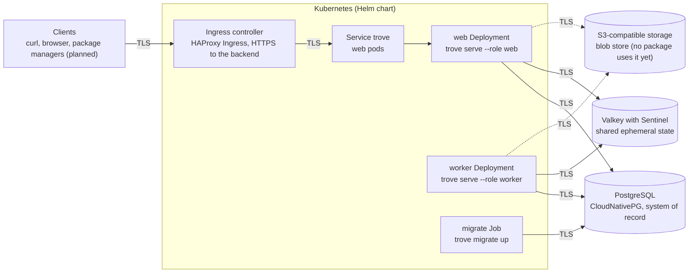

# trove

[](https://github.com/guided-traffic/trove/actions)
[](https://github.com/guided-traffic/trove)
[](https://goreportcard.com/report/github.com/guided-traffic/trove)
[](LICENSE)

> **Status: pre-release, access core milestone (M1) built: login, tokens, permission policies, endpoints and exposure rules, generic repositories with raw transfer, audit and the admin UI.** The platform of M0 (the binary, its configuration,
> the PostgreSQL and Valkey connections, replica coordination, the S3 blob layer, the TLS of every connection, the system API,
> the ops endpoints and the Helm chart) is built and tested. Not built yet: the npm and NuGet protocols, GitLab CI federation,
> the pull-through proxy and backup and restore. Everything else is the target design in [docs/spec/](docs/spec/README.md). `v0.1.0` is the
> last release made before the switch to the organisation's CI and release standard; it was published to `ghcr.io`. Releases
> from now on are cut by Semantic Release from the conventional commits on `main`, and published to Docker Hub and to the chart
> repository ([releasing](docs/developer/releasing.md)).

trove is a self-hosted, highly available binary repository manager. Its target: host your own packages, proxy and cache public
registries on demand (pull-through), and put both behind one URL per ecosystem. People sign in through your OpenID Connect
provider. Access is denied by default and granted through permission policies that reach down to package-name patterns. GitLab CI
jobs need no stored secret: a job trades its GitLab-issued ID token for a short-lived trove token. npm and NuGet come first.

trove is one Go binary with an embedded Angular UI, deployed with a Helm chart in two roles, `web` and `worker`. `web` replicas
answer HTTP requests behind a Kubernetes Service that spreads them at random, without session affinity. `worker` replicas run
background jobs. No replica keeps state between requests. PostgreSQL is the system of record; Valkey with Sentinel holds shared
ephemeral state. Every connection can run TLS, trove's own listeners included, and certificates are reloaded without a
restart.



## ✨ Key Features

Built (M0):

- 🧱 **One binary, roles by configuration.** `trove serve --role web|worker|all`, `trove migrate`, `trove admin config validate`. See [R-ARCH-001](docs/spec/architecture.md).
- ⚙️ **One configuration file, environment overrides, strict validation.** `/etc/trove/trove.yaml`, every key overridable with `TROVE_<SECTION>_<KEY>`, secrets only as files, a redacted effective view. See [R-OPS-028](docs/spec/operations-and-observability.md).
- 🔒 **TLS on every connection trove makes or accepts.** Listeners, endpoints, PostgreSQL, Valkey and Sentinels, the object store and outbound HTTP; certificates picked by SNI and reloaded without a restart. Plain HTTP is an explicit chart setting. See [transport encryption](docs/security/transport-encryption.md) and [INV-20](docs/spec/README.md#design-invariants).
- 🌐 **Endpoints.** One client listener per endpoint, identified by the listener, not by the `Host` header; a foreign host answers `421`. See [endpoints](docs/developer/endpoints.md) and [ADR-128](docs/decisions.md#adr-128--endpoints-one-listener-each-identified-by-the-listener-with-exposure-rules-as-a-ceiling).
- 🗃️ **Migrations with a compatibility gate.** Embedded in the binary, applied under an advisory lock; a replica waits, not ready, until the schema is current. See [R-ARCH-026](docs/spec/architecture.md).
- 🔁 **Cross-replica coordination.** A PostgreSQL change log that every replica polls, Valkey Pub/Sub as an early eviction path, and singleton work under session advisory-lock leases with fencing. See [isolation and coordination](docs/security/isolation-and-coordination.md).
- 🧰 **Durable job queue.** A PostgreSQL job table with leases, heartbeats, attempts and a scheduler for maintenance tasks. See [R-ARCH-016](docs/spec/architecture.md).
- 🟥 **Valkey client with Sentinel discovery.** Finds the primary through Sentinel, follows failovers, a circuit breaker, a degraded but ready mode, and refusal of unsupported server versions. See [R-ARCH-031](docs/spec/architecture.md).
- 🔑 **Stored-secret key ring.** Keys from files, sealed values under AES-256-GCM with row and column bound as additional data, and redaction of secrets in log records, span attributes and error texts. See [data and secret flow](docs/security/data-and-secret-flow.md).
- 🛡️ **Egress address policy.** Outbound clients refuse denied addresses after DNS resolution, zoned IPv6 always, and the NAT64 forms of denied IPv4. See [egress](docs/security/egress.md).
- 🪣 **S3 blob layer.** Content-addressed keys, a spool, digests, a circuit breaker, and a conformance suite run against SeaweedFS. See [R-STOR-001](docs/spec/storage.md) for the layout.
- 🩺 **Health, metrics and the system API.** `/healthz`, `/readyz` and `/metrics` on the ops port; ping, version, info and the replica registry on the client port. See [R-OPS-001](docs/spec/operations-and-observability.md) and [R-API-038](docs/spec/api-and-ui.md).
- ⎈ **Helm chart.** Separate `web` and `worker` Deployments, a migration hook Job, Services, Ingress with backend TLS, NetworkPolicies, PodDisruptionBudgets and a fail-fast values check. See [HA and Helm](docs/spec/ha-and-helm.md).
- 🧪 **Local HA profile on kind.** PostgreSQL with a standby, Valkey with a replica and three Sentinels, SeaweedFS, and failure scripts. See [local profile](docs/developer/local-profile.md).

Built (M1, access core):

- 🔐 **OIDC login with PKCE.** Providers under `auth.oidc.providers`, the authorization-code flow with PKCE, a server-side session per browser login, CSRF protection and logout. See [login](docs/developer/login.md) and [login and sessions](docs/security/login-and-sessions.md).
- 🆘 **Break-glass administrator.** One local account whose password comes from a file: a plaintext password of at least 20 characters or an Argon2id hash; lockout and a rotation hold. See [login](docs/developer/login.md).
- 🎟️ **Own tokens.** Personal (`trv_pat_`) and service-account (`trv_sat_`) tokens with lifetimes, rotation, revocation, a per-address failed-credential throttle. See [identity](docs/developer/identity.md) and [tokens and credentials](docs/security/tokens-and-credentials.md).
- 🛂 **Permission policies.** Deny by default; allow-only policies over repository and package-name patterns, five system roles and role bindings; a grant index per replica that is consistent through an epoch. See [authorization](docs/developer/authorization.md) and [permissions](docs/security/permissions.md).
- 🚪 **Endpoints and exposure rules.** Further endpoints on their own listeners and hosts; exposure rules are a ceiling on what each endpoint serves. See [endpoints](docs/developer/endpoints.md) and [endpoints and exposure](docs/security/endpoints-and-exposure.md).
- 📦 **Generic repositories.** Local repositories with flat paths; raw transfer under `/files/{repoKey}/{path}` with `PUT`, `GET` (with `Range`), `HEAD` and `DELETE`; folders and the items API. See [files](docs/developer/files.md) and [repository model](docs/security/repository-model.md).
- 🧾 **Audit.** An event registry, transactional and asynchronous recording, a PostgreSQL journal with partitions and retention, and the query and export API. See [audit](docs/developer/audit.md) and [audit trail](docs/security/audit.md).
- 🧭 **Management API.** Under `/api/v1/`, described by [api/openapi.yaml](api/openapi.yaml): problem+json errors, cursor paging, ETags with `If-Match`, idempotency keys, and a permission declared on every operation. See [API families](#management-api).
- 🖥️ **Admin UI.** The Angular application, embedded in the binary: sign-in, the file tree, repositories, users, groups, service accounts, tokens, policies, endpoints, audit and the system status. See [web UI](docs/developer/web-ui.md).

Planned, not built (see the [roadmap](docs/coverage/roadmap.md)): the npm and NuGet protocols with local, remote and virtual repositories;
remote and virtual repositories for the generic format; GitLab CI OIDC federation; the pull-through proxy; backup and restore; the UI
screens of packages, search, trash, builds, setup, webhooks, CI identity and projects.

## 📛 Naming conventions

Built names are the ones the code produces. *Planned* marks a name the spec fixes that no code uses yet.

### Binary, commands and listeners

| Name | Value | Source |
|---|---|---|
| Binary | `trove`, static (`CGO_ENABLED=0`); `make build` writes `bin/trove` | `Makefile`, `cmd/trove` |
| Roles | `web`, `worker`, `all` (`all` is for local runs outside the chart) | `cmd/trove/serve.go`, `internal/config/process.go` |
| Default client listener | `:8080` (`server.listen`) | `internal/config/server.go` |
| Ops listener | `:8081` (`server.ops_listen`) | `internal/config/server.go` |
| Further endpoint listener | any free port, one per endpoint, name `^[a-z][a-z0-9-]{0,19}$` (`server.endpoints.<name>.listen`) | `internal/config/endpoints.go` |
| Endpoint name in metrics, logs and spans | `default` for the default endpoint, the configured name otherwise; a name outside the configured set folds into `_other` | `internal/observability` |
| Backup command | `trove backup …` reserved, "not implemented yet" (planned for M5) | `cmd/trove/main.go` |

### URL paths

| Path | Method | Built |
|---|---|---|
| `/api/v1/system/ping`, `/api/v1/system/version`, `/api/v1/system/info`, `/api/v1/system/replicas` | GET | yes |
| `/api/v1/openapi.json`, `/api/v1/openapi.yaml` | GET | yes, from [api/openapi.yaml](api/openapi.yaml) |
| `/api/v1/problems/{code}` | GET | yes; the `type` of every problem is this path |
| `/healthz`, `/readyz`, `/metrics` | GET, ops listener | yes (`/metrics` unless `metrics.enabled: false`) |
| `/files/{repoKey}/{path}` | GET, HEAD, PUT, DELETE | yes (M1; [files](docs/developer/files.md)) |
| `/auth/oidc/{providerId}/start`, `/auth/oidc/{providerId}/callback` | GET | yes (M1; [login](docs/developer/login.md)) |
| `/auth/local/login`, `/auth/logout` | POST | yes (M1; the break-glass login and logout) |
| `/api/v1/…` (the management API) | see the [API families](#management-api) | yes (M1; [api/openapi.yaml](api/openapi.yaml)) |
| `/api/<format>/<repoKey>/…`, `/ui/{locale}/…` | — | planned ([INV-6](docs/spec/README.md)) |

### Headers

| Header | Value | Built |
|---|---|---|
| `X-Request-Id` | every response; the same value is `requestId` in problem bodies and the trace ID of the request | yes (`internal/httpserver/chain.go`) |
| `X-Trove-Replica` | the instance name, on responses where `server.replica_header` allows it (default `authenticated`) | yes (`internal/httpserver/chain.go`) |
| `X-Forwarded-For` or `Forwarded` | the family the edge rewrites: exactly one, chosen by `server.forwarded_header`; the other is never read | yes (`internal/httpserver/clientaddr.go`) |
| `Authorization` | `Bearer <token>` with a `trv_pat_` or `trv_sat_` value (`trv_cit_` is reserved until the CI exchange). The status code of a refused value is not restated here | yes (`internal/auth/stage.go`) |
| `X-CSRF-Token` | the value of the `__Host-trv_csrf` cookie, on a state-changing request that the session cookie authenticates; with a same-origin `Origin` or `Sec-Fetch-Site`. Failure: `403 csrf_failed` | yes (`internal/auth/session`) |
| `Idempotency-Key` | on a create: a replay answers the stored outcome; the same key with another body answers `422 idempotency_key_reused`, a concurrent duplicate `409 idempotency_in_progress` | yes (`internal/api/v1/idempotency.go`) |
| `If-Match`, `If-None-Match` | the ETag of a resource on `PUT` and `PATCH`; `If-Match` is required there, and `If-Match: *` is the explicit blind write. `If-None-Match: *` on `/files/` makes a deploy create-only | yes (`internal/api/v1`, `internal/api/rawfiles/conditional.go`) |
| `ETag` of a repository read | `"<config_version>.<µs>"`; the consumer view has a tag of its own | yes (`internal/api/v1/repositories_api.go`) |
| `Trove-Authz-Epoch` | the authorization epoch a write produced, on the answer of the write | yes (`internal/authz/errors.go`) |
| `Trove-Authz-Min-Epoch` | a decimal integer from 1: the replica waits until its grant index has reached that epoch; an epoch the database has not reached answers `412 authz_epoch_unknown` | yes (`internal/authz/wait.go`) |

### Cookies and credential prefixes

| Name | Value | Built |
|---|---|---|
| Session cookie | `__Host-trv_session` (`internal/auth/session/cookie.go`); a browser login, `Secure`, `Path=/`, no `Domain` | yes |
| CSRF cookie | `__Host-trv_csrf`, readable by the UI; its value goes into `X-CSRF-Token` | yes |
| Login-flow binding cookie | `__Host-trv_oidc_binding`, `Path=/`, `HttpOnly`, about 10 minutes; it binds a callback to the browser that started the login (Q-AUTH-2) | yes |
| Personal token prefix | `trv_pat_` (`internal/auth/token/token.go`, `TypePAT`) | yes |
| Service-account token prefix | `trv_sat_` | yes |
| CI token prefix | `trv_cit_` (`TypeCIT`); reserved, no route issues it before the GitLab CI exchange | planned ([GitLab CI OIDC](docs/spec/gitlab-ci-oidc.md)) |

### Environment variables

| Name | Pattern | Built |
|---|---|---|
| Configuration override | `TROVE_<SECTION>_<KEY>`, e.g. `TROVE_AUDIT_RETENTION_DAYS` (the `x-trove-env` of [schema.json](internal/config/schema.json)) | yes |
| Configuration file | `/etc/trove/trove.yaml`, or `--config`, or `TROVE_CONFIG_FILE` (an explicit path must exist) | yes (`internal/config/load.go`) |
| Reserved names | `TROVE_CAC_*` and `TROVE_TEST_*` (ignored by the strict check), `TROVE_CONFIG_FILE`, `TROVE_POD_NAME`, `TROVE_POD_NAMESPACE`, `TROVE_NODE_NAME`, `TROVE_POOL_NAME` | yes |
| Instance name | `TROVE_POD_NAME`, then `POD_NAME`, then `HOSTNAME` inside Kubernetes, otherwise `<hostname>-<pid>` | yes (`internal/app/identity.go`) |
| Pool name | `TROVE_POOL_NAME`, set by the chart on the pool of an endpoint (empty on the main `web` Deployment) | yes (`deploy/helm/trove/templates/_deployment.tpl`) |
| Object-store settings from a Secret | `TROVE_STORAGE_S3_BUCKET`, `TROVE_STORAGE_S3_ENDPOINT`, `TROVE_STORAGE_S3_REGION`, each read from a key of `secrets.s3` when that key is set | yes (`deploy/helm/trove/templates/_endpoints.tpl`) |
| Dev profile | `TROVE_DEV_HTTP_PORT` (edge port, default `8080`), `TROVE_PROFILE` (`default` or `scatter`) | yes (`deploy/dev/`) |
| M1 settings | `TROVE_<SECTION>_<KEY>` for `auth`, `authz`, `api`, `repositories`, with nested keys joined by `_`: `TROVE_AUTH_BREAK_GLASS_PASSWORD_FILE`, `TROVE_API_RATE_LIMITS_EXEMPT_ADMINS` (the rule of the configuration override above) | yes |

### TLS material

| Name | Value | Built |
|---|---|---|
| Listener certificate mount | `/var/run/secrets/trove/tls/` (`tls.crt`, `tls.key`; only in pods that load the pair, see `tls.ops`) | yes (`_secrets.tpl`) |
| Listener client CA mount | `/var/run/secrets/trove/tls-client-ca/ca.crt` (main `web` pods only) | yes |
| Ops listener certificate mount | `/var/run/secrets/trove/tls-ops/` | yes |
| Endpoint certificate mount | `/var/run/secrets/trove/endpoints/<name>/<n>/` (`tls.crt`, `tls.key`; `n` is the position in `tls.certificates`), client CA at `…/<name>/client-ca/ca.crt` | yes (`_endpoints.tpl`) |
| PostgreSQL CA and client pair | `/var/run/secrets/trove/database-ca/ca.crt`, `/var/run/secrets/trove/database-client/tls.{crt,key}` | yes |
| Object-store CA | `/var/run/secrets/trove/s3-ca/ca.crt` (`secrets.s3CA`; renders `storage.s3.ca_file`) | yes |
| Break-glass password mount | `/var/run/secrets/trove/break-glass/password` (`secrets.breakGlass`; renders `auth.break_glass.password_file`; `web` pods only) | yes (`_secrets.tpl`) |
| OIDC client secret mount | `/var/run/secrets/trove/oidc-<providerId>/client-secret` (`secrets.oidc[]`; renders `auth.oidc.providers.<providerId>.client_secret_file`; `web` pods only) | yes |
| Valkey CA and client pair | `/var/run/secrets/trove/valkey-ca/ca.crt`, `/var/run/secrets/trove/valkey-client/tls.{crt,key}` | yes |
| Kubernetes Service port of an endpoint | `<fullname>-ep-<name>`, port from `endpoints.<name>.port` | yes (`endpoint-services.yaml`) |
| Metric families | `trove_tls_certificate_expiry_timestamp_seconds`, `trove_tls_reloads_total`, `trove_tls_reload_errors_total`, labels `kind`, `listener`, `name` | yes (`internal/tlsfiles/metrics.go`) |

### Valkey

| Name | Pattern | Built |
|---|---|---|
| Key prefix | `valkey.key_prefix`, default `trove:`, must end in `:` | yes |
| Keyspace | the first 12 hex digits of `system_state.keyspace_id`, dashes removed | yes (`internal/app/wire_valkey.go`) |
| Key shape | `<key_prefix><keyspace>:<mechanism>:v<version>[:<part>…]`; a part matches `^[A-Za-z0-9_-]{1,128}$` | yes (`internal/cluster/valkey_keys.go`) |
| Health probe | `trove:<ks>:probe:v1:<instance>`, expires after 30 s | yes (`internal/cluster/valkey.go`) |
| Change channel | `trove:<ks>:inv:v1` | yes (`internal/cluster/changelog*.go`) |
| Client names | `trove:<instance>:pubsub` (Pub/Sub), `trove:<instance>:probe` (Sentinel probe) | yes (`internal/cluster/valkey_pubsub.go`, `valkey_sentinel.go`) |
| Rate limits | `<key_prefix><keyspace>:rl:v1:<…>`, family `rl` with a 24 h expiry (`internal/cluster/valkey_keys.go`, `valkey_ratelimit.go`) | yes |
| Token-seen markers | `<key_prefix><keyspace>:tokseen:v1:<…>`, family `tokseen`, expiry bounded by `MaxTokenSeenWindow` (`valkey_keys.go`) | yes |
| Negative cache, flight locks | `…:neg:v1:…`, `…:lock:fetch:v1:…` | planned (R-ARCH-030); not registered in `valkey_keys.go` |

### Object storage

| Name | Pattern | Built |
|---|---|---|
| Blob object | `<prefix>/sha256/<h0h1>/<h2h3>/<64 hex>`; `<prefix>` defaults to `trove` (`storage.s3.prefix`) | yes (`internal/blob/key.go`); no package writes blobs yet |
| Probe, upload staging, revocation journal | `<prefix>/_probe/…`, `<prefix>/_uploads/…`, `<prefix>/_journal/revocations/…` | planned ([R-STOR-001](docs/spec/storage.md)) |

### PostgreSQL

| Name | Value | Built |
|---|---|---|
| Schema | `trove` (`database.schema`) | yes |
| Migration records | `schema_migration`, `schema_state` (the runtime login may only read them) | yes (`internal/meta/postgres/migrations/`) |
| Job kinds | `gc`, `gc-full`, `repository-delete`, `items-delete` (one job per deletion), `token-cleanup`, `token-expiry-notice`, `session-cleanup`, `audit-retention`, `idempotency-cleanup`, `secrets-reencrypt` (manual only), `cluster-change-prune`, `replica-registry-prune`, `system.probe`. The list of the registrations is in the [job kinds](#job-kinds-and-tasks) reference | yes (`internal/app/wire_*.go`, `internal/jobs`) |
| Advisory-lock categories | two-`int4` form: `1` lease, `2` fetch (retired, never reused), `3` migration, `4` configuration | yes (`internal/cluster/locks.go`) |
| Roles and `application_name` | `trove_owner`, `trove_app`, `trove:<replica>:<class>` | planned ([R-HA-014](docs/spec/ha-and-helm.md)) for the role names; the `application_name` is built |

### Change-log areas

Names of the areas of the PostgreSQL change log ([internal/cluster/areas.go](internal/cluster/areas.go)). A replica polls the log; a Valkey message only evicts early.

| Area | What it invalidates | Built |
|---|---|---|
| `auth` | the principal, session, token and settings caches (payload kinds: Q-AUTH-22) | yes |
| `authz` | the compiled grant index and its epochs | yes |
| `repo_config` | the repository snapshot and the repository configuration | yes |
| `jobs`, `cache` | the job queue and the in-process caches of M0 | yes |

### Metrics

Built families, all with the `trove_` prefix:

| Family | Labels |
|---|---|
| `trove_build_info` | build information, with the role |
| `trove_http_requests_total`, `trove_http_request_duration_seconds` | `listener`, `endpoint`, `handler`, `method`, `code` (and `le` for the histogram) |
| `trove_http_requests_in_flight` | `listener`, `endpoint` |
| `trove_endpoint_listener_up`, `trove_endpoint_misdirected_total`, `trove_endpoint_forwarded_host_ignored_total` | `endpoint` |
| `trove_ready` | none; 1 while `/readyz` answers 200 |
| `trove_tls_certificate_expiry_timestamp_seconds`, `trove_tls_reloads_total`, `trove_tls_reload_errors_total` | `kind` (`listener`, `database`, `valkey`, `objectstore`, `outbound`), `listener` (`client`, `client:<endpoint>`, `ops`, or empty), `name` (the configured file) |
| `trove_cluster_changes_applied_total` | `area`, `source` (`poll`, `message`, `local`) |
| `trove_cluster_changes_published_total`, `trove_cluster_changes_dropped_total` | `area` |
| `trove_cluster_poll_errors_total`, `trove_cluster_poll_last_success_timestamp_seconds` | counter, gauge |
| `trove_cluster_signals_published_total`, `trove_cluster_signals_dropped_total` | `area` |
| `trove_cache_flushes_total` | `cache`, `reason` |
| `trove_valkey_pubsub_subscribed` | gauge |
| `trove_outbound_requests_total`, `trove_outbound_request_duration_seconds`, `trove_outbound_egress_denied_total` | `kind` (the purpose of the outbound client) |
| `trove_storage_s3_requests_total`, `trove_storage_s3_request_duration_seconds` | `operation`, `outcome` |
| `trove_metrics_label_overflow_total` | `family`, `label` |
| `trove_tracing_spans_dropped_total` | none |
| `trove_auth_attempts_total`, `trove_auth_ratelimited_total`, `trove_auth_throttle_exempt_total`, `trove_auth_cache_bypassed_total`, `trove_auth_cache_invalidations_total`, `trove_auth_group_claim_missing_total` | the labels of `internal/auth/principal/gate.go` | yes |
| `trove_auth_session_touch_failures_total`, `trove_auth_csrf_failures_total` | the labels of `internal/auth/session/metrics.go` | yes |
| `trove_authz_decisions_total`, `trove_authz_evaluation_seconds`, `trove_authz_epoch`, `trove_authz_min_epoch_total`, `trove_authz_stale_waits_total`, `trove_authz_index_rebuilds_total`, `trove_authz_index_rebuild_seconds`, `trove_authz_index_staleness_seconds`, `trove_authz_index_builds_discarded_total`, `trove_exposure_rules`, `trove_exposure_hidden_total` | the labels of `internal/authz/metrics.go` | yes |
| `trove_api_rate_limited_total`, `trove_ratelimit_decisions_total` | the labels of `internal/api/v1/ratelimit.go` and `internal/cluster/limiter.go` | yes |
| `trove_jobs_claimed_total`, `trove_jobs_completed_total`, `trove_jobs_running`, `trove_jobs_duration_seconds`, `trove_jobs_claim_errors_total` | the labels of `internal/jobs/metrics.go` | yes |
| `trove_cache_requests_total`, `trove_cache_entries`, `trove_cache_bytes` | the labels of `internal/cache/metrics.go` | yes |
| `trove_lease_held`, `trove_lease_lost_total` | the labels of `internal/cluster/lease_manager.go` | yes |

The label sets of the M1 families are not restated per family in this pass; read the file named in each row.

### Kubernetes and Helm

`<fullname>` is the release name, or `fullnameOverride` ([_helpers.tpl](deploy/helm/trove/templates/_helpers.tpl)).

| Name | Value | Built |
|---|---|---|
| Chart | `deploy/helm/trove` | yes (skeleton) |
| Deployments | `<fullname>-web` (`--role web`), `<fullname>-worker` (`--role worker`) | yes |
| Endpoint pools | `<fullname>-web-ep-<name>`, label `ep-<name>`, for an endpoint with `endpoints.<name>.pool.enabled` | yes (`_endpoints.tpl`) |
| Endpoint objects | `<fullname>-ep-<name>` for the Service, Ingress and NetworkPolicy of a further endpoint | yes |
| Migration hook Job | `<fullname>-migrate` | yes |
| ConfigMap | `<fullname>-config`, holding `trove.yaml` | yes |
| Services | `<fullname>` (client port), `<fullname>-ops` (ops port) | yes |
| Network policies | `<fullname>-web`, `<fullname>-worker`, `<fullname>-migrate` | yes |
| Backup CronJob, restore Job | `<fullname>-backup`, `<fullname>-restore` | planned (M5) |

### Audit event types

The names of the event registry ([internal/audit](internal/audit/)). Each event carries an actor and a source; the registry says which types the journal always keeps. The list is read from the `events_*.go` files, not from the running system.

<details>
<summary>Event types by area</summary>

| Area | Event types |
|---|---|
| Login | `auth.login.succeeded`, `auth.login.failed`, `auth.breakglass.login`, `auth.breakglass.locked`, `auth.breakglass.unlocked`, `auth.logout`, `auth.session.ended`, `auth.csrf_failed`, `auth.credential.rejected` |
| Authorization | `authz.denied`, `authz.read.allowed`, `authz.write.allowed`, `authz.policy.created`, `authz.policy.updated`, `authz.policy.deleted`, `authz.role.bound`, `authz.role.unbound`, `authz.settings.changed`, `authz.ownership.claimed`, `authz.ownership.added`, `authz.ownership.removed`, `authz.ownership.released` |
| Tokens | `token.created`, `token.rotated`, `token.revoked`, `token.expiring`, `token.rejected` |
| Users | `user.created`, `user.updated`, `user.renamed`, `user.rename_conflict`, `user.disabled`, `user.enabled`, `user.deleted`, `user.dormancy_warning`, `user.groups.synced`, `user.groups.claim_missing` |
| Groups and service accounts | `group.created`, `group.updated`, `group.deleted`, `group.members.changed`, `serviceaccount.created`, `serviceaccount.updated`, `serviceaccount.disabled`, `serviceaccount.deleted` |
| Settings | `settings.auth.changed` |
| Repositories and endpoints | `repository.created`, `repository.updated`, `repository.deleted`, `endpoint.exposure.created`, `endpoint.exposure.updated`, `endpoint.exposure.deleted` |
| Files | `artifact.deployed`, `artifact.deleted`, `artifact.downloaded` |
| System and audit | `system.task_triggered`, `system.job.cancelled`, `audit.exported` |

</details>

### Error codes

The code registry is [internal/errs/codes.go](internal/errs/codes.go). Every problem answer carries one of these values as `code`. The HTTP status of each code is in the registry.

<details>
<summary>Error codes (109 codes in the registry, grouped as the file groups them)</summary>

- General: `internal`, `malformed_request`, `validation_failed`, `unauthenticated`, `forbidden`, `not_found`, `method_not_allowed`, `conflict`, `precondition_failed`, `payload_too_large`, `unsupported_media_type`, `rate_limited`, `insufficient_storage`, `unavailable`, `upstream_failed`, `upstream_timeout`, `repository_not_found`, `database_unavailable`, `egress_denied`, `key_ring_incompatible`, `object_store_unavailable`, `shutting_down`, `server_busy`, `database_timeout`, `misdirected_request`, `invalid_cursor`, `invalid_header`, `already_exists`, `idempotency_in_progress`, `idempotency_key_reused`, `precondition_required`, `reserved_name`, `managed_by_config`
- Tokens: `invalid_token`, `credentials_required`, `invalid_credentials`, `principal_disabled`, `invalid_scope`, `invalid_ttl`, `ttl_exceeds_maximum`, `default_above_maximum`, `exceeds_ceiling`, `non_expiring_not_allowed`, `non_expiring_restricted`, `pat_not_allowed`, `ci_token_restricted`, `token_already_issued`, `token_limit_reached`, `derivation_exceeds_parent`, `description_required`, `not_a_token`
- Identities and login: `managed_by_scim`, `last_admin`, `anonymous_not_allowed`, `auto_join_admin_conflict`, `username_invalid`, `session_expired`, `reauthentication_required`, `csrf_failed`, `browser_mismatch`, `flow_expired`, `provider_unavailable`, `break_glass_restricted`, `break_glass_immutable`, `break_glass_rotating`, `local_login_disabled`, `break_glass_locked`, `too_many_pending_logins`
- Authorization: `authz_stale`, `authz_epoch_unknown`, `role_not_allowed`, `unknown_role`, `authenticated_write_action`, `anonymous_write_action`, `anonymous_dynamic_selector`, `action_not_allowed`, `invalid_action`, `invalid_pattern`, `unknown_principal`, `unknown_repository`, `unknown_format`, `duplicate_principal`, `virtual_action_not_applicable`
- Repositories and formats: `repository_disabled`, `repository_referenced`, `invalid_key`, `invalid_member`, `invalid_document`, `not_applicable`, `unsupported_class`, `unsupported_layout`, `batch_too_large`, `not_a_package`, `no_deploy_target`
- Files: `invalid_path`, `not_admitted`, `path_conflict`, `content_unavailable`, `range_not_satisfiable`
- Endpoints and exposure: `endpoint_read_only`, `invalid_version_range`, `dimension_not_supported`, `format_not_exposable`, `endpoint_not_configured`, `exposure_rule_limit_reached`
- Package ownership and populating (M2): `package_owned_by_other_owner`, `last_owner`, `populate_not_permitted`

</details>

### Job kinds and tasks

Registrations at start-up, in `internal/app/wire_*.go` and in the packages that own a kind. A task is a kind with a cron schedule in UTC; the `maintenance.tasks` key of the configuration sets its schedule and whether it runs.

<details>
<summary>Kinds and tasks (M1)</summary>

| Kind or task | Registered by | Schedule or trigger |
|---|---|---|
| `gc`, `gc-full` | `internal/app/wire_jobs.go` (blob GC) | tasks: `*/30 * * * *`, `0 2 * * 0` |
| `repository-delete` | `internal/repository/delete.go` | one job per repository deletion, exclusive |
| `items-delete` | `internal/files/delete.go` | one job per delete of a large subtree, exclusive |
| `token-cleanup`, `token-expiry-notice` | `internal/app/wire_identity.go`, `internal/auth/token/tasks.go` | tasks (`maintenance` queue, 3 attempts) |
| `session-cleanup` | `internal/auth/session/cleanup.go` | task |
| `audit-retention` | `internal/app/wire_audit.go` | task |
| `idempotency-cleanup` | `internal/api/v1/cleanup.go` | task, `13 * * * *` |
| `secrets-reencrypt` | `internal/app/wire_api.go` | manual only (`POST /api/v1/system/tasks/{name}/run`) |
| `cluster-change-prune`, `replica-registry-prune` | `internal/jobs/builtin.go` | tasks, `*/10 * * * *` |
| `system.probe` | `internal/jobs/probe.go` | probe kind |

</details>

## 📚 Documentation

| Document | What it holds |
|---|---|
| [docs/developer/](docs/developer/README.md) | Contributor entry point; the M1 pages: [login](docs/developer/login.md), [identity](docs/developer/identity.md), [authorization](docs/developer/authorization.md), [files](docs/developer/files.md), [m1-contracts](docs/developer/m1-contracts.md), [audit](docs/developer/audit.md), [repositories](docs/developer/repositories.md) |
| [docs/security/](docs/security/README.md) | Security architecture, one page per perspective, with the open gaps of each page: trust boundaries, transport encryption, data and secret flow, privilege footprint, isolation and coordination, egress, login and sessions, tokens and credentials, permissions, endpoints and exposure, repository model, file transfer, audit |
| [SECURITY.md](SECURITY.md) | How to report a vulnerability, the supported versions and the pointer to the known gaps |
| [docs/spec/](docs/spec/README.md) | Target design: owner constraints, invariants `INV-1` to `INV-20`, requirements `R-<AREA>-nnn`, open gaps `H-<n>` |
| [docs/coverage/](docs/coverage/README.md) | Which catalog entries the spec covers, and which requirements have passing tests |
| [docs/coverage/roadmap.md](docs/coverage/roadmap.md) | Milestones, exit criteria, the open decisions for the owner's walkthrough, and the next milestones |
| [docs/decisions.md](docs/decisions.md) | Architecture decision records |
| [docs/features/](docs/features/README.md) | The feature catalog that the spec covers |
| [Full reference](#-full-reference) | Every command, configuration key, system endpoint and Helm value of this README |
| Upstream | [Go](https://go.dev/doc/), [PostgreSQL 16](https://www.postgresql.org/docs/16/), [Valkey Sentinel](https://valkey.io/topics/sentinel/), [Helm](https://helm.sh/docs/), [kind](https://kind.sigs.k8s.io/), [CloudNativePG](https://cloudnative-pg.io/documentation/), [HAProxy Ingress](https://haproxy-ingress.github.io/), [cert-manager](https://cert-manager.io/docs/), [RFC 9457](https://www.rfc-editor.org/rfc/rfc9457), [OpenAPI 3.1](https://spec.openapis.org/oas/v3.1.0) |

The production platform is the owner's stack: guided-traffic operators, and the upstream projects they run on. The chart consumes
them and does not bundle them:

| Need | Component | What trove reads from it |
|---|---|---|
| Ingress with TLS to the backend | HAProxy Ingress (chart `haproxy-ingress`, `haproxy-ingress.github.io/` annotations) | the Ingress and the `secure-*` backend keys the chart renders |
| PostgreSQL | [CloudNativePG](https://cloudnative-pg.io/documentation/) | the application Secret with `username` and `password`, and `ca.crt` for verification |
| Valkey with Sentinel, TLS only | [guided-traffic valkey-operator](https://github.com/guided-traffic/valkey-operator) | the password Secret and the CA; Sentinel addresses and the primary name. *Pending: ACL users, a separate Sentinel password and `maxmemory` are not in the operator yet; see [Q-HA-15](docs/spec/ha-and-helm.md#q-ha-15--valkey-with-sentinel-in-the-local-profile-and-ci)* |
| Generated Secrets (passwords, key ring) | [guided-traffic internal-secrets-operator](https://github.com/guided-traffic/internal-secrets-operator) | Secrets whose keys the chart reads; trove reads a 32-byte raw key file or base64 text, the `bytes` type gives raw bytes |
| Buckets and object-store credentials | [guided-traffic stackit-s3-provisioner](https://github.com/guided-traffic/stackit-s3-provisioner) (STACKIT); SeaweedFS in the local profile | a Secret with `AWS_ACCESS_KEY_ID`, `AWS_SECRET_ACCESS_KEY`, `S3_BUCKET`, `S3_REGION`, `S3_ENDPOINT` |
| OIDC client credentials (M1) | [guided-traffic dex-operator](https://github.com/guided-traffic/dex-operator) | the client ID and secret of trove's OIDC client. *Not used before M1* |
| Certificates | [cert-manager](https://cert-manager.io/docs/) | the `kubernetes.io/tls` Secret of the listeners, with `ca.crt` |

The local profile uses the same operators where they exist; [local-profile.md](docs/developer/local-profile.md) states which
parts are in place today and which are pending.

## 🚀 TL;DR fast start

**Prerequisites.** The pins are in [tools/versions.env](tools/versions.env) (kind, kubectl, Helm, golangci-lint and more), in
`go.mod` (Go 1.27.3) and in `web/.nvmrc` (Node.js 26.13.0). Install Docker, Go, Node.js and GNU Make 3.81 or later, plus the pinned
kind, kubectl and Helm for the dev profile. `make versions-check` reports any installed tool that differs from its pin.

**Install a release.** The image is `docker.io/guidedtraffic/trove` on Docker Hub, and the chart is in its own repository.
The chart needs its values and the existing Secrets of [the Helm values](#helm-values):

```shell
helm repo add trove https://guided-traffic.github.io/trove/
helm repo update trove
helm install trove trove/trove -n trove -f values.yaml --version <v>   # example: <v> from helm search repo trove --versions
helm status trove -n trove                                             # example: STATUS: deployed
```

**1. Start the local profile** (a kind cluster, CloudNativePG PostgreSQL with a standby, Valkey with a replica and three
Sentinels over TLS, SeaweedFS, the Ingress controller and the chart with `web` and `worker`):

```shell
make dev-up                          # example: TROVE_DEV_HTTP_PORT=18080 make dev-up if 8080 is taken
```

The profile is changing to the owner's stack in this milestone. The state of each part is in
[local-profile.md](docs/developer/local-profile.md). Today the edge is plain HTTP on `localhost` (`tls.enabled: false` in the dev
values). **Pending:** the edge is HTTPS on `localhost` with the dev CA in `.dev/`, served by HAProxy Ingress; Valkey comes from the
valkey-operator and its Secrets from internal-secrets-operator; the dev Valkey manifests and `valkey-certs.sh` are replaced.

**2. Verify through the edge** on `http://localhost:8080` (or your `TROVE_DEV_HTTP_PORT`). The dev values set
`system.bootstrap_anonymous_read`, a development-only switch, so the replica list reads without a credential:

```shell
curl -s -o /dev/null -w '%{http_code}\n' http://localhost:8080/api/v1/system/ping      # example: 200
curl -s http://localhost:8080/api/v1/system/replicas                                    # example: the web and worker replicas
```

Pending: the same two requests over `https://localhost:<port>` with `curl --cacert .dev/<dev CA file>` once the edge serves TLS.
The exact path of the CA file is set when the dev profile switches; it is not in `local-profile.md` yet.

**First sign-in, first repository, first file (M1).** These steps use a release install with the login values below. The
password and the client secret are files of existing Secrets; the chart never creates them.

```yaml
config:
  server:
    base_url: https://trove.example.com   # example; the redirect URI at the provider is <base_url>/auth/oidc/corp/callback
  auth:
    oidc:
      providers:
        corp:                             # example: the provider ID
          display_name: Corporate sign-in # example
          issuer: https://id.example.com  # example
          client_id: trove                # example
secrets:
  breakGlass:
    existingSecret: trove-break-glass     # example; the key `password`: plaintext of at least 20 characters or an Argon2id PHC hash
    key: password                         # default
  oidc:
    - providerId: corp                    # example: must be a key of config.auth.oidc.providers
      existingSecret: trove-oidc-corp     # example
      key: client-secret                  # default
```

Sign in as the break-glass administrator with a cookie jar, create a generic repository, mint a personal token, then upload
and download a file. The `__Host-trv_csrf` cookie goes back as `X-CSRF-Token` on each change, with a same-origin `Origin`:

```shell
curl -s -c jar.txt -b jar.txt -H 'Content-Type: application/json' \
  -d '{"username":"admin","password":"<the password>"}' https://trove.example.com/auth/local/login       # example
CSRF=$(awk '$6 == "__Host-trv_csrf" {print $7}' jar.txt)
curl -s -b jar.txt -H "X-CSRF-Token: $CSRF" -H 'Origin: https://trove.example.com' -H 'Content-Type: application/json' \
  -d '{"key":"generic-local","class":"local","format":"generic"}' https://trove.example.com/api/v1/repositories   # example
curl -s -b jar.txt -H "X-CSRF-Token: $CSRF" -H 'Origin: https://trove.example.com' -H 'Content-Type: application/json' \
  -d '{"description":"laptop","ttlSeconds":2592000,"scope":{"inherit":true}}' https://trove.example.com/api/v1/tokens  # example
TOKEN=trv_pat_...                                     # example: the value the token answer carries once
curl -s -H "Authorization: Bearer $TOKEN" -H 'If-None-Match: *' --data-binary @hello.txt \
  https://trove.example.com/files/generic-local/docs/hello.txt                                             # example
curl -s -H "Authorization: Bearer $TOKEN" https://trove.example.com/files/generic-local/docs/hello.txt     # example
```

Verify the session and the principal: `curl -s -b jar.txt https://trove.example.com/api/v1/auth/whoami` answers the
principal, and its `principal.kind` is `break_glass` for this account (the kinds are listed in Q-AUTH-44 of [the identity spec](docs/spec/identity-and-authentication.md#q-auth-44--the-shape-of-whoami)).

Not verified in this pass: no stack was started for these steps. The request shapes come from the OpenAPI document and the
login code. The dev profile still serves plain HTTP, and the `__Host-` cookies need HTTPS. Whether a break-glass session may
mint a personal token is not checked against its code path.

**3. Run the integration tests** against their own stack (PostgreSQL, PgBouncer, Valkey with Sentinel, SeaweedFS), not
against the dev profile. The stack runs its connections over TLS, verified against one test CA; the tests that check the refusal
of plaintext keep their own settings on purpose:

```shell
make integration-up && make test-integration
```

<details>
<summary>Upgrade, uninstall and the failure scripts</summary>

- Upgrade: there is no in-place upgrade of the dev profile. Stop it with `make dev-down`, then run `make dev-up` again.
- Uninstall: `make dev-down` deletes the dev cluster; `make integration-down` stops the integration stack and removes its volumes.
- Failure scripts, under load: `make dev-failover` (PostgreSQL switchover), `make dev-valkey-failover`, `make dev-valkey-kill`,
  `make dev-valkey-outage DURATION=60s`, `make dev-drain`.
- A production install is the chart with existing Secrets: `helm upgrade --install trove deploy/helm/trove -n trove -f values.yaml`.
  The chart never creates a Secret, so the Secrets of [the Helm values](#helm-values) must exist first.

</details>

## 📖 Full reference

Every public interface of M1 is listed once here: the command line, every configuration key of `internal/config`, the
management API by family, the system API and the ops endpoints, and the Helm values. The configuration keys are generated from the struct tags in
[internal/config](internal/config/); [schema.json](internal/config/schema.json) is the generated JSON Schema. A value marked
`# default` is the default of its struct tag or of the code path that applies it; a value marked `# example` is illustrative.

### Command line

`trove <command> [flags]`

| Command | Flags | Behaviour |
|---|---|---|
| `trove serve` | `--role web\|worker\|all` (overrides `process.role`, which has no default), `--config <file>`, `--log-level <level>` | Runs one replica until `SIGTERM` or `SIGINT`. A second signal ends the process at once. |
| `trove migrate [up\|status]` | `--config <file>`, `--log-level <level>` | `up` (the default) applies the embedded migrations under the migration lock. `status` prints the state as JSON. |
| `trove admin config validate` | `--format table\|json` (default `table`), `--config <file>`, `--log-level <level>` | Validates the file and the environment and prints the effective configuration with each value's source. Secrets are redacted. A map or a list prints as one JSON value, such as `server.endpoints`. |
| `trove version`, `trove --version` | none | Version, commit and build date |
| `trove help`, `-h`, `--help` | none | Usage |
| `trove admin break-glass …` | `status`, `unlock`, `end-sessions`; `--user`, `--all` for ending sessions | Recovery of the break-glass account (R-AUTH-015). Source: [cmd/trove/admin_login.go](cmd/trove/admin_login.go). The nesting of the subcommands is read from that file, not restated here. |
| `trove admin service-account …` | `create` with `--description`, `--admin` (bind the admin role); `revoke` | Bootstrap and recovery of service accounts. Source: [cmd/trove/admin_identity.go](cmd/trove/admin_identity.go). |
| `trove admin token …` | `--service-account`, `--ttl` (default 15m, at most the SAT maximum), `--scope-file`, `--id`, `--value-stdin` | Flags of the token command; the subcommand names are in the source. Source: [cmd/trove/admin_identity.go](cmd/trove/admin_identity.go). |
| `trove admin user …` | `--keep-tokens` | Keeps the user's tokens when the user is disabled; they then fail with `principal_disabled`. Source: [cmd/trove/admin_identity.go](cmd/trove/admin_identity.go). |
| `trove backup …` | none | Reserved. Returns "not implemented yet" (planned for M5). |

Exit status: `0` success, `1` failed command, `2` usage error.

### Configuration keys

Keys are snake_case in `trove.yaml`; the environment override is `TROVE_` plus the key path in upper case
(`database.ssl_mode` → `TROVE_DATABASE_SSL_MODE`). A map key takes JSON in the environment (`TROVE_SERVER_ENDPOINTS`,
`TROVE_MAINTENANCE_TASKS`). A key without a default is required by the command that uses it. A key marked as a secret in the
struct tags (for example `database.password_file`) takes a file path only, read where the key says; the value is never inline.

<details>
<summary>Process and server (listeners, endpoints, TLS, forwarding)</summary>

```yaml
process:
  role: ""                              # no default: web, worker or all; required by serve
server:
  listen: ":8080"                       # default: the default endpoint's listener
  ops_listen: ":8081"                   # default
  read_header_timeout: 10s              # default; at least 1s
  idle_timeout: 120s                    # default
  transfer_stall_timeout: 60s           # default
  max_header_bytes: 65536               # default; at least 4096
  max_in_flight: 4096                   # default: concurrent requests per replica
  shutdown_timeout: 0s                  # default: 0 derives it from runtime.termination_grace_period
  tls:                                  # the default endpoint's client listener; empty certificates = plain HTTP
    certificates: []                    # default; example: [{cert_file: /var/run/secrets/trove/tls/tls.crt, key_file: /var/run/secrets/trove/tls/tls.key}]
    client_ca_file: ""                  # default; required unless client_auth is none
    client_auth: none                   # default: none | verify_if_given | require
    min_version: "1.2"                  # default: 1.2 | 1.3
    reload_interval: 10s                # default; at least 1s
  ops_tls:                              # the ops listener
    inherit: true                       # default: serve server.tls's pairs with no client certificate; false = the keys below
    certificates: []                    # default; with inherit false only
    client_ca_file: ""                  # default; with inherit false only
    client_auth: none                   # default; with inherit false only
    min_version: "1.2"                  # default; with inherit false only
    reload_interval: 10s                # default; with inherit false only
  content_base_url: ""                  # default: empty = one origin (planned, P1)
  content_url_ttl: 300s                 # default
  base_url: ""                          # default: empty for development only; example: https://trove.example.com
  trusted_proxies: []                   # default: no proxy is trusted; example: ["10.244.3.17", "10.244.5.9"]; a /0 prefix is refused
  forwarded_header: x-forwarded-for     # default: x-forwarded-for | forwarded
  additional_base_urls: []              # default; origins the forwarded scheme and host may select
  replica_header: authenticated         # default: authenticated | always | never
  endpoints: {}                         # default: only the default endpoint; see the entry below
  endpoint_rate_limits:                 # default
    external: {requests_per_second: 50, burst: 200, key: principal}
runtime:
  memory_limit_ratio: 0.85              # default; 0.1 to 1
  memory_limit_bytes: 0                 # default: 0 = none known
  termination_grace_period: 0s          # default: 0s = unknown
```

Further endpoints, one entry per name (`server.endpoints.<name>`; at most 16 further endpoints; the name `default` tunes the
default endpoint with `hosts`, `wildcard_host`, `host_roots`, `wildcard_root`, `surface`, `auth`, `exposure`, `cache_fill`,
`rate_limit_class` and `replica_header` only):

```yaml
server:
  endpoints:
    customers:                          # example
      listen: ":8443"                   # example; required; its own port
      base_url: https://packages.example.com   # example; required; an origin
      hosts: []                         # default: the host of base_url only; example: [pkgs.example.org]
      wildcard_host: ""                 # default: none; example: "*.registry.example.com"
      host_roots: {}                    # default; example: {pkgs.example.org: docker-hub}; reserved, no route uses it yet
      wildcard_root: none               # default: none | label
      trusted_proxies: []               # default: server.trusted_proxies
      pool: ""                          # default: served by the main web Deployment; example: ep-customers
      max_in_flight: 1024               # default, per replica and endpoint
      tls:
        certificates: []                # default: the pair(s) of server.tls; example: [{cert_file: /var/run/secrets/trove/endpoints/customers/0/tls.crt, key_file: /var/run/secrets/trove/endpoints/customers/0/tls.key}]
        client_ca_file: ""              # default: no client certificates; set = require and verify, never inherited
      surface: [packages]               # default for a further endpoint: ui | api | ci_exchange | packages | files; ui is refused
      auth:
        token_types: [sat]              # default for a further endpoint: pat | sat | cit
        bound_tokens_only: true         # default for a further endpoint
        anonymous: false                # default for a further endpoint
      exposure: rules                   # default for a further endpoint: all | rules
      cache_fill: false                 # default for a further endpoint
      rate_limit_class: external        # default for a further endpoint; names an entry of endpoint_rate_limits
      replica_header: never             # default for a further endpoint: authenticated | always | never
    default:                            # example: tunes the default endpoint only
      hosts: [trove.example.com]        # example; the default endpoint's defaults: surface all five, token_types [pat, sat, cit], bound_tokens_only false, anonymous true, exposure all, cache_fill true
```

</details>

<details>
<summary>Database, pool and migrations</summary>

```yaml
database:
  host: ""                              # no default, required; example: trove-db-rw.trove.svc
  port: 5432                            # default
  session_host: ""                      # default: empty = host; the lease pool and the migration use it
  session_port: 0                       # default: 0 = port
  control_host: ""                      # default: empty = host
  control_port: 0                       # default: 0 = port
  control_name: ""                      # default: empty = name
  name: ""                              # no default, required; example: trove
  schema: trove                         # default
  backup_role: ""                       # default
  username_file: /var/run/secrets/trove/database/username   # default; file only
  password_file: /var/run/secrets/trove/database/password   # default; file only; read again on every new connection
  ssl_mode: verify-full                 # default: verify-full | verify-ca | require | disable | allow | prefer
  ssl_root_cert_file: ""                # default: empty = the system roots; required by verify-ca
  ssl_cert_file: ""                     # default: client certificate, read on every new connection
  ssl_key_file: ""                      # default; file only; set together with ssl_cert_file
  allow_insecure: false                 # default; needed for disable, allow and prefer, and for require without a root file
  connect_timeout: 5s                   # default; at least 100ms
  target_session_attrs: read-write      # default: read-write | primary | any
  lease_pool_size: 4                    # default: concurrent singleton leases per replica
  lease_check_interval: 5s              # default; at least 1s
  pooler:
    mode: none                          # default: none | session | transaction
    server_connections: 0               # default
  pool:
    max_conns: 20                       # default; at least 2
    min_conns: 2                        # default
    max_conn_lifetime: 30m              # default
    max_conn_lifetime_jitter: 5m        # default
    max_conn_idle_time: 5m              # default
    health_check_period: 30s            # default
  session:
    statement_timeout: 30s              # default
    lock_timeout: 5s                    # default
    idle_in_transaction_session_timeout: 60s   # default
  retry:
    initial_backoff: 100ms              # default
    max_backoff: 2s                     # default
    max_elapsed: 30s                    # default; request deadlines may cut it shorter
  keepalive:
    idle: 15s                           # default
    interval: 5s                        # default
    count: 3                            # default
    user_timeout: 30s                   # default
  server_keepalive:
    idle: 60s                           # default
    interval: 10s                       # default
    count: 6                            # default
  preflight:
    connection_budget: enforce          # default: enforce | warn
    reserved_connections: 10            # default
    allow_superuser: false              # default
    expected_web_replicas: 0            # default; set by the chart on the migration Job
    expected_worker_replicas: 0         # default; set by the chart on the migration Job
migrate:
  advisory_lock_wait: 5m                # default
  ddl_lock_timeout: 5s                  # default
  ddl_lock_retries: 20                  # default
```

</details>

<details>
<summary>Valkey</summary>

```yaml
valkey:
  mode: sentinel                        # default: sentinel | standalone (development only)
  sentinel:
    addresses: []                       # default; required in sentinel mode; example: ["trove-valkey-sentinel-0.trove-valkey-sentinel-headless.trove.svc.cluster.local:36379"]
    primary_name: ""                    # default; required in sentinel mode; the name in the Sentinels' monitor line, example: trove-valkey
    username_file: ""                   # default; file only; empty = no Sentinel user
    password_file: ""                   # default; file only; empty = no Sentinel password
    tls: true                           # default: use valkey.tls for the Sentinel connections too
    refresh_interval: 5s                # default; at least 1s
  address: ""                           # default; standalone mode only; example: trove-valkey:6379
  database: 0                           # default
  key_prefix: "trove:"                  # default; must end in ":"
  username_file: ""                     # default; file only; empty = the default user
  password_file: ""                     # default; file only
  tls:
    mode: verify-full                   # default: verify-full | verify-ca | disable
    ca_file: ""                         # default: empty = system roots (verify-full only); required by verify-ca
    cert_file: ""                       # default: client certificate, read on every handshake
    key_file: ""                        # default; file only; set together with cert_file
    server_name: ""                     # default: empty = the host name of each address
  allow_insecure: false                 # default; required for tls.mode disable and for sentinel.tls false
  connect_timeout: 2s                   # default; at least 10ms
  command_timeout: 500ms                # default; at least 10ms
  sentinel_query_timeout: 300ms         # default; per Sentinel tried
  max_conn_lifetime: 30m                # default
  health_check_interval: 5s             # default; at least 100ms
  reconnect:
    initial_backoff: 100ms              # default
    max_backoff: 5s                     # default
  circuit_breaker:
    failure_threshold: 5                # default
    open_duration: 5s                   # default
```

</details>

<details>
<summary>Storage: object store, spool, uploads, downloads, garbage collection</summary>

```yaml
storage:
  s3:
    endpoint: ""                        # default: empty = AWS endpoint resolution for the region; a host without scheme means https://
    region: ""                          # default; required when no region is in the environment
    bucket: ""                          # default; required to serve; example: trove-blobs
    prefix: trove                       # default: letters, digits and !_.*'()/- ; no leading or trailing /
    force_path_style: false             # default; true for SeaweedFS, MinIO and Ceph RGW
    allow_insecure_endpoint: false      # default; needed for an http:// endpoint
    ca_file: ""                         # default: empty = the outbound trust store (system roots plus proxy.outbound.tls.ca_files); set = the whole trust store of the object-store client. The chart sets it through secrets.s3CA
    storage_class: ""                   # default
    payload_checksum: sha256            # default: sha256 | md5 | none
    startup_check: true                 # default: object-store conformance check before the first readiness
    checksums:
      request_calculation: when_supported   # default: when_supported | when_required
      response_validation: when_supported   # default: when_supported | when_required
    credentials:
      source: default                   # default: default | webIdentity | static
      role_arn: ""                      # default
      web_identity_token_file: ""       # default; file only; required with source webIdentity
      sts_endpoint: ""                  # default
      access_key_id_file: ""            # default; file only; required with source static
      secret_access_key_file: ""        # default; file only; required with source static
      session_token_file: ""            # default; file only
    sse:
      mode: none                        # default: none | s3 | kms
      kms_key_id: ""                    # default; required with mode kms
      bucket_key: true                  # default
    http:
      max_connections: 256              # default; at least 1
      dial_timeout: 5s                  # default; at least 100ms
      tls_handshake_timeout: 5s         # default; at least 100ms
      response_header_timeout: 30s      # default; at least 1s
      idle_conn_timeout: 90s            # default
      idle_transfer_timeout: 60s        # default
      proxy_url: ""                     # default: empty = the environment; no user information
      proxy_credentials_file: ""        # default; file only; refused until the outbound layer can send it
      no_proxy: ""                      # default
    retry:
      max_attempts: 5                   # default
      max_backoff: 20s                  # default; at least 100ms
    circuit_breaker:
      failure_threshold: 5              # default
      open_duration: 10s                # default; at least 100ms
    multipart:
      threshold: 100MiB                 # default; at least 5MiB
      part_size: 16MiB                  # default; at least 5MiB; not above threshold
      concurrency: 4                    # default: parallel parts per upload
      max_concurrent_parts: 64          # default: per replica
    presign:
      endpoint: ""                      # default: empty = storage.s3.endpoint
      ttl: 60s                          # default; at least 1s
      min_size: 1MiB                    # default
  spool:
    dir: /var/lib/trove/spool           # default
    max_bytes: 50GiB                    # default; at least 1MiB; the budget shared by the uploads of a replica
    min_free_bytes: 2GiB                # default
    memory_threshold: 1MiB              # default: content below it stays in memory
    warn_percent: 80                    # default: 1 to 100
  upload:
    max_size: 10GiB                     # default; at least 1MiB; must not exceed spool.max_bytes on web and all
    commit_attempts: 5                  # default
    commit_deadline: 1h                 # default; below orphans.min_age / 2
    blob_wait_timeout: 120s             # default; above 2 times gc.delete_settle
  uploads:                              # multi-request upload sessions (P1)
    part_size: 16MiB                    # default; at least 5MiB
    writer_lease: 60s                   # default
    session_ttl: 4h                     # default
    session_max_age: 20h                # default; below orphans.multipart_max_age
  deploy_by_checksum:
    enabled: true                       # default
    max_candidates: 100                 # default
  sidecars:
    pending_ttl: 1h                     # default
  download:
    buffer_size: 256KiB                 # default; at least 4KiB
    verify: true                        # default
    hold_back: 64KiB                    # default; at least 1KiB; 0 would release bytes before the digest check
  stats:
    flush_interval: 10s                 # default
  delete:
    max_sync_items: 10000               # default
    batch_size: 5000                    # default
  properties:
    max_values_per_item: 1000           # default
    max_recursive_items: 100000         # default
  usage:
    fold_interval: 5s                   # default
  gc:
    grace_period: 24h                   # default
    delete_settle: 30s                  # default; at least 1s; also bounds the insertion of a blob row (half of it)
    handover_delay: 10m                 # default; above jobs.lease_duration plus twice delete_settle
    batch_size: 1000                    # default
    batch_delete: true                  # default; false for stores without DeleteObjects
    delete_concurrency: 8               # default
  orphans:
    min_age: 24h                        # default
    multipart_max_age: 24h              # default
  scrub:
    check_interval: 168h                # default; at least 1h
    deep_interval: 2160h                # default; at least 1h
    deep_bytes_per_second: 50MiB        # default
```

</details>

<details>
<summary>Jobs, cluster, cache, health, secrets, system</summary>

```yaml
jobs:
  workers:                              # default: concurrent jobs per queue
    default: 4
    maintenance: 1
    index: 2
    delivery: 8                         # webhook deliveries (P1)
  poll_interval: 2s                     # default; at least 100ms; below health.watchdog_timeout
  lease_duration: 60s                   # default; at least 3 times heartbeat_interval
  heartbeat_interval: 15s               # default
  schedule_tick: 10s                    # default; below health.watchdog_timeout
  retention: 720h                       # default: how long finished jobs are kept
  background_migrations:                # default
    batch_size: 1000
    pause_between_batches: 100ms
cluster:
  lease_retry_interval: 15s             # default
  epoch_poll_interval: 1s               # default; below health.watchdog_timeout
  epoch_max_staleness: 20s              # default; at least 15s
  change_retention: 1h                  # default; at least 1m
  signal_coalesce_window: 50ms          # default
  flight_lock_ttl: 30s                  # default; at least 3s
cache:
  rendition_bytes: 256MiB               # default: rendered package documents, per replica
  snapshot_safety_ttl: 5m               # default; at least 10s
  unknown_repo_keys: 10000              # default: negative cache of unknown repository keys, per replica
repositories:
  lookup_wait: 5s                       # default; at least 100ms: wait for the change-log poll on a key the snapshot does not know yet
health:
  check_interval: 5s                    # default
  check_timeout: 2s                     # default; not above check_interval
  failure_threshold: 2                  # default
  success_threshold: 1                  # default
  require_object_store: false           # default; true gates readiness on the object store continuously
  watchdog_timeout: 2m                  # default: bound for the watched loops of liveness
  shutdown_drain_delay: 5s              # default; must exceed the edge's endpoint removal time
  database_outage_grace: 20s            # default; below database.retry.max_elapsed; 0 disables it
secrets:
  encryption_key_files: []              # default; example: [/var/run/secrets/trove/encryption/2026-10.key]; 32 random bytes, raw or base64; the file name without .key is the key ID
  active_key_id: ""                     # default; example: 2026-10; must name one of the listed files
system:
  public_version: false                 # default
  bootstrap_anonymous_read: false       # default; development only; refused with an https base URL that is not localhost
  heartbeat_interval: 10s               # default; at least 1s
  heartbeat_stale_after: 30s            # default; at least 2 times heartbeat_interval
```

</details>

<details>
<summary>Logs, metrics, tracing, audit, maintenance, outbound</summary>

```yaml
log:
  format: json                          # default: json | text
  level: info                           # default: debug | info | warn | error
  levels: {}                            # default; per component, example: {proxy: debug}
  add_source: false                     # default
  ring_buffer_records: 5000             # default: records kept in memory per replica
  ring_buffer_bytes: 8MiB               # default: bytes kept in memory per replica; a record above 16 KiB is kept as a stub
  override_max_duration: 24h            # default; at least 1m
  request:
    enabled: true                       # default
    ops_listener: false                 # default: also log probe and metrics requests
    redact_query_params: [token, access_token, password, secret, sig, signature, X-Amz-Signature, X-Amz-Credential, X-Amz-Security-Token]   # default
  upstream:
    enabled: true                       # default
metrics:
  enabled: true                         # default
  auth: none                            # default: none | static
  bearer_token_file: ""                 # default; file only; required with auth static; read on each request
  label_limits:
    repository: 500                     # default
    subscription: 100                   # default
  repository_label_include: []          # default
  slow_query_threshold: 500ms           # default
  db_query_histograms: false            # default
  native_histograms: false              # default
  db_gauge_interval: 30s                # default; at least 1s
tracing:
  enabled: false                        # default
  endpoint: ""                          # default; https:// unless allow_insecure; no user information; not required when OTEL_EXPORTER_OTLP_ENDPOINT or OTEL_EXPORTER_OTLP_TRACES_ENDPOINT is set
  protocol: http/protobuf               # default: grpc | http/protobuf
  ca_file: ""                           # default; read once, at start; refused with an http:// endpoint
  allow_insecure: false                 # default: the endpoint must be https://; true accepts http:// and OTEL_EXPORTER_OTLP_INSECURE=true (spans cross the network in plaintext)
  headers_file: ""                      # default; file only; one "Name: value" per line
  sample_ratio: 0.1                     # default: 0 to 1
  incoming_context: trusted_peers       # default: trusted_peers | all | none
  trusted_peers: []                     # default: empty = no incoming trace context is continued; example: ["10.42.0.0/24"]; a catch-all prefix is refused
  propagate_to_upstreams: false         # default
  queue_size: 2048                      # default; at least 1
audit:
  retention_days: 365                   # default; 0 keeps every event
  async_buffer: 10000                   # default; at least 1
  denial_dedup_window: 1m               # default
  token_rejection_dedup_window: 5m      # default
  record_anonymous_denials: false       # default
  record_downloads: false               # default
maintenance:
  tasks:                                # default: the built-in tasks and their five-field cron schedules (UTC)
    gc:               {enabled: true, schedule: "*/30 * * * *"}
    gc-full:          {enabled: true, schedule: "0 2 * * 0"}
    orphan-sweep:     {enabled: true, schedule: "0 5 * * 6"}
    scrub:            {enabled: true, schedule: "0 4 * * *"}
    storage-summary:  {enabled: true, schedule: "17 * * * *"}
    remote-cache-cleanup: {enabled: true, schedule: "0 3 * * *"}
proxy:
  outbound:
    proxy_from_environment: false       # default
    tls:
      use_system_roots: true            # default
      ca_files: []                      # default: CA bundles added to the trust store, reloaded on use
      min_version: "1.2"                # default: 1.2 | 1.3
    address_policy:
      deny_cidrs: [127.0.0.0/8, ::1/128, 0.0.0.0/8, ::/128, ::/96, 169.254.0.0/16, fe80::/10, fd00:ec2::254/128, 100.100.100.200/32, 168.63.129.16/32, 224.0.0.0/4, ff00::/8, 255.255.255.255/32]   # default
      allow_cidrs: []                   # default; permitted even inside a denied range; zoned IPv6 is refused regardless
```

</details>

<details>
<summary>Full list of the keys without a default in the tables above</summary>

These keys are required by the command that uses them, and have no default in the struct tags:
`process.role` (by `serve`), `database.host`, `database.name`, `valkey.sentinel.addresses` and `primary_name` (in sentinel mode),
`valkey.address` (in standalone mode), `storage.s3.bucket` (to serve), `secrets.encryption_key_files` and `active_key_id` (to
serve). The chart sets the secret-file paths and `storage.spool.dir` of the pods; those keys must not be set under `config`
(the comment of [values.yaml](deploy/helm/trove/values.yaml) says so, R-HA-029).

</details>

<details>
<summary>M1 sections: auth, authz, api, repositories</summary>

The keys come from the struct tags of [internal/config/m1.go](internal/config/m1.go), [login.go](internal/config/login.go),
[auth_identity.go](internal/config/auth_identity.go) and [authz.go](internal/config/authz.go). A value marked `# default` is the
`default` tag of the field; a field without one is marked as such. Ranges are the `validate` tags.

```yaml
auth:
  revocation_bound: 2s                  # default; 500ms to 10s; at least 2 times cluster.epoch_poll_interval
  tokens:
    cache_ttl: 15s                      # default; 1s to 60s
    retention_after_end: 2160h          # default; at least 1h: token-cleanup deletes a row this long after expiry or revocation
    expiry_notice: 168h                 # default; at least 1h; one token.expiring event per token in this period
    pat:
      default_ttl: 2160h                # default; at least 1m
      max_ttl: 8760h                    # default
      allowed_groups: []                # default: empty = every user may create personal tokens
    sat:
      default_ttl: 2160h                # default
      max_ttl: 8760h                    # default
      allow_non_expiring: false         # default: an administrator may create a non-expiring service-account token only when true
    cit:
      max_ttl: 6h                       # default; 1m to 6h; hard ceiling
    max_active_per_principal:
      pat: 50                           # default
      sat: 20                           # default
  anonymous:
    allowed: true                       # default: the ceiling of the runtime switch anonymousAccess
  clients:
    basic:
      enabled: true                     # default; off breaks NuGet restore and _auth users
    nuget_api_key_header: true          # default; read on the NuGet API-key endpoints (their milestone is M2)
  rate_limit:
    failures_per_address: 300           # default; rejected credentials per minute and client address, cluster-wide
    starts_per_address: 30              # default; requests to the unauthenticated row-creating endpoints per minute and address
    device_code_failures: 5             # default; wrong device user codes per user within auth.cli_login.ttl
    recent_token_window: 10m            # default; 1s to 1h
    max_pending_flows: 100000           # default
    exempt_cidrs: []                    # default; example: ["10.42.0.0/24"]
  login_page:
    auto_redirect: true                 # default: redirect to the provider when exactly one is configured
  oidc:
    providers: {}                       # default; a map keyed by the provider ID (example: corp)
    # per provider (no default in the tags; the doc of the field names R-AUTH-004, R-AUTH-007 and R-AUTH-008):
    #   display_name, issuer, client_id, client_secret_file (file only; the chart renders it), client_secret_env,
    #   client_auth_method, scopes, extra_auth_params, allowed_signing_algs, trusted_audiences, clock_skew,
    #   max_id_token_age, use_user_info, discovery_refresh, rp_initiated_logout, claims {username, email, display_name, groups},
    #   username_prefix, sync_username, jit, require_verified_email, login_requires_groups, public_issuer,
    #   order (sorts the login page), group_sync {enabled, on_missing_claim, create_groups,
    #   rules [{match | match_regex, group}]}
  sessions:
    idle_timeout: 1h                    # default; 5m to 24h
    absolute_timeout: 12h               # default; 5m to 168h
    max_per_user: 20                    # default; 1 to 1000; one more ends the oldest
    recent_auth_window: 1h              # default; 1m to 24h: credential-minting actions need an interactive login this recent
  break_glass:
    enabled: true                       # default; the account is unusable without password_file (Q-AUTH-33)
    username: admin                     # default
    password_file: ""                   # default; file only; the chart renders /var/run/secrets/trove/break-glass/password
    show_on_login_page: false           # default
    idle_timeout: 15m                   # default; 1m to 24h
    absolute_timeout: 1h                # default; 1m to 168h
    rotation_hold: 2m                   # default; 0 to 1h: local login refused this long after a rotation is noticed
    max_concurrent_verifications: 2     # default; 1 to 64
    lockout:
      threshold: 5                      # default; 1 to 1000
      window: 15m                       # default; 1m to 24h
      duration: 15m                     # default; 1m to 24h
    check_interval: 10s                 # default; 1s to 5m: how often a web replica looks at the password file
authz:
  hide_existence: true                  # default: a refused read answers 404, as for a missing resource
  cache:
    max_staleness: 10s                  # default; at least 1s: no decision on an index unconfirmed for longer
    safety_ttl: 10m                     # default; at least 10s: a full rebuild of the grant index, jittered by 10 percent
  audit:
    reads: denied                       # default: none | denied | all
api:
  page_size_default: 50                 # default: the limit of a list request that sends none
  page_size_max: 500                    # default; a larger limit is clamped to it
  idempotency_retention: 24h            # default; at least 1m
  max_request_body_bytes: 1MiB          # default; at least 1KiB; larger answers 413
  max_configuration_body_bytes: 4MiB    # default; at least 1KiB
  cors:
    allowed_origins: []                 # default: CORS is off; example: ["https://ui.example.com"]; exact origins, no wildcard
  rate_limits:
    enabled: true                       # default
    exempt_admins: false                # default: callers who hold the admin capability bypass the limits
    read: {requests_per_second: 50, burst: 200}        # default (safe methods)
    write: {requests_per_second: 10, burst: 50}        # default (unsafe methods)
    anonymous: {requests_per_second: 5, burst: 20}     # default (requests without credentials, per address)
repositories:
  lookup_wait: 5s                       # default; at least 100ms: wait for the change-log poll on a key the snapshot does not know
```

</details>

### Security-relevant settings

| Setting | Default | What changes | Decision |
|---|---|---|---|
| `database.ssl_mode`, `database.allow_insecure` | `verify-full`, `false` | `disable`, `allow` and `prefer` need `allow_insecure: true`; `require` without a root file needs it too; `verify-ca` needs `ssl_root_cert_file`. A session connection behind a transaction-mode pooler is refused, not retried. | [transport encryption](docs/security/transport-encryption.md), [Q-ARCH-23](docs/spec/architecture.md) |
| `valkey.tls.mode`, `valkey.sentinel.tls`, `valkey.allow_insecure` | `verify-full`, `true`, `false` | `disable` and plaintext Sentinel connections are refused without `allow_insecure`; `verify-ca` needs `ca_file`. Sentinel without a password and verification against the system roots are warned about at start. | [H-64](docs/security/transport-encryption.md), [Q-HA-30](docs/spec/ha-and-helm.md) |
| `server.tls.certificates`, `client_auth` | empty, `none` | Empty is plain HTTP. A client certificate is verified against `client_ca_file`; `require` refuses a client without one in the handshake. | [transport encryption](docs/security/transport-encryption.md), [Q-ARCH-32](docs/spec/architecture.md) |
| `server.trusted_proxies`, `server.forwarded_header` | `[]`, `x-forwarded-for` | The edge's addresses may set the client address through one header family. A wider list lets a client choose its address. A `/0` prefix is refused. | [roles and trust boundaries](docs/security/roles-and-trust-boundaries.md), [R-ARCH-006](docs/spec/architecture.md) |
| `tracing.incoming_context`, `tracing.trusted_peers` | `trusted_peers`, `[]` | No incoming trace context is continued by default; only the listed peers can choose the trace ID. `server.trusted_proxies` grants no trace trust. | [roles and trust boundaries](docs/security/roles-and-trust-boundaries.md), [Q-OPS-32](docs/spec/operations-and-observability.md) |
| `server.base_url` | empty | Empty is for development only. Set the `https` origin of the edge. | [R-OPS-005](docs/spec/operations-and-observability.md) |
| `system.bootstrap_anonymous_read` | `false` | `true` lets anonymous callers read the installation facts and the replica list on the client port. Startup refuses it with an `https` base URL that is not localhost. | [H-63](docs/security/roles-and-trust-boundaries.md), [Q-API-14](docs/spec/api-and-ui.md) |
| `metrics.auth` | `none` | With `none`, whoever reaches port 8081 reads the metrics; the chart's NetworkPolicy limits that. `static` requires a bearer token file. | [H-41](docs/spec/operations-and-observability.md), [R-OPS-006](docs/spec/operations-and-observability.md) |
| `storage.s3.allow_insecure_endpoint`, `storage.s3.ca_file` | `false`, empty | An `http://` object-store endpoint is refused without the first; the second replaces the system roots for the object-store client. | [transport encryption](docs/security/transport-encryption.md), [Q-STOR-14](docs/spec/storage.md) |
| `storage.s3.credentials.source` | `default` | `default` uses the SDK's chain, which can reach node metadata; `static` and `webIdentity` read files. | [H-74](docs/security/privilege-footprint.md) |
| `proxy.outbound.address_policy` | loopback, link-local, metadata, multicast denied; private ranges allowed | Upstream clients refuse denied addresses after DNS resolution; zoned IPv6 always; the object store and span export are not checked. | [egress](docs/security/egress.md), [H-6](docs/spec/repositories-and-proxy.md) |
| `secrets.encryption_key_files` | empty (required) | Keys are read once at start-up; a rotated key file takes effect after a restart. | [H-55](docs/spec/architecture.md), [data and secret flow](docs/security/data-and-secret-flow.md) |
| `auth.break_glass.enabled`, `auth.break_glass.password_file` | `true`, empty | Without a password file the account is unusable, not open. With `secrets.breakGlass` it is the local administrator that holds system administration without a role binding. The password is a file, never inline. | [login](docs/developer/login.md), [Q-AUTH-33](docs/spec/identity-and-authentication.md#q-auth-33--an-enabled-break-glass-account-without-a-password-file) |
| `auth.clients.basic.enabled` | `true` | Basic authentication for NuGet restore and the `_auth` users. Off breaks those clients; a Basic request with a password is refused either way. | [identity](docs/developer/identity.md) |
| `auth.anonymous.allowed` | `true` | The operator's ceiling for the runtime `anonymousAccess` switch. `false` refuses anonymous access whatever the runtime setting says. | [identity](docs/developer/identity.md), [Q-AUTH-19](docs/spec/identity-and-authentication.md#q-auth-19--which-unauthenticated-requests-the-stage-lets-through) |
| `authz.hide_existence` | `true` | A refused read answers 404, indistinguishable from a missing resource. `false` answers 403 for a resource that exists, for troubleshooting only. A repository's `hideExistence` overrides it. | [permissions](docs/security/permissions.md) |
| `api.rate_limits.exempt_admins` | `false` | Callers who hold the admin capability bypass the rate limits. | [API edge](docs/security/api-edge.md) |
| `server.endpoints.<name>.auth`, `…exposure` | further endpoints: `token_types: [sat]`, `bound_tokens_only: true`, `anonymous: false`; `exposure: rules` | Which credentials an endpoint accepts, and the ceiling on what it serves (exposure rules are a ceiling, never a grant). | [endpoints and exposure](docs/security/endpoints-and-exposure.md), [ADR-128](docs/decisions.md#adr-128--endpoints-one-listener-each-identified-by-the-listener-with-exposure-rules-as-a-ceiling) |

### Management API

The operations below are the paths of [api/openapi.yaml](api/openapi.yaml), grouped by family, as M1 declares them. The
document is the source: `GET /api/v1/openapi.json` serves it, and the operations declare their capability in an
`x-trove-permission` block; `Document.CheckRoutes` checks the routes against the document at start-up. The table lists every operation with its
`x-trove-permission` and whether it requires a recent sign-in (`x-trove-recent-auth`, R-API-007).

<details>
<summary>Every operation with its permission (generated from api/openapi.yaml)</summary>

**system**

| Method and path | Operation | Permission |
|---|---|---|
| `GET /api/v1/system/ping` | `getPing` | public |
| `GET /api/v1/system/version` | `getVersion` | authenticated, public with `system.public_version` |
| `GET /api/v1/system/info` | `getSystemInfo` | `settings:read` |
| `GET /api/v1/system/replicas` | `listReplicas` | `settings:read` |
| `GET /api/v1/system/encryption` | `getEncryptionStatus` | `settings:read` |

**meta**

| Method and path | Operation | Permission |
|---|---|---|
| `GET /api/v1/openapi.json` | `getOpenApiJson` | public |
| `GET /api/v1/openapi.yaml` | `getOpenApiYaml` | public |
| `GET /api/v1/problems/{code}` | `getProblemType` | public |

**audit**

| Method and path | Operation | Permission |
|---|---|---|
| `GET /api/v1/audit/events` | `listAuditEvents` | `audit:read` |
| `GET /api/v1/audit/events/export` | `exportAuditEvents` | `audit:read` |
| `GET /api/v1/audit/events/{id}` | `getAuditEvent` | `audit:read` |

**jobs**

| Method and path | Operation | Permission |
|---|---|---|
| `GET /api/v1/system/jobs` | `listJobs` | authenticated |
| `GET /api/v1/system/jobs/{id}` | `getJob` | authenticated |
| `POST /api/v1/system/jobs/{id}/cancel` | `cancelJob` | authenticated |
| `GET /api/v1/system/tasks` | `listTasks` | `settings:read` |
| `POST /api/v1/system/tasks/{name}/run` | `runTask` | `settings:write` |

**users**

| Method and path | Operation | Permission |
|---|---|---|
| `GET /api/v1/users` | `listUsers` | `identities:read` |
| `POST /api/v1/users` | `createUser` | `identities:write` |
| `GET /api/v1/users/me` | `getCurrentUser` | authenticated |
| `GET /api/v1/users/{username}` | `getUser` | `identities:read` |
| `PATCH /api/v1/users/{username}` | `updateUser` | `identities:write` |
| `DELETE /api/v1/users/{username}` | `deleteUser` | `identities:write` |
| `POST /api/v1/users/{username}/disable` | `disableUser` | `identities:write` |
| `POST /api/v1/users/{username}/enable` | `enableUser` | `identities:write` |
| `PATCH /api/v1/users/{username}/groups` | `patchUserGroups` | `identities:write` |
| `POST /api/v1/users/{username}/unlock` | `unlockBreakGlass` | role `admin` |

**groups**

| Method and path | Operation | Permission |
|---|---|---|
| `GET /api/v1/groups` | `listGroups` | `identities:read` |
| `POST /api/v1/groups` | `createGroup` | `identities:write` |
| `GET /api/v1/groups/{name}` | `getGroup` | `identities:read` |
| `PATCH /api/v1/groups/{name}` | `updateGroup` | `identities:write` |
| `DELETE /api/v1/groups/{name}` | `deleteGroup` | `identities:write` |
| `GET /api/v1/groups/{name}/members` | `listGroupMembers` | `identities:read` |
| `PATCH /api/v1/groups/{name}/members` | `patchGroupMembers` | `identities:write` |

**service-accounts**

| Method and path | Operation | Permission |
|---|---|---|
| `GET /api/v1/service-accounts` | `listServiceAccounts` | `identities:read` |
| `POST /api/v1/service-accounts` | `createServiceAccount` | `identities:write` |
| `GET /api/v1/service-accounts/{name}` | `getServiceAccount` | `identities:read` |
| `PATCH /api/v1/service-accounts/{name}` | `updateServiceAccount` | `identities:write` |
| `DELETE /api/v1/service-accounts/{name}` | `deleteServiceAccount` | `identities:write` |
| `POST /api/v1/service-accounts/{name}/disable` | `disableServiceAccount` | `identities:write` |
| `POST /api/v1/service-accounts/{name}/enable` | `enableServiceAccount` | `identities:write` |

**tokens**

| Method and path | Operation | Permission |
|---|---|---|
| `POST /api/v1/tokens` | `createToken` | authenticated · recent sign-in |
| `GET /api/v1/tokens` | `listTokens` | authenticated |
| `GET /api/v1/tokens/current` | `getCurrentToken` | authenticated |
| `DELETE /api/v1/tokens/current` | `revokeCurrentToken` | authenticated |
| `POST /api/v1/tokens/current/rotate` | `rotateCurrentToken` | authenticated |
| `POST /api/v1/tokens/revoke` | `revokeTokenByValue` | public |
| `GET /api/v1/tokens/{id}` | `getToken` | authenticated |
| `DELETE /api/v1/tokens/{id}` | `revokeToken` | authenticated |
| `POST /api/v1/tokens/{id}/rotate` | `rotateToken` | authenticated · recent sign-in |
| `DELETE /api/v1/users/me/tokens` | `revokeOwnTokens` | authenticated |
| `DELETE /api/v1/users/{username}/tokens` | `revokeUserTokens` | `tokens:revoke` |
| `POST /api/v1/service-accounts/{name}/tokens` | `createServiceAccountToken` | authenticated · recent sign-in |
| `DELETE /api/v1/service-accounts/{name}/tokens` | `revokeServiceAccountTokens` | `tokens:revoke` |

**auth-settings**

| Method and path | Operation | Permission |
|---|---|---|
| `GET /api/v1/settings/auth` | `getAuthSettings` | `settings:read` |
| `PATCH /api/v1/settings/auth` | `updateAuthSettings` | `settings:write` · recent sign-in |

**auth**

| Method and path | Operation | Permission |
|---|---|---|
| `GET /api/v1/auth/login-options` | `getLoginOptions` | public |
| `GET /api/v1/auth/whoami` | `getWhoami` | authenticated |

**sessions**

| Method and path | Operation | Permission |
|---|---|---|
| `GET /api/v1/users/me/sessions` | `listOwnSessions` | authenticated |
| `DELETE /api/v1/users/me/sessions` | `endOwnSessions` | authenticated |
| `DELETE /api/v1/users/me/sessions/{id}` | `endOwnSession` | authenticated |
| `GET /api/v1/users/{username}/sessions` | `listUserSessions` | `identities:read` |
| `DELETE /api/v1/users/{username}/sessions` | `endUserSessions` | `identities:write` |

**preferences**

| Method and path | Operation | Permission |
|---|---|---|
| `GET /api/v1/users/me/preferences` | `getPreferences` | authenticated |
| `PATCH /api/v1/users/me/preferences` | `updatePreferences` | authenticated |

**permissions**

| Method and path | Operation | Permission |
|---|---|---|
| `GET /api/v1/permission-policies` | `listPermissionPolicies` | `policies:read` |
| `POST /api/v1/permission-policies` | `createPermissionPolicy` | `policies:write` · recent sign-in |
| `GET /api/v1/permission-policies/{name}` | `getPermissionPolicy` | `policies:read` |
| `PUT /api/v1/permission-policies/{name}` | `replacePermissionPolicy` | `policies:write` · recent sign-in |
| `PATCH /api/v1/permission-policies/{name}` | `patchPermissionPolicy` | `policies:write` · recent sign-in |
| `DELETE /api/v1/permission-policies/{name}` | `deletePermissionPolicy` | `policies:write` · recent sign-in |
| `POST /api/v1/authz/validate-policy` | `validatePermissionPolicy` | `policies:read` |
| `GET /api/v1/roles` | `listRoles` | authenticated |
| `GET /api/v1/role-bindings` | `listRoleBindings` | `roles:read` |
| `PUT /api/v1/role-bindings/{role}/{principalRef}` | `bindRole` | `roles:write` · recent sign-in |
| `DELETE /api/v1/role-bindings/{role}/{principalRef}` | `unbindRole` | `roles:write` · recent sign-in |
| `GET /api/v1/authz/me` | `getAuthzMe` | authenticated |
| `POST /api/v1/authz/check` | `checkPermissions` | authenticated |

**repositories**

| Method and path | Operation | Permission |
|---|---|---|
| `GET /api/v1/formats` | `listFormats` | public |
| `GET /api/v1/repositories` | `listRepositories` | public |
| `POST /api/v1/repositories` | `createRepository` | `repositories:write-config` |
| `GET /api/v1/repositories/{key}` | `getRepository` | public |
| `PUT /api/v1/repositories/{key}` | `replaceRepository` | `repositories:write-config` |
| `PATCH /api/v1/repositories/{key}` | `updateRepository` | `repositories:write-config` |
| `DELETE /api/v1/repositories/{key}` | `deleteRepository` | `repositories:write-config` · recent sign-in |

**items**

| Method and path | Operation | Permission |
|---|---|---|
| `GET /api/v1/repositories/{repoKey}/items` | `getItem` | action `read` on `path.repoKey` |
| `DELETE /api/v1/repositories/{repoKey}/items` | `deleteItem` | action `delete` on `path.repoKey` |
| `GET /api/v1/repositories/{repoKey}/children` | `listChildren` | action `read` on `path.repoKey` |
| `GET /api/v1/repositories/{repoKey}/stats` | `getItemStats` | action `read` on `path.repoKey` |

**files**

| Method and path | Operation | Permission |
|---|---|---|
| `GET /files/{repoKey}/{path}` | `downloadFile` | action `read` on `path.repoKey` |
| `HEAD /files/{repoKey}/{path}` | `headFile` | action `read` on `path.repoKey` |
| `PUT /files/{repoKey}/{path}` | `deployFile` | action `deploy` on `path.repoKey` |
| `DELETE /files/{repoKey}/{path}` | `deleteFile` | action `delete` on `path.repoKey` |

**endpoints**

| Method and path | Operation | Permission |
|---|---|---|
| `GET /api/v1/endpoints` | `listEndpoints` | `endpoints:read` |
| `GET /api/v1/endpoints/{endpoint}` | `getEndpoint` | `endpoints:read` |
| `GET /api/v1/endpoints/{endpoint}/exposure-rules` | `listExposureRules` | `endpoints:read` |
| `POST /api/v1/endpoints/{endpoint}/exposure-rules` | `createExposureRule` | `endpoints:write` · recent sign-in |
| `GET /api/v1/endpoints/{endpoint}/exposure-rules/{name}` | `getExposureRule` | `endpoints:read` |
| `PUT /api/v1/endpoints/{endpoint}/exposure-rules/{name}` | `replaceExposureRule` | `endpoints:write` · recent sign-in |
| `PATCH /api/v1/endpoints/{endpoint}/exposure-rules/{name}` | `patchExposureRule` | `endpoints:write` · recent sign-in |
| `DELETE /api/v1/endpoints/{endpoint}/exposure-rules/{name}` | `deleteExposureRule` | `endpoints:write` · recent sign-in |
| `POST /api/v1/endpoints/{endpoint}/check-exposure` | `checkExposure` | `endpoints:read` |

**ownership**

| Method and path | Operation | Permission |
|---|---|---|
| `GET /api/v1/repositories/{repoKey}/packages/{packageName}/owners` | `getPackageOwners` | action `read` on `path.repoKey`; `read` on the package in the handler |
| `POST /api/v1/repositories/{repoKey}/packages/{packageName}/owners` | `addPackageOwner` | authenticated; an owner, `manage` or `content:bypass` in the handler · recent sign-in |
| `DELETE /api/v1/repositories/{repoKey}/packages/{packageName}/owners/{owner}` | `removePackageOwner` | authenticated; as adding, `release=true` needs `manage` · recent sign-in |
| `GET /api/v1/package-owners` | `listOwnedPackages` | authenticated; `policies:read`, or the caller's own identity or group |

</details>

### System API

The OpenAPI 3.1 document is [api/openapi.yaml](api/openapi.yaml); the binary serves it at `/api/v1/openapi.json` and
`/api/v1/openapi.yaml`.

| Method and path | Purpose | Access in M0 |
|---|---|---|
| `GET /api/v1/system/ping` | Answers on the client port | as declared in [api/openapi.yaml](api/openapi.yaml) |
| `GET /api/v1/system/version` | Version and revision | public only with `system.public_version: true`, otherwise as declared |
| `GET /api/v1/system/info` | Installation facts: version, base URL, replicas per role, database and schema versions, Valkey facts | the capability `settings:read` ([R-AUTHZ-010](docs/spec/authorization.md)); anonymous on the default endpoint only with `system.bootstrap_anonymous_read` |
| `GET /api/v1/system/replicas` | Replica registry: name, instance, node, version, revision, roles, state, checks, degraded checks, leases and the Valkey view of each replica | the same as `info` |
| `GET /api/v1/problems/{code}` | Description of a problem code | as declared |

Errors are `application/problem+json` (RFC 9457): `type` is `/api/v1/problems/<code>`, `code` is the stable identifier,
`requestId` equals `X-Request-Id`, and `errors` lists the fields of a `422`. A request that cannot be parsed answers
`400 malformed_request`. A replica at its concurrency bound answers `503 server_busy`, and a statement over its time limit
`503 database_timeout`. A foreign host on an endpoint answers `421 misdirected_request`. See [Q-API-13](docs/spec/api-and-ui.md).

### Ops listener

| Path | Answer |
|---|---|
| `GET /healthz` | Liveness: `200` while the replica's watched loops make progress |
| `GET /readyz` | Readiness: `200` once PostgreSQL, the TLS material and the process checks pass; `503` otherwise, including while the schema is behind. `?verbose=1` lists the check names and fixed reason codes, never addresses or raw errors. |
| `GET /metrics` | Prometheus text format, unless `metrics.enabled: false`; with `metrics.auth: static` a `Bearer` token is required |

The ops listener has no authentication of its own in M0. Limit it with a NetworkPolicy, which the chart renders
([H-41](docs/spec/operations-and-observability.md)).

### Helm values

The chart is [deploy/helm/trove](deploy/helm/trove/). The defaults below are from
[values.yaml](deploy/helm/trove/values.yaml); [values.schema.json](deploy/helm/trove/values.schema.json) refuses unknown keys.
The `config` object is rendered to `/etc/trove/trove.yaml`, with the chart-managed paths of the mounted Secrets filled in.
The chart never creates a Secret; every Secret named below must exist before the install.

<details>
<summary>Images, replicas, probes and the pod</summary>

```yaml
image:
  registry: docker.io                   # default: Docker Hub (build.yml publishes there)
  repository: guidedtraffic/trove       # default: the image of the release pipeline
  tag: ""                               # default: empty = the chart's appVersion
  digest: ""                            # default; example: sha256:<64 hex>; wins over tag
highAvailability:
  enforce: true                         # default: at least two replicas per role, a PDB, host spreading; Sentinel mode with three Sentinels
web:
  replicaCount: 3                       # default
  terminationGracePeriodSeconds: 120    # default
  spool:
    sizeLimit: ""                       # default: empty = spool.sizeLimit
  resources:
    requests: {cpu: "1", memory: 1Gi, ephemeral-storage: 2Gi}   # default
    limits: {memory: 2Gi}               # default; no CPU limit
  podDisruptionBudget: {enabled: true, maxUnavailable: 1, minAvailable: null}   # default
  topologySpread: {enabled: true, nodeTaintsPolicy: Honor}     # default; zone ScheduleAnyway, host DoNotSchedule
worker:
  replicaCount: 2                       # default; at least 1
  terminationGracePeriodSeconds: 300    # default
  spool:
    sizeLimit: 5Gi                      # default
spool:
  type: emptyDir                        # default: emptyDir | ephemeral
  sizeLimit: 20Gi                       # default; web.spool and worker.spool override it
  headroom: 2GiB                        # default; sizeLimit minus headroom is storage.spool.max_bytes
  medium: ""                            # default; "Memory" counts against the memory limit
tmp:
  sizeLimit: 1Gi                        # default
probes:
  startup: {enabled: true, path: /healthz, periodSeconds: 2, timeoutSeconds: 2, failureThreshold: 60}   # default; HTTPS when tls.enabled
  liveness: {enabled: true, path: /healthz, periodSeconds: 10, timeoutSeconds: 3, failureThreshold: 6}  # default
  readiness: {enabled: true, path: /readyz, periodSeconds: 5, timeoutSeconds: 3, failureThreshold: 1}   # default
podSecurityContext:
  runAsNonRoot: true                    # default
  runAsUser: 65532                      # default; null on OpenShift
  runAsGroup: 65532                     # default
  fsGroup: 65532                        # default
  seccompProfile: {type: RuntimeDefault}   # default
securityContext:
  allowPrivilegeEscalation: false       # default
  privileged: false                     # default
  readOnlyRootFilesystem: true          # default
  capabilities: {drop: [ALL]}           # default
serviceAccount:
  create: true                          # default
  name: ""                              # default: <fullname>
  annotations: {}                       # default; example (IRSA): {eks.amazonaws.com/role-arn: "arn:aws:iam::123456789012:role/trove-s3"}
  automountServiceAccountToken: false   # default: trove never calls the Kubernetes API
service:
  type: ClusterIP                       # default: ClusterIP | LoadBalancer | NodePort
  port: 8080                            # default
  opsPort: 8081                         # default
migrations:
  mode: hook                            # default: hook | disabled
  backoffLimit: 2                       # default
  activeDeadlineSeconds: 1800           # default
  ttlSecondsAfterFinished: 86400        # default
```

</details>

<details>
<summary>TLS on trove's listeners and the backend</summary>

```yaml
tls:
  enabled: true                         # default; false = plain HTTP inside the cluster (H-38)
  secretName: ""                        # required with tls.enabled; example: trove-tls (a kubernetes.io/tls Secret with tls.crt, tls.key and ca.crt)
  certKey: tls.crt                      # default
  keyKey: tls.key                       # default
  minVersion: "1.2"                     # default: 1.2 | 1.3 (server.tls.min_version)
  reloadInterval: 10s                   # default (server.tls.reload_interval)
  clientCA:                             # optional mutual TLS on :8080
    secretName: ""                      # default: empty = no client certificates; example: trove-edge-ca
    key: ca.crt                         # default
    auth: require                       # default: require | verify_if_given
  ops:                                  # a separate pair for :8081; empty = the same material as :8080 (inherit), which puts the :8080 private key into every pod. Set it when you run workers or endpoint pools (H-57)
    secretName: ""                      # default; example: trove-ops-tls
    certKey: tls.crt                    # default
    keyKey: tls.key                     # default
  backendTLSPolicy:                     # Gateway API: how the Gateway verifies trove; needs the BackendTLSPolicy CRD
    enabled: false                      # default
    caConfigMapName: ""                 # required when enabled; a ConfigMap with ca.crt
    hostname: ""                        # default: <fullname>.<namespace>.svc; must be a SAN of the certificate
ingress:
  enabled: false                        # default
  className: ""                         # default: the cluster's default IngressClass
  annotations: {}                       # default; controller settings; never cookie affinity
  hosts: []                             # default: empty = the host of server.base_url
  tls: []                               # default; example: [{secretName: trove-tls, hosts: [trove.example.com]}]
  backendTLS:                           # how the controller reaches trove over TLS
    controller: haproxy                 # default: haproxy | traefik | ingress-nginx | manual
    verify: true                        # default: the controller verifies the trove certificate; with true, caSecret is required (haproxy, ingress-nginx), also for the Ingress of an endpoint
    caSecret: ""                        # required with verify on haproxy and ingress-nginx; a Secret with ca.crt; example: trove-tls
    clientCertSecret: ""                # haproxy: a Secret with tls.crt and tls.key presented to trove; required with tls.clientCA
    serversTransport: ""                # traefik only: <namespace>-<name>@kubernetescrd; required with verify
```

With `controller: haproxy` the chart renders `haproxy-ingress.github.io/secure-backends`, `secure-verify-ca-secret`,
`secure-sni` and `secure-crt-secret`. Other controllers get their own annotations as listed in
[ingress.yaml](deploy/helm/trove/templates/ingress.yaml).

</details>

<details>
<summary>Secrets the chart reads (existing Secrets, never created by the chart)</summary>

```yaml
secrets:
  database:
    existingSecret: ""                  # required; example: trove-db-app (CloudNativePG application Secret)
    usernameKey: username               # default
    passwordKey: password               # default
  databaseMigration:
    existingSecret: ""                  # default: empty = single-role mode (R-HA-014); example: trove-db-owner
    usernameKey: username               # default
    passwordKey: password               # default
  databaseCA:
    existingSecret: ""                  # example: trove-db-ca; only ca.crt is projected
    key: ca.crt                         # default
  databaseClientCert:
    existingSecret: ""                  # default: no client certificate
    certKey: tls.crt                    # default
    keyKey: tls.key                     # default
  s3:
    existingSecret: ""                  # default; required with credentials.source static; also the provisioner's Secret when a key below is set
    accessKeyIdKey: access-key-id       # default; the provisioner writes AWS_ACCESS_KEY_ID
    secretAccessKeyKey: secret-access-key   # default; the provisioner writes AWS_SECRET_ACCESS_KEY
    bucketKey: ""                       # default: empty = config.storage.s3.bucket; example: S3_BUCKET (set = TROVE_STORAGE_S3_BUCKET reads it)
    regionKey: ""                       # default: empty = config.storage.s3.region; example: S3_REGION
    endpointKey: ""                     # default: empty = config.storage.s3.endpoint; example: S3_ENDPOINT (a host without scheme, reached over https)
  valkey:
    existingSecret: ""                  # required; example: trove-valkey
    usernameKey: username               # default; empty = the default user, the file is not mounted
    passwordKey: password               # default
  valkeySentinel:
    existingSecret: ""                  # default: empty = Sentinels without a password; example: trove-valkey-sentinel
    usernameKey: ""                     # default: empty = no Sentinel user
    passwordKey: password               # default
  s3CA:
    existingSecret: ""                  # default: empty = the outbound trust store (system roots, config.proxy.outbound.tls.ca_files); example: trove-s3-tls
    key: ca.crt                         # default; mounted at /var/run/secrets/trove/s3-ca/ca.crt, renders storage.s3.ca_file (the whole trust store of the object-store client)
  valkeyCA:
    existingSecret: ""                  # default: empty = the system roots; example: trove-valkey-ca
    key: ca.crt                         # default
  valkeyClientCert:
    existingSecret: ""                  # default: no client certificate
    certKey: tls.crt                    # default
    keyKey: tls.key                     # default
  oidc: []                              # default: no client secrets. Web pods only, never worker, Job or backup pods (R-AUTH-042)
  #  - providerId: corp                 # example: the ID of a provider in config.auth.oidc.providers, ^[a-z0-9][a-z0-9-]{0,31}$; the render fails for a provider that does not exist
  #    existingSecret: trove-oidc-corp  # example; required
  #    key: client-secret               # default; mounted at /var/run/secrets/trove/oidc-<providerId>/client-secret, renders client_secret_file of that provider
  breakGlass:
    existingSecret: ""                  # default: empty = the chart renders auth.break_glass.enabled: false; example: trove-break-glass. Web pods only (R-AUTH-014, R-AUTH-042)
    key: password                       # default; plaintext of at least 20 characters or an Argon2id PHC hash; mounted at /var/run/secrets/trove/break-glass/password
  encryption:
    existingSecret: ""                  # required; example: trove-encryption-keys
    keys: []                            # required; ordered, first = active; example: [2026-10.key, 2026-04.key]
  metricsToken:
    existingSecret: ""                  # default; needed with config.metrics.auth static
    key: token                          # default
```

Security notes on the login secrets:

- `secrets.breakGlass` is the password of an account that holds system administration without a role binding
  ([R-AUTH-014](docs/spec/identity-and-authentication.md)). Whoever can read the Secret, or `get` it through the Kubernetes API,
  is an administrator. Restrict that Secret with RBAC like the database credentials. A hash (Argon2id PHC) keeps the plaintext out of
  the cluster; a plaintext password is hashed in memory by each `web` replica. Without the value the account is off, not open.
- Both secrets are mounted as a directory of the Secret, read-only, without `subPath`, `defaultMode: 0440`, and only into `web`
  pods (the main pool and endpoint pools): `worker`, the migration Job and the backup pods never get them. A rotated Secret
  reaches the pods through the kubelet, trove notices the new file within `auth.break_glass.check_interval` and refuses the local
  login for `auth.break_glass.rotation_hold` (Q-AUTH-14) and ends the break-glass sessions.
- `config.auth.break_glass.password_file` and `config.auth.oidc.providers.<id>.client_secret_file` are chart-managed
  for a provider named in `secrets.oidc`; setting them inside `config` fails the render. `client_secret_env` stays free for
  installations that read the secret from the environment.

**First sign-in with the break-glass account.** Create the Secret before the install; the internal-secrets-operator
generates and, with `iso.gtrfc.com/rotate`, rotates the password (a rotation opens the 2-minute hold above):

```shell
kubectl -n trove apply -f - <<'EOF'
apiVersion: v1
kind: Secret
metadata:
  name: trove-break-glass                    # example
  annotations:
    iso.gtrfc.com/autogenerate: password     # the field to generate
    iso.gtrfc.com/length: "32"               # default: 32; trove needs at least 20
    # iso.gtrfc.com/rotate: 90d              # example: optional rotation; the operator's minimum is 5m
type: Opaque
EOF
helm upgrade --install trove trove/trove -n trove -f values.yaml --set secrets.breakGlass.existingSecret=trove-break-glass
kubectl -n trove get secret trove-break-glass -o jsonpath='{.data.password}' | base64 -d; echo
```

Open `/ui/login?local=1` on the installation's base URL (trove redirects it to the negotiated locale, `/ui/<locale>/login?local=1`) and sign in as `admin` (`auth.break_glass.username`, default `admin`) with that
password. Without the operator, `kubectl create secret generic trove-break-glass --from-literal=password="$(head -c 24 /dev/urandom | base64)"`
does the same once.

Secret keys the platform produces for these values: the provisioner of the object store writes `AWS_ACCESS_KEY_ID`,
`AWS_SECRET_ACCESS_KEY`, `S3_BUCKET`, `S3_REGION` and `S3_ENDPOINT`; the internal-secrets-operator generates values with the
`iso.gtrfc.com/autogenerate` annotation. Both are the owner's operators; see the table in [Documentation](#-documentation).

</details>

<details>
<summary>Endpoints in the chart, network policy and config overrides</summary>

```yaml
endpoints: {}                           # default: only the default endpoint; the entry default tunes it
#  customers:                           # example: the endpoint name, ^[a-z][a-z0-9-]{0,19}$
#    port: 8443                         # example; required; container and Service port; not 8080, 8081 or another endpoint's
#    baseUrl: https://packages.example.com   # example; required; an origin
#    hosts: []                          # default; example: [pkgs.example.org]
#    wildcardHost: ""                   # default; example: "*.packages.example.com"
#    hostRoots: {}                      # default; host -> repository key, reserved
#    wildcardRoot: none                 # default: none | label
#    surface: [packages]                # default: ui is refused on a further endpoint
#    auth: {tokenTypes: [sat], boundTokensOnly: true, anonymous: false}   # default
#    exposure: rules                    # default: rules | all
#    cacheFill: false                   # default
#    rateLimitClass: external           # default
#    replicaHeader: never               # default: authenticated | always | never
#    maxInFlight: 1024                  # default, per replica and endpoint
#    trustedProxies: []                 # default: config.server.trusted_proxies
#    tls:
#      existingSecret: ""               # default: empty = the pair of tls.secretName; example: trove-packages-tls
#      extraSecrets: []                 # default; further pairs, chosen by SNI; example: [trove-packages-wildcard-tls]
#      clientCaSecret: ""               # default: no client certificates; example: trove-customer-ca (key ca.crt)
#    pool:
#      enabled: false                   # default: true renders <fullname>-web-ep-<name>
#      replicaCount: 2                  # default when enabled
#    service:
#      type: ClusterIP                  # default
#      loadBalancerSourceRanges: []     # default
#    ingress:
#      enabled: false                   # default
#      className: ""                    # default
#      tls: []                          # default
#      backendTLS: {}                   # default; any key given here wins for this endpoint
#    networkPolicy:
#      from: []                         # default: empty = from anywhere
networkPolicy:
  enabled: true                         # default: web and worker accept only the listed peers; the migration Job accepts nothing
  ingress:
    http:
      from: []                          # default: empty = port 8080 from anywhere; example: [{namespaceSelector: {matchLabels: {kubernetes.io/metadata.name: ingress-system}}}]
    ops:
      from:                             # default: port 8081 only from the monitoring namespace
        - namespaceSelector: {matchLabels: {kubernetes.io/metadata.name: monitoring}}
  probeCIDRs: []                        # default; example: ["10.0.0.0/16"]; where the CNI does not exempt kubelet probes
config:                                 # rendered to /etc/trove/trove.yaml; chart-managed keys (secret paths, spool dir) must not be set here
  server:
    base_url: ""                        # required; example: https://trove.example.com
    trusted_proxies: []                 # default; example: ["10.244.3.17", "10.244.5.9"] (the edge's addresses, never a whole pod CIDR)
    forwarded_header: x-forwarded-for   # default
  health:
    shutdown_drain_delay: 5s            # default
  database:
    host: ""                            # required; example: trove-db-rw.trove.svc
    name: trove                         # example
    ssl_mode: verify-full               # default
  valkey:
    mode: sentinel                      # default
    sentinel:
      addresses: []                     # required; example: ["trove-valkey-sentinel-0.trove-valkey-sentinel.trove.svc:26379"]
      primary_name: ""                  # required; example: trove
      tls: true                         # default
    tls:
      mode: verify-full                 # default
  storage:
    s3:
      bucket: ""                        # required; example: trove-blobs
      force_path_style: false           # default
  metrics:
    auth: none                          # default: none | static
```

</details>

<details>
<summary>Scheduling, extension points and migration Job</summary>

```yaml
highAvailability:
  enforce: true                         # default
web:
  affinity: {}                          # default
  nodeSelector: {}                      # default
  tolerations: []                       # default
  priorityClassName: ""                 # default
  topologySpreadConstraints: []         # default; a non-empty list replaces the generated constraints
worker:
  affinity: {}                          # default
  nodeSelector: {}                      # default
  tolerations: []                       # default
migrations:
  resources:
    requests: {cpu: 100m, memory: 128Mi}   # default
    limits: {memory: 512Mi}                # default
  podAnnotations: {}                    # default
  extraEnv: []                          # default
extraEnv: []                            # default; example: [{name: TROVE_LOG_LEVEL, value: debug}]
extraEnvFrom: []                        # default
extraVolumes: []                        # default
extraVolumeMounts: []                   # default
extraObjects: []                        # default; extra manifests, rendered with tpl
commonLabels: {}                        # default
commonAnnotations: {}                   # default
```

</details>

The chart's values are checked by [values.schema.json](deploy/helm/trove/values.schema.json) and by `make chart-lint`. The
requirement of the chart is [HA and Helm](docs/spec/ha-and-helm.md).

### Development targets

| Target | What it does |
|---|---|
| `make build` | Static binary in `bin/trove` |
| `make web` | Angular build into `internal/webui/dist/` (needs Node.js 26.13.0) |
| `make generate`, `make generate-check` | Every `go:generate` directive; the check fails on any diff |
| `make lint`, `make fmt` | `golangci-lint` and `go vet`; the formatters of `.golangci.yml` |
| `make gosec` | gosec through the pinned golangci-lint, with the settings of `.golangci.yml` |
| `make vuln` | `govulncheck` (pinned) over the module |
| `make cyclo`, `make cyclo-report` | gocyclo (pinned): fails above `CYCLO_THRESHOLD`; the 20 most complex functions |
| `make malware-scan` | ClamAV over the source tree; needs `clamscan` on the `PATH` |
| `make test` | Unit tests with the race detector |
| `make coverage-report` | Merges the unit and integration profiles into `.out/coverage` (`coverage.txt`, `summary.md`, `coverage.json`) |
| `make test-release-tooling` | `npm ci`, `npm audit signatures`, and the release-notes check of `hack/verify-release-tooling.mjs` |
| `make chart-lint`, `make chart-test` | Helm lint over every value set; render assertions (`chart` build tag) |
| `make integration-up`, `make test-integration`, `make integration-down` | Integration stack and tests (`integration` build tag, `test/integration/<area>`) |
| `make coverage` | Regenerates the requirement checklist in `docs/coverage/` |
| `make dev-up`, `make dev-down`, `make e2e` | Local profile, its teardown, and the end-to-end suite (`e2e` build tag; `SET=access` runs the access-core tests) |
| `make dev-valkey-stop`, `make dev-valkey-start` | Stops Valkey and the Sentinels until the start target; the test holds the outage for a criterion of unknown length |

## 🛠 Development

Run `make help` for the list of targets. Before a change, run `make generate-check`, `make lint` and `make test`. Contributors
start at [docs/developer/README.md](docs/developer/README.md), which describes the repository layout, the test tiers and the
conventions. The security architecture is in [docs/security/](docs/security/README.md).

Commit messages follow [Conventional Commits](https://www.conventionalcommits.org/en/v1.0.0/). Semantic Release reads them on
`main` and cuts the version and the release, so nobody tags a release by hand ([releasing](docs/developer/releasing.md)).

## License

Apache License 2.0. See [LICENSE](LICENSE).
