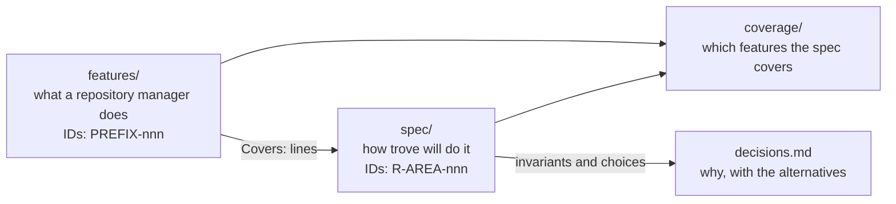

# trove documentation

Status: specification phase. Nothing described in these pages is implemented yet.

This page maps the documentation. The project currently consists of documents only. Four parts
build on each other, and each part has its own stable ID scheme, so any statement can be traced
from the capability through the design to the decision behind it.

## Parts

| Part | Question it answers | IDs | Entry point |
|---|---|---|---|
| Feature catalog | What does a full-featured binary repository manager do, precisely enough to build it compatibly? What priority does trove give each feature? | `<PREFIX>-nnn`, e.g. `RMT-004`; format pages `PKG-<FORMAT>-nnn` | [features/README.md](features/README.md) |
| Specification | How will trove do it: invariants, requirements, data model, API, configuration and acceptance criteria | `INV-n`, `R-<AREA>-nnn`, open questions `Q-<AREA>-n`, security gaps `H-n` | [spec/README.md](spec/README.md) |
| Coverage | Which catalog entries a requirement covers, and what is left by priority | catalog and requirement IDs | [coverage/README.md](coverage/README.md) |
| Decisions | Why the design is what it is, with the options that were weighed | one record per decision; every invariant becomes one | [decisions.md](decisions.md) |
| Developer documentation | How to work on the repository: ID rules, adding entries and requirements, the planned code layout | — | [developer/README.md](developer/README.md) |
| Security architecture | The security design, one page per perspective, and where open gaps are recorded | `H-n` | [security/README.md](security/README.md) |

Vulnerability reports go through [SECURITY.md](../SECURITY.md). The user-facing overview is the
root [README.md](../README.md).

## Reading order

1. [spec/README.md](spec/README.md): the owner constraints and design invariants `INV-1` to
   `INV-17`. Every spec page builds on them.
2. [spec/architecture.md](spec/architecture.md): components, request paths and the format plug-in
   contract.
3. The spec page of the area you work on (page table in [spec/README.md](spec/README.md#pages)),
   and the catalog pages its `Covers:` lines point to.
4. [decisions.md](decisions.md) before you change an invariant or a decision recorded there.

## Conventions for every page

- English only. Every stated fact is checked against its source; anything unverified is marked as
  such.
- Values carry `# default (proposed)` or `# example`. The catalog says *unspecified* when no value is
  known.
- Capabilities have descriptive, product-neutral names. Links go to open standards and to the
  documentation of the ecosystems trove speaks (npm, NuGet, GitLab, Helm, PostgreSQL, S3, OIDC).
- `### <ID> · <Title>` headings and the `Priority:` line below them are read by tools. Keep each on
  one line.
- Long reference tables go into `
` blocks.
