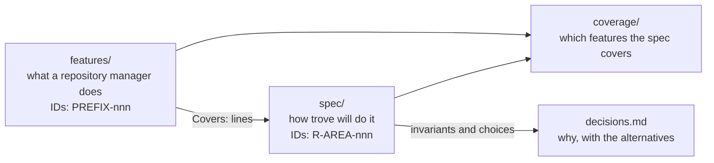

# trove documentation

Status: specification phase. Nothing described in these pages is implemented yet.

This page maps the documentation. The project currently consists of documents only. Four parts
build on each other, and each part has its own stable ID scheme, so any statement can be traced
from the capability through the design to the decision behind it.

## Parts

| Part | Question it answers | IDs | Entry point |
|---|---|---|---|
| Feature catalog | What does a full-featured binary repository manager do, precisely enough to build it compatibly? What priority does trove give each feature? | `<PREFIX>-nnn`, e.g. `RMT-004`; format pages `PKG-<FORMAT>-nnn` | [features/README.md](features/README.md) |
| Specification | How will trove do it: invariants, requirements, data model, API, configuration and acceptance criteria | `INV-n`, `R-<AREA>-nnn`, decided questions `Q-<AREA>-n`, security gaps `H-n` | [spec/README.md](spec/README.md) |
| Coverage | Which catalog entries a requirement covers, and what is left by priority | catalog and requirement IDs | [coverage/README.md](coverage/README.md) |
| Decisions | Why the design is what it is, with the options that were weighed | one record per decision; every invariant becomes one | [decisions.md](decisions.md) |
| Developer documentation | How to work on the repository: ID rules, adding entries and requirements, the planned code layout, the HA-shaped local development profile | — | [developer/README.md](developer/README.md) |
| Security architecture | The security design, one page per perspective (including the Valkey trust boundary and the backup data flow), and where open gaps are recorded | `H-n` | [security/README.md](security/README.md) |

Vulnerability reports go through [SECURITY.md](../SECURITY.md). The user-facing overview is the
root [README.md](../README.md).

## The architecture in brief

Four facts shape every page. They follow from the owner constraints of 2026-10-28, which are not up
for redesign ([spec/README.md](spec/README.md#owner-constraints)):

- **Roles, split from the start** ([INV-2](spec/README.md#design-invariants)). One binary runs as
  `web` (every HTTP request), `worker` (background jobs) or `backup` (the backup and restore
  commands). The chart deploys `web` and `worker` as separate Deployments, each scaling on its own,
  and the backup as a CronJob. `all` exists only for development outside the chart.
- **PostgreSQL decides, Valkey accelerates** ([INV-3](spec/README.md#design-invariants)).
  Highly available PostgreSQL is the system of record. Valkey with Sentinel holds shared ephemeral
  state only, so losing it costs performance, never correctness or data. Blobs and backups live in
  S3.
- **Any replica, any request** ([INV-12](spec/README.md#design-invariants),
  [INV-18](spec/README.md#design-invariants)). A Kubernetes Service spreads requests at random over
  at least two `web` replicas on different nodes, with no session affinity. No request depends on
  state an earlier request left on a replica, so a node drain causes no outage when the roles are
  sized for it.
- **Nothing shared on disk, a consistent backup in S3** ([INV-13](spec/README.md#design-invariants),
  [INV-19](spec/README.md#design-invariants)). No ReadWriteMany volume is used anywhere. The backup
  job writes a consistent PostgreSQL snapshot and every blob it references to a configurable S3
  target; Valkey is not backed up.

## Reading order

1. [spec/README.md](spec/README.md): the owner constraints and design invariants `INV-1` to
   `INV-19`. Every spec page builds on them.
2. [spec/architecture.md](spec/architecture.md): process roles, components, request paths, which
   state lives in PostgreSQL and which in Valkey (R-ARCH-030), and the format plug-in contract.
3. The spec page of the area you work on (page table in [spec/README.md](spec/README.md#pages)),
   and the catalog pages its `Covers:` lines point to. Deployment and operations work starts at
   [spec/ha-and-helm.md](spec/ha-and-helm.md) (topology, Valkey with Sentinel, node drains, the
   chart) and [spec/backup-and-restore.md](spec/backup-and-restore.md) (the backup job and
   restore).
4. [decisions.md](decisions.md) before you change an invariant or a decision recorded there.

## Conventions for every page

- English only. Every stated fact is checked against its source; anything unverified is marked as
  such.
- Values carry `# default (proposed)` or `# example`. The catalog says *unspecified* when no value is
  known.
- Capabilities have descriptive, product-neutral names. Links go to open standards and to the
  documentation of the ecosystems trove speaks (npm, NuGet, GitLab, Helm, PostgreSQL, Valkey, S3,
  OIDC).
- `### <ID> · <Title>` headings and the `Priority:` line below them are read by tools. Keep each on
  one line.
- Long reference tables go into `
` blocks.
