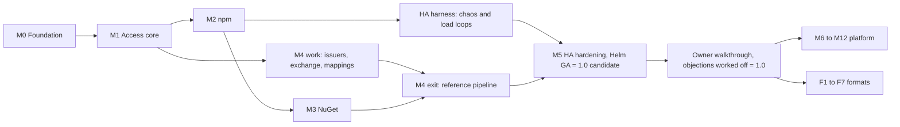

# Roadmap

Status: plan. Nothing is implemented. Milestones carry no dates: a milestone is reached when every
exit criterion passes on `main` in CI. The calendar does not end a milestone.

Every question this plan depends on is decided. The development agent selected one of the
documented options for each question on the spec pages and for the four questions on this page
([Decisions](#decisions)). No milestone from M0 to M5 waits for the owner. The development agent
builds the prototype through M5 on its own, and the owner reviews it at the
[walkthrough](#owner-walkthrough) after M5.

This page orders the work from an empty repository to trove 1.0 (the MVP), then through P1, P2
and Later. It is built from these inputs:

- the requirements in [docs/spec/](../spec/README.md), each with a `Priority:` line and a
  `Covers:` line;
- the priority rubric of the [feature catalog](../features/README.md);
- the [format matrix](../features/formats/README.md);
- the [beyond-baseline candidates](../features/beyond-baseline.md).

Once M0's coverage generator exists, it publishes the status of each requirement as a generated
checklist in this directory ([README.md](README.md)). This page owns the order, the scope and the
exit criteria.

Reading the scope lists:

- `R-AUTH-001…018` means every requirement of that prefix from 001 to 018.
- Every MVP requirement appears in exactly one of M0 to M5. Every P1 requirement appears in exactly
  one of M6 to M11, or in the format lane. There are two exceptions, both named where they occur:
  - R-HA-023 and R-HA-025 are P1 and scheduled in M5 ([Q-ROAD-2](#q-road-2--backup-and-restore-in-10));
  - M0 builds the `/v2/` reservation bullet of R-HA-041, and the rest of R-HA-041 stays in F4
    (Q-HA-4).
- Exit criteria are tests. Where a spec requirement already states the test, the criterion names
  that requirement and does not repeat the test.

## Starting point

These numbers were measured on 2026-10-28 over the catalog and spec pages, after every spec
question was decided. A throwaway script did the counting. It applied the parsing rules that M0's
coverage generator will own.

| Catalog priority | Catalog entries | Listed in a requirement's `Covers:` line | Not listed yet |
|---|---|---|---|
| MVP | 359 | 359 | 0 |
| P1 | 508 | 286 | 222 |
| P2 | 909 | 13 | 896 |
| Later | 391 | 0 | 391 |
| Out of scope | 72 | 0 | 72 |
| **Total** | **2,239** | **658** | **1,581** |

The spec contains 491 requirements: 342 MVP, 147 P1 and 2 P2 (R-STOR-014 and R-CI-022). Every ID
in a `Covers:` line exists in the catalog. The spec pages carry 111 questions and the security gaps
H-1 to H-45. The development agent decided every one of the questions in the `## Decisions` section
of its page. This page adds Q-ROAD-1 to Q-ROAD-4, decided in [Decisions](#decisions).

Five findings shaped this plan:

1. **Generic local repositories are P1, yet 16 MVP requirements test against one.** These
   requirements use a generic repository (`generic-local` or `files-internal`) in their acceptance
   criteria:
   R-STOR-001, R-STOR-004, R-STOR-007, R-STOR-012, R-API-012, R-API-025, R-UI-008, R-ARCH-005,
   R-ARCH-007, R-ARCH-024, R-AUTHZ-006, R-AUTH-012, R-AUTH-033, R-HA-010, R-HA-011 and R-HA-039.
   R-HA-052's load also includes `curl -T` of 200 MB files. npm and NuGet repositories refuse raw
   deploys (R-API-025), so these tests have no other target. [Q-ROAD-1](#q-road-1--generic-local-repositories-in-m1)
   (option (a)) moves the local class of the generic format into M1.
2. **The MVP failure suite runs a P1 procedure.** R-HA-052's restore drill executes the steps of
   R-HA-025. R-HA-025 (restore procedure) and R-HA-023 (backup) are both P1.
   [Q-ROAD-2](#q-road-2--backup-and-restore-in-10) (option (a)) schedules both in M5 and keeps
   their P1 label.
3. **The npm acceptance matrix includes P1 operations.** R-NPM-045's scenario list covers
   deprecate (R-NPM-018), login (R-NPM-020, R-NPM-021), audit (R-NPM-038) and search (R-NPM-037),
   all P1. M2 gates only on the MVP scenarios. Until M6 lands, the P1 scenarios check for the
   predictable answers that R-NPM-043 specifies.
4. **Every MVP catalog entry is covered.** FMT-013 (client authentication styles and anonymous
   fallbacks) was the last MVP entry without a requirement. R-AUTH-033 now covers it: its table
   *Authentication styles across formats* maps each client style to the one authentication stage
   (R-AUTH-001) and settles the npm and NuGet rows at MVP. A client that cannot authenticate is
   served only as the anonymous principal (R-AUTH-037), never through a per-repository bypass.
   The rows of other formats keep their format's priority and follow the same rules. No separate
   M1 item remains: the work is part of R-AUTH-033 in M1.
5. **No P1 format has a spec page.** `docs/spec/formats/` contains only `npm.md` and `nuget.md`.
   M1 writes `formats/generic.md` for the generic local class (Q-ROAD-1). Every other P1 format
   needs a spec page before its implementation starts, and so do build metadata, search and
   upstream curation, which also have P1 catalog entries without requirements. See
   [Spec work before P1 implementation](#spec-work-before-p1-implementation).

## Milestones at a glance

| Milestone | Theme | Requirements | Can start when | Ends with |
|---|---|---|---|---|
| [M0](#m0--foundation) | Foundation: skeleton, pins, CI, PostgreSQL, S3, coordination, chart skeleton, coverage generator | 69 MVP, plus the `/v2/` reservation (Q-HA-4) | — | internal build |
| [M1](#m1--access-core) | Access core: OIDC login, tokens, permissions, repositories, raw file transfer, admin UI | 125 MVP, plus the generic local class and its spec page (Q-ROAD-1) | M0 | internal build |
| [M2](#m2--npm) | npm with local, remote and virtual repositories; proxy and virtual engines | 76 MVP | M1 | pre-release 0.1 |
| [M3](#m3--nuget) | NuGet v3; freeze of the format contract | 24 MVP | M2's WP2.1 to WP2.3 | pre-release 0.2 |
| [M4](#m4--gitlab-ci-oidc) | GitLab CI OIDC token exchange | 26 MVP | M1 for the work, M3 for the exit | pre-release 0.3 |
| [M5](#m5--ha-hardening-and-helm-ga) | HA hardening and Helm GA | 22 MVP, plus the P1 requirements R-HA-023 and R-HA-025 (Q-ROAD-2) | M3 and M4 | **1.0 candidate** |
| [Walkthrough](#owner-walkthrough) | The owner reviews the prototype; objections are worked off | — | M5 | **1.0** |
| [M6 to M12](#p1-platform-milestones) | P1 platform | 143 P1, plus 3 spec pages to write (builds, search, curation) | 1.0 | 1.x minors |
| [F1 to F7](#p1-format-expansion-order) | P1 formats | 2 P1, plus 6 format spec pages to write and `formats/generic.md` to extend | 1.0 | 1.x minors |

## Why this order

- **M0 comes first because every later acceptance test runs on the chart.** R-NPM-045,
  R-NUGET-027 and R-CI-028 each require at least two replicas behind the Helm chart, with
  PostgreSQL and S3-compatible storage. These must exist before the first format can be accepted.
  HA is built in from M0 onward. M5 proves it under failure. Adding it after the fact would mean
  revisiting every request path.
- **Access (M1) comes before npm (M2).** Every package request resolves credentials (R-AUTH-001,
  R-AUTH-033) and goes through one decision point (R-AUTHZ-015). npm publish also depends on
  package ownership (R-AUTHZ-018) and token scopes (R-AUTH-024). Building npm first would mean
  building its authentication twice. Raw file transfer on a generic local repository is the smallest
  protected surface that proves login, tokens, permissions and the upload path together, and 16 MVP
  acceptance criteria already use it.
- **npm comes before NuGet.** npm puts the most strain on the generic engines:
  - four clients in eight gate rows (R-NPM-045, Q-NPM-4);
  - scoped names that make routing ambiguous (the reason given in Q-ARCH-1);
  - the widest dependency fan-out on a cold cache of the two MVP formats.

  So npm drives the proxy engine, virtual merging and miss collapsing. NuGet comes second because
  a second implementation is the real test of the format contract. Freezing the contract after one
  format would build npm's assumptions into it. M3 therefore ends with the contract freeze.
- **CI OIDC (M4) work starts after M1, but its exit waits for M3.** Issuer validation, the exchange
  endpoint, the mapping engine and claim templating depend only on tokens and authorization
  (R-AUTHZ-014), so they run in parallel with M2 and M3. The exit test (R-CI-028) publishes an npm
  package and a NuGet package from one pipeline.
- **M5 comes last.** The load loops of the failure-injection suite are `npm ci`, `dotnet restore`,
  `npm publish` and `curl -T` (R-HA-052), so the suite can gate only once all four exist. The GA
  values reference (R-HA-031) must also cover every MVP setting, CI issuers included. The chaos and
  load harness itself starts in M2 (WP2.8), so M5 tightens a running suite and does not build one
  from scratch.

Orders considered and rejected:

- *npm first, access later.* This gives a faster demo, but publish authentication, ownership and
  token formats would have to be built twice.
- *CI OIDC before any format.* The exit test would have nothing to publish.
- *HA hardening first.* Without load from real clients, the failure suite has nothing to measure.

Rules that hold across all milestones:

- No milestone waits for an owner decision. A question that comes up during the work is decided by
  the development agent in the `## Decisions` section of the page that owns it, in the form that
  [docs/spec/README.md](../spec/README.md) prescribes, and the work goes on with that choice.
- Every end-to-end test runs on at least two replicas behind the chart, from M0 onward.
- Migrations follow expand/contract from the first one (INV-3). The pre-releases of M2 to M4 are
  real upgrade sources: M5 upgrades from the M4 pre-release (E5.4).
- A requirement counts as implemented when a test that names it passes on `main`
  ([Q-ROAD-4](#q-road-4--how-the-coverage-generator-learns-implementation-status)).
- Each tool and dependency is pinned once, and local builds and CI read the same pin.
- A change that alters documented behavior updates the documentation in the same change.

## Decisions the milestones build on

No milestone waits for a decision. Every question was decided by the development agent: it worked
out the options on the question's page, selected one, recorded the rationale and the condition
under which it would revisit the choice, and applied the choice to the spec. The owner reviews the
choices at the [walkthrough](#owner-walkthrough). Until then development proceeds on them. Each
question's page is authoritative. The ADR log indexes the spec questions under
[Decisions by the development agent](../decisions.md#decisions-by-the-development-agent), and the
four questions of this page are decided in [Decisions](#decisions) below.

The table shows which decisions each milestone's first commits encode. A question appears in the
row of the milestone that first builds on it. The layout questions Q-UI-2, Q-UI-3 and Q-UI-4 were
decided without example screenshots, and the owner judges the layouts on the running UI at the
walkthrough.

| Milestone | Questions | What the first commits encode |
|---|---|---|
| M0 | Q-ARCH-1…5, Q-ARCH-11, Q-API-1, Q-HA-2, Q-HA-3, Q-HA-8, Q-HA-11, Q-HA-12, Q-STOR-2, Q-STOR-4 (same as Q-OPS-7), Q-STOR-6, Q-STOR-10, Q-OPS-9, Q-ROAD-4 | `net/http.ServeMux` serves every route, and each format resolves its own escaped path (Q-ARCH-1). PostgreSQL is reached through pgx's native API, sqlc and the confined `listq` builder (Q-ARCH-2). A trove-owned migration runner applies each file together with its `schema_migration` row in one transaction (Q-ARCH-3). The `service/s3` client is used with trove's own multipart upload from the spool file (Q-ARCH-4). The job queue is trove's PostgreSQL job table (Q-ARCH-5). INV-6 is unchanged, with ports 8080 and 8081 (Q-ARCH-11). Go models, the server interface and the TypeScript types are generated from the hand-written OpenAPI 3.1 document (Q-API-1). PostgreSQL 16 is the floor version (Q-HA-2). SeaweedFS runs on every change, and MinIO (built from source at a pinned commit, on isolated runners) and AWS S3 run nightly (Q-HA-3). The operator creates the encryption-key Secret, and the chart fails without it (Q-HA-8). Images and chart are published to `ghcr.io/guided-traffic/trove` and `oci://ghcr.io/guided-traffic/charts/trove` (Q-HA-11). The replica table, heartbeat, pruning and read-only replica API are MVP (Q-HA-12). SHA-512 is computed for every upload (Q-STOR-2). Every schedule is five-field cron in UTC, read by one parser (Q-STOR-4, Q-OPS-7). Download verification is on (Q-STOR-6). Storage jobs are tasks of the shared framework (Q-STOR-10). The job API R-OPS-019 is MVP (Q-OPS-9). A test that names a requirement ID is the evidence that the requirement is implemented (Q-ROAD-4). |
| M1 | Q-AUTH-1…4, Q-AUTH-6, Q-AUTH-7, Q-AUTHZ-3, Q-AUTHZ-5, Q-AUTHZ-9, Q-AUTHZ-10, Q-API-2…4, Q-API-6…9, Q-ARCH-10, Q-UI-1, Q-UI-2, Q-UI-4, Q-UI-5, Q-OPS-3, Q-OPS-4, Q-STOR-9, Q-ROAD-1 | Login providers are configured only in the YAML file (Q-AUTH-1). The cookies are `__Host-trv_session`, `__Host-trv_csrf` and `__Host-trv_oidc_binding` (Q-AUTH-2). There are no refresh tokens (Q-AUTH-3). A missing group claim clears the user's groups and emits a warning event (Q-AUTH-4). Revocation by value works unauthenticated, is rate-limited and has no existence oracle (Q-AUTH-6). Nobody but a PAT's owner ever holds its secret (Q-AUTH-7). The built-in principal `authenticated` is read-only, covers users only and is R-AUTHZ-030 (Q-AUTHZ-3). Refused reads are audited by default, allowed reads only with `authz.audit.reads: all` (Q-AUTHZ-5). A token scope element is a policy resource set plus `actions` (Q-AUTHZ-9). A scope names only resource types of the grant model, `repositories` in the MVP, and is always intersected with the subject's rights (Q-AUTHZ-10). `If-Match` is required on PUT and PATCH of resources with a revision ETag (Q-API-2). Rate limits are per replica (Q-API-3, H-43). INV-17 covers `/files/…` and `/auth/…` (Q-API-4). Lists page with `limit` and `cursor` (Q-API-6). Custom methods are kebab-case sub-path verbs (Q-API-7). The key-ring status endpoint is R-API-049 (Q-API-8). Singleton tasks start only through the task trigger and stop only through job cancel (Q-API-9). Content is served from one origin with content headers that the core enforces (Q-ARCH-10). The UI uses Angular Material, the CDK and `@angular/aria` (Q-UI-1). The side bar is pinned from 1024 CSS px, with compact density (Q-UI-2). The policy editor is one page with a sticky preview (Q-UI-4). Translations use compile-time i18n, one build per locale (Q-UI-5). The version endpoint needs a credential (Q-OPS-3). Audit rows are append-only for the runtime role (Q-OPS-4). Permissions and retention share one pattern syntax (Q-STOR-9). The generic local class is built in M1 (Q-ROAD-1). |
| M2 | Q-NPM-1, Q-NPM-2, Q-NPM-4…6, Q-NPM-8, Q-NPM-9, Q-ARCH-6…9, Q-ARCH-12, Q-REPO-1…6, Q-AUTHZ-1, Q-AUTHZ-2, Q-AUTHZ-4, Q-UI-3, Q-UI-6, Q-OPS-10 | npm's trusted-publishing routes are reserved at the host root and below every registry URL, and the exchange itself is R-NPM-022 in M10 (Q-NPM-1). Versions the upstream removed are hidden by default (Q-NPM-2). The gate rows are npm 10, 11 and 12, pnpm 10, 11 and 12, Yarn 4 and Yarn 1.22 (Q-NPM-4). Remotes store only the full package document (Q-NPM-5). Inconsistent manifests are rejected (Q-NPM-6). Tombstones are never purged (Q-NPM-8). Dist-tags and deprecation need `deploy` plus ownership (Q-NPM-9). The fetch lock is a session advisory lock on a bounded pool with a bypass, behind `cluster.FlightLock` (Q-ARCH-6), and uses the two-key form (Q-ARCH-7). Hot-path notifications leave through a post-commit coalescer (Q-ARCH-8). Merged metadata checks each local member's `rev_seq` on every hit (Q-ARCH-9). Derived indexes are rendered per request, and no publish waits for one (Q-ARCH-12). R-ARCH-021 seals every stored secret (Q-REPO-1). A metadata period of `0` is allowed (Q-REPO-2). An upstream 404 or 410 for a package document marks the package gone (Q-REPO-3). Every remote of the format refuses `global`-claimed names (Q-REPO-4). Pins, claims, extra hosts and upstream credentials are generic members (Q-REPO-5). The shadowing check is R-REPO-048 (Q-REPO-6). `read` on a virtual repository is only an endpoint gate (Q-AUTHZ-1). New npm and NuGet local repositories enforce ownership (Q-AUTHZ-2). `cacheFillAction` defaults to `read` (Q-AUTHZ-4). The package page has two columns from 960 CSS px (Q-UI-3). External README images are blocked unless their origin is listed (Q-UI-6). The `repo` metric label is capped at 500 keys per metric family (Q-OPS-10). |
| M3 | Q-NUGET-1…7 | A protocol delete unlists unless the repository sets `deleteMode: delete` (Q-NUGET-1). NuGet remotes default to a 300 s metadata period (Q-NUGET-2). IDs pushed to local repositories are ASCII (Q-NUGET-3). Search is forwarded to the upstream unless a term is protected (Q-NUGET-4). The version that created a package fixes its ID casing (Q-NUGET-5). Versions are immutable, and every removal leaves a tombstone (Q-NUGET-6). Symbol requests carry a routing name for patterns, claims and pin rules (Q-NUGET-7). |
| M4 | Q-CI-1…4, Q-CI-6…10, Q-AUTHZ-6 | Mappings use first match per tier and union across tiers (Q-CI-1). The `scope` parameter is a scope string per RFC 6749 (Q-CI-2). Every `aud` element must be an allowed audience (Q-CI-3). Single use is off for GitLab and on for GitHub and generic issuers (Q-CI-4). Ownership is claimed on first publish (Q-CI-6). Each job revokes its own CI token, and the TTL stays the bound (Q-CI-7). A rejected subject token answers 400 `invalid_request` (Q-CI-8). Fork pipelines are denied by default (Q-CI-9). A mapping's principal is named `<CI issuer name>/<mapping name>` (Q-CI-10). A writing CI inline grant that omits `ownership` is saved as `bind_project`, and any other inline grant as `none` (Q-AUTHZ-6). |
| M5 | Q-HA-1 (same as Q-STOR-1 and Q-OPS-2), Q-HA-5, Q-HA-6, Q-HA-7, Q-HA-10, Q-OPS-1, Q-ROAD-2 | Object storage gates only a replica's first readiness (Q-HA-1). Zero-downtime upgrades hold between adjacent minor releases only (Q-HA-5). Transaction-mode poolers are not supported (Q-HA-6). The HTTPRoute is MVP as R-HA-038, and a chart-created Gateway is P1 as R-HA-053 (Q-HA-7). The egress NetworkPolicy is off by default (Q-HA-10). Liveness never reads readiness and fails only when one of trove's own loops stops making progress (Q-OPS-1). R-HA-023 and R-HA-025 ship in 1.0 (Q-ROAD-2). |
| P1 | Q-HA-4, Q-HA-9, Q-CI-11, Q-AUTH-5, Q-AUTH-8, Q-AUTHZ-7, Q-AUTHZ-8 (same as Q-API-5 and Q-STOR-3), Q-STOR-5, Q-STOR-7, Q-STOR-8, Q-OPS-5, Q-OPS-6, Q-OPS-8, Q-OPS-11, Q-NPM-3, Q-NPM-7, Q-ROAD-3 | M0 reserves `/v2/`, and the OCI routing itself is F4 (Q-HA-4). In M11 the revocation journal R-HA-054, with R-AUTHZ-031's entries, survives a database restore, while the MVP keeps the manual procedure (Q-HA-9). In M11 a replayed mapping disable also suspends every later enabled mapping of its tier (Q-CI-11). In M10 dormancy is on by default after 90 days (Q-AUTH-5). In M10 CI delegations stay independent of projects (Q-AUTHZ-7). In M6 the npm web-login poll is bound to the client's network (Q-AUTH-8). In M6 npm audit is forwarded only for names the remote holds (Q-NPM-3). In M6 the dependency rewrite touches HTTP(S) tarball URLs only (Q-NPM-7). In M7 a quota or capacity limit answers `507`, and the per-request size limit `413` (Q-STOR-7). In M8 an overwrite sends the previous file to the trash can (Q-STOR-5). In M8 a copy or move target is the exact destination (Q-STOR-8). In M9 build records get their own page, `builds.md` with prefix `R-BLD` (Q-AUTHZ-8). In M9 CloudEvents types are `trove.<registry name>` (Q-OPS-5). In M9 login providers stay out of configuration documents (Q-OPS-6). In M9 managed objects are locked against API and UI changes (Q-OPS-8). In M9 webhook templates are bounded `text/template` (Q-OPS-11). The format lane keeps the order on this page (Q-ROAD-3). |
| P2 | Q-CI-5 | The `CI_JOB_TOKEN` fallback R-CI-022 is specified at P2 and is built only when a concrete population of pipelines needs it. |

## M0 · Foundation

**Goal.** M0 delivers a production-shaped platform with no package format: one binary, two
replicas on kind, PostgreSQL with migrations, a content-addressed blob store on S3, coordination
between replicas, the chart skeleton, an embedded Angular shell, observability, and the coverage
generator that measures everything after it.

**Scope.**

| Area | Requirements |
|---|---|
| Architecture | R-ARCH-001…006, R-ARCH-016…026 |
| Storage | R-STOR-001…006, R-STOR-024, R-STOR-025, R-STOR-030, R-STOR-031, R-STOR-033, R-STOR-035 |
| HA and chart | R-HA-001, R-HA-003…006, R-HA-013…016, R-HA-018, R-HA-019, R-HA-027…030, R-HA-033…037, R-HA-051 |
| Operations | R-OPS-001…004, R-OPS-006, R-OPS-007, R-OPS-009, R-OPS-010, R-OPS-013, R-OPS-018, R-OPS-028 |
| API | R-API-001…003, R-API-009, R-API-038 |
| Reserved route (Q-HA-4) | The reservation bullet of R-HA-041: `/v2/` and everything below it answer `404`, and a route-table test fails when any other client-listener pattern starts with `/v2/`. The rest of R-HA-041 stays in F4. |
| UI | R-UI-001, R-UI-046, R-UI-047 |
| trove-only | Coverage generator (below) |

**Coverage generator.** This is a Go `main` package at `internal/tools/coverage/`, run with
`go run ./internal/tools/coverage`. R-ARCH-003's layout tree gains the entry in the same
change. It reads every page under `docs/features/` and `docs/spec/` and checks that:

- each `### <ID> · <Title>` heading is followed by a `Priority:` line with one of the five rubric
  values;
- each `### R-…` heading is followed by `Priority: **…** · Covers: …`;
- every `Covers:` ID exists in the catalog or is `trove-only`;
- requirement IDs, catalog IDs, `Q-` IDs and `H-` numbers are unique.

It ignores headings inside fenced code blocks, because the format example in
[docs/spec/README.md](../spec/README.md) reuses `R-NPM-012`. It writes the checklist with a status
per ID and counts per priority. It learns implementation status as
[Q-ROAD-4](#q-road-4--how-the-coverage-generator-learns-implementation-status) decides: from the
requirement IDs in the names of passing tests, read from CI's `go test -json` output and the
end-to-end reports.

**Exit criteria.**

- **E0.1** `go build ./cmd/trove` succeeds on a clean checkout without Node.js, and
  `go generate ./... && git diff --exit-code` passes in CI (R-ARCH-003).
- **E0.2** One version per tool. CI fails in any of these cases:
  - the `go version` in its log differs from `go 1.27.3` in `go.mod`;
  - a code generator runs at a version other than its `tool` directive;
  - the Angular packages differ from the lockfile of `web/`.

  The dev profile's tool pins (kind, kubectl, Helm, CloudNativePG chart, PostgreSQL image, S3
  store) are read from one place by both the task runner and CI (R-HA-051).
- **E0.3** On a machine with Docker and the pinned tools, `dev-up` produces two trove replicas,
  a two-instance CloudNativePG cluster and the S3 store on a three-node kind cluster in under
  10 minutes. Both pods answer `200` on `:8081/readyz`, and `GET /api/v1/system/ping` answers `OK`
  through the Ingress. R-HA-051's `npm ping` criterion moves to M2.
- **E0.4** On an empty PostgreSQL 16, the floor version (Q-HA-2), the migration Job creates the
  schema. If two migration Jobs start at once, one applies the migrations and the other waits on
  the advisory lock, then exits with nothing to do. A migration that fails on purpose leaves the
  running replicas serving and makes `helm upgrade` fail. This is the "Migration failure" row of
  R-HA-052, run early.
- **E0.5** The S3 conformance check of R-STOR-035 passes on every change against SeaweedFS, the
  CI store chosen in Q-HA-3, and nightly against MinIO (built from source at a pinned commit, on
  isolated runners) and AWS S3. Until the owner provides an AWS account and a CI role, the nightly
  results list the AWS S3 job as skipped, never as passed (R-HA-051), and M0 exits without it. The
  race test of R-STOR-005 passes, and so does R-STOR-024's variant with the collector killed at
  random points. When 100 concurrent uploads of identical content are spread across both replicas,
  exactly one object exists under its content address.
- **E0.6** A singleton job holds its lease on exactly one replica. Force-deleting that pod moves
  the lease to the other replica, and the lease table never shows two holders with valid fencing
  tokens (R-HA-006). In the same run, `GET /api/v1/system/replicas` shows the deleted pod with
  `"lost": true` within 30 s and then lists its replacement (R-OPS-003). On the dev profile, cross-replica invalidation reaches p99 ≤ 1 s (P-13) and
  job pick-up reaches p99 ≤ 1 s (P-14).
- **E0.7** `helm lint` and `helm template` pass with the dev values. `helm template` without the
  encryption-key Secret fails with R-HA-029's message. The pods start in a namespace that enforces
  the restricted Pod Security Standard (R-HA-033).
- **E0.8** The coverage generator reproduces the table in [Starting point](#starting-point) from
  the pages, fails CI on each rule violation listed above, and its committed output passes
  `git diff --exit-code`. Given a fixture `go test -json` stream with a passing test named after
  one requirement and a failing test named after another, it marks exactly the first one
  implemented (Q-ROAD-4).
- **E0.9** The binary serves the Angular 22 shell under `/ui/` from its embedded build. The web unit
  tests run in CI (R-UI-001, R-UI-047).
- **E0.10** `:8081/metrics` exposes `trove_` metrics, the request log is JSON, and a request that
  carries `traceparent` keeps its trace ID in the log and in `X-Request-Id` (R-OPS-002, R-OPS-018).

**Work packages.**

| WP | Content | Depends on | Runs in parallel with |
|---|---|---|---|
| WP0.1 | Repository skeleton: `go.mod` with `tool` pins, `web/` workspace with lockfile, task runner, architecture test of R-ARCH-002, placeholder `dist/` | — | — |
| WP0.2 | CI: lint, unit tests, generate-diff check, image build, chart lint, integration tier with PostgreSQL and the S3 store in containers, version check of E0.2 | WP0.1 | WP0.3 to WP0.9 |
| WP0.3 | PostgreSQL: pool and connection budget, migration runner under an advisory lock with the compatibility gate, core schema of R-STOR-003, roles and TLS | WP0.1 | WP0.4 to WP0.9 |
| WP0.4 | Blob store: S3 client, spool, single-pass hashing, commit protocol, multipart transfer, conformance check, garbage collection | WP0.3 (schema), WP0.5 (GC lease) | WP0.6 to WP0.9 |
| WP0.5 | Coordination: job queue, leases with fencing, advisory-lock categories, LISTEN/NOTIFY, in-process caches, replica registry | WP0.3 | WP0.4, WP0.6 to WP0.9 |
| WP0.6 | Server shell: listeners, middleware, client address, error model, configuration, lifecycle, stored-secret encryption, outbound HTTP client, logs, metrics, traces, OpenAPI skeleton, ping and version | WP0.1 | all |
| WP0.7 | Helm chart skeleton and dev profile | WP0.3 (`migrate`), WP0.6 (probes) | WP0.4, WP0.5, WP0.8, WP0.9 |
| WP0.8 | Angular workspace, signals baseline, embedding and serving | WP0.1 | all |
| WP0.9 | Coverage generator | WP0.1 | all |

**Not in M0:** repositories, users, tokens and any package format. The GC trigger and the task and
job API (R-OPS-019) wait for the management API of M1. Failure-mode guarantees beyond E0.4 and
E0.6 belong to M5.

## M1 · Access core

**Goal.** M1 delivers humans signing in through OIDC, tokens for machines, deny-by-default
permissions, and the repository model, all proven on raw file transfer to a generic local
repository. It also delivers the management API conventions that every later resource inherits,
and the administration UI.

**Scope.**

| Area | Requirements |
|---|---|
| Identity | R-AUTH-001…018, R-AUTH-020, R-AUTH-022…024, R-AUTH-026…029, R-AUTH-032, R-AUTH-033, R-AUTH-037, R-AUTH-038, R-AUTH-040, R-AUTH-041 |
| Authorization | R-AUTHZ-001…006, R-AUTHZ-010, R-AUTHZ-013, R-AUTHZ-015, R-AUTHZ-016, R-AUTHZ-021…023, R-AUTHZ-028, R-AUTHZ-029, R-AUTHZ-030 |
| Repositories | R-REPO-001…006, R-REPO-008…013 |
| Request paths and items | R-ARCH-007, R-ARCH-011, R-ARCH-014, R-STOR-007, R-STOR-012, R-STOR-013, R-STOR-016, R-STOR-018 |
| Deployment | R-HA-040, R-HA-043 |
| Operations and audit | R-OPS-005, R-OPS-014…017, R-OPS-019, R-OPS-020 |
| API | R-API-004…008, R-API-010…022, R-API-025, R-API-031…033, R-API-037, R-API-039, R-API-040, R-API-049 |
| UI | R-UI-002…005, R-UI-010, R-UI-011, R-UI-020, R-UI-021, R-UI-024…027, R-UI-029…031, R-UI-033, R-UI-037, R-UI-038, R-UI-042…045 |
| Generic local class (Q-ROAD-1) | The local class of PKG-GENERIC-001, plus PKG-GENERIC-004 and PKG-GENERIC-005. WP1.4 first writes `docs/spec/formats/generic.md` (prefix `R-GENERIC`). Its local-class requirements are MVP and join this scope when the page exists. Its remote and virtual requirements are P1 and belong to F1. |

M1 is the largest milestone. Its work packages touch separate packages (`auth`, `authz`,
`repository`, `api/v1`, `web`), so this is where parallel teams pay off most.

R-OPS-019, the task and job API, is MVP (Q-OPS-9): the garbage-collection trigger (R-OPS-020) and
every long-running operation (R-API-015) return job references that must be pollable from the first
release. Its acceptance criteria name the `storage-summary` task, which arrives with R-OPS-023 in
M7. Until then M1 runs them against the MVP task `gc`.

**Exit criteria.**

- **E1.1** In the dev profile, a Keycloak test IdP signs a user in through the
  authorization code flow with PKCE. The user is created just in time, groups come from the
  configured claim, logout ends the trove session, and R-AUTH-013's IdP logout criterion passes.
  The break-glass administrator signs in and can be disabled (R-AUTH-014).
- **E1.2** A personal access token is shown once, and the database stores only its SHA-256. A test
  scans a database dump for the token value and finds nothing. After revocation through replica A,
  a request with that token through replica B gets `401` within 2 s (R-AUTH-029's bound).
- **E1.3** Deny by default holds on a fresh installation. With one generic local repository and no
  policies, anonymous and authenticated requests are refused as R-AUTHZ-016 specifies. A table of
  at least 200 authorization cases passes, covering policy union, token scope as a ceiling,
  include and exclude patterns, `deploy` without `overwrite`, and hidden existence. R-AUTHZ-006's
  `files-internal` criterion is one of those cases. So is the built-in principal `authenticated`
  (R-AUTHZ-030) on `generic-local`: with a policy giving it `read`, a user in no group downloads a
  file, a service-account token without a grant of its own gets `404`, and an entry giving it
  `deploy` answers 422 `authenticated_write_action`.
- **E1.4** Raw transfer on `generic-local` passes the criteria of R-STOR-007, R-STOR-012 and
  R-API-025: `201` and then `200` on re-upload, a `Range` request returns 100 bytes, and a digest
  mismatch is refused. An `evil.svg` served from `/files/` carries the R-ARCH-007 headers.
- **E1.5** Every login, failed login, token creation and revocation, policy change and denied
  deploy produces an audit event. The event can be found through `GET /api/v1/audit/events` and
  appears in the log stream (R-OPS-015…017).
- **E1.6** The OpenAPI document validates as OpenAPI 3.1. Every implemented route has a test that
  validates its responses against the document (R-API-002). Pagination, `ETag` with `If-Match`,
  merge patch and idempotency keys each have a contract test on the repository resource.
- **E1.7** These UI screens work against the real API: sign-in, repository list and wizard, file
  tree, users, groups, service accounts, policy editor, profile tokens, token administration,
  authentication settings, audit log and system status. An automated accessibility check reports no
  serious violations on any of them (R-UI-044). The English and German builds both pass (R-UI-045).
- **E1.8** R-AUTH-038's brute-force thresholds trigger in an automated test against Basic, Bearer
  and the login flow. R-API-016's rate limits answer `429` with `Retry-After`.
- **E1.9** R-API-049's acceptance criteria pass on two replicas whose key rings differ. The system
  status screen shows the same key-ring state in its "Stored-secret keys" card (R-UI-038).
- **E1.10** `docs/spec/formats/generic.md` exists, passes the coverage generator's checks, and
  lists PKG-GENERIC-001, PKG-GENERIC-004 and PKG-GENERIC-005 in the `Covers:` lines of MVP
  requirements. Each of those requirements has a passing test that names it (Q-ROAD-1, Q-ROAD-4).

**Work packages.**

| WP | Content | Depends on | Runs in parallel with |
|---|---|---|---|
| WP1.1 | OIDC login, sessions, CSRF, logout, break-glass account, bootstrap commands, test IdP in the dev profile | M0 | WP1.2, WP1.4, WP1.6 to WP1.8 |
| WP1.2 | Users, groups, service accounts, token types, storage, scopes, lifetime, revocation, expiry notices | M0 | WP1.1, WP1.4, WP1.6 to WP1.8 |
| WP1.3 | Authorization engine: policies, selectors, patterns, evaluation, compiled grant index with invalidation, decision audit | WP1.2 (principals) | WP1.4, WP1.6 to WP1.8 |
| WP1.4 | Spec page `formats/generic.md`, then the repository model and API, plus the generic local class (Q-ROAD-1) | M0 | WP1.1 to WP1.3 |
| WP1.5 | Raw transfer: `/files/`, items API, upload and download request paths | WP1.3, WP1.4 | WP1.6 to WP1.8 |
| WP1.6 | API conventions and admin resources: errors, pagination, ETags, idempotency, jobs, rate limits, CORS, settings, audit, GC trigger, key-ring status | M0 | all |
| WP1.7 | Event registry and audit recording | M0 | all |
| WP1.8 | UI shell and administration screens | consumes the OpenAPI types that WP1.6 produces; trails the API by one step | all |

**Not in M1:** any package protocol. Package ownership waits for M2, because it needs package
names. CI identities wait for M4.

## M2 · npm

**Goal.** M2 delivers npm with local, remote and virtual repositories for npm, pnpm and both Yarn
lines, and with it the format contract, the proxy engine and virtual resolution that every later
format reuses.

**Scope.**

| Area | Requirements |
|---|---|
| npm | R-NPM-001…013, R-NPM-015…017, R-NPM-019, R-NPM-024…027, R-NPM-029…033, R-NPM-040…045 |
| Format contract | R-ARCH-008…010, R-ARCH-028 |
| Proxy and virtual engines | R-ARCH-012, R-ARCH-013, R-ARCH-015, R-REPO-017, R-REPO-019…021, R-REPO-023…030, R-REPO-032, R-REPO-033, R-REPO-038…043, R-REPO-045, R-REPO-047, R-REPO-048, R-OPS-011 |
| Authorization | R-AUTHZ-008, R-AUTHZ-009, R-AUTHZ-018, R-AUTHZ-019 |
| API and UI | R-API-029, R-API-030, R-UI-006…009, R-UI-016, R-UI-017, R-UI-022 |

**Exit criteria.**

- **E2.1** On two replicas behind the chart's Ingress, every MVP scenario of R-NPM-045 passes for
  each of its gate rows: npm 10, 11 and 12, pnpm 10, 11 and 12, Yarn 4 and Yarn 1.22 (Q-NPM-4).
  The rows follow R-NPM-045's rule, which is re-evaluated at every release, so the list can change;
  a scenario a row's client cannot run is marked not applicable with its reason. The P1 scenarios
  receive the answers R-NPM-043 specifies. The `e2e-npm` job gates every change.
- **E2.2** Cold cache, concurrent clients: three clients run `npm ci` at once, each against a
  different replica of three. They use an empty client cache and the reference lockfile in `perf/`
  (at least 500 packages), and resolve through `npm-all`, a virtual repository over `npm-local` and
  `npm-remote`, with the remote pointing at the counting test upstream. All three succeed. The
  upstream records exactly one request per tarball and at most one per package document (P-12).
- **E2.3** `npm publish` through replica A, followed at once by `npm view` of that version through
  `npm-all` on replica B, returns the new version (R-ARCH-012, Q-ARCH-9).
- **E2.4** With the upstream stopped, `npm ci` on a warm cache succeeds from stale metadata
  (R-REPO-029). With the upstream answering `404` for a name, repeated requests inside the negative
  cache period cause no further upstream request (R-REPO-028).
- **E2.5** A name under a namespace claimed by `npm-local` (R-REPO-023, R-NPM-033) is never
  requested from the upstream, even when the upstream offers a higher version. The npm criteria of
  R-REPO-048 pass: a `deploy` holder's first publish of a name the upstream serves gets `403`
  `shadows_remote_package`, a `manage` holder's succeeds and is audited, and while the upstream
  cannot be asked a `deploy` holder gets `503` `shadow_check_unavailable`. Its NuGet criterion runs
  from M3 on.
- **E2.6** npm passes checks 1 to 8 of the conformance kit (R-ARCH-010). A nightly Go fuzz run of
  npm's `Match` and `Inspect`, lasting at least 30 minutes, finds no crash and no breach of the
  R-ARCH-028 limits.
- **E2.7** `npm ping --registry http://localhost:8080/api/npm/npm-all/` succeeds on the dev profile.
  This is the remaining criterion of R-HA-051.
- **E2.8** The version published in E2.3 appears in the packages list, its README renders
  sanitized, and E2.1's configure step uses the snippets from the client setup dialog verbatim.

**Work packages.**

| WP | Content | Depends on | Runs in parallel with |
|---|---|---|---|
| WP2.1 | Format contract, registry, conformance kit, limits for untrusted content | M1 | — |
| WP2.2 | Proxy engine: remote settings, request path, single-flight and advisory-lock collapse, freshness, negative cache, offline circuit, egress rules, integrity check, URL rewriting | WP2.1 | WP2.3, WP2.4, WP2.7, WP2.8 |
| WP2.3 | Virtual resolution: membership, algorithm, merged-metadata cache, deployment target, pin rules, namespace claims and the shadowing check | WP2.1 | WP2.2, WP2.4, WP2.7, WP2.8 |
| WP2.4 | npm local: publish, documents, revisions, dist-tags, unpublish, tombstones, whoami | WP2.1 | WP2.2, WP2.3 |
| WP2.5 | npm remote and virtual: document fetch, tarball URLs, upstream removals, merges | WP2.2 to WP2.4 | WP2.6 to WP2.8 |
| WP2.6 | Client matrix, counting upstream stub, reference lockfile in `perf/` | WP2.4 | WP2.5, WP2.7, WP2.8 |
| WP2.7 | Package UI, install panel, client setup dialog and snippets | WP2.4 | WP2.5, WP2.6, WP2.8 |
| WP2.8 | HA harness start: pod-crash scenario of R-HA-052 and the load scripts of R-ARCH-027 running against npm | WP2.4 | all |

**Not in M2:** the P1 npm operations (M6) and npm trusted publishing (M10).

## M3 · NuGet

**Goal.** M3 delivers NuGet v3 with local, remote and virtual repositories for the .NET CLI,
nuget.exe and Visual Studio. It also proves that the format contract is free of npm assumptions,
and then freezes it.

**Scope.**

| Area | Requirements |
|---|---|
| NuGet | R-NUGET-001…010, R-NUGET-012…020, R-NUGET-026…028 |
| Authorization | R-AUTHZ-007 |
| UI | R-UI-018 |

**Exit criteria.**

- **E3.1** R-NUGET-027 is green:
  - the .NET 10 SDK on Linux;
  - nuget.exe and the .NET 10 SDK on a Windows runner;
  - the nightly run against nuget.org.

  The manual Visual Studio 2022 checklist has been run once against the M3 build.
- **E3.2** Cold cache, concurrent clients: three clients run `dotnet restore --no-cache` at once
  against three replicas. They restore the reference solution in `perf/` (at least 100 packages in
  its restore graph) through `nuget-all`. All three succeed, and the counting upstream records one
  request per `.nupkg`.
- **E3.3** Contract freeze: at the end of M3 the format contract (R-ARCH-008, R-ARCH-009) has
  `ContractVersion` 1, and both formats pass the conformance kit. Any contract change that NuGet
  needed was applied to npm in the same change. From here on, every contract change is an ADR.
- **E3.4** Every row of R-AUTHZ-007's action map has one test per format. The test shows the
  operation succeeds with the action and fails without it.
- **E3.5** A push with a personal access token as `X-NuGet-ApiKey` succeeds, and so does a restore
  with a token as Basic password. A revoked token gets `401` on both (INV-8, R-NUGET-012).

**Work packages.** These can run in parallel:

- WP3.1, NuGet local: ingestion, push, unlist and delete, flat container, registrations, search;
- WP3.2, remote and virtual repositories;
- WP3.3, symbol package push;
- WP3.4, the acceptance suite, including the Windows runner.

After those, WP3.5 holds the contract-freeze review and the action-map tests.

**Not in M3:** the symbol server, symbol proxying, vulnerability data, autocomplete and reindexing
(M6). NuGet v2 is P2 (INV-14).

## M4 · GitLab CI OIDC

**Goal.** M4 lets GitLab CI jobs exchange their OIDC ID token for a short-lived trove token. Mapped
permissions give them read access to the packages they consume and write access to the packages
they produce.

**Scope.**

| Area | Requirements |
|---|---|
| CI | R-CI-001…021, R-CI-028 |
| Authorization | R-AUTHZ-014 |
| API and UI | R-API-035, R-UI-035, R-UI-036 |

**Exit criteria.**

- **E4.1** R-CI-028 passes against a GitLab test instance:
  - on a protected tag, both packages are published;
  - on an unprotected branch, both publishes get `403`;
  - the issuance list shows the right `project_id`, `ref` and `sha`;
  - no job log contains a `trv_cit_` value or the ID token.
- **E4.2** The negative cases of R-CI-004 pass, including the HS256-with-the-public-key case and
  the rejection of an ID token whose `aud` names a recipient other than trove (Q-CI-3).
  R-CI-003's key-rotation test passes against an issuer double.
- **E4.3** On the GitLab test issuer with its default `single_use_subject_tokens: false` (Q-CI-4),
  concurrent exchanges of one ID token on two replicas both succeed, and the issuance list shows
  the exchange count 2. With the override `true` on the same issuer, concurrent exchanges yield
  exactly one success, and the other answers `subject_token_replayed` (R-CI-018).
- **E4.4** A fork merge-request pipeline cannot publish to `npm-internal` (R-CI-012).
- **E4.5** For every claim set recorded during E4.1, the mapping dry run (R-CI-019) and the claim
  tester (R-UI-036) return the grants that the real exchange issued.
- **E4.6** A CI token used after its expiry gets `401`. Revoking an issuance makes its token fail
  within R-AUTH-029's 2 s bound.

**Work packages.** WP4.1 to WP4.4 start as soon as M1 ends, in parallel with M2 and M3:

- WP4.1: issuers, discovery, signing keys with caching and rotation, subject-token validation;
- WP4.2: exchange endpoint, errors, hardening, replay protection;
- WP4.3: mapping engine, claim conditions, templating, grants, ownership binding, CI tokens in
  evaluation;
- WP4.4: token lifetime, identity, revocation, issuance records.

WP4.5 (mapping API, dry run and UI) follows WP4.3. WP4.6 sets up the two test environments:

- per-change CI uses an issuer double that signs GitLab-shaped tokens with rotating keys;
- the reference pipeline runs against a real GitLab instance nightly and as the M4 exit.

Not verified: how long a GitLab container takes to become ready on the CI runners. If it exceeds a
job's time budget, the nightly run moves to a standing test instance.

**Not in M4:** delegated mapping management, and GitHub Actions and generic issuers (M10). The
`CI_JOB_TOKEN` fallback (R-CI-022) is P2 and is built only when a concrete population of pipelines
needs it (Q-CI-5).

## M5 · HA hardening and Helm GA

**Goal.** M5 proves the failure-mode contract under real client load and finishes the chart for
production. Its result is the 1.0 candidate, which the owner reviews at the
[walkthrough](#owner-walkthrough).

**Scope.**

| Area | Requirements |
|---|---|
| Failure modes and upgrades | R-HA-007…012, R-HA-020…022, R-HA-024, R-STOR-036 |
| Chart GA | R-HA-031, R-HA-032, R-HA-038, R-HA-039, R-HA-042, R-HA-048…050 |
| Proof | R-HA-052, R-ARCH-027, R-OPS-008 |
| P1 requirements scheduled in M5 (Q-ROAD-2) | R-HA-023, R-HA-025 |

**Exit criteria.**

- **E5.1** The full R-HA-052 suite is green in two consecutive nightly runs. The restore drill has
  passed once on the dev profile, from a PostgreSQL backup and a versioned bucket set up as R-HA-023
  specifies, following R-HA-025's steps. Until R-HA-054 ships, step 4 of R-HA-025 has no revocation
  journal to replay. The drill therefore runs the journal-off variant of its revoked-token check,
  which documents H-37, and the MVP keeps the manual procedure that Q-HA-9 names.
- **E5.2** Cold cache with a replica killed mid-run: `npm ci` of the 500-package reference lockfile
  through `npm-all` succeeds on three replicas while one replica is force-deleted partway through.
  The same holds for `dotnet restore --no-cache` of the reference solution through `nuget-all`. No
  client iteration fails after the clients' own retries, and `trove admin storage verify` reports
  no item without its object.
- **E5.3** P-1 to P-15 of R-ARCH-027 are met in two consecutive nightly runs on the reference
  environment.
- **E5.4** A rolling upgrade from the M4 pre-release to the 1.0 candidate with the migration Job,
  followed by `helm rollback`, shows zero failed iterations under R-HA-052's load (R-HA-020).
- **E5.5** The values reference documents every chart value, and the values schema validates it
  (R-HA-031). Production example values render the PodDisruptionBudget, topology spreading,
  HorizontalPodAutoscaler and NetworkPolicy (R-HA-032, R-HA-042). R-HA-038's criteria pass through
  an HTTPRoute attached to an existing Gateway. R-HA-039's 6 GiB upload and 15-minute slow download
  pass through the Ingress and through the HTTPRoute.
- **E5.6** The coverage generator shows no uncovered MVP catalog entry. Every MVP requirement has at
  least one passing test that names it (Q-ROAD-4).
- **E5.7** [docs/security/](../security/) describes the 1.0 mechanisms. Each H-item from the spec
  pages that applies to 1.0 appears under its H number in the `What this does not cover` section of
  the security page for its mechanism.
- **E5.8** The release pipeline publishes the 1.0 candidate as a pre-release: the image to
  `ghcr.io/guided-traffic/trove` and the chart to `oci://ghcr.io/guided-traffic/charts/trove`, the
  GitHub Container Registry chosen in Q-HA-11. `helm install` by digest from there passes E2.1's
  smoke scenarios. Image signing, SBOM and provenance arrive with R-HA-047 (M11).

**Work packages.** These can run in parallel:

| WP | Content |
|---|---|
| WP5.1 | Failure-mode contract, dependency failures, PostgreSQL failover, object-storage outage, graceful termination, node loss |
| WP5.2 | Rolling upgrades, mixed-version operation, background data migrations, upgrade policy |
| WP5.3 | Restore consistency, plus backup and restore (R-HA-023, R-HA-025; Q-ROAD-2) |
| WP5.4 | Chart GA: values reference and schema, PDB, spreading, HPA, network policies, edge proxy requirements, uninstall, prerequisites, sizing |
| WP5.5 | Completion of the failure-injection suite |
| WP5.6 | Performance runs and the metrics catalog |
| WP5.7 | Security pages and review; release pipeline |

## Owner walkthrough

The plan waits for the owner at this one point, and it comes after the MVP milestones. Until then
the development agent builds M0 to M5 on its own. It decides every question that comes up on the
way, and the owner reviews the result here instead of approving steps along the way.

- **When.** M5's exit criteria pass on `main`, and the release pipeline has published the 1.0
  candidate (E5.8).
- **What.** The development agent guides the owner through the 1.0 candidate. It is installed by
  digest from its published chart on the dev profile (R-HA-051), with the repositories and data of
  the acceptance suites. The walk covers:
  - OIDC sign-in, users, groups, tokens and the policy editor;
  - npm and NuGet clients against local, remote and virtual repositories;
  - the GitLab reference pipeline (R-CI-028);
  - a failure drill from R-HA-052;
  - the coverage numbers.

  Every decision is open to objection: the spec questions are indexed in the ADR log's
  [Decisions by the development agent](../decisions.md#decisions-by-the-development-agent), and
  the questions of this page are in [Decisions](#decisions).
- **What follows.** Each objection becomes a change on `main` that updates the documentation and
  the code together. When the owner overturns a choice, the question's block on its page records
  the owner's choice, and the ADR log adds an entry that supersedes the old one. An objection that
  moves a requirement to another priority also moves it to another milestone on this page. The
  candidate is tagged 1.0 once the objections are worked off and M5's exit criteria pass again.
- **Before the walkthrough.** If M5 exits before the walkthrough takes place, the development agent
  may write the P1 spec pages listed under
  [Spec work before P1 implementation](#spec-work-before-p1-implementation). It builds no P1
  requirement, so that objections and the format order ([Q-ROAD-3](#q-road-3--ecosystems-the-owners-teams-use-after-npm-and-nuget))
  are settled before P1 code depends on them.

## After 1.0: P1

P1 has two lanes, both starting at 1.0. The platform lane (M6 to M12) extends subsystems that 1.0
already has. The format lane (F1 to F7) adds formats through the frozen contract. Each lane ships 1.x
minor releases. M7 to M11 touch separate subsystems and can run in parallel. The order below is the
sequence to follow if only one team is available, with one exception. That team builds the
revocation journal of M11 first: R-HA-054 with R-AUTHZ-031's entries and the journal criteria of
R-CI-020 (Q-CI-11). The reason is that 1.0 ships the restore procedure while H-37 stays live
([Q-ROAD-2](#q-road-2--backup-and-restore-in-10)).

### P1 platform milestones

| Milestone | Scope | Exit criteria | Why at this position |
|---|---|---|---|
| **M6 · npm and NuGet completion** | R-NPM-014, R-NPM-018, R-NPM-020, R-NPM-021, R-NPM-023, R-NPM-028, R-NPM-034…039, R-NUGET-011, R-NUGET-021…025, R-NUGET-029, R-AUTH-034, R-AUTH-035, R-REPO-014…016, R-REPO-018, R-REPO-022, R-REPO-044, R-API-023, R-API-036, R-UI-023 | R-NPM-045's P1 scenarios (deprecate, web and legacy login, audit, search) join the gate and pass for every gated client. Symbols pushed in M3 are served through `nuget-all`, and nightly through a remote from nuget.org's symbol server. A nested virtual repository that would form a cycle is refused. With pass-through mode on, `npm ci` adds no object to the bucket. | Serves 1.0's users at once and closes the open rows of the acceptance matrix. Small, because it reuses the M2 and M3 engines. |
| **M7 · Storage lifecycle and retention** | R-STOR-026…029, R-STOR-037…042, R-STOR-044, R-STOR-045, R-REPO-007, R-REPO-046, R-OPS-021…023, R-API-024, R-API-043 | A cleanup dry run over a repository with 10,000 versions lists exactly the versions the real run then deletes, and GC reclaims their blobs after the grace period. Remote-cache items unused past the configured period are removed and fetched again on request. The integrity scrub reports an object altered in the bucket out of band. A deploy beyond a repository cap answers `507` (Q-STOR-7) and leaves no orphaned object after the orphan sweep. | Remote caches and CI publishing grow storage without limit after go-live, so this is the first operational need. It also provides the orphan sweep that upload sessions (M8) rely on. |
| **M8 · Content operations and search** | R-STOR-008…011, R-STOR-015, R-STOR-017, R-STOR-019…023, R-API-026…028, R-UI-012…015, R-OPS-034; the SRCH entries once the search page exists | A chunked upload session survives killing the replica that received the first chunk (R-STOR-011). Copying 1,000 files between repositories creates no new object and keeps every digest. A file restored from the trash can is byte-identical. Checksum-first deploy of a known digest succeeds without a body. R-API-028's search criteria pass. | Start with R-STOR-011, which unblocks F4 (OCI), and with R-STOR-008 and R-STOR-010, which unblock F7 (Maven). |
| **M9 · Automation and integration** | R-OPS-029…032, R-API-044, R-OPS-033, R-OPS-035…044, R-API-041, R-UI-039, R-API-042, R-UI-040, R-AUTHZ-027, R-STOR-043; the BLD entries once the builds page exists | Applying the same configuration document twice yields zero changes on the second apply. Exporting an installation and applying the export to an empty one reproduces its repositories, policies and CI mappings. An npm publish event reaches a test receiver with a valid signature, succeeds by retry after three `503` answers, and every attempt shows in the delivery log. Deliveries to link-local addresses are refused (R-OPS-042). A build record from the reference pipeline links that job's npm and NuGet artifacts. | Operators can script the 1.0 API (INV-17) until then. Configuration documents, webhooks and builds are where they stop scripting it by hand. |
| **M10 · Identity, access and CI breadth** | R-AUTH-019, R-AUTH-021, R-AUTH-025, R-AUTH-030, R-AUTH-031, R-AUTH-036, R-AUTH-039, R-AUTHZ-011, R-AUTHZ-012, R-AUTHZ-017, R-AUTHZ-020, R-AUTHZ-024…026, R-CI-023…027, R-NPM-022, R-API-034, R-API-046…048, R-UI-028, R-UI-032, R-UI-041 | A GitHub Actions job publishes an npm package through the exchange (R-CI-025). A generic issuer works against an issuer double (R-CI-026). From GitLab CI, without a stored token, `npm publish` (npm 11 and 12 rows, host-root route), `pnpm publish` (pnpm 11 and 12 rows) and `yarn npm publish` (Yarn 4 row), both through the route below the registry URL, publish natively through the exchange (R-NPM-022). A SCIM client provisions and deprovisions users and groups, and deprovisioning revokes their tokens. For 10,000 random requests, the effective-permission explainer returns the evaluator's decision. | Extends the access model that 1.0 proved. Projects ship without touching CI delegations, which stay independent of them in P1 (Q-AUTHZ-7, decided). |
| **M11 · HA and deployment breadth** | R-HA-002, R-HA-017, R-HA-026, R-HA-044…047, R-HA-053…055, R-AUTHZ-031, R-STOR-032, R-STOR-034, R-REPO-031, R-REPO-034…037, R-OPS-012, R-OPS-024…027, R-API-045, R-UI-034, R-ARCH-029 | R-HA-052 passes with separate api and worker Deployments. R-HA-038's criteria pass through a Gateway that the chart creates (R-HA-053). After a restore drill with the revocation journal on, a token revoked after the restore point stays rejected, and hand-written journal objects grant no principal any access (R-HA-054, R-AUTHZ-031). Replaying the disable of a CI mapping also suspends every later enabled mapping of its tier, so no job falls through to a broader mapping (R-CI-020, Q-CI-11). Database credential rotation under load causes zero failed iterations. An air-gapped install from a private registry verifies image and chart signatures before installing. A dual-stack kind cluster passes the npm suite. R-HA-055's chart criteria pass. On a chart install with `contentOrigin.host` set to a second host name, R-ARCH-029's acceptance criteria pass: a logged-in browser that opens `evil.svg` from the UI host ends on the content host and sends it no trove cookie, and `npm ci` and `dotnet restore` against the UI host make no request to the content host. | Most 1.0 installations do not need these immediately. Signatures (R-HA-047) are the item most likely to be pulled forward. The revocation journal (R-HA-054, with R-AUTHZ-031's entries) is P1 (Q-HA-9) and extends the restore procedure that 1.0 ships (Q-ROAD-2). Until it ships, H-37 stays live with the manual procedure, which is why a single team builds it first after 1.0. The separate content origin (R-ARCH-029, chart side R-HA-055) is deployment-level hardening on top of the header defence that 1.0 already enforces in the core (R-ARCH-007). It is off by default and needs a second host name, certificate and edge route. It moves into an earlier milestone, or into 1.0, as soon as one of the revisit triggers of [Q-ARCH-10](../spec/architecture.md#q-arch-10--separate-content-origin-for-package-content-a-browser-can-render) occurs. |
| **M12 · Upstream curation** | The 22 P1 curation entries (SEC-001, SEC-002, SEC-004, SEC-007…014, SEC-021…023, SEC-025…028, SEC-032, SEC-035…037); spec page first | A curated npm remote blocks a version flagged malicious in the risk data source, and serves the newest compliant version where the client allows a fallback. A dry-run policy only records its decisions. A waiver lets one version through. | The rubric's P1 list does not name curation, but the catalog marks these entries P1. Curation needs a spec page, an external risk data source and remotes in several ecosystems before it is worth building. Until then, R-NPM-012's release-age policy and R-REPO-023's namespace claims provide the cheapest protections. |

### P1 format expansion order

Every format follows the same path:

1. A spec page `docs/spec/formats/<format>.md` with requirements and `Covers:` lines.
2. The conformance kit.
3. A native-client acceptance matrix on two replicas behind the chart.
4. A cold-cache install of a reference project through a virtual repository on three replicas,
   with one replica killed mid-run.
5. One more load loop in R-HA-052.
6. Client setup instructions (R-UI-019).

The table adds the criterion specific to each format.

How the order was set. Demand counts first. Among formats of similar demand, the one closer to what
already exists goes first, because each new format then adds a single unknown. A format whose
prerequisites are platform work starts that work early and runs as its own lane. Demand here is
judged, not measured: no usage data from the owner's teams was available. The order stands
([Q-ROAD-3](#q-road-3--ecosystems-the-owners-teams-use-after-npm-and-nuget), option (a)). The owner
can reorder it at the walkthrough, before any format-lane work starts.

| Order | Format | P1 catalog entries | Closeness to what exists | Prerequisites beyond 1.0 | Format-specific exit criterion |
|---|---|---|---|---|---|
| F1 | Generic: remote and virtual | 8 (local part in M1) | Closest: `/files/` exists, and a remote is the proxy engine without a metadata document. | none | A remote serves a 1 GiB upstream file to 10 concurrent clients with one upstream request. A `PUT` through a virtual repository lands in its deployment target. |
| F2 | PyPI | 23 | Same shape as npm: one index page per project plus files on a separate host, URL rewriting, a merge per project in virtual repositories. Upload uses Basic, which NuGet already accepts. Name normalization resembles NuGet's. | none | `pip`, `uv` and Poetry install through a virtual repository. `twine upload` with a token as password succeeds. Names that differ only in `.`, `_` and `-` resolve to one project (PKG-PYPI-003). |
| F3 | Helm, index-based | part of 18 | One repository-wide `index.yaml` merged across members is npm's document merge applied to a whole repository. Chart parsing is like reading `package.json` from a tarball. | none | `helm repo add` and `helm install` work from a virtual repository whose index merges a local and a remote member. trove's own chart is published there. |
| F4 | OCI and Docker | 15 + 34 | Highest demand: every Kubernetes deployment, trove's own included, pulls images, and CI pipelines commonly build them. Also furthest from what exists: the registry API lives at `/v2/` outside INV-6, needs a bearer-token challenge, chunked uploads, manifests and tags as a data model, referrers, and multi-gigabyte layers. | R-STOR-011 (M8) with the orphan sweep (M7), the `/v2/` reservation that M0 puts in place (Q-HA-4), R-HA-041 edge routing, R-STOR-039 for untagged manifests, a P-12 measurement for Q-ARCH-6 | `docker`, Podman and ORAS push and pull through local, remote and virtual repositories, including referrers (BEYOND-015). A 5 GiB layer push survives the kill of the replica holding the session. In a cold-cache image pull test, the collapse-bypass counter stays at zero, or Q-ARCH-6 moves to its lease-row option. |
| F5 | Helm charts as OCI | part of 18 | A thin layer over F4: chart artifact type and chart metadata. | F4 | `helm push` and `helm install oci://…` work through a virtual OCI repository. |
| F6 | Go | 13 | Close to generic: the module proxy protocol is a fixed file layout (`list`, `.info`, `.mod`, `.zip`), and merging version lists is trivial. The `go` command has no publish operation (PKG-GO-006), so local hosting needs trove's own upload path. Remotes backed by version control systems are a new kind of upstream and come last. | none for the module-mirror remote | `go mod download` of a reference module graph with a cold cache works through a virtual repository, with checksum database proxying on (PKG-GO-014). trove's own `go.mod` resolves through it. |
| F7 | Maven, with Gradle's P1 entries | 23 + 4 | Path-based like generic, but with the largest set of rules apart from OCI: releases and snapshots, metadata calculation, POM consistency, checksum sidecars, layouts. | R-STOR-008 and R-STOR-010 (M8), R-STOR-038 snapshot cleanup (M7), FMT-010 default layouts | `mvn deploy` of a release and a snapshot succeeds. `mvn -U` resolves the newest snapshot through a virtual repository. A Gradle build reads module metadata (PKG-JVM-005) from the same repository. Checksum sidecars behave as R-STOR-010 specifies. |

Lanes:

- **Lane A** (small formats that follow known patterns and test how far the contract stretches):
  F1, then F2 and F3 in parallel.
- **Lane B** (largest format, highest demand): F4, then F5. Its platform prerequisites begin at
  1.0, inside M7 and M8.
- **Lane C** (after Lane A frees capacity): F6, then F7 once M7 and M8 have delivered its storage
  prerequisites.

If the walkthrough shows that the owner's teams depend on Maven (Q-ROAD-3), pull R-STOR-008 and
R-STOR-010 to the front of M8 and move F7 directly after F2.

The two P1 requirements of the format lane are R-HA-041 (container-registry routing at the edge,
part of F4) and R-UI-019 (client instructions for further formats, extended by each format).

### Spec work before P1 implementation

The 222 P1 catalog entries that no requirement covers yet, grouped by the spec page that has to
cover them first:

| Spec page to write or extend | Catalog entries | Blocks |
|---|---|---|
| `formats/generic.md` | PKG-GENERIC-001…006, PKG-GENERIC-008, PKG-GENERIC-011, REPO-003 | M1 writes the page for the local class (PKG-GENERIC-001 local part, PKG-GENERIC-004, PKG-GENERIC-005; Q-ROAD-1), F1 extends it |
| `formats/pypi.md` | 23 PKG-PYPI entries | F2 |
| `formats/helm.md` | 18 PKG-HELM entries | F3, F5 |
| `formats/oci.md`, `formats/docker.md` | 15 PKG-OCI and 34 PKG-DOCKER entries, REPO-043, OPS-062, OPS-063 | F4 |
| `formats/go.md` | 13 PKG-GO entries | F6 |
| `formats/maven.md` | 23 PKG-MAVEN entries, PKG-JVM-001…003, PKG-JVM-005, PKG-BAZEL-011, REPO-022…024, REPO-026, REPO-041, RMT-036, FMT-010 | F7 |
| `builds.md`, prefix `R-BLD` (Q-AUTHZ-8, Q-API-5 and Q-STOR-3, option (a) each) | BLD-001…007, BLD-010, BLD-012…016, BLD-023, BLD-024 | M9 |
| Search page | 21 SRCH entries | M8 |
| Curation page | 22 SEC entries | M12 |
| Existing pages, small additions | REPO-013, REPO-045 (M10); FMT-014 (M6); HA-075…077, OPS-057 (M11); BEYOND-015 (F4), BEYOND-021 and BEYOND-031 (M10), BEYOND-027 (each format from F2 on) | as listed |
| None in P1: deferred to P2 by their owning pages | ADMAPI-019, ADMAPI-066, ADMAPI-068 | — |

The three ADMAPI entries stay open P1 entries in the counts, because the catalog labels them P1.
[authorization.md](../spec/authorization.md) and [api-and-ui.md](../spec/api-and-ui.md) defer them
to P2 together with roles and environments (IAM-054, IAM-055, IAM-063). The fixed system roles of
R-AUTHZ-010 cover P1, so no P1 milestone builds them.

HA-077 (container installation without Kubernetes) is P1 in the catalog, while the owner's
constraints name Helm as the supported deployment. The development agent keeps it at P1 and writes
its section in M11 within INV-13. The section may document running the one image without
Kubernetes against external PostgreSQL and S3, but such an installation is not an HA deployment
and gets no failure-mode guarantees.

## P2 breadth

P2 covers the remaining 33 catalog formats, plus R-STOR-014, R-CI-022 and 896 P2 catalog entries
without a requirement. No milestone numbers yet. Within each family, the order is demand first, then
closeness to the engines that will exist by then.

| Order | Family | Formats | Shared prerequisite | Why at this position |
|---|---|---|---|---|
| 1 | Variants of P1 engines | Gradle (rest), Ivy, sbt, Eclipse P2 (remote only); NuGet v2 (OData); model-serving containers (OCI remote) | the P1 engine they extend | The smallest step each. NuGet v2 unlocks proxying of the Chocolatey community repository and the PowerShell Gallery, which per [beyond-baseline.md](../features/beyond-baseline.md) are v2 endpoints. |
| 2 | Language registries with a per-package index | Cargo (sparse index), RubyGems, Terraform and OpenTofu registry with the provider network mirror, Composer, Conan, Conda, pub, Hex, Swift, CRAN, LuaRocks, Ansible Galaxy, Puppet, Chef, CocoaPods, Bower | the npm and PyPI patterns of document merge and file rewrite | Shaped like npm and PyPI. Ordered by expected demand. Bower comes last because its ecosystem is deprecated. |
| 3 | Signed operating-system repositories | Debian, RPM, Alpine, Opkg | key custody for repository signing keys (sealed with R-ARCH-021's mechanism) and an index-regeneration job per repository | Debian and RPM come together because they share key custody. Debian has the most P2 entries of any format page (27). |
| 4 | Large artifacts | Hugging Face models and datasets, Git LFS | upload sessions (R-STOR-011), streaming target P-9 | Both move multi-gigabyte objects. They reuse what F4 forced into existence. |
| 5 | Proxy-only and IDE sources | version-control archives, editor extension marketplace proxy, JetBrains IDE plugins | the proxy engine with a host allowlist | Remote only. The JetBrains clients cannot authenticate (FMT-013), so R-AUTH-033 serves them only as the anonymous principal: both anonymous switches on, plus an anonymous `read` grant on exactly the repositories they use. trove has no per-repository switch that bypasses authentication. |
| 6 | AI agent formats | agent plugins, agent packages, agent skills | none | The protocols are young, and the format matrix marks agent skills as beta. Build them once a client protocol stabilizes. |
| 7 | Remaining | Vagrant, Nix, Bazel modules, Terraform state backend | — | State files can hold secrets, and the backend needs locking semantics, so the state backend gets its own security review. |

P2 platform work, roughly in order:

1. Push and pull replication (REPL-001…017), the first step toward multiple sites.
2. A query language (search entries marked P2).
3. Presigned download redirects (R-STOR-014, STOR-032…035).
4. Further storage back ends (STOR-030 Google Cloud Storage, STOR-031 Azure Blob Storage) and
   multi-bucket sharding (STOR-026).
5. Email notification of expiring tokens (TOK-023, which needs R-OPS-033 from M9).
6. Internal TLS from the edge to the pods (HA-018, closes H-38).
7. Read-only queries on PostgreSQL standbys.
8. Worker autoscaling on queue depth.
9. Transaction-mode pooler support (Q-HA-6, option b).
10. Repository export and import (OPS-036, OPS-037).
11. Build promotion (BLD-020).
12. The P2 curation conditions (licenses, waiver workflows).
13. The `CI_JOB_TOKEN` fallback (R-CI-022), specified but built only when pipelines that cannot
    declare `id_tokens:` need a CI path to trove (Q-CI-5).

## Later

These are large subsystems with no slot in this plan. Each one would get its own spec page and its
own roadmap section when it moves up:

- federation of repositories across sites (51 Later entries on the replication and federation
  page) and active-active operation across sites;
- release sets, distribution to edge instances, lifecycle stages and evidence (69 Later entries on
  the distribution and lifecycle page);
- a vulnerability and license scanning engine (56 Later entries on the scanning page). The curation
  of M12 consumes an external risk data source and does not scan.
- machine-learning model repositories whose only client is a proprietary SDK
  ([format matrix](../features/formats/README.md));
- from the beyond-baseline page: OSTree hosting (BEYOND-005), TUF-signed metadata (BEYOND-025),
  and a checksum database for hosted Go modules (BEYOND-026). Each of these needs signing keys held
  and rotated by trove, which no earlier milestone provides.

## Beyond the baseline: selected candidates

Candidates from [beyond-baseline.md](../features/beyond-baseline.md), placed by what they build on.
The page's sizes are small, medium and large.

| Candidate | Catalog priority, size | Slot | Why |
|---|---|---|---|
| BEYOND-028 namespace claims against dependency confusion | P1, small | M2 (already MVP through R-REPO-023) | Protects local package names from the first remote repository on. |
| BEYOND-030 per-tenant quotas and rate limits | P2, medium | Rate limits in M1 (R-API-016 lists it); quotas after M7 | Rate limits are needed to run 1.0. Tenant quotas need M7's storage accounting. |
| BEYOND-027 minimum release age for remote repositories | P1, medium | npm in M2 (R-NPM-012), then with each format from F2 | Holds back fresh upstream releases at little cost. Each format defines publish time differently, so a missing time must lead to an explicit policy decision. |
| BEYOND-015 referrers through remote and virtual repositories | P1, medium | F4 | Without it, signatures and SBOMs attached to proxied images stay invisible. |
| BEYOND-031 provider presets for further CI systems | P1, small | M10 | Data and validation on top of R-CI-026's generic issuer. |
| BEYOND-021 npm provenance for locally published packages | P1, medium | M10, with trusted publishing (R-NPM-022) | Uses the same CI identity flow. Without it, packages published from CI carry no provenance. |
| BEYOND-032 Kubernetes service-account token trust | P2, small | First P2 identity item | trove runs on Kubernetes, so in-cluster workloads could authenticate without a stored token. |
| BEYOND-012, BEYOND-017, BEYOND-018 OCI additions | P2, small each | After F4 | Small rules on top of stored OCI data. |
| BEYOND-023 project status markers in the Python index | P2, small | After F2 | A per-project field and an index extension. |
| BEYOND-010 JSR through its npm compatibility layer | P2, small | After M2 | An npm remote with a scoped client line. |
| BEYOND-029 cache pre-warming from lockfiles and SBOMs | P2, medium | After M7 | A job type on the M0 job framework. Useful for air-gapped installations. |
| BEYOND-024 SBOM attachment store | P2, medium | After F4 | For non-OCI formats this needs its own attach path. |
| BEYOND-019 Sigstore signature verification gate, then BEYOND-034 Notary Project verification and BEYOND-020 SLSA provenance policy | P2, large then medium | After F4 and BEYOND-015 | One policy framework, reused by all three. |

The remaining candidates are new formats (BEYOND-001…004, BEYOND-006…009, BEYOND-011, BEYOND-013,
BEYOND-014) or depend on a base listed above (BEYOND-016, BEYOND-022, BEYOND-033). They join the P2
breadth list after the catalog formats of their family.

## Decisions

Each question below was decided by the development agent from the listed options, and the owner
reviews the choices at the [walkthrough](#owner-walkthrough).

### Q-ROAD-1 · Generic local repositories in M1

Status: **Decided by the development agent** — selected from the options below; the owner reviews it at the walkthrough.

The generic format is P1 in the catalog. Even so, sixteen MVP requirements and the load of
R-HA-052 test against a generic local repository (see [Starting point](#starting-point)). npm and
NuGet repositories refuse raw deploys (R-API-025), so those tests have no other target.

| Option | What it means | For | Against |
|---|---|---|---|
| (a) Generic local class in M1, as MVP | `formats/generic.md` specifies the local class of PKG-GENERIC-001, with PKG-GENERIC-004 and PKG-GENERIC-005, as MVP requirements. Remote and virtual generic repositories stay P1 (F1). | The sixteen criteria keep their target. 1.0 users get a raw file store. The format has no metadata documents, so it is the smallest one. It is also the smallest protected surface that proves login, tokens, permissions and the upload path together. | One more spec page and one more format in M1, the largest milestone. It pulls three P1 catalog entries forward. |
| (b) Keep generic at P1 and rewrite the criteria | The sixteen criteria are rewritten against npm and NuGet repositories. | The MVP scope stays as the rubric sets it. | npm and NuGet refuse raw deploys, so these criteria lose their only target and would be dropped: the large-upload criterion (R-HA-039's 6 GiB upload), `Range`, the content headers for browser-renderable content (R-ARCH-007's `evil.svg`) and the edge-proxy criteria. |
| (c) Test-only format | A format compiled only into test builds serves the tests. | No user-visible scope. | It proves behavior that no user receives, and the released binary differs from the tested one exactly on the paths under test. |

**Choice:** (a) — the local class of the generic format is built in M1 as MVP, from a new spec page
`formats/generic.md`. Remote and virtual generic repositories stay in F1.

**Rationale:** (b) would drop the acceptance tests of security-relevant behavior: the content
headers that keep a browser from running uploaded content, and the limits at the edge. Weakening
security tests to save effort is not an option. (c) tests a binary that is never shipped. (a) costs
one format descriptor without metadata documents and a short spec page. The same work gives M1 its
end-to-end proof. The development agent would revisit this if writing the page shows that the local
class needs more than deploy, download, listing and deletion of raw files, for example layouts or
properties that would grow M1 by more than one work package. The page would then specify only what
the sixteen criteria use and leave the rest to F1.

**Applied in the roadmap:**
- M1's scope row "Generic local class": WP1.4 writes `docs/spec/formats/generic.md` first, with
  prefix `R-GENERIC`. Its local-class requirements are MVP and join M1's scope; its remote and
  virtual requirements are P1 for F1. The change that creates the page also adds it to the page
  table in [docs/spec/README.md](../spec/README.md).
- Exit criterion E1.10.
- The `formats/generic.md` row of [Spec work before P1 implementation](#spec-work-before-p1-implementation).
- The format-lane cell of [Milestones at a glance](#milestones-at-a-glance).

### Q-ROAD-2 · Backup and restore in 1.0

Status: **Decided by the development agent** — selected from the options below; the owner reviews it at the walkthrough.

R-HA-052 (MVP) runs a restore drill made of R-HA-025's steps. R-HA-025 (restore procedure) and
R-HA-023 (backup) are P1, following the catalog's P1 for OPS-033. R-HA-024 (restore consistency,
MVP) already assumes a restore procedure. The revocation journal R-HA-054 is P1 (Q-HA-9), so a
restore in 1.0 brings back credentials revoked after the restore point (H-37) unless the operator
repeats the revocations by hand.

| Option | What it means | For | Against |
|---|---|---|---|
| (a) Schedule both in M5, label unchanged | R-HA-023 and R-HA-025 are built and drilled in M5. Their `Priority:` lines stay P1. | 1.0 ships a restore procedure that was run. No spec page changes. The coverage tables keep counting OPS-033 at the catalog's priority. | The rule that every P1 requirement sits in M6 to M11 needs a named exception. E5.6's per-requirement gate does not see them, so E5.1 has to. H-37 stays live in 1.0. |
| (b) Remove the restore drill from R-HA-052 for 1.0 | 1.0 ships without a documented restore. | Smaller M5. | An HA release whose restore was never run is not ready for production. R-HA-024's consistency guarantee and H-37's manual procedure go untested. Operators would restore with the platform's tools anyway, without the post-restore step that ends UI sessions and warns. |
| (c) Schedule both in M5 and raise them to MVP | As (a), and ha-and-helm.md changes both priority lines to MVP. | The priority label matches the release scope. | The same work as (a), plus a spec edit that moves a requirement away from the catalog's priority with no change to the design. |
| (d) As (a), plus the revocation journal | R-HA-054 and R-AUTHZ-031 move into M5 as well. | H-37 is closed in 1.0. | The journal is a new write path across every access-bearing object type, with per-object replay rules (Q-CI-11). M5 would carry a new security subsystem instead of hardening the existing ones. H-37 exists in every installation whose database is restored, whether or not a procedure is documented. (a) does not create it. |

**Choice:** (a) — R-HA-023 and R-HA-025 are built and drilled in M5 and keep their P1 label. The
revocation journal stays in M11, and a single team builds it first after 1.0.

**Rationale:** (a) and (c) are the same work and the same test. (a) needs no spec edit and keeps a
requirement's priority as the rubric's judgement, while this page decides the timing. The same
split already applies to R-HA-041's `/v2/` reservation in M0. E5.1 gates on the drill, so nothing
depends on E5.6 seeing the two requirements. The procedure is mostly the platform's point-in-time
recovery plus bucket versioning, and R-HA-025's post-restore step ends UI sessions and warns about
H-37. 1.0 is therefore safer with it than without it. (d) closes H-37 earlier but turns M5 from a
hardening milestone into a feature milestone. Putting the journal at the front of P1 bounds how
long H-37 stays live. The development agent would revisit this in two cases:
- If a 1.0 installation needs a production restore before the journal ships, the journal is built
  ahead of all other work.
- If the coverage generator is extended to gate releases by priority label, (c) applies, so that
  the gate sees both requirements.

**Applied in the roadmap:**
- M5's scope row "P1 requirements scheduled in M5", E5.1 and WP5.3.
- M11 no longer lists R-HA-023 and R-HA-025.
- The list "Reading the scope lists" at the top of this page names the exception.
- The M5 row of [Milestones at a glance](#milestones-at-a-glance).
- The single-team order in [After 1.0: P1](#after-10-p1).

Cross-page: the rationale of
[ha-and-helm.md Q-HA-9](../spec/ha-and-helm.md#q-ha-9--making-revocations-survive-a-database-restore-h-37)
no longer derives the journal's P1 from a P1 restore procedure. It rests on the reasons that still
hold (a new write path across every access-bearing object, and H-37 exists whether or not the
restore is documented), and its revisit condition includes the production-restore case above.

### Q-ROAD-3 · Ecosystems the owner's teams use after npm and NuGet

Status: **Decided by the development agent** — selected from the options below; the owner reviews it at the walkthrough.

The P1 format order (F1 to F7) rests on judged demand. Measured demand from the teams that will use
trove could reorder it, for example by moving Maven ahead of OCI preparation.

| Option | What it means | For | Against |
|---|---|---|---|
| (a) Keep the order on this page | F1 generic, F2 PyPI, F3 Helm, F4 OCI and Docker, F5 Helm as OCI, F6 Go, F7 Maven, in the three lanes below the table. | Needs no input now. No format-lane work starts before the walkthrough, so a reorder there costs nothing. | Judged demand can be wrong for the owner's teams. |
| (b) Reorder by an inventory of the owner's CI pipelines | Count the lockfiles and descriptor files in the owner's GitLab projects and order by the counts. | Measured demand of the actual users. | Needs access to the owner's GitLab, which the development agent does not have. As a precondition it would become an owner gate. |
| (c) Reorder by public ecosystem data | Order by public registry or survey numbers. | Measured, needs no owner input. | Public popularity does not describe the owner's teams. OCI stays first on any public measure, so the order barely changes. |

**Choice:** (a) — the order on this page stands. The owner can reorder it at the walkthrough, for
example by bringing the inventory of (b).

**Rationale:** The order matters only once P1 implementation starts, and that happens after the
walkthrough. (b) has the better data but would make the owner a gate, and the walkthrough gives him
the same chance without one. (c) would change little and still measure the wrong population. The
development agent would revisit this if the owner provides an inventory before or at the walkthrough.
The order then follows (b). For Maven, the move is already written down below the format table.

**Applied in the roadmap:**
- [P1 format expansion order](#p1-format-expansion-order): the demand paragraph and the Maven rule.
- [Owner walkthrough](#owner-walkthrough): no P1 code before the walkthrough.

### Q-ROAD-4 · How the coverage generator learns implementation status

Status: **Decided by the development agent** — selected from the options below; the owner reviews it at the walkthrough.

| Option | What it means | For | Against |
|---|---|---|---|
| (a) Requirement IDs in test names | A test carries the ID of the requirement it verifies in its name: a Go subtest `t.Run("R-NPM-007 …")` or an end-to-end test title. The generator reads `go test -json` and the end-to-end reports from CI. | The status follows from evidence and cannot drift from it. A requirement without a passing test that names it is not implemented, whatever anyone writes. | Needs naming discipline. One passing test can mark a requirement implemented while another of its criteria has no test. |
| (b) Status field per requirement on the spec pages | A hand-edited field next to `Priority:`. | Simple, visible on the page. | Drifts from reality the first time someone forgets it. It also changes the machine-read requirement format. |
| (c) Separate status file in this directory | A hand-edited list of implemented IDs. | Keeps the spec pages untouched. | Drifts like (b), and is a second place to keep in sync. |

**Choice:** (a) — tests name the requirement IDs they verify, and the generator derives the status
from CI results. A catalog feature counts as implemented only when every requirement that lists it
in its `Covers:` line is implemented.

**Rationale:** Only (a) ties the status to evidence. (b) and (c) are claims that nobody checks. The
feature rule is the strict one, because a feature that is half built is not built for its user. The
checklist keeps showing such a feature as *specified*. The development agent would revisit this if
names turn out to be too coarse, that is, if requirements with several acceptance criteria are
marked implemented while a criterion has no test. Each criterion would then get its own
suffix (`R-NPM-007/2`), and the generator would require one passing test per suffix.

**Applied in the roadmap:**
- M0's coverage generator and exit criterion E0.8.
- E5.6.
- The rule "A requirement counts as implemented …" under [Why this order](#why-this-order).

Cross-page in the same change: [README.md](README.md#how-the-numbers-are-produced) item 3 states
the rule.

The ADR log's index
[Decisions by the development agent](../decisions.md#decisions-by-the-development-agent) lists
Q-ROAD-1 to Q-ROAD-4 after the spec questions.
