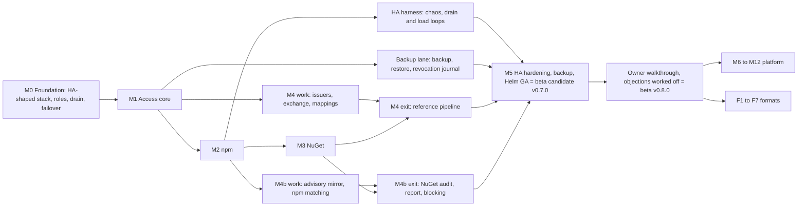

# Roadmap

Status: plan. Nothing is implemented. Milestones carry no dates: a milestone is reached when every
exit criterion passes on `main` in CI. The calendar does not end a milestone.

Every question this plan depends on is decided. The development agent selected one of the
documented options for each question on the spec pages and for the four questions on this page
([Decisions](#decisions)). No milestone from M0 to M5, M4b included, waits for the owner. The development agent
builds the prototype through M5 on its own, and the owner reviews it at the
[walkthrough](#owner-walkthrough) after M5.

On 2026-10-28 the owner added constraints that cannot be deselected
([docs/spec/README.md](../spec/README.md#owner-constraints)): HA PostgreSQL, HA Valkey with
Sentinel and S3; a load that one replica cannot carry, spread at random by a Kubernetes Service,
with node drains that cause no outage; a configurable backup job that writes a consistent backup
to S3; and no ReadWriteMany volume. The spec pages took them in as INV-2, INV-3, INV-11, INV-12,
INV-13, INV-18 and INV-19. This page folds the work they own into M0 to M5, all of it MVP:

| Work | Where it is built | Where it is proven |
|---|---|---|
| Valkey with Sentinel and its degraded mode | M0 (client, discovery, fallbacks, dev profile with three Sentinels) | E0.12, E0.13; under full client load in E5.10 |
| `web` and `worker` roles as separate Deployments | M0 (R-HA-002) | E0.3, E0.7; job routing from M1 |
| TLS on every connection, trove's listeners included | M0 (R-ARCH-035, R-HA-063; WP0.12) | E0.15; the dev profile and the integration tier run on TLS |
| Drain-safe shutdown | M0 (R-ARCH-024, R-HA-011) | E0.14, then with every format's load; R-HA-059 in E5.9 |
| No state between requests, no ReadWriteMany | M0 (R-ARCH-032, R-HA-061), then per page in M1 to M4 | `scatter` profile from E0.11 on |
| Backup create and restore, with the revocation journal | M5, in a lane that starts after M1 (Q-ROAD-2) | E5.11, E5.12 |

This page orders the work from an empty repository to the trove beta release (the MVP, `v0.8.0`), then through P1, P2
and Later. It is built from these inputs:

- the requirements in [docs/spec/](../spec/README.md), each with a `Priority:` line and a
  `Covers:` line;
- the priority rubric of the [feature catalog](../features/README.md);
- the [format matrix](../features/formats/README.md);
- the [beyond-baseline candidates](../features/beyond-baseline.md).

Once M0's coverage generator exists, it publishes the status of each requirement as a generated
checklist in this directory ([README.md](README.md)). This page owns the order, the scope and the
exit criteria.

Reading the scope lists:

- `R-AUTH-001…018` means every requirement of that prefix from 001 to 018.
- Every MVP requirement appears in exactly one of M0 to M5 and M4b. Every P1 requirement appears in exactly
  one of M6 to M11, or in the format lane. There is one exception, named where it occurs: M0 builds
  the `/v2/` reservation bullet of R-HA-041, and the rest of R-HA-041 stays in F4 (Q-HA-4).
- A requirement sits in the milestone that builds its mechanism. Where one of its acceptance
  criteria needs a client, a repository class or a load that a later milestone brings, that
  criterion first runs in the later milestone, and the scope section of the earlier milestone
  names it. R-ARCH-024 in M0 is an example: its drain criterion loads npm and NuGet clients.
- Exit criteria are tests. Where a spec requirement already states the test, the criterion names
  that requirement and does not repeat the test.

## Starting point

These numbers were measured on 2026-10-29 over the catalog and spec pages, after every spec
question was decided and the spec pages had taken in the owner constraints of 2026-10-28. A
throwaway script did the counting. It applied the parsing rules that M0's coverage generator will
own, and it reproduces the numbers of the previous version (491 requirements, 658 listed entries)
from the pages as committed before the constraints.

| Catalog priority | Catalog entries | Listed in a requirement's `Covers:` line | Not listed yet |
|---|---|---|---|
| MVP | 359 | 359 | 0 |
| P1 | 521 | 285 | 236 |
| P2 | 896 | 20 | 876 |
| Later | 391 | 0 | 391 |
| Out of scope | 72 | 0 | 72 |
| **Total** | **2,239** | **664** | **1,575** |

The spec contains 577 requirements on 13 pages: 431 MVP, 144 P1 and 2 P2 (R-STOR-014 and
R-CI-022). The owner's input of 2026-10-29 added 22 of them: the constraint "TLS on every
connection, trove's listeners included" added R-ARCH-035 and R-HA-063, both MVP and both in M0, and
the request for several endpoints with exposure rules added the page
[endpoints.md](../spec/endpoints.md) with R-EP-001 to R-EP-020 (19 MVP, 1 P1) plus R-NPM-048 and
R-NUGET-034. The constraints added 62 requirements (58 MVP, 4 P1), most of them on the new page
[backup-and-restore.md](../spec/backup-and-restore.md), and raised 8 from P1 to MVP: R-API-024,
R-AUTHZ-031, R-HA-002, R-HA-023, R-HA-025, R-HA-045, R-HA-054 and R-OPS-021. Every ID in a
`Covers:` line exists in the catalog. The spec pages carry 178 questions and the security gaps H-1
to H-52. The development agent decided every one of the questions in the `## Decisions` section of
its page. This page adds Q-ROAD-1 to Q-ROAD-5, decided in [Decisions](#decisions).

Six findings shaped this plan:

1. **Generic local repositories are P1, yet 16 MVP requirements test against one.** These
   requirements use a generic repository (`generic-local` or `files-internal`) in their acceptance
   criteria:
   R-STOR-001, R-STOR-004, R-STOR-007, R-STOR-012, R-API-012, R-API-025, R-UI-008, R-ARCH-005,
   R-ARCH-007, R-ARCH-024, R-AUTHZ-006, R-AUTH-012, R-AUTH-033, R-HA-010, R-HA-011 and R-HA-039.
   R-HA-052's load also includes `curl -T` of 200 MB files. npm and NuGet repositories refuse raw
   deploys (R-API-025), so these tests have no other target. [Q-ROAD-1](#q-road-1--generic-local-repositories-in-m1)
   (option (a)) moves the local class of the generic format into M1.
2. **Backup and restore are MVP, and so is the revocation journal.** INV-19 makes trove's own
   backup create and restore MVP (the `R-BAK` page, R-HA-060). Q-HA-19 raised the platform layer
   R-HA-023 and the point-in-time restore R-HA-025 to MVP, so the exception this page used to make
   for them is gone. Q-HA-9 raised the revocation journal R-HA-054 with R-AUTHZ-031's entries to
   MVP, because a restore from a scheduled backup undoes up to one backup interval of revocations,
   and a restore refuses to run without the journal (R-BAK-020). The drill restores npm and NuGet
   data and replays CI revocations, so it can gate only once M3 and M4 exist.
   [Q-ROAD-2](#q-road-2--backup-and-restore-in-the-beta) (revisited, option (e)) builds the backup in a
   lane that starts after M1 and gates it in M5.
3. **The npm acceptance matrix includes P1 operations.** R-NPM-045's scenario list covers
   deprecate (R-NPM-018), login (R-NPM-020, R-NPM-021) and search (R-NPM-037), all P1. M2 gates
   only on the MVP scenarios. Until M6 lands, the P1 scenarios check for the predictable answers
   that R-NPM-043 specifies. Audit (R-NPM-038) was P1 too; the owner raised it to MVP on
   2026-10-31, and it is built in M2 (Q-NPM-61).
4. **Every MVP catalog entry is covered.** FMT-013 (client authentication styles and anonymous
   fallbacks) was the last MVP entry without a requirement. R-AUTH-033 now covers it: its table
   *Authentication styles across formats* maps each client style to the one authentication stage
   (R-AUTH-001) and settles the npm and NuGet rows at MVP. A client that cannot authenticate is
   served only as the anonymous principal (R-AUTH-037), never through a per-repository bypass.
   The rows of other formats keep their format's priority and follow the same rules. No separate
   M1 item remains: the work is part of R-AUTH-033 in M1.
5. **No P1 format has a spec page.** `docs/spec/formats/` contains only `npm.md` and `nuget.md`.
   M1 writes `formats/generic.md` for the generic local class (Q-ROAD-1). Every other P1 format
   needs a spec page before its implementation starts, and so do build metadata, search and
   upstream curation, which also have P1 catalog entries without requirements. See
   [Spec work before P1 implementation](#spec-work-before-p1-implementation).
6. **The constraints of 2026-10-28 belong in the foundation.** Valkey with Sentinel, the `web` and
   `worker` split, no state between requests, drains without outage and the ban on ReadWriteMany
   volumes each touch every request path and every chart template. Added after the first format,
   each would mean building the proxy, authentication and job paths a second time. M0 therefore
   brings up the HA-shaped stack (PostgreSQL with a standby, Valkey with a replica and three
   Sentinels, the S3 store, three kind worker nodes), runs every end-to-end test in the `scatter`
   profile, and gates on a node drain and on PostgreSQL and Valkey failovers with zero failed
   requests. Each later milestone repeats those tests with its own client load, and M5 runs them
   under the full failure suite.

## Milestones at a glance

| Milestone | Theme | Requirements | Can start when | Ends with |
|---|---|---|---|---|
| [M0](#m0--foundation) | Foundation: skeleton, pins, CI, PostgreSQL with a standby, Valkey with Sentinel, S3, coordination, `web` and `worker` roles, drain-safe shutdown, chart skeleton, coverage generator | 88 MVP, plus the `/v2/` reservation (Q-HA-4) | — | `v0.1.0` |
| [M1](#m1--access-core) | Access core: OIDC login, tokens, permissions, repositories, raw file transfer, admin UI, all of it across replicas | 139 MVP, plus the generic local class and its spec page (Q-ROAD-1) | M0 | `v0.2.0` |
| [M2](#m2--npm) | npm with local, remote and virtual repositories; proxy and virtual engines with request collapsing through Valkey | 85 MVP | M1 | `v0.3.0` |
| [M3](#m3--nuget) | NuGet v3; freeze of the format contract | 28 MVP | M2's WP2.1 to WP2.3 | `v0.4.0` |
| [M4](#m4--gitlab-ci-oidc) | GitLab CI OIDC token exchange | 28 MVP | M1 for the work, M3 for the exit | `v0.5.0` |
| [M4b](#m4b--vulnerability-scanning) | Vulnerability scanning: advisory mirror from OSV, matching by package identity, findings and the vulnerability report, blocking of malicious versions, npm and NuGet audits from trove's data | 29 MVP | M3 for the exit; the advisory and npm work from M2 (Q-ROAD-8) | `v0.6.0` |
| [M5](#m5--ha-hardening-and-helm-ga) | HA hardening under drains and failovers, backup and restore with the revocation journal, Helm GA | 64 MVP | M3, M4 and M4b; the backup lane from M1 (Q-ROAD-2) | **beta candidate** `v0.7.0` |
| [Walkthrough](#owner-walkthrough) | The owner reviews the prototype; objections are worked off | — | M5 | **beta** `v0.8.0` |
| Beta phase | Beta feedback worked off, upgrade path from the beta, import tooling, user documentation ([FULL.md](../projektplan/FULL.md) block A) | — | Beta | further `v0` minors; 1.0 only on the owner's explicit decision |
| [M6 to M12](#p1-platform-milestones) | P1 platform | 140 P1, plus 3 spec pages to write (builds, search, curation) | Beta | `v0` minors |
| [F0 to F7](#p1-format-expansion-order) | P1 formats | 3 P1 plus the 13 Ansible entries, 7 format spec pages to write and `formats/generic.md` to extend | Beta | `v0` minors |

## Why this order

- **M0 comes first because every later acceptance test runs on the chart.** R-NPM-045,
  R-NUGET-027 and R-CI-028 each require several replicas behind the Helm chart, with PostgreSQL,
  Valkey with Sentinel and S3-compatible storage, and R-NPM-046, R-NUGET-030 and R-CI-029 run them
  in the `scatter` profile, where consecutive requests reach different `web` replicas (R-ARCH-032).
  These must exist before the first format can be accepted. HA, the role split and statelessness
  are built in from M0 onward: M0 already drains a node and fails PostgreSQL and Valkey over
  without a failed request. M5 proves the same under the full client load and failure suite.
  Adding any of it after the fact would mean revisiting every request path.
- **Access (M1) comes before npm (M2).** Every package request resolves credentials (R-AUTH-001,
  R-AUTH-033) and goes through one decision point (R-AUTHZ-015). npm publish also depends on
  package ownership (R-AUTHZ-018) and token scopes (R-AUTH-024). Building npm first would mean
  building its authentication twice. Raw file transfer on a generic local repository is the smallest
  protected surface that proves login, tokens, permissions and the upload path together, and 16 MVP
  acceptance criteria already use it.
- **npm comes before NuGet.** npm puts the most strain on the generic engines:
  - four clients in eight gate rows (R-NPM-045, Q-NPM-4);
  - scoped names that make routing ambiguous (the reason given in Q-ARCH-1);
  - the widest dependency fan-out on a cold cache of the two MVP formats.

  So npm drives the proxy engine, virtual merging and miss collapsing. NuGet comes second because
  a second implementation is the real test of the format contract. Freezing the contract after one
  format would build npm's assumptions into it. M3 therefore ends with the contract freeze.
- **CI OIDC (M4) work starts after M1, but its exit waits for M3.** Issuer validation, the exchange
  endpoint, the mapping engine and claim templating depend only on tokens and authorization
  (R-AUTHZ-014), so they run in parallel with M2 and M3. The exit test (R-CI-028) publishes an npm
  package and a NuGet package from one pipeline.
- **Vulnerability scanning (M4b) comes after M3 and before M5.** The owner decided on 2026-10-31 that it is part of
  the beta ([ADR-131](../decisions.md#adr-131--own-vulnerability-scanning-with-a-dashboard-in-the-beta)). Its matching
  needs each format's version order and its NuGet audit the NuGet service index, so its exit waits for M3; the advisory
  mirror, the findings and npm's matching need only M2 and can start in parallel with M3 and M4
  ([Q-ROAD-8](#q-road-8--where-vulnerability-scanning-goes-in-the-beta)). It comes before M5 so that the failure suite,
  the drain tests and the restore drill of M5 cover its sync and evaluation jobs and its blocks (E5.13).
- **M5 comes last.** The load loops of the failure-injection suite are `npm ci`, `dotnet restore`,
  `npm publish` and `curl -T` (R-HA-052), so the suite can gate only once all four exist. The GA
  values reference (R-HA-031) must also cover every MVP setting, CI issuers included. The chaos and
  load harness itself starts in M2 (WP2.8), so M5 tightens a running suite and does not build one
  from scratch.
- **Backup and restore gate in M5, but their work starts after M1.** The drill restores published
  npm and NuGet packages and replays revocations of every kind, CI token revocations from M4
  included (R-BAK-024, R-HA-054), so it can gate only once M3 and M4 exist. The snapshot, the blob
  pool, the garbage-collection hold and the restore procedure depend only on M0 and M1, so the
  backup lane runs in parallel with M2 to M4, as M4's work does
  ([Q-ROAD-2](#q-road-2--backup-and-restore-in-the-beta)). M0 already gives every table its export class
  (R-BAK-004), so no table has to be classified after the fact.

Orders considered and rejected:

- *npm first, access later.* This gives a faster demo, but publish authentication, ownership and
  token formats would have to be built twice.
- *CI OIDC before any format.* The exit test would have nothing to publish.
- *HA hardening first.* Without load from real clients, the failure suite has nothing to measure.
- *Valkey and the role split after the first format.* The proxy's request collapsing, the rate
  limits and the change propagation would first be built on PostgreSQL locks and `LISTEN`, in one
  process type, and then again.

Rules that hold across all milestones:

- No milestone waits for an owner decision. A question that comes up during the work is decided by
  the development agent in the `## Decisions` section of the page that owns it, in the form that
  [docs/spec/README.md](../spec/README.md) prescribes, and the work goes on with that choice.
- Every end-to-end test runs in the `scatter` profile of R-ARCH-032 from M0 onward: the chart with
  three `web` and two `worker` replicas on three kind worker nodes, an edge that balances every
  request round robin over the `web` replicas, PostgreSQL with a standby, Valkey with a replica and
  three Sentinels, and the S3 store. Each format's end-to-end job also runs with Valkey
  stopped, in the full run of Test and Release on the commit that closes the phase.
- No change renders a ReadWriteMany volume, a PersistentVolumeClaim, a StatefulSet or session
  affinity, or keeps request state in a package-level variable: R-HA-061's template check and
  R-ARCH-032's architecture test fail CI otherwise.
- Migrations follow expand/contract from the first one (INV-3). The pre-releases of M2 to M4b are
  real upgrade sources: M5 upgrades from the M4b pre-release (E5.4).
- A requirement counts as implemented when a test that names it passes on `main`
  ([Q-ROAD-4](#q-road-4--how-the-coverage-generator-learns-implementation-status)).
- Each tool and dependency is pinned once, and local builds and CI read the same pin.
- A change that alters documented behavior updates the documentation in the same change.

## Decisions the milestones build on

No milestone waits for a decision. Every question was decided by the development agent: it worked
out the options on the question's page, selected one, recorded the rationale and the condition
under which it would revisit the choice, and applied the choice to the spec. The owner reviews the
choices at the [walkthrough](#owner-walkthrough). Until then development proceeds on them. Each
question's page is authoritative. The ADR log indexes the spec questions under
[Decisions by the development agent](../decisions.md#decisions-by-the-development-agent), and the
four questions of this page are decided in [Decisions](#decisions) below.

The table shows which decisions each milestone's first commits encode. A question appears in the
row of the milestone that first builds on it. The layout questions Q-UI-2, Q-UI-3 and Q-UI-4 were
decided without example screenshots, and the owner judges the layouts on the running UI at the
walkthrough.

| Milestone | Questions | What the first commits encode |
|---|---|---|
| M0 | Q-ARCH-1…5, Q-ARCH-11, Q-ARCH-13…16, Q-ARCH-18, Q-API-1, Q-HA-2, Q-HA-3, Q-HA-8, Q-HA-11…16, Q-STOR-2, Q-STOR-4 (same as Q-OPS-7), Q-STOR-6, Q-STOR-10, Q-STOR-12, Q-STOR-13, Q-OPS-9, Q-OPS-12, Q-OPS-13, Q-OPS-18, Q-ROAD-4, Q-EP-1, Q-EP-3, Q-EP-6, Q-EP-7 | `net/http.ServeMux` serves every route, and each format resolves its own escaped path (Q-ARCH-1). PostgreSQL is reached through pgx's native API, sqlc and the confined `listq` builder, and trove uses no `LISTEN` (Q-ARCH-2). A trove-owned migration runner applies each file together with its `schema_migration` row in one transaction (Q-ARCH-3). The `service/s3` client is used with trove's own multipart upload from the spool file (Q-ARCH-4). The job queue is trove's PostgreSQL job table, claimed only by `worker` replicas, with wake-ups from Valkey and polling as the bound (Q-ARCH-5). Valkey is reached through valkey-go, against Valkey 9.0 and later, in Sentinel mode for production (Q-ARCH-13). The main pool is transaction-scoped and may run through a transaction-mode pooler; session connections exist only for the lease pool of `worker` replicas, `trove migrate` and `trove backup` (Q-ARCH-14). Cross-replica invalidation is a per-area epoch and change log in PostgreSQL that every replica polls, with Valkey Pub/Sub as a fast path that can only evict early (Q-ARCH-15). Valkey holds coordination state and the negative cache, and nothing served to a client and no positive authentication or authorization result is read from it (Q-ARCH-16). A transfer still running at the shutdown deadline is cut, and clients resume with `Range` or retry (Q-ARCH-18). Only configuration errors hold back a replica's first readiness, and Valkey never affects readiness (Q-HA-13). Sentinel is the only production topology; a standalone instance serves development, and the endpoint mode is P1 (Q-HA-14). The dev profile and CI run Valkey with a replica and three Sentinels from `deploy/dev/valkey.yaml` (Q-HA-15). The chart defaults to three `web` and two `worker` replicas, with R-HA-059's N + 1 rule (Q-HA-16). Usage is folded from append-only deltas by every `worker` replica with `SKIP LOCKED`, and download statistics stay in per-replica buffers (Q-STOR-12). Storage maintenance runs are excluded only by their exclusive job key (Q-STOR-13). `worker` replicas run the same readiness checks as `web` and claim jobs only while ready (Q-OPS-12). `role` and `pool` are target labels that the ServiceMonitor attaches, and `trove_build_info{role}` reports the role (Q-OPS-13). Gauges read from PostgreSQL are evaluated in the background once per interval on every replica (Q-OPS-18). INV-6 is unchanged, with ports 8080 and 8081 (Q-ARCH-11). Go models, the server interface and the TypeScript types are generated from the hand-written OpenAPI 3.1 document (Q-API-1). PostgreSQL 16 is the floor version (Q-HA-2). SeaweedFS runs on every change, and MinIO (built from source at a pinned commit, on isolated runners) and AWS S3 run nightly (Q-HA-3). The operator creates the encryption-key Secret, and the chart fails without it (Q-HA-8). Images and chart are published to `ghcr.io/guided-traffic/trove` and `oci://ghcr.io/guided-traffic/charts/trove` (Q-HA-11). The replica table, heartbeat, pruning and read-only replica API are MVP (Q-HA-12). SHA-512 is computed for every upload (Q-STOR-2). Every schedule trove's scheduler evaluates is five-field cron in UTC, read by one parser; the chart checks the backup CronJob's schedule against the same rejected forms, with `backup.timeZone` defaulting to `Etc/UTC` (Q-STOR-4, Q-OPS-7). Download verification is on (Q-STOR-6). Storage jobs are tasks of the shared framework (Q-STOR-10). The job API R-OPS-019 is MVP (Q-OPS-9). A test that names a requirement ID is the evidence that the requirement is implemented (Q-ROAD-4). The endpoint of a request is the listener it arrived on, and a foreign host answers `421` (Q-EP-1). A further endpoint may run on a pool of its own, off by default (Q-EP-3). An endpoint has exact hosts and at most one single-label wildcard, and a host may bind its root to one repository, a mechanism without an MVP consumer (Q-EP-6). Endpoints are MVP over M0 to M3, until the owner objects (Q-EP-7). |
| M1 | Q-AUTH-1…4, Q-AUTH-6, Q-AUTH-7, Q-AUTH-9…14, Q-AUTHZ-3, Q-AUTHZ-5, Q-AUTHZ-9…13, Q-API-2…4, Q-API-6…9, Q-API-12, Q-ARCH-10, Q-ARCH-17, Q-UI-1, Q-UI-2, Q-UI-4, Q-UI-5, Q-UI-7, Q-OPS-3, Q-OPS-4, Q-OPS-14, Q-OPS-22, Q-STOR-9, Q-ROAD-1, Q-EP-2, Q-EP-4, Q-EP-8…13 | Login providers are configured only in the YAML file (Q-AUTH-1). The cookies are `__Host-trv_session`, `__Host-trv_csrf` and `__Host-trv_oidc_binding` (Q-AUTH-2). There are no refresh tokens (Q-AUTH-3). A missing group claim clears the user's groups and emits a warning event (Q-AUTH-4). Revocation by value works unauthenticated, is rate-limited and has no existence oracle (Q-AUTH-6). Nobody but a PAT's owner ever holds its secret (Q-AUTH-7). Sessions, tokens, principals and runtime settings are cached in each replica's memory only, and Valkey carries only their change messages (Q-AUTH-9). The auth caches answer only while the replica's view of the change log is younger than `auth.revocation_bound`; otherwise the lookup goes to PostgreSQL, and a failed lookup answers `503`, never a cached acceptance (Q-AUTH-10). The failed-credential throttle and the login-flow limits count cluster-wide in Valkey, and the break-glass lockout stays in PostgreSQL (Q-AUTH-11). Multi-request login flows keep their state in PostgreSQL only (Q-AUTH-12). Idle expiry is decided from the session row (Q-AUTH-13). A break-glass password rotation opens a hold in PostgreSQL that ends every earlier break-glass session (Q-AUTH-14). The grant index follows the `authz` and `repo_config` change areas and treats a Valkey message as a hint that an epoch query confirms (Q-AUTHZ-11). A request may carry `Trove-Authz-Min-Epoch`, and every replica honours it (Q-AUTHZ-12). No decision is made on a grant index unconfirmed for longer than `authz.cache.max_staleness`; the request waits, then is decided or answered `503` `authz_stale` (Q-AUTHZ-13). The built-in principal `authenticated` is read-only, covers users only and is R-AUTHZ-030 (Q-AUTHZ-3). Refused reads are audited by default, allowed reads only with `authz.audit.reads: all` (Q-AUTHZ-5). A token scope element is a policy resource set plus `actions` (Q-AUTHZ-9). A scope names only resource types of the grant model, `repositories` in the MVP, and is always intersected with the subject's rights (Q-AUTHZ-10). `If-Match` is required on PUT and PATCH of resources with a revision ETag (Q-API-2). The rate-limit classes `read`, `write` and `anonymous` count cluster-wide in Valkey and fall back to per-replica shares while Valkey is unavailable; H-43 covers only that fallback (Q-API-3). The limiter of R-ARCH-034 serves every class that limits callers with cluster scope (Q-ARCH-17). Management reads come from PostgreSQL, and every other effect on enforcement follows R-ARCH-018's propagation bound (Q-API-12). INV-17 covers `/files/…` and `/auth/…` (Q-API-4). Lists page with `limit` and `cursor` (Q-API-6). Custom methods are kebab-case sub-path verbs (Q-API-7). The key-ring status endpoint is R-API-049 (Q-API-8). Singleton tasks start only through the task trigger and stop only through job cancel (Q-API-9). Content is served from one origin with content headers that the core enforces (Q-ARCH-10). The UI uses Angular Material, the CDK and `@angular/aria` (Q-UI-1). The side bar is pinned from 1024 CSS px, with compact density (Q-UI-2). The policy editor is one page with a sticky preview (Q-UI-4). Translations use compile-time i18n, one build per locale (Q-UI-5). The status screen groups replicas by role, states drain safety per role and summarises Valkey from the replicas' views (Q-UI-7). The version endpoint needs a credential (Q-OPS-3). Audit rows are append-only for the runtime role (Q-OPS-4). Audit deduplication stays per replica, so the bound is n first events and n summaries per key and window (Q-OPS-14). An event type flagged for the revocation journal requires an entry from its producer, except the allow-listed shared types `package.published` and `package.deleted` (Q-OPS-22). Permissions and retention share one pattern syntax (Q-STOR-9). The generic local class is built in M1 (Q-ROAD-1). Endpoints are file configuration, their exposure rules live in PostgreSQL inside the grant index (Q-EP-2). Hidden content answers `404`, writes on an endpoint with rules `403` (Q-EP-4). A rule names one repository by key (Q-EP-8). Endpoints with rules are read only (Q-EP-9). A further endpoint accepts only service-account tokens bound to it (Q-EP-10). Exposure is decided on the addressed repository (Q-EP-11) and binds administrators too (Q-EP-12). Sign-in and the UI stay on the default endpoint (Q-EP-13). |
| M2 | Q-NPM-1, Q-NPM-2, Q-NPM-4…6, Q-NPM-8…11, Q-NPM-13, Q-NPM-61…65, Q-ARCH-6…9, Q-ARCH-12, Q-REPO-1…9, Q-AUTHZ-1, Q-AUTHZ-2, Q-AUTHZ-4, Q-UI-3, Q-UI-6, Q-OPS-10, Q-EP-5 | npm's trusted-publishing routes are reserved at the host root and below every registry URL, and the exchange itself is R-NPM-022 in M10 (Q-NPM-1). Versions the upstream removed are hidden by default (Q-NPM-2). The gate rows are npm 10, 11 and 12, pnpm 10, 11 and 12, Yarn 4 and Yarn 1.22 (Q-NPM-4). Remotes store only the full package document (Q-NPM-5). Inconsistent manifests are rejected (Q-NPM-6). Tombstones are never purged (Q-NPM-8). Dist-tags and deprecation need `deploy` plus ownership (Q-NPM-9). npm documents are cached per replica under keys read from PostgreSQL, and dates do not validate a document (Q-NPM-10). An identical publish retried by the same principal within 10 minutes is acknowledged with `201` and changes nothing (Q-NPM-11). A cached tarball is served only while its package document is current (Q-NPM-13). The fetch lock is a Valkey lock per flight with a 30 s TTL that the holder extends, behind `cluster.FlightLock`, with per-replica collapsing as the fallback; no PostgreSQL connection is held during a fetch (Q-ARCH-6). Its key is the SHA-256 of the flight key, and every remaining PostgreSQL advisory lock keeps the two-key form (Q-ARCH-7). Signals from client traffic leave through a post-commit coalescer to Valkey Pub/Sub, and trove sends no `NOTIFY` (Q-ARCH-8). Merged metadata checks each local member's `rev_seq` on every hit (Q-ARCH-9). Derived indexes are rendered per request, and no publish waits for one (Q-ARCH-12). R-ARCH-021 seals every stored secret (Q-REPO-1). A metadata period of `0` is allowed (Q-REPO-2). An upstream 404 or 410 for a package document marks the package gone (Q-REPO-3). Every remote of the format refuses `global`-claimed names (Q-REPO-4). Pins, claims, extra hosts and upstream credentials are generic members (Q-REPO-5). The shadowing check is R-REPO-048, and it reads no negative entry from Valkey (Q-REPO-6). A draining replica finishes the fetches it holds until 5 s before its deadline and takes no new flight after `SIGTERM` (Q-REPO-7). `limits.maxConcurrentFetches` is a budget for the installation, shared out per replica from the replica registry (Q-REPO-8). `remote.sourceNetwork` takes a CIDR prefix with one address per replica (Q-REPO-9). `read` on a virtual repository is only an endpoint gate (Q-AUTHZ-1). New npm and NuGet local repositories enforce ownership (Q-AUTHZ-2). `cacheFillAction` defaults to `read` (Q-AUTHZ-4). The package page has two columns from 960 CSS px (Q-UI-3). External README images are blocked unless their origin is listed (Q-UI-6). The `repo` metric label is capped at 500 keys per metric family, the same keys on every replica, chosen from the repository snapshot (Q-OPS-10). Further endpoints do not fill caches from upstreams unless configured to (Q-EP-5). The security audit is MVP (owner, Q-NPM-61): a remote, or the first forwarding remote member of a virtual repository, forwards through its upstream client (Q-NPM-62) only the names one statement finds fetched and not internal (Q-NPM-63), bodies are bounded to 1 MiB as sent by default (Q-NPM-64), and npm 6's audit endpoints, which pnpm 10 uses, answer 501 (Q-NPM-65). |
| M3 | Q-NUGET-1…11 | A protocol delete unlists unless the repository sets `deleteMode: delete` (Q-NUGET-1). NuGet remotes default to a 300 s metadata period (Q-NUGET-2). IDs pushed to local repositories are ASCII (Q-NUGET-3). Search is forwarded to the upstream unless a term is protected (Q-NUGET-4). The version that created a package fixes its ID casing (Q-NUGET-5). Versions are immutable, every removal leaves a tombstone, and an identical-bytes push of a stored version answers 201 (Q-NUGET-6). Symbol requests carry a routing name for patterns, claims and pin rules (Q-NUGET-7). Forwarded search results are cached unfiltered in each `web` replica's memory and filtered on every use (Q-NUGET-8). Rendered documents carry a weak ETag over a render version and their inputs, and stored files keep the strong, content-addressed ETag (Q-NUGET-9). Publishes and deletions on local repositories are journaled, so that a restore reserves the numbers of lost versions for their exact bytes and reports revived versions; the replay arrives with the journal in M5 (Q-NUGET-10). A symbol push only validates and stores the `.snupkg`, and indexing runs as one `nuget-symbol-index` job per symbol package on `worker` (Q-NUGET-11). |
| M4 | Q-CI-1…4, Q-CI-6…10, Q-CI-12…15, Q-AUTHZ-6 | Mappings use first match per tier and union across tiers (Q-CI-1). The `scope` parameter is a scope string per RFC 6749 (Q-CI-2). Every `aud` element must be an allowed audience (Q-CI-3). Single use is off for GitLab and on for GitHub and generic issuers (Q-CI-4). Ownership is claimed on first publish (Q-CI-6). Each job revokes its own CI token, and the TTL stays the bound (Q-CI-7). A rejected subject token answers 400 `invalid_request` (Q-CI-8). Fork pipelines are denied by default (Q-CI-9). A mapping's principal is named `<CI issuer name>/<mapping name>` (Q-CI-10). An issuer's key set lives in one PostgreSQL row, refreshed by a `worker` task, with in-process copies on every replica (Q-CI-12). The replay set lives in PostgreSQL only, inside the exchange transaction, and after a restore single-use issuers refuse subject tokens issued before it finished (Q-CI-13). Exchange limits count cluster-wide per client address and per issuer and subject (Q-CI-14). The exchange evaluates again from PostgreSQL when its mapping cache is behind the issuer row's `mappings_version` (Q-CI-15). A writing CI inline grant that omits `ownership` is saved as `bind_project`, and any other inline grant as `none` (Q-AUTHZ-6). |
| M4b | Q-VULN-1…19, Q-ROAD-8 | Package formats are scanned by matching stored versions against the OSV records of their ecosystem inside trove, and an image analyser comes only with OCI (Q-VULN-1). Advisory data and findings live in PostgreSQL (Q-VULN-2). Public advisories never apply to claimed names, and a match on one is an alert (Q-VULN-3). Malicious versions are blocked at download by default, a severity threshold is opt-in per repository, and a dismissal lifts a block (Q-VULN-4). A version is evaluated in its commit; without any advisory data downloads are allowed by default (Q-VULN-5). Severity comes from the newest CVSS vector, scored by trove (Q-VULN-6). Statuses are `needs_triage`, `confirmed`, `dismissed` and `resolved`, and a dismissal reopens on a material change (Q-VULN-7). Triage needs the capability `vulnerabilities:triage` (Q-VULN-8). npm audits are answered from trove's data by default (Q-VULN-9), and so is NuGet's audit (Q-VULN-10). The incremental sync reads the change file with ranged requests (Q-VULN-11). An air-gapped installation imports from a generic repository (Q-VULN-12). Advisory tables are not backed up, findings are (Q-VULN-13). Known-exploited marking is on, EPSS is P1 and off (Q-VULN-14). Formats join through an optional interface after the contract freeze (Q-VULN-15). The trend is computed from the readable findings (Q-VULN-16). npm audit ids are hash-derived (Q-VULN-17). Evaluation jobs read their work from tables, not from their arguments (Q-VULN-18). An endpoint with exposure rules answers no npm audit in any mode (Q-VULN-19). The milestone sits between M4 and M5 (Q-ROAD-8). |
| M5 | Q-HA-1 (same as Q-STOR-1 and Q-OPS-2), Q-HA-5, Q-HA-6, Q-HA-7, Q-HA-9, Q-HA-10, Q-HA-17 (same as Q-BAK-9), Q-HA-18…20, Q-BAK-1…8, Q-BAK-10, Q-BAK-11, Q-API-10, Q-API-11, Q-NPM-12, Q-CI-11, Q-OPS-1, Q-OPS-15, Q-OPS-16, Q-ROAD-2 | Object storage gates only a replica's first readiness (Q-HA-1). Zero-downtime upgrades hold between adjacent minor releases only (Q-HA-5). Transaction-mode poolers are supported for the main pool, with a separate control pool (Q-HA-6, Q-HA-20). The HTTPRoute is MVP as R-HA-038, and a chart-created Gateway is P1 as R-HA-053 (Q-HA-7). The revocation journal in object storage is MVP and is replayed by `trove admin post-restore` and by every restore of a trove backup (Q-HA-9). The egress NetworkPolicy is off by default (Q-HA-10). The backup CronJob is rendered by default, and the chart fails without a backup target unless `backup.enabled: false` is set (Q-HA-17, Q-BAK-9). `restore.enabled` renders an ordinary restore Job with both roles at zero, no migration Job and the backup CronJob suspended (Q-HA-18). R-HA-023 and R-HA-025 are MVP (Q-HA-19). The database part of a backup is trove's own `COPY` export from one `REPEATABLE READ READ ONLY` snapshot (Q-BAK-1). A global hold and then per-blob pins, both under a lease, keep garbage collection away from a running backup's blobs (Q-BAK-2). Blobs go to a content-addressed pool that every backup of a target shares, incremental by digest, with mark-and-sweep retention (Q-BAK-3). A `backup_run` row with a partial unique index and a lease allows one target-writing run at a time (Q-BAK-4). A restore takes a new Valkey keyspace ID and lifts every registered revision column by 2^32 (Q-BAK-5). Backups use server-side encryption at MVP, and client-side encryption of the database files is P1 (Q-BAK-6). A restore goes into an empty installation; reusing an existing blob store is P1 (Q-BAK-7). A newer release restores a backup when its migrations contain every step of the backup (Q-BAK-8). An interrupted restore resumes on its own (Q-BAK-10). A run without progress for 30 minutes cancels itself (Q-BAK-11). The API and UI start no backup and show the `kubectl` command for a manual run (Q-API-10), and they list stored backups from the newest run that listed the target (Q-API-11). npm unpublishes are journaled, and replay withholds a restored version (Q-NPM-12). A replayed disable of a CI mapping also suspends every later enabled mapping of its tier (Q-CI-11). Liveness never reads readiness and fails only when one of trove's own loops stops making progress (Q-OPS-1). A single Valkey failover raises no alert; repeated failovers and replicas that disagree about the primary do (Q-OPS-15). Deleting trove's Valkey keys is always safe, and the installation-wide cache flush is P1 as R-OPS-047 (Q-OPS-16). trove's own backup create and restore, the platform layer and the revocation journal ship in the beta, built in a lane that starts after M1 (Q-ROAD-2). |
| P1 | Q-HA-4, Q-AUTH-5, Q-AUTH-8, Q-AUTHZ-7, Q-AUTHZ-8 (same as Q-API-5 and Q-STOR-3), Q-STOR-5, Q-STOR-7, Q-STOR-8, Q-STOR-11, Q-OPS-5, Q-OPS-6, Q-OPS-8, Q-OPS-11, Q-OPS-17, Q-OPS-19…21, Q-NPM-3, Q-NPM-7, Q-ROAD-3 | M0 reserves `/v2/`, and the OCI routing itself is F4 (Q-HA-4). In M10 dormancy is on by default after 90 days (Q-AUTH-5). In M10 CI delegations stay independent of projects (Q-AUTHZ-7). In M6 the npm web-login poll is bound to the client's network (Q-AUTH-8). In M6 npm audit is forwarded only for names the remote holds (Q-NPM-3). In M6 the dependency rewrite touches HTTP(S) tarball URLs only (Q-NPM-7). In M7 a quota or capacity limit answers `507`, and the per-request size limit `413` (Q-STOR-7). In M8 an overwrite sends the previous file to the trash can (Q-STOR-5). In M8 a copy or move target is the exact destination (Q-STOR-8). In M8 a multi-request upload is one S3 multipart upload per session, with its offset, hash state and parts in PostgreSQL under a writer claim (Q-STOR-11). In M9 build records get their own page, `builds.md` with prefix `R-BLD` (Q-AUTHZ-8). In M9 CloudEvents types are `trove.<registry name>` (Q-OPS-5). In M9 login providers stay out of configuration documents (Q-OPS-6). In M9 managed objects are locked against API and UI changes (Q-OPS-8). In M9 webhook templates are bounded `text/template` (Q-OPS-11). In M9 a `webhook.deliver` claim counts its subscription's running deliveries under a row lock (Q-OPS-19), an unrecorded success leaves a tombstone row for the follow stream (Q-OPS-20), and the follow stream's position is `change_seq` (Q-OPS-21). In M11 the lock view shows PostgreSQL advisory locks only, and collapsed fetches are diagnosed through metrics and `Cache-Status` (Q-OPS-17). The format lane keeps the order on this page (Q-ROAD-3). |
| P2 | Q-CI-5 | The `CI_JOB_TOKEN` fallback R-CI-022 is specified at P2 and is built only when a concrete population of pipelines needs it. |

## M0 · Foundation

**Goal.** M0 delivers a production-shaped platform with no package format: one binary in the roles
`web` and `worker`, each a Deployment with its own replicas on a kind cluster with three worker
nodes; PostgreSQL with a standby and migrations; Valkey with a replica and three Sentinels; a
content-addressed blob store on S3; coordination between replicas through PostgreSQL and Valkey;
drain-safe shutdown; the chart skeleton; an embedded Angular shell; observability; and the coverage
generator that measures everything after it. From M0 on, a node drain and a PostgreSQL or Valkey
failover cause no failed request.

**Scope.**

| Area | Requirements |
|---|---|
| Architecture | R-ARCH-001…006, R-ARCH-016…026, R-ARCH-030…032, R-ARCH-035 |
| Storage | R-STOR-001…006, R-STOR-024, R-STOR-025, R-STOR-030, R-STOR-031, R-STOR-033, R-STOR-035, R-STOR-046 |
| HA and chart | R-HA-001…006, R-HA-011, R-HA-013…016, R-HA-018, R-HA-019, R-HA-027…030, R-HA-033…037, R-HA-051, R-HA-056, R-HA-061, R-HA-063 |
| Backup groundwork | R-BAK-004: the table registry and its migration test, so every table from the first migration on carries its export class; and the `system_state` table (below) |
| Operations | R-OPS-001…004, R-OPS-006, R-OPS-007, R-OPS-009, R-OPS-010, R-OPS-013, R-OPS-018, R-OPS-028 |
| API | R-API-001…003, R-API-009, R-API-038 |
| Reserved route (Q-HA-4) | The reservation bullet of R-HA-041: `/v2/` and everything below it answer `404`, and a route-table test fails when any other client-listener pattern starts with `/v2/`. The rest of R-HA-041 stays in F4. |
| UI | R-UI-001, R-UI-046, R-UI-047 |
| Endpoint foundation | R-EP-001…006, R-EP-008, R-EP-009: further client listeners from the configuration, identity by listener, the host check with `421`, certificates by SNI including wildcard certificates, the surface per endpoint, the reserved host-root binding with the `/.well-known/` reservation, the chart objects per endpoint (Service or pool, Ingress or HTTPRoute, NetworkPolicy per port) and the `endpoint` label, log field and audit column. R-EP-008 renders endpoint pools with the rules of the chart's web pools; the path pools stay in M11. |
| trove-only | Coverage generator (below) |

The first migration creates the key-value table `system_state` with `installation_id`,
`keyspace_id` and `incarnation`. The table is MVP, because MVP requirements keep keys in it from
the first release (the Valkey keyspace, restore markers, `restored_at`); R-OPS-024, the read-only
maintenance mode that defines it, stays P1 in M11.

Criteria of these requirements that need a later milestone run there:
- from M1: R-HA-002's GC-trigger criterion, R-HA-011's upload criterion, R-ARCH-024's
  `generic-local` download criteria, the UI login and paged list of R-ARCH-032's `scatter` suite,
  and R-STOR-046's race test through the Service;
- from M2: R-HA-051's `npm ping` and its failover-during-`npm ci` criterion, R-ARCH-001's and
  R-ARCH-032's `npm` criteria, R-ARCH-030's negative-cache and client-suite criteria, and
  R-HA-056's password rotation during `npm ci`;
- from M3: R-ARCH-024's drain criterion, whose load includes `dotnet restore` and
  `dotnet nuget push`, and R-ARCH-032's NuGet criterion;
- from M5: R-HA-056's and R-HA-061's criteria over a full R-HA-052 run, R-HA-051's backup
  criterion, R-BAK-004's export criterion and R-STOR-046's drain criterion.

**Coverage generator.** This is a Go `main` package at `internal/tools/coverage/`, run with
`go run ./internal/tools/coverage`. R-ARCH-003's layout tree gains the entry in the same
change. It reads every page under `docs/features/` and `docs/spec/` and checks that:

- each `### <ID> · <Title>` heading is followed by a `Priority:` line with one of the five rubric
  values;
- each `### R-…` heading is followed by `Priority: **…** · Covers: …`;
- every `Covers:` ID exists in the catalog or is `trove-only`;
- requirement IDs, catalog IDs, `Q-` IDs and `H-` numbers are unique.

It ignores headings inside fenced code blocks, because the format example in
[docs/spec/README.md](../spec/README.md) reuses `R-NPM-012`. It writes the checklist with a status
per ID and counts per priority. It learns implementation status as
[Q-ROAD-4](#q-road-4--how-the-coverage-generator-learns-implementation-status) decides: from the
requirement IDs in the names of passing tests, read from CI's `go test -json` output and the
end-to-end reports.

**Exit criteria.**

- **E0.1** `go build ./cmd/trove` succeeds on a clean checkout without Node.js, and
  `go generate ./... && git diff --exit-code` passes in CI (R-ARCH-003).
- **E0.2** One version per tool. CI fails in any of these cases:
  - the `go version` in its log differs from `go 1.27.3` in `go.mod`;
  - a code generator runs at a version other than its `tool` directive;
  - the Angular packages differ from the lockfile of `web/`.

  The dev profile's tool pins (kind, kubectl, Helm, openssl, CloudNativePG chart, PostgreSQL
  image, Valkey image, SeaweedFS image) are read from one place by both the task runner and CI,
  and every image is pinned by digest (R-HA-051).
- **E0.3** On a machine with Docker and the pinned tools, `dev-up` produces, in under 15 minutes,
  on a kind cluster with one control-plane and three worker nodes: two `web` and two `worker`
  replicas, a two-instance CloudNativePG cluster, Valkey with a replica and three Sentinels over
  TLS, and the S3 store with its blob, WAL-archive and backup buckets (R-HA-051). Every trove pod
  answers `200` on `:8081/readyz`. `GET /api/v1/system/replicas` lists two replicas with role
  `web` and two with role `worker`, and `GET /api/v1/system/ping` answers `OK` through the Ingress
  (R-HA-002). R-HA-051's `npm ping` criterion moves to M2.
- **E0.4** On an empty PostgreSQL 18, the version under test (Q-ARCH-219; the floor is 16, Q-HA-2), the migration Job creates the
  schema. If two migration Jobs start at once, one applies the migrations and the other waits on
  the advisory lock, then exits with nothing to do. A migration that fails on purpose leaves the
  running replicas serving and makes `helm upgrade` fail. This is the "Migration failure" row of
  R-HA-052, run early. R-BAK-004's migration test fails on a test migration that adds a table
  without an export class, and the first migration leaves `system_state` holding
  `installation_id`, `keyspace_id` and `incarnation`.
- **E0.5** The S3 conformance check of R-STOR-035 passes on every change against SeaweedFS, the
  CI store chosen in Q-HA-3 (the integration tier of Test and Release), and against MinIO (built from
  source at the commit of `MINIO_COMMIT`, served over TLS only; the job `s3-conformance` of Test and
  Release, on every change, owner decision of 2026-10-29). The AWS S3 check does not run until the owner
  provides an AWS account and a CI role. No run reports AWS S3 as passed or as skipped, because no run
  includes it (R-HA-051), and M0 exits without it. The
  race test of R-STOR-005 passes, and so does R-STOR-024's variant with the collector killed at
  random points. When 100 concurrent uploads of identical content are spread across the `web`
  replicas, exactly one object exists under its content address. The blob-store integration tier
  passes with Valkey stopped, and R-STOR-046's source test passes: nothing below `internal/blob`
  imports the Valkey client or takes a session-level advisory lock.
- **E0.6** A singleton job holds its lease on exactly one `worker` replica. Force-deleting that
  pod moves the lease to the other `worker` replica, and at most one session holds the scheduler
  lease's advisory lock in `pg_locks` (`locktype = 'advisory'`) at any sample, because leases are session
  advisory locks with no table (R-HA-006, Q-ARCH-14). No `web` replica's instance ID ever appears in
  `job.locked_by`, and no `web` replica holds a lease connection (R-ARCH-001). In the same run,
  `GET /api/v1/system/replicas` shows the killed pod with `"lost": true` within 30 s and then
  lists its replacement (R-OPS-003). A force delete with `--grace-period=0` still delivers SIGTERM, so the replica
  shuts down cleanly and its row is removed, not marked lost. The lost case is produced by a real SIGKILL of the
  container, which the test sends through the node's container runtime; the lease holder is read from `pg_locks`. On the dev profile, change propagation reaches p99 ≤ 100 ms
  with Valkey and p99 ≤ `cluster.epoch_poll_interval` + 1 s with Valkey stopped (P-13), and job
  pick-up reaches p99 ≤ 1 s with Valkey and p99 ≤ `jobs.poll_interval` + 1 s without it (P-14).
- **E0.7** `helm lint` and `helm template` pass with the dev values. `helm template` without the
  encryption-key Secret fails with R-HA-029's message. The pods start in a namespace that enforces
  the restricted Pod Security Standard (R-HA-033). For every value set in `ci/`, the chart renders
  `<fullname>-web` and `<fullname>-worker` with `--role web` and `--role worker`, never `all`, and
  `--set worker.replicaCount=0` fails naming that key (R-HA-002). The output holds no
  `ReadWriteMany` or `ReadOnlyMany` access mode, no PersistentVolumeClaim, no StatefulSet and no
  `volumeClaimTemplates`, and a ReadWriteMany spool fails schema validation (R-HA-061).
- **E0.8** The coverage generator reproduces the table in [Starting point](#starting-point) from
  the pages, fails CI on each rule violation listed above, and its committed output passes
  `git diff --exit-code`. Given a fixture `go test -json` stream with a passing test named after
  one requirement and a failing test named after another, it marks exactly the first one
  implemented (Q-ROAD-4).
- **E0.9** The binary serves the Angular 22 shell under `/ui/` from its embedded build. The web unit
  tests run in CI (R-UI-001, R-UI-047).
- **E0.10** `:8081/metrics` exposes `trove_` metrics, the request log is JSON, and a request that
  carries `traceparent` keeps its trace ID in the log and in `X-Request-Id` (R-OPS-002, R-OPS-018).
- **E0.11** No state between requests from the first commit. The `scatter` e2e profile exists: the
  edge balances every request round robin over three `web` replicas with its keep-alive to trove
  off, and M0's end-to-end checks pass in it. The architecture test of R-ARCH-032 fails on a
  package-level variable of map, slice, pointer or `sync.Map` type outside the allowed packages.
- **E0.12** Valkey with Sentinel. On the dev profile, `CLIENT LIST` on the Valkey primary shows
  connections named `trove:<pod>:…` from every `web` and `worker` pod over TLS only, at most six
  per replica. A new replica with a wrong `primary_name` or a wrong password stays not ready and
  logs the cause; with every Sentinel unreachable at its first start it becomes ready with
  `"degraded":["valkey"]` (R-HA-056, Q-HA-13). R-ARCH-031's criteria pass: a Valkey 8.1 server
  is refused with a degraded replica, the example ACL rule produces no denial, and a failover with
  the Sentinels' Pub/Sub traffic blocked moves every replica to the new primary within
  `valkey.sentinel.refresh_interval` plus 1 s. After the integration suite, every key starts with
  the key prefix and has a TTL (R-ARCH-030).
- **E0.13** Failovers without a failed request. Under a k6 load of 100 requests/s through the
  Ingress against `GET /api/v1/system/ping` and `GET /api/v1/system/replicas`, with a test change
  written through one replica and a test job enqueued every second:
  - `dev-failover` (PostgreSQL switchover): k6 records only `200`;
  - PostgreSQL primary force-deleted: failures only within `retry.maxElapsed`, all `503`, and
    recovery without intervention; PostgreSQL stopped for 30 s: `/healthz` stays `200`, `/readyz`
    turns `503` and back, and no restart count rises (R-ARCH-024);
  - `dev-valkey-failover`, `dev-valkey-kill` and `dev-valkey-outage 60s`: k6 records only `200`,
    `/readyz` answers `200` on every replica throughout, and changes and jobs keep P-13's and
    P-14's bounds without Valkey.
- **E0.14** A node drain without a failed request. `kubectl drain --ignore-daemonsets
  --delete-emptydir-data` of a kind node that hosts a `web` and a `worker` pod runs under E0.13's
  load, while a test job that persists its cursor every second runs on that `worker`. k6 records
  only `200` and no connection error. The job finishes on the other `worker` from its cursor with
  `attempt` unchanged. The kubelet events show no `SIGKILL` of a trove container, and no trove pod
  stays `Pending` for longer than 60 s (R-ARCH-024, R-HA-011). This drain runs on every change to
  `main` from here on and gains each later milestone's client load.
- **E0.15** TLS on every connection. The listener certificate is rotated under E0.13's load: k6 records only
  `200`, the new certificate is served within `server.tls.reload_interval` + 1 s (checked with `openssl s_client`),
  and the process start time does not change. The dev profile and the integration tier run every connection over
  TLS, and a plaintext connection fails the suite (R-ARCH-035, R-HA-063, R-HA-051).
- **E0.16** A second endpoint. On the dev profile, the endpoint `customers` (R-HA-051) listens on its own port with
  its own host and certificate, reached through its own Traefik route: a request whose `Host` is not one of its
  hosts answers `421`, also when it carries `X-Forwarded-Host` with a valid host from an untrusted peer; `/ui/`,
  `/api/v1/` and `/files/` answer the `404` of an unknown path while `/api/<format>/<repoKey>/` routes are served;
  `openssl s_client` receives the endpoint's certificate for its host and its wildcard certificate for a host under
  its wildcard; rotating that certificate under E0.13's load follows E0.15. Requests on `:8080` are unchanged, and
  `trove_http_requests_total` carries both `endpoint` values (R-EP-002 to R-EP-005, R-EP-008, R-EP-009).

**Work packages.**

| WP | Content | Depends on | Runs in parallel with |
|---|---|---|---|
| WP0.1 | Repository skeleton: `go.mod` with `tool` pins, `web/` workspace with lockfile, task runner, architecture test of R-ARCH-002, placeholder `dist/` | — | — |
| WP0.2 | CI in Test and Release ([release.yml](../../.github/workflows/release.yml)): lint, unit tests, generate-diff check, image build, chart lint, integration tier with PostgreSQL, Valkey with Sentinel and the S3 store in containers, version check of E0.2 | WP0.1 | WP0.3 to WP0.10 |
| WP0.3 | PostgreSQL: connection classes (a transaction-scoped main pool that keeps no session state, the reserved control connection, the lease pool on `worker` only) and the connection budget, migration runner under an advisory lock with the compatibility gate, core schema of R-STOR-003, `system_state`, the table registry of R-BAK-004, roles and TLS | WP0.1 | WP0.4 to WP0.10 |
| WP0.4 | Blob store: S3 client, spool on `emptyDir`, single-pass hashing, commit protocol, multipart transfer, conformance check, garbage collection as `maintenance` jobs on `worker` | WP0.3 (schema), WP0.5 (job key) | WP0.6 to WP0.10 |
| WP0.5 | Coordination: job queue claimed by `worker` only, leases with fencing, advisory-lock categories for the locks that stay in PostgreSQL, the change log with per-area epochs, in-process caches, replica registry | WP0.3; WP0.10 for the fast path | WP0.4, WP0.6 to WP0.9 |
| WP0.6 | Server shell: listeners, roles (`--role web`, `worker`, `all`), middleware, client address, error model, configuration, lifecycle with drain-safe shutdown (readiness flip, drain delay, in-flight completion, job release), stored-secret encryption, outbound HTTP client, logs, metrics, traces, OpenAPI skeleton, ping and version | WP0.1 | all |
| WP0.7 | Helm chart skeleton: `web` and `worker` Deployments, Services without session affinity, PodDisruptionBudgets, topology spreading with `nodeTaintsPolicy: Honor`, volumes per R-HA-061, Valkey wiring. Dev profile with three kind worker nodes, CloudNativePG with a standby, Valkey with a replica and three Sentinels, SeaweedFS, and the `scatter` e2e profile | WP0.3 (`migrate`), WP0.6 (probes), WP0.10 (Valkey keys) | WP0.4, WP0.5, WP0.8, WP0.9 |
| WP0.8 | Angular workspace, signals baseline, embedding and serving | WP0.1 | all |
| WP0.9 | Coverage generator | WP0.1 | all |
| WP0.10 | Valkey: valkey-go client with Sentinel discovery, TLS and ACL, key prefix and keyspace ID, Pub/Sub fast path for change messages and signals, circuit breaker and the per-replica fallbacks, version check | WP0.1 | WP0.3, WP0.4, WP0.6, WP0.8, WP0.9 |
| WP0.12 | TLS and endpoint foundation: the listeners and their reloader (R-ARCH-035), client-side reload of PostgreSQL, Valkey and outbound material, chart TLS wiring (R-HA-063), and the dev profile and integration stack on TLS; then further client listeners from `server.endpoints` with identity by listener, the host check with `421` and forwarded hosts within the endpoint's set, certificate sets by SNI with wildcard certificates on the same reloader, the surface per endpoint, the reserved host-root binding and the `/.well-known/` reservation, the chart's Service or pool, Ingress or HTTPRoute and NetworkPolicy per endpoint, the second endpoint of the dev profile, and the `endpoint` label, log field and audit column (R-EP-001…006, R-EP-008, R-EP-009) | WP0.1, WP0.6, WP0.7 | WP0.11 |
| WP0.11 | Drain and failover harness: the `dev-failover`, `dev-valkey-*` and `dev-drain` targets and the k6 load of E0.13 and E0.14, which WP2.8 extends | WP0.7 | WP0.8, WP0.9 |

**Not in M0:** repositories, users, tokens and any package format. The GC trigger and the task and
job API (R-OPS-019) wait for the management API of M1. The backup commands wait for M5's lane,
which starts after M1. The transaction-mode pooler profile (R-HA-058) is M5; M0's main pool already
keeps no session state, so the profile adds configuration, not a code path. Failure-mode guarantees
beyond E0.4, E0.6, E0.13 and E0.14 belong to M5.

## M1 · Access core

**Goal.** M1 delivers humans signing in through OIDC, tokens for machines, deny-by-default
permissions, and the repository model, all proven on raw file transfer to a generic local
repository. It also delivers the management API conventions that every later resource inherits,
and the administration UI.

**Scope.**

| Area | Requirements |
|---|---|
| Identity | R-AUTH-001…018, R-AUTH-020, R-AUTH-022…024, R-AUTH-026…029, R-AUTH-032, R-AUTH-033, R-AUTH-037, R-AUTH-038, R-AUTH-040…043 |
| Authorization | R-AUTHZ-001…006, R-AUTHZ-010, R-AUTHZ-013, R-AUTHZ-015, R-AUTHZ-016, R-AUTHZ-021…023, R-AUTHZ-028, R-AUTHZ-032, R-AUTHZ-029, R-AUTHZ-030 |
| Repositories | R-REPO-001…006, R-REPO-008…013 |
| Request paths and items | R-ARCH-007, R-ARCH-011, R-ARCH-014, R-ARCH-034, R-STOR-007, R-STOR-012, R-STOR-013, R-STOR-016, R-STOR-018 |
| Deployment | R-HA-040, R-HA-043 |
| Operations and audit | R-OPS-005, R-OPS-014…017, R-OPS-019, R-OPS-020 |
| API | R-API-004…008, R-API-010…022, R-API-025, R-API-031…033, R-API-037, R-API-039, R-API-040, R-API-049, R-API-051, R-API-052 |
| UI | R-UI-002…005, R-UI-010, R-UI-011, R-UI-020, R-UI-021, R-UI-024…027, R-UI-029…031, R-UI-033, R-UI-037, R-UI-038, R-UI-042…045 |
| Endpoints and exposure | R-EP-010…017: accepted credentials per endpoint, endpoint-bound tokens, exposure rules in PostgreSQL as a ceiling in the decision point, raw files and listings under exposure, the rate-limit class per endpoint, the endpoint API and the endpoint screen. R-EP-016's audit events carry their journal flag from their registration on; their replay arrives with the revocation journal in M5. |
| Generic local class (Q-ROAD-1) | The local class of PKG-GENERIC-001, plus PKG-GENERIC-004 and PKG-GENERIC-005. WP1.4 first writes `docs/spec/formats/generic.md` (prefix `R-GENERIC`). Its local-class requirements are MVP and join this scope when the page exists. Its remote and virtual requirements are P1 and belong to F1. |

M1 is the largest milestone. Its work packages touch separate packages (`auth`, `authz`,
`repository`, `api/v1`, `web`), so this is where parallel teams pay off most.

R-OPS-019, the task and job API, is MVP (Q-OPS-9): the garbage-collection trigger (R-OPS-020) and
every long-running operation (R-API-015) return job references that must be pollable from the first
release. Its acceptance criteria name the `storage-summary` task, which arrives with R-OPS-023 in
M7. Until then M1 runs them against the MVP task `gc`.

R-OPS-014 and R-OPS-015 are built with their journal parts, which are MVP since Q-HA-9: an event
type carries its `journal: revocation` flag from its registration on (Q-OPS-22), and the audit
writer inserts the `revocation_outbox` row in the same transaction as the event. R-AUTH-041
registers the identity events that way. The journal writer, the replay and their criteria are
R-HA-054 in M5, so no event type has to be revisited then.

**Exit criteria.**

- **E1.1** In the dev profile, a Keycloak test IdP signs a user in through the
  authorization code flow with PKCE. The user is created just in time, groups come from the
  configured claim, logout ends the trove session, and R-AUTH-013's IdP logout criterion passes.
  The break-glass administrator signs in and can be disabled (R-AUTH-014).
- **E1.2** A personal access token is shown once, and the database stores only its SHA-256. A test
  scans a database dump for the token value and finds nothing. After revocation through replica A,
  a request with that token through replica B gets `401` within 2 s (R-AUTH-029's bound), with
  Valkey running and again with Valkey stopped (Q-AUTH-10).
- **E1.3** Deny by default holds on a fresh installation. With one generic local repository and no
  policies, anonymous and authenticated requests are refused as R-AUTHZ-016 specifies. A table of
  at least 200 authorization cases passes, covering policy union, token scope as a ceiling,
  include and exclude patterns, `deploy` without `overwrite`, and hidden existence. R-AUTHZ-006's
  `files-internal` criterion is one of those cases. So is the built-in principal `authenticated`
  (R-AUTHZ-030) on `generic-local`: with a policy giving it `read`, a user in no group downloads a
  file, a service-account token without a grant of its own gets `404`, and an entry giving it
  `deploy` answers 422 `authenticated_write_action`.
- **E1.4** Raw transfer on `generic-local` passes the criteria of R-STOR-007, R-STOR-012 and
  R-API-025: `201` and then `200` on re-upload, a `Range` request returns 100 bytes, and a digest
  mismatch is refused. An `evil.svg` served from `/files/` carries the R-ARCH-007 headers.
- **E1.5** Every login, failed login, token creation and revocation, policy change and denied
  deploy produces an audit event. The event can be found through `GET /api/v1/audit/events` and
  appears in the log stream (R-OPS-015…017).
- **E1.6** The OpenAPI document validates as OpenAPI 3.1. Every implemented route has a test that
  validates its responses against the document (R-API-002). Pagination, `ETag` with `If-Match`,
  merge patch and idempotency keys each have a contract test on the repository resource.
- **E1.7** These UI screens work against the real API: sign-in, repository list and wizard, file
  tree, users, groups, service accounts, policy editor, profile tokens, token administration,
  authentication settings, audit log and system status. An automated accessibility check reports no
  serious violations on any of them (R-UI-044). The English and German builds both pass (R-UI-045).
- **E1.8** R-AUTH-038's brute-force thresholds trigger in an automated test against Basic, Bearer
  and the login flow, with requests spread over three `web` replicas. R-API-016's rate limits
  answer `429` with `Retry-After`. R-ARCH-034's criteria pass: limits count cluster-wide across
  three `web` replicas, hold the same bound with Valkey stopped, and add no delay once the circuit
  breaker is open.
- **E1.9** R-API-049's acceptance criteria pass on two replicas whose key rings differ. The system
  status screen shows the same key-ring state in its "Stored-secret keys" card (R-UI-038).
- **E1.10** `docs/spec/formats/generic.md` exists, passes the coverage generator's checks, and
  lists PKG-GENERIC-001, PKG-GENERIC-004 and PKG-GENERIC-005 in the `Covers:` lines of MVP
  requirements. Each of those requirements has a passing test that names it (Q-ROAD-1, Q-ROAD-4).
- **E1.11** Requests that span replicas. In the `scatter` profile, the Playwright journeys of
  R-UI-047 pass, every list operation is walked to its last page with `limit=1`, and an
  `Idempotency-Key` replayed through another replica returns the stored outcome (R-API-051).
  R-AUTH-042's MVP criteria pass: browser logins, re-authentication, logout, revocation and a
  break-glass lockout, each with consecutive requests on different replicas, also with Valkey
  stopped and with `FLUSHALL` in the middle. Its npm web and device logins join with R-AUTH-034
  and R-AUTH-036 (P1). A management read on another replica shows a write at once (R-API-052).
- **E1.12** R-AUTHZ-032's criteria pass: with three `web` replicas, Valkey stopped and propagation
  slowed for the test, 20 parallel uploads that carry `Trove-Authz-Min-Epoch` follow a new grant
  and then its removal on every replica.
- **E1.13** Drains with raw transfers. R-HA-011's upload criterion and R-ARCH-024's two
  `generic-local` download criteria pass: no `curl -T` of 500 MB fails during
  `kubectl rollout restart deploy/trove-web`, and a download longer than the grace period is cut
  once and resumes with `206` from another replica with a matching SHA-256. E0.14's drain runs with
  an upload and download loop on `generic-local` added. R-HA-002's GC criterion passes: a GC run
  triggered through a `web` pod executes on a `worker` pod.
- **E1.14** Exposure on a customer endpoint. On the endpoint `customers` with exposure rules, in the
  `scatter` profile: a rule with `paths.include: ["releases/**"]` on `generic-local` makes
  `releases/1.0/app.zip` downloadable with a service-account token bound to `customers`, while
  `internal/x.bin` answers a `404` byte-identical to a missing file; the same token gets `401` on
  `:8080`, a personal access token gets `401` on `customers` without a token-table query, and an
  administrator token bound to `customers` sees no more than the rules expose (R-EP-010, R-EP-011,
  R-EP-013, R-EP-014). A rule created, narrowed and deleted through the API and through the endpoint
  screen takes effect on every replica within R-AUTHZ-028's bound, also with Valkey stopped, and each
  change is an audit event (R-EP-012, R-EP-016, R-EP-017). R-EP-015's rate-limit criteria pass.

**Work packages.**

| WP | Content | Depends on | Runs in parallel with |
|---|---|---|---|
| WP1.1 | OIDC login, sessions, CSRF, logout, break-glass account, bootstrap commands, test IdP in the dev profile | M0 | WP1.2, WP1.4, WP1.6 to WP1.8 |
| WP1.2 | Users, groups, service accounts, token types, storage, scopes, lifetime, revocation, expiry notices | M0 | WP1.1, WP1.4, WP1.6 to WP1.8 |
| WP1.3 | Authorization engine: policies, selectors, patterns, evaluation, compiled grant index with invalidation, decision audit | WP1.2 (principals) | WP1.4, WP1.6 to WP1.8 |
| WP1.4 | Spec page `formats/generic.md`, then the repository model and API, plus the generic local class (Q-ROAD-1) | M0 | WP1.1 to WP1.3 |
| WP1.5 | Raw transfer: `/files/`, items API, upload and download request paths | WP1.3, WP1.4 | WP1.6 to WP1.8 |
| WP1.6 | API conventions and admin resources: errors, cursor pagination, ETags, idempotency keys in PostgreSQL, jobs, rate limits on the cluster limiter (R-ARCH-034), CORS, settings, audit, GC trigger, key-ring status | M0 | all |
| WP1.7 | Event registry with the journal flag, and audit recording with the outbox row | M0 | all |
| WP1.8 | UI shell and administration screens | consumes the OpenAPI types that WP1.6 produces; trails the API by one step | all |
| WP1.9 | Endpoints and exposure: credential rules per endpoint and bound tokens in the authentication stage, the exposure rules table and its compilation into the grant index, the ceiling in `Decide`, exposure on `/files/` and the management API listings, the endpoint rate-limit class, the endpoint API and screen (R-EP-010…017) | WP1.2, WP1.3; the screen with WP1.8 | WP1.4 to WP1.7 |

**Not in M1:** any package protocol. Package ownership waits for M2, because it needs package
names. CI identities wait for M4.

## M2 · npm

**Goal.** M2 delivers npm with local, remote and virtual repositories for npm, pnpm and both Yarn
lines, and with it the format contract, the proxy engine and virtual resolution that every later
format reuses.

**Scope.**

| Area | Requirements |
|---|---|
| npm | R-NPM-001…013, R-NPM-015…017, R-NPM-019, R-NPM-024…027, R-NPM-029…033, R-NPM-038, R-NPM-040…046, R-NPM-048 |
| Endpoints | R-EP-018, R-EP-019: the exposure adapter of the format contract, filtered metadata, URLs on the endpoint's base URL, cache keys and validators with the endpoint, and the cache-fill policy per endpoint |
| Format contract | R-ARCH-008…010, R-ARCH-028 |
| Proxy and virtual engines | R-ARCH-012, R-ARCH-013, R-ARCH-015, R-ARCH-033, R-REPO-017, R-REPO-019…021, R-REPO-023…030, R-REPO-032, R-REPO-033, R-REPO-038…043, R-REPO-045, R-REPO-047…049, R-OPS-011, R-OPS-021, R-API-024 |
| Authorization | R-AUTHZ-008, R-AUTHZ-009, R-AUTHZ-018, R-AUTHZ-019 |
| API and UI | R-API-029, R-API-030, R-API-053, R-UI-006…009, R-UI-016, R-UI-017, R-UI-022, R-UI-049 |

R-OPS-021 and R-API-024 are MVP since 2026-10-28: the negative cache lives in Valkey, and cache
invalidation is the one way to cut a wrong or forged negative entry short without a Valkey
credential (H-49). R-API-024's reindex row keeps P1 and arrives with R-OPS-022 in M7. R-NPM-046's
pooler-profile criterion runs from M5 (R-HA-058); R-REPO-049's NuGet criterion runs from M3.
R-NPM-038 (the security audit) is MVP since 2026-10-31, the owner's decision (Q-NPM-61). Its drain
criterion (the pod that forwards an audit is deleted during the forward) has no test yet; it belongs
with the drain tests of R-HA-059 (WP2.8). R-UI-049 and R-API-053, the in-app guide for every npm
variant, are MVP since 2026-10-31, the owner's decision (Q-UI-83); the guide is a method of the format
contract (Q-ARCH-235) that kit check 8 enforces.

**Exit criteria.**

- **E2.1** In the `scatter` profile of R-ARCH-032 (three `web` and two `worker` replicas, Valkey
  with Sentinel), and with Valkey stopped in the full run of Test and Release on the commit that closes the phase, every MVP scenario of R-NPM-045 passes for
  each of its gate rows: npm 10, 11 and 12, pnpm 10, 11 and 12, Yarn 4 and Yarn 1.22 (Q-NPM-4).
  The rows follow R-NPM-045's rule, which is re-evaluated at every release, so the list can change;
  a scenario a row's client cannot run is marked not applicable with its reason. The P1 scenarios
  (deprecate, login, search) receive the answers R-NPM-043 specifies. The audit scenario is MVP
  (R-NPM-038, Q-NPM-61): `npm audit`, `pnpm audit` and `yarn npm audit` through `npm-all` report the
  counting upstream's advisories, `npm audit` at `npm-local` reports the 501 of R-NPM-038, and pnpm 10,
  which speaks npm 6's audit protocol, reports that 501 (Q-NPM-65). The `e2e-npm` job gates every change.
- **E2.2** Cold cache, concurrent clients: three clients run `npm ci` at once, each against a
  different replica of three. They use an empty client cache and the reference lockfile in `perf/`
  (at least 500 packages), and resolve through `npm-all`, a virtual repository over `npm-local` and
  `npm-remote`, with the remote pointing at the counting test upstream. All three succeed. The
  upstream records exactly one request per tarball and at most one per package document (P-12).
  With Valkey stopped, it records at most one of each per replica.
- **E2.3** `npm publish` through replica A, followed at once by `npm view` of that version through
  `npm-all` on replica B, returns the new version (R-ARCH-012, Q-ARCH-9).
- **E2.4** With the upstream stopped, `npm ci` on a warm cache succeeds from stale metadata
  (R-REPO-029). With the upstream answering `404` for a name, repeated requests inside the negative
  cache period cause no further upstream request (R-REPO-028).
- **E2.5** A name under a namespace claimed by `npm-local` (R-REPO-023, R-NPM-033) is never
  requested from the upstream, even when the upstream offers a higher version. The npm criteria of
  R-REPO-048 pass: a `deploy` holder's first publish of a name the upstream serves gets `403`
  `shadows_remote_package`, a `manage` holder's succeeds and is audited, and while the upstream
  cannot be asked a `deploy` holder gets `503` `shadow_check_unavailable`. Its NuGet criterion runs
  from M3 on.
- **E2.6** npm passes checks 1 to 8 of the conformance kit (R-ARCH-010). A Go fuzz run, in the full run of Test and Release on the commit that closes the phase (dispatched with `closing=true`, Q-NPM-46), of
  npm's `Match` and `Inspect`, lasting at least 30 minutes, finds no crash and no breach of the
  R-ARCH-028 limits.
- **E2.7** `npm ping --registry https://localhost:8080/api/npm/npm-all/` succeeds on the dev profile
  (which serves TLS only, R-ARCH-035).
  This is the remaining criterion of R-HA-051.
- **E2.8** The version published in E2.3 appears in the packages list, its README renders
  sanitized, and E2.1's configure step uses the snippets from the client setup dialog verbatim.
- **E2.9** Request collapsing through Valkey. R-ARCH-033's criteria pass: 100 concurrent misses
  over two replicas cause one upstream `GET`, while no trove connection is `idle in transaction`
  and no advisory lock is held; a killed holder's flight is taken over within
  `cluster.flight_lock_ttl` plus the poll interval; with Valkey stopped the upstream sees at most
  one `GET` per replica; a lock lost in a forced Sentinel failover costs at most one duplicate
  fetch and leaves one cache entry. R-REPO-049's npm criteria pass in the `scatter` profile,
  including a drain during a cold-cache `npm ci` with no entry for a partial body.
- **E2.10** R-NPM-046's criteria pass, among them `FLUSHALL` and a forced Sentinel failover during
  the scenario list without a failed client operation, conditional requests answered `304` by
  every replica, and an `npm unpublish` whose answer the edge drops. A cache invalidation sent
  through one replica takes effect on every replica within `cluster.epoch_poll_interval` plus 1 s,
  with and without Valkey (R-OPS-021, R-REPO-045).
- **E2.11** Drain and failover under npm load. Variant A of R-HA-059's drain test, with the npm
  part of its load (the `npm ci` and `npm publish` loops and the k6 npm requests), runs on every
  change to `main`: every npm command exits `0` with npm's default retries, and k6 records only
  `2xx` and `304`. `dev-failover` and `dev-valkey-failover` during an `npm ci` loop cause no
  failed iteration (R-HA-051).
- **E2.12** npm on a customer endpoint. Through the endpoint `customers` and its own Ingress, with a
  service-account token bound to it, every gated client of R-NPM-045 lists and installs only the
  exposed versions of `@acme/sdk` from `npm-customers`: `npm view @acme/sdk versions` prints exactly
  the exposed versions, `latest` names the highest exposed release, a hidden version answers `E404`
  as a missing one does, tarball URLs name only the endpoint's host, and no response names a member
  of `npm-customers`. After a rule narrows the exposure, a conditional request with the earlier ETag
  gets `200` with the new list on every replica. A version not cached in a remote member answers
  `E404` on `customers` with no upstream request, and the same install through `default` fills the
  cache (R-NPM-048, R-EP-018, R-EP-019).
- **E2.13** The in-app guide for every npm variant (R-UI-049, R-API-053). npm passes kit check 8 with
  its guide: local, remote and virtual repositories, each for npm, pnpm, Yarn Berry and Yarn Classic,
  have the sections `what`, `configure`, `authenticate`, `install` and `troubleshooting`, and no code
  block spells a credential. Every code of the troubleshooting table is a code of the problem catalog
  under its status, and the texts the guide quotes are the handlers'. The browser journey
  `09-guides.spec.ts` opens the guides from the side bar and the How to use tab of a virtual npm
  repository, whose configure snippet equals the client setup page's for the same repository and
  client.

**Work packages.**

| WP | Content | Depends on | Runs in parallel with |
|---|---|---|---|
| WP2.0 | Contract hardening found by the M1 architecture review, before the format contract freezes: the format catalog as a leaf package that repository and authz import (one name normaliser, the exposure facts, the registry; no mirrors); the files pipeline cut into a format-neutral item store (`Host.Ingest`, `Items`, no authz calls) and the generic layer; the request's endpoint carried in `authz.Subject` instead of the context (Q-EP-20 option b), so collapsed and fanned-out work keeps its ceiling; one index per request (`Begin`/`DecideOn`) from the shared step to the handler; explicit `…Tx(ctx, tx, …)` methods instead of `principal.Join`; one merge-patch implementation owned by the API conventions; a small edge package for request-to-domain conversions and content responses (rawfiles and the format dispatcher do not import the management API); the `/auth/` browser handlers in an edge package over `oidc.Service`; the token scope value type in a leaf package; typed wiring steps in `internal/app` (missing prerequisites are start-up errors); one in-process test harness through `app.New` | M1 | — |
| WP2.1 | Format contract, registry, conformance kit, limits for untrusted content | WP2.0 | — |
| WP2.2 | Proxy engine: remote settings, request path, single-flight and Valkey flight-lock collapse (R-ARCH-033), freshness, negative cache in Valkey with a per-replica L1, cache invalidation, fetch budget per installation, offline circuit, egress rules, integrity check, URL rewriting | WP2.1 | WP2.3, WP2.4, WP2.7, WP2.8 |
| WP2.3 | Virtual resolution: membership, algorithm, merged-metadata cache, deployment target, pin rules, namespace claims and the shadowing check | WP2.1 | WP2.2, WP2.4, WP2.7, WP2.8 |
| WP2.4 | npm local: publish, documents, revisions, dist-tags, unpublish, tombstones, whoami | WP2.1 | WP2.2, WP2.3 |
| WP2.5 | npm remote and virtual: document fetch, tarball URLs, upstream removals, merges | WP2.2 to WP2.4 | WP2.6 to WP2.8 |
| WP2.6 | Client matrix, counting upstream stub, reference lockfile in `perf/` | WP2.4 | WP2.5, WP2.7, WP2.8 |
| WP2.7 | Package UI, install panel, client setup dialog and snippets; the guides of R-UI-049 (the contract method, kit check 8, npm's guide, the two operations, the guides area and the How to use tab) | WP2.4 | WP2.5, WP2.6, WP2.8 |
| WP2.9 | Endpoints in the engines: the exposure adapter in the format contract, filtering after merge and rewrite, endpoint and exposure fingerprint in cache keys and ETags, the cache-fill policy in the remote request path, npm's filter (R-EP-018, R-EP-019, R-NPM-048) | WP2.1 to WP2.4, WP1.9 | WP2.5 to WP2.8 |
| WP2.8 | HA harness start: the pod-crash, PostgreSQL switchover, Valkey failover and Valkey outage scenarios of R-HA-052, variant A of R-HA-059's drain test, and the load scripts of R-ARCH-027 with k6, running against npm | WP2.4 | all |

**Not in M2:** the P1 npm operations (M6) and npm trusted publishing (M10).

## M3 · NuGet

**Goal.** M3 delivers NuGet v3 with local, remote and virtual repositories for the .NET CLI,
nuget.exe and Visual Studio. It also proves that the format contract is free of npm assumptions,
and then freezes it.

**Scope.**

| Area | Requirements |
|---|---|
| NuGet | R-NUGET-001…010, R-NUGET-012…020, R-NUGET-026…028, R-NUGET-030…032, R-NUGET-034 |
| Authorization | R-AUTHZ-007 |
| UI | R-UI-018, R-UI-019 (NuGet's guide, R-UI-049, R-NUGET-026) |

**Exit criteria.**

- **E3.1** R-NUGET-027 is green:
  - the .NET 10 SDK on Linux;
  - nuget.exe and the .NET 10 SDK on a Windows runner;
  - the run against nuget.org, in the full run of Test and Release on the commit that closes the phase.

  The manual Visual Studio 2022 checklist has been run once against the M3 build.
- **E3.2** Cold cache, concurrent clients: three clients run `dotnet restore --no-cache` at once
  against three replicas. They restore the reference solution in `perf/` (at least 100 packages in
  its restore graph) through `nuget-all`. All three succeed, and the counting upstream records one
  request per `.nupkg`.
- **E3.3** Contract freeze: at the end of M3 the format contract (R-ARCH-008, R-ARCH-009) has
  `ContractVersion` 1, and both formats pass the conformance kit. Any contract change that NuGet
  needed was applied to npm in the same change. From here on, every contract change is an ADR.
- **E3.4** Every row of R-AUTHZ-007's action map has one test per format. The test shows the
  operation succeeds with the action and fails without it.
- **E3.5** A push with a personal access token as `X-NuGet-ApiKey` succeeds, and so does a restore
  with a token as Basic password. A revoked token gets `401` on both (INV-8, R-NUGET-012).
- **E3.6** NuGet on interchangeable replicas. R-NUGET-030 to R-NUGET-032 pass in the `scatter`
  profile and with Valkey stopped, and so does R-REPO-049's NuGet criterion. A `dotnet nuget push`
  whose answer a fault-injecting edge drops is repeated by the client and exits `0`, because an
  identical push of a stored version answers `201` (Q-NUGET-6). Every rendered document has the
  same body and the same weak `ETag` on all three `web` replicas (R-NUGET-030, Q-NUGET-9). Variant
  A of the drain test gains the NuGet part of its load, and R-ARCH-024's drain criterion, whose
  load needs both formats, passes.
- **E3.7** NuGet on a customer endpoint. Through `customers` and its own Ingress, with a bound
  token as password, `dotnet restore` and nuget.exe restore only exposed versions of `Acme.Sdk` from
  `nuget-customers`: the version list, the three registration hives and search list exactly the
  exposed versions, `dotnet add package` of a hidden version fails with `NU1102`, the service index
  lists no publish resource, and a push answers `403` (R-NUGET-034). The format contract freeze of
  E3.3 includes the exposure adapter.
- **E3.8** NuGet's guide (R-UI-049, R-UI-019, R-NUGET-026): NuGet passes kit check 8 with a guide for
  local, remote and virtual repositories and the .NET CLI, nuget.exe and Visual Studio; the guides area
  offers NuGet without a screen change, and the How to use tab of `nuget-all` shows the setup page's
  configure snippet for each client.

**Work packages.** These can run in parallel:

- WP3.1, NuGet local: ingestion, push with identical-bytes retries, unlist and delete, flat
  container, registrations, search;
- WP3.2, remote and virtual repositories, with forwarded search cached per replica (Q-NUGET-8);
- WP3.3, symbol package push, which validates and stores the `.snupkg`; extraction and indexing
  are the `nuget-symbol-index` job of M6 (Q-NUGET-11);
- WP3.4, the acceptance suite, including the Windows runner and the `scatter` and Valkey-stopped
  runs;
- WP3.6, NuGet's exposure filter on endpoints with rules (R-NUGET-034).

After those, WP3.5 holds the contract-freeze review and the action-map tests. WP3.0 comes first: the NuGet work packages build on its additions.

**Contract additions before the freeze (WP3.0).** The architecture review of M2 found what the format contract lacks for NuGet, and what npm
got away with. Each row is one addition to `internal/formats`, to the catalog or to an engine seam the contract depends on; each is applied to npm in the same
change (E3.3), none has been started, and the freeze of `ContractVersion` 1 comes after all of them. The rows come with a test of the NuGet behaviour they serve. What M2 already
fixed is in [Q-ARCH-228 to Q-ARCH-234](../spec/architecture.md#decisions).

| ID | Addition | Serves |
|---|---|---|
| WP3.0a | A hook on a remote fill: an optional step of the remote adapter that receives the spooled artifact after the digest check and before the item commit, outside any transaction; its result becomes `CommitEvent.Inspection` and its error the answer (nothing stored). The engine must not stream the body to the first client before the hook ran, so a refusal can still answer 502. The adapter declares that it has the hook | R-NUGET-015 (every cached `.nupkg` is parsed like an upload; identity mismatch answers 502 `upstream_package_mismatch`; rows with `origin = 'cache'`), R-ARCH-013 |
| WP3.0b | Upstream addressing that follows a discovery document: the adapter names the document it discovers from, the engine gives `UpstreamRequest` the parsed discovery data of the stored entry, and the engine reads `remote_url_map` for metadata paths as well as artifacts (one condition at the fetch plus a test) | R-NUGET-014 (service index, `PackageBaseAddress`, registration hive), R-NUGET-015 (registration pages that are not inlined), R-REPO-043 |
| WP3.0c | Pass-through of `Volatile` requests and the fan-out over members: a query on the remote fetcher with an engine-owned, registered, per-replica cache, hop credentials, egress, circuit, audit and metrics as for a fetch; a plan of the members of a virtual repository (tier, position, whether it may fill); and a question whether a claim, pin or exclude keeps a search term away from a member. R-ARCH-013 step 6 becomes true | R-NUGET-016, R-NUGET-018 (forwarded search, per-replica cache flushed by `repo_config`, withheld queries), R-REPO-019, R-ARCH-013 step 6 |
| WP3.0d | A `Volatile` route may serve package-derived content: it is wrapped with the headers of `Metadata` without `Content-Disposition`, kit check 7 asserts them, and the sentence of R-ARCH-007 that calls it a violation is rewritten | R-NUGET-016 (search returns titles, descriptions, icon URLs), R-ARCH-007 |
| WP3.0e | A format can name only its own repository: writes (`EnsureLocked`, `DeleteItems`) bind to the request's or the event's repository and drop the `RepoRef` parameter; the read stores refuse a reference that is neither the request's repository nor a member the engine handed out; `FormatData` answers only the caller's own port; a narrowed repository view replaces `*repository.Repository` in the request | Q-ARCH-189, R-AUTHZ-009 rule 2 (per-member read check), R-NUGET-018 (a search over `rq.Repo.Members()` would skip it) |
| WP3.0f | Rendered-document mechanics in the contract: one weak ETag over every field of `RenditionKey` but the encoding, and one serving function that owns the conditional request, the rendition cache, gzip and the headers; npm moves onto it in the same change, which makes the comment of `RenditionKey` true | R-NUGET-002 (the weak ETag is the same for gzip and identity), R-NUGET-030, Q-NUGET-9, R-ARCH-012 |
| WP3.0g | Validation of a remote repository's configuration by the format: a catalog fact that says whether `checksumPolicy: require` is supported, and a check of the probe's status and bounded body that the repository service runs on create, on update and on the upstream test | R-NUGET-014 (422 when the index lacks `PackageBaseAddress/3.0.0` or a registration base), R-NUGET-015 (`require` refused until R-NUGET-029) |
| WP3.0h | The raw routes run the format's ingestion rules: the files seam gains an admission of a deploy before the body, an inspection after the spool with the re-check of the declared name at the commit, and a veto of a delete of a derived item alone; an item marked `generated` refuses raw writes (the column is written since Q-ARCH-228) | R-NUGET-005 (a raw deploy runs the full pipeline and answers 400 when path and declared identity differ; every other path and the derived files answer 409; a raw delete of a derived file alone answers 409) |
| WP3.0i | A typed environment for a format: its own configuration section and a metrics registerer, handed through the Host or by building the formats per replica, instead of a duck-typed `Bind(host, *config.Config, metrics)` on a process-wide singleton that keeps per-replica state in maps that are never emptied; the allowlist of the formats then drops `internal/config` | R-ARCH-009 (formats never see bucket names), R-NUGET-030 (`nuget.search.*`, `nuget.archive.*` keys) |
| WP3.0j | The dormant contract methods that cannot be implemented as frozen: either design the seams the P1 work needs (a registration of job handlers in the descriptor, a worker-side host with ranged reads over stored items, `IndexBuilder`, `RemoveVersion` and `OnItemsRestored` with the transaction, writer and port of `OnCommit`) or remove them from the frozen interface and state the additive-evolution rule in R-ARCH-025 (optional interfaces found by `Register`, defaults in `Base`, a version bump only when a meaning changes); the smaller freeze is the second | R-NUGET-025 (reindex with ranged reads), Q-NUGET-11 (the `nuget-symbol-index` job on the worker), R-STOR-022 (restore from the trash), R-ARCH-025 |
| WP3.0k | The early-eviction signal and the open `Notify`: the package writer attaches `metadata_changed` with its payload once per package it raised in a transaction, so no format repeats the six call sites; `Notify` leaves the contract or is limited to areas the descriptor declares; the signal's name and `PackageChanged` exist once in a leaf. The signal path of the proxy and of npm is not touched before this | R-NUGET-005 step 6 (the signal after the commit), R-REPO-020, R-ARCH-018 |
| WP3.0l | No format knowledge in the virtual bridge: tier 2 reaches npm's artifact gate through a typed path of the host instead of an interface assertion on whatever `Remote()` returns (a wrapper would drop the gate and serve a withdrawn version), and the directory of a package's cached versions comes from the virtual adapter instead of a hard-coded `index.json` | R-NPM-026 (withdrawn versions through a virtual repository), R-NUGET-018 (version lists of NuGet are `index.json`) |
| WP3.0m | One value type per engine concept: digests, entry state, currency, cache status, URL mapping and fill event are declared once in a leaf and aliased by `formats`; MD5 is no longer dropped silently at the bridge; the repository's numeric ID is parsed once and exported (it is parsed in four places), and a tier is no longer converted by a numeric cast | Q-ARCH-189 (declared once, never mirrored), R-STOR-004 |
| WP3.0n | A refusal that can build links: the dispatcher hands `WriteError` the repository key and the base URL once the key is known, and the 404 of a repository of another format says so | R-NUGET-001 (every unmatched path answers 404 `nuget_v2_unsupported` with the absolute service-index URL) |
| WP3.0o | The declared length of a spooled body is an option of the spool, not read from the request, so a multipart part needs no copy of the request that sets the length to unknown; npm's `withoutLength` goes | R-NUGET-006 (the push is `multipart/form-data`) |
| WP3.0p | The dispatcher talks to the Host interface only: a `Begin(rq)` that returns the finish function replaces `formathost.Prepare`/`Finish` and the untyped `HostState` slot of the frozen `Request` | E3.3 (a freeze without an untyped slot) |
| WP3.0q | A minimal contract: `ExposureView.Tag` and `SetupData.Scope`/`RegistryKey` are npm concepts that are frozen into the contract (declare them as optional or move them); `ExposureAdapter.FilterDocument` is called by no core code (drop it or call it uniformly); `Prerelease` is derived once from `catalog.Versioning`; `Strategy.Newest` is implemented (revalidate the remote members first) or removed (Q-ARCH-234) | E3.3, R-REPO-019 |
| WP3.0r | The per-format leaf of a data port is a rule, not an exception: `internal/formats/<id>/rows` is a leaf that imports only `errs`, and R-ARCH-002 states the rule | R-NUGET-025 (NuGet's data port needs `formats/nuget/rows`), R-ARCH-002 |
| WP3.0s | The populate decision of a fill through a virtual repository is the real one: the check returns the decision that allowed the write and the audit event records it, where it records an allow that the bridge built itself | R-AUTHZ-029, R-AUTHZ-008 |
| WP3.0t | What Q-ARCH-230 and Q-ARCH-231 left: the components keep a default for a missing dependency (`proxy.New` without an invalidation matcher treats every entry as valid) that only tests use, and the files seam reads the Host at request time; make the first a refusal once the proxy tests build a matcher, and remove the second if the Host and the item store can be built without a cycle | R-ARCH-024 step 8, R-REPO-045 |

**Not in M3:** the symbol server, symbol proxying, vulnerability data, autocomplete and reindexing
(M6). NuGet's part of backups and restores (R-NUGET-033) is M5. NuGet v2 is P2 (INV-14).

## M4 · GitLab CI OIDC

**Goal.** M4 lets GitLab CI jobs exchange their OIDC ID token for a short-lived trove token. Mapped
permissions give them read access to the packages they consume and write access to the packages
they produce.

**Scope.**

| Area | Requirements |
|---|---|
| CI | R-CI-001…021, R-CI-028…030 |
| Authorization | R-AUTHZ-014 |
| API and UI | R-API-035, R-UI-035, R-UI-036 |

**Exit criteria.**

- **E4.1** R-CI-028 passes against a GitLab test instance:
  - on a protected tag, both packages are published;
  - on an unprotected branch, both publishes get `403`;
  - the issuance list shows the right `project_id`, `ref` and `sha`;
  - no job log contains a `trv_cit_` value or the ID token.
- **E4.2** The negative cases of R-CI-004 pass, including the HS256-with-the-public-key case and
  the rejection of an ID token whose `aud` names a recipient other than trove (Q-CI-3).
  R-CI-003's key-rotation test passes against an issuer double.
- **E4.3** On the GitLab test issuer with its default `single_use_subject_tokens: false` (Q-CI-4),
  concurrent exchanges of one ID token on two replicas both succeed, and the issuance list shows
  the exchange count 2. With the override `true` on the same issuer, concurrent exchanges yield
  exactly one success, and the other answers `subject_token_replayed` (R-CI-018).
- **E4.4** A fork merge-request pipeline cannot publish to `npm-internal` (R-CI-012).
- **E4.5** For every claim set recorded during E4.1, the mapping dry run (R-CI-019) and the claim
  tester (R-UI-036) return the grants that the real exchange issued.
- **E4.6** A CI token used after its expiry gets `401`. Revoking an issuance makes its token fail
  within R-AUTH-029's 2 s bound.
- **E4.7** R-CI-028 passes in the `scatter` profile with a `web` node drained during the run and
  again with Valkey stopped. Single-use exchanges yield exactly one success across a forced
  Sentinel failover (R-CI-018, R-CI-029). The tasks of R-CI-030 run only on `worker` replicas. The
  restore part of this criterion, a single-use subject token issued before a restore finished that
  answers `subject_token_predates_restore`, needs the restore of M5 and runs in E5.12.

**Work packages.** WP4.1 to WP4.4 start as soon as M1 ends, in parallel with M2 and M3:

- WP4.1: issuers, discovery, signing keys in one PostgreSQL row per issuer, refreshed by a
  `worker` task (R-CI-030, Q-CI-12), subject-token validation;
- WP4.2: exchange endpoint, errors, hardening with cluster-wide limits (Q-CI-14), replay
  protection in PostgreSQL (Q-CI-13);
- WP4.3: mapping engine with the `mappings_version` check (Q-CI-15), claim conditions, templating,
  grants, ownership binding, CI tokens in evaluation;
- WP4.4: token lifetime, identity, revocation, issuance records, with the CI events registered for
  the revocation journal (R-CI-020).

WP4.5 (mapping API, dry run and UI) follows WP4.3. WP4.6 sets up the two test environments:

- per-change CI uses an issuer double that signs GitLab-shaped tokens with rotating keys;
- the reference pipeline runs against a real GitLab instance in the full run of Test and Release on the commit that closes the phase, and as the M4 exit.

Not verified: how long a GitLab container takes to become ready on the CI runners. If it exceeds a
job's time budget, that run moves to a standing test instance.

**Not in M4:** delegated mapping management, and GitHub Actions and generic issuers (M10). The
`CI_JOB_TOKEN` fallback (R-CI-022) is P2 and is built only when a concrete population of pipelines
needs it (Q-CI-5).

## M4b · Vulnerability scanning

**Goal.** M4b lets trove find known-vulnerable and malicious versions among the packages it stores, from public advisory
data it mirrors itself, and act on them: a vulnerability report in the API and the UI, triage, blocked downloads of
malicious versions, and the audits of npm, pnpm, Yarn and .NET answered from that data, with no package name leaving the
installation. The owner decided on 2026-10-31 that this ships in the beta
([ADR-131](../decisions.md#adr-131--own-vulnerability-scanning-with-a-dashboard-in-the-beta)).

**Scope.**

| Area | Requirements |
|---|---|
| Model and settings | R-VULN-001, R-VULN-002 |
| Advisory data | R-VULN-003…008 |
| Matching and findings | R-VULN-009…014 |
| Enforcement | R-VULN-015, R-VULN-016 |
| Client audits | R-VULN-017, R-VULN-018 |
| Permissions, API and UI | R-VULN-019…023 |
| Operations | R-VULN-024…029 |

The P1 requirements R-VULN-030 to R-VULN-032 are in M6. The cross-page changes this milestone makes are listed on
[vulnerability-scanning.md](../spec/vulnerability-scanning.md): the `local` mode of R-NPM-038 and R-NPM-048, the
`vulnerabilityInfo` modes of R-NUGET-023, the capability `vulnerabilities:triage` of R-AUTHZ-010, the optional format
interface of R-ARCH-008, the change area, job kinds and tasks of R-ARCH-016, R-ARCH-018 and R-OPS-019, the export classes of
R-BAK-004, and the package-page tab of R-UI-007. The npm audit endpoint's request handling is R-NPM-038's.

**Exit criteria.**

- **E4b.1** Against the test advisory source, R-VULN-004's and R-VULN-005's criteria pass: full and incremental sync,
  `304` and ranged requests, every fault case leaves the data unchanged, the shrink guard and its override, the offline
  import from `vuln-mirror` without a network request, and a full sync drained mid-run that finishes on another `worker`
  with `attempt` unchanged.
- **E4b.2** The matching corpus of R-VULN-009 passes for npm and NuGet, including the real-record corpus against
  osv-scanner's offline results, and the claims rule of R-VULN-010 passes: a malicious record for a claimed name produces no
  finding and no block, and fires `TroveVulnerabilityClaimedNameMalicious`.
- **E4b.3** The lifecycle of R-VULN-011 to R-VULN-014 passes: evaluation in the publish and fill commits, re-evaluation after
  an advisory change without an object-store GET, re-detection with the earlier triage, the reopen on a material change, bulk
  triage with its audit events.
- **E4b.4** Blocking (R-VULN-015, R-VULN-016): a malicious test version is refused by `npm install`, `npm ci` and `curl` on
  `/files/`, through `npm-remote` and `npm-all`, without an upstream request on a miss; a NuGet version above a
  `blockSeverity` threshold fails `dotnet restore`; a dismissal unblocks on another replica at the next request; downloads
  keep one query each (`pg_stat_statements`).
- **E4b.5** Client audits (R-VULN-017, R-VULN-018): `npm audit` for the reference lockfile lists the GHSA identifiers of the
  recorded public answer, with no request to any upstream; `pnpm audit` (pnpm 11, 12) and `yarn npm audit` (Yarn 4) report the
  test advisory through `npm-local`, `npm-remote` and `npm-all`; `dotnet restore` (.NET 8, 9, 10) reports NU1903 and NU1904
  through `nuget-all`, and from `nuget-local` as a second source.
- **E4b.6** The report (R-VULN-020 to R-VULN-023): the browser journeys pass with axe across three `web` replicas with random
  distribution; a caller narrowed to `@team-a/*` sees only those findings in the list, the counts, the trend and the export.
- **E4b.7** Restore (R-VULN-026): a backup restored into an empty namespace keeps its blocks and triage before the first sync,
  and reconciles them after it.
- **E4b.8** The set runs once with Valkey stopped (R-VULN-027), and the performance run reports V-1 to V-9 (R-VULN-028).
- **E4b.9** Every MVP requirement of the page has a passing test that names it (Q-ROAD-4).

**Work packages.**

| WP | Content | Can start |
|---|---|---|
| WP4b.1 | Schema, sources state, the sync tasks (online full and incremental, limits, guards, egress), the test advisory source | M2 |
| WP4b.2 | Advisory normalization, aliases, severity with go-cvss, KEV | WP4b.1 |
| WP4b.3 | The optional format interface, npm's adapter on internal/formats/npm/semver, the evaluation algorithm and corpus, the claims rule | M2 |
| WP4b.4 | Evaluation in the commit and on the miss path, the `vuln-evaluate` and `vuln-rescan` jobs, findings and their lifecycle, retention | WP4b.2, WP4b.3 |
| WP4b.5 | Blocking in the item lookup on every route, the refusal shapes, report mode | WP4b.4 |
| WP4b.6 | npm audit in mode `local` | WP4b.4 and R-NPM-038's request handling |
| WP4b.7 | NuGet adapter and `VulnerabilityInfo` from trove's data | WP4b.4 and M3 |
| WP4b.8 | Findings, summary, trend and sources API; permissions and the capability | WP4b.4 |
| WP4b.9 | Report screen, package-page tab, sources screen | WP4b.8 |
| WP4b.10 | Offline import, backup classes and the restore fail-safe, metrics, alerts, performance run, e2e matrix | WP4b.1 to WP4b.9 |

**Not in M4b:** EPSS, time-limited dismissals and vulnerabilities in NuGet registrations (P1, M6); curation policies with
fallback (M12); container images (F4); licenses, SBOMs and content analyses (Later).

## M5 · HA hardening and Helm GA

**Goal.** M5 proves the failure-mode contract under real client load: node drains, PostgreSQL and
Valkey failovers and the full failure-injection suite, each with zero failed client requests. It
ships trove's own backup and restore with the revocation journal, and finishes the chart for
production. Its result is the the beta candidate, which the owner reviews at the
[walkthrough](#owner-walkthrough).

**Scope.**

| Area | Requirements |
|---|---|
| Failure modes and upgrades | R-HA-007…010, R-HA-012, R-HA-020…022, R-HA-024, R-STOR-036 |
| Valkey, drains and connections | R-HA-057…059 |
| Backup and restore | R-BAK-001…003, R-BAK-005…024, R-BAK-026, R-BAK-028, R-BAK-029, R-HA-023, R-HA-025, R-HA-060, R-STOR-047, R-NPM-047 (with `trove admin npm reinstate`), R-NUGET-033, R-API-050, R-UI-048 |
| Revocation journal (Q-HA-9) | R-HA-054, R-AUTHZ-031, R-EP-020 |
| Chart GA | R-HA-031, R-HA-032, R-HA-038, R-HA-039, R-HA-042, R-HA-045, R-HA-048…050 |
| Proof and signals | R-HA-052, R-ARCH-027, R-OPS-008, R-OPS-045, R-OPS-046 |

The backup lane (WP5.8 to WP5.10) starts when M1 ends and runs in parallel with M2 to M4, as M4's
work does. Its first slice backs up and restores an installation with generic local repositories,
users, tokens and policies. npm and NuGet data join as M2 and M3 land (R-NPM-047, R-NUGET-033),
and CI entries join the journal after M4. The identity and CI events are already registered with
the journal flag in M1 and M4 (R-AUTH-041, R-CI-020); M5 adds the writer, the replay and the
criteria of their entries. A restore refuses to run without the revocation journal (R-BAK-020),
so the journal ships with the backup, not after it (Q-ROAD-2).

**Exit criteria.**

- **E5.1** The full R-HA-052 suite is green in a full run of Test and Release on the commit that closes the phase, including its Valkey,
  drain, pooler, backup and restore rows. Both restore drills pass: the trove-backup drill into an
  empty namespace (R-HA-060) and the point-in-time drill from a PostgreSQL backup and a versioned
  bucket set up as R-HA-023 specifies, following R-HA-025's steps. In both, `post-restore` or the
  restore replays the revocation journal, and a token revoked after the restore point stays
  rejected (R-HA-054). The journal-off case runs only as the documented
  `--skip-revocation-journal` variant (R-BAK-024).
- **E5.2** Cold cache with a replica killed mid-run: `npm ci` of the 500-package reference lockfile
  through `npm-all` succeeds on three `web` replicas while one of them is force-deleted partway
  through. The same holds for `dotnet restore --no-cache` of the reference solution through
  `nuget-all`. No client iteration fails after the clients' own retries, and
  `trove admin storage verify` reports no item without its object.
- **E5.3** P-1 to P-17 of R-ARCH-027 are met in a full run of Test and Release on the commit that closes the phase, on the reference
  environment, among them the scale-out from three to six `web` replicas (P-16) and the latency
  with Valkey down (P-17). The reference load test also runs once with Valkey stopped and records
  upstream request rates and PostgreSQL load (R-HA-057).
- **E5.4** A rolling upgrade from the M4b release `v0.6.0` to the beta candidate `v0.7.0` with the migration Job,
  followed by `helm rollback`, shows zero failed iterations under R-HA-052's load (R-HA-020).
- **E5.5** The values reference documents every chart value, and the values schema validates it
  (R-HA-031). Production example values render the PodDisruptionBudget, topology spreading,
  HorizontalPodAutoscaler and NetworkPolicy (R-HA-032, R-HA-042). R-HA-038's criteria pass through
  an HTTPRoute attached to an existing Gateway. R-HA-039's 6 GiB upload and 15-minute slow download
  pass through the Ingress and through the HTTPRoute. R-HA-045's ServiceMonitor and
  PrometheusRule render with the production example values; the Valkey, drain and backup alerts
  fire in their R-HA-052 scenarios, and the "Maintenance stays quiet" scenario fires none
  (R-OPS-045, R-OPS-046).
- **E5.6** The coverage generator shows no uncovered MVP catalog entry. Every MVP requirement has at
  least one passing test that names it (Q-ROAD-4).
- **E5.7** [docs/security/](../security/) describes the the beta mechanisms. Each H-item from the spec
  pages that applies to the beta appears under its H number in the `What this does not cover` section of
  the security page for its mechanism.
- **E5.8** The release pipeline publishes the beta candidate `v0.7.0` (the version the commits give; see
  [ADR-130](../decisions.md#adr-130--the-organisations-ci-and-release-standard)): the image to
  `docker.io/guidedtraffic/trove` and the chart to the chart repository `https://guided-traffic.github.io/trove/`,
  the publishing locations of Q-HA-11 as the owner decided them on 2026-10-29. `helm install` by digest from there
  passes E2.1's smoke scenarios. The image carries provenance and SBOM attestations from the release; no signature
  is part of the pipeline (R-HA-047).
- **E5.9** Node drain with zero failed requests. R-HA-059's acceptance test passes with variants A
  to E in a full run of Test and Release on the commit that closes the phase, under its full load: eight `npm ci` loops, four
  `dotnet restore` loops, an npm and a NuGet publish every 10 s, k6 at 150 requests/s, and the
  long-transfer probes. Every `npm` and `dotnet` command exits `0` with the clients' default
  retries; k6 records only `2xx` and `304` and no connection error; every acknowledged publish
  installs afterwards; a long transfer is cut at most once per evicted `web` pod and completes by
  resume; no trove container gets `SIGKILL`; and every job of an evicted `worker` finishes
  elsewhere with `attempt` unchanged. R-STOR-046's drain criterion passes in the same runs.
- **E5.10** PostgreSQL and Valkey failovers under client load. PostgreSQL: a switchover and drain
  variant C cause zero failed iterations; a force-deleted primary causes failures only within
  `retry.maxElapsed`, all `503`, with every client iteration succeeding after its own retries; the
  database at 0 instances for 2 minutes restarts no container (R-HA-052). Valkey: R-HA-057's
  criteria pass under R-HA-052's load (planned failover, primary loss, a 5-minute outage with a
  `web` pod replaced, Sentinel quorum loss, `FLUSHALL`, a slow Valkey) with zero failed commands and
  `/readyz` answering `200` throughout, and drain variant B passes. The pooler profile passes
  R-HA-058's criteria in the full run of Test and Release on the commit that closes the phase, drain variant D among them.
- **E5.11** A backup taken during publishing restores into an empty installation. R-BAK-029 passes
  scenario by scenario in CI. In scenario 1, npm and NuGet packages are published, deleted and
  trashed, and garbage collection runs with `grace_period: 0s` every 10 s, while
  `trove backup create` runs. The backup is restored into a fresh database and bucket. Every
  untrashed and trashed file item then returns bytes whose SHA-256 equals its recorded digest,
  `npm view` lists exactly the versions in the restored database, and `trove backup verify --deep`
  exits `0`. Two overlapping runs yield one success and one exit code 3; a drain during a backup and
  during a restore ends both Jobs `Complete` without manual steps; the drill publishes its
  timings as a job artifact.
- **E5.12** What a restore brings back and what it withholds. After the trove-backup restore:
  - a token revoked and a user disabled after the snapshot stay revoked and disabled, and
    hand-written journal objects grant no principal any access (R-BAK-024, R-HA-054, R-AUTHZ-031);
  - a replayed disable of a CI mapping also suspends every later enabled mapping of its tier
    (R-CI-020, Q-CI-11);
  - a single-use CI subject token issued before the restore finished answers
    `subject_token_predates_restore` (R-CI-018, R-CI-029);
  - an npm version unpublished after the snapshot is withheld until an administrator confirms or
    reverses it with `trove admin npm reinstate` (R-NPM-047, Q-NPM-12);
  - a NuGet version number deleted after the snapshot stays reserved for its journaled bytes
    (R-NUGET-033, Q-NUGET-10);
  - an exposure rule narrowed or deleted after the snapshot stays narrowed or deleted, and a
    narrowing the comparator cannot prove disables the rule (R-EP-020);
  - the first storage summary matches the restored `blobs` table (R-STOR-047);
  - the backups screen shows the run, the stored backups and the restore origin from R-API-050
    (R-UI-048).

- **E5.13** Vulnerability scanning under the failure suite ([vulnerability-scanning.md](../spec/vulnerability-scanning.md)):
  a `vuln-sync-osv-full` job on an evicted `worker` finishes elsewhere from its checkpoint (R-VULN-004); a PostgreSQL
  switchover during a `vuln-evaluate` job leaves no finding twice and none lost (R-VULN-011); a malicious version stays
  blocked on every replica throughout drain variants A to E; the trove-backup drill restores blocks and triage and
  reconciles them after the first sync (R-VULN-026).
**Work packages.** These can run in parallel:

| WP | Content | Can start |
|---|---|---|
| WP5.1 | Failure-mode contract, dependency failures, PostgreSQL failover, object-storage outage, node loss | M3 and M4 |
| WP5.2 | Rolling upgrades, mixed-version operation, background data migrations, upgrade policy | M3 and M4 |
| WP5.3 | Restore consistency, the platform layer and the point-in-time restore (R-HA-023 to R-HA-025) | M3 and M4 |
| WP5.4 | Chart GA: values reference and schema, PDB, spreading, HPA, network policies, edge proxy requirements, monitoring integration (R-HA-045), uninstall, prerequisites, sizing | M3 and M4 |
| WP5.5 | Completion of the failure-injection suite: Valkey, drain, pooler, backup and restore rows, and the vulnerability rows of E5.13 | M3, M4 and M4b |
| WP5.6 | Performance runs and the metrics catalog, Valkey and operational signals (R-OPS-045, R-OPS-046) | M3 and M4 |
| WP5.7 | Security pages and review; release pipeline | M3 and M4 |
| WP5.8 | Backup create: snapshot and table export, blob pool with incremental copy, garbage-collection hold, run records and one run at a time, configuration, CronJob, exit codes, credentials, encryption, key escrow, retention, pool sweep, `list`, `verify`, `delete` | M1 |
| WP5.9 | Restore: preconditions, resumable procedure, rebuilt state with the new keyspace and revision offsets, version compatibility, restore Job (R-HA-060); npm and NuGet parts as M2 and M3 land; backup API and screen (R-API-050, R-UI-048) | WP5.8 |
| WP5.10 | Revocation journal: writer from the outbox, replay rules, R-AUTHZ-031's comparator, the identity entries and the exposure entries of R-EP-020, then the CI entries and the npm and NuGet version entries | M1; CI entries after M4 |
| WP5.11 | Valkey degraded mode under client load, the drain rules and the pooler profile with its control pool (R-HA-057 to R-HA-059) | M2 |

## Owner walkthrough

The plan waits for the owner at this one point, and it comes after the MVP milestones. Until then
the development agent builds M0 to M5 and M4b on its own. It decides every question that comes up on the
way, and the owner reviews the result here instead of approving steps along the way.

- **When.** M5's exit criteria pass on `main`, and the release pipeline has published the the beta
  candidate (E5.8).
- **What.** The development agent guides the owner through the the beta candidate. It is installed by
  digest from its published chart on the dev profile (R-HA-051), with the repositories and data of
  the acceptance suites. The walk covers:
  - OIDC sign-in, users, groups, tokens and the policy editor;
  - npm and NuGet clients against local, remote and virtual repositories;
  - the GitLab reference pipeline (R-CI-028);
  - the vulnerability report, a blocked malicious version and the npm and .NET audits from trove's data (R-VULN-022, R-VULN-015, R-VULN-017, R-VULN-018);
  - a node drain and a PostgreSQL and a Valkey failover under client load (R-HA-059, R-HA-057);
  - a backup taken by the CronJob and its restore into an empty namespace (R-HA-060);
  - a failure drill from R-HA-052;
  - the coverage numbers.

  Every decision is open to objection: the spec questions are indexed in the ADR log's
  [Decisions by the development agent](../decisions.md#decisions-by-the-development-agent), and
  the questions of this page are in [Decisions](#decisions).
- **What follows.** Each objection becomes a change on `main` that updates the documentation and
  the code together. When the owner overturns a choice, the question's block on its page records
  the owner's choice, and the ADR log adds an entry that supersedes the old one. An objection that
  moves a requirement to another priority also moves it to another milestone on this page. The
  candidate is published as the beta release `v0.8.0` once the objections are worked off and
  M5's exit criteria pass again. Afterwards every completed phase ships the next `v0` minor; trove
  stays on major version 0 until the owner decides otherwise. The
  owner's checklists for both steps are [BETA.md](../projektplan/BETA.md) and
  [FULL.md](../projektplan/FULL.md).
- **Before the walkthrough.** If M5 exits before the walkthrough takes place, the development agent
  may write the P1 spec pages listed under
  [Spec work before P1 implementation](#spec-work-before-p1-implementation). It builds no P1
  requirement, so that objections and the format order ([Q-ROAD-3](#q-road-3--ecosystems-the-owners-teams-use-after-npm-and-nuget))
  are settled before P1 code depends on them.

## After the beta: P1

P1 has two lanes, both starting at the beta release; fixes from beta feedback take precedence. The
platform lane (M6 to M12) extends subsystems that the beta already has. The format lane (F0 to F7) adds formats through the frozen contract. Each lane ships `v0`
minor releases. M7 to M11 touch separate subsystems and can run in parallel. The order below is the
sequence to follow if only one team is available. The revocation journal, which this page used to
put first after the beta, ships in the beta since Q-HA-9 made it MVP
([Q-ROAD-2](#q-road-2--backup-and-restore-in-the-beta)).

### P1 platform milestones

| Milestone | Scope | Exit criteria | Why at this position |
|---|---|---|---|
| **M6 · npm and NuGet completion** | R-NPM-014, R-NPM-018, R-NPM-020, R-NPM-021, R-NPM-023, R-NPM-028, R-NPM-034…037, R-NPM-039, R-NUGET-011, R-NUGET-021…025, R-NUGET-029, R-AUTH-034, R-AUTH-035, R-REPO-014…016, R-REPO-018, R-REPO-022, R-REPO-044, R-API-023, R-API-036, R-UI-023, R-VULN-030…032 | R-NPM-045's P1 scenarios (deprecate, web and legacy login, search) join the gate and pass for every gated client. Symbols pushed in M3 are served through `nuget-all` once per-package `nuget-symbol-index` jobs on `worker` have indexed them, with a data migration that enqueues the backfill for symbol packages pushed before (Q-NUGET-11), and nightly through a remote from nuget.org's symbol server. A nested virtual repository that would form a cycle is refused. With pass-through mode on, `npm ci` adds no object to the bucket. | Serves the beta's users at once and closes the open rows of the acceptance matrix. Small, because it reuses the M2 and M3 engines. |
| **M7 · Storage lifecycle and retention** | R-STOR-026…029, R-STOR-037…042, R-STOR-044, R-STOR-045, R-REPO-007, R-REPO-046, R-OPS-022, R-OPS-023, R-API-043 | A cleanup dry run over a repository with 10,000 versions lists exactly the versions the real run then deletes, and GC reclaims their blobs after the grace period. Remote-cache items unused past the configured period are removed and fetched again on request. The integrity scrub reports an object altered in the bucket out of band. A deploy beyond a repository cap answers `507` (Q-STOR-7) and leaves no orphaned object after the orphan sweep. | Remote caches and CI publishing grow storage without limit after go-live, so this is the first operational need. Upload sessions (M8) expire through collection runs and through their own age check on every request (R-STOR-011, R-STOR-025); the orphan sweep is only their backstop. |
| **M8 · Content operations and search** | R-STOR-008…011, R-STOR-015, R-STOR-017, R-STOR-019…023, R-API-026…028, R-UI-012…015, R-OPS-034; the SRCH entries once the search page exists | A chunked upload session survives killing the replica that received the first chunk (R-STOR-011). Copying 1,000 files between repositories creates no new object and keeps every digest. A file restored from the trash can is byte-identical. Checksum-first deploy of a known digest succeeds without a body. R-API-028's search criteria pass. | Start with R-STOR-011, which unblocks F4 (OCI), and with R-STOR-008 and R-STOR-010, which unblock F7 (Maven). |
| **M9 · Automation and integration** | R-OPS-029…032, R-API-044, R-OPS-033, R-OPS-035…044, R-API-041, R-UI-039, R-API-042, R-UI-040, R-AUTHZ-027, R-STOR-043; the BLD entries once the builds page exists | Applying the same configuration document twice yields zero changes on the second apply. Exporting an installation and applying the export to an empty one reproduces its repositories, policies and CI mappings. An npm publish event reaches a test receiver with a valid signature, succeeds by retry after three `503` answers, and every attempt shows in the delivery log. Deliveries to link-local addresses are refused (R-OPS-042). A build record from the reference pipeline links that job's npm and NuGet artifacts. | Operators can script the the beta API (INV-17) until then. Configuration documents, webhooks and builds are where they stop scripting it by hand. |
| **M10 · Identity, access and CI breadth** | R-AUTH-019, R-AUTH-021, R-AUTH-025, R-AUTH-030, R-AUTH-031, R-AUTH-036, R-AUTH-039, R-AUTHZ-011, R-AUTHZ-012, R-AUTHZ-017, R-AUTHZ-020, R-AUTHZ-024…026, R-CI-023…027, R-NPM-022, R-API-034, R-API-046…048, R-UI-028, R-UI-032, R-UI-041 | A GitHub Actions job publishes an npm package through the exchange (R-CI-025). A generic issuer works against an issuer double (R-CI-026). From GitLab CI, without a stored token, `npm publish` (npm 11 and 12 rows, host-root route), `pnpm publish` (pnpm 11 and 12 rows) and `yarn npm publish` (Yarn 4 row), both through the route below the registry URL, publish natively through the exchange (R-NPM-022). A SCIM client provisions and deprovisions users and groups, and deprovisioning revokes their tokens. For 10,000 random requests, the effective-permission explainer returns the evaluator's decision. | Extends the access model that the beta proved. Projects ship without touching CI delegations, which stay independent of them in P1 (Q-AUTHZ-7, decided). |
| **M11 · HA and deployment breadth** | R-HA-017, R-HA-026, R-HA-044, R-HA-046, R-HA-047, R-HA-053, R-HA-055, R-HA-062, R-STOR-032, R-STOR-034, R-REPO-031, R-REPO-034…037, R-OPS-012, R-OPS-024…027, R-OPS-047, R-BAK-025, R-BAK-027, R-API-045, R-UI-034, R-ARCH-029 | R-HA-052 passes, and so does R-HA-059's drain test for each pool, with a `web` pool for the package paths and a `worker` pool for the `maintenance` queue (R-HA-062). R-HA-038's criteria pass through a Gateway that the chart creates (R-HA-053). A restore with `--existing-blobs reuse` passes R-BAK-025's criteria, and a backup whose database files are encrypted to age recipients restores only with a matching identity (R-BAK-027). `POST /api/v1/system/caches/flush` drops the in-process and negative caches on every replica and deletes no Valkey key (R-OPS-047). Database credential rotation under load causes zero failed iterations. An air-gapped install from a private registry verifies image and chart signatures before installing. A dual-stack kind cluster passes the npm suite. R-HA-055's chart criteria pass. On a chart install with `contentOrigin.host` set to a second host name, R-ARCH-029's acceptance criteria pass: a logged-in browser that opens `evil.svg` from the UI host ends on the content host and sends it no trove cookie, and `npm ci` and `dotnet restore` against the UI host make no request to the content host. | Most the beta installations do not need these immediately. Signatures (R-HA-047) are the item most likely to be pulled forward. Further pools (R-HA-062) are a change of values on top of the `web` and `worker` split that the beta already deploys. The P1 backup options (R-BAK-025, R-BAK-027) extend the backup that the beta ships. The separate content origin (R-ARCH-029, chart side R-HA-055) is deployment-level hardening on top of the header defence that the beta already enforces in the core (R-ARCH-007). It is off by default and needs a second host name, certificate and edge route. It moves into an earlier milestone, or into the beta, as soon as one of the revisit triggers of [Q-ARCH-10](../spec/architecture.md#q-arch-10--separate-content-origin-for-package-content-a-browser-can-render) occurs. |
| **M12 · Upstream curation** | The 18 P1 curation entries (SEC-007…011, SEC-013, SEC-014, SEC-021…023, SEC-025…028, SEC-032, SEC-035…037); spec page first. The risk data source, its synchronization, malicious-package intelligence and the malicious condition (SEC-001, SEC-002, SEC-004, SEC-012) are MVP in M4b | A curated npm remote blocks a version whose advisory exceeds a policy's CVSS threshold, and serves the newest compliant version where the client allows a fallback. A dry-run policy only records its decisions. A waiver lets one version through. | The rubric's P1 list does not name curation, but the catalog marks these entries P1. Curation needs a spec page and remotes in several ecosystems before it is worth building; it builds on M4b's advisory data, which already blocks malicious versions. Until then, R-NPM-012's release-age policy and R-REPO-023's namespace claims provide the cheapest protections. |
| **M13 · trove Bastion** | The page `bastion.md` (to be written, owner's request of 2026-10-31); it pulls the chained remote repository (RMT-040 to RMT-046, P2) and the edge deployment profile with its trust pairing (DIST-024, DIST-025, Later) forward | A Bastion installed with its own chart in front of a main installation serves `npm ci` and `dotnet restore` with the main installation's tokens; a second run with an empty client cache sends no tarball or package request to the main installation; a token revoked at the main installation is refused at the Bastion within the bound the page states; a version hidden by an exposure rule or a permission of the main installation is hidden at the Bastion too, cached or not; a publish to the Bastion is refused in the client's protocol shape, since it is read-only (owner, 2026-10-31); with the main installation unreachable, cached content and stale metadata are served. | It needs the remote engine of M2, both beta formats, the endpoints and exposure rules of M1 and the HA chart of M5; it is the owner's request for sites that should not load the main installation, and it can run in parallel with M6 to M12. |

### P1 format expansion order

Every format follows the same path:

1. A spec page `docs/spec/formats/<format>.md` with requirements and `Covers:` lines.
2. The conformance kit.
3. A native-client acceptance matrix in the `scatter` profile, and with Valkey stopped in the full run of Test and Release on the commit that closes the phase.
4. A cold-cache install of a reference project through a virtual repository on three `web`
   replicas, with one replica killed mid-run.
5. One more load loop in R-HA-052 and in the load of R-HA-059's drain test, and a section in the
   format's spec page that lists its state across replicas and in backups, as R-NPM-046 and
   R-NPM-047 do for npm.
6. Client setup instructions (R-UI-019).

The table adds the criterion specific to each format.

How the order was set. Demand counts first. Among formats of similar demand, the one closer to what
already exists goes first, because each new format then adds a single unknown. A format whose
prerequisites are platform work starts that work early and runs as its own lane. Demand here is
judged, not measured: no usage data from the owner's teams was available. The order stands
([Q-ROAD-3](#q-road-3--ecosystems-the-owners-teams-use-after-npm-and-nuget), option (a)). The owner
can reorder it at the walkthrough, before any format-lane work starts.

| Order | Format | P1 catalog entries | Closeness to what exists | Prerequisites beyond the beta | Format-specific exit criterion |
|---|---|---|---|---|---|
| F0 | Ansible Galaxy (collections and roles) | 13, raised from P2 on 2026-10-29: the owner runs an Ansible Galaxy that trove replaces after the beta | Medium: a per-collection index and artifact files resemble npm's document and tarball split; publishing goes through an HTTP API with token authentication, which needs the Galaxy client's token header | none | `ansible-galaxy collection install` and `collection publish`, and `role install`, work through a virtual repository that merges an internal local repository with a remote of the public Galaxy; the content of the owner's existing Galaxy is imported into trove |
| F1 | Generic: remote and virtual | 8 (local part in M1) | Closest: `/files/` exists, and a remote is the proxy engine without a metadata document. | none | A remote serves a 1 GiB upstream file to 10 concurrent clients with one upstream request. A `PUT` through a virtual repository lands in its deployment target. |
| F2 | PyPI | 23 | Same shape as npm: one index page per project plus files on a separate host, URL rewriting, a merge per project in virtual repositories. Upload uses Basic, which NuGet already accepts. Name normalization resembles NuGet's. | none | `pip`, `uv` and Poetry install through a virtual repository. `twine upload` with a token as password succeeds. Names that differ only in `.`, `_` and `-` resolve to one project (PKG-PYPI-003). |
| F3 | Helm, index-based | part of 18 | One repository-wide `index.yaml` merged across members is npm's document merge applied to a whole repository. Chart parsing is like reading `package.json` from a tarball. | none | `helm repo add` and `helm install` work from a virtual repository whose index merges a local and a remote member. trove's own chart is published there. |
| F4 | OCI and Docker | 15 + 34 | Highest demand: every Kubernetes deployment, trove's own included, pulls images, and CI pipelines commonly build them. Also furthest from what exists: the registry API lives at `/v2/` outside INV-6, needs a bearer-token challenge, chunked uploads, manifests and tags as a data model, referrers, and multi-gigabyte layers. | R-STOR-011 (M8), the `/v2/` reservation that M0 puts in place (Q-HA-4), R-HA-041 edge routing, R-EP-007 on the host-root binding that M0 puts in place (Docker Engine mirrors, subdomain mode), R-STOR-039 for untagged manifests, a P-12 measurement with multi-gigabyte layers | `docker`, Podman and ORAS push and pull through local, remote and virtual repositories, including referrers (BEYOND-015). A 5 GiB layer push survives the kill of the replica holding the session, with consecutive chunks on different `web` replicas. In a cold-cache image pull test over three `web` replicas, the counting upstream records one request per layer while Valkey is available, and a flight that outlasts `cluster.flight_lock_ttl` keeps its Valkey lock through extensions (Q-ARCH-6, P-12). |
| F5 | Helm charts as OCI | part of 18 | A thin layer over F4: chart artifact type and chart metadata. | F4 | `helm push` and `helm install oci://…` work through a virtual OCI repository. |
| F6 | Go | 13 | Close to generic: the module proxy protocol is a fixed file layout (`list`, `.info`, `.mod`, `.zip`), and merging version lists is trivial. The `go` command has no publish operation (PKG-GO-006), so local hosting needs trove's own upload path. Remotes backed by version control systems are a new kind of upstream and come last. | none for the module-mirror remote | `go mod download` of a reference module graph with a cold cache works through a virtual repository, with checksum database proxying on (PKG-GO-014). trove's own `go.mod` resolves through it. |
| F7 | Maven, with Gradle's P1 entries | 23 + 4 | Path-based like generic, but with the largest set of rules apart from OCI: releases and snapshots, metadata calculation, POM consistency, checksum sidecars, layouts. | R-STOR-008 and R-STOR-010 (M8), R-STOR-038 snapshot cleanup (M7), FMT-010 default layouts | `mvn deploy` of a release and a snapshot succeeds. `mvn -U` resolves the newest snapshot through a virtual repository. A Gradle build reads module metadata (PKG-JVM-005) from the same repository. Checksum sidecars behave as R-STOR-010 specifies. |

Lanes:

- **Lane 0** (confirmed owner demand): F0 Ansible Galaxy, first after the beta, in parallel with
  Lane A's F1.
- **Lane A** (small formats that follow known patterns and test how far the contract stretches):
  F1, then F2 and F3 in parallel.
- **Lane B** (largest format, highest demand): F4, then F5. Its platform prerequisites begin at
  the beta, inside M7 and M8.
- **Lane C** (after Lane A frees capacity): F6, then F7 once M7 and M8 have delivered its storage
  prerequisites.

If the walkthrough shows that the owner's teams depend on Maven (Q-ROAD-3), pull R-STOR-008 and
R-STOR-010 to the front of M8 and move F7 directly after F2.

The three P1 requirements of the format lane are R-HA-041 (container-registry routing at the edge,
part of F4), R-EP-007 (single-repository hosts: its OCI part in F4, its Terraform part with the
Terraform format in P2 breadth) and R-UI-019 (client instructions for further formats, extended by
each format).

### Spec work before P1 implementation

The 222 P1 catalog entries that no requirement covers yet, grouped by the spec page that has to
cover them first:

| Spec page to write or extend | Catalog entries | Blocks |
|---|---|---|
| `formats/generic.md` | PKG-GENERIC-001…006, PKG-GENERIC-008, PKG-GENERIC-011, REPO-003 | M1 writes the page for the local class (PKG-GENERIC-001 local part, PKG-GENERIC-004, PKG-GENERIC-005; Q-ROAD-1), F1 extends it |
| `formats/ansible.md` | 13 PKG-ANSIBLE entries | F0 |
| `formats/pypi.md` | 23 PKG-PYPI entries | F2 |
| `formats/helm.md` | 18 PKG-HELM entries | F3, F5 |
| `formats/oci.md`, `formats/docker.md` | 15 PKG-OCI and 34 PKG-DOCKER entries, REPO-043, OPS-062, OPS-063 | F4 |
| `formats/go.md` | 13 PKG-GO entries | F6 |
| `formats/maven.md` | 23 PKG-MAVEN entries, PKG-JVM-001…003, PKG-JVM-005, PKG-BAZEL-011, REPO-022…024, REPO-026, REPO-041, RMT-036, FMT-010 | F7 |
| `builds.md`, prefix `R-BLD` (Q-AUTHZ-8, Q-API-5 and Q-STOR-3, option (a) each) | BLD-001…007, BLD-010, BLD-012…016, BLD-023, BLD-024 | M9 |
| Search page | 21 SRCH entries | M8 |
| Curation page | 18 SEC entries | M12 |
| Existing pages, small additions | REPO-013, REPO-045 (M10); FMT-014 (M6); HA-075…077, OPS-057 (M11); BEYOND-015 (F4), BEYOND-021 and BEYOND-031 (M10), BEYOND-027 (each format from F2 on) | as listed |
| None in P1: deferred to P2 by their owning pages | ADMAPI-019, ADMAPI-066, ADMAPI-068 | — |

The three ADMAPI entries stay open P1 entries in the counts, because the catalog labels them P1.
[authorization.md](../spec/authorization.md) and [api-and-ui.md](../spec/api-and-ui.md) defer them
to P2 together with roles and environments (IAM-054, IAM-055, IAM-063). The fixed system roles of
R-AUTHZ-010 cover P1, so no P1 milestone builds them.

HA-077 (container installation without Kubernetes) is P1 in the catalog, while the owner's
constraints name Helm as the supported deployment. The development agent keeps it at P1 and writes
its section in M11 within INV-13. The section may document running the one image without
Kubernetes against external PostgreSQL and S3, but such an installation is not an HA deployment
and gets no failure-mode guarantees.

## P2 breadth

P2 covers the remaining 33 catalog formats, plus R-STOR-014, R-CI-022 and 892 P2 catalog entries
without a requirement. No milestone numbers yet. Within each family, the order is demand first, then
closeness to the engines that will exist by then.

| Order | Family | Formats | Shared prerequisite | Why at this position |
|---|---|---|---|---|
| 1 | Variants of P1 engines | Gradle (rest), Ivy, sbt, Eclipse P2 (remote only); NuGet v2 (OData); model-serving containers (OCI remote) | the P1 engine they extend | The smallest step each. NuGet v2 unlocks proxying of the Chocolatey community repository and the PowerShell Gallery, which per [beyond-baseline.md](../features/beyond-baseline.md) are v2 endpoints. |
| 2 | Language registries with a per-package index | Cargo (sparse index), RubyGems, Terraform and OpenTofu registry with the provider network mirror, Composer, Conan, Conda, pub, Hex, Swift, CRAN, LuaRocks, Puppet, Chef, CocoaPods, Bower | the npm and PyPI patterns of document merge and file rewrite | Shaped like npm and PyPI. Ordered by expected demand. Bower comes last because its ecosystem is deprecated. |
| 3 | Signed operating-system repositories | Debian, RPM, Alpine, Opkg | key custody for repository signing keys (sealed with R-ARCH-021's mechanism) and an index-regeneration job per repository | Debian and RPM come together because they share key custody. Debian has the most P2 entries of any format page (27). |
| 4 | Large artifacts | Hugging Face models and datasets, Git LFS | upload sessions (R-STOR-011), streaming target P-9 | Both move multi-gigabyte objects. They reuse what F4 forced into existence. |
| 5 | Proxy-only and IDE sources | version-control archives, editor extension marketplace proxy, JetBrains IDE plugins | the proxy engine with a host allowlist | Remote only. The JetBrains clients cannot authenticate (FMT-013), so R-AUTH-033 serves them only as the anonymous principal: both anonymous switches on, plus an anonymous `read` grant on exactly the repositories they use. trove has no per-repository switch that bypasses authentication. |
| 6 | AI agent formats | agent plugins, agent packages, agent skills | none | The protocols are young, and the format matrix marks agent skills as beta. Build them once a client protocol stabilizes. |
| 7 | Remaining | Vagrant, Nix, Bazel modules, Terraform state backend | — | State files can hold secrets, and the backend needs locking semantics, so the state backend gets its own security review. |

P2 platform work, roughly in order:

1. Push and pull replication (REPL-001…017), the first step toward multiple sites.
2. A query language (search entries marked P2).
3. Presigned download redirects (R-STOR-014, STOR-032…035).
4. Further storage back ends (STOR-030 Google Cloud Storage, STOR-031 Azure Blob Storage) and
   multi-bucket sharding (STOR-026).
5. Email notification of expiring tokens (TOK-023, which needs R-OPS-033 from M9).
6. Read-only queries on PostgreSQL standbys.
7. Worker autoscaling on queue depth.
8. Repository export and import (OPS-036, OPS-037).
9. Build promotion (BLD-020).
10. The P2 curation conditions (licenses, waiver workflows).
11. The `CI_JOB_TOKEN` fallback (R-CI-022), specified but built only when pipelines that cannot
    declare `id_tokens:` need a CI path to trove (Q-CI-5).

## Later

These are large subsystems with no slot in this plan. Each one would get its own spec page and its
own roadmap section when it moves up:

- federation of repositories across sites (51 Later entries on the replication and federation
  page) and active-active operation across sites;
- release sets, distribution to edge instances, lifecycle stages and evidence (69 Later entries on
  the distribution and lifecycle page);
- license scanning, SBOMs, content analyses and the scan-policy engine of the scanning page (43 Later
  entries). The advisory matching, findings, report and download blocking are MVP in M4b, and container images
  come with F4.
- machine-learning model repositories whose only client is a proprietary SDK
  ([format matrix](../features/formats/README.md));
- from the beyond-baseline page: OSTree hosting (BEYOND-005), TUF-signed metadata (BEYOND-025),
  and a checksum database for hosted Go modules (BEYOND-026). Each of these needs signing keys held
  and rotated by trove, which no earlier milestone provides.

## Beyond the baseline: selected candidates

Candidates from [beyond-baseline.md](../features/beyond-baseline.md), placed by what they build on.
The page's sizes are small, medium and large.

| Candidate | Catalog priority, size | Slot | Why |
|---|---|---|---|
| BEYOND-028 namespace claims against dependency confusion | P1, small | M2 (already MVP through R-REPO-023) | Protects local package names from the first remote repository on. |
| BEYOND-030 per-tenant quotas and rate limits | P2, medium | Rate limits in M1 (R-API-016 lists it); quotas after M7 | Rate limits are needed to run the beta. Tenant quotas need M7's storage accounting. |
| BEYOND-027 minimum release age for remote repositories | P1, medium | npm in M2 (R-NPM-012), then with each format from F2 | Holds back fresh upstream releases at little cost. Each format defines publish time differently, so a missing time must lead to an explicit policy decision. |
| BEYOND-015 referrers through remote and virtual repositories | P1, medium | F4 | Without it, signatures and SBOMs attached to proxied images stay invisible. |
| BEYOND-031 provider presets for further CI systems | P1, small | M10 | Data and validation on top of R-CI-026's generic issuer. |
| BEYOND-021 npm provenance for locally published packages | P1, medium | M10, with trusted publishing (R-NPM-022) | Uses the same CI identity flow. Without it, packages published from CI carry no provenance. |
| BEYOND-032 Kubernetes service-account token trust | P2, small | First P2 identity item | trove runs on Kubernetes, so in-cluster workloads could authenticate without a stored token. |
| BEYOND-012, BEYOND-017, BEYOND-018 OCI additions | P2, small each | After F4 | Small rules on top of stored OCI data. |
| BEYOND-023 project status markers in the Python index | P2, small | After F2 | A per-project field and an index extension. |
| BEYOND-010 JSR through its npm compatibility layer | P2, small | After M2 | An npm remote with a scoped client line. |
| BEYOND-029 cache pre-warming from lockfiles and SBOMs | P2, medium | After M7 | A job type on the M0 job framework. Useful for air-gapped installations. |
| BEYOND-024 SBOM attachment store | P2, medium | After F4 | For non-OCI formats this needs its own attach path. |
| BEYOND-019 Sigstore signature verification gate, then BEYOND-034 Notary Project verification and BEYOND-020 SLSA provenance policy | P2, large then medium | After F4 and BEYOND-015 | One policy framework, reused by all three. |

The remaining candidates are new formats (BEYOND-001…004, BEYOND-006…009, BEYOND-011, BEYOND-013,
BEYOND-014) or depend on a base listed above (BEYOND-016, BEYOND-022, BEYOND-033). They join the P2
breadth list after the catalog formats of their family.

## Decisions

Each question below was decided by the development agent from the listed options, and the owner
reviews the choices at the [walkthrough](#owner-walkthrough).

### Q-ROAD-1 · Generic local repositories in M1

Status: **Decided by the development agent** — selected from the options below; the owner reviews it at the walkthrough.

The generic format is P1 in the catalog. Even so, sixteen MVP requirements and the load of
R-HA-052 test against a generic local repository (see [Starting point](#starting-point)). npm and
NuGet repositories refuse raw deploys (R-API-025), so those tests have no other target.

| Option | What it means | For | Against |
|---|---|---|---|
| (a) Generic local class in M1, as MVP | `formats/generic.md` specifies the local class of PKG-GENERIC-001, with PKG-GENERIC-004 and PKG-GENERIC-005, as MVP requirements. Remote and virtual generic repositories stay P1 (F1). | The sixteen criteria keep their target. The beta users get a raw file store. The format has no metadata documents, so it is the smallest one. It is also the smallest protected surface that proves login, tokens, permissions and the upload path together. | One more spec page and one more format in M1, the largest milestone. It pulls three P1 catalog entries forward. |
| (b) Keep generic at P1 and rewrite the criteria | The sixteen criteria are rewritten against npm and NuGet repositories. | The MVP scope stays as the rubric sets it. | npm and NuGet refuse raw deploys, so these criteria lose their only target and would be dropped: the large-upload criterion (R-HA-039's 6 GiB upload), `Range`, the content headers for browser-renderable content (R-ARCH-007's `evil.svg`) and the edge-proxy criteria. |
| (c) Test-only format | A format compiled only into test builds serves the tests. | No user-visible scope. | It proves behavior that no user receives, and the released binary differs from the tested one exactly on the paths under test. |

**Choice:** (a) — the local class of the generic format is built in M1 as MVP, from a new spec page
`formats/generic.md`. Remote and virtual generic repositories stay in F1.

**Rationale:** (b) would drop the acceptance tests of security-relevant behavior: the content
headers that keep a browser from running uploaded content, and the limits at the edge. Weakening
security tests to save effort is not an option. (c) tests a binary that is never shipped. (a) costs
one format descriptor without metadata documents and a short spec page. The same work gives M1 its
end-to-end proof. The development agent would revisit this if writing the page shows that the local
class needs more than deploy, download, listing and deletion of raw files, for example layouts or
properties that would grow M1 by more than one work package. The page would then specify only what
the sixteen criteria use and leave the rest to F1.

**Applied in the roadmap:**
- M1's scope row "Generic local class": WP1.4 writes `docs/spec/formats/generic.md` first, with
  prefix `R-GENERIC`. Its local-class requirements are MVP and join M1's scope; its remote and
  virtual requirements are P1 for F1. The change that creates the page also adds it to the page
  table in [docs/spec/README.md](../spec/README.md).
- Exit criterion E1.10.
- The `formats/generic.md` row of [Spec work before P1 implementation](#spec-work-before-p1-implementation).
- The format-lane cell of [Milestones at a glance](#milestones-at-a-glance).

### Q-ROAD-2 · Backup and restore in the beta

Status: **Decided by the development agent** — selected from the options below; the owner reviews it at the walkthrough.

Revisited on 2026-10-28 after the owner added the Valkey, horizontal-scale, backup and storage-class constraints: the choice moves from (a) to the new option (e). trove's own backup create and restore are MVP (INV-19), R-HA-023 and R-HA-025 are MVP (Q-HA-19), and the revocation journal R-HA-054 with R-AUTHZ-031's entries is MVP (Q-HA-9). The exception that put P1 requirements into M5 is gone, and the journal is no longer the first work after the beta. The owner constraint excludes (b). The spec pages applied (c) and (d); (e) adds when the work starts, and (f) was added and rejected.

R-HA-052 (MVP) runs two restore drills: the point-in-time drill of R-HA-025 and the drill that
restores a trove backup through R-HA-060. Until 2026-10-28, R-HA-023 (platform backup) and
R-HA-025 (restore procedure) were P1, following the catalog's P1 for OPS-033, and so was the
revocation journal, so a restore in the beta would have brought back credentials revoked after the
restore point (H-37). Since 2026-10-28 the owner requires a configurable backup job that writes a
consistent backup to S3 (INV-19), and the spec pages made every part of backup and restore MVP:
the `R-BAK` page, R-HA-023, R-HA-025, R-HA-054, R-HA-060 and R-AUTHZ-031. What remains open is the
timing. The drill restores npm and NuGet data and replays CI revocations, so it can gate only
after M3 and M4. The mechanism itself (snapshot, blob pool, garbage-collection hold, restore
procedure) depends only on M0 and M1.

| Option | What it means | For | Against |
|---|---|---|---|
| (a) Schedule both in M5, label unchanged | R-HA-023 and R-HA-025 are built and drilled in M5. Their `Priority:` lines stay P1. | The beta ships a restore procedure that was run. No spec page changes. | Since 2026-10-28 the labels are MVP (Q-HA-19), and trove's own backup (INV-19) is not covered at all. Before that: the rule that every P1 requirement sits in M6 to M11 needed a named exception, and H-37 stayed live in the beta. |
| (b) Remove the restore drill from R-HA-052 for the beta | The beta ships without a documented restore. | Smaller M5. | Excluded since 2026-10-28: the owner requires the backup job. An HA release whose restore was never run is not ready for production either. R-HA-024's consistency guarantee and H-37's manual procedure would go untested. |
| (c) Schedule both in M5 and raise them to MVP | As (a), and ha-and-helm.md changes both priority lines to MVP. | The priority label matches the release scope. | Covers only the platform layer and leaves trove's own backup and the journal out. Q-HA-19 applied the label change. |
| (d) As (a), plus the revocation journal | R-HA-054 and R-AUTHZ-031 move into M5 as well. | H-37 is closed in the beta. | Alone, it still leaves trove's own backup out. Before 2026-10-28 the journal looked like a new security subsystem in a hardening milestone. Now a restore refuses to run without it (R-BAK-020), so it is part of the backup. |
| (e) Everything in the beta, gated in M5, built from M1 | trove's own backup and restore (the `R-BAK` page, R-HA-060, R-API-050, R-UI-048, R-STOR-047, the format parts R-NPM-047 and R-NUGET-033), the platform layer (R-HA-023, R-HA-025) and the journal (R-HA-054, R-AUTHZ-031) gate in M5. Their work runs in a lane that starts after M1, in parallel with M2 to M4. M0 gives every table its export class (R-BAK-004). | Meets INV-19 and closes H-37 for both restore paths in the beta. The lane keeps the backup off M5's critical path. Every table is classified when it is created, not afterwards. The drill gates on real npm, NuGet and CI data. | M5 carries a feature lane besides the hardening. The lane has to follow M2 to M4: each new table, revision column and journaled event of those milestones joins the backup in the same change. |
| (f) Gate backup and restore in M3, the journal in M5 | Backup and restore ship with the second format, and the journal two milestones later. | An earlier pre-release has a backup. | A restore refuses to run without the journal (R-BAK-020), and the replay is what withholds unpublished npm versions and reserves NuGet version numbers (Q-NPM-12, Q-NUGET-10). Until M5 a restore would run only with `--skip-revocation-journal`, which reopens H-37. |

**Choice:** (e) — trove's own backup create and restore, the platform layer and the revocation
journal are MVP and gate in M5. Their work starts after M1 in its own lane, and M0 builds the table
registry.

**Rationale:** The owner constraint settles that backup and restore ship in the beta, and the spec pages
already made every part MVP, so only the timing was open. The drill needs npm and NuGet data and CI
revocations, so M5 is the earliest gate at which it tests what the beta ships. (f) gates earlier but
only on a restore that skips the journal, which is the weaker restore that the spec refuses by
default. (a) and (c) leave out the backup the owner asked for. The lane removes (e)'s main cost:
nothing in the snapshot, the pool, the hold or the restore waits for a format, and the format
parts are small pages of rules (R-NPM-047, R-NUGET-033). Registering export classes from M0 on
costs one test and spares a pass over every table in M5. The development agent would revisit this
in two cases:
- If the lane falls behind, so that M5's other exit criteria pass while E5.11 and E5.12 do not, the
  lane's exit becomes a pre-release of its own between M4 and M5 rather than holding up the HA
  work.
- If an installation of a pre-release needs a restore before the beta, the lane's commands ship in the
  next pre-release with the journal, never without it.

**Applied in the roadmap:**
- M5's scope rows "Backup and restore" and "Revocation journal", the lane paragraph, E5.1, E5.11,
  E5.12 and WP5.8 to WP5.10.
- M0's scope row "Backup groundwork" and E0.4; M1's paragraph on the journal parts of R-OPS-014
  and R-OPS-015; M4's WP4.4 and E4.7.
- M11 no longer lists R-HA-054 and R-AUTHZ-031, and gains R-BAK-025 and R-BAK-027.
- The list "Reading the scope lists" at the top of this page no longer names an exception for P1
  requirements in M5.
- Finding 2 under [Starting point](#starting-point), the M5 row and the flowchart of
  [Milestones at a glance](#milestones-at-a-glance), and the backup paragraph under
  [Why this order](#why-this-order).
- The single-team order in [After the beta: P1](#after-the-beta-p1) no longer puts the journal first.

Cross-page: [ha-and-helm.md Q-HA-19](../spec/ha-and-helm.md#q-ha-19--priority-of-the-platform-backup-layer-and-the-point-in-time-restore)
raised R-HA-023 and R-HA-025 to MVP and starts from option (a) of this question, and
[ha-and-helm.md Q-HA-9](../spec/ha-and-helm.md#q-ha-9--making-revocations-survive-a-database-restore-h-37)
moved the journal to MVP on the production-restore case this question's earlier revisit condition
named. The ADR log's index row for this question follows the choice above.

### Q-ROAD-3 · Ecosystems the owner's teams use after npm and NuGet

Status: **Decided by the development agent** — selected from the options below; the owner reviews it at the walkthrough.

Revisited on 2026-10-29 after the owner named Ansible Galaxy as a system in use that trove replaces
after the beta: that is measured demand, so Ansible Galaxy becomes F0 (P1) ahead of F1, and its 13
catalog entries move from P2 to P1. The rest of the order stands under (a).

The P1 format order (F1 to F7) rests on judged demand. Measured demand from the teams that will use
trove could reorder it, for example by moving Maven ahead of OCI preparation.

| Option | What it means | For | Against |
|---|---|---|---|
| (a) Keep the order on this page | F1 generic, F2 PyPI, F3 Helm, F4 OCI and Docker, F5 Helm as OCI, F6 Go, F7 Maven, in the three lanes below the table. | Needs no input now. No format-lane work starts before the walkthrough, so a reorder there costs nothing. | Judged demand can be wrong for the owner's teams. |
| (b) Reorder by an inventory of the owner's CI pipelines | Count the lockfiles and descriptor files in the owner's GitLab projects and order by the counts. | Measured demand of the actual users. | Needs access to the owner's GitLab, which the development agent does not have. As a precondition it would become an owner gate. |
| (c) Reorder by public ecosystem data | Order by public registry or survey numbers. | Measured, needs no owner input. | Public popularity does not describe the owner's teams. OCI stays first on any public measure, so the order barely changes. |

**Choice:** (a) — the order on this page stands. The owner can reorder it at the walkthrough, for
example by bringing the inventory of (b).

**Rationale:** The order matters only once P1 implementation starts, and that happens after the
walkthrough. (b) has the better data but would make the owner a gate, and the walkthrough gives him
the same chance without one. (c) would change little and still measure the wrong population. The
development agent would revisit this if the owner provides an inventory before or at the walkthrough.
The order then follows (b). For Maven, the move is already written down below the format table.

**Applied in the roadmap:**
- [P1 format expansion order](#p1-format-expansion-order): the demand paragraph and the Maven rule;
  since 2026-10-29 the F0 row for Ansible Galaxy, Lane 0, and the `formats/ansible.md` row of the
  spec work; Ansible Galaxy removed from the P2 families.
- [docs/features/formats/ansible.md](../features/formats/ansible.md): the 13 entries at P1; the
  format matrix row at P1.
- [Owner walkthrough](#owner-walkthrough): no P1 code before the walkthrough.

### Q-ROAD-4 · How the coverage generator learns implementation status

Status: **Decided by the development agent** — selected from the options below; the owner reviews it at the walkthrough.

| Option | What it means | For | Against |
|---|---|---|---|
| (a) Requirement IDs in test names | A test carries the ID of the requirement it verifies in its name: a Go subtest `t.Run("R-NPM-007 …")` or an end-to-end test title. The generator reads `go test -json` and the end-to-end reports from CI. | The status follows from evidence and cannot drift from it. A requirement without a passing test that names it is not implemented, whatever anyone writes. | Needs naming discipline. One passing test can mark a requirement implemented while another of its criteria has no test. |
| (b) Status field per requirement on the spec pages | A hand-edited field next to `Priority:`. | Simple, visible on the page. | Drifts from reality the first time someone forgets it. It also changes the machine-read requirement format. |
| (c) Separate status file in this directory | A hand-edited list of implemented IDs. | Keeps the spec pages untouched. | Drifts like (b), and is a second place to keep in sync. |

**Choice:** (a) — tests name the requirement IDs they verify, and the generator derives the status
from CI results. A catalog feature counts as implemented only when every requirement that lists it
in its `Covers:` line is implemented.

**Rationale:** Only (a) ties the status to evidence. (b) and (c) are claims that nobody checks. The
feature rule is the strict one, because a feature that is half built is not built for its user. The
checklist keeps showing such a feature as *specified*. The development agent would revisit this if
names turn out to be too coarse, that is, if requirements with several acceptance criteria are
marked implemented while a criterion has no test. Each criterion would then get its own
suffix (`R-NPM-007/2`), and the generator would require one passing test per suffix.

**Applied in the roadmap:**
- M0's coverage generator and exit criterion E0.8.
- E5.6.
- The rule "A requirement counts as implemented …" under [Why this order](#why-this-order).

Cross-page in the same change: [README.md](README.md#how-the-numbers-are-produced) item 3 states
the rule.

### Q-ROAD-5 · Evidence rules of the coverage generator

Status: **Decided by the development agent** — selected from the options below; the owner reviews it at the walkthrough.

| Option | What it means | For | Against |
|---|---|---|---|
| (a) A requirement is implemented when one passing test names it | A later failing test that names the same ID does not remove the status | One rule, easy to state | A requirement stays implemented while its own test fails |
| (b) A failing test vetoes its ID; a skipped test counts as neither; a name with an unknown ID fails the run (chosen) | Implemented means at least one passing test and no failing test naming the ID; `skip` is neither; an ID that no spec page defines stops the generator | A failing requirement is never shown as implemented; a skip is never evidence; a typo in an ID cannot silently count nothing | A flaky test that names an ID blocks its status until it passes again |
| (c) A hand-kept list of implemented IDs | The record is edited by hand | No tooling | Drifts from the tests, the failure Q-ROAD-4 rejects |

**Choice:** (b). The committed record `docs/coverage/implemented.txt` is the evidence the checklist is built from, and
`-tests` recomputes it from every report given, the chart report included. The coverage-evidence job of CI runs
`go run ./internal/tools/coverage -check -tests` on every change, not only on `main`.

**Rationale:** Q-ROAD-4 ties status to evidence; this block says what counts as evidence. A veto makes a failing test
visible in the status, not only in CI. The development agent would revisit the veto if flaky tests keep requirements
at `specified` for days; the fallback is a quarantine with an expiry date per test, not a return to (a).

**Applied in the roadmap:** the E0.8 rule of the coverage generator and the evidence record of [Q-ROAD-4](#q-road-4--how-the-coverage-generator-learns-implementation-status);
the E0.6 wording above now uses `pg_locks` (a wording correction, not a decision).

The ADR log's index [Decisions by the development agent](../decisions.md#decisions-by-the-development-agent) lists this block
as Q-ROAD-5.

### Q-ROAD-6 · How the end-to-end driver reads and drives the cluster

Status: **Decided by the development agent** — selected from the options below; the owner reviews it at the walkthrough.

The end-to-end tests of E0.13 and E0.14 must measure change propagation and job pick-up from a process that is not a `web` or
`worker` replica, and the test must not add a second write path to the product before the job API exists (M1).

| Option | What it means | For | Against |
|---|---|---|---|
| (a) A diagnostic job kind `system.probe` in the release image, registered only with `jobs.RegisterProbeKind`, enqueueable only with write access to the job table; the driver is a pod built from this module, on a control-plane node, with the release ConfigMap and Secrets | the driver uses the product's own job and change paths | measures the real paths, with the real timings; the probe is inert unless enqueued | a diagnostic kind ships in the release image; it is removed or kept behind the job API in M1 |
| (b) The driver writes rows of the product tables directly | no code in the product | no kind in the release | the driver then measures a write path that no product code takes |
| (c) A separate test image with its own copy of the cluster code | the product image stays clean | no kind in the release | the copy can drift from the code it claims to test |

**Choice:** (a). The probe source is `internal/jobs/probe.go`, linked by `jobs.RegisterProbeKind` in `wire_jobs.go`.

**Rationale:** P-13 and P-14 are latency requirements of the product's own paths; a driver that bypasses them measures
nothing that a user sees. The development agent would revisit this when the M1 job API exists: the probe then becomes an
API-level test and its kind is removed from the release image.

**Applied in the roadmap:** E0.13 and E0.14 (the driver). The probe kind is a test tool of the release image, and the
spec page does not describe it as a feature.

### Q-ROAD-7 · Which end-to-end jobs run on each push and which nightly

Status: **Decided by the development agent** — selected from the options below; the owner reviews it at the walkthrough.

| Option | What it means | For | Against |
|---|---|---|---|
| (a) Every end-to-end test on every push | one job, all scenarios | nothing is skipped | the failover and drain scenarios take minutes per push and make the push job flaky |
| (b) A push set and a nightly set | `SET=push` (E0.3, E0.4, E0.6, E0.7, E0.11, E0.12, E0.14) on every push; the nightly failover set (E0.4, E0.6, E0.13) runs the failure scripts | the push job stays short; the failures run on a schedule with their own timeouts | a failure in the nightly set is seen a day later |
| (c) Nightly only | every end-to-end test runs at night | cheapest | a regression reaches the main branch unseen |

**Choice:** (b). The AWS leg of the nightly run stays skipped and never green until the owner provides an account (E0.4).

**Rationale:** The push set covers the install, the lease and the scatter profile, which fail on a plain code change. The failure
scripts need the full load and the time, so they run where a time budget is available. The development agent would revisit
this when the failover set runs in under the push budget.

**Applied in the roadmap:** E0.4, E0.6, E0.13 and E0.14 (the sets they belong to). The workflows that carried the
sets were `ci.yml` (`make e2e SET=push`) and `nightly.yml` (`make e2e SET=failover`); the owner's standard replaced both.

**Owner decision (2026-10-29), recorded once here for every page.** There is no nightly workflow, and no new
scheduler is added. Every acceptance criterion or schedule that said "nightly" or "two consecutive nightly runs"
now says "a green full run of Test and Release on the commit that closes the phase", or "on every change" where
it is a per-change gate. The job `e2e` of
[Test and Release](../../.github/workflows/release.yml) runs both sets on every change, as two legs of its matrix:
`make e2e SET=push` and `make e2e SET=failover`, each with its own cluster name and edge port. Choice (b) is superseded
in that respect. The AWS S3 leg does not run until an AWS account exists (E0.5).

### Q-ROAD-8 · Where vulnerability scanning goes in the beta

Status: **Decided by the development agent** — selected from the options below; the owner reviews it at the walkthrough.

Context: the owner decided on 2026-10-31 that trove's own vulnerability scanning and dashboard are part of the beta. M5's
numbers and its anchors are cited on many pages.

| Option | What it means | For | Against |
|---|---|---|---|
| (a) A milestone M4b between M4 and M5 | Its exit after M3; its work from M2; M5 hardens it | M5 keeps its number and every link to it; the failure suite, drains and the restore drill cover the scanner; matches the plan's phase order (phase 6 before HA in BETA.md) | A milestone name with a letter |
| (b) Renumber: scanning becomes M5, HA becomes M6 | Consecutive numbers | Clean sequence | Dozens of pages cite M5 and M6 to M12; every one would change |
| (c) Fold it into M5 | No new milestone | Fewer milestones | M5 is the hardening of what exists; building a subsystem inside it delays the beta candidate's proof |
| (d) After the walkthrough | Beta without scanning | Shorter path to the beta | Contradicts the owner's decision |

**Choice:** (a), named M4b.

**Rationale:** the name keeps every published reference valid, and the position lets M5 do for the scanner what it does for
everything else. The development agent would revisit this if the owner wants scanning reviewed separately before M5.

**Applied in the spec:** this page (Milestones at a glance, Why this order, M4b, M5's E5.4, E5.8, E5.13 and WP5.5, the
walkthrough, M12, Later), [BETA.md](../projektplan/BETA.md) phase 6, [FULL.md](../projektplan/FULL.md) M6, M12, F4 and F.

### Q-ROAD-9 · What WP2.8 builds of R-ARCH-027's load scripts, and where they run

Status: **Decided by the development agent** — selected from the options below; the owner reviews it at the walkthrough.

Context: WP2.8 starts "the load scripts of R-ARCH-027 with k6, running against npm". R-ARCH-027 measures at the replica, with the load
generator inside the cluster, on a reference environment that does not exist yet; E5.3 gates P-1 to P-17 there. The dev profile is a
kind cluster on a laptop or a runner.

| Option | What it means | For | Against |
|---|---|---|---|
| (a) The npm scripts now, reported on the dev profile, gated in E5.3 | [perf/k6/npm.js](../../perf/k6/npm.js) with the targets a client can measure (P-1, P-3, P-5, P-7, P-8) as k6 scenarios against one `web` pod from inside the cluster; `TestNPMPerf` runs it in the leg `npm-ha` and fails on an unanswered request, not on a target; `GATE=1` makes the targets k6 thresholds for the reference run | The scripts run on every change, so they cannot rot before M5; the numbers of each run are in the log; E5.3 runs the same file | A missed target on the dev profile is no signal |
| (b) Gate on the dev profile now | The thresholds apply on kind | A regression fails at once | A kind cluster is not the reference environment: a target missed there says nothing about the product, and one met there proves nothing |
| (c) Scripts in M5 | WP5.6 writes them | No unused work | WP2.8 names them; M5 would build a harness again |

**Choice:** (a). P-4, P-6 and P-9 to P-17 need the replica's side, the upstream's timing or another driver (P-12 is E2.9's test,
P-13 and P-14 the driver's of E0.6 and E0.13) and stay with WP5.6.

**Rationale:** A script that runs on every change stays correct, and the reference environment is where a target means something.
The development agent revisits this when the reference environment exists: the run there sets `GATE=1`, and the dev-profile run may
then be dropped from the per-change leg.

**Applied in the roadmap:** none; [../developer/e2e.md](../developer/e2e.md#drain-and-failover-under-npm-load).

The ADR log's index
[Decisions by the development agent](../decisions.md#decisions-by-the-development-agent) lists
Q-ROAD-1 to Q-ROAD-9 after the spec questions.
