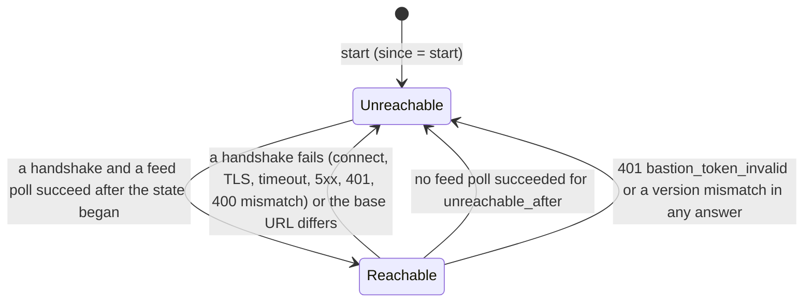

# The trove Bastion: contracts

Status: the contracts of phase 5b are laid (the shared types, interfaces, schema, routes, configuration and the skeleton of the
role) and the role is built: package 1 (registrations and the `bst` token), package 2 ([the main installation's
interface](#package-2-the-main-installations-interface)), package 3 ([marking, the write probe and the read
shape](#marking-the-write-probe-and-the-read-shape-package-3)), package 4 ([the link to the main installation](#the-link-to-the-main-installation-package-4a),
[the engine](#the-engine-package-4b) and [how the role is wired](#how-the-role-is-wired-package-4c)), package 5 ([the cache backends](#the-cache-backends-package-5)),
package 6 ([shared state and guard](#shared-state-and-the-guard)) and package 8 (the screen, client setup and the manual). The specification is
[spec/bastion.md](../spec/bastion.md) (R-BAS-001 to R-BAS-049, decisions Q-BAS-1 to Q-BAS-104), its security perspective [security/bastion.md](../security/bastion.md), the plan
[projektplan/BETA.md](../projektplan/BETA.md#phase-5b--trove-bastion-m13).

The Bastion is a role of the one image, `trove serve --role bastion`, with a configuration tree of its own, no PostgreSQL, no UI and a
client listener that mirrors the main installation's package URL space. This page is for the eight developers who build it in
parallel: it says which package owns which file, which seams join them, how a request travels, and how to run the role.

## What to have in your head first

- **Two sides, one wire.** The Bastion's code is [internal/bastion/](../../internal/bastion); the main installation's side is
  [internal/bastionmain](../../internal/bastionmain) (seams), [internal/api/v1](../../internal/api/v1) (the operations) and the chain stage.
  The wire contract both import is [internal/bastion/iface](../../internal/bastion/iface); it changes only with `InterfaceVersion`
  ([the guard](#the-interface-guard)).
- **The Bastion imports no subsystem of the main installation.** An allow-list rule of the archtest ([bastion.go](../../internal/archtest/bastion.go),
  R-BAS-001) holds `internal/bastion/**` to the platform packages. `internal/cluster` (the Valkey client) is allowed for `shared`
  only and `internal/blob/s3` for `cache` only.
- **The role builds real components only.** There is no placeholder client, cache, download buffer, guard or engine, and `engine.Deps` has no
  `Stubbed`: `server.New` fails when a component cannot be built, and `engine.New` refuses a missing dependency. The operations of the
  management API are built; no `501 bastion_not_implemented` stub is left.
- **Every file has one owner.** The tables below name it. Shared files carry `>>> package n` markers
  ([wire_bastion.go](../../internal/app/wire_bastion.go)); edit your block only.
- **Tests carry the requirement ID** in their name (`TestR_BAS_0nn_<What>`), or in a comment for a contract or refusal test.

## Work packages and what they own

| # | Package | Owns (new files unless said) | Fills the seams |
|---|---|---|---|
| 1 | Registrations and the `bst` token type (R-BAS-004, R-BAS-005) — **built** | [bastion_registrations_api.go](../../internal/api/v1/bastion_registrations_api.go), [registrations.go](../../internal/bastionmain/registrations.go), [admin_bastion.go](../../cmd/trove/admin_bastion.go), [bastion.go](../../internal/auth/token/bastion.go) (issuance, revocation and validation of the type `bst`), [events_bastion.go](../../internal/audit/events_bastion.go); see [identity.md](identity.md#bastion-registrations-and-tokens-r-bas-004-r-bas-005) | `bastionmain.TokenAuthenticator` ([authenticator.go](../../internal/bastionmain/authenticator.go), built by `bastionAuthenticator` in the `package 1` block of `wire_bastion.go`) |
| 2 | Interface handlers, recognition (R-BAS-008 to R-BAS-012, R-BAS-015 to R-BAS-017) | [bastion_handshake_api.go](../../internal/api/v1/bastion_handshake_api.go), [bastion_check_api.go](../../internal/api/v1/bastion_check_api.go), [bastion_feed_api.go](../../internal/api/v1/bastion_feed_api.go), [bastion_downloads_api.go](../../internal/api/v1/bastion_downloads_api.go), the Recognize stage, the feed mapping over [bastion_feed.sql](../../internal/meta/postgres/queries/bastion_feed.sql), the contact upsert | `Stages.Recognize`; uses `ShapeResolver` |
| 3 | Marking and the write probe (R-BAS-013, R-BAS-014) | **built**: [internal/api/bastionmark](../../internal/api/bastionmark) (the Mark stage and the `RouteObserver`), `authz.Engine.ReachOn` and `bastionmain.NewShapeResolver` (R-BAS-012), the notes of the lookups (`bastionmain.NoteMissing`), the calls in `internal/api/rawfiles`, kit check 12 | `Stages.Mark`, `RouteObserver`, `ShapeResolver` |
| 4a | The link to the main installation, its lifecycle and the download buffer (R-BAS-006, R-BAS-010, R-BAS-025 to R-BAS-028, R-BAS-039, R-BAS-042 to R-BAS-044) — **built** | [mainclient](../../internal/bastion/mainclient) (client, budget, token reload), [link](../../internal/bastion/link), [downloads](../../internal/bastion/downloads), [server](../../internal/bastion/server), [maintest](../../internal/bastion/maintest) | `mainclient.Client`, `mainclient.Budget`, `downloads.Buffer`, `Deps.Link` |
| 4b | The engine (R-BAS-018 to R-BAS-024, R-BAS-029) — **built** | [internal/bastion/engine](../../internal/bastion/engine) | `engine.Engine` |
| 4c | The integration of 4a, 4b, 5 and 6 into one role, and the end-to-end suite (R-BAS-043, R-BAS-048) — **built** | [server](../../internal/bastion/server) (the wiring), [roletest](../../internal/bastion/roletest), the engine's use of the cache, the guard and the link | none |
| 5 | Cache backends, eviction, integrity (R-BAS-030 to R-BAS-032) — **built** | the two backends, `Cache`, `Fill`, the sweep in `internal/bastion/cache/…` | `cache.Backend`, `cache.Cache` |
| 6 | Valkey, rate limits, failed-auth timeout, blocking (R-BAS-034 to R-BAS-037) — **built** | the Valkey implementation of `shared.*` in `internal/bastion/shared/…`, `guard.New` and its `Instance`, the Valkey mechanism in `internal/cluster/valkey_bastion.go` | `shared.State`, `guard.Guard` |
| 7 | Metrics' consumers (R-BAS-040) | the PrometheusRule's metric inputs (the names are defined); the download buffer went to 4a | none |
| 8 | UI, client setup, manual (R-BAS-007) | the Bastions screen ([web-ui.md](web-ui.md#the-bastions-screen)), the `bastion=` parameter of `getClientSetup` ([packages_api.go](../../internal/api/v1/packages_api.go), [packages.md](packages.md#client-setup)), the **Install from** step of the setup page and the guides, [docs/manual/admin/bastion.md](../manual/admin/bastion.md) (built) | none; reads `BastionGet` and `BastionLastBaseURL` through `PackageServices.Bastions` |

The contract work (this page's author) owns [internal/bastion/iface](../../internal/bastion/iface), the schema, the OpenAPI document,
the configuration trees and the skeleton. A change to one of those in a work package is a contract change: say so in the review.

## Package 2: the main installation's interface

Requests of a Bastion meet these pieces in this order: the Recognize stage in the chain of the default endpoint
([recognize.go](../../internal/bastionmain/recognize.go): token, throttle, version, `Recognition`), the authentication function
(`v1.BastionRouteAuth` admits an interface route as the registration, every other request is the stage's), the shared authorization step
(`{bastion: true}`), then the handler. The four handlers are thin over the services of `v1.BastionServices`.

| File | Responsibility |
|---|---|
| [bastionmain/recognize.go](../../internal/bastionmain/recognize.go) | `Recognize`, `RecognizeOptions`, `Throttle`, the interface metrics, the removal of the Bastion token from the request behind it |
| [bastionmain/feed.go](../../internal/bastionmain/feed.go) | `Feed` (`Read`, `Position`), `mapEvent`: the table of R-BAS-015, the cursor, the resets |
| [bastionmain/contact.go](../../internal/bastionmain/contact.go) | `Contacts.Record`: the contact upsert, the memory gate, the cap of 256 rows, `bastion.contact`; `Release` |
| [bastionmain/downloads.go](../../internal/bastionmain/downloads.go) | `Intake.Accept`: `artifact.downloaded` per event, `bastion.downloads.dropped` |
| [api/v1/bastion_services.go](../../internal/api/v1/bastion_services.go) | `BastionServices`, `writeInterface`, `BastionPrincipal`, `BastionRouteAuth` |
| [api/v1/bastion_handshake_api.go](../../internal/api/v1/bastion_handshake_api.go), [bastion_check_api.go](../../internal/api/v1/bastion_check_api.go), [bastion_feed_api.go](../../internal/api/v1/bastion_feed_api.go), [bastion_downloads_api.go](../../internal/api/v1/bastion_downloads_api.go) | the four operations |
| [app/wire_bastion.go](../../internal/app/wire_bastion.go) (the `package 2` block) | the Recognize stage, `bastionServices`, the metrics, the throttle; `bastionTokens` and `bastionShapes` are the two accessors packages 1 and 3 fill |
| [audit/events_bastion_iface.go](../../internal/audit/events_bastion_iface.go) | `bastion.contact`, `bastion.downloads.dropped` |
| [meta/postgres/queries/bastion_feed_names.sql](../../internal/meta/postgres/queries/bastion_feed_names.sql), [bastion_contact_cap.sql](../../internal/meta/postgres/queries/bastion_contact_cap.sql) | the two statements package 2 added to the contract's files |

Things other code now relies on: `httpserver.Credential.ExpiresAt` (the marking's `expires=` and the check's `expiresAt`), `httpserver.KindBastion`,
`httpserver.WithClient` (the check runs a credential for the caller's address), `audit.Event.At`, `auth.NewAddressThrottle`,
`postgres.IsNoRows`. Recognition is also where the main installation's own hot path can be slowed by a Bastion: it adds a header lookup to every
request of the default endpoint and a store lookup only for a value that starts with `trv_bst_`.

To replace a seam: `App.bastionTokens` returns package 1's `TokenAuthenticator` (without one, every Bastion token is invalid), `App.bastionShapes`
returns package 3's `ShapeResolver` (without one, the check answers `503`).

## Package tree

```text
internal/bastion/
├── iface/            the wire contract of both sides; stdlib only; guarded by testdata/interface.txt
├── answers/          the validity rules of R-BAS-020 and the feed log; a leaf
├── metrics/          every metric of R-BAS-040, defined once; a leaf
├── mainclient/       the client of the main installation: HTTPClient, SlotBudget, Reloader, TokenSource, errors; token file and holder
├── link/             the replica's standing connection: handshake, feed poll, reachable or not, mismatch, token lifetime; Guard wraps the client
├── cache/            Backend, Entry, the HMAC Signer; the volume and bucket backends, Cache, Fill, the sweep, Fault (a test's switch)
├── shared/           the shared state (limiters, block list, timeouts, flight lock, sweep lease, answer records): the local form and the Valkey form
├── guard/            Guard (R-BAS-035 to R-BAS-037): Instance, the verdicts, and the address key (an IPv6 address counts as its /64)
├── downloads/        Buffer of download events and its Reporter (R-BAS-039)
├── engine/           Deps, Engine: the request flow of R-BAS-018 to R-BAS-029
├── server/           the process of the role: telemetry, token, TLS, listeners, health, the wiring of every component, drain
├── maintest/         an in-process main installation (httptest TLS) and doubles for the tests of the Bastion; a test helper
└── roletest/         the end-to-end scenario of the whole role in one process (R-BAS-048); a test helper
internal/bastionmain/ the main installation's seams (a domain package)
```

<details>
<summary>File → responsibility</summary>

| File | Responsibility |
|---|---|
| [iface/version.go](../../internal/bastion/iface/version.go) | `InterfaceVersion` |
| [iface/routes.go](../../internal/bastion/iface/routes.go) | the four route paths, the feed query parameters, the operation names, the mirrored path families |
| [iface/headers.go](../../internal/bastion/iface/headers.go) | every header name of R-BAS-008, R-BAS-013, R-BAS-014, R-BAS-017, the probe and route values, the token prefix |
| [iface/marking.go](../../internal/bastion/iface/marking.go) | `Class`, `Read`, `Marking` (Set, Parse, Strip), `SubjectKind`, `Subject` and its header form |
| [iface/cursor.go](../../internal/bastion/iface/cursor.go) | `Cursor` and the synthetic `t:<RFC 3339>` form |
| [iface/wire.go](../../internal/bastion/iface/wire.go) | the bodies of the handshake, check, feed and downloads, `FeedKind`, `DecodeStrict`, `Marshal` |
| [iface/problems.go](../../internal/bastion/iface/problems.go) | the problem codes of R-BAS-008, R-BAS-009, R-BAS-014 and R-BAS-029 |
| [iface/surface_test.go](../../internal/bastion/iface/surface_test.go) | the generator of the surface and the guard of R-BAS-009 |
| [answers/answers.go](../../internal/bastion/answers/answers.go) | `Answer`, `State.Check` (the four rules), `FeedLog` (Record, Prune, Reset) |
| [metrics/metrics.go](../../internal/bastion/metrics/metrics.go) | names, label values, `Metrics`, `New`, `Names` |
| [mainclient/mainclient.go](../../internal/bastion/mainclient/mainclient.go) | `Client`, `Forward`, `Response`, `Budget`, `Token`, `TokenSource`, `Options`, the errors |
| [mainclient/client.go](../../internal/bastion/mainclient/client.go), [mainclient/budget.go](../../internal/bastion/mainclient/budget.go), [mainclient/reload.go](../../internal/bastion/mainclient/reload.go) | `HTTPClient` (the four operations and the forward, TLS only, the slot held until the body ends), `SlotBudget`, `Reloader` |
| [link/link.go](../../internal/bastion/link/link.go), [link/guard.go](../../internal/bastion/link/guard.go) | `Link` (handshake, feed poll, `State`, `AnswerState`, `Watch`, `SetSink`), `Guard` (a refused token or a mismatch in any answer makes the replica unreachable) |
| [mainclient/token.go](../../internal/bastion/mainclient/token.go) | `ParseToken` (prefix, length, base62, CRC), `ReadTokenFile`, `Holder` |
| [cache/cache.go](../../internal/bastion/cache/cache.go) | the layout, `Backend`, `Entry`, `Usage` |
| [cache/fault.go](../../internal/bastion/cache/fault.go) | `Fault`: the switch with which a test makes the storage fail (`Options.Fault`); nil in production |
| [cache/sign.go](../../internal/bastion/cache/sign.go) | `Signer` (Sign, Verify, SignEntry, VerifyEntry), `KeyHash`, the signature domains |
| [cache/layout.go](../../internal/bastion/cache/layout.go) | the names of the layout, `WithArea`, validation of every name that becomes a path or a key |
| [cache/core.go](../../internal/bastion/cache/core.go) | `backend`, the one implementation of `Backend` over a `store`: probe, spool, eviction sweep, audit spool, error counting |
| [cache/volume.go](../../internal/bastion/cache/volume.go), [cache/bucket.go](../../internal/bastion/cache/bucket.go) | the two stores: a directory, and S3 through `internal/blob/s3` |
| [cache/verify.go](../../internal/bastion/cache/verify.go), [cache/fill.go](../../internal/bastion/cache/fill.go) | the verifying reader with its hold-back, the `Fill` spool |
| [cache/store.go](../../internal/bastion/cache/store.go), [cache/sweep.go](../../internal/bastion/cache/sweep.go) | `Cache` (what the engine uses), `New`, `NewVolume`, `NewBucket`, `Options`; `SweepOnce`, `RunSweeper` |
| [shared/shared.go](../../internal/bastion/shared/shared.go) | `Limiter`, `BlockList`, `FlightLock`, `SweepLease`, `AnswerStore`, `State`, `NewLocal` |
| [shared/local.go](../../internal/bastion/shared/local.go) | the local forms: token buckets, sliding-window counters, block list, flights, answers in memory, all bounded |
| [shared/valkey.go](../../internal/bastion/shared/valkey.go) | `Open`, `New`, `Options`: the Valkey forms over `cluster.BastionStore`, the limiters of R-ARCH-034 and the FlightLock, with the local forms as the fallback; the signing of answer records |
| [guard/guard.go](../../internal/bastion/guard/guard.go) | `Guard`, `Verdict`, `AddressKey` |
| [guard/instance.go](../../internal/bastion/guard/instance.go) | `New`, `Options`, `Instance`: the limits, the miss limits, the timeout, the blocking |
| [server/shared.go](../../internal/bastion/server/shared.go) | `openShared`: builds the state and the guard from the configuration and closes them |
| [downloads/downloads.go](../../internal/bastion/downloads/downloads.go), [downloads/reporter.go](../../internal/bastion/downloads/reporter.go) | `Buffer`; `Reporter` (the bounded buffer, batches, the spool to the cache backend, the adoption of spool files) |
| [engine/engine.go](../../internal/bastion/engine/engine.go) | `Deps`, `Engine`, `New` (hands the link its `AnswerSink`), `Start` and `Drain` (the janitor and the background tasks), `Ready` (the cache's first check) |
| [engine/request.go](../../internal/bastion/engine/request.go) | `ServeHTTP`, the request record `rq`, the steps of R-BAS-018 (host, block list, path, limits, credentials), the guard's verdict as a response |
| [engine/credential.go](../../internal/bastion/engine/credential.go) | `Authorization` (Bearer, Basic), the token syntax, the credential key, the challenge |
| [engine/respond.go](../../internal/bastion/engine/respond.go) | the Bastion's own problem details, the mapping of the client's errors, the header filters |
| [engine/answerstore.go](../../internal/bastion/engine/answerstore.go) | answers in memory and in the shared store, negative entries, private copies, the `AnswerSink` the link calls |
| [engine/readflow.go](../../internal/bastion/engine/readflow.go) | the decision between hit, check and miss, the check, the collapsing of misses |
| [engine/forward.go](../../internal/bastion/engine/forward.go) | the forwarded request, the handling of a marked response by its class, documents and refusals |
| [engine/fill.go](../../internal/bastion/engine/fill.go) | the artifact fill through `cache.Fill`, with the withheld tail towards the client |
| [engine/serve.go](../../internal/bastion/engine/serve.go) | serving a representation with RFC 9110 semantics, the stream with the withheld tail, the download event |
| [engine/entries.go](../../internal/bastion/engine/entries.go) | the cache key and Vary, the entry through `cache.Cache`, freshness |
| [engine/probe.go](../../internal/bastion/engine/probe.go) | the write probe and the real request of a read route that takes a body |
| [engine/background.go](../../internal/bastion/engine/background.go) | the background refresh of a shape answer |
| [engine/quiet.go](../../internal/bastion/engine/quiet.go) | `WithQuietSlot`, `Quiet`: how a quiet verdict reaches the server's request log |
| [engine/lru.go](../../internal/bastion/engine/lru.go), [engine/flight.go](../../internal/bastion/engine/flight.go) | the bounded LRU, the single-flight |
| [server/server.go](../../internal/bastion/server/server.go) | `Run`, `New`, `Start`, `Shutdown`; `buildDeps` and `wireLink` build and connect the components, `runLink` runs their loops |
| [maintest/maintest.go](../../internal/bastion/maintest/maintest.go) | `Main`, the in-process main installation; `Faulty`, `MemSpool` |
| [roletest/roletest.go](../../internal/bastion/roletest/roletest.go) | `Run`: the scenario of the whole role for one cache backend |
| [bastionmain/recognition.go](../../internal/bastionmain/recognition.go) | `Recognition`, `WithRecognition`, `RecognitionFrom` |
| [bastionmain/auth.go](../../internal/bastionmain/auth.go) | `TokenAuthenticator`, `BastionToken`, `ErrTokenInvalid` |
| [bastionmain/shape.go](../../internal/bastionmain/shape.go) | `ShapeResolver`, `Shape` |
| [bastionmain/shape_resolver.go](../../internal/bastionmain/shape_resolver.go) | `NewShapeResolver`: the resolver over `authz.Reacher`, the status of a `none` |
| [bastionmain/absence.go](../../internal/bastionmain/absence.go) | `Absence`, `WithAbsence`, `NoteMissing`, `NoteUnknown`: the per-request record of what the lookups found |
| [api/bastionmark/mark.go](../../internal/api/bastionmark/mark.go) | `New`, `Marker.Stage`: the Mark stage, its observer, the marking at the status line, the write refusal and the probe answer, the strip |
| [bastionmain/route.go](../../internal/bastionmain/route.go) | `RouteObserver`, `RouteMatch`, `RouteDecision`, `WithObserver`, `ObserverFrom`, the kind names |
| [bastionmain/stages.go](../../internal/bastionmain/stages.go) | `Stages` (Recognize, Mark, Chain), `Stub`, `ErrNotImplemented` |
| [bastionmain/metrics.go](../../internal/bastionmain/metrics.go) | `trove_bastion_interface_requests_total`, `trove_bastion_forwarded_requests_total` |

</details>

## Seams

| Seam | Declared in | Implemented by | Used by |
|---|---|---|---|
| Recognition result in the request context | [bastionmain/recognition.go](../../internal/bastionmain/recognition.go) | package 2 (the Recognize stage) | package 3, the shared authorization step ([authorize.go](../../internal/api/v1/authorize.go), built), the interface handlers (package 2) |
| `TokenAuthenticator` (raw token → enabled registration, token ID, expiry) | [bastionmain/auth.go](../../internal/bastionmain/auth.go) | package 1 (query `BastionTokenBySecret`, the token cache and revocation bound of R-AUTH-023) | package 2 |
| `ShapeResolver` (subject × repositories → full, partial, none, status) | [bastionmain/shape.go](../../internal/bastionmain/shape.go) | **package 3** (Q-BAS-51): `NewShapeResolver(engine)`, wired by `App.bastionShapes` | package 3 (marking), package 2 (check) |
| Route kind and coarse action to a middleware | `RouteObserver` in [bastionmain/route.go](../../internal/bastionmain/route.go); called by [dispatcher.go](../../internal/api/dispatch/dispatcher.go) after the match and after the decision and by [rawfiles/handler.go](../../internal/api/rawfiles/handler.go) (`routeOf`, `decided`) | package 3 ([bastionmark](../../internal/api/bastionmark/mark.go)) | package 3 |
| The chain stage | `Chain.Bastion` in [chain.go](../../internal/httpserver/chain.go) (built); `Stages` | package 2 (Recognize), package 3 (Mark), composed in [wire_bastion.go](../../internal/app/wire_bastion.go) | the default endpoint's chain only |
| The permission form `{bastion: true}` | [authorize.go](../../internal/api/v1/authorize.go) (built) | contract work | the four interface operations |
| `bst` is unknown to every other route | [token.Service.Check](../../internal/auth/token/validate.go) (built) | contract work | all |
| The token API does not see a `bst` token | `IdentityListTokens` and `IdentityTokenRow` in [identity.sql](../../internal/meta/postgres/queries/identity.sql) (built) | contract work | package 1 manages the tokens through `/bastions/{name}/tokens` and `bastion_registration.sql` |
| Last contact of a replica | [bastion_contact.sql](../../internal/meta/postgres/queries/bastion_contact.sql) | package 2 writes (`BastionContactUpsert`, `BastionContactPrune`) | package 1 reads (`BastionContactList`, `BastionContactListAll`), package 8 (`BastionLastBaseURL`) |
| Feed inputs | [bastion_feed.sql](../../internal/meta/postgres/queries/bastion_feed.sql) | contract work | package 2 |
| `mainclient.Client`, `Budget`, `TokenSource` | [mainclient.go](../../internal/bastion/mainclient/mainclient.go) | package 4a (`HTTPClient`, `SlotBudget`, `Reloader`) | the link, the buffer, the engine |
| `engine.Deps.Link` and `link.AnswerSink` | [link.go](../../internal/bastion/link/link.go) | 4a (the link); the engine implements `AnswerSink` and calls `Link.SetSink` in `engine.New` | the engine |
| `cache.Backend`, `cache.Cache` | [cache.go](../../internal/bastion/cache/cache.go), [store.go](../../internal/bastion/cache/store.go) | package 5 | the engine (`Cache`), the download buffer (`Backend()` for the spool), the server (`RunSweeper`) |
| `shared.State`, `guard.Guard` | [shared.go](../../internal/bastion/shared/shared.go), [guard.go](../../internal/bastion/guard/guard.go) | package 6 (built: [Shared state and the guard](#shared-state-and-the-guard)) | the engine, the cache sweeper (`shared.State` is its `LeaseSource`), the download buffer (the claim of a spool file) |
| `downloads.Buffer` | [downloads.go](../../internal/bastion/downloads/downloads.go) | package 4a (`Reporter`) | the engine (`Add`), the server (`Run`, `Drain`, `SetEnabled`) |
| Metrics | [metrics.go](../../internal/bastion/metrics/metrics.go) | contract work | everyone; add no metric elsewhere |
| Problem codes | [iface/problems.go](../../internal/bastion/iface/problems.go), [errs/codes.go](../../internal/errs/codes.go) | contract work | everyone |

### The interface guard

[surface_test.go](../../internal/bastion/iface/surface_test.go) lists every exported declaration of `iface` (constants with values, types
with fields and JSON tags, functions) into [testdata/interface.txt](../../internal/bastion/iface/testdata/interface.txt), the version on the
first line. `TestR_BAS_009_TheInterfaceChangesOnlyWithItsVersion` fails when the code and the file differ. To change the interface:
raise `InterfaceVersion`, then `go test ./internal/bastion/iface -run TestR_BAS_009 -update-interface`; the regeneration refuses to write
a changed surface under an unchanged version. The OpenAPI document must name the new version in `x-trove-bastion-interface`
(`LoadDocument` checks it), and the release notes announce it.

## Shared state and the guard

Package 6 built both. The server makes them in [server/shared.go](../../internal/bastion/server/shared.go) from the configuration and
hands `engine.Deps.Shared` and `engine.Deps.Guard` over; it closes them (the Valkey client, the guard's gauge loop) at the end of the drain.

**What changed in the committed interfaces (a contract change, said here on purpose).** Package 4 reads this before it calls the guard.

| Where | Change | Why |
|---|---|---|
| `guard.Stub`, `guard.IsStub` | removed (and with them every other stub of the role, [below](#how-the-role-is-wired-package-4c)) | the stub is replaced (Q-BAS-94) |
| `guard.Verdict` | new field `Quiet`: the request is not to be logged one by one | a blocked address answers many requests, the guard logs one line per block (R-BAS-037); the server keeps such a request out of the request log ([how](#how-the-role-is-wired-package-4c)) |
| `shared.State` | new field `Timeouts` (a `BlockList` for the failed-authentication timeouts) | R-BAS-036 needs a timeout that outlives the counting window |
| `shared.Limiter` | `Add` and `Count` return the count **in the units of the configured value**: a local form multiplies its count by `bastion.replicas`; `Replicas()` stays but a caller need not use it | one comparison for every form (Q-BAS-92) |
| `shared.FlightLock` | on an error `held` is **true**: the replica fetches itself | the lock is an optimization (R-BAS-034) |
| `shared.SweepLease` | with Valkey unavailable the lease is held and `err` is nil | a sweep only deletes (R-BAS-031) |
| `shared.AnswerStore` | the Valkey form signs on `Put` and verifies on `Get`; the engine hands over the record and **does not sign** | Q-BAS-93; a record above 1 KiB (signature included) is refused with an error and kept in memory by the engine only |
| `cluster.WithoutKeyspace`, `cluster.BastionStore`, `cluster.FlightKeyFromHash`, `cluster.Limiter.Estimate` | new in `internal/cluster` | the typed mechanisms behind the Valkey form ([valkey.md](valkey.md#the-bastions-keys)) |

**Where the engine calls the guard** (R-BAS-018). Every method takes the address as `guard.AddressKey` returns it.

| Step | Call | A refusal |
|---|---|---|
| 2, block list | `Blocked(addr)` | `429 address_blocked`, `Quiet`, `Retry-After` |
| 4, limits | `Request(addr, credentialed)` | `429 rate_limited` |
| a credential the Bastion refuses itself (R-BAS-019) | `FailedAuth(addr)` | none, the answer is the `401` |
| before a check or a forward for a credential with no usable answer | `AuthTimeout(addr)` | `429 auth_timeout`; nothing is sent to the main installation |
| before every request to the main installation (forward, check, conditional, probe) | `Miss(addr, credentialed)` | `429 rate_limited` while hits keep being served |
| the main installation called the credential invalid | `FailedAuth(addr)` | none |

The guard decides and returns a `Verdict` (`Status`, `Code`, `RetryAfter`, `Reason`, `Quiet`); the engine renders the problem details of R-BAS-029,
sets `Retry-After` and the `RateLimit` fields, and counts `trove_bastion_refused_total{reason=Verdict.Reason}`. The guard counts the blocks it sets
(`trove_bastion_blocks_total`, `trove_bastion_blocked_addresses`) and logs `bastion address blocked` once per block. An error of the shared state
admits the request (Q-BAS-94). `exempt_cidrs` are parsed at `guard.New`; a bad entry stops the start.

**The rules in one place.**

- Request limits: a token bucket without Valkey, the sliding window of R-ARCH-034 with it (limiters `bastion.requests_authenticated`,
  `bastion.requests_anonymous`); the local rate and burst are divided by `bastion.replicas`.
- Miss limits: the count of the sliding minute (limiters `bastion.misses_authenticated`, `bastion.misses_anonymous`), refused misses included; the
  retry delay is 15 s.
- Failed authentication (`bastion.failed_auth`): the failure that brings the count of the window to `max_failures` puts the address into the timeout
  (`Timeouts`, `failed_auth.timeout`); the next credential without a usable answer is refused. Anonymous requests and credentials with a usable answer
  are not the guard's to refuse.
- Blocking (`bastion.refusals`): every refusal of a request limit, a miss limit or the timeout counts; more than `threshold` within `window` blocks the
  address for `duration`, doubled for each earlier block within 24 h, up to `max_duration`. The decision is serialized in the process; across replicas
  two blocks can race, and the later one raises the level.
- IPv6 counts as its /64, an IPv4-mapped address as the IPv4 address (`AddressKey`).

**Valkey and its absence.** `shared.Open(ctx, shared.Options{...})` returns the local state for `valkey.mode: none` and the Valkey state otherwise,
with a closer. The Valkey form runs on `cluster.NewValkey(..., cluster.WithoutKeyspace())` and keeps a memory next to every mechanism: the block list
writes to both, reads memory first (a blocked address costs no round trip) and then Valkey; the limiters are the cluster limiters whose fallback is
the replica's share; the answers are Valkey only (the engine has its own memory). A Valkey that is down, refuses the credential or is slow makes
the state run from memory and never the replica unready; `trove_valkey_available` and `trove_ratelimit_fallback{limiter}` show it. Losing Valkey
costs the sharing, not correctness. The keys are in [valkey.md](valkey.md#the-bastions-keys).

**Add a limit.** A new limiter is a name `bastion.<name>` in [guard/instance.go](../../internal/bastion/guard/instance.go), a call to
`State.Limiter.Allow` (bucket) or `Add` (count), and a row in R-BAS-035 to R-BAS-037; the name is a metric label, so it carries no address. A new
shared mechanism is a typed method in `internal/cluster/valkey_bastion.go` first, then the interface in `shared.go`, its local form in `local.go` and its
Valkey form in `valkey.go`.

## Request flows

**Hit** (R-BAS-022): the engine classifies the request (host, block list, path, limits, credential), finds the cache entry for the
cache key, finds a usable `full` read-shape answer for the caller (or a usable URL answer) and the entry fresh, and serves the bytes
from the cache through its verifying reader. It adds a `DownloadEvent` to `downloads.Buffer`. No request to the main
installation.

**Check** (R-BAS-011, R-BAS-022): the entry exists and the caller has no usable answer. The engine takes a budget slot and sends one
`Check` for the credential and the repository (collapsed per credential and repository); on `full` it serves as a hit. For a `partial`
caller it sends a conditional `Do` with the caller's credential and `If-None-Match: "<sha256>"` through the real route: `304` serves the
cached bytes. The main installation's `check` handler validates the credential (throttle, `token.rejected`) and asks the
`ShapeResolver`.

**Miss** (R-BAS-021): the engine takes a budget slot, forwards the request with the caller's `Authorization`, the Bastion token in
`Trove-Bastion-Authorization` and the forwarded-for and host headers. On the main installation: the Recognize stage validates the token
and stores a `Recognition`; the Mark stage installs the observer; authentication and the dispatcher decide as for the caller's own
request; the marking wrapper adds `Trove-Bastion-Class`, `-Repository`, `-Read`, `-Subject` and `-Interface` at the status line. The
engine keeps what the class allows, streams the rest.

**Write probe** (R-BAS-014): a method other than `GET` and `HEAD` becomes a bodiless `Do` with `Probe` set, no credential and
`Trove-Bastion-Probe: 1`. The dispatcher calls `RouteObserver.Matched` after the match: for an `Upload`, `Delete`, `Admin` route or a
coarse action other than `read` it returns the `bastion_read_only` error, which the format renders in its own shape; for a read route
that takes a body it answers `204` with `Trove-Bastion-Route: read-with-body` and reports `handled`. The Bastion replays a `403` or
`404` and, after a `204`, forwards the real request.


## The link to the main installation (package 4a)

The Bastion reaches the main installation through one client, one standing link per replica and one download buffer. The server builds and runs
all three; the engine reads them.

### What the server runs

| Loop | Package | Started by | Stopped |
|---|---|---|---|
| The link: handshake, feed poll, state | [link](../../internal/bastion/link) `Link.Run` | `server.runLink` after the listeners are bound | after the buffer was drained |
| The token reloader | [mainclient](../../internal/bastion/mainclient) `Reloader.Run` | `server.runLink` | with the link |
| The buffer's flush and spool adoption | [downloads](../../internal/bastion/downloads) `Reporter.Run` | `server.runLink` | before the drain, so that `Drain` sends what is left |
| The cache sweeper | [cache](../../internal/bastion/cache) `Cache.RunSweeper` with `shared.State` as its `LeaseSource` | `server.runLink` | before the drain |

`Engine.Start` starts none of them (it runs the janitor, [below](#the-engine-package-4b)). Readiness is the start-up check, the TLS material and the cache
backend's first `Check`; it never depends on the main installation (Q-BAS-44).

### What the engine gets in `engine.Deps`

| Field | What it is | What the engine does with it |
|---|---|---|
| `Main` | the `mainclient.Client`, wrapped by `Link.Guard` | `Handshake` and `Feed` are the link's; the engine calls `Check`, `Do` and nothing else. Every call but those two takes a budget slot inside the client |
| `Link` | the `*link.Link` | reads the state (below), `Feed()` for the log, sets the sink once |
| `Downloads` | the `downloads.Buffer` | `Add` for every artifact served from the cache (a hit, or a check answered `304`); `SetEnabled` is the server's |

**The client's contract.**

- `Do(ctx, Forward)` sends the caller's request (method, path and query as received; the caller's `Authorization` and end-to-end
  headers), removes `Cookie`, `Forwarded`, `X-Forwarded-*`, `Trove-*`, `Range`, `If-*`, trace headers and the hop-by-hop headers,
  and adds the interface headers, the Bastion token in `Trove-Bastion-Authorization` and exactly one client address from
  `Forward.ClientAddress` in both families. `IfNoneMatch` is the Bastion's own condition. `Probe` sends the method without a body
  and without the caller's credential. A redirect is returned, not followed.
- The `Response` has its `Trove-Bastion-*` headers removed and parsed into `Marking` (`Marked` false for an unmarked answer). `Response.Route` is the value of `Trove-Bastion-Route`, read before the strip (the engine's probe decides on it, [Q-BAS-108](../spec/bastion.md#q-bas-108--the-route-of-a-probe-answer-is-read-before-the-marking-is-stripped)). The
  slot of the budget is held until the body ends or `Close` is called, so **the engine closes every body on every path**
  (`TestR_BAS_025_EveryPathClosesTheResponseBodyAndSoReleasesItsSlot` serves every kind of answer over a budget of one slot and counts the slots after each).
- `Forward.Class` is `Anonymous` for a request without a credential: those requests share the anonymous slots.
- Errors, mapped to the answers of R-BAS-029: `ErrBusy` (`503 bastion_busy`); `ErrUnreachable` (`*UnreachableError`;
  `Timeout` true means `504 main_timeout`, otherwise `502 main_failed`); `ErrBadAnswer` (`502 main_failed`); `ErrTokenRefused` and
  `ErrInterfaceMismatch` concern the Bastion, are never passed on, and have already made the link unreachable by `Link.Guard` (`503
  main_unreachable` for the caller). Any other error of a forward does not make the link unreachable (R-BAS-027, Q-BAS-44). A context error of the
  caller's own context is returned as it is.

**The link's contract.**

- `Link.State()` returns a snapshot: `Reachable`, `UnreachableSince` (zero while reachable), `Handshaken`, `AnonymousAccess`,
  `RecordDownloads`, `HistoryStart`, the registration, token ID and expiry, the main installation's base URL and release, and the
  two mismatch flags. `Link.Reachable()` is the shortcut.
- `Link.AnswerState(now)` returns the `answers.State` of R-BAS-020: period, grace period, `Unreachable`, `HistoryStart`, the log.
  The engine judges every answer with it and decides nothing about validity itself.
- `Link.Watch(f)` calls `f` after each change of the state, on the link's goroutine; it must not block. The server uses it to follow `recordDownloads`.
- `Link.SetSink(s)` takes a `link.AnswerSink`: `Drop(entry)` deletes the answers the entry matches from memory and, best effort, from the
  shared answer store; `DropAll()` on a reset. The engine implements it (`answerStore.Drop`, `DropAll`) and calls `SetSink` in `engine.New`.
- Before the first successful feed read `HistoryStart` is zero and `answers.State` refuses every answer, so a replica that started
  during an outage serves nothing from Valkey and nothing from memory until the main installation answers once.

### The state machine



Handshake: at start, every `handshake_interval`, on `RequestHandshake` (a settings entry, a reloaded token) and at every tick
while the handshake of the unreachable state is outstanding, and on the first successful poll after a failed one. Feed poll: every
`feed.poll_interval`, paged while `more`. While unreachable a tick is a handshake and a feed probe and nothing else. Entries are
applied by ID with the receipt time; `reset` empties the log and starts the history at the reset. The decisions are
[Q-BAS-75 to Q-BAS-79](../spec/bastion.md#q-bas-75--the-anonymous-cap-of-the-budget-is-the-share-rounded-down-at-least-one-slot).

### `maintest`: the fake main installation

`maintest.New(t)` starts an httptest TLS server that speaks the four operations with the `iface` types and answers forwards with a
marking. A test points a client at `main.URL()` with `main.CAFile(dir)` as `bastion.main.ca_file` (the real TLS path), issues
tokens (`NewToken`, `NewTokenExpiring`, `Revoke`), adds feed entries (`AddEntry`, `Reset`), and switches the main installation
(`SetVersion`, `SetBaseURLHonoured`, `SetDown`, `SetDelay`, `Force`, `SetForward`, `SetCheck`, `SetClock`). It records what arrived (`Forwards`,
`Checks`, `Downloads`, `FeedReads`, `Headers`, `Calls`, `MaxInFlight`). `Faulty` wraps the client's transport through
`mainclient.Options.WrapTransport` to cut the link without the fake. `MemSpool` is the audit spool of a test; `Value(metric)` reads a
counter or gauge. [roletest](../../internal/bastion/roletest/roletest.go) builds the whole-role scenario on it.

## The engine (package 4b)

[engine.go](../../internal/bastion/engine/engine.go) `New` requires every dependency of `Deps` (a missing one is an error) and returns the flow. The
flow is `engine.ServeHTTP` ([request.go](../../internal/bastion/engine/request.go)):

| Step (R-BAS-018) | Where | Answer |
|---|---|---|
| 1 host | `stepHost`: the request's host, or the forwarded host of a trusted proxy (Q-BAS-83) | `421 misdirected_request` |
| 2 block list | `stepBlocked` → `guard.Blocked` | `429 address_blocked` |
| 3 path | `stepPath`: `/api/<format>/<key>/…` and `/files/<key>/…`, the key rule of INV-5 | `404 bastion_not_served`, no request |
| 4 limits, credentials | `stepLimits` → `guard.Request`; for `GET` and `HEAD` `stepCredentials`: syntax and checksum before any request, `bst` and unknown prefixes refused, anonymous only while the handshake said `anonymousAccess` (before the first handshake: `503`, Q-BAS-99), the failed-authentication timeout for a credential without a usable answer | `429 rate_limited`, `401 invalid_token`, `401 credentials_required`, `429 auth_timeout` |
| 5 method | `OPTIONS` → `405`; other methods → [probe.go](../../internal/bastion/engine/probe.go) (Q-BAS-81) | |
| 6 read flow | [readflow.go](../../internal/bastion/engine/readflow.go) `read` | below |

**Read flow** (`attempt`, up to two rounds when a request waited for a collapsed fetch): kept `invalid` credential → `401`; shape answer `none` → the
stored status; kept URL refusal → replayed; cache entry → `fromEntry`; negative entry → `fromNegative`; the caller's private copy → conditional
request; else `miss`. `fromEntry` serves without a request when the caller is allowed (shape `full`, or a URL answer `allowed`) and the entry is fresh
(`fresh`: the period of the kind and the feed log, no `content` entry of the repository after `validatedAt − 15 s`) or the main installation is
unreachable; asks `checkShape` when the caller has neither answer; and otherwise sends the conditional request. Every request to the main
installation first asks `guard.Miss`, and `mainclient` takes the budget slot. [forward.go](../../internal/bastion/engine/forward.go) `process`
records the credential and shape answers of a marked response and then acts by its class: `artifact` and `shared` 200 are kept (artifact: the fill of
[fill.go](../../internal/bastion/engine/fill.go), a document: held whole and written through a `cache.Fill` with its entry), a `304` closes its body, serves
and renews the entry, `private` is kept in memory as the caller's copy, `absent` fills the negative cache, everything else is passed through (a `403` and a
conditional `404` are also kept as the caller's URL answer, Q-BAS-80). An unmarked `5xx`, a connect error and a timeout answer `502 main_failed` or
`504 main_timeout`.

**The cache** (Q-BAS-98): the engine holds a `*cache.Cache` and nothing of the raw `cache.Backend`. An entry is found by `LookupEntry` (the signature, the
bytes' existence and size are checked there, a stale entry is deleted there and counted), written by `StoreEntry` (signed there; unsigned without a key),
the bytes are read by `Open` (verified while served, the last 64 KiB held back, a mismatch deletes the object and the entry and fails the read with
`cache.ErrCorrupt`) and `Touch` writes the throttled access marker. The engine counts none of this.

**Fill** (R-BAS-021): `cache.NewFill` spools the body below the volume or the pod's temporary directory while it is streamed; everything but the last 64 KiB
is written to the caller as it arrives, and the tail is released after `Fill.Commit` checked the SHA-256 against the content address of the `ETag` and
stored the bytes and the entry was written. A mismatch cuts the connection (`http.ErrAbortHandler`) and keeps nothing. A request with `Range` or a
conditional header is answered from the committed fill (`Fill.Keep` leaves the spool readable, so a backend that refuses the commit does not fail the
request, R-BAS-030). The withheld tail towards the client is the engine's; the verification, the commit and the entry are the cache's.

**Serving from the cache** ([serve.go](../../internal/bastion/engine/serve.go)): `serveSource` answers `If-None-Match`, `Range` with `If-Range`, `HEAD`
and `416`; `streamVerified` copies the cache's verifying reader and withholds the last 64 KiB of the output until the whole object was read, so a
range is verified by reading the object to its end; a failed read cuts the transfer. A served artifact adds a `DownloadEvent` (a `GET` whose
body was delivered from the cache, `200` or `206`; a `HEAD` and a `304` are no download).

**Answers** ([answerstore.go](../../internal/bastion/engine/answerstore.go)): an LRU in memory (`answers.max_entries`) and, when `Shared.Shared()` is
true, records in `shared.AnswerStore`, which signs and verifies them itself (Q-BAS-93): the engine hands over plain JSON. `answerStore.get` judges every
answer with `answers.State.Check` (the four rules, through `Link.AnswerState`) at every use, counts `trove_bastion_answers_total`, and drops what fails.
Private copies are never written anywhere but memory. A feed entry reaches the store through `Drop` (the link's `AnswerSink`, R-BAS-026): the answers it matches are
deleted from memory and, in the background and best effort, from the shared store.

**Collapsing**: `group` is a single-flight per replica (checks are shared with their result, misses with a wait and a second decision); with the
bucket backend and Valkey `shared.FlightLock` makes the other replicas wait (`waitRemote`, at most 30 s); a lock that cannot be asked
returns `held` with an error and the replica fetches itself. A key whose last fetch left nothing shareable is marked for a minute and not collapsed (Q-BAS-86).

**Background**: `Start` runs the janitor (every minute: answers past period and grace, the feed entries no answer can depend on, the registries' expired
items); a shape answer used in the last fifth of its period is refreshed by one collapsed check in a task `Drain` waits for (`background`). Nothing else
runs in the engine: the link, the token reload, the download buffer and the cache sweep are the server's.

**Logs and trace** (R-BAS-042): `rq.end` sets the fields of the request log (`bastion_class`, `bastion_result`, `token_hint`, `main_request_id`, the
repository, the token ID, the refusal reason, the limiter) and the attributes `trove.bastion.class`, `trove.bastion.result` and
`trove.bastion.refusal` on the span the server's chain started; the forwarded request carries the request's context, which `mainclient` propagates. A
refusal whose `guard.Verdict` is `Quiet` marks the request through `engine.WithQuietSlot` (below).

## How the role is wired (package 4c)

[server.go](../../internal/bastion/server/server.go) builds every component from the role's configuration when `server.New` runs, so that a defect
stops startup before a port is bound, and runs their loops in `Start`:

| Component | Built from | Run by the server | Notes |
|---|---|---|---|
| shared state, guard | `valkey.*`, `bastion.replicas`, the limits ([shared.go](../../internal/bastion/server/shared.go)) | the guard's gauge loop; the Valkey client is closed at the end | local form for `valkey.mode: none` |
| cache | `bastion.cache.*`, the signing key | `RunSweeper` with the shared state as its lease source | the first `Check` gates readiness; `volume` or `bucket`; no key is allowed with the volume backend and no Valkey (Q-BAS-98) |
| client, budget | `bastion.main.*` | — | `mainclient.New` with a `SlotBudget`; TLS only, `ca_file` read again without a restart |
| link | the client, `bastion.feed.*`, `bastion.answers.*` | `Link.Run` | `Link.Guard(client)` is what the engine gets as `Main` |
| token reloader | `bastion.main.token_file` | `Reloader.Run` | tells the link to handshake again when the token changes |
| download buffer | `bastion.audit.*`, the client, the cache's backend as its spool, the fetch lock as its claim | `Reporter.Run` and `Drain` | follows `recordDownloads` through `Link.Watch` |
| engine | all of the above | `Engine.Start` (the janitor) and `Drain` | the handler of the client listener |

**Readiness** (R-BAS-043): the start-up check, the TLS material, and `cache` (the engine's `Ready`, which is `Cache.Ready`: the first check of the backend, then
always ready). The main installation gates nothing.

**Drain order** (R-ARCH-024, R-BAS-043): readiness off; the drain delay (the client listener still serves); the client listener shuts down by the
deadline; the sweeper and the buffer's flush loop stop; `Engine.Drain` (the janitor, the background refreshes); `Downloads.Drain` (sent, or spooled to the
cache backend); the link and the reloader stop; the ops listener closes last.

**The request log of a quiet refusal**: the client listener's chain puts a slot into the request context before the request log
([`requestLog`](../../internal/bastion/server/server.go)); the engine sets it when a verdict is `Quiet`; the logger the request log writes through skips the
record. The request is still counted in the metrics and in `trove_bastion_refused_total`; the guard logs one line per block (R-BAS-037).

**Seams that are gone.** Each was written twice, in the packages built in parallel, and one stayed:

| Was | Stayed | Gone |
|---|---|---|
| a link interface in the engine (`engine.Link`: `Run`, `Reachable`, `AnonymousAccess`, `HistoryStart`, `Failed`) | `link.Link`: `State()`, `AnswerState`, `Watch`, `SetSink` | `engine.Link`; `Failed(err)` is `Link.Guard`, which marks the link unreachable for a refused token or a mismatch only |
| the budget (`engine.NewBudget`, `BudgetSlots`) | `mainclient.SlotBudget` | the engine's budget |
| the cache sweep of the engine | `Cache.RunSweeper` (R-BAS-031) | `engine.sweepLoop`, `engine.sweep` |
| the fill, verification, entry signing and access marker of the engine over `cache.Backend` | `Cache.NewFill`, `Fill.Commit`, `StoreEntry`, `LookupEntry`, `Open`, `Touch` | the engine's own SHA-256 loop, signer calls and `touch` map |
| the signing of answer and negative records in the engine | the Valkey `AnswerStore` signs and verifies | `Deps.Signer` |
| loops started by the engine (the link, the download buffer, its adoption) | the server starts them | the engine's `goRun` of those |
| the stubs and the placeholder (`mainclient.Stub`, `downloads.Stub`, `cache.Stub`, the placeholder engine, `Deps.Stubbed`) | real components only | all of them |

`engine.Deps` is `Config`, `Log`, `Metrics`, `Replica`, `Release`, `Now`, `Main`, `Link`, `Cache`, `Shared`, `Guard` and `Downloads`. `server.Options.Deps` lets a
test replace one of them after the server built it (the tests of the server replace the cache with one whose storage a `cache.Fault` switches off).

**Doubles of the engine's tests.** [support_test.go](../../internal/bastion/engine/support_test.go) runs the engine over the real `link.Link` and a real
`cache.Cache` on a temporary volume, and a small double of `mainclient.Client` (`fakeMain`) that records every request and answers from a `site`; the
`site` is also an `http.Handler`, so the slot test runs it behind `maintest` and the real client. Where `maintest` cannot show a case (a response
whose body the test controls byte by byte, a request count per kind), `fakeMain` does.

## The cache backends (package 5)

Specification: R-BAS-030 to R-BAS-032, decisions Q-BAS-87 to Q-BAS-90, gaps H-451 to H-453. The consumers (engine, download buffer) hold
a `*cache.Cache` from `cache.New(ctx, cfg.Cache, signer, cache.Options{…})`; the audit spool and the raw operations are on
`Cache.Backend()`.

**One implementation, two stores.** `backend` (core.go) implements `cache.Backend` over a `store` of seven primitives: put a file, put
bytes, get a range, stat, list, remove, touch. `volumeStore` keeps the layout in `bastion.cache.volume.dir` and spools to `<dir>/tmp`
on the same filesystem, so a fill is committed by a `rename`; stale spool files (older than an hour) are removed at start.
`bucketStore` keeps it below `bastion.cache.bucket.prefix` through `internal/blob/s3` (the cache's only import beyond the platform
list), spools to `<tmp>/trove-bastion-cache` in the pod, and uses nothing but PutObject, GetObject, HeadObject, ListObjectsV2 and
DeleteObject, with no versioning and no conditional write. The S3 client is the main installation's, reached through the plain-typed
methods of [plain.go](../../internal/blob/s3/plain.go) ([Q-BAS-89](../spec/bastion.md#q-bas-89--the-bucket-backend-reaches-s3-through-a-plain-adapter-and-fails-fast));
`config.BastionCacheBucket.StorageS3()` maps the Bastion's keys onto it: `https` only, the trust bundle `ca_file`, credentials
`static` (the files of `secrets.cacheBucket`, re-read when they change), `webIdentity` or `default`, three attempts and 2 s of backoff.
Only the `static` source is exercised by the tests; the other two are the client's own, covered by its tests.

**What was added to the contract.** `cache.Backend` has the committed methods and one convention: `cache.WithArea(ctx, cache.EntryDocument)`
selects the area of the bytes (`sha256/` for artifacts, `documents/` for shared documents) on `PutObject`, `GetObject`, `HeadObject`
and `DeleteObject`; the default is the artifact area, and the wrong area is a miss ([Q-BAS-87](../spec/bastion.md#q-bas-87--the-bytes-of-documents-have-a-tree-of-their-own)).
`ObjectInfo.LastAccess` is the object's own time (a head does not read the marker). New errors: `ErrMismatch`, `ErrCorrupt`,
`ErrTooLarge`, `ErrInvalid`. Beyond the interface, `cache.Cache` ([Q-BAS-90](../spec/bastion.md#q-bas-90--the-cache-package-offers-a-fill-a-verified-read-and-the-first-readiness-gate-beyond-backend)):

| Call | What it does |
|---|---|
| `Ready(ctx)` | checks the backend (write, read, delete a probe) until one check succeeds, then answers nil without a request: the gate of the first readiness only |
| `NewFill(kind)` → `Fill` | spools a response while it is streamed (`Write`, running `SHA256`, `Size`); `Commit(ctx, sha)` verifies, commits under the address and removes the spool, `Abort()` discards; refuses bytes past `max_object_bytes` (artifact) or `documents_max_bytes` (document) with `ErrTooLarge` |
| `StoreEntry(ctx, cacheKey, entry)` | signs (HMAC over every field and the cache key) and stores; write the entry after `Commit` |
| `LookupEntry(ctx, cacheKey)` | `ErrNotFound` is a miss: no entry, a failed signature (entry deleted, `evictions{stale}`), bytes gone (entry deleted, `evictions{missing}`), a size that differs from the entry's (counted corrupt, object deleted); any other error is the backend's: serve a miss |
| `Open(ctx, cacheKey, entry)` | full read through the verifying reader; the last 64 KiB are released only after the SHA-256 and size matched; a mismatch returns `ErrCorrupt` from `Read`, deletes the object and the entry of the key, counts `trove_bastion_cache_corrupt_total`; a body longer than the entry is refused at once |
| `OpenRange` | a range, not verified (H-451) |
| `Touch(ctx, entry)` | the access marker, at most once per `access_resolution` per replica and content address; best effort |
| `SweepOnce(ctx, src)`, `RunSweeper(ctx, src)` | the sweep of R-BAS-031 and its loop; publish `cache_bytes`, count `evictions{size}`; `src` is a `LeaseSource` (`shared.State` is one), which offers the sweep lease only while the replicas share state, so the cache does not import `shared` |

**The sweep.** The limits are `max_bytes − documents_max_bytes` for artifacts and `documents_max_bytes` for documents
([Q-BAS-88](../spec/bastion.md#q-bas-88--documents-have-a-reserved-share-and-entries-are-removed-when-read)); `trove_bastion_cache_capacity_bytes{area}`
exports them. A cycle measures both areas (one listing each); an area above 95 % of its limit is swept: it lists its bytes and `access/`
(two listings), orders by the later of an object's marker and its own time (a refill counts as an access), and deletes oldest first until
85 % remain, taking the markers along. The sweep does not read entries (H-452). Who runs it: the volume, every replica its own; the
bucket with Valkey (`st.Shared()`), the replica that wins `shared.SweepLease` for `2 × sweep_interval`; the bucket without Valkey, every
replica at `sweep_interval ± 20 %`. The package 6 forms plug in through `shared.State`; until they land, `shared.NewLocal` is what the
tests use.

**Errors.** Every backend error except a missing key, an invalid name and a cancelled context is counted in
`trove_bastion_cache_errors_total{op}` (`get`, `put`, `delete`, `list`, `spool`) where it happens, so a caller only has to turn an error
into a miss. **Audit spool** (package 7): `SpoolWrite(ctx, replica, jsonl)` names the file `audit-spool/<replica>/<unix ms>.jsonl`
(raised by a millisecond on a clash in the process); `SpoolList` is oldest first; names that do not match the form are refused or
skipped, so no input becomes a path.

**Run it.** `go test -race ./internal/bastion/cache`; the bucket tests need the stack (`make integration-up`) and run in
`make test-integration` or alone with `go test -tags integration ./test/integration/bastioncache` after sourcing
`.dev/integration/env`. They write below `it-bastioncache/<run>/` of the `trove-backups` bucket and remove it.
## Marking, the write probe and the read shape (package 3)

The Mark stage ([bastionmark](../../internal/api/bastionmark/mark.go)) wraps the response writer of every request that carries a
`Recognition` and strips every `Trove-Bastion-` header from every other response. The chain is `client address → Recognize → Mark →
authentication → rate limits → router`; the authentication stage reports the caller it accepted through `httpserver.WithPrincipalNote`,
so the subject is right for answers that never reach a route. What happens to one forwarded read:

1. The dispatcher (or `rawfiles`) matches the route and calls `Observer.Matched`. A write is refused here (`bastion_read_only`, rendered by the format's
   `WriteError`); the probe of a read route that takes a body is answered `204` with `Trove-Bastion-Route: read-with-body`. Nothing has
   been decided or read yet.
2. The decision point allows the request and the repository resolves; the dispatcher calls `Observer.Decided` with the subject and the
   index of the decision. The stage asks `ShapeResolver` for the caller's shape on the addressed repository, once.
3. The handler runs. The core's lookups note into the request's `Absence`: `NoteMissing` for a package row or an item a local repository does not
   hold and for a remote answer marked `errs.WithAbsent` or a negative document; `NoteUnknown` for a refusal of `Host.Authorize`, a serve-time
   refusal and any other `NotFound` of the remote engine. A route needs to do nothing.
4. At the status line the stage sets the class from the route kind, the status and the shape (R-BAS-013's table; `absent` needs a `404`, a
   `full` shape, a missing lookup and no unknown one), the repository, the shape, the subject and the interface version.

Adding a lookup that decides a `404` in the core (a new engine, a new host store): call `bastionmain.NoteMissing(ctx)` only when the result is
independent of the subject and of state that can change without the item changing; otherwise `NoteUnknown`. Both are no-ops outside a Bastion
request. Do not note a lookup whose empty result is not an answer (an optional row).

## Schema and queries

Migrations ([database.md](database.md#migrations-of-the-bastion-q-bas-48)): `00032_bastion` (expand: `bastion`, `bastion_contact`,
the name rule, the token guard), `00033_bastion_kinds` (contract, `requires-app >= 0.1.0`: the checks of `principal.kind` and
`api_token.type`), `00034_bastion_validate` (expand). The query files are owned by the package that writes them and read by others
as the table in [Seams](#seams) says; nobody edits another package's file: add a file of your own.

## Configuration

The main installation's keys ([bastions.go](../../internal/config/bastions.go), `auth.tokens.bst.*`,
`auth.tokens.max_active_per_principal.bst`) are in [configuration.md](configuration.md#bastion-keys). The role's tree is
[bastion_role.go](../../internal/config/bastion_role.go) (`BastionConfig`, `LoadBastion`); its JSON Schema is the committed, generated
file [internal/config/bastion.schema.json](../../internal/config/bastion.schema.json), which the chart `trove-bastion` includes as the
schema of its `config` value. Keys the chart renders carry `x-trove-chart-managed: true`; the chart refuses a value for them.
`go generate ./internal/config` writes both schema files and the generated files of the chart (`values.schema.json` `config`
property, `chart-managed-keys.yaml`; [helm-chart.md](helm-chart.md#the-bastion-chart)).

## Run the role locally

The role needs a main installation that knows its token: it handshakes at start and, until that works, answers a read that needs the main installation with
`503 main_unreachable`. Three ways, from the one that needs nothing to the real one.

**1. Without a main installation (verified).** The role starts, is ready, and answers with its own problems:

```shell
mkdir -p .out/bastion
go run ./internal/tools/bsttoken > .out/bastion/token
cat > .out/bastion/trove.yaml <<'EOF'
server:
  listen: 127.0.0.1:18443
  ops_listen: 127.0.0.1:18081
  base_url: https://packages.example.com      # example
bastion:
  cache:
    volume:
      dir: .out/bastion/cache                  # the default /var/cache/trove-bastion is not writable for you
  main:
    url: https://trove.example.com              # example; unreachable, which is the point of this variant
    token_file: .out/bastion/token
EOF
go run ./cmd/trove serve --role bastion --config .out/bastion/trove.yaml
```

In a second shell: `curl -s 127.0.0.1:18081/readyz` (ready: the cache backend's first check passed), `curl -s 127.0.0.1:18081/metrics | grep trove_bastion_main_reachable`
(`0`), `curl -si -H 'Host: packages.example.com' 127.0.0.1:18443/ui/` (`404 bastion_not_served`; the engine answers only for the host of `server.base_url`, so send
the header), and a read with a well-formed token (`go run ./internal/tools/bsttoken` prints one; a Bastion token as a credential is refused, use a
`trv_pat_` token) answers `503 main_unreachable` with `Retry-After: 30`. A key of another section stops the role: add `database: {host: x}` to the file and the
start names `database.host` and the role. No TLS is configured on the listeners here; with `server.tls.certificates` both serve it and reload it ([tls.md](tls.md)).

**2. Against the in-process main installation (verified).** The scenario of R-BAS-048 starts the role from a configuration file exactly as the command does and
walks a cold miss, a warm hit, a revocation and an outage against `maintest` over TLS:

```shell
go test -race -v -run TestR_BAS_048 ./internal/bastion/roletest                                  # the volume backend
set -a; . .dev/integration/env; set +a; go test -tags integration -v -run TestR_BAS_048 ./test/integration/bastion   # the bucket backend on the stack's SeaweedFS
```

To run the role by hand against a main installation you control, copy `Run` in [roletest.go](../../internal/bastion/roletest/roletest.go): it writes the
configuration file, the token file and the CA file of the double into a temporary directory.

**3. Against a main installation of the development stack (not exercised in this change).** Register a Bastion on the main installation, which issues a
`trv_bst_` token (package 1: `trove admin bastion …` and the screen of the management UI), write it to the token file, set `bastion.main.url` to the main
installation's https URL (and `bastion.main.ca_file` when its certificate is not signed by a root the machine trusts), and set `server.base_url` to the address
clients will use for the Bastion: the handshake refuses a base URL the main installation does not honour (`trove_bastion_base_url_mismatch`). This works
once the main installation's side of the interface (package 2: the four operations, the Recognize and Mark stages) is on `main`; until then the handshake
fails and the role stays unreachable.

## Tests

| Where | What |
|---|---|
| `go test -race ./internal/bastion/...` | the guard of the interface, the validity rules, the metrics table against the specification, the signer, the token syntax against `internal/auth/token`, the local shared state, the guard with an injected clock (limits, misses, timeout, blocking, exempt networks, IPv6); the client's headers and typed errors, the budget, the token reload, the link against `maintest` (reachability, grace period, mismatch, feed, the 5 s bound over 100 trials), the download buffer; the engine (`TestR_BAS_003` to `TestR_BAS_043` in `internal/bastion/engine`: over the real link and a real cache on a temporary volume, with a double of the client; the slot test over the real client); the server (listeners, readiness gated by the cache's first check, drain order, TLS reload, token and key refusals, the quiet request log, the sweeper) |
| `make test-integration` (`test/integration/bastion`) | the integration suite of R-BAS-048: the web role as the main installation and one or two real Bastion replicas, see [The integration suite](#the-integration-suite-r-bas-048) |
| `go test -race ./internal/bastion/roletest` and `make test-integration` (`test/integration/bastion`) | `TestR_BAS_048_TheWholeRoleServes…`: the role started from a configuration file against `maintest` over TLS, with the volume backend (no key) and with the bucket backend (the stack's SeaweedFS, a prefix of its own in `trove-backups`): a cold miss, a warm hit that costs the main installation nothing, a second reader that costs one check, a revocation refused within 5 s, the main installation cut off (grace period, `503` for an unseen token, `503` after the period and the grace period); one clock for the replica and the double |
| `go test ./internal/config` | the role's defaults, the refusal of another section's keys, the ranges, the chart-managed marking, the committed schema |
| `go test ./internal/api/v1` | the document's interface operations, the `{bastion: true}` form, the stubs; the registration operations answer 503 without their service |
| `go test ./internal/bastionmain ./internal/auth ./internal/authz ./internal/project ./internal/auth/principal ./cmd/trove` | package 1: the authenticator, a Bastion token as no credential on any other route, the refusals of a Bastion as principal, the usage of `trove admin bastion` |
| `make test-integration` (`test/integration/bastionreg`) | package 1 against PostgreSQL: `TestR_BAS_004_*` and `TestR_BAS_005_*` (registrations, tokens, limits, capabilities, events and journal, the authenticator across replicas, the admin commands) |
| `go test ./internal/api/v1` | the document's interface operations, the `{bastion: true}` form, the stubs, the check against a fake stage and resolver, the intake's HTTP side, the read class of a Bastion |
| `go test ./internal/bastionmain ./internal/httpserver ./internal/observability` | the Recognize stage and its throttle, the feed's mapping table, the intake and the contact helpers; the forwarded headers of a Bastion (`bastion_forwarded_test.go`); the redaction of `Trove-Bastion-Authorization` |
| `make test-integration` (`test/integration/bastioniface`) | the Recognize stage and the four operations behind the real chain, stage, token service, decision point and audit writer on PostgreSQL, with fakes for the two seams of packages 1 and 3 |
| `go test ./internal/archtest/...` | R-BAS-001's import rule and the layers of the Bastion's packages |
| `go test ./internal/authz -run R_BAS_012` | the shape against the decision point ([authorization.md](authorization.md#read-shapes)) |
| `go test ./internal/api/bastionmark ./internal/api/rawfiles ./internal/bastionmain ./internal/formathost` | the marking: class by kind, status and shape, the subject, the strip over the route table of npm and NuGet, the write probe in npm's and NuGet's shape, the notes of the lookups |
| `go test ./internal/formats/...` | kit check 12 on npm and NuGet, the defect `varies-by-caller` |
| `make test-integration` (`test/integration/proxy`) | `TestR_BAS_013_UpstreamNotFoundIsMarkedAbsent`: the remote engine marks an upstream 404 and its negative entry, not a cache view miss |
| `go test ./cmd/trove` | the role's start: another section's key, an http main URL, a missing token file |
| `go test -race ./internal/bastion/cache` | the volume backend on a temporary directory, the fill, the sweep and its order, the audit spool, the verifying reader, the signed entries, the first-readiness gate and counted errors |
| `make test-integration` (`test/integration/bastioncache`) | the bucket backend on the stack's SeaweedFS (S3, TLS), under a prefix of its own in `trove-backups`: two replicas on one bucket, the five operations asserted through a counting transport, eviction of 300 MiB to a 100 MiB limit, two sweepers, a replaced object, a rewritten entry |
| `make test-integration` (`test/integration/postgres`) | `TestBastionMigration`: the three migrations, the constraints, the guards and every query of the Bastion files |
| `make test-integration` ([test/integration/bastionshared](../../test/integration/bastionshared)) | two replicas against the stack's Valkey with Sentinel and TLS, each test on a key prefix of its own and an injected clock: an answer stored by replica A is found by B and a forged or altered record is ignored (`TestR_BAS_034_…`); the anonymous limit in total over two replicas without Valkey, 1,000 requests in 10 s admitted at most 140 times, 100 misses a minute at most 30 (`TestR_BAS_035_…`); 21 tokens (`TestR_BAS_036_…`); a flood blocked on both replicas for 15 and then 30 minutes (`TestR_BAS_037_…`); the fetch lock and the sweep lease. Valkey unavailable is an address nothing listens on: the tests never stop Valkey or trigger a failover |
| `go test ./internal/cluster` | `valkey_bastion_test.go`: the Bastion's keys against the in-memory server, the address mapping, `Limiter.Estimate` |

## The integration suite (R-BAS-048)

[test/integration/bastion](../../test/integration/bastion) runs the real main installation and the real Bastion against each other. Per test (so that a test may
revoke, disable and unpublish) it starts:

| Piece | What it is |
|---|---|
| the main installation ([world_test.go](../../test/integration/bastion/world_test.go)) | `testenv.NewStack` with Valkey and `Stack.Start` (the `web` role) on the stack's PostgreSQL, Valkey with Sentinel and S3. Repositories `npm-local`, `npm-remote` (over the counting `npmstub`), `npm-all`, `nuget-local`, `nuget-remote` (over `nugetstub`), `nuget-all`; the service accounts `acme-full` (`$FULL`), `acme-part` (`$PART`: `read` on the virtual repositories, on the local ones only `@acme/*` and `Acme.*`) and `no-grant` (`$NONE`); a `publisher`; an administrator; the registration `partners` and its `trv_bst_` token (issued through the management API); `server.trusted_proxies` with the front's address, `server.additional_base_urls` with the Bastion's base URL, `audit.record_downloads`. Everything a test changes at the main installation (revoke, disable, delete a policy, the anonymous switch, an exposure rule, an unpublish) goes through the management API, so the audit trail and the feed are the real ones. `restartMain` starts a second replica with `server.endpoints` of its own (the default endpoint with `exposure: rules` is read-only, so content is published first) |
| the front ([front_test.go](../../test/integration/bastion/front_test.go)) | A TLS listener (the Bastion talks to the main endpoint over TLS only) in front of the replica, with a certificate of a CA of the test. It records every request of the Bastion with its answer (`Mark`, `Since`, `Forwards`, `Artifacts`, `Cost`: what a client request costs the main installation, without the Bastion's polling), and it can cut the link (`SetDown`), delay or hold requests and answers (`SetDelay`, `SetGate`, `SetHold`: a decision of the main installation that reaches the Bastion late), count the requests in flight (`Peak`), and rewrite the interface version of a request or an answer (`reqVersion`, `resVersion`, [Q-BAS-105](../spec/bastion.md#q-bas-105--the-integration-suites-main-installation-is-the-web-role-behind-a-tls-front-another-interface-version-is-simulated-on-the-wire)). It keeps the forwarded headers as the Bastion wrote them and sets the Host of the main endpoint |
| the Bastion ([replica_test.go](../../test/integration/bastion/replica_test.go)) | `newBastion` writes a configuration file and starts `server.New` and `Start` as the role does: the volume backend on a temporary directory or the bucket backend on the stack's S3 (below a prefix of its own in `trove-backups`, removed afterwards), with or without Valkey (the stack's Sentinels with the `bastion` ACL user and a key prefix of its own), one or two replicas that share the cache and the state, a signing key. The clock of the replicas is settable (`bastion.clk.Advance`); a test that needs both a revocation and an advanced clock revokes first, because the feed stamps an entry with the real time of its receipt |
| the clients ([clients_test.go](../../test/integration/bastion/clients_test.go)) | `npmRun` (the package document and the tarball at the address the document names, which must be on the Bastion's host) and `nugetRun` (service index, flat container, `.nupkg`) |

The tests, by requirement (the file is the one to read; every name carries the IDs):

| Test | What it shows |
|---|---|
| `TestR_BAS_021_R_BAS_022_R_BAS_023_ColdAndWarmCache` | the roadmap criterion for npm and NuGet, on four configurations (volume; volume and Valkey; bucket and Valkey with two replicas; bucket): a cold run costs one transfer per artifact, a second run within `metadata_revalidate_after` sends nothing for a tarball, a package or a document, and after it only conditional requests, none transferring an artifact |
| `TestR_BAS_021_R_BAS_023_R_BAS_024_EveryCallerIsAnsweredAsTheMainInstallationAnswers` | `$FULL`, `$PART`, `$NONE`, anonymous (on and off), cold and warm: the Bastion's status is the main installation's own answer to the caller's request, and a 200 is its bytes rendered for the Bastion's host. It found the `304` defect (Q-BAS-107) |
| `TestR_BAS_022_R_BAS_024_NegativeCacheOnlyForFullReaders` | absent is replayed to full readers from the first request on; a partial reader's `404` is never stored |
| `TestR_BAS_015_R_BAS_026_RevocationByEveryFeedKind` | token, principal, grants, settings, content: both replicas refuse within the 5 s bound with the answers and the bytes cached |
| `TestR_BAS_020_R_BAS_026_AnAnswerObtainedBeforeARevocationAndStoredAfterItIsNotUsed` | the front holds the main installation's decision while the token is revoked and the feed entry arrives; the stored answer is not used |
| `TestR_BAS_026_AReplicaStartedAfterARevocationDoesNotAcceptTheStoredAnswer`, `TestR_BAS_034_R_BAS_020_AForgedAnswerRecordIsNotTrusted` | the answers shared through Valkey: a replica that starts later, and a rewritten record |
| `TestR_BAS_015_R_BAS_026_AFeedResetDropsEveryAnswer` | the audit row the cursor names is deleted; the reset drops the answers, the history starts at the reset (the skew margin applies) |
| `TestR_BAS_027_TheMainInstallationUnreachable` | grace, 503 for an unseen token and a cold package, nothing after, no request reaches the main installation, recovery |
| `TestR_BAS_009_R_BAS_028_InterfaceMismatch`, `TestR_BAS_010_R_BAS_017_BaseURLMismatch`, `TestR_BAS_005_R_BAS_006_ARevokedBastionToken` | the three ways the main installation becomes unreachable for a reason of the link; the token file is read again |
| `TestR_BAS_014_WritesAreRefusedInTheFormatsShape` | `npm publish` and `nuget push` shapes, the body not waited for, 1,000 PUTs one probe, no `package.published`, the read route with a body |
| `TestR_BAS_013_TheMarkingContractAtTheWire` | what the Bastion receives from the real main installation, for each kind of request and caller |
| `TestR_BAS_017_TheClientAddressAndTheBastionsHost` | the main installation's audit and request log show the caller's address; no body or header names the main installation's host |
| `TestR_BAS_016_R_BAS_039_DownloadsServedFromTheCacheAreAuditedAtTheMainInstallation` | the cold run recorded without `origin`, the warm run with `origin: bastion`, none twice |
| `TestR_BAS_025_TheBudgetAndCollapsedMisses` | `max_concurrent` bounds the requests in flight; one request per replica, one in total with Valkey |
| `TestR_BAS_035_PerAddressLimits`, `TestR_BAS_036_FailedAuthenticationTimeout`, `TestR_BAS_037_BlockingOfFloodingAddresses` | the guard with and without Valkey, two replicas |
| `TestR_BAS_032_CorruptCacheContentAndForgedEntries` | a damaged object is never delivered as complete, a forged entry is a miss; both backends |
| `TestR_BAS_022_R_BAS_023_R_BAS_026_AVersionHiddenByAnExposureRuleIsHiddenAtTheBastion` | a version hidden by an exposure rule after caching, and on a Bastion that never saw it |
| `TestR_BAS_048_TheWholeRoleServes…_Bucket` | the older scenario against `maintest` ([roletest](../../internal/bastion/roletest/roletest.go)) with the bucket backend |

**Run it.** `make integration-up`, then `make test-integration` (the package is in shard `b`, with the rest) or alone with the stack's environment sourced:
`go test -count=1 -tags integration ./test/integration/bastion` (about 90 s). A failing replica prints the tail of its log; the Bastion's and the main installation's logs are
`replica.logs` and `world.main.Logs`.

**Known failure until the main side lands.** The `anonymous off` leg of `TestR_BAS_014_WritesAreRefusedInTheFormatsShape` fails while the authentication stage answers a Bastion's probe
(no caller credential) `401 credentials_required` before the router runs; the `anonymous on` leg passes. The test asserts the specified behavior.

**Add a scenario.** Build the world (`newWorld`), publish with `w.content()` or `w.publishNPM`/`w.publishNuGet`, start a Bastion with `w.newBastion(t, bastionOptions{…}).wait()`, drive it with
`replica.do` and count what reached the main installation with `w.front.Mark()` and `Cost`/`Forwards`/`Artifacts`. Change the main installation only through `w.mustAPI`.

## Extension checklist

1. A new field in a body of the interface: edit `iface`, raise `InterfaceVersion`, regenerate the surface file, update the OpenAPI
   schema and its `x-trove-bastion-interface`, run `make generate` and `npm run generate:api` in `web/` (the UI types), and name the change in the release notes.
2. A new Bastion setting: add the key to `BastionConfig` with tags and a validation, run `go generate ./internal/config`, add it to
   R-BAS-046's block in the spec and to the chart's values; if the chart renders it, tag it `chart:"managed"`.
3. A new metric: a line in `internal/bastion/metrics` and a row in R-BAS-040; the test compares the two.
4. A new import in `internal/bastion/**`: it must be in `bastionAllowed()` with the requirement that justifies it, or the rule fails.
5. A new component of the role: build it in `server.buildDeps`, run its loop in `server.runLink` and stop it in `Shutdown` in the order of the drain, give the
   engine only what it uses through `engine.Deps`, and add it to the table of [how the role is wired](#how-the-role-is-wired-package-4c). The engine runs
   nothing that another package owns.
