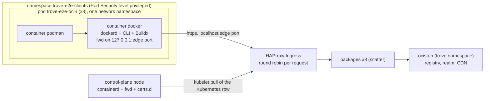
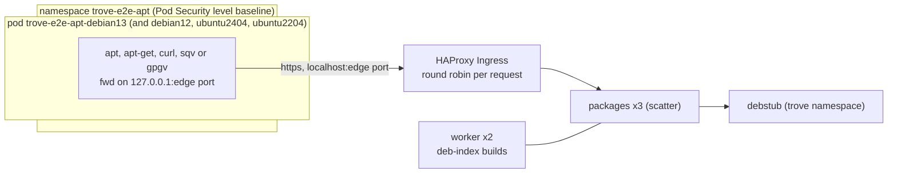
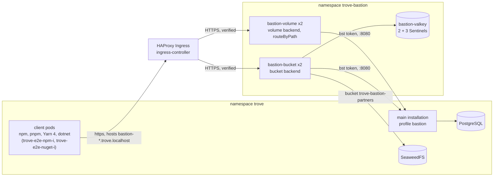
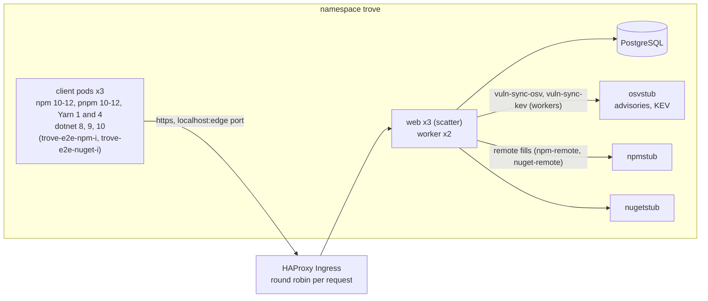
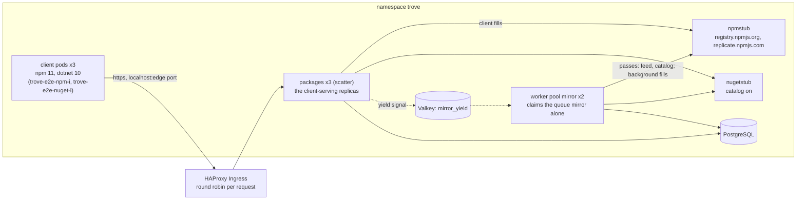
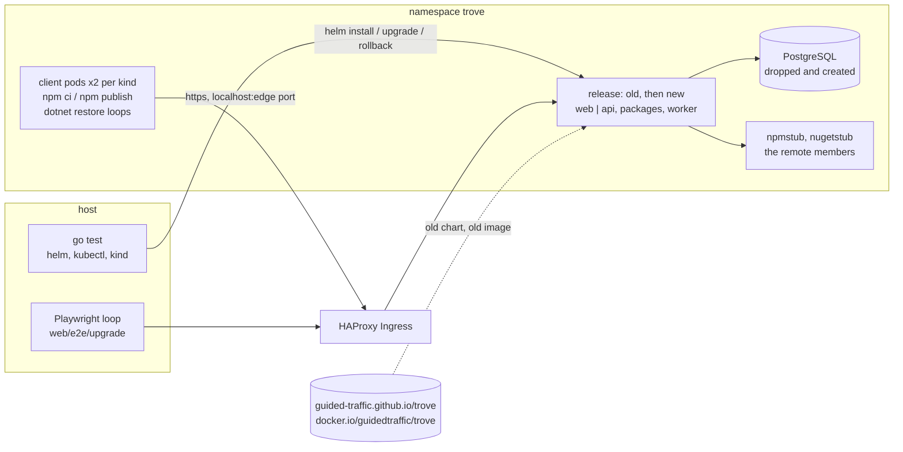
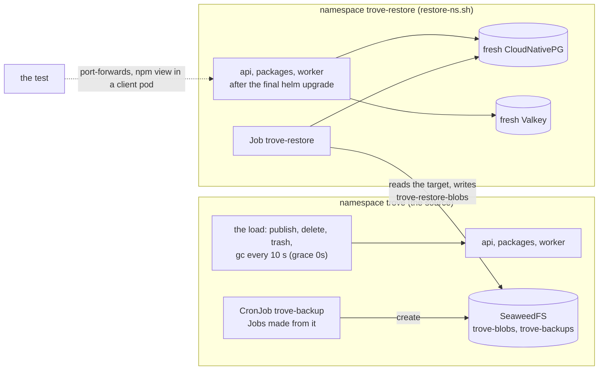

# End-to-end tests on the dev cluster

The suite proves the exit criteria of M0 that need Kubernetes: E0.3, E0.4 (chart part), E0.6, E0.7,
E0.11, E0.12 (dev-profile parts), E0.13, E0.14, E0.15 and E0.16 of the [roadmap](../coverage/roadmap.md), and the
end-to-end criteria of the access core of M1: E1.1, E1.8, E1.11 (the API part and the browser journeys), E1.13 and E1.14, and of
npm in M2: E2.1 to E2.12 and E2.11's drain and failovers under npm load, and of the vulnerability scanning in M4b: E4b.1's drain, E4b.4 to E4b.6 and E4b.8
([the vulnerability tests](#the-vulnerability-tests)), and of the remote full mirror in phase 6b: E6b.6 ([the mirror tests](#the-mirror-tests)). The Debian (APT) registry of phase T-17 has its own set with the real APT of four images ([the Debian tests](#the-debian-tests)). It runs
the real release image on the [dev profile](local-profile.md), over TLS on every connection, and injects the failures of
[R-HA-051 and R-HA-052](../spec/ha-and-helm.md). This is work package WP0.11 (and its TLS part, WP0.12); the M1 tests are
[described below](#m1-tests), the npm tests [further down](#the-npm-tests), and WP2.8's harness, which runs the drain and the
failovers under npm load, in [Drain and failover under npm load](#drain-and-failover-under-npm-load).

## What has to be in your head first

- **The release image is what is tested.** The tests start nothing test-only inside the replicas. The
  one thing the release image needed for E0.14 is a diagnostic job kind (below).
- **M0 has no API that writes a change or enqueues a job.** A *driver* pod does what a serving replica would
  do, with the same packages and the same configuration: it writes a change through `internal/cluster`
  and enqueues a job through `internal/jobs`. The workers of the release run the jobs.
- **A failed request is counted by the client.** k6 runs at 100 requests/s through the Ingress, and every
  response becomes a line the Go test parses. Nothing is inferred from server metrics.
- **The harness's own stop is not a failure.** The tests end k6 with SIGINT, which cancels the requests in flight at
  that moment (measured: one run in four at 100 requests/s, k6 error text `context canceled`; it caused the single
  `status 0` of a CI run of E0.11). `parseK6` sets aside exactly those: status 0, text `context canceled`, started in
  the last two seconds of the run, and reports their number in the log line. A connection error, a reset or any other
  status 0 stays a failure, wherever it happens. A request without a response is logged as `<code>:<text>` in the
  replica column.
- **The M1 tests start from a fresh installation's own tools.** The administrator they seed with is made the way
  [identity.md](identity.md#bootstrap-commands) says (`trove admin service-account create --admin`, `trove admin token
  create` through `kubectl exec` into a worker pod); everything else is the management API. They run in the `scatter`
  profile (three `api` and three `packages` replicas, every request to another one) and `TestMain` returns the cluster to the default profile at
  the end.
- **Every repository of the suite is in the project `e2e`** (`e2eProject` in [m1_env_test.go](../../test/e2e/m1_env_test.go)).
  `adminAPI` creates the project once per run (`POST /api/v1/projects`, 409 is fine), so a repository is created with
  `POST /api/v1/projects/e2e/repositories`, addressed as `/api/<format>/e2e/<key>/` and `/files/e2e/<key>/`, and named in
  instance-wide policies, exposure rules, findings filters and authorization checks by its qualified name `e2e/<key>`
  (`qn`, `ensurePolicy` qualifies bare keys). The partner project tests below use projects of their own. The upgrade tests
  start on the release before the upgrade, which has no projects: until a release with projects exists their fixtures
  (`buildUpgradeFixture`) cannot be created there.
- **A failing test here is a finding.** When a criterion fails because of the product, the test stays red
  and [Findings of the suite](#findings-of-the-suite) says what was measured. No threshold is moved to make it pass.

## Layout

```
deploy/dev/e2e.sh           what `make e2e` calls: builds the driver, starts its pod, runs go test
deploy/dev/values-mirror.yaml  the profile `mirror`: the worker pool `mirror` of two processes (up.sh, TROVE_PROFILE=mirror)
deploy/dev/drain.sh         E0.14 as a script (`make dev-drain`), the drain alone for the test, and with `--also valkey|postgres|pooler` the drain of variants B, C and D (below)
deploy/dev/pg-kill.sh       force-delete the PostgreSQL primary, wait for the recovery
deploy/dev/pg-stop.sh       stop PostgreSQL for a time by fencing the CloudNativePG cluster
deploy/dev/sentinel-scale.sh  scale the Valkey Sentinels to a number with the operator stopped (TestHAFaults_ValkeySentinelQuorumLoss); valkey-start.sh ends it
deploy/dev/valkey-slow.sh   repeat a CLIENT PAUSE on the Valkey primary for a time (TestHAFaults_ValkeySlow)
deploy/dev/valkey-credential.sh  break|fix: change the default user's password on the Valkey pods (TestHAFaults_ValkeyCredentialMismatch)
deploy/dev/valkey-stop.sh   stop Valkey and the Sentinels until valkey-start.sh (the M1 tests hold the outage themselves)
deploy/dev/s3-stop.sh       scale the object store to 0 until s3-start.sh (its objects stay on the volume); s3-outage.sh is stop, sleep, start (TestHASuite_ObjectStoreOutage)
deploy/dev/valkey-cli.sh    valkey-cli against the current primary (FLUSHALL of E1.11, CLIENT PAUSE of E1.8)
deploy/dev/bastion.sh       the e2e Bastions of R-BAS-049: infra, install <volume|bucket>, status, down (the Bastion tests, below)
deploy/dev/bastion*.yaml    their manifests and chart values; values-bastion.yaml is the main installation's `bastion` profile
deploy/dev/restore-ns.sh    the second installation of the restore drill (namespace trove-restore): infra, install <backup id>, serve, down; restore-ns.yaml and values-restore.yaml are its manifests and chart values, values-restore-vuln.yaml the overlay of `TROVE_RESTORE_PROFILE=vuln` (the backup tests and the vulnerability tests, below)
deploy/dev/values-backup.yaml  the profile `backup`: garbage collection without a grace period (TROVE_PROFILE=backup)
test/e2e/                   the Go tests, build tag `e2e`, package e2e
  env_test.go               kubectl, the API-server proxy to :8081, the driver and k6 helpers
  e03_cluster_test.go       E0.3, E0.7 (Pod Security, NetworkPolicy enforcement)
  e03_roles_test.go         E6a.5: the roles' Deployments, Services, path split, access logs and 404s (TestE03Roles)
  e04_migration_test.go     E0.4 chart part
  e06_lease_test.go         E0.6, P-13 and P-14 with Valkey
  e12_valkey_test.go        E0.12
  e13_failover_test.go      E0.13
  e14_drain_test.go         E0.14
  e14_drain_roles_test.go   E6a.6: the drain per role (TestDrainRoles)
  e15_tls_test.go           E0.15: plaintext refused, the listener certificate renewed under load
  e16_endpoint_test.go      E0.16: the second endpoint `customers`
  m1_env_test.go            the M1 harness: edge client with a cookie jar, bootstrap administrator, browser login
                            against the test IdP, port-forwards to single pods, the Valkey outage, the scatter profile
  e1_01_login_test.go       E1.1: sign-in with Keycloak, JIT user, groups, logout, break-glass
  e1_08_ratelimit_test.go   E1.8: R-AUTH-038 thresholds, R-API-016 classes, R-ARCH-034 cluster-wide counting
  e1_11_scatter_test.go     E1.11: list walks, Idempotency-Key, read after write, R-AUTH-042 (TestE1_11Scatter), and
                            TestE1_11Journeys, which runs the Playwright journeys of R-UI-047 (web/e2e, below)
  e1_13_transfer_test.go    E1.13: curl -T during a rollout, downloads during a rollout and a pod deletion, GC on a worker
  e1_14_exposure_test.go    E1.14: exposure rules on the endpoint `customers`, bound tokens, R-EP-015
  e99_scatter_test.go       E0.11, last because it switches the profile
  monitor_test.go           /healthz and /readyz of every replica, once a second
  k6/load.js                the load: 100 requests/s on /system/ping and /system/replicas
  k6/transfer.js            the transfer loop of E1.13: PUT, GET and SHA-256 of 256 KiB bodies on generic-local
  cmd/driver/               the driver (main.go: connections, probe and job commands; load.go: the load loop)
  Dockerfile                the driver image: a static binary on the release image's base
  npm_clients_test.go       the smoke test of the npm client pods (R-NPM-045), and npmClientExec, the helper the matrix builds on
  npm_env_test.go           the npm harness: fixture (repositories, publisher, token), the control API of the test upstream,
                            npmClient (a gate row in a pod: exec, files, pseudo-terminal), pinning to a replica, the matrix report
  npm_matrix_test.go        E2.1: the scenario table and the eight rows (TestNPMMatrix); the snippets are rendered from SetupTemplates
  npm_replicas_test.go      E2.3 and E2.10: publish on A, view on B; validators; unpublish across replicas; FLUSHALL and Sentinel failover
  npm_upstream_test.go      E2.2, E2.4, E2.5, E2.9: what the counting upstream recorded (TestNPMCollapse, TestNPMUpstream)
  npm_endpoint_test.go      E2.12: npm on the endpoint `customers`
  npm_closing_test.go       the closing run: the matrix and the cold install with Valkey stopped, the public-registry subset
  npm_load_test.go          E2.11's load: the fixture (tokens, the lockfile of 475 packages, the 1 to 5 MiB tarballs), the npm ci
                            and publish loops detached in the client pods, the k6 npm requests and their conditions
  npm_ha_test.go            E2.11: drain variant A, PostgreSQL switchover, Valkey failover, pod crash (TestNPMHA); the Valkey
                            outage of the closing run (TestNPMHAClosing)
  ha_suite_test.go          R-HA-052 under the npm load, the rest of it: the object-store outage, node loss, PostgreSQL and Valkey primary loss,
                            the audit forward cut by a pod deletion (TestHASuite_..., set ha-suite)
  ha_faults_test.go         E5.10 under the npm load: the database at 0 instances, Sentinel quorum loss, FLUSHALL, a slow Valkey, a Valkey credential
                            mismatch, a rejected object-store credential (TestHAFaults_..., set ha-faults); ha_faults_failover_test.go: the planned failover's 10 s bound
  ha_pooler_test.go         R-HA-058 under the npm load: a pooler instance deleted, gracefully and forced (TestHAPooler_..., set ha-pooler)
  npm_perf_test.go          R-ARCH-027: perf/k6/npm.js against one web replica from inside the cluster, reported (TestNPMPerf)
  k6/npm.js                 the k6 npm requests of R-HA-059: documents and 1 to 5 MiB tarballs of npm-all, 120 requests/s
  nuget_load_test.go        the NuGet load of R-HA-059: the fixture (nuget-ha-local, -remote, -all, 61 packages per restore), the dotnet restore and
                            push loops detached in the client pods, the k6 NuGet requests and their conditions
  nuget_ha_test.go          drain variant A, PostgreSQL switchover and Valkey failover under the npm and NuGet load; R-ARCH-024's drain (TestNuGetHA)
  k6/nuget.js               the k6 NuGet requests of R-HA-059: registrations, version lists and packages of nuget-all, 30 requests/s
  oci_clients_test.go       the OCI client pods (R-OCI-035): the pod helpers, pinning to a replica, the smoke test (TestOCIClients)
  oci_env_test.go           the OCI harness: fixture (oci-e2e, oci-e2e-open, publisher), ociClient (docker or podman in a pod), the control API of the OCI test upstream, upstreamRepos
  oci_local_test.go         login, push, pull, anonymous pull, Buildx, docker manifest, Podman manifests (TestOCILocal)
  oci_remote_test.go        pull-through, six concurrent pulls on three replicas, the mirror with the upstream stopped (TestOCIRemote, TestOCIRemoteMirror)
  oci_virtual_test.go       pull and push through a virtual repository (TestOCIVirtual)
  oci_engine_test.go        the Docker Engine mirror of a bound host (TestOCIEngineMirror), a Kubernetes pod with an image pull secret (TestOCIKubernetes)
  oci_snippets_test.go      the rendered setup snippets run by the clients (TestOCISnippets)
  oci_closing_test.go       the closing run: Valkey stopped, the read-only subset against Docker Hub (TestOCIClosing, TestOCIClosingPublic)
  oci_long_test.go          the long set oci-long: the drain of the pod that receives a 300 MiB push (TestOCILong_R_OCI_011_...)
  mirror_oci_test.go        R-REPO-055 with an OCI pass while docker and podman pull; mirror_long_oci_test.go: the drain of the node of an OCI pass (mirror-long)
  ociclients/               the OCI client images (below): Dockerfile.docker, Dockerfile.podman, entrypoints, build.sh, check-pins.mjs
  mirror_env_test.go        the mirror harness (R-REPO-059): the profile `mirror`, the repositories in mode mirror, the status and the run, the
                            pool's counters, the CoreDNS rewrite of the public registry's name, the sampler of the job table, the clients
  mirror_clients_test.go    R-REPO-055: npm ci and dotnet restore while a pass runs (TestMirror_R_REPO_055_ClientsFirst)
  mirror_ha_test.go         R-REPO-058: the status from every replica, two claimants of the queue, a pass with Valkey stopped
  mirror_offline_test.go    E6b.3: a restore with the test upstreams stopped
  mirror_ui_test.go         the browser journey of the Mirror tab in the profile `mirror`
  mirror_long_test.go       the long set `mirror-long`: the drain of the node of the process that runs a pass
  mirror_long_fault_test.go the failure suite of R-HA-052 on a pass (`mirror-long`): the process lost three ways, the upstream throttling across a drain and a kill, a PostgreSQL switchover and a Valkey failover
  vuln_failures_test.go     the vulnerability scanning under the failure suite (E5.13): a switchover during an evaluation, the block through a drain and the primaries' failovers, a killed worker
  drain_variants_test.go    the harness of drain variants B to E of R-HA-059: the node pick, `drain.sh --also`, each variant's condition (Drain variants B to E, below)
  drain_variants_hold_test.go  the hold of variant B: the evicted Valkey primary stays lost until the Sentinels name another primary (Q-HA-181)
  vuln_drain_variants_test.go  E5.13: the blocks through drain variants B, C and E (set vuln-long)
  vuln_pooler_test.go       E5.13: the block through drain variant D on the cluster with the poolers (set vuln-pooler)
  vuln_restore_test.go      E5.13, R-VULN-026: the restore drill of the vulnerability data (set vuln-long)
  backup_env_test.go        the backup harness (R-BAK-029): the profile, the repositories, the load, Jobs made from the CronJob, the port-forwards to the restored installation, the timings artifact
  backup_drill_test.go      the restore drill: a backup during the load, the restore Job into the second namespace, the restored installation judged by its bytes, npm view and verify --deep, two overlapping Jobs
  backup_drain_test.go      a node drain and a kill -9 of a backup and of a restore (R-BAK-012, R-BAK-010, R-BAK-021)
  backup_journal_test.go    E5.12: the revocation journal across a restore
  backup_ci_test.go         E5.12's CI bullets: the issuer, the mappings and the exchange against the source and the restored installation
  clients/                  the npm client matrix image (below): package.json + package-lock.json, bin/ wrappers, shim/npm, fwd/ forwarder,
                            Dockerfile, build.sh, check-pins.mjs
web/e2e/                    the Playwright journeys of R-UI-047 (TypeScript, in the web workspace's lockfile)
  playwright.config.ts      Chromium, one worker, no retries, the edge URL and the IdP mapping from the environment
  global-setup.ts           verifies the TLS chains against the dev CA, removes alice and bob (JIT users of an earlier run)
  support.ts                the `page`, `admin` and `replicas` fixtures, the CSP watch, `expectAccessible` (axe), the sign-ins
  tests/01-...07-*.spec.ts  the journeys, in the order they run (Browser journeys, below)
perf/k6/npm.js              the npm load scripts of R-ARCH-027 (P-1, P-3, P-5, P-7, P-8); TestNPMPerf runs them
```

## Running it

```shell
make image VERSION=dev          # IMAGE defaults to guidedtraffic/trove:dev
make dev-up                  # TROVE_DEV_HTTP_PORT=28080 make dev-up when 8080 is taken
make e2e SET=push            # E0.3, E0.4, E0.6, E0.7, E0.12, E0.14, E0.15, E0.16, E1.14, then E0.11 (CI, every change)
make e2e SET=failover        # the E0.13 failovers and the E1.8 limits (CI: nightly and on dispatch, since 2026-11-01)
make e2e SET=access-long     # E1.1, E1.11 with the browser journeys, E1.13 (CI, every change)
make e2e SET=access          # the M1 tests alone: E1.1, E1.8, E1.11, E1.13, E1.14
make e2e SET=full            # everything, in the order of the milestone
make e2e SET=drain           # E0.14 only (with the transfer loop of E1.13)
make e2e SET=drain-roles     # the drain per role of R-HA-059 (E6a.6): api, packages, the worker and the pool vuln pod by pod under load, the npm load of npm-ha among it; three client pods, the scatter profile (CI: nightly and on dispatch)
make e2e SET='^TestE06'      # any go test -run expression
make e2e SET=clients         # build the npm clients image, start the client pods, run the smoke test (the pods stay up)
make e2e SET=clients-down    # remove the client pods
make e2e SET=npm             # the npm acceptance matrix and E2.2 to E2.12 but E2.11, and TestNPMProjectPartner (CI job e2e-npm, every change); three client pods
make e2e SET=release-smoke  # E5.8: TestNPMClients and TestNPMMatrix against the published chart and image (CI job smoke-published of build.yml, after each release; needs TROVE_RELEASE_VERSION and TROVE_RELEASE_DIGEST, below)
make e2e SET=npm-closing     # the additions of the closing run (below); fails unless TROVE_E2E_NPM_CLOSING=1, which the set exports
make e2e SET=npm-ha          # E2.11: drain variant A and the failovers under the npm load (CI leg npm-ha: nightly and on dispatch, since 2026-11-01)
make e2e SET=npm-ha-crash    # E2.11: the pod crash under the npm load, three force-deletes (no CI leg since 2026-11-01; run by hand)
make e2e SET=npm-ha-soak     # the pod crash with ten force-deletes over 20 minutes, then perf/k6/npm.js (nightly)
make e2e SET=npm-ha-closing  # npm-ha, npm-ha-soak and the 5-minute Valkey outage under the npm load (the closing run's leg)
make e2e SET=ha-faults       # E5.10: the database at 0 instances for 2 minutes, Sentinel quorum loss, FLUSHALL, a slow Valkey, the planned failover with its 10 s bound, a Valkey credential mismatch, a rejected object-store credential (about 45 minutes; nightly and by hand)
make e2e SET=ha-pooler       # E5.10, R-HA-058: a pooler instance deleted, gracefully and forced, in the pooler profile (TROVE_POOLER=1; about 25 minutes; nightly and by hand)
make e2e SET=ha-suite        # the failure scenarios of R-HA-052 that npm-ha leaves out, under the same npm load: the audit forward cut by a pod deletion, the object-store outage, PostgreSQL and Valkey primary loss, node loss (about 50 minutes; nightly and by hand)
make npm-clients-image       # only build the image into the local Docker
make e2e SET=nuget-clients   # build the NuGet clients image, start the client pods, run the smoke test (the pods stay up)
make e2e SET=nuget-clients-down  # remove the NuGet client pods
make e2e SET=nuget           # every TestNuGet... but TestNuGetClosing... and TestNuGetHA...: local, remote and virtual repositories, a project's partner (TestNuGetProjectPartner), E3.2, E3.6 and E3.7 with the real clients; the test upstream and three client pods (Q-NUGET-34, Q-NUGET-70); CI job e2e-nuget on every change
make e2e SET=nuget-closing   # the additions of the closing run (TestNuGetClosing: R-NUGET-030 and R-NUGET-031 with Valkey stopped; TestNuGetClosingPublic: the read-only subset against nuget.org; exports TROVE_E2E_NUGET_CLOSING=1); CI leg of a closing dispatch
make e2e SET=nuget-ha        # TestNuGetHA: drain variant A, the PostgreSQL switchover and the Valkey failover under the npm and NuGet load together (R-HA-059, R-ARCH-024); CI job e2e-nuget in the nightly workflow; starts both client pods and both test upstreams
make nuget-clients-image     # only build the NuGet clients image into the local Docker
make nuget-clients-smoke     # the image like a pod against the counting NuGet test upstream, without a cluster
make nuget-reference-check   # perf/nuget/reference against a regeneration (no cluster, no Docker)
make e2e SET=oci-clients     # build the OCI clients images, start the Docker Engine and Podman pods of the namespace trove-e2e-clients, run the smoke test (the pods stay up)
make e2e SET=oci             # every TestOCI... but the closing and long names: login, push and pull through local, remote, mirror, virtual and bound-host repositories with docker and podman, Buildx, the Kubernetes pull, the setup snippets (CI job e2e-oci, when the change touches the registry); three client pods and the counting OCI test upstream
make e2e SET=oci-closing     # the additions of the closing run (TestOCIClosing: Valkey stopped; TestOCIClosingPublic: the read-only subset against Docker Hub; exports TROVE_E2E_OCI_CLOSING=1); CI leg of a closing dispatch
make e2e SET=oci-long        # TestOCILong: the drain of the pod that receives a push of a 300 MiB layer (CI: job e2e-oci of the nightly workflow)
make oci-clients-image       # only build the two OCI clients images into the local Docker
make e2e SET=bastion         # the short scenarios of R-BAS-049 with npm, pnpm, Yarn 4 and dotnet restore (CI job e2e-bastion, when the change touches the Bastion; nightly)
make e2e SET=bastion-long    # the drain, the failure suite under client load (replica lost, main installation failing over, rolling upgrade of either side) and the anonymous miss flood (CI: nightly and on dispatch; a red long leg is a finding, not a blocker)
make e2e SET=mirror          # the mirror (R-REPO-059, E6b.6): npm ci and dotnet restore while a pass runs, the status from every replica, two claimants, Valkey stopped, a restore with the upstream stopped, the browser journey (CI job e2e-mirror, when the change touches the mirror; nightly)
make e2e SET=mirror-long     # the drain of the node of the process that runs a pass of 300 packages, and the failure suite on a pass of 100 (a process lost, a throttling upstream, a switchover and a failover) (CI: nightly and on dispatch; a red long leg is a finding, not a blocker)
make e2e SET=upgrade         # the upgrade across the cut from v0.16.0 (E6a.7) and the rolling upgrade with its rollback from the latest release (R-HA-020), under npm, NuGet and browser loops; replaces the installation and puts the current dev release back (CI: nightly and on dispatch; a red long leg is a finding, not a blocker)
make e2e SET=vuln-pooler     # E5.13: the block through drain variant D on the cluster with the poolers of R-HA-058 (TROVE_POOLER=1, set by the set); no client pods; about 6 minutes of `make e2e` (the variant takes 2.5 to 3.5 minutes: the pooler pod stops after its 90 s `preStop` sleep); the cluster stays in the pooler overlay until the next `make dev-up` (CI: job e2e-vuln, nightly)
make e2e SET=backup          # the backup and restore suite (R-BAK-029): the drill into the namespace trove-restore, the drain and the kill -9 of a backup and a restore, the journal across a restore with E5.12's CI bullets (starts the issuer double); the profile backup, one npm client pod (CI: job e2e-backup of the nightly workflow, on dispatch; about 25 minutes)
make fuzz-npm FUZZ=FuzzMatch FUZZTIME=1m   # npm's fuzz targets (CI: 30 minutes, closing run only)
```

Needs Docker, kind, kubectl, Helm (pinned, checked by `up.sh`), `jq` and Go. k6 is a container: `K6_IMAGE`
in [tools/versions.env](../../tools/versions.env), pinned by digest, run on the Docker network `kind`, so
no host install and no host port is involved. `e2e.sh` refuses a `K6_IMAGE` whose tag differs from
`K6_VERSION`.

`VERSION` defaults to `dev`, or to the number of a `v0.*` tag on `HEAD`. The binary refuses a version that is
neither `major.minor.patch` nor `dev`: with a commit hash the replicas would wait for the schema forever and never
become ready, and it now logs an ERROR at start saying so ([Findings of the suite](#findings-of-the-suite)).

Output: the machine-readable report is `.out/test-e2e.json` (`go test -json`, test names carry the
requirement IDs), the artifacts are in `.out/e2e/`: per k6 run the console log (one line per request:
`R <unix ms> <status> <replica> <ms> <path>`) and k6's own `summary.json`, the driver's JSON per run, the
pod watch and the events of the drain, the logs of the drained pods, and the result files `e13-*.json`,
`e14-drain.json`, `e06-*.json`.

| Variable | Default | Effect |
|---|---|---|
| `TROVE_DEV_SCHEME` | `https` | scheme of the edge for the host client and k6 |
| `TROVE_DEV_OPS_SCHEME` | `https` | scheme of the pods' `:8081` as the API server proxy reaches it |
| `TROVE_DEV_CA_FILE` | `.dev/pki/ca.crt` (written by `up.sh`) | PEM bundle that signs the edge's certificate: used by the Go client and mounted into the k6 container (`SSL_CERT_FILE`) |
| `TROVE_E2E_K6_TARGET` | `https://localhost:30443` | what k6 requests: the edge's HTTPS NodePort, by the name its certificate carries |
| `TROVE_E2E_K6_HOSTS_ADDR` | `<control-plane node address on the Docker network kind>:30443` | `host:port` that name resolves to inside the k6 container (so the certificate is verified for `localhost` while k6 reaches the node's address) |
| `TROVE_E2E_OUT` | `.out/e2e` | artifact directory |
| `TROVE_E2E_TIMEOUT` | `90m` | go test timeout |
| `TROVE_E2E_DRIVER_BIN` | unset | a prebuilt linux driver binary instead of `go build` |
| `TROVE_E2E_SCATTER_RETURN` | `1` | `0` leaves the cluster in the `scatter` profile after E0.11 |
| `TROVE_E2E_RUN` | unset | replaces the `go test -run` expression of any set (`TROVE_E2E_RUN='TestNPMMatrix/rows/E2.1_npm11' deploy/dev/e2e.sh npm`) |
| `TROVE_E2E_NPM_CRASH_SOAK` | unset | `1` makes `TestNPMHACrash` force-delete ten pods over 20 minutes instead of three; the sets `npm-ha-soak` and `npm-ha-closing` export it |

The suite runs over TLS by default: the scheme, the CA and the probe scheme are parameters (the defaults above),
and nothing in the suite hard-codes `http`. What the move to TLS changed is listed in
[TLS in the suite](#tls-in-the-suite).

## The driver

[test/e2e/cmd/driver](../../test/e2e/cmd/driver) runs in the pod `trove-e2e-driver`, which `e2e.sh`
creates from the worker Deployment's pod template: the same ConfigMap (`/etc/trove/trove.yaml`), the same
Secrets, the same security contexts, no probes, no ports. It carries `app.kubernetes.io/name=trove` and
`trove/serve=true` because the Valkey NetworkPolicy admits exactly those pods, and a component label
that no Service, PodDisruptionBudget or spread constraint selects. It runs on the control-plane node, so a
drain of a worker node never evicts it. Its connections are named `trove:e2e-writer-…`, `…e2e-follower-…`
and `…e2e-probe-…` with role `web`: it claims no job and holds no lease.

| Command | What it does |
|---|---|
| `driver load -duration d` | each second: write a change to the area `cache` through peer A and enqueue a `system.probe` job (one step). Peer B follows the change log like a second `web` replica and measures when a cached value that the change names is evicted (**P-13**). The pick-up of the jobs (**P-14**) is the database's `started_at` minus `created_at`. The summary splits the samples by whether Valkey was up at the start and at the end |
| `driver stop` | ends a running `load` after its tick |
| `driver probe -steps n -interval-ms m` | enqueues one long `system.probe` job and prints its id |
| `driver job <id>` | prints the job row: state, attempt, checkpoint, result |
| `driver info` | prints `cluster.epoch_poll_interval`, `jobs.poll_interval` and `database.retry.max_elapsed` |

### The `system.probe` job kind

A job that persists its cursor every second has to exist in the release image: workers only run kinds
they know. [internal/jobs/probe.go](../../internal/jobs/probe.go) registers `system.probe` (default queue,
three attempts): it counts `steps` steps of `interval_ms`, saves a checkpoint and the progress after every
step, and records in the checkpoint which workers carried it (`hops`) and the step each later worker
resumed from (`resumes`). It touches no table but its own job row. Nothing enqueues it except a caller
with write access to the job table. The driver declares the same kind and args on its side of the wire,
without importing the handler.

## The tests

Each subtest name carries the requirement IDs (the coverage generator reads them from `go test -json`) and
the exit criterion.

| Criterion | Test | What it checks |
|---|---|---|
| E0.3 | `TestE03DevProfile` | two `api`, three `packages`, two `worker` and two pool `vuln` pods Ready, every pod's `:8081/readyz` 200 (through the API-server proxy), `/system/replicas` lists each pod under its `roles` entry (the pool's with `pool` `vuln`), `/system/ping` is `OK` through the Ingress; two PostgreSQL instances, two Valkey pods, three Sentinels. The 15-minute budget is measured by `make dev-up` itself (below) |
| E0.4 | `TestE04MigrationFailure` | `helm upgrade` with a migration credential whose password is wrong. The Job fails for that real reason (SASL authentication, `28P01`); `helm upgrade` fails naming the Job; ping answers 200 throughout; no pod is replaced and no Deployment's generation changes; the release is `failed`; the repairing upgrade succeeds and the checks of E0.3 pass again |
| E0.6 | `TestE06Lease` | the scheduler lease is read from `pg_locks` (class 1, object 1) joined to `pg_stat_activity` (`trove:<pod>:lease`), sampled every 200 ms from one psql session. One holder, a worker; no lease connection and no job lock of an `api` or `packages` replica. Then two faults: force-delete, and SIGKILL of the process |
| E0.7 | `TestE07PodSecurity`, `TestE07NetworkPolicy` | the namespace enforces `restricted`, the pods run, a privileged pod is refused; from another namespace `:8080` of an `api` pod answers and `:8081` does not |
| E0.11 | `TestE99Scatter` | switches to `scatter`, runs the E0.3 checks and the Valkey connection check, 60 sequential requests reach three replicas 20 times each, k6 at 100 requests/s records only 200 spread evenly over the three |
| E0.12 | `TestE12Valkey` | `CLIENT LIST` on the primary; three new replicas started from the packages template with a wrong `primary_name`, a wrong password and an unreachable Sentinel; each is deleted with its normal grace period and the test waits until the registry no longer lists it, because a row of a serving role left to go stale counts towards the `n` that every fallback rate-limit share divides by (R-ARCH-034) and refused the transfer loop of E0.14 in the test that follows |
| E0.13 | `TestE13Failover` | `faultRun`: k6 + driver `load` + a monitor of `/healthz` and `/readyz` of every replica run while the fault is injected: `failover.sh`, `pg-kill.sh`, `pg-stop.sh 30s`, `valkey-failover.sh`, `valkey-kill.sh`, `valkey-outage.sh 60s` |
| E0.14 | `TestE14Drain` | see below |
| E0.15 | `TestE15TLS` | see below |
| E0.16 | `TestE16Endpoint` | see below |
| E1.1 | `TestE1_01Login` | see [M1 tests](#m1-tests) |
| E1.8 | `TestE1_08RateLimits` | see [M1 tests](#m1-tests) |
| E1.11 | `TestE1_11Scatter`, `TestE1_11Journeys` | see [M1 tests](#m1-tests) |
| E1.13 | `TestE1_13Transfers`, and the loop in `TestE14Drain` | see [M1 tests](#m1-tests) |
| E1.14 | `TestE1_14Exposure` | see [M1 tests](#m1-tests) |

### E0.6: the two faults

`kubectl delete pod --grace-period=0 --force` does not crash the process: the kubelet still delivers
SIGTERM, the replica shuts down cleanly and **deletes its own row** ([R-OPS-003](../spec/operations-and-observability.md):
"on a clean shutdown the replica deletes its own row"). The roadmap's wording, that the registry shows
the deleted pod `"lost": true`, can therefore only be observed after a process dies without cleanup. The
test runs both: the force-delete (the lease moves, the row is gone, the replacement is listed) and a
SIGKILL of the container's process through the container runtime of the node (`crictl inspect`, `kill -9`),
after which the kubelet restarts the container in the same pod. The registry then shows the dead
instance `lost` once its heartbeat is older than `system.heartbeat_stale_after` (30 s), and the new
instance beside it. The lease goes to whoever asks first: the other worker, or the restarted or
replacement pod. The test asserts that it moves, to a live worker, with never two holders in 200 ms
samples, and logs who took it.

### E0.13: pass and fail

The criterion counts the client's view. `only200` fails on any non-200, on fewer than 95 % of the
expected requests, and on `dropped_iterations` (k6 could not keep its rate). k6 waits 45 s for an answer, longer than
`database.retry.max_elapsed` (30 s), so a request the server holds ends as the server's answer and not as
a client timeout. For the PostgreSQL cases the test checks the status set (503 only), the time of the
last failure against `retry.max_elapsed` and that no failure follows the recovery. For Valkey it checks
that `/readyz` is 200 on every replica at every sample, that every change reached the follower and every
job ran, and that the p99 of the propagation and of the pick-up stay under `epoch_poll_interval + 1 s` and
`jobs.poll_interval + 1 s`, which are the bounds without Valkey.

The monitor reads the replicas through the API server (`/api/v1/namespaces/trove/pods/<pod>:8081/proxy/…`),
so the answer is the pod's own, not a Service's. The first four non-200 answers of each pod (status and body, so the failing
check or the transport error) go to the test log, and `runLoadFault` keeps the pod's log (`kubectl logs --timestamps`, since a
minute before the load) on its first failing sample, then every fifteenth, and at the end, with the previous instance of a
restarted pod, under `.out/e2e/podlogs-<fault>/` ([monitor_test.go](../../test/e2e/monitor_test.go)): a later fault deletes
or replaces pods, and a container killed by its liveness probe takes its log with it.

### E0.14

1. Pick the node ([drain.sh --pick](../../deploy/dev/drain.sh)): a worker node with an `api`, a `packages` and a `worker`
   pod, not the PostgreSQL primary's: CloudNativePG switches the primary over as soon as its node is cordoned, which ends
   every connection and job lease (Test and Release run 42406831768: every probe job ran a second attempt). When the only
   such node is the primary's, `failover.sh` moves the primary first. The drain evicts only the release's pods
   (`--pod-selector`), so the standby that then stays on the node, Valkey and the object store keep running, as
   R-HA-059's acceptance test has them on other nodes: an evicted synchronous standby held every commit about 6 s until
   CloudNativePG dropped it (`dataDurability: preferred`), and five uploads queued on one row lock met the lock timeout
   (`503 database_timeout`, run 42402849059).
2. Start a watch on the trove pods (every transition with its arrival time), stream the logs of the pods
   that will be drained, start the driver `load` and k6.
3. Enqueue six `system.probe` jobs of 150 steps at 1 s, so that both workers run some.
4. `drain.sh <node>`: `kubectl drain --ignore-daemonsets --delete-emptydir-data`, wait for the rollouts,
   uncordon.
5. Every job must end `succeeded` with `attempt` 1 and 150 steps. A job that has more than one hop must
   have resumed at a step strictly inside the run. At least one job must have moved.
6. k6: only 200, no connection error, no dropped iteration. No container with exit code 137 or
   `OOMKilled` since the watch started. The kubelet's events for the drained pods hold no SIGKILL, no
   `FailedKillPod`. No trove pod Pending longer than 60 s.
7. The endpoint-removal time of the edge, measured and held to the drain delay ([below](#the-endpoint-removal-time-of-the-edge)).

The dev profile gives the worker a `terminationGracePeriodSeconds` of 60 (the chart default is 300), so a
worker whose job outlasts the shutdown budget releases it after about 45 s and the test does not wait 5
minutes. The edge is not part of the system under test: HAProxy Ingress runs two replicas on the control-plane node, which
no test drains. With one replica on a worker node, the drain reset the client connections of the evicted
edge pod (25 connection errors in the first measured run, with the previous controller).

### The endpoint-removal time of the edge

R-HA-059 rule 4: `health.shutdown_drain_delay` must exceed the time the edge needs to stop sending requests to a pod whose readiness
flipped. All three drain tests measure it with the helpers in [drain_measure_test.go](../../test/e2e/drain_measure_test.go)
([Q-HA-110](../spec/ha-and-helm.md#q-ha-110--how-the-drain-test-measures-the-edges-endpoint-removal-time)):
`TestE14Drain` (set `push`, `drain`; prefix `drain-`), `TestDrainRoles` (set `drain-roles`; prefix `drain-roles-`, a stream per pod
of the role before its first eviction) and the drain of `TestNPMHA` (prefix `npm-drain-`).

1. `streamPodLogs` starts a `kubectl logs -f --since=10m` per pod that will be evicted, into `<prefix><pod>.log` of the artifacts,
   so that the log outlives the pod.
2. After the drain, `checkEndpointRemoval` reads each log with one clock, the pod's own: the line `shutting down` is the readiness
   flip (the process sets the drain state right after it), the line `draining` carries the delay it waits, and every
   `"log":"request"` line of a client listener (not `ops`, the kubelet's probes) is a request whose arrival is its stamp minus its
   `duration_ms`. The sample of a pod is the arrival of the last request after the flip, counted from the flip, and a count of the
   arrivals per half second.
3. The samples go to the test log (`endpoint removal of <pod> (<role>): the last of N requests after the readiness flip arrived
   X after it, drain delay Y`) and to `<name>-endpoint-removal.json` (`e14-drain`, `e14-drain-roles`, `npm-ha-drain`) with the
   samples, the pods without one and the longest time.
4. The test fails when `delay < longest + 1 s` ([Q-HA-113](../spec/ha-and-helm.md#q-ha-113--what-the-drain-test-fails-on)): the
   listener accepts until the delay ends, so a delay that is too short shows as requests until its last moment, and the second of
   silence is what tells "the edge had stopped" from "the listener closed first". A pod without a request after the flip (workers,
   which have no client listener; `packages` in `TestE14Drain`, which gets 4 requests/s) is no sample and no failure; a run in which
   no pod has one fails, because then the rule was not tested.

Measured (the longest time from the readiness flip to the last request that reached the pod, the dev profile's HAProxy Ingress):

| Run | api | packages |
|---|---|---|
| Actions `e2e-artifacts-push`, `TestE14Drain`, the runs 42057547730, 42116230650, 42121742101, 42131510743 | 0.15, 0.15, 0.18, 0.16 s | 1.79 s (9 requests after the flip), no request after it in the other three |
| Actions nightly dispatch 42126196109, drain variant A of `TestNPMHA` under 150 requests/s | no request after the flip | 0.98 s (54 requests) |
| Local, idle host, `make e2e SET=drain` 2026-11-06 | 0.14 s (7 requests) | no request after the flip |
| Local, CPU-starved host (load average 16 to 27 on 20 CPUs, kubectl answering `TLS handshake timeout`), `make e2e SET=drain-roles` 2026-11-06 | 13.4 s (the first pod: about 100 requests/s for 10 s, then 9 queued requests at 13.4 s), 1.3 s (the second) | not reached |

The Actions rows come from the logs of the pods that the tests kept before this measurement existed (`--tail=-1`), read with the same
rule. The chart default of 5 s ([Q-HA-111](../spec/ha-and-helm.md#q-ha-111--the-default-of-healthshutdown_drain_delay)) is 2.8
times the longest time on the runners; the dev profile keeps 15 s for hosts like the last row
([Q-HA-112](../spec/ha-and-helm.md#q-ha-112--whether-the-dev-profile-keeps-its-drain-delay-of-15-s)). The two local `drain-roles`
runs of 2026-11-06 ended on the host's load before the measurement (`TestDrainRoles` calls `kubectl` for the pods of a role and a
`TLS handshake timeout` ends it with `t.Fatal`), so `e14-drain-roles-endpoint-removal.json` has not been written by a green run yet; the
nightly run is its first.


### E0.15

`TestE15TLS` has two subtests.

1. **Plaintext is refused.** A pod of the namespace `default` sends a plaintext `GET` to `:8080` and `:8081` of a packages
   pod and to the object store (`http://trove-s3.trove.svc:9000/`). The listeners answer `400` (net/http's "Client sent
   an HTTP request to an HTTPS server") or nothing; any `200` fails the test. (Valkey's plaintext port is 0, checked by
   E0.12. PostgreSQL's plaintext refusal is a CloudNativePG default that this suite does not probe.)
2. **The listener certificate is renewed under load.**
   - Per trove pod (two api, three packages, four worker) an *ephemeral container* with the pinned openssl image
     (`OPENSSL_IMAGE`, same user as trove, `--target=trove`) polls every 100 ms: the serial of
     `/var/run/secrets/trove/tls/tls.crt` as the kubelet mounts it into the trove container (read through
     `/proc/1/root`), and the serial `openssl s_client` receives from `127.0.0.1:8080` and `:8081` of that pod. It logs
     a line with the kernel uptime whenever one of the three changes, so *file arrival* and *served* are timed by the
     same clock inside one pod, which is what `reload_interval` bounds. (A worker serves `:8081` only.)
   - k6 runs at 100 requests/s through the edge; after 20 s the test triggers the renewal the way `cmctl renew`
     does: it adds the `Issuing` condition to the status of the `Certificate` `trove-tls` (a JSON patch on the status
     subresource; `privateKey.rotationPolicy: Always` makes it a new key too).
   - Asserted: k6 only `200` (and the rate held); on every pod the new serial is served within
     `server.tls.reload_interval + 1 s` (2 s + 1 s from the dev values) of the file changing, on both listeners;
     `trove_tls_reloads_total{kind="listener"}` rose and `trove_tls_reload_errors_total` did not; pod UID, restart
     count and `process_start_time_seconds` of every pod are unchanged.
   - The kubelet needs up to about a minute to refresh a Secret volume; that part is not bounded by trove and not
     asserted, only logged (`everywhere_after_s`).

### E0.16

`TestE16Endpoint`: the second endpoint `customers` (listener `:8443`, host `packages.trove.localhost`, wildcard
`*.packages.trove.localhost`, surface `packages`, own certificate and wildcard pair, own Ingress; see
[local-profile.md](local-profile.md#the-second-endpoint)).

- Through the edge (`TLS` to the published port, name resolution bypassed, verified against the dev CA for the real
  name): `packages.trove.localhost` and a host under the wildcard get the endpoint's edge certificate by SNI, and
  `localhost` the default one; `/ui/`, `/`, `/files/…`, `/api/v1/system/ping`, `/api/v1/system/replicas` and an unknown
  `/api/v1/` path answer, on both hosts, one identical `401` `credentials_required` (an endpoint admits no anonymous
  request, R-EP-010, Q-EP-10; the authentication stage runs before the routing, so the surface is not visible without a
  credential); the default endpoint's ping still answers `200`.
- On the endpoint's Service, from a pod in `default` (no trusted proxy): `Host: localhost` answers `421`, also with
  `X-Forwarded-Host: packages.trove.localhost`, and an IP literal as host answers `421`; the endpoint's own hosts
  answer the same `401` `credentials_required` with identical bodies on `/ui/` and a management API path; the TLS listener of the pod hands out the exact pair for the exact host and the
  wildcard pair for a host under the wildcard (serials compared with the two Secrets).
  The `421` is tested here and not through the Ingress because HAProxy Ingress routes by `Host`: a request with the
  default endpoint's host goes to the default backend.
- `trove_http_requests_total` carries both `endpoint` values and `trove_endpoint_listener_up{endpoint="customers"}` is 1.

## The cut into roles (phase 6a)

The dev profile runs every role ([values-dev.yaml](../../deploy/dev/values-dev.yaml)): `api` 2 replicas, `packages` 3, `worker` 2 and a
worker pool `vuln` of 2 (the Deployments `trove-api`, `trove-packages`, `trove-worker`, `trove-worker-vuln`; the Services `trove-api` and
`trove-packages`; the endpoint `customers` has `trove-ep-customers` for the packages pods and `trove-api-ep-customers` for the api pods). The scatter
profile makes `api` 3 as well. There is no Deployment `trove-web` and no Service `trove` (the bridge `web.enabled` of R-HA-064 is used only by the [upgrade tests](#the-upgrade-tests), which install the old shape themselves and put the dev release back)
The sizing and the PostgreSQL `max_connections` of 450 (the chart's budget is 303, 383 with the bridge, 403 with the bridge in the scatter profile) are
[Q-HA-87](../spec/ha-and-helm.md#q-ha-87--the-dev-profiles-sizing-of-the-roles-and-its-postgresql-connection-budget).

**How a test names a role** ([Q-HA-89](../spec/ha-and-helm.md#q-ha-89--how-the-end-to-end-harness-addresses-the-roles)). A request of the other role's
family answers the `404` of an unknown path at the pod, so a helper over both roles would send half of its requests to the wrong pods.

| Helper ([env_test.go](../../test/e2e/env_test.go), [m1_env_test.go](../../test/e2e/m1_env_test.go)) | What it is |
|---|---|
| `selAPI`, `selPackages`, `selWorker` | label selectors of the role's pods; `selWorker` holds the main worker and the pool `vuln`; add `trove/pool=` (empty) or `trove/pool=vuln` for one Deployment |
| `selServing`, `selTrove` | `api` and `packages` (the pods that open `:8080`); all three roles |
| `readyAPIPods`, `readyPackagesPods`, `readyServingPods` | the names of the ready pods |
| `apiForwards`, `packagesForwards`, `podForwardsOf(selector, port)` | port-forwards to the pods' listeners; the management API, sign-in and rate-limit tests use `apiForwards`, the package tests `packagesForwards`, the endpoint `customers` `podForwardsOf(selPackages, 8443)` |
| `waitServingSettled` | waits for the rollouts of `api` and `packages` |
| `awaitTokenRefusedOnPackagesPods` | a revocation reaches the packages pods within the bound of R-AUTHZ-028; the `revoke` helpers wait for `api` through the edge and call this for `packages` |
| `checkReleaseServes(api, packages, worker)` | E0.3's checks per role; the registry names each pod under `roles` and, for the pool, `pool` |

The npm and NuGet clients of the client pods reach the cluster through the edge (the in-cluster HAProxy Ingress, `TROVE_E2E_NPM_CLIENTS_TARGET`
and its NuGet twin), so the edge's path split between `api` and `packages` is exercised by every package test; `pinClient` and `nugetPin` pin a
client to one `packages` pod.

| Test | Criterion | What it checks |
|---|---|---|
| `TestE03Roles` (in the sets `default`, `push` and `full`) | E6a.5, R-HA-002, R-HA-037, R-ARCH-001 | every Deployment has its replicas ready and none named `trove-web` exists; the registry lists each pod with its `roles` entry and the vuln pods with `pool` `vuln`; each role Service's EndpointSlices name the pods of its role alone and `sessionAffinity` is `None`; 90 requests of each family through the edge reach every pod of the role that serves the family and no other; with markers in the paths, package and raw-file requests appear in the access logs of the packages pods only and UI, sign-in and management requests in those of the api pods only (the logs are read since the start of the test, so a probe of another test does not count); at every pod, with an administrator token, a route of the other role's family answers the `404` of `/does-not-exist` with the same problem body |
| `TestE14Drain` (set `push`, `drain`) | R-HA-059 variant A | the node hosts an `api`, a `packages` and a `worker` pod; the E0.14 steps below |
| `TestDrainRoles` (set `drain-roles`, nightly) | E6a.6, R-HA-059 "A drain per role", [Q-HA-94](../spec/ha-and-helm.md#q-ha-94--the-load-of-the-drain-per-role) | in the scatter profile of the npm tests (three `api`, three `packages`, two `worker`, two of the pool `vuln`), each of `api`, `packages`, the main worker and the pool `vuln` is evicted pod by pod through the eviction API (repeated while the PodDisruptionBudget answers `429`), each after the replacement is ready, under k6 ping, the upload and download loop, a management call with a token every 250 ms, the driver's jobs and the npm load of `TestNPMHA` ([below](#drain-and-failover-under-npm-load): eight `npm ci` loops, a publish every 10 s, k6 at 120 requests/s of npm documents and tarballs, `npmHAFx` and `startNPMLoad` reused) with `npmLoadOpts.allDocuments`: k6 asks for the document of every package the fixture's lockfile locks (406: the 405 names of its 475 entries and the blob, against the 22 of `TestNPMHA`), because `npm ci` asks for tarballs only and a replaced `packages` replica has to render them again; the load runs 90 s to fill the replicas' caches, a warm-up of 2 minutes, the evictions, and 3 minutes after the last replacement is ready. k6 ping only `200`, no failed transfer or call; every `npm` command exits `0`, k6's npm requests only `2xx` and `304`, their p99 from the first eviction until 2 minutes after the last replacement is ready at most twice the warm-up's, and the p99 of the document requests on their own at most twice the warm-up's documents' (the tarballs of 1 to 5 MiB set the p99 of the mix); every replacement `packages` replica answered at least half of the documents with `200`; every acknowledged publish installs; the log has the p99 per kind (all, document, tarball) for the warm-up, the drain window and the window of the `packages` evictions plus 2 minutes; the pods of the other roles keep names, UIDs and restart counts, no SIGKILL, nothing `Pending` for 60 s, four probe jobs of the main worker finish with `attempt` 1 and at least one resumed from its cursor on another worker. Not part of it: the `dotnet` loops and NuGet's share of k6, the long-transfer probes, a browser journey loop and an advisory sync per pod (Q-HA-94). Artifacts: `e14-drain-roles.json` (the numbers of the conditions), `npm-load-drain-roles.json`, `k6-npm-drain-roles/`, `k6-drain-roles/`, `k6-drain-roles-xfer/` |

**`TestDrainRoles` measured** (2026-11-05, `make e2e SET=drain-roles` on a kind cluster of an Apple-silicon laptop, arm64, 20 CPUs and
15.8 GiB for Docker, the release image built from the tree of the change, k6 asking for all 406 documents): the test 799 s, the set
14 minutes with the Docker build cache warm; ten evictions in 3 min 18 s; 1,130 `npm ci` and 73 publishes, all exit `0`, the
slowest 9.4 s, the 73 publishes installed; k6's npm requests 87,370 (`document 200` 53,477, `document 304` 1,134, `tarball 200`
32,759, nothing else, none dropped), 406 distinct documents. `npm ci` asks for no document: samples of 10 s every 30 s of the
`packages` pods' access logs during the run before it counted 52,707 tarball requests and 17 document requests with npm's user agent,
the latter during the fixture's build and at about the publish loop's rate.

| k6's npm p99 | warm-up (2 min after the 90 s of filling) | first eviction until 2 min after the last replacement | first eviction of `packages` until 2 min after its last replacement |
|---|---|---|---|
| all | 826 ms (14,252) | 842 ms (38,181) | 832 ms (20,489) |
| documents | 365 ms (8,907) | 397 ms (23,864) | 390 ms (12,806) |
| tarballs | 1,093 ms (5,345) | 1,091 ms (14,317) | 1,081 ms (7,683) |

Each of the three replacement `packages` replicas answered all 406 documents with `200` and counted 434 to 440 misses of
`format_renditions`, 812 to 818 of `merged_metadata` and 402 of `proxy_metadata_bytes`. A replacement's documents in its first 20 s
of serving had a p99 of 356 to 481 ms (p50 72 to 86 ms), against 373 to 377 ms (p50 67 to 70 ms) one to three minutes later: the
corpus documents are small, and a cold rendering costs little on this cluster. k6 ping 72,378 requests, all `200`; 2,884 uploads and
downloads, no failure; 2,069 management calls, none failed; the four probe jobs all moved and resumed (at step 45 or 83) with
`attempt` 1; the longest `Pending` 0.9 s; no SIGKILL. The host's load average was 21 to 29 during the run, which the test itself puts
there. The run before it, with the same test, ended 35 s into the evictions when the kind control plane stalled: etcd logged a
`slow fdatasync` of 6.8 s, the scheduler and the controller manager lost their leases, k6 got 1,482 request timeouts (45 s each) for documents and tarballs alike
and the harness's `kubectl` a TLS handshake timeout; the host's load average over 5 minutes was 33 at its end. Which process added
the load beyond the test's is not known.

With `TestNPMHA`'s 22 documents (the first run of the day, before `allDocuments`): mix 834 and 838 ms, documents 402 and 400 ms,
tarballs 1,063 and 1,108 ms in the warm-up and the drain window, which is why the documents are held to their bound on their own
([Q-HA-94](../spec/ha-and-helm.md#q-ha-94--the-load-of-the-drain-per-role)).

The measured values further down this page were taken on the profile before the cut (one `web` Deployment) and are not re-measured; a
line that says `web` there names that profile.

## M1 tests

The tests of the access core run in the `scatter` profile. `useScatter` switches to it once per process (`up.sh` with
`TROVE_PROFILE=scatter`, three ready `api` and three ready `packages` pods) and `TestMain` switches back at the end, as `TestE99Scatter` does.
Subtest names carry the requirement IDs and the criterion, as the M0 tests do.

**The harness** ([m1_env_test.go](../../test/e2e/m1_env_test.go)):

| Piece | What it does |
|---|---|
| `api` | an HTTP client of the edge that sends a new connection per request (so the scatter profile's round robin shows in `X-Trove-Replica`), with a Bearer token or a cookie jar and the CSRF header; `rt` routes names to the edge's published port, to a port-forward for the test IdP's Service name and, for the per-address tests, to the `api` pods in turn |
| `adminToken` | `trove admin service-account create e2e-admin --admin` and `trove admin token create` through `kubectl exec` into a worker pod: the bootstrap of a fresh installation. The account stays between runs, every run mints a token and revokes those of earlier runs |
| `browser.oidcLogin` | the authorization code flow with PKCE: GET `/auth/oidc/keycloak/start`, the redirects followed by hand, the IdP's login form (found by its form id) posted with the user's password from the Secret `trove-keycloak`, the callback, the redirect into the UI. The trace records every hop and the answers of the start and the callback, so a test sees on which replicas they ran. It is an HTTP client, not a browser ([Q-AUTH-79](../spec/identity-and-authentication.md#q-auth-79--how-the-end-to-end-tests-drive-the-browser-login-of-e11-and-disable-the-break-glass-account)) |
| `apiForwards`, `packagesForwards` | a `kubectl port-forward` to every ready `api` or `packages` pod; a client that sends its requests to them in turn reaches the three replicas without the edge, from the address 127.0.0.1, a bucket of its own for the per-address limits of R-AUTH-038. Every test that exceeds such a limit uses it, so the edge address (the host, which every other test shares) keeps its budget. A forward is supervised: `kubectl port-forward` ends for good on the first connection through it that fails upstream (`lost connection to pod`) or when its stream to the kubelet breaks, (measured: a client that resets a connection through the forward, or a refused connection inside the pod, makes `kubectl` print `error: lost connection to pod` and exit; the listener is then gone for the next client), so the harness starts it again on the same local port, writes the end and its stderr to `.out/e2e/portforward-*.log`, and a client that finds the port closed in between (connection refused, nothing of its request sent) waits up to 30 s for the new process, then fails with that stderr. A request through one pod's forward that ends in a transport error is repeated over a new forward, twice at most, each repeat logged: a read by `getOverForward` or `safeOverForward` (GET, HEAD, conditional, Range), an idempotent write by `writeOverForward` (a PATCH with a JSON merge patch, R-API-013, or a PUT). The first attempt of a write may have been applied before the reset, so after a repeat `writeOverForward` reads the resource back and fails unless it shows the state the write sets (`ctlretry.StateShown`); a repeat answered 412 because the first attempt changed the ETag is accepted when the state is shown, and the resource read back is the answer. POST and DELETE are never repeated by these helpers, and a test that counts requests (the rate limits) sends once. A client bound to the parent test fails the parent when a subtest uses it: rebind it with `api.as(t)` (`replicaClients.as`) |
| `withValkeyStopped` | `valkey-stop.sh`, the criterion, `valkey-start.sh` (also after a failure) |
| `walkRetry` | a list read page by page; a 429 is waited out, because a walk with `limit=1` is more requests than the read class admits in a burst |
| `withWriteBudget` | a copy of a client whose writes are counted against the write class of its token: it reads `q` and `w` of the member `"write"` of `RateLimit-Policy` from the answers and fails the write that would exceed `q` before it is sent, with a message that names the budget ([Q-AUTH-188](../spec/identity-and-authentication.md#q-auth-188--the-write-cases-of-e111-each-get-a-token-of-their-own-and-a-guard-holds-them-to-the-write-budget)). It counts every write of the token, not those of one window, so it needs a token that no other client uses (`freshAdmin`) |

**The control clients and a broken forward.** The control client of a test upstream (`stubControl` in
[npm_env_test.go](../../test/e2e/npm_env_test.go): the npm, NuGet and advisory-source stubs) keeps one supervised
forward for the whole process, so a drain or a busy API server that breaks the forward's stream resets a call that is
in flight (the cleanup of `TestVulnLong_R_VULN_004_FullSyncDrainedMidRun` hit it), and a single connection through a
forward can end without an answer on a quiet cluster too (the setup of the `vuln` set lost a publish to the npm stub with
`EOF` in the nightly run 42002617340, and a readiness ping through a packages pod's forward with `connection reset by peer`
in run 42035411725, each failing every test of the set). A call that failed on the transport (a reset, an end of
stream, a refused connection; never an HTTP status) therefore goes to a new forward, at most twice per call
(`overForward` in [m1_env_test.go](../../test/e2e/m1_env_test.go)): `forward.renew` ends a kubectl process that is
still the one the call started on, waits up to 30 s for the next one to listen on the same port, and the call goes out
again. Every repeat is logged (`t.Logf`) with the transport error and the start of the kubectl process it failed on, so
a run's log shows how often a forward broke. What is repeated:

- the idempotent control calls (`idempotentControl`: every GET and PUT and the POSTs to `reset`, `mode` and
  `records`);
- a publish to the npm or NuGet stub (`publish`, `nugetPublish`, through `publishVersion`). It is not idempotent: once
  the stub has the version, a repeat answers 409. A 409 of a repeat is a success only when the stub then lists exactly
  the version that was sent (`GET /-/stub/version`, uncounted; npm: name, version, dependencies, the integrity of the
  tarball the stub builds for them and every tag sent; NuGet: ID in its case, version, dependencies, listed, no
  deprecation or advisory), which means the attempt that broke had reached the stub. A 409 of the first attempt, or of
  a repeat when the stub lists other content, fails;
- the readiness waits of new repositories on every packages replica (`awaitReadableOnEveryReplica`,
  `nugetReadableOnEveryReplica`), whose GETs go through a forward per pod (`getOverForward`); the clock of the
  R-AUTHZ-028 bound keeps running across a repeat.

The rule itself is [test/e2e/ctlretry](../../test/e2e/ctlretry), without the build tag, so
`go test ./test/e2e/ctlretry/` checks it without a cluster; the read-back and its comparison are unit-tested with the stubs
(`TestServedVersionReadsBackAPublish`, `TestR_NUGET_027_ServedVersionReadsBackAPublish`), and
`TestVuln_SetupSurvivesABrokenForward` of the `vuln` set ([vuln_harness_test.go](../../test/e2e/vuln_harness_test.go))
kills the kubectl process of forwards of its own: after the connection to it was accepted (a control call, a publish and
a ping through a packages pod's forward are repeated on the new forward) and after the stub answered a publish (the 409
of the repeat is accepted with the npm and the NuGet stub, and refused when the stub lists other dependencies). Nothing
else through a forward is repeated: the requests of the tests themselves (an assertion or a measured load) and the one
to the test IdP are not known to be idempotent. The requests of the setup through the edge (repository creation,
policies, tokens, the task API) are not either: the edge is the kind port mapping, not a kubectl port-forward, and has
no forward to renew.

**Pacing.** The limits are the product's defaults (`api.rate_limits` read 50/s burst 200 and write 10/s burst 50,
`auth.rate_limit` 300 failures and 30 flow starts per minute and address). The classes of the API are sliding windows per
token (R-API-016: the read class admits 200 requests per 4 s, the write class 50 per 5 s, and a refused request counts too);
the answers name them in `RateLimit-Policy`. The dev profile raises only the anonymous class,
which no M1 test uses: the read and write classes are tested with tokens, the anonymous class has its bound in
`test/integration/api`. A test that spends a budget mints its own tokens and keeps each token within one window's budget. A
sleep between requests is a poor substitute: the 150 ms that R-API-052 slept covered only its patches, so on a fast cluster its
writes and those of R-API-014 (59 on one token) fit into one window, and two of five runs got a 429. The write cases of E1.11
(R-API-014 with 18 writes, R-API-052 with 41) therefore each have a token of their own under `withWriteBudget`; run on the dev
cluster on 2026-11-02 after the fix wave of phase 4, `make e2e SET=access-long` is green, 56 tests and subtests in 14 min 27 s
(E1.1 153 s, E1.11 310 s and its journeys 77 s, E1.13 295 s), with no write refused. The 50 browser
logins of R-AUTH-042 are paced at 2.2 s so they stay under the flow-start limit of the host's address, which counts per address
and minute, not per token.

| Criterion | Test | What it checks |
|---|---|---|
| E1.1 | `TestE1_01Login` | alice signs in through the Ingress with the code flow and PKCE (the authorization request carries `code_challenge_method=S256`, `state`, `nonce` and the redirect URI of the edge; the realm enforces S256, so a completed exchange proves the verifier); created just in time (`origin: jit`, deleted before the test so the creation is observable); groups `team-web` and `platform-admins` from the claim `groups` through the rule `trove-(.+)`, bob only `team-web`. Logout: the answer names the IdP's end-session endpoint with `id_token_hint`, `client_id` and the post-logout URI; the browser follows it; the cookie of the ended session is refused on every replica within `auth.revocation_bound`; a second sign-in in the same browser needs no password before the logout (the control) and asks for it again after (R-AUTH-013: the IdP session ended). Break-glass: wrong password `401`, the generated password `204`, `isAdmin` via `break-glass`; `TROVE_AUTH_BREAK_GLASS_ENABLED=false` on the `trove-api` Deployment (R-AUTH-014: disabled): nine attempts over the three replicas get `403 local_login_disabled`, the earlier session `401 session_expired`; enabled again, the login works |
| E1.8 | `TestE1_08RateLimits` | R-API-016: 400 reads with one token get `429` with `Retry-After`, `rate_limited` and the `RateLimit` fields of class `read` after the burst of 200, a second token is not slowed; the write class likewise at 50, and a token whose write budget is gone still reads. R-ARCH-034: 1000 requests with one token round robin over three replicas are admitted 200 times, not three bursts, and the same on one replica; with Valkey stopped the same bound holds (each replica's share, `trove_ratelimit_fallback{limiter="api_read"}` is 1 on all three), and sequential reads add no delay with the circuit open. The latency injection: `CLIENT PAUSE 4000 ALL` on the primary holds every check for `valkey.command_timeout`; exactly the 15 checks of `failure_threshold` 5 times three replicas are held, then thousands of fast requests. R-AUTH-038: 400 random well-formed tokens, Bearer and Basic alternating, are validated (401) 300 times and answer 429 after that, both kinds; a PAT used once before still works on all three replicas during the burst; 40 starts of the login flow get 429 from the 31st on; with Valkey stopped at most 300 validations and the 40 starts admit about 30 (each replica's share of 10), and `trove_ratelimit_fallback{limiter="auth.credential_failures"}` is 1 on each replica |
| E1.11 | `TestE1_11Scatter` | every list operation (repositories, users, groups, service accounts, tokens, policies, role bindings, audit events, exposure rules, jobs) walked with `limit=1` returns what one page of 500 returns (read before and after, no duplicate, served by at least two replicas); an `Idempotency-Key` replayed 15 times is `201` with `Idempotency-Replayed: true`, the stored body and `Location`, from all three replicas, the same key with another body is `422 idempotency_key_reused` (R-API-051); a write on one replica is read back at once on the others, 24 times, and a new repository takes uploads on all three replicas at once (R-API-052); each of these two cases writes with a token of its own under `withWriteBudget` (18 and 41 writes, [Q-AUTH-188](../spec/identity-and-authentication.md#q-auth-188--the-write-cases-of-e111-each-get-a-token-of-their-own-and-a-guard-holds-them-to-the-write-budget)). R-AUTH-042, in three modes (Valkey up with 50 browser logins, Valkey stopped for its whole duration with 25 and every pod `degraded: valkey`, and `FLUSHALL` at the lockout, after the revocation and in the middle of 25 logins): break-glass lockout (five wrong passwords one after another over the three replicas, the correct one `429 break_glass_locked` with `Retry-After` on each, still locked after `FLUSHALL`, unlock through the API; five at once lock it as well), PAT revocation (the token worked on all three replicas, then 401 on all three within the 2 s of `auth.revocation_bound`, and after `FLUSHALL` too), re-authentication (the session's `authenticated_at` set back two hours: `401 reauthentication_required` on any replica, the silent round trip `purpose=reauth` needs no password and rotates the session, the old cookie is dead), logout, and the browser logins on varying replicas |
| E1.11 journeys | `TestE1_11Journeys` | runs `npx playwright test` in `web/e2e` against the scatter profile and fails on any failure of any journey, including an axe violation of impact serious or critical on a visited screen; one subtest per journey, named by its title. A missing `npm ci` or browser is a failure that names the command to run, not a skip. See [Browser journeys](#browser-journeys) |
| E1.13 | `TestE1_13Transfers` | R-HA-011: two loops of `curl -T` of 500 MB at 50 MB/s during `kubectl rollout restart deploy/trove-packages`: none fails, uploads overlapped the rollout, and what arrived has the SHA-256 that was sent. R-ARCH-024, download 1: a 400 MiB file of `generic-local` is downloaded during a rollout restart and matches ([Q-ARCH-76](../spec/architecture.md#q-arch-76--the-pace-of-the-download-that-a-rollout-restart-must-not-break): at 6 MB/s, so that the serving pod is drained while it transfers, which the test asserts). Download 2: at 2 MB/s (200 s, longer than the grace period) with the serving pod deleted after 3 s: the bytes stop arriving about 110 s later (the shutdown timeout; the pod's log says `requests cut at the shutdown deadline`), curl ends with an error, `curl -C -` resumes with `206` from another replica and the SHA-256 matches. Download 1 was red in about half of the runs until [finding 5](#findings-of-the-suite) was fixed; the cut download must end for curl within 15 s of its last bytes. R-HA-002: `POST /api/v1/system/tasks/gc/run` through an `api` pod is executed by a worker (the job's `replica`, and `job.ran_by` resolved through the replica table), and no job was ever run by an `api` or `packages` replica. E0.14: `TestE14Drain` runs `k6/transfer.js` next to the ping load (4 iterations/s: PUT, GET, SHA-256 compared) and fails on any transfer that is not 200/201, a wrong checksum or a dropped iteration |
| E1.14 | `TestE1_14Exposure` | on `customers` (through its own Ingress): without a rule nothing is exposed (`404`) and a write is `403 endpoint_read_only`, a rule with `packages` on a generic repository is `422 dimension_not_supported`; a rule `paths.include: ["releases/**"]` makes `releases/1.0/app.zip` downloadable with a service-account token bound to `customers` while `internal/x.bin` and several missing paths answer the same 404 (problem body without `instance` and `requestId`, same content type and cache control); the same token is `401 invalid_token` on the default endpoint; a PAT is `401 invalid_token` on `customers` with no query of the token table (`api_token` is locked `ACCESS EXCLUSIVE` for 14 s: 41 PATs are answered in milliseconds, while an unknown PAT on the default endpoint, the control, waits for the lock and ends `503` after the statement timeout; the statistics views are no evidence, an idle backend flushes its counters up to a minute late) and `trove_endpoint_credentials_refused_total{reason="token_type"}` +41; an unbound SAT is refused with `reason="token_binding"`; no credential and a valid session cookie are `401 credentials_required`; an administrator token bound to `customers` reads the exposed file, gets the 404 for the internal one, lists only `generic-local` among the repositories and no `internal` folder. The rule lifecycle (created, narrowed with a merge patch, deleted) is read on every replica through a port-forward to its endpoint listener within the bound of R-AUTHZ-028 (Valkey up and stopped), and each change is one audit event (`endpoint.exposure.created`, `.updated`, `.deleted`). R-EP-015: 400 reads with one token get `429` after the burst with `Retry-After` and the policy `endpoint:external`, a second bound token is not slowed, the same token is not held on the default endpoint; 1000 requests with one token over the three replicas are admitted at most burst plus decay, with Valkey stopped too, where `trove_ratelimit_fallback{limiter="endpoint_external"}` is 1 on every replica |

## Browser journeys

`TestE1_11Journeys` is the second half of E1.11: the Playwright journeys of [R-UI-047](../spec/api-and-ui.md) in
[web/e2e](../../web/e2e), run in Chromium against the chart-installed build in the `scatter` profile (three `api` and three `packages`
replicas, every request to another one). The unit and component tiers stay in `make web-test`
([web-ui.md](web-ui.md#test-tiers-r-ui-047)); this is the tier that sees the real layout, the real CSP, the real IdP page
and, with `@axe-core/playwright`, `color-contrast` and the document-level rules (Q-UI-11, Q-UI-66).

### What a journey is

| File | Journey | Requirements | What it does |
|---|---|---|---|
| `01-sign-in.spec.ts` | sign-in through the IdP, and the local form | R-UI-004, R-AUTH-009, R-AUTH-013, R-AUTH-022 | alice signs in at the test IdP (the dev profile sets `autoRedirect`), the session survives reloads on other replicas, sign-out ends the IdP session too (the next protected route asks for the password); the break-glass administrator signs in with `?auto_sign_in=false`, axe on the local form |
| `02-repository-and-files.spec.ts` | wizard, upload, browse, download | R-UI-010 to R-UI-012 | the administrator creates a repository with the five wizard steps (the format first: a tile grid with a search field, then the class, of which generic offers only local and shows the others unavailable with the reason; [Q-UI-112](../spec/api-and-ui.md#q-ui-112--the-repository-wizard-asks-for-the-format-first)), filters the tree by typing the key, uploads `hello.txt` in the browser, sees it in the folder table of the repository, opens it from the tree, downloads it and compares the bytes |
| `03-access.spec.ts` | group, membership, policy editor, the effect for bob | R-UI-025, R-UI-026 | bob signs in (JIT) and sees no repository; the administrator creates a group, adds bob, writes a policy in the editor (the preview reports problems while the draft is empty, then the covered repository, and "Try it" explains the draft); bob sees the repository and its file on several requests; removing the membership takes it away again |
| `04-tokens.spec.ts` | personal token create and revoke | R-UI-029 | alice creates a token, sees the value once, uses it six times (every replica), revokes it, and the token is refused six times after the bound of R-AUTH-042 |
| `05-exposure.spec.ts` | exposure rule with the preview | R-UI-039, R-EP-017 | on the endpoint `customers`: the preview's verdict per path as the rule is typed, create, read back on another replica |
| `06-audit-and-system.spec.ts` | audit log, system status | R-UI-036 to R-UI-038 | one entry for each action the journeys before it did (repository, group, membership, policy, token created and revoked, exposure rule), an event opened; the status screen shows three ready `api`, three `packages` and four `worker` replicas and "Answered by" names one of the `api` ones |
| `07-german-dark.spec.ts` | German, dark theme | R-UI-044, R-UI-045 | the break-glass sign-in at `/ui/de/...`, five screens in German with axe in the dark theme, the language menu back to English, sign-out |
| `08-packages.spec.ts` | packages and client setup (E2.8); npm settings | R-UI-006, R-UI-008, R-UI-016, R-UI-021 | `beforeAll` creates an npm local repository and publishes a version to it with the npm protocol (`PUT /api/npm/<projectKey>/<key>/<name>`, a tarball built in the journey whose README carries a `<script>`, an `onerror` image, a `javascript:` link and an `<iframe>`). The version is found in the packages list through the repository filter; its README tab shows the Markdown (a heading with its `user-content-` anchor, the code block) and none of the hostile elements, and none of them ran; "Set up your client for this repository" opens the setup page, where the configure snippet of npm, pnpm, Yarn Berry and Yarn Classic, with the environment-variable credential, equals character for character what `setupSnippet` of the npm matrix writes for that repository, with the same file name ([Q-UI-82](../spec/api-and-ui.md#q-ui-82--the-packages-journey-compares-the-setup-page-with-the-matrixs-snippet-written-out)). The second journey creates a local npm repository in the wizard with `latestGuard` off (the API shows `{"npm": {"latestGuard": false}}`), reads it back on the edit form's "npm settings" tab and turns it on again (the API shows no `npm` member). The third journey creates a remote npm repository in the wizard and asserts the Mirror section (mode pull-through with no members; mode mirror with the members empty at their defaults and the notice that the well-known upstream needs a bound; axe in both schemes), creates it in the default mode (the API fills the mirror defaults) and reads the mode back on the edit form's "Mirror" tab; the mirror mode itself is refused by the server until the npm lister is built, so no `mode: mirror` is saved ([Q-UI-117](../spec/api-and-ui.md#q-ui-117--the-mirror-section-where-it-sits-what-it-writes-who-may-change-it)) |
| `09-guides.spec.ts` | the guides (E2.13) | R-UI-049, R-API-053 | `beforeAll` creates a local npm repository and a virtual one over it with the local one as deployment target. The user menu's "Guides" opens the guides area (outside a project, [Q-UI-163](../spec/api-and-ui.md#q-ui-163--the-url-is-the-project-what-stays-outside-a-project-and-where-the-packages-of-a-project-come-from)) with generic and curl preselected, the first format of the catalog; choosing npm offers its four clients and the virtual class's guide; the virtual repository's "How to use" tab shows the virtual repository's sections and names its deployment target; its configure snippet is read and equals, character for character, the first configure snippet of the client setup page that the tab's link opens, with the environment-variable credential; the setup page's link opens the guide of the same repository again ([Q-UI-87](../spec/api-and-ui.md#q-ui-87--the-guides-journey-compares-the-guide-with-the-setup-page)) |
| `11-nuget.spec.ts` | NuGet clients, snippets, guide and settings | R-UI-018, R-UI-019, R-UI-021 | `beforeAll` creates a local NuGet repository and a virtual one over it with the local one as deployment target. Test 1: the setup page for the virtual repository offers NuGet with `.NET CLI (dotnet)`, `NuGet CLI (nuget.exe)` and `Visual Studio`; the .NET CLI's source command carries the repository's `index.json` URL and `--store-password-in-clear-text`, its `nuget.config` has `<clear />` and `%TROVE_TOKEN%`, its publish snippet names the local member; nuget.exe and Visual Studio show their source instructions; axe runs on the setup page and the guide in the light and in the dark scheme (`page.emulateMedia`). Test 2: the wizard creates a local NuGet repository with `deleteMode` `delete` (the API shows `{"nuget": {"deleteMode": "delete"}}`; `forwardSearch` is not offered for a local repository), the edit form reads it back and the default removes the member. No package is published ([Q-UI-95](../spec/api-and-ui.md#q-ui-95--what-the-nuget-browser-journey-covers)); run on the dev cluster 2026-11-02 (`SET=access-long`): the first run corrected two assertions of the journey (the nuget.exe snippet is rendered in the shell and in the PowerShell form, so the locator takes the first; the `deleteMode` select carries the option index as value, so the test reads the text of the selected option) |
| `12-projects.spec.ts` | projects and delegated administration | R-UI-041, R-AUTHZ-026 | `beforeAll` creates a local generic repository and a group through the API; bob signs in first (JIT) and is added to the group. The administrator creates the project in the dialog of the admin list (key, display name, the group found through "Find a user or group") and lands on the project's settings (`/projects/<key>/settings`); the repository is created through the API and listed on the project's Repositories screen, and "Delete project" is disabled. bob, without any system role, has no Admin button and no project filter, finds the project on the start page (`/projects`), opens it, sees the project's side bar (Packages, Browse, Repositories, Members, Permission policies, Service accounts, Settings, none of the global entries) and the project in the breadcrumb, opens the project switcher (`aria-expanded`, axe, Escape returns the focus to its button), sees "Create repository" and "Edit project" but no "Delete project", sees the group as Owner on Members and is refused the removal of the last Owner, creates a project policy with the lookup of principals and the project's repository as selector (`/projects/<key>/policies/<name>`), creates a project service account (`/projects/<key>/service-accounts/<name>`), issues a token (no "Never expires", the cap said, `trv_sat_` value shown once) and revokes it. The administrator then sees the policy and the account on the project's screens and the Project column of the admin list of service accounts. axe runs on every screen |
| `10-help.spec.ts` | the help area and the Documentation link (F-16) | R-UI-050, R-API-054, R-UI-044, R-UI-045 | two tests, the break-glass administrator in each: light and English, then dark and German. `/help` lists the manual and a page opens from the list; the "?" of the top bar on `/profile/tokens` opens `user/access-tokens`, on `/admin/groups` `admin/sign-in-and-identity`. Axe with `color-contrast` runs on each of the five screens per scheme (the manual's own text is English with `lang="en"`, Q-UI-89). No data is prepared |
| `14-mirror.spec.ts` | the mirror panel and the upstream settings of a remote (F-54) | R-REPO-059, R-UI-021, R-REPO-024, R-REPO-033 | needs the npm test upstream: `TROVE_E2E_NPMSTUB_HOST` (`deploy/dev/e2e.sh` sets `TROVE_E2E_NPMSTUB=1` for `full`, `access` and `access-long`), whose address `https://npmstub.<ns>.svc/` the journeys type into the wizard; the browser never contacts it, trove does. Journey 1: the wizard creates an npm remote in mode mirror against the stub with a storage limit and a pass interval (the notice that an unbounded mirror of another upstream is saved with a warning goes when the limit is typed); the API shows `mode: mirror`; the Mirror tab shows the status above the settings with a state word, the headings of the last pass, the next pass, the last error, the rate-limit waits and the bound; **Pause** sends `{"remote":{"mirror":{"paused":true}}}` with `If-Match` and the state reads Paused, **Run a pass now** on a paused mirror says so, **Resume** reverts it (the API shows `paused` true and false); **Run a pass now** and, from the menu, **Run a full pass** answer with a queued or the running job and a link that opens the jobs filtered by `mirror-pass`; axe in both schemes and in the paused state. It asserts neither the end of a pass nor a count, which depend on a process that claims the queue `mirror` and on the stub's dataset, and it needs a build whose npm remote adapter can discover packages (otherwise the server refuses the create with `not_applicable`). Journey 2 (F-54): the wizard shows the preset URL of npm, authentication none, empty periods with their defaults in the hints; the stub's address, basic authentication, a username, a password and a metadata period are entered and **Test connection** shows *The upstream answered.* with the credentials accepted; the review and its request show `<the password>` and never the value; the create stores `url`, `authMode`, `username`, `password: {set: true}` and the period, and no read of the repository holds the password; the edit form's Upstream tab shows the stored values with an empty password field and the sentence that one is stored, **Test connection** with **Offline** ticked says the upstream could not be reached with the reason `offline`, a save of the switch keeps the stored password and the switch off again restores `online`. Not run against a backend yet |
| `16-backups.spec.ts` | the backups screen | R-UI-048, R-API-050 | the administrator opens Backups from the System status, finds the status, the filtered run list, the stored backups and the panel with the `kubectl` command, copies the command (at most 63 characters in the Job name), and the requests of the visit are all `GET`; it holds whether or not a run exists yet |
| `vuln/15-vulnerabilities.spec.ts` | the vulnerability report, triage and package tab | R-VULN-022, R-VULN-023, R-VULN-029 | own config `playwright.vuln.config.ts` (it needs the scanning against the test advisory source, `TROVE_E2E_VULN=1`, the `scatter` profile); not part of `TestE1_11Journeys` yet, the e2e wave of the scanning starts it. Each journey creates a local npm repository and publishes the fixture packages through the API (`web/e2e/npm-publish.ts`), waits for the findings the commit hook wrote, and does through the UI only what it tests. Journey 1: the count of the finding's severity filters the list (URL), sort by detected, open the finding, dismiss it with `not_exploitable`, go back: the filter is kept and the count is 0; axe in both schemes; at least two replicas answered. Journey 2: three findings (`trove-test-vuln`, `trove-test-alias`, `left-pad`) selected and confirmed in one bulk change (three rows show Confirmed), "Export CSV" holds the three rows, no horizontal overflow at 390 px, and bob (read on the repository only) sees the rows and no selection column. Journey 3: the package tab shows one finding on `1.0.0` and "No known vulnerabilities." on `1.0.1`, the badge on `1.0.0` only; confirm and block the finding: the row is *Blocked*, the blocked count is 1, the page reads "Blocked in <repository>" and names *blocked in triage*, the tarball answers 403; lift the block and all of it reverts, the tarball answers 200. Journey 4: the sources screen shows the test source's state and the advisory page lists where it is used. They have not run against a backend yet |

The files run in this order, in one worker: the audit journey reads what the journeys before it did (the packages journey runs after it and is
not read by it). A journey prepares
its data through the API with the administrator token (INV-17: `beforeAll` creates repositories and files, `afterAll`
deletes them) and does through the UI only what it tests. Every name carries a base-36 timestamp, so a rerun needs no
cleanup first.

### The break-glass rotation hold

The dev cluster is long-lived, and the internal-secrets-operator rotates `trove-break-glass` every 24 h
([local-profile.md](local-profile.md#secrets)). For `login.break_glass.rotation_hold` (2 m) after the replicas
notice the new file, the local login answers `503 break_glass_rotating` with a `Retry-After` (R-AUTH-014, Q-AUTH-14). A fresh
cluster in CI never meets that window; a run on the dev cluster can. Every break-glass sign-in of the suite therefore goes
through one of two shared helpers, which wait for the `Retry-After` and ask again, at most 3 m in total, and fail with a message
that names the hold beyond that ([Q-AUTH-194](../spec/identity-and-authentication.md#q-auth-194--the-e2e-sign-ins-wait-out-the-break-glass-rotation-hold)):

| Where | Helper | Used by |
|---|---|---|
| Go tests | `rotationhold.Wait` in [test/e2e/rotationhold](../../test/e2e/rotationhold/rotationhold.go), called by `browser.localLogin` | E1.1, the break-glass lockout of R-AUTH-042 |
| Playwright journeys | `submitLocalForm` in [web/e2e/support.ts](../../web/e2e/support.ts), called by `signInLocal` and by the form journey of `01-sign-in.spec.ts` | every journey that signs in as the administrator |

Only 503 with the code `break_glass_rotating` is waited for; a 401, a 429 `break_glass_locked` and a 503 `server_busy` reach
the test's own assertion at once. The Go helper is unit-tested without a cluster (`go test ./test/e2e/rotationhold/`); the two
journeys at the end of `01-sign-in.spec.ts` stub the answer (two holds with `Retry-After: 1`, then the real login; and a
`server_busy` that is not waited for). The Playwright helper grows the test's timeout by the time it waits, so the wait is not
charged to the journey's 120 s. A wait is printed (`break-glass rotation hold (R-AUTH-014): waiting ...`) in `playwright.log`
and in the Go test's log. To see it for real, rotate by hand and start the run at once
([local-profile.md](local-profile.md#secrets)).

### Every journey is scattered, and every page is checked

- **Replicas.** The `replicas` fixture collects the `X-Trove-Replica` of every response the page received; a journey
  asserts at least two. (The status screen's "Answered by" is checked to name one of the three, not to change: a screen
  makes a fixed number of API calls, and with the round robin of the edge pod that holds the browser's connection a
  given call can reach the same replica on every load; 8 reloads in a row did.) The scatter profile's
  round robin is per request, so a journey that signs in, writes and reads back has used the session, the change log
  and the caches across replicas (R-ARCH-032, R-API-052).
- **Accessibility.** `expectAccessible(page, screen)` waits for finite animations (a dialog still fading in has a
  blended colour), runs axe on the page and fails on a violation of impact serious or critical. It runs on each screen
  a journey visits, in English with the light theme and, in the German journey, in the dark theme.
- **CSP.** Every page of every journey is watched for `securitypolicyviolation` events; one fails the test (the
  security tier of R-UI-047).
- **TLS.** Chromium does not read `NODE_EXTRA_CA_CERTS`, and the dev CA is in no system store, so the browser contexts
  ignore certificate errors. `global-setup.ts` makes up for it: before any journey it opens a verified TLS connection
  (dev CA, name checked) to the edge and to the IdP and fails the run on a wrong or expired certificate.

### How the browser reaches the IdP

The issuer is the Service name `trove-keycloak.trove.svc` ([local-profile.md](local-profile.md#the-test-idp)), which
no resolver on the host knows. `TestE1_11Journeys` opens a `kubectl port-forward` to the Service (the one the Go
tests use, `keycloakAddr`) and passes its address as `TROVE_E2E_KEYCLOAK_ADDR`; `playwright.config.ts` adds
`--host-resolver-rules=MAP trove-keycloak.trove.svc <address>` to Chromium, so the page keeps the issuer's name (and its
certificate check) and no hosts entry is needed. Without that variable the name must resolve on its own.

### Environment

| Variable | Set by | Meaning |
|---|---|---|
| `TROVE_E2E_EDGE_URL` | `e2e.sh` | the edge, `https://localhost:<port>` |
| `NODE_EXTRA_CA_CERTS` | `TestE1_11Journeys` (from `TROVE_E2E_CA_FILE`) | the dev CA for `global-setup.ts` and the Node side of the suite |
| `TROVE_E2E_KEYCLOAK_ADDR` | `TestE1_11Journeys` | `host:port` of the port-forward to the test IdP |
| `TROVE_E2E_ALICE_PASSWORD`, `TROVE_E2E_BOB_PASSWORD`, `TROVE_E2E_BREAKGLASS_PASSWORD` | `TestE1_11Journeys` | read from the Secrets `trove-keycloak` and `trove-break-glass` |
| `TROVE_E2E_ADMIN_TOKEN` | `TestE1_11Journeys` | the token of the account `e2e-admin` (`adminToken`) |
| `PLAYWRIGHT_JSON_OUTPUT_NAME` | `TestE1_11Journeys` | `.out/playwright/results.json`, which the test turns into one subtest per journey |
| `TROVE_E2E_OIDCSTUB_ISSUER`, `TROVE_E2E_CI_TOKEN_PASTE`, `TROVE_E2E_CI_TOKEN_EXCHANGE` | `TestE1_11Journeys` | the issuer URL of the [double](#the-oidc-issuer-double) and two ID tokens it minted with the claim set of a protected tag of the example project: the journey `13-ci` registers the issuer, pastes the first token into the claim tester and exchanges the second (`e2e.sh` deploys the double for the sets that run the journeys) |
| `TROVE_E2E_PLAYWRIGHT_ARGS` | by hand | arguments for `npx playwright test`, to run one journey while it is written (`TROVE_E2E_PLAYWRIGHT_ARGS=tests/13-ci.spec.ts TROVE_E2E_RUN='^TestE1_11Journeys$' make e2e SET=access-long`) |

`TestE1_11Journeys` also unlocks the break-glass user first (a lockout left by `TestE1_11Scatter` would fail the first
sign-in for a reason that is not the UI). `global-setup.ts` deletes the users `alice` and `bob`, as `TestE1_01Login`
does: a user left by an earlier run is bound to the subject of an IdP that may since have been rebuilt, and the sign-in
refuses it with `username_taken`.

### Installing and running

```shell
cd web && npm ci                                   # @playwright/test and @axe-core/playwright, pinned exactly in package-lock.json
npx playwright install --with-deps chromium       # the browser build of the locked Playwright version (--with-deps: apt on Linux)
make e2e SET=access                                # or: make e2e SET='^TestE1_11Journeys$'
```

The browser binaries live outside the repository (`~/.cache/ms-playwright`, on macOS `~/Library/Caches/ms-playwright`)
and are named by the Playwright version, so they follow the lockfile: after a Playwright bump run the install again.

**CI.** The `e2e` job of [release.yml](../../.github/workflows/release.yml) sets up Node from `web/.nvmrc`, runs `npm ci` in
`web/` and `npx playwright install --with-deps chromium` before the dev profile comes up, and uploads
`.out/playwright/` (HTML report, traces and screenshots of failed journeys) as `e2e-playwright-<set>`. The `--with-deps`
step uses `sudo apt-get`, which the job already does for the build tools; a self-hosted runner that is not a Debian
derivative needs the libraries Playwright lists installed by hand. On a GitHub-hosted runner (`ubuntu-24.04`) the install
and the journeys passed in the `access-long` leg of Test and Release run 41864646902; locally the same commands ran on
macOS (the browser download without `--with-deps`).

**After a new image** the deployment does not restart on its own (the chart does not change, the tag is `dev`):
`kubectl -n trove rollout restart deploy/trove-api deploy/trove-packages deploy/trove-worker deploy/trove-worker-vuln`, then wait for the rollout.

By hand against a running profile (after `TROVE_PROFILE=scatter deploy/dev/up.sh`): export the variables above, forward
the IdP and run `npx playwright test` in `web/e2e` (`--ui` or `--headed` to watch). The HTML report is
`.out/playwright/report/index.html`; `npx playwright show-report .out/playwright/report` opens it.

### What the browser tier found

Both are fixed in the same change; the journeys fail without the fix (axe, serious or critical).

1. **The label of every `mat-form-field` was `display: none`.** The density of -2 sets
   `--mat-form-field-filled-label-display: none`, so the sign-in form, the filters of the identity screens and the
   fields of the policy and token forms showed empty boxes, and axe reported `label` and `select-name` as critical (the
   label is hidden). jsdom has no layout and could not see it. Fix at the time: `--mat-form-field-filled-label-display: block`
   in `main.scss` (Q-UI-67). Since Q-UI-126 was finished there is no Material field: the label of `trove-text-field` is a
   visible `<label for>` above the control.
2. **The user menu button's accessible name ("User menu") did not contain its visible text (the user's name).**
   WCAG 2.5.3, axe `label-content-name-mismatch`, on every screen. Fix: no `aria-label`; the name is the visible user
   name followed by a visually hidden "User menu" ([app.html](../../web/src/app/app.html), Q-UI-67).

## Measured on the dev cluster

Apple-silicon laptop (arm64), 20 CPUs, 16 GB for Docker, kind v0.32.0, edge on `https://localhost:28080`, the operators'
amd64 images under qemu. Release image built from the working tree of 2026-10-29 (`make image VERSION=dev`), TLS on
every connection.

| What | Result |
|---|---|
| `make dev-down`, then `make dev-up` (images pulled by the new nodes, the trove image built beforehand) | 156 s for both; `dev-up` itself 2 min 33 s (E0.3 budget: 15 min). Per task: HAProxy Ingress 57 s, PKI and secrets 64 s, Valkey operator 64 s, PostgreSQL, Valkey and SeaweedFS 2 min 22 s |
| `make e2e SET=push` | 561 s: E0.14 171 s, E0.15 107 s, E0.12 98 s, E0.11 87 s, E0.6 68 s, E0.7 11 s, E0.4 9 s, E0.16 5 s |
| `make e2e SET=failover` | 453 s: E0.13 364 s, E0.6 68 s, E0.4 9 s |
| E0.15, certificate renewal under load (10 K requests) | k6 only `200` (9694 requests, 0 dropped); cert-manager issued 0.1 s after the trigger; on the four pods the new certificate was served 0.0 to 1.8 s after the mounted file changed (bound 3 s); the kubelet needed up to 65 s to refresh the Secret volume of the last pod; `trove_tls_reloads_total` +2 on a web pod (client and ops listener), +1 on a worker; reload errors 0; no restart, process start time unchanged |
| E0.14, drain of `trove-worker2` | k6 16994 requests, only `200`, 0 dropped; drain 46.5 s; 2 jobs moved to the other worker, all `succeeded` with `attempt` 1 |
| E0.13, PostgreSQL switchover | 4890 requests, only `200`, 0 dropped, slowest request 9.5 s (held in the retry) |
| E0.13, PostgreSQL primary force-deleted | 6290 requests, only `200`, 0 dropped, slowest 17.9 s |
| E0.13, PostgreSQL stopped 30 s | 6991 requests, `200` 6145 and `503` 846 (503 only), 0 dropped; `/readyz` 503 on 10 to 15 one-second samples per pod; `/healthz` never; no restart |
| E0.13, Valkey failover / kill / outage 60 s | only `200` (3391 / 4294 / 10495 requests), slowest request 21 ms, `/readyz` 200 on every replica throughout; the faults took 2 s / 10 s / 72 s |
| E0.11 scatter | 60 sequential requests reached the three web replicas 20 times each; 100 requests/s through the edge, only `200` |

The M1 tests, same machine, measured in `make e2e SET=access` and the re-runs that followed it: E1.1 128 s, E1.8 69 s, E1.11 343 s
(with the 50 browser logins at 2.2 s, then 25 and 25 in the Valkey-stopped and FLUSHALL modes), E1.13 about 400 s (upload
under a restart 65 s, download under a restart 80 to 170 s, cut download and resume 220 s), E1.14 80 s; `TestE14Drain` with
the transfer loop 174 s. Numbers the tests print:

| What | Result |
|---|---|
| E1.8, 1000 requests with one token over three replicas | `read` class: 200 admitted (burst 200) in 0.9 s, 66 to 73 per replica; one replica alone: 200; Valkey stopped: 325 in 2.7 s (each replica's share plus the decay), `trove_ratelimit_fallback{limiter="api_read"}` 1 on all three |
| E1.8, `CLIENT PAUSE 4000 ALL` on the Valkey primary | 15 of 2975 requests held (400 ms or more), the first at +0.4 s and the last at +2.5 s: `failure_threshold` 5 times three replicas; 2847 fast requests after the last held one |
| E1.8, 400 random well-formed tokens, Bearer and Basic alternating | 300 validated (401), 100 throttled (429), 50 of each kind; with Valkey stopped 300 validations in all and 40 starts of the login flow admit 30 |
| E1.11, revocation of a PAT | last `200` 0 s (Valkey up) and 0.2 s (stopped) after the revocation answered, `401` on all three replicas |
| E1.13, 500 MB at 50 MB/s during `kubectl rollout restart deploy/trove-web` | 8 uploads, 0 failed, 8 overlapped the rollout (48 s) |
| E1.13, 400 MiB download | 6 MB/s during a rollout restart: the serving pod drained 25 s in, curl exit 0, SHA-256 matches. 2 MB/s with the serving pod deleted: the pod logs the cut and stops after 1 min 55 s, the resume is `206` from another replica, SHA-256 matches |
| E1.14, rule lifecycle on each replica | created, narrowed and deleted rule visible on every replica within 10 ms to 1 s with Valkey, 0.1 to 1 s without (bounds 1 s and 2 s) |
| E1.14, 1000 requests with one token on `customers` | 200 admitted with Valkey; 264 to 280 with Valkey stopped, `trove_ratelimit_fallback{limiter="endpoint_external"}` 1 on all three |
| E0.14 with the transfer loop | 1362 transfer requests (681 PUT, 681 GET), 0 failures, 0 wrong checksums, 0 dropped iterations; k6 17190 pings, only `200` |

The k6 load pre-allocates 2000 virtual users. A request that the server holds while it retries the database occupies
one for up to `database.retry.max_elapsed`, and a user started on demand is slow (with TLS it includes a handshake),
so with the earlier 100 pre-allocated users k6 dropped 177 to 540 iterations in the PostgreSQL cases and
`only200` rightly failed on "the load fell behind its rate". The check is unchanged; the load generator now holds
its rate.

The measured numbers of each criterion are in the files under `.out/e2e/` after a run and in the test
log. The tests print them with `t.Logf`.

## Findings of the suite

What the suite found in the product, and what fixed each. Every one has a regression test that fails without the
fix. The numbers stay, because commits and test output refer to them. The suite was re-run on the kind
profile after the fixes (`SET=push` and `SET=failover`, above): the measurements below no longer occur.

1. **Fixed: `GET /api/v1/system/replicas` was not retried and answered 500 during a PostgreSQL failover**
   (`TestE13Failover`, switchover, primary kill and stop). `replicaSource.Replicas`
   ([internal/app/facts.go](../../internal/app/facts.go)) called `cluster.ListReplicas` with the raw pool
   `db.Main()`: it bypassed the retry and the mapping to `database_unavailable`/503 that `postgres.InTx` has.
   Measured: switchover, 40 of 4555 requests `500` (`FATAL: terminating connection due to administrator
   command (SQLSTATE 57P01)`), and `failed to connect … dial error: timeout` after 5 s; primary kill, 2 `500`;
   30 s stop, 575 `500` next to 2667 `503`. Fix: `DB.Read(ctx, func(q.DBTX) error)` in
   [internal/meta/postgres/tx.go](../../internal/meta/postgres/tx.go), with the retry, the bound and the error
   mapping of `InTx`; `replicaSource.Replicas`, `SystemFacts`, `ServerVersion` and `SchemaState` use it
   ([database.md](database.md)). Regression: `TestRead` in
   [test/integration/postgres/read_test.go](../../test/integration/postgres/read_test.go), subtests
   "Read repeats a read that a failover ended", "reads that run while every backend is terminated all succeed"
   (150 reads, backends terminated every 120 ms, none fails), "a read that keeps failing ends as
   database_unavailable within retry.max_elapsed" and "the system facts reads go through Read".
2. **Fixed: `GET /api/v1/system/ping` answered 503 as soon as a `web` replica drained**, intermittently
   (`TestE14Drain`): 1 of 16938 requests in one run, 3 of 16502 in the next, always from the drained replica,
   100 to 240 ms after the drain started. Ping followed readiness, readiness flips at SIGTERM (R-ARCH-024), and the
   edge keeps routing to the pod until its endpoint is removed; the drain delay exists to cover that window and
   only helps if the replica serves in it. Decision Q-OPS-30: ping answers from `Health.Serving()` (`200` while the
   replica is ready or draining after it was ready; `503` when a gating check other than `draining` fails, or it
   never was ready). Regression: `TestGracefulShutdown` in
   [internal/app/lifecycle_test.go](../../internal/app/lifecycle_test.go) (ping during the drain delay is 200),
   `TestServeProcess` in [cmd/trove/serve_process_test.go](../../cmd/trove/serve_process_test.go) (the process,
   SIGTERM, ping five times in the drain delay), `TestServing` in
   [internal/observability/health](../../internal/observability/health/health_test.go).
3. **Fixed: readiness could flip during a short PostgreSQL outage** (first switchover run: 75 `503`, about 4 s on
   both replicas; the second run: none). `health.check_interval` 5 s times `failure_threshold` 2 is shorter than a
   switchover (10 to 15 s), while queries retry for `database.retry.max_elapsed` (30 s). Decision Q-OPS-31: the
   `database` and `schema` checks have an outage grace, `health.database_outage_grace` (20 s, validated below
   `database.retry.max_elapsed`). Once a replica has been ready, a connectivity failure keeps the check `degraded` and
   `/readyz` at 200 for that long; then it fails. Regression: `TestOutageGrace` (fake clock) in
   [internal/observability/health](../../internal/observability/health/health_test.go), `TestMarkOutage` and
   `TestDatabaseOutageGrace` in
   [test/integration/server/outage_test.go](../../test/integration/server/outage_test.go) (a TCP proxy in front of
   PostgreSQL, grace 12 s: down until `/readyz` lists `database` as degraded, then back, and `/readyz` stays 200 until
   neither `database` nor `schema` is listed (other checks may be degraded for their own reasons); down past the grace,
   503 not earlier than the grace and not later than the grace plus three rounds of interval and timeout, and 200 again
   when the proxy is back. The first case does not time the outage. Every replica of the server area runs with
   `health.check_interval` and `health.check_timeout` of 2 s (`checkInterval`, `checkTimeout` in
   [env_test.go](../../test/integration/server/env_test.go)); with 200 ms the five-statement schema check timed out
   every round on a starved CPU, replicas did not become ready, and the grace, which runs from the first failed check to
   the first passing one, ran out. `TestOutageGrace` also asserts that a check which runs past `health.check_timeout`
   earns the grace, and `TestCheckTimeoutClassification` that an answer of `ctx.Err()` at the check's own deadline counts as
   that timeout (`timedOut`), whichever branch of `runCheck`'s select delivered it). The 30 s stop of E0.13 still turns
   `/readyz` 503, now 20 to 25 s into the outage instead of 10.
4. **Fixed: `make image` produced a binary that never became ready in a checkout without tags.** `VERSION` fell back
   to `git describe --tags --always --dirty`, a commit hash, which `parseVersion`
   ([internal/meta/postgres/version.go](../../internal/meta/postgres/version.go)) refuses, so the replicas logged
   `waiting for the schema … is not major.minor.patch` for ever. Now the Makefile's `VERSION` is the number of a
   `v0.*` tag on `HEAD` (the `v` stripped) and `dev` otherwise; an explicit `VERSION=` (CI) still wins. The binary
   also logs one ERROR at start when its own version cannot be compared with the schema (`TestCheckBinaryVersion`
   in [internal/app/version_check_test.go](../../internal/app/version_check_test.go)): the message names the version
   and the way out. CI and this page still pass `VERSION=dev`, which is now the default and no longer needed.

5. **Fixed in trove: the end of a download was lost when the replica that served it exited right after its last response**
   (`TestE1_13Transfers`, the download under a rollout restart; red in 4 of 8 runs, 2 of 2 on the day of the fix). The 400 MiB
   file is downloaded at 6 MB/s through the edge while `kubectl rollout restart` replaces the pods. trove logged the
   request as `200` with `response_bytes` 419430400 and stopped 0.2 to 0.5 s later; curl had 396 to 399 MiB, got nothing more
   and ended after 2 min 33 s with `HTTP/2 stream 1 was not closed cleanly: PROTOCOL_ERROR` (exit 92). Cause: when the
   handler returned, the last 2 to 4 MiB were in the replica's kernel send queue, because the reader (curl at 6 MB/s through
   HAProxy) had not taken them. `net/http` closed the connection and the process exited; the pod's network namespace went
   with its containers, and a socket that `close()` leaves behind with unsent bytes dies there without a `FIN` or an `RST`.
   The edge lost the tail and was never told. The same silence was the cut download's 77 s: the replica stopped at the shutdown
   deadline and curl heard of it when the edge's own timeout fired. It was not the edge: HAProxy relayed what it received
   and had no way to learn of bytes that were never sent. Fix ([Q-ARCH-187](../spec/architecture.md#q-arch-187--a-connection-is-held-until-the-peer-has-taken-its-last-bytes-and-a-cut-is-a-reset),
   [internal/httpserver/linger.go](../../internal/httpserver/linger.go)): during the shutdown a connection that closes with
   unacknowledged bytes (`SIOCOUTQ`) is held open until the peer has acknowledged them, at most until the commit bound of
   `planShutdown`; a connection that is cut at the deadline or still unacknowledged at that bound is closed with `SO_LINGER 0`,
   so the peer receives an `RST`. The pod's log says what was held: `connections held open until the peer acknowledged their
   last bytes` with `unacknowledged_bytes` (2.0 to 4.1 MB in each of the 11 runs after the fix) and `waited` (up to 0.84 s).
   After the fix: the download under a rollout restart ran 10 times in a row green (curl exit 0, SHA-256 matches, the serving
   pod drained 13 to 37 s in), and the cut download ends for curl 1 s after the last bytes (exit 92), not 77 s; the test now
   asserts that bound (15 s). Off Linux (a developer's `go test` on macOS) the hold and the reset are off (no `SIOCOUTQ`; a streaming connection's `RST` was observed not to reach the peer on macOS loopback), so the three unit tests of `linger_test.go` run on Linux only (CI, or a Linux container). The `h2` stream the edge opens to curl is unchanged; no edge setting was touched.
6. **Open: the access log's `principal`, `principal_type` and `auth_method` stay `anonymous` and `none` for authenticated
   requests.** Seen in the `"log":"request"` line of a `GET /api/v1/auth/whoami` with a valid service-account token
   (`status` 200, `principal":"anonymous"`) and of every `PUT /files/…` of E1.13. The stage authenticates (the answer
   names the service account); the field is not filled. Not asserted by the suite, which reads the answers and the audit
   events; the access log is a finding for E1.5's "appears in the log stream".
7. **Fixed in the profile: the object store did not survive E1.13.** Two 500 MB uploads at once were OOM-killed at the
   1 GiB limit of SeaweedFS (`OOMKilled`, exit 137; trove answered `504` and `500`), and the drain of E0.14 with the
   transfer loop evicted the node that hosted it: every blob lives on its `emptyDir`, so every download after that was
   `503 content_unavailable`. `deploy/dev/s3.yaml` now has a 4 GiB limit and runs on the control-plane node, like the
   edge. A consequence for tests: the metadata of a blob outlives the store's data (an upload of bytes that already have
   a blob row writes no object), so the bytes the M1 tests upload depend on the store instance (`storeNonce`, the UID of
   its pod).
8. **Fixed in the profile: the Keycloak client's redirect URI was `https://localhost:8080/…` whatever port the cluster
   was created with.** `up.sh` now sets `KC_TROVE_BASE_URL` from the edge port.
9. **Fixed in trove: a PostgreSQL switchover made a client below its rate limit receive `429`** (`TestNPMHA`, the switchover;
   red in one run of three). k6 sent 120 requests/s on one token, below its `package_read` budget of 1,000 per 5 s, at exactly 120
   arrivals per second throughout; the switchover held the requests for 6 s; 4 to 5 s after the release, 153 requests were answered
   `429` on all three replicas. A window of 600 arrivals can exceed 1,000 only if it is charged requests that arrived before it: the
   limiter, which runs after the authentication because its bucket is the token, counted each request in the window of its check, and
   a token lookup whose cache entry had expired (`auth.tokens.cache_ttl`, 15 s) waited for the database, so every request of that token
   on that replica reached the limiter at the release. Fix
   ([Q-HA-66](../spec/ha-and-helm.md#q-ha-66--the-rate-limit-window-of-a-request-that-a-database-outage-held)): step 5 of the chain
   records `RequestInfo.Received`, and the API and endpoint limits call `Limiter.TakeAt` with it, which counts and decides the request in
   the window it arrived in ([valkey.md](valkey.md)). Regression: `TestLimiterCluster` in
   [internal/cluster/limiter_test.go](../../internal/cluster/limiter_test.go) ("requests a stage held are charged to the windows they
   arrived in": 24 held requests of a client at 8/s are all admitted by arrival, 10 by the time of the check, and a client at twice its
   rate is still held to its burst) and `TestAuthenticationStage` in [internal/httpserver/chain_test.go](../../internal/httpserver/chain_test.go)
   (`Received` lies before the authentication). After the fix the switchover ran three times in a row with k6 only `2xx` and `304`.
   Not run by this change: the integration tier's rate-limit tests (`test/integration`), whose stack was in use.
10. **Fixed in trove: one replica lost its cached forwarded search right after the remote was created, and the claim's search
   asked the upstream again** (`TestNuGetSearchClaimTiming`, `the upstream saw 1 new searches`; Test and Release run 41441061809
   on 17f0e54, and on the dev cluster 4 of 4 targeted runs with the same cache code). The test warms the three replicas within
   about one second of creating its remote (CI: 0.97, 1.01 and 1.05 s after the creation; locally 0.75, 0.78 and 0.84 s). A
   replica applies every `repo_config` change twice, at once and again with its change-log poll up to
   `cluster.epoch_poll_interval` (1 s) later (R-ARCH-018), and
   `proxy_query_results` dropped every copy of the repository on each application; its fill (`Cache.Load`) also stored nothing
   while the area's epoch moved. A replica whose poll applied the creation after its warm-up search lost the copy and fetched
   again for the claim's search: in CI the one replica that had searched within the second, locally the same one of three in
   every run; by the times of its searches its poll ticked between 0.59 and 0.65 s into each second, right after its warm-up
   (the replica logs no poll, so this is inferred, not measured). Fix
   ([Q-NUGET-94](../spec/formats/nuget.md#q-nuget-94--a-forwarded-answer-fetched-under-the-remotes-current-configuration-outlives-both-applications-of-a-change)):
   the `repo_config` payload carries the `config_version` the write left, the cache drops only the copies of older versions
   (every copy on a deletion or a payload without a version), and a fetched answer is stored with `Cache.Set`, because the key
   holds the version. Regression: `TestR_ARCH_013_ACopyOfTheCurrentConfigurationOutlivesTheChange` in
   [test/integration/proxy/query_test.go](../../test/integration/proxy/query_test.go) (the creation, an update, another
   repository's change during a fill: all three fail on 17f0e54), `TestQueryEviction` (since F-31
   `TestChangeEviction` in [internal/repository/change_test.go](../../internal/repository/change_test.go)) and the payload's version in `TestCreateReadUpdate`.
   After the fix, on the dev cluster: `TestNuGetSearchClaimTiming` alone 5 of 5 green, with the warm-ups still 0.76 to 0.90 s
   after the creation and no upstream search after the claim, then `make e2e SET=nuget` twice in a row green (79 tests and
   subtests, 274 s and 275 s).
11. **Fixed in the harness: one `kubectl get pods` that did not reach the API server ended a drain test** (`TestDrainRoles`, twice
   on the dev cluster on 2026-11-06 at a load average of 16 to 27 on 20 CPUs: `Unable to connect to the server: net/http: TLS
   handshake timeout` in `livePods`, once before the first eviction and once during it). The listing is a read of the kind API
   server, not of trove, so `podsOfIn` ([env_test.go](../../test/e2e/env_test.go)) repeats a call whose error says it never reached
   the server up to three times, 2 s apart; any other error, and a fourth unreachable answer, still fail the test.
12. **Fixed in the harness: two requests through a broken `kubectl port-forward` failed the set `vuln`** (Test and Release run
   42160309458: `EOF` in the warm-up of `TestVuln_R_VULN_017_NPMAuditThroughEveryRepository` and in a refusal check of
   `TestVuln_R_VULN_027_AcrossReplicasAndWithoutValkey`, both through `apiAtPod`; neither edge pod logged them, and the edge logs
   every connection, empty ones included, so they never reached it). A setup request through one replica's forward already renews
   the forward and repeats itself (`getOverForward`, `overForward`); the warm-up now uses it, and the refusal checks of
   `wantRefused` send their GET, HEAD, conditional and Range requests through `safeOverForward`, which does the same for a request
   that is safe to repeat. An HTTP status is still an answer, and every repeat is logged with the transport error.
13. **Fixed in the harness: `TestMirror_R_REPO_058_ValkeyStoppedForAWholePass` compared a status read at the pass's end with one read
   later** (Test and Release run 42167251206): the two differed only in `bound.usedBytes` (0, then 209,896), which the storage usage fold
   (F-55) writes after the pass ended. The test takes its reference after the fold now (`awaitFolded`: `usedBytes` counts the bytes of the
   last complete pass), so the comparison checks what it means to, that every replica answers the same settled status.
14. **Fixed in the harness: a scheduled KEV sync fell into the window of an audit test** (Test and Release run 42173973459,
   `TestVuln_R_VULN_017_NPMAuditThroughEveryRepository/no_request_to_an_upstream_during_the_audits`: the test advisory source saw 1 request
   at 06:41 UTC; `vuln-sync-kev` is scheduled `41 */6 * * *`, so it fires at 06:41 UTC, and the OSV sync every 15 minutes is the same hazard).
   The request is the scheduler's (inferred from the time and the schedule; the run kept only the stub's counts), not an audit path's: the audits are answered from trove's data (the package documents are warmed
   and the npm test upstream saw none). The test could not tell the two apart, and it did not print the request. The profile
   [values-vuln.yaml](../../deploy/dev/values-vuln.yaml) switches the three scheduled syncs off (no test relies on one: each
   starts its sync through the task API), and the two tests that assert on the source print its request log when they fail.
15. **Fixed in the harness: the finding of `blockMalicious` was read on another process than the one waited for**
   (run 42173973459, `TestVuln_R_VULN_027_AcrossReplicasAndWithoutValkey/R-VULN-027_with_Valkey_stopped_as_well`: B answered 200 after
   570 ms, the finding read straight after said `Blocked:true`). The download runs on the `packages` replica B, the finding is read on
   the `api` replica B; both decide from the policy of their own repository snapshot, which a replica applies at its own change-log
   poll (`cluster.epoch_poll_interval`, 1 s; R-VULN-027, R-ARCH-018), and with Valkey stopped there is no early eviction. The
   product follows the spec; the test now waits for the finding to stop blocking on the `api` replica within the same 2 s.

## TLS in the suite

The suite and the profile are TLS on every connection ([local-profile.md](local-profile.md)). What that meant for the
harness:

- `deploy/dev/e2e.sh` defaults to `TROVE_DEV_SCHEME=https`, `TROVE_DEV_OPS_SCHEME=https` and
  `TROVE_DEV_CA_FILE=.dev/pki/ca.crt`. k6 requests `https://localhost:30443` (the edge's HTTPS NodePort; the
  certificate names `localhost`) and resolves that name to the control-plane node's address on the Docker network
  (`TROVE_E2E_K6_HOSTS_ADDR`); the CA is mounted into the k6 container as `SSL_CERT_FILE`. The edge URL for the host
  stays `https://localhost:<port>`.
- The API-server proxy to `:8081` is addressed as `https:<pod>:8081`; it does not verify the pod's certificate. The
  checks that matter for the certificate (E0.15, E0.16) connect differently, as described above.
- `TestE07NetworkPolicy` completes a TLS handshake with `openssl s_client` from a pod in `default` and reads the status
  line; the `Host` is the default endpoint's (`localhost`), because the chart gives the default endpoint a host check
  once a further endpoint exists.
- `TestE12Valkey` uses the Valkey operator's names: port 16379, password from `$VALKEY_PASSWORD` in the pod, user
  `default`. The wrong-password case creates a Secret with a `password` key only, because the profile's chart values
  use the `default` user.
- The Valkey outage cannot scale the StatefulSets alone (the operator restores them), see
  [local-profile.md](local-profile.md#valkey-and-sentinel).

## The npm client matrix

The npm acceptance matrix of [R-NPM-045](../spec/formats/npm.md#r-npm-045--client-acceptance-matrix) runs eight real
clients against the `scatter` profile: npm 10, 11, 12, pnpm 10, 11, 12, Yarn 4 (Berry) and Yarn 1.22 (Classic). This page
describes how the suite gets them; the scenarios are described with the tests that use them. The decisions are
[Q-NPM-44](../spec/formats/npm.md#q-npm-44--how-the-end-to-end-suite-gets-the-eight-clients) and
[Q-NPM-45](../spec/formats/npm.md#q-npm-45--the-nodejs-the-clients-run-on).

```
test/e2e/clients/
  package.json         one npm alias per row, exact version ("npm12": "npm:npm@12.2.1", "yarn4": "npm:@yarnpkg/cli-dist@4.18.1", ...)
  package-lock.json    the integrity of every package; generated by npm, not edited
  bin/<row>            the wrapper of a row: npm10 npm11 npm12 pnpm10 pnpm11 pnpm12 yarn4 yarn1
  fwd/                 the TCP forwarder (Go, unit-tested without a build tag)
  Dockerfile           FROM the pinned Node image, npm ci --ignore-scripts, then the install script of pnpm 12 only
  build.sh             builds fwd for linux/<arch> and the image (make npm-clients-image, deploy/dev/e2e.sh)
  check-pins.mjs       what make versions-check verifies about all of the above
```

- **The pins live once.** The versions are `package.json` and its lockfile; the Node.js image is
  `E2E_CLIENTS_NODE_IMAGE` in [tools/versions.env](../../tools/versions.env), a digest-pinned tag that starts with the
  version of `web/.nvmrc`. `make versions-check` runs `check-pins.mjs`: the tag follows `web/.nvmrc`, every alias is
  `npm:<package>@x.y.z` (no range), the lockfile resolves each alias to exactly that package and version, and every
  alias has a wrapper and every wrapper a pin. Renovate groups the aliases as "npm clients" and opens no major for them
  ([renovate.json](../../renovate.json)); changing the rows is an edit of the spec table and of `package.json`.
- **No second client in the image.** The `npm`, `npx` and `corepack` of the Node image are removed, so a test that
  types `npm` fails instead of running an unpinned npm; Corepack would download clients at run time and is not used.
  Yarn 4 is `@yarnpkg/cli-dist`, the package that carries the Yarn 4 CLI itself, which needs no `yarnPath` and no download.
- **One Node.js for all rows.** The image runs Node.js 26.13.0. The `engines` ranges (read with `npm view` on
  2026-10-30) accept it for every row: npm 12.2.1 needs `^22.22.2 || ^24.15.0 || >=26.0.0`, npm 11.21.1
  `^20.17.0 || >=22.9.0`, npm 10.9.9 `^18.17.0 || >=20.5.0`, pnpm 11.28.9 `>=22.13`, pnpm 10.34.9 `>=18.12`, Yarn 4.18.1
  `>=18.12.0`, Yarn 1.22.22 `>=4.0.0`. pnpm 12.16.1 (`>=18`) does not run on Node.js at all: its install script replaces the
  launcher with the native binary of its platform package, so the Dockerfile runs `npm rebuild pnpm12` (all other scripts
  stay off); with the script skipped the launcher falls back to Node.js and may download a binary at first use.
  Verified: `<row> --version` prints the pinned version for all eight rows in the built image (2026-10-30, Node.js 26.13.0),
  and `pnpm12` also runs with no `node` on `PATH`. The scenario list of every row runs on Node.js 26.13.0 ([the matrix](#the-matrix-and-what-is-not-applicable)); pnpm 10 runs an
  `npm` from its `PATH` for `whoami`, `view` and the upload of `publish`, which the image does not have, so `bin/pnpm10`
  puts `shim/npm` (the npm11 row) in front.
- **The base URL is the real one.** Each client pod runs `fwd -listen 127.0.0.1:<edge port> -to <target>` as its only
  process. The clients therefore use `https://localhost:<edge port>` exactly as the setup snippets
  ([R-NPM-041](../spec/formats/npm.md#r-npm-041--client-setup-instructions)) print it, and TLS verifies `localhost`
  against the dev CA (the certificates of the edge and the listener both carry `localhost`,
  [deploy/dev/pki.yaml](../../deploy/dev/pki.yaml)). `fwd` relays bytes and terminates nothing. Its default target is
  the in-cluster HAProxy Ingress HTTPS port, `haproxy-ingress.ingress-controller.svc.cluster.local:443`
  (`TROVE_E2E_NPM_CLIENTS_TARGET`; verified on the 0.16.3 chart: the smoke test and the matrix reach the cluster through it).
  `fwd -target-file /tmp/target` makes a test pin the client to one `packages` pod
  ([Pinning a client to a replica](#pinning-a-client-to-a-replica)).
  `fwd` logs one line, `target closed the connection first`, for a connection that the target ended before the client did, with
  `age`, `idle_at_close` and `client_bytes_met_closed_connection` (the client sent bytes after the close). It is the witness for a keep-alive
  connection that lost a request to the edge's idle limit: the client sees `ECONNRESET` / `socket hang up`, and the edge has no line for
  the request. The dev edge keeps an idle connection for 90 s (`timeout-keep-alive` in
  [haproxy-values.yaml](../../deploy/dev/haproxy-values.yaml)), longer than npm's last retry delay of 60 s
  ([Q-HA-136](../spec/ha-and-helm.md#q-ha-136--the-dev-edge-keeps-an-idle-client-connection-longer-than-npms-longest-retry-delay)).
  The lines are in the cluster-state artifact, `log-trove-trove-e2e-npm-<n>`.
- **The CA is mounted, not baked.** `deploy/dev/e2e.sh` writes the dev CA into the ConfigMap `trove-e2e-npm-ca`, the pod
  mounts it at `/etc/trove-ca/ca.crt` and sets `NODE_EXTRA_CA_CERTS`, which Node.js itself reads (npm, pnpm 10 and 11,
  both Yarn lines). Verified: the native pnpm 12 verifies the dev CA's certificate with that variable alone; none of its
  scenarios needs pnpm's `ca`/`cafile` setting. The pod follows the restricted Pod Security profile
  (non-root, read-only root filesystem, `/work` as `HOME`, `/tmp`, both emptyDir, no service account token) and runs on
  the control-plane node like the driver.
- **Running a client.** `kubectl -n trove exec trove-e2e-npm-0 -- npm12 --version`. The Go side is
  `npmClientExec(t, pod, argv...)` in `npm_clients_test.go`; `TROVE_E2E_NPM_CLIENTS_PODS` (default 1) sets how many pods
  `e2e.sh clients` starts, `trove-e2e-npm-0` to `-<n-1>`.
- **The smoke test.** `TestNPMClients` has two subtests: `R-NPM-045 every gate row runs --version` compares every
  wrapper's output with the version in `package.json`, and `R-NPM-045 the base URL reaches the cluster with a verified
  certificate` requests `/api/v1/system/ping` from the pod through the forwarder with a plain Node.js `https.get`.

## The npm tests

`make e2e SET=npm` (CI job `e2e-npm`, every change) runs the eight clients and the criteria E2.1 to E2.12 of the
[roadmap](../coverage/roadmap.md) that need a cluster, but E2.11, which is the legs `npm-ha` and `npm-ha-crash` ([below](#drain-and-failover-under-npm-load)); `make e2e SET=npm-closing` adds what the run that closes a phase adds
([Q-NPM-46](../spec/formats/npm.md#q-npm-46--what-marks-the-run-that-closes-the-phase), [releasing.md](releasing.md#the-run-that-closes-a-phase)).
`e2e.sh` builds the clients image, starts three client pods and the counting upstream, and the tests switch the cluster to the
`scatter` profile once ([useScatter](../../test/e2e/m1_env_test.go)). Decisions: Q-NPM-46 to Q-NPM-49 in [npm.md](../spec/formats/npm.md).

| Test | Criterion | What it does |
|---|---|---|
| `TestNPMClients` | R-NPM-045 | the smoke test: every wrapper prints its pinned version, the base URL reaches the cluster with a verified certificate |
| `TestNPMMatrix` | E2.1, E2.7, E2.8, R-NPM-040, R-NPM-042, R-NPM-043 | the scenario table below for each of the eight rows, rows side by side |
| `TestNPMReplicas` | E2.3, E2.10 | publish on replica A and `npm view` on replica B (20 rounds); a validator answered 304 by every replica and invalid after a publish elsewhere, for `npm-local` and for a remote after an upstream change; `npm unpublish` whose requests reach different replicas (read from each replica's `trove_npm_requests_total`); the scenario list of one row during `FLUSHALL` every 1.5 s, and during a Sentinel failover; an unpublish whose answer the edge drops; a cache invalidation in force on every replica within `epoch_poll_interval` plus 1 s |
| `TestNPMCollapse` | E2.2, E2.9 | three `npm ci` at once against three replicas from the reference lockfile of [perf/npm](../../perf/npm) through a fresh virtual repository over `npm-local` and a fresh remote on the counting upstream (the lockfile's registry key is the only thing rewritten): exactly one tarball request each, at most one document request each; 100 concurrent misses on two replicas with `pg_stat_activity` and `pg_locks` sampled; Valkey stopped (bursts from client pods pinned to two replicas); a flight lock lost with `FLUSHALL` (at most one duplicate fetch, one cache entry); a killed holder |
| `TestNPMUpstream` | E2.4, E2.5 | an install on a warm cache with the upstream down and the metadata expired; the negative cache; a claimed namespace never requested from the upstream; the shadowing check of R-REPO-048 with a `deploy` holder, a `manage` holder and the upstream down |
| `TestNPMEndpoint` | E2.12 | every row lists and installs only the exposed versions of `@acme<run>/sdk` through the endpoint `customers` with a bound token, the hidden version is a 404, tarball URLs and bodies name only the endpoint, a narrowed rule invalidates the ETag on every replica, an uncached remote version is a 404 with no upstream request and the same install through `default` fills the cache |
| `TestNPMProjectPartner` | R-AUTHZ-026, R-AUTH-020 | a project service account with npm ([The project tests](#the-project-tests)): publish into the project's local repository, `npm` and `pnpm` installs through the project's virtual repository (the local member's package and one from the remote member), a package outside the project is `E404`, the revoked token is a `401` |
| `TestNPMClosing` | E2.1, E2.2, R-NPM-045 | closing run only: the matrix and the cold install with Valkey stopped (every replica ready and degraded), and a read-only subset against `https://registry.npmjs.org` for every row |

### The matrix and what is not applicable

[npm_matrix_test.go](../../test/e2e/npm_matrix_test.go) holds one table of scenarios (`npmScenarios`); the rows are `npmGateRows`. A cell has one of
three outcomes, in the log line of the subtest, in the table of counts that `TestNPMMatrix` logs per row, and in `.out/e2e/npm-matrix.json`:
**passed**, **failed** and **not applicable** (the client cannot run the scenario; the reason is in the log and below). Nothing is skipped silently.

The client sees nothing but the snippet: [setupSnippet](../../test/e2e/npm_matrix_test.go) renders the `configure` template of npm's
`SetupTemplates` with the data the setup API gives it (the edge's registry URL, the keyed credential line, always-auth because `npm-local` requires
authentication) and writes it to the file the template names. Everything else the clients need goes through the environment of the command
(`npmClient.environment`): `HOME`, the caches, no telemetry, `YARN_NPM_MINIMAL_AGE_GATE=0` ([Q-NPM-47](../spec/formats/npm.md#q-npm-47--where-the-matrix-puts-the-snippets-and-what-it-adds-through-the-environment)).
The registry is `npm-all` when the build serves the virtual class and `npm-local` until then (`npmFixture.registry`); the scenarios do not change.

| Scenario | npm 10, 11, 12 | pnpm 10, 11, 12 | Yarn 4 | Yarn 1.22 |
|---|---|---|---|---|
| `configure` (E2.8) | `npm config get registry` | `pnpm config get registry` | `yarn config get npmRegistryServer` | `yarn config list` |
| `whoami` | `npm whoami` | `pnpm whoami` | `yarn npm whoami` | n/a: no such command |
| `ping` (E2.7) | `npm ping` | `pnpm ping` | n/a: no such command | n/a: no such command |
| `publish`, scoped and unscoped | `npm publish` | `pnpm publish --no-git-checks` | `yarn npm publish` | `yarn publish --new-version` |
| `install-local` | `npm install` | `pnpm add` | `yarn add` | `yarn add` |
| `install-remote` (`@cobalt/dusky-gauge` and `left-pad` from the counting upstream through `npm-all`) | `npm install` | `pnpm add` | `yarn add` | `yarn add` |
| `dist-tag` add, list, remove | `npm dist-tag` | `pnpm dist-tag` | `yarn npm tag` | `yarn tag` |
| `deprecate` (P1, 404) | `npm deprecate` | `pnpm deprecate` | n/a: no such command | n/a: no such command |
| `unpublish` | `npm unpublish` | `pnpm unpublish --force` (pnpm 11 and 12 at `npm-local`, see the findings) | n/a: no such command | n/a: no such command |
| `login` (P1) | `npm login` (501) and `--auth-type=legacy` (404) under a pseudo-terminal | `pnpm login` under a pseudo-terminal | `yarn npm login` under a pseudo-terminal | n/a: `yarn login` only stores the name and e-mail locally and sends no request |
| `audit` (R-NPM-038): `left-pad` and `@cobalt/dusky-gauge` from the counting upstream and the row's own package through `npm-all`; the report lists the advisories 1900001 and 1900003, the provider's log never the row's package | `npm audit`, which prints the `npm-notice` of the withheld name; then `npm audit` at `npm-local`: 501 and the text of R-NPM-038 | `pnpm audit` (pnpm 10: n/a, it speaks only npm 6's audit endpoints, which answer 501; Q-NPM-65) | `yarn npm audit` | n/a: `yarn audit` goes to registry.yarnpkg.com whatever `.npmrc` says |
| `search` (P1, 404) | `npm search` | `pnpm search` | n/a: no such command | n/a: no such command |
| `deferred-endpoints` (R-NPM-043) | `token list`, `profile get`, `org ls`, `access get status`, `owner add` | n/a: npm's commands | n/a | n/a |
| `lockfile-reinstall` | `npm ci` | `pnpm install --frozen-lockfile` | `yarn install --immutable` | `yarn install --frozen-lockfile` |
| `yarn4-lockfile` (R-NPM-042) | n/a | n/a | `yarn.lock` holds no URL of the registry | n/a |
| `yarn4-switch-registry` (R-NPM-042) | n/a | n/a | install through `npm-all`, point `npmRegistryServer` at `npm-remote`, `yarn install --immutable` | n/a |
| `pnpm-workspace` (R-NPM-040) | n/a | 3 internal and 300 corpus packages: install, install `--frozen-lockfile`, delete `node_modules`, install again | n/a | n/a |

The logins ask for a user name and a password only at a terminal; `npmClient.execPTY` runs them under `script` with typed answers. The status a
client reports depends on whether it sends its credential to the login endpoint: npm does and gets the 501 of the `POST` and the 404 of the `PUT`;
pnpm, Yarn 4 and Yarn 1 log in anonymously and, at a repository that requires authentication, get the 401 of the authentication gate first.

### Repositories of a test

The fixture ([npmFx](../../test/e2e/npm_env_test.go)) creates `npm-local`, `npm-remote` (the counting upstream) and `npm-all` (the virtual repository over both, deployment
target `npm-local`) once per run. A virtual repository accepts only `read` and `manage` in a policy (R-AUTHZ-009) and is read through the members the caller can read, so the
publisher holds `read`, `deploy` and `delete` on `npm-local` and `read` on the other two. A test that changes the upstream, stops it, or needs an empty cache makes a remote and a
virtual repository of its own (`upstreamRepos`) and deletes them when it ends. That is not only tidiness: the shadowing check of R-REPO-048 asks every remote of every virtual
repository that contains the target, so a remote left behind whose upstream was stopped keeps its circuit open for five minutes and answers every first publish into `npm-local`
with `503 shadow_check_unavailable`; a document that a test made the upstream publish a future version of stays in the cache, because an older copy never marks a version
removed (R-NPM-026). Tokens: `freshSAToken` revokes the earlier tokens of the account first (`token_limit_reached`).

### Pinning a client to a replica

`fwd -target-file /tmp/target` ([test/e2e/clients/fwd](../../test/e2e/clients/fwd)) relays to the address in the file while the file holds one, to the edge otherwise.
`pinClient(t, pod, webPodIP)` writes `<pod IP>:8080` and `unpinClient` empties it. The client still connects to `https://localhost:<port>` and verifies the
certificate for `localhost`, which the web pods' listener carries. `pinnedClient` checks the file after writing it. The tests that pin (E2.2, E2.3, validators, E2.12)
restore the edge target with a `defer`.

### The closing run

`SET=npm-closing` exports `TROVE_E2E_NPM_CLOSING=1` and runs `TestNPMClosing`; without the variable the test fails, so it cannot be absent from the closing run. The
workflow adds this leg, and the three 30-minute fuzz legs of `make fuzz-npm`, when it is dispatched with `closing=true`.

### The published mode

`make e2e SET=release-smoke` is the scenario half of the post-release check of E5.8 (R-HA-047, [Q-HA-165](../spec/ha-and-helm.md#q-ha-165--the-smoke-scenarios-of-e58-are-the-e21-matrix-and-the-client-smoke-test)):
`TestNPMClients` and `TestNPMMatrix`, nothing else of the npm set, with the counting upstream and three client pods. What differs from `SET=npm` is the
installation under test, not the tests. The release is installed by `deploy/dev/up.sh` in its published mode, which `TROVE_RELEASE_VERSION` (`0.25.0`, example)
and `TROVE_RELEASE_DIGEST` (`sha256:...`, example) switch on together: the chart package of that version from `https://guided-traffic.github.io/trove/`,
`image.digest` set, no `make image`, no `kind load`, no chart of the working tree ([local-profile.md](local-profile.md#environment)).

The matrix needs the scatter profile, and `useScatter` in [m1_env_test.go](../../test/e2e/m1_env_test.go) (and `restoreProfile`, and
`restoreCurrentRelease` of the upgrade tests) switch to it by running `up.sh` again with the process environment. The variables are part of that environment,
so every switch installs the published chart and digest again and never the working tree; set in the shell that starts `make e2e`, they reach it. A harness that lost
them would not fail a scenario: the switch would roll the pods to a local image (or fail on its absence), and the matrix would pass against the wrong
artifact. Two checks keep that from passing silently. `up.sh` refuses the variables together with `TROVE_IMAGE` or `TROVE_SKIP_RELEASE=1`, `e2e.sh` refuses the set `release-smoke` without both variables, and
`make release-smoke-guard` (`deploy/dev/release-smoke.sh guard`) runs after the scenarios and fails unless every container of the release's pods (the
e2e driver pod excluded: it is built from the working tree by design) reports an image ID that ends in `@<digest>` and `helm get values` carries the
same `image.digest`. The image ID of a container pulled by an index digest is that digest; the guard relies on it, and it was checked on the dev cluster for the pinned
cert-manager images, not yet for `guidedtraffic/trove` (the first run of the job shows it).

`make release-smoke VERSION=<x.y.z>` is the half that needs no cluster: it checks that the release exists (the GitHub API, `curl` and `jq`), waits until the chart repository lists the version and serves the package (cap 20 minutes), compares the package's SHA-256 with the
index, resolves `guidedtraffic/trove:<x.y.z>` to its digest, reads the provenance and the SPDX SBOM of both platforms and checks the release's SPDX asset. It writes
`.out/release-smoke/evidence.json`, appends to the job summary in CI, and prints the digest the install uses. Each failure names its case ([Q-HA-163](../spec/ha-and-helm.md#q-ha-163--a-red-post-release-check-leaves-the-release-published-and-is-a-finding-not-a-withdrawal)).
Locally (read-only network access, `curl`, `jq`, `helm` and Docker with buildx, no cluster): `make release-smoke VERSION=0.25.0`.

Not covered: a cryptographic check of the attestations (no signature is part of the pipeline, H-79), the Valkey-stopped variant of the matrix, and any criterion of E2.2 to E2.12.

### Findings of the npm tests

Found while building the matrix and running it through `npm-all`, in the order they were found; the first is fixed, the rest are recorded in the spec (Q-NPM-47, Q-NPM-49).

- **`npm deprecate` waited 70 seconds.** The metadata `PUT` of a deprecation answered 501, npm retries a `PUT` on any 5xx. The answer is now the 404 of R-NPM-043
  (`TestR_NPM_043_DeprecateIsRefusedWithoutRetries`).
- **pnpm 11 and 12 ignore a credential with an environment variable in a project `.npmrc`.** The pnpm snippet now names `~/.npmrc`.
- **pnpm 10 shells out to `npm`** for `whoami`, `view` and the upload of `publish`; the image has no npm, so it has a shim (the npm11 row) on pnpm 10's `PATH` only.
- **Yarn 4 quarantines a version younger than `npmMinimalAgeGate`**; the matrix sets the gate to 0 in the environment, not in the snippet.
- **`yarn npm publish` needs an installed project**: the package directory is installed once (no dependencies, no request) before it publishes.
- **`pnpm audit` retries a 501 `POST`** (10 seconds, then a minute) on pnpm 10, 11 and 12, which contradicts the premise of R-NPM-001 that a 501 on a `POST` costs nothing. Since audit
  is built (R-NPM-038), pnpm 11 and 12 get the provider's answer through `npm-all`. **pnpm 10 speaks npm 6's audit protocol**: it posts to `-/npm/v1/security/audits/quick` and then to
  `-/npm/v1/security/audits`, never to the bulk endpoint, and both answer 501 (2 min 20 s with its retries, measured locally with 10.34.9). The owner kept pnpm 10 as a gate row with its audit scenario not applicable (Q-NPM-65).
- **Only npm prints the `npm-notice` of a partial audit** on a successful answer; pnpm 11 and 12 and Yarn 4 do not, so their users do not see that names were withheld
  ([H-302](../security/data-and-secret-flow.md#h-302--pnpm-and-yarn-do-not-show-that-an-audit-was-partial)).
- **`yarn audit` ignores `.npmrc` and goes to registry.yarnpkg.com**; **`yarn login` sends no request**; **Yarn 4 has no unpublish, deprecate or search**. All are `not applicable` with those reasons.
- **`npm owner ls` succeeds** (it reads the maintainers); the criterion of R-NPM-043 names `npm owner add`.
- **pnpm 11 and 12 cannot unpublish through a virtual repository.** They read the package with a plain `GET`, whose `_rev` on `npm-all` is the merge's synthetic one, and send it back; the write
  answers 409 `npm_stale_rev` and the client retries it for 70 seconds. npm and pnpm 10 use `?write=true`. The scenario runs these two rows' unpublish at `npm-local`, the deployment target
  (Q-NPM-49; the owner decided on 2026-10-31 to keep it so and to examine it again in M6, Q-NPM-68).
- **A virtual repository needs `read` on its members.** A token that reads `npm-all` and not its members gets 404 for everything (R-AUTHZ-009 rule 2); the customer endpoint's token and every fixture grant the members.
- **The shadowing check couples unrelated repositories** (above): one remote with an open circuit anywhere in a virtual repository that contains `npm-local` blocks first publishes for holders of `deploy`.
- **`kubectl exec -i` with an empty standard input never ends.** An empty file is made without stdin (`npmClient.write`); every write is bounded to two minutes. It cost one run 45 minutes.
- **`kubectl port-forward` loses connections under 50 at once**, so the collapse tests start their bursts inside the cluster, from the client pods pinned to a replica (`burstGet`).
- **The replicas' pollers hold short transactions** (`ListClusterEpochs`, a few milliseconds each) that a sample of `pg_stat_activity` catches as `idle in transaction`; the E2.9 check counts only a session idle in a transaction for more than 700 ms, against an upstream delay of 1.5 s.
- **A CPU-starved `web` pod was OOM-killed by P-8** (CI run 41206031404: 587/s served at a p50 of 3.7 s, then 1,998 unexpected ends and 761 refused
  connections). Reproduced locally with `--set web.resources.limits.cpu=250m` on the dev profile: P-7 served 865/s at a p50 of 4.5 s (k6 dropped 51,931
  iterations for want of free virtual users), P-8 289/s, then the pod was `OOMKilled`; P-8 counted 1,354 `connection_refused`, 1,995 `eof` and 102 `reset`.
  With the memory guard ([Q-ARCH-240](../spec/architecture.md#q-arch-240--a-replica-admits-what-its-memory-holds-memory-slots-and-a-heap-gate-in-step-4))
  the same run ended without a restart and without a failure: P-8 served 270/s and shed 20,501 requests, P-7 served 256/s and shed 50,577. P-7 serves
  fewer than before because the requests k6 no longer has to hold are sent and refused: a shed answer costs the starved pod CPU too, and k6 does not
  honour `Retry-After` (the dropped iterations fell to 3,171).

### Not covered by the npm tests

- A test build of the plug-in with a higher `npmRenderVersion` next to the current one (R-NPM-046): `document.RenderVersion` is a constant hashed into the validator (`Inputs.ETag`), so the criterion needs a second image with another constant next to the first; this suite builds one image and has no test for it. Open: a build-tag or ldflags variant of the constant in WP2.8's harness.
- The pooler profile (R-HA-058, from M5) and the 200 MiB upload over a throttled link (R-NPM-007, covered by `test/integration/npm/big_test.go`).
- E2.8's package list, the sanitized README and the comparison of the setup page with `setupSnippet` are the browser journey
  `08-packages.spec.ts` ([Browser journeys](#browser-journeys)), which runs in `TestE1_11Journeys`, not in this suite. Its repository is its own
  local npm repository, not `npm-all`.
- E2.11 (drain and failover under npm load) is in [its own section](#drain-and-failover-under-npm-load). The second build with another
  `npmRenderVersion` is still open after WP2.8: the constant lives in `internal/formats/npm/document`, which has no build-time variant yet,
  and that package was another work package's while WP2.8 was built.

## Drain and failover under npm load

`make e2e SET=npm-ha` (CI leg `e2e-npm (npm-ha)`, nightly and on dispatch since 2026-11-01, owner) and `SET=npm-ha-crash` (no CI leg; run by hand) are exit criterion
E2.11 of the [roadmap](../coverage/roadmap.md) and the M2 part of work package WP2.8: variant A of
[R-HA-059](../spec/ha-and-helm.md#r-ha-059--node-drain-without-outage)'s drain test and the PostgreSQL-switchover and Valkey-failover
scenarios of [R-HA-052](../spec/ha-and-helm.md#r-ha-052--failure-injection-test-suite) in the first leg, its pod crash with three
force-deletes in the second, each under the npm part of R-HA-059's load. The drain per role (`TestDrainRoles`, set `drain-roles`, [above](#the-cut-into-roles-phase-6a)) runs the same load
beside its own ([Q-HA-94](../spec/ha-and-helm.md#q-ha-94--the-load-of-the-drain-per-role)). `SET=npm-ha-soak` (job `npm-ha-soak` of the nightly Performance
workflow) runs the pod crash with ten force-deletes over 20 minutes and then the npm load scripts of R-ARCH-027 as a report.
`SET=npm-ha-closing`, the one leg a closing dispatch runs instead, runs all of it and adds the 5-minute Valkey outage, which R-HA-052 keeps
for the full suite ([Q-HA-67](../spec/ha-and-helm.md#q-ha-67--where-and-how-often-the-scenarios-under-npm-load-run)). The harness of the npm tests is the base
(three client pods, the counting test upstream, the scatter profile with three `api`, three `packages` and four `worker` replicas); the M0 drain harness
(`startPodWatch`, `checkEvents`, the driver's probe jobs, `startMonitor`) is reused. Decisions:
[Q-HA-65 to Q-HA-69](../spec/ha-and-helm.md#q-ha-65--the-npm-part-of-r-ha-059s-load-before-nuget-exists-and-how-its-commands-are-counted) and
[Q-ROAD-9](../coverage/roadmap.md#q-road-9--what-wp28-builds-of-r-arch-027s-load-scripts-and-where-they-run).

### The load

| Source | What it runs | Where |
|---|---|---|
| eight `npm ci` loops | `npm11 ci --cache <new directory>` of the fixture's lockfile through `npm-all`, again and again; npm's default retries; update notifier, fund and audit off as in the matrix | the three client pods, loops spread over them |
| one publish loop | `npm11 publish` of `@e2e/ha-<run>-<scenario>-pub@1.0.<n>` to `npm-local` every 10 s, counted from the start of the previous publish | client pod 0 |
| k6, [k6/npm.js](../../test/e2e/k6/npm.js) | 120 requests/s through the edge to `npm-all`: five in eight a package document with `npm install`'s `Accept` (every second round of a VU with the `ETag` it saw, so `304`s are part of it), three in eight a tarball of 1 to 5 MiB, compared with its length and `sha512` | a container on the Docker network `kind` |

The fixture ([npm_load_test.go](../../test/e2e/npm_load_test.go), `npmHAFx`, once per process, about 10 s):

- the service account `e2e-npm-ha` with `read`, `deploy`, `delete` on `npm-local` and `read` on `npm-remote` and `npm-all`, and 20
  tokens: two per `npm ci` loop, which alternates them per command, three for k6, which takes them in turn per request (a PostgreSQL
  switchover queues 19 s of its load at the edge, which then arrives at once, over one token's burst), one for the publisher. The `package_read` class of
  R-API-016 budgets 200 requests/s per token with a burst of 1,000 in 5 s, and one loop asks for 475 tarballs every 2.5 s (finding 1 below);
- three packages `@e2e/ha-<run>-lib0..2` in `npm-local`, nine versions of `@e2e/ha-<run>-blob` with 1 MiB to 5 MiB of random bytes (k6's
  tarballs), one `@e2e/ha-<run>-small` of 50 KiB (P-8 below);
- the lockfile project: the corpus roots of `corpus.Reference(397)` plus the three local packages, resolved with `npm install` through
  `npm-all`. Its lockfile locks 475 packages (472 through `npm-remote`, 3 from `npm-local`; R-HA-059 asks for 400), and the install
  fills trove's cache, so every loop runs with the cache warm. An `npm ci` of it takes 2.5 s on a quiet cluster.

**How a command is counted** ([Q-HA-65](../spec/ha-and-helm.md#q-ha-65--the-npm-part-of-r-ha-059s-load-before-nuget-exists-and-how-its-commands-are-counted)). Each loop is a shell
script (`ciLoopScript`, `publishLoopScript`) started once in its pod with `setsid`, detached from the `kubectl exec` that started it. It
writes `R <ci|publish> <start ms> <end ms> <exit status> <n> [version]` per command to `records` and keeps the output of a failed command
in `out/<n>.log`; the test ends it with a file `stop`, waits for `finished` and reads the records. A `kubectl exec` that breaks during a
fault is therefore never a failed client command, and a loop that dies leaves no records, which fails `loopsSpan`.

### The scenarios

| Test | Injection | Load | Pass conditions |
|---|---|---|---|
| `TestNPMHA` drain | `drain.sh <node>`, 2 minutes after the load started; the load runs 3 more minutes after the drain returns; six `system.probe` jobs of 330 steps | all three | R-HA-059's: every `npm` command exits `0`; k6 only `2xx` and `304`, no connection error, no wrong tarball, no dropped iteration and 95 % of the rate; the p99 of the k6 requests from the first eviction until 2 minutes after the drain at most twice the p99 of the warm-up; every acknowledged publish installs afterwards; every probe job `succeeded` with `attempt` 1, at least one moved and resumed from its cursor; no container exit 137 or `OOMKilled`, no SIGKILL or `FailedKillPod` event; no trove pod `Pending` for more than 60 s; `drain.sh` returns within 10 minutes and the node is uncordoned |
| `TestNPMHA` switchover | `failover.sh` (`dev-failover`) after 1 minute; 1 minute after | all three | every `npm` command exits `0`, every `npm ci` loop ran a command during the switchover; k6 as above; every acknowledged publish installs; `/healthz` 200 on every pod, no restart |
| `TestNPMHA` Valkey failover | `valkey-failover.sh` (`dev-valkey-failover`) after 1 minute; 1 minute after | all three | as the switchover, and `/readyz` 200 on every pod throughout, and `trove_valkey_primary_changes_total` rises by exactly one on every `api`, `packages` and `worker` replica (R-HA-057) |
| `TestNPMHACrash` | `kubectl delete pod --grace-period=0 --force` of a random `api`, `packages` or `worker` pod (the seed is logged), every 2 minutes: three times, ten with `TROVE_E2E_NPM_CRASH_SOAK=1` (`npm-ha-soak`, `npm-ha-closing`) | `npm ci` and publish loops (R-HA-052 adds k6 only to the drain and Valkey rows) | every `npm` command exits `0`; every version `npm-local` lists for the publish loop's package downloads with its `dist.integrity`, and every acknowledged one is listed (the interim of `trove admin storage verify`, [Q-HA-69](../spec/ha-and-helm.md#q-ha-69--the-storage-check-of-the-pod-crash-before-trove-admin-storage-verify-exists)); every acknowledged publish installs; `/healthz` 200 on every pod that was not deleted; three `api`, three `packages` and four `worker` pods ready at the end |
| `TestNPMHAClosing` (closing run) | `valkey-stop.sh` after 1 minute; 2 minutes in, one `packages` pod deleted with its grace period; `valkey-start.sh` 5 minutes after the stop | all three | every `npm` command exits `0`; k6 as above; the replacement pod becomes ready with `valkey` degraded; `/readyz` 200 throughout on every pod but the deleted one and its replacement; after the return, `degraded` clears on every replica within `open_duration` plus `health_check_interval` plus 5 s (15 s in the dev profile, read through `driver info`), counted from the first moment a Sentinel names a primary again (`valkeyClearWatch` polls while `valkey-start.sh` still waits for the StatefulSets and the operator) |
| `TestNPMPerf` | none | [perf/k6/npm.js](../../perf/k6/npm.js) | every request answered `200` or shed with the replica's `503 server_busy`; no restart of the target pod; the numbers are reported, not gated (below) |

The drain picks its node with `drainNodeVariantA`: a worker node with an `api`, a `packages` and a `worker` pod and neither the PostgreSQL primary nor
the Valkey primary, which it asks the Sentinels for. A primary in the way is moved first, before the load starts. On the three-node
profile the node still carries a Sentinel and often the PostgreSQL standby or a Valkey replica; their own disruption budgets drain them
([Q-HA-68](../spec/ha-and-helm.md#q-ha-68--the-node-variant-a-drains-on-the-three-node-local-profile)). The first eviction is the first pod
the pod watch sees with a deletion timestamp; the warm-up is every k6 request before it.

**Not built in M2, with where it lands:** the NuGet rows of the load (`dotnet restore`, `dotnet nuget push`, k6's 20 %) are built
([Drain and failover under NuGet load](#drain-and-failover-under-nuget-load)); the
long-transfer probes of R-HA-059 and variants B to E in E5.9; R-HA-057's "every replica writes to the new primary within 10 s", the alerts
(`TroveValkeyUnavailable`; the dev profile runs no Prometheus, [H-791](../spec/ha-and-helm.md#h-791--the-valkey-alerts-are-tested-as-rules-not-as-alerts-of-a-running-installation)) and the other Valkey rows in E5.10, which
are built now ([The failure suite ha-faults](#the-failure-suite-ha-faults)); `trove admin storage verify` in E5.2. The
Valkey-primary-loss row of R-HA-052, which ran on every change until 2026-11-01 and now runs in the nightly failover set, is E0.13's (`valkey-kill.sh` under the ping load); its npm load
joins with M5.

### The load scripts of R-ARCH-027

`TestNPMPerf` ([npm_perf_test.go](../../test/e2e/npm_perf_test.go)) runs [perf/k6/npm.js](../../perf/k6/npm.js) against one `packages` pod: the
k6 container joins the network namespace of the control-plane node (`--network container:<cluster>-control-plane`), which routes the
pod network, and resolves `localhost` to the pod's address, so the requests reach the pod's listener without the edge and the certificate
is checked for `localhost`. Twenty tokens of the service account `e2e-npm-perf` carry the 2,000 requests/s of P-7 (the per-token budget
again). The scenarios run one after the other for 30 s each:

| Scenario | Target of R-ARCH-027 | Request | Rate |
|---|---|---|---|
| `p1` | P-1, time to first byte | the 1 MiB tarball of `npm-local` | 50/s |
| `p3` | P-3 | a document of `npm-local`, gzip | 50/s |
| `p5` | P-5 | a document of `npm-all` (whether the replica merged is not visible to a client) | 50/s |
| `p7` | P-7 | documents of `npm-local` | 2,000/s |
| `p8` | P-8 | the 50 KiB tarball | 1,000/s |

The dev profile is not the reference environment, so the test does not gate the targets and logs the numbers; with `GATE=1` the
script makes the targets k6 thresholds, which is the run of roadmap E5.3
([Q-ROAD-9](../coverage/roadmap.md#q-road-9--what-wp28-builds-of-r-arch-027s-load-scripts-and-where-they-run)). The result is
`.out/e2e/perf-npm/perf-npm.json`.

A runner's CPU may not serve P-7 or P-8 on one pod (request 250m, `GOMAXPROCS` 1). The pod then answers the excess with
`503 server_busy` and `Retry-After: 1` from its memory guard (R-ARCH-005) instead of being OOM-killed, so the script counts every
answer by its outcome
([Q-ROAD-10](../coverage/roadmap.md#q-road-10--what-testnpmperf-fails-on-when-the-replica-sheds-load)):

| Outcome in `perf-npm.json` (`scenarios.<id>.outcomes`) | Counts as |
|---|---|
| `200` | served (`served_per_s`, the latency trend) |
| `shed`: a `503` with `Retry-After` whose npm error body has the code `server_busy` | shed (`shed`); fails only with `GATE=1`, for P-7 and P-8 |
| `304`, `401`, `403`, `404`, `429`, `500`, `502`, `503`, `504`, then `4xx`, `5xx`, `other_status` | failed |
| no answer: `connection_refused`, `eof` (unexpected end of the connection), `reset`, `timeout`, `tls`, `http2`, `other_error` (k6's `error_code` and message) | failed |

`TestNPMPerf` fails on any failed count, on a scenario without a `200`, and when the target pod's restart count or UID changed
during the run (an OOM kill restarts the container in place).

### Artifacts

`.out/e2e/npm-load-<scenario>.json` (every command with its times and exit status, the output of a failed one),
`npm-ha-<scenario>.json` and `npm-ha-drain.json` (the conditions' numbers), `k6-npm-<scenario>/` (one line per request:
`N <unix ms> <status> <replica> <ms> <document|tarball> <ok|bad> <path>`, and k6's summary), `drain-pod-watch.jsonl`, `drain-events.json`,
`npm-drain-<pod>.log` (the drained pods' logs), `perf-npm/`. The loops' own files stay in the client pods below `/work/ha-<run>-<scenario>-*`.

### Measured on the dev cluster

Apple-silicon laptop (arm64), 18 CPUs and 24 GB for Docker, kind v0.33.0, edge on `https://localhost:8080`, the release image built from
the working tree of 2026-10-31 with the fix of finding 9. One run of `make e2e SET=npm-ha-closing` (the scenarios of `npm-ha` and the
Valkey outage): 2,651 s in all, 44 minutes of tests; `npm-ha` alone is about 36 minutes of tests.

| Scenario | Result |
|---|---|
| fixture | 475 locked packages (3 from `npm-local`), tarballs of 1,049,373 to 5,244,966 bytes, 18 tokens (20 since k6 has three), 10 s |
| drain variant A (`trove-worker2`: a `web` and a `worker` pod, a Sentinel, the Valkey replica and the PostgreSQL standby) | `drain.sh` 48 s; 939 `npm ci` and 35 publishes, all exit `0`, slowest command 4.3 s, every loop ran 15 to 17 commands between the first eviction and the end of the drain; k6 41,563 requests in 5 min 46 s, `document 200` 21,341, `document 304` 4,641, `tarball 200` 15,581, nothing else, no wrong tarball, 0 dropped; p99 292 ms in the warm-up (14,304 requests) and 255 ms from the first eviction until 2 minutes after the drain (20,070); the 35 publishes installed; 4 of 6 probe jobs moved and resumed at step 162 with `attempt` 1; longest `Pending` 0.7 s; no SIGKILL |
| PostgreSQL switchover | 9 s; 354 `npm ci` and 14 publishes, all exit `0`, every loop ran 2 or 3 commands during the switchover, slowest 8.8 s; k6 15,728 requests, only `2xx` and `304`; `/healthz` and `/readyz` 200 throughout. Before the fix of finding 9 one run of three had 153 `429`; after it, four runs of four had none |
| Valkey failover | 2 s; 342 `npm ci` and 13 publishes, all exit `0`; k6 14,797 requests, only `2xx` and `304`, p99 236 ms; `/readyz` 200 on every pod throughout; `trove_valkey_primary_changes_total` +1 on each of the five replicas |
| pod crash, 10 force-deletes in 20 minutes (8 `web`, 2 `worker`) | 4,231 `npm ci` and 131 publishes, all exit `0`, slowest command 3.8 s; 131 versions listed, every tarball read with its integrity |
| Valkey outage, 5 minutes, a `web` pod deleted at minute 2 | 1,193 `npm ci` and 44 publishes, all exit `0`; k6 52,426 requests, only `2xx` and `304`; the replacement ready with `valkey` degraded; `degraded` cleared on every replica 6.6 s after a Sentinel named a primary again (bound 15 s) |
| R-ARCH-027, one `web` pod (reported, not gated) | p1 p50 2.5 ms / p99 4.5 ms; p3 0.8 / 1.8 ms; p5 0.8 / 1.7 ms; p7 2,000/s held, p99 3.7 ms; p8 1,000/s held, p99 10.7 ms; every request `200` |

Not verified here: a run of the leg on a CI runner (the runners were queued), and the timings there.

### Findings of the scenarios under npm load

1. **Fixed in trove: a PostgreSQL switchover made a client below its rate limit receive `429`** (finding 9 of
   [the suite](#findings-of-the-suite)).
2. **The harness: one token per `npm ci` loop met the `package_read` budget.** A loop asks for 475 tarballs every 2.5 s, and the budget
   is 1,000 per 5 s per token: four in ten commands got a `429` and waited 10 s for npm's retry (45,709 refusals on one replica over one
   run; the p90 of a command 11.4 s instead of 3 s). The commands still exited `0`, but the load measured the limiter more than the
   drain. Each loop now alternates two tokens of its own
   ([Q-HA-65](../spec/ha-and-helm.md#q-ha-65--the-npm-part-of-r-ha-059s-load-before-nuget-exists-and-how-its-commands-are-counted)).
   The loops still meet the budget now and then at the peak of a command (314 refusals on the three replicas over three switchover
   runs, 0.04 % of the loops' requests), which npm retries within the command: no command of the final run took more than 10 s. k6, on
   its own token, received none.
3. **The harness: right after a Valkey failover both Valkey pods report `role` `master` for a moment** (the promoted replica answers
   before the old primary is demoted). The node choice of the drain, which asked the pods (`valkeyPrimaryPod` of E0.12), failed the
   primary over three times in a row and gave up. It asks the Sentinels now (`valkeyPrimaryBySentinel`); E0.12 keeps its helper, which
   it calls without a failover before it.
4. **The harness: the administrator's write budget.** Revoking an earlier run's 18 tokens and minting 18 after the fixture's other writes
   exceeds the burst of 50 of `api.rate_limits.write`; `pacedSATokens` waits out each `429` for its `Retry-After`.
5. **The harness: a fault of one second can fall between two publishes** of the publish loop (one command of half a second every 10 s).
   `loopsSpan` requires the overlap of the `npm ci` loops, which is the criterion's "during an `npm ci` loop", and reports the publish
   loop's.
6. **Observed, not a failure:** in the pod crash with one token per loop, commands took up to 2 minutes 15 seconds (689 of 1,854 above
   10 s, 8 above 60 s), all exiting `0`. With two tokens per loop the slowest of 4,231 commands took 3.8 s with the same ten
   force-deletes, so the long commands were the limiter's `429`s and npm's waits between retries (finding 2), not the killed pods. No
   command of that run took long enough for an npm retry of a cut request (npm's first wait is 10 s); whether the edge resent a
   refused connection to another pod was not measured.
7. **Observed on the dev profile, not gated:** `p8` of the R-ARCH-027 report held 1,000 requests/s with a p99 of 16.5 ms in one run and
   dropped 126 iterations with a p99 of 649 ms in the run before, on the same cluster; a kind cluster on a laptop is no reference
   environment.

### Drain variants B to E

[R-HA-059](../spec/ha-and-helm.md#r-ha-059--node-drain-without-outage) names five drains; variant A is the node drain of the sections above. B, C and D add one dependency to the
node that is drained, E a running backup pod. Decisions: [Q-HA-170 to Q-HA-174](../spec/ha-and-helm.md#q-ha-170--a-variant-drain-evicts-the-releases-pods-and-the-variants-dependency-by-their-own-selectors-in-parallel-drains-and-nothing-else-on-the-node).

`deploy/dev/drain.sh --also valkey|postgres|pooler… <node>` starts one `kubectl drain --pod-selector` per set of pods together: the release's (`app.kubernetes.io/name=trove,app.kubernetes.io/instance=trove`) and, for each
`--also`, the dependency's. Nothing else on the node is evicted. The script logs when each run started and ended, fails if one failed, waits for the release's rollouts, uncordons, and then waits for the dependency to be
whole again (its volume, where it has one, is bound to the node, so it cannot return before the uncordon):

| `--also` | Selector (`--pod-selector`) | Whole again |
|---|---|---|
| `valkey` | `app.kubernetes.io/instance=trove-valkey`: the Valkey data pods (`component=valkey`) and the Sentinels (`component=sentinel`) | `sts_wait_ready` of `trove-valkey` (2) and `trove-valkey-sentinel` (3) |
| `postgres` | `cnpg.io/cluster=trove-db,cnpg.io/podRole=instance` | `readyInstances` 2 and the `Ready` condition of `cluster/trove-db` |
| `pooler` | `cnpg.io/poolerName` (every pod of the two poolers) | `rollout status` of `trove-db-pooler-rw` and `trove-db-pooler-control` |

`kubectl drain --pod-selector` selects the pods of every namespace, so the restore installation of `trove-restore` (its release is named `trove` and its PostgreSQL cluster `trove-db`) must not exist while a
variant drains; `TestVulnLong_R_VULN_026_RestoreKeepsBlocksAndTriage` removes it when it ends. The labels of the Valkey and CloudNativePG pods were read from the cluster (`kubectl get pods --show-labels`); the pooler label
is `cnpg.io/poolerName`, the CloudNativePG operator's own, and `Verify` fails if a pod of the dependency that was on the node is still the same pod afterwards, so a selector that matched nothing cannot pass.

The harness, [drain_variants_test.go](../../test/e2e/drain_variants_test.go), brings no load: the caller's probes or load run between `prepareVariantDrain` and `Verify`.

```go
d := prepareVariantDrain(t, variantB)  // picks the node (moving a primary in the way), records the pods on it, starts the pod watch and the variant's monitors
// ... start the probes or the load ...
d.Run(t)                               // the fault: drain.sh [--also ...] <node>; never fails the test itself, Verify reports it
// ... stop the probes or the load ...
d.Verify(t)                            // the variant's condition and the shared ones
d.Settle(t)                            // the release has its pods again, the evicted dependency is whole
```

| Variant | The node | Its own condition | How it is judged |
|---|---|---|---|
| B | the node of the Valkey primary (`valkeyPrimaryBySentinel`) that hosts an `api`, a `packages` and a main `worker` pod and not the PostgreSQL primary; a primary in the way is moved first with `failover.sh` or `valkey-failover.sh` (at most four attempts) | `trove_valkey_primary_changes_total` rises by at least 1 on every replica that existed before and is not on the node, and none of them answers `/readyz` other than 200 (`startMonitor` and the counter snapshot start in `Run`, right before `drain.sh`, so the monitor does not see the preparation's own recovery); a replacement's counter is logged | the primary is evicted without a planned failover first (Q-HA-171); the node must also host a Sentinel. `Run` puts a finalizer on the primary's pod, so the StatefulSet cannot start a pod of that name while the Sentinels decide, and removes it when a Sentinel names another primary; when none has done so 25 s after the eviction, the test sends `SENTINEL FAILOVER` (at most twice, never during a running failover) and logs it with a `::warning::` line, and 90 s without a failover fails the variant (Q-HA-181, [the hold](#variant-b-the-hold)); the log carries the failover events of the Sentinels that run afterwards |
| C | the node of the PostgreSQL primary under the same conditions, not the Valkey primary | CloudNativePG has requested the switchover before the eviction: a poll every 250 ms of `.status.targetPrimary` of the cluster with its `targetPrimaryTimestamp` and of the time the old primary pod's deletion was requested (`deletionTimestamp` minus the grace period; the server's own, a second of resolution allowed) from before the drain; the target must name another instance when the pod is marked for deletion (Q-HA-172; the operator admits the eviction from the request, the promotion follows a few seconds later) | the switchover is never asked for once the node is picked (F-65) |
| D | a node with an instance of the request pooler (`trove-db-pooler-rw`), the same hosting condition, neither primary | none of its own | needs the pooler profile (`TROVE_POOLER=1`, set `vuln-pooler`) |
| E | `drainNodeVariantA`; 16 files of 1 MiB go into a generic repository of the run first, and a backup Job is made from the CronJob with `backoffLimit: 0`, a fresh `TROVE_BACKUP_TARGET_PREFIX`, `TROVE_BACKUP_COPY_BYTES_PER_SECOND=512KiB` and `TROVE_BACKUP_COPY_CONCURRENCY=1` and a preferred node affinity (weight 100) for the node (`bakJob.preferNode`, Q-HA-174); if its pod landed elsewhere the Job is deleted and made once more | the Job ends `Complete` within 15 minutes and ran at least two pods | the replacement pod is scheduled wherever it fits, so it is not `Pending` for the length of the drain |

#### Variant B: the hold

Why the variant holds the primary ([Q-HA-181](../spec/ha-and-helm.md#q-ha-181--variant-b-keeps-the-evicted-valkey-primary-lost-until-the-sentinels-name-another-one-and-asks-for-the-failover-when-they-do-not)):
the failover of an evicted primary depends on two races of the platform, and the Valkey pods of the dev cluster have no volume
claim. The Valkey operator's sidecar asks a Sentinel for a failover only when its `SIGTERM` finds Valkey still answering: in 2 of
14 drains of the Valkey pods alone it did not (Valkey had exited, or reset the connection during its shutdown, before the
sidecar's `INFO`; in one of them the sidecar's signal came 6.5 s after Valkey's), and the Sentinels needed 1.2 to 6.2 s to name the
other pod when it did. Without that request the Sentinels fail over
after `down-after-milliseconds`, which worked in one of the two. In the other the Sentinel on the drained node was evicted too,
the two that remained both started the election, and it ended with `-failover-abort-not-elected` 10 s later; Sentinel then starts no
automatic failover again before two `failover-timeout` (120 s) have passed. The primary was down for 55 s there and came back empty
with no Sentinel having named another one, so the replicas' counter stayed at 0. It is not a return within the 5 s of
`down-after-milliseconds`, which F-78 had suspected.

`primaryHold` ([drain_variants_hold_test.go](../../test/e2e/drain_variants_hold_test.go)) puts the finalizer
`e2e.trove.guided-traffic.com/hold-valkey-primary` on the primary's pod before `drain.sh` runs and removes it when the Sentinels name
another pod, at the latest after 90 s. Every kubectl call of the hold has a 15 s bound, and the release is retried for 30 s (only
`NotFound` and `Precondition failed` count as done). A test that cannot clean up (SIGKILL, a CI cancel) leaves the finalizer;
`sweepHeldPods`, called by `TestMain`, removes it from every pod of the namespace at the start of the next run.

When no Sentinel has named another primary 25 s after the eviction, the hold sends `SENTINEL FAILOVER`: never while a reachable
Sentinel lists `failover_in_progress` in `SENTINEL MASTER trove-valkey` (the `-INPROG` answer is per Sentinel, and one that is not
leading would start a new epoch, and not when no Sentinel's flags could be read), to the first Sentinel that answers, at most once every
3 s whatever the answer (a refusal included), and at most twice accepted (the second 10 s after an accepted first one, the election
timeout). The rules are in [valkeyhold](../../test/e2e/valkeyhold/valkeyhold.go), which runs without a cluster
(`go test ./test/e2e/valkeyhold/`, also in `make test`). Reading the log of a run: "was held in Terminating" gives the eviction, the Sentinels' answer and the release
with their times, "assist:" lines every attempt, and a `::warning::` line (also appended to `$GITHUB_STEP_SUMMARY` when it is set) says the Sentinels did not manage by themselves, which is
the platform's race and not trove's; the Sentinel events printed after it show which. `kubectl logs --timestamps` of the surviving
Sentinels and `kubectl get pods -w` are the evidence to keep when it happens in CI. The pass condition is the one of the table; only
the disturbance is fixed.

Every variant also requires, as R-HA-059: no trove container killed (`SIGKILL`, exit 137 or OOM, from the pod watch of `selTrove`), no trove pod `Pending` for more than 60 s, `drain.sh` within 10 minutes, the node
uncordoned, no `Killing` event with `SIGKILL` for the pods on the node (`checkEvents`).

Measured on the dev cluster (kind with three worker nodes, the profile `vuln`, 2026-11-08, `TestVulnLong_R_VULN_015_BlockHoldsThroughDrainVariants`, 824 s in all): B 112 s (`drain.sh` 28 s), C 101 s (`drain.sh` 42 s; the cluster named
the new primary 2.2 s before the old primary's pod was marked for deletion), E 515 s (`drain.sh` 22 s, the Job `Complete` with two pods; at 256 KiB/s the second pod's copy of the whole installation took 16 minutes, so the rate is 512 KiB/s).
`TestVulnLong_R_VULN_015_BlockHoldsDuringFailures` (variant A and the failovers) 258 s. Not yet run on a CI runner.

## The failure suite under npm load

`make e2e SET=ha-suite` runs the scenarios of [R-HA-052](../spec/ha-and-helm.md#r-ha-052--failure-injection-test-suite) that `npm-ha`
leaves out, under the same load ([The load](#the-load): eight `npm ci` loops, a publish loop, k6 at 120 requests/s, npm's default retries), in the
scatter profile with the counting npm test upstream and three client pods: [test/e2e/ha_suite_test.go](../../test/e2e/ha_suite_test.go). A long set
(about 50 minutes), for the nightly workflow, a dispatch and by hand. The decisions are
[Q-STOR-147 to Q-STOR-149](../spec/storage.md#q-stor-147--the-dev-profiles-object-store-keeps-its-objects-over-an-outage),
[Q-HA-103 to Q-HA-105](../spec/ha-and-helm.md#q-ha-103--the-node-loss-bound-is-counted-from-the-moment-the-cluster-declares-the-node-lost) and
[Q-NPM-76 and Q-NPM-77](../spec/formats/npm.md#q-npm-76--how-the-drain-criterion-of-the-audit-forward-is-run).

| Test | Injection | Load | Pass conditions |
|---|---|---|---|
| `TestHASuite_AuditDrain` | the counting upstream answers an audit after 20 s (`delay_ms.audit`); the `packages` pod with a client request in flight (`trove_http_requests_in_flight`) is deleted 1 s after the request reached the provider | one `npm audit` of a package without an advisory | R-NPM-038: the audit exits 0 ("found 0 vulnerabilities") after the 20 s; the provider logged one request; no SIGKILL event and no container exit 137 |
| `TestHASuite_ObjectStoreOutage`, 30 s | `s3-stop.sh`; `s3-start.sh` 30 s after the stop returned | all three, plus a prober (below) | R-HA-052, R-HA-010, R-STOR-036: documents and the management API answer 200 throughout; tarballs answer `503` with `Retry-After` = `open_duration` rounded up, at least 5 (10 s in the dev profile), once the circuit is open; `curl -T` of 64 MiB with `Expect: 100-continue` is `503` with `Retry-After`, three in five before the body; no pod turns unready or restarts; a tarball and an upload succeed again within `open_duration` + 10 s of the return (`s3-start.sh` returns when the store stores a file); k6: every failure a tarball `503` inside the outage and the recovery bound; an `npm` command that overlaps the outage may fail (with the `503`), every other one exits 0 and every `npm ci` loop completes one after it ([Q-STOR-148](../spec/storage.md#q-stor-148--what-the-npm-loops-may-see-of-an-object-store-outage)); every acknowledged publish installs |
| `TestHASuite_ObjectStoreOutage`, 5 min | as above; a `packages` pod deleted 60 s into the outage | as above | as above, and: the replacement pod is not ready at any of the samples taken every 2 s while the store is down (at least 20) and its restart count stays 0 (R-STOR-035); it is ready within 60 s of the return |
| `TestHASuite_NodeLoss` | `docker stop` of the node `nodeLossNode` picks, 1 min into the load; the node comes back after the replacements and the scheduler lease are settled | all three | replacement pods ready (3 `api`, 3 `packages`, 4 `worker` outside the node) within `nodeFailureTolerationSeconds` + 60 s of the `unreachable` taint; the scheduler lease held by one live worker again, never by two connections (a 200 ms sample of `pg_locks`), within the server keepalive's `idle + interval x count` + 30 s of the stop when the holder was on the node; no `(task, scheduled_for)` slot twice; no job locked by an `api` or `packages` replica; the pods outside the node stay ready and are not restarted; k6 fails no request more than 10 s after the replacements are ready; a command running at the stop may fail with a network error, every later one exits 0 ([Q-HA-105](../spec/ha-and-helm.md#q-ha-105--what-the-npm-loops-may-see-of-a-lost-node)); the node, PostgreSQL (2 instances), Valkey and the Sentinels are whole again at the end |
| `TestHASuite_PostgresPrimaryLoss` | `pg-kill.sh` after 1 minute | all three | R-HA-052: every k6 failure is a `503` within `retry.max_elapsed` (30 s) of the kill and none after the cluster reports healthy; every `npm` command exits 0 (after their retries); no restart; `ping` answers after the recovery; every acknowledged publish installs |
| `TestHASuite_ValkeyPrimaryLoss` | `valkey-kill.sh` after 1 minute | all three | R-HA-057: every `npm` command exits 0, k6 only `2xx` and `304`, `/readyz` 200 on every pod throughout, `valkey` degraded on a replica for at most `down-after-milliseconds` + 15 s |

`nodeLossNode` picks the node without a PostgreSQL instance that hosts an `api` and a `packages` pod (three workers hold two instances, so there is one; else the
node with the fewest of the primaries and operators), makes sure a main `worker` pod runs there (`ensureMainWorkerOn`: the other workers are cordoned while one worker pod is
replaced), and `clearNode` ([node_loss_test.go](../../test/e2e/node_loss_test.go)) clears it before the load starts
([Q-HA-106](../spec/ha-and-helm.md#q-ha-106--the-node-of-the-node-loss-scenario-is-chosen-first-and-cleared-not-searched-for)). The earlier search for a clean node
(Q-HA-104) moved one blocker per attempt and gave up after four; with four blockers on three workers it did so in the nightly run 42192042297.

**The clearance and its waits** ([Q-HA-126](../spec/ha-and-helm.md#q-ha-126--the-node-clearance-moves-the-primaries-before-the-cordon-and-failoversh-waits-for-what-a-switchover-needs)), in this order:

1. The primaries first, while the node is schedulable and the operators that follow a switchover run: `valkey-failover.sh` when the Valkey
   primary is on the node, `failover.sh` when the PostgreSQL primary is. A cordon of the primary's node would make CloudNativePG switch the
   primary away by itself, and a switchover asked for in that moment races it (F-65).
2. Only when an operator's pod is on the node: `kubectl cordon`, the operators' pods deleted, and `replaceOperators` waits up to 3 minutes until
   each operator has a ready pod on another node that holds its leader lease (`db9c8771.cnpg.io` in `cnpg-system`,
   `valkey-operator.vko.gtrfc.com` in `valkey-operator-system`). It fails naming what it did not see: a pod still on the node, no
   holder of the lease, or a holder that is not a ready pod off the node. `kubectl rollout status` is not used: it reads the Deployment's
   status, which can still count the deleted pod.
3. `dependentsOn` again: none of the primaries and operators may be left on the node; then the node is uncordoned.

[failover.sh](../../deploy/dev/failover.sh) itself, for every caller, waits up to 180 s before it asks, and fails naming the precondition it did
not see met: a ready pod of the CloudNativePG operator, not being deleted, holds the operator's lease; the cluster is settled (target
primary = current primary, every instance ready, phase "Cluster in healthy state"). It takes a ready standby on a schedulable node (a
standby on a cordoned node is refused: the operator would switch the primary off it again), asks with a JSON patch that tests the primary
it read (a switchover that started in between refuses the request), and returns when the new primary is current, every instance ready and
the pod carries `cnpg.io/instanceRole=primary`, the label `trove-db-rw` selects.

**The prober of the outage test** asks once a second for a document of `npm-all` and `GET /api/v1/repositories` (metadata), for the 1 MiB tarball of the fixture (a blob),
and every fifth second for an upload of a 64 MiB file to `generic-local` with `curl -T -H 'Expect: 100-continue'`, which records the bytes curl sent.

**Dev scripts.** [s3-stop.sh](../../deploy/dev/s3-stop.sh) scales the Deployment `trove-s3` to 0 and waits for its pod; [s3-start.sh](../../deploy/dev/s3-start.sh) scales it to 1,
waits for the pod and then until the filer stores and returns a file (the pod's readiness is a TCP check that the S3 gateway passes before the volume server has registered);
[s3-outage.sh](../../deploy/dev/s3-outage.sh) (`make dev-s3-outage DURATION=60s`) is stop, sleep, start. The store's data directory is a PersistentVolumeClaim, so the
objects survive a scale to 0 ([Q-STOR-147](../spec/storage.md#q-stor-147--the-dev-profiles-object-store-keeps-its-objects-over-an-outage)).
The counting upstream's `delay_ms.audit` switch ([Failure switches](#failure-switches)) needed no change.

### Artifacts

`.out/e2e/ha-suite-<scenario>.json` (the numbers of the conditions), `npm-ha-<scenario>.json`, `npm-load-<scenario>.json` and `k6-npm-<scenario>/` as in
[Artifacts](#artifacts) above (`s3-outage-30s`, `s3-outage-300s`, `node-loss`, `pg-primary-loss`, `valkey-primary-loss`), `ha-audit-<pod>.log` (the followed log of the pod that
forwarded the audit, which ends with the pod), `drain-pod-watch.jsonl` and `drain-events.json`.

### Measured on the dev cluster

Apple-silicon laptop (arm64), kind v1.37, edge on `https://localhost:8080`, the working tree of 2026-11-06. Each test ran at least once; the table gives the
last run of each unless it says otherwise.

| Scenario | Result |
|---|---|
| audit forward | the audit ended after 20.3 s with exit 0; the pod was deleted 1,002 ms after the request reached the provider, drained its 15 s and answered after the delay; 1 `Killing` event (SIGTERM) |
| object store, 30 s (after the fixes below) | `s3-stop.sh` took 26 s (the store terminates slowly), the outage 65 s from the first second of the scale-down to the end of `s3-start.sh`; a tarball was served again 30 ms and an upload accepted 1.8 s after the return (bound 20 s); 273 `npm` commands, 1 failed (a publish, see finding 3), 18 publishes installed; k6 29,925 requests: `document 200` 16,409, `document 304` 2,296, `tarball 200` 9,011, `tarball 503` 2,209, nothing else; no pod unready, no restart |
| object store, 5 min with a `packages` pod deleted (the run before the fixes) | 547 `npm` commands, 36 failed, each with the `503`; 27 publishes installed; the replacement was sampled 116 times while the store was down, never ready, 0 restarts, ready 5 s after the return; `/readyz` non-200 only on the deleted pod (16) and on the replacement before its first readiness (267); k6 73,166 requests, `tarball 503` 15,571 and `tarball 500` 39 (finding 1) |
| PostgreSQL primary loss | the fault took 31 s; 301 `npm` commands, all exit 0, 15 publishes installed; k6 18,146 requests, `document 200` 10,537, `document 304` 807, `tarball 200` 6,802, no failure, 345 dropped iterations (the requests that waited for the new primary); no pod unready, no restart |
| Valkey primary loss | 145 s test; all `npm` commands exit 0; k6 only `2xx` and `304`; `/readyz` 200 throughout; three `packages` replicas reported `valkey` degraded for 4 to 5 samples (about a second apart; bound 20 s) |
| node loss, a node with the operators (the first run, finding 4) | the node was declared lost 53 s after the stop, the replacements were ready 321 s after that (bound 120 s), the scheduler lease moved 374 s after the stop; every replica's `/readyz` answered `503` for about 5 minutes; 34 of 458 `npm` commands failed with the `503` |
| node loss, `trove-worker` (an `api`, two `packages`, a `worker` and a `worker-vuln` pod, no operator or primary; standby elsewhere) | `docker stop` returned after 10 s; declared lost 44 s after the stop; the replacements were ready 65 s after the declaration and 109 s after the stop (bound 120 s); the scheduler lease, held by a worker on the node, moved to a live worker 109 s after the stop, never two holders in 1,711 samples; the pods outside the node were ready throughout and did not restart; 477 `npm` commands, 3 `npm ci` failed with `ECONNRESET` after 37 to 40 s (finding 5), 32 publishes installed; k6 39,642 requests, 781 without answer or `502`, none after the replacements were ready |

Not verified here: a run of the whole set in one go (the scenarios ran separately, in three groups, because the kind cluster is shared); the 5-minute outage after the fixes
of findings 1 to 3 (the 30 s one ran after them); the node-loss test with the command rule of Q-HA-105 (the run above used `allExitZero` and failed on the three
commands); a run on a CI runner.

### Findings of the failure suite

1. **Fixed in trove: a download that timed out in the transport answered `500`.** The first requests that met a store that was gone (the dial timed out after
   5 s) became `500 internal` instead of `503 object_store_unavailable`: `mapStoreErr` returned any error that wraps `context.DeadlineExceeded` as it was, before it looked at
   the transient `StoreError` around it (8 of 3,379 failures in the 30 s run, 39 of 15,610 in the 5 minute run). Unit test `TestMapStoreErrTransportTimeout`.
2. **Fixed in trove: `Retry-After` of an open circuit was always 5 s and uploads with `Expect: 100-continue` sent their whole body.** R-HA-010 states `open_duration` rounded up
   (at least 5) and a refusal before the body; the dev profile's 10 s showed `Retry-After: 5`, and `Guard.Open` had no caller, so `curl -T` of 64 MiB sent 64 MiB and then received the `503`.
   Now the failure that opens the circuit, a call on the open circuit and a failing probe carry the circuit's `Retry-After`, and a write with `Expect: 100-continue` is refused
   by `Store.Ingest` before its body (the chain only marks the request; the first version refused in the chain before authorization and was corrected after the code review) ([Q-STOR-149](../spec/storage.md#q-stor-149--an-upload-that-waits-for-100-continue-is-refused-before-its-body-while-the-circuit-is-open)).
   Unit tests `TestGuardRejecting`, `TestExpectMark`, `TestIngestRefusesAnAwaitedBodyWhileTheCircuitIsOpen`.
3. **Open: one `npm publish` of 273 commands in the 30 s run ended with `ECONNRESET` ("socket hang up") instead of the `503`** at 05:42:55, 8 s into the outage. The edge's log
   has two `503` for that package's `PUT` (04:42:55 and 04:43:05, UTC) and no third line, so the third attempt never reached the edge (it logs every connection, empty ones
   included): the class of F-50. The check requires the `503` (Q-STOR-148) and fails on a network error, so the next one stays visible with its artifact.
4. **The dev profile: the loss of a node with the CloudNativePG operator stalls PostgreSQL for the operator's toleration of 300 s.** With `dataDurability: preferred` the primary's commits wait
   for the synchronous standby until the operator drops it from the set; the operator pod was on the lost node, so the replicas could not write for about 5 minutes, turned unready and the
   replacements could not become ready. `nodeLossNode` keeps the operators and the primaries off the node ([Q-HA-104](../spec/ha-and-helm.md#q-ha-104--the-node-of-the-node-loss-scenario)).
   A node with the standby alone was not run; the commits would wait for the detection time and the operator's reaction.
5. **Observed, decided: `npm ci` commands that were running when a node stopped fail with `ECONNRESET`** ([Q-HA-105](../spec/ha-and-helm.md#q-ha-105--what-the-npm-loops-may-see-of-a-lost-node)).
6. **Fixed in trove: the audit forward gave up after the remote's `readTimeoutMs` (15 s), not `npm.audit.timeout` (30 s).** The first run of `TestHASuite_AuditDrain` ended with `502 upstream_timeout` 15 s after
   the provider got the request, whatever the replica did ([Q-NPM-77](../spec/formats/npm.md#q-npm-77--the-wait-for-the-advisory-providers-answer-is-bounded-by-npmaudittimeout-alone)).
   Unit test `TestExchangeClientIsBoundByTheCallersContext`.
7. **The dev profile: the object store lost its objects over a scale to 0** (`emptyDir`), after which the metadata named blobs the store did not have: every download of earlier
   content answered `503 content_unavailable`, and a stored upstream document whose object was gone answered `500` on `npm-all` until the cluster was recreated (the comment of `storeNonce` in
   [e1_13_transfer_test.go](../../test/e2e/e1_13_transfer_test.go) says why a fill of identical content does not repair it: the blob row says the object exists). A PersistentVolumeClaim ([Q-STOR-147](../spec/storage.md#q-stor-147--the-dev-profiles-object-store-keeps-its-objects-over-an-outage)) keeps the objects;
   the existing cluster was recreated once. The `500` of the document was finding F-62, fixed: the first read of a missing object marks its blob `missing`, and a remote
   fills the document, tarball or package again from its upstream (`503 content_unavailable` while it cannot); an upload of identical content after that read repairs the object
   ([Q-REPO-202](../spec/repositories-and-proxy.md#q-repo-202--a-cached-item-whose-object-is-lost-is-a-cache-miss-filled-again-from-the-upstream-or-503-content_unavailable),
   [Q-STOR-151](../spec/storage.md#q-stor-151--a-read-that-finds-no-object-marks-the-blob-missing-and-looks-once-more-after-the-mark), `TestR_STOR_027_*` in
   [test/integration/npm](../../test/integration/npm/remote_lost_test.go) and [test/integration/nuget](../../test/integration/nuget/remote_lost_test.go)). An upload of content
   whose lost object no read has found yet still deduplicates onto it, which is why `storeNonce` stays.
8. **The dev profile: a CloudNativePG instance can sit in a smart shutdown for its `stopDelay` of 30 minutes** while sessions stay open (seen at the start of the work on this set: the primary had been in a smart shutdown since 03:19 UTC; the cause was not found,
   and the cluster was healthy when the 30 minutes were over).
9. **Fixed in the harness: the 30 s case counted its 30 s from before `s3-stop.sh`, and a k6 failure by its start.** Nightly run 42177273488 (runner class `large`) failed the case twice and passed the 5 min case,
   `TestHASuite_AuditDrain`, `NodeLoss`, `PostgresPrimaryLoss` and `ValkeyPrimaryLoss`. (a) `s3-stop.sh` took 26 s, so the store was stopped for 4 s after it returned and the prober (uploads from then on, every fifth second)
   made one upload probe (refused before its body, 1 of 1) where the test wants at least three. (b) Two k6 `tarball 503` of 2,043 and 1,955 ms started 55 ms and 87 ms before the scale-down: the transport timeout of
   requests that met the store's leaving pod, answered by the registry with its replica header, counted as outside the outage because a k6 line carries the start. No product defect: 19 of 19 commands
   that overlapped the outage exited 0, documents and the API answered 200 throughout, no replica turned unready or restarted, blobs were served 50 ms and uploads accepted 1.02 s after the return.
   The store is now held stopped for the duration from the return of `s3-stop.sh`, and a request counts as inside the window when it overlapped it ([Q-STOR-150](../spec/storage.md#q-stor-150--how-long-the-outage-test-keeps-the-store-stopped-and-what-a-k6-failure-inside-it-is)).
   Not verified: the pods' logs of that minute are not in the artifacts (they hold the end of the run), so the 503 of finding (b) is read from the k6 line alone.
10. **Fixed in the harness: `TestHASuite_NodeLoss` ran out of attempts to find a node.** In the nightly run 42192042297 (runner class `large`, three workers) the
    test moved the Valkey primary, switched PostgreSQL over, deleted the operators' pods (the scheduler put them on the same two nodes again) and switched PostgreSQL over a second
    time, and was then at its fourth attempt: "no node hosts an api, a packages and a worker pod without the PostgreSQL and Valkey primaries and the operators" (42 s). Four
    blockers on three workers leave a clean node only by luck. The node is now chosen first and cleared with a cordon
    ([Q-HA-106](../spec/ha-and-helm.md#q-ha-106--the-node-of-the-node-loss-scenario-is-chosen-first-and-cleared-not-searched-for)). The same helper clears the node of the mirror's node-loss subtest (finding in
    [the mirror failure suite](#findings-of-the-mirror-tests)). A first fix that cleared the node of the standby still failed (R-HA-008, `/readyz` of the survivors non-200 two or three times, 4,771 k6 failures): the primary's log shows `canceling wait for synchronous replication` for every commit from 10 s after the stop; the node is now one without a PostgreSQL instance. Passed locally after that (replacements ready 1 min 48 s after the stop, one `npm ci` that was running failed with a network error, 395 k6 failures none after the replacements were ready). Not exercised: `ensureMainWorkerOn` (the node chosen already hosted a worker pod in the passing run); not verified on the CI runner class.

## The failure suite ha-faults

`make e2e SET=ha-faults` and `make e2e SET=ha-pooler` run the scenarios that E5.10 adds to [R-HA-052](../spec/ha-and-helm.md#r-ha-052--failure-injection-test-suite), and the rows of
[R-HA-007](../spec/ha-and-helm.md#r-ha-007--failure-mode-contract) that had no scenario, under the same load as `ha-suite` ([The load](#the-load): eight `npm ci` loops, a publish loop,
k6 at 120 requests/s, npm's default retries): [test/e2e/ha_faults_test.go](../../test/e2e/ha_faults_test.go),
[ha_faults_failover_test.go](../../test/e2e/ha_faults_failover_test.go) and [ha_pooler_test.go](../../test/e2e/ha_pooler_test.go). Both are long sets (about 45 and 25 minutes) for the
nightly workflow (legs of the job `e2e-npm`, lane 1, [Q-HA-250](../spec/ha-and-helm.md#q-ha-250--where-the-scenarios-of-e510-run-and-in-which-lane)), a dispatch and by hand. The decisions are
Q-HA-250 to Q-HA-258 on the same page.

| Test | Injection | Pass conditions |
|---|---|---|
| `TestHAFaults_PostgresOutage` | [pg-stop.sh](../../deploy/dev/pg-stop.sh) `2m`: every instance of the CloudNativePG cluster fenced for 2 minutes, then unfenced | R-HA-052: no trove container restarts, `/healthz` 200 throughout; every replica turns unready and ready again; every pod ready and the edge answering within 30 s of the cluster reporting two ready instances; every k6 failure a `503` inside [start of the fence, healthy + 30 s]; an `npm` command that overlaps that window may fail, with the `503` in its output, every other one exits 0 and every `npm ci` loop completes a command afterwards ([Q-HA-251](../spec/ha-and-helm.md#q-ha-251--what-the-clients-may-see-of-the-database-at-0-instances-for-2-minutes)); every acknowledged publish installs |
| `TestHAFaults_ValkeySentinelQuorumLoss` | [sentinel-scale.sh](../../deploy/dev/sentinel-scale.sh) `1`, 45 s, then `0`, 45 s, then `valkey-start.sh` | R-HA-057: `trove_valkey_sentinels_reachable` is 3 on every serving replica before, then 1 and 0 within `valkey.sentinel.refresh_interval` + 1 s of the scale returning (polled every 250 ms); every `npm` command exits 0, k6 only `2xx` and `304`, `/readyz` 200 and no replica reporting `valkey` degraded; `trove_valkey_primary_changes_total` unchanged (no failover) |
| `TestHAFaults_ValkeyFlushAll` | three documents requested through two `packages` replicas while the upstream holds its answer for 4 s; `FLUSHALL` on the primary ([valkey-cli.sh](../../deploy/dev/valkey-cli.sh)) 2 s in | R-HA-057: every command exits 0, k6 only `2xx` and `304`, `/readyz` 200; every request for the documents answers 200 and the counting upstream recorded 1 or 2 requests for each ([Q-HA-255](../spec/ha-and-helm.md#q-ha-255--the-flushall-criterion-is-run-on-documents-that-are-in-flight)) |
| `TestHAFaults_ValkeySlow` | [valkey-slow.sh](../../deploy/dev/valkey-slow.sh) `3m 2000`: `CLIENT PAUSE 2000 ALL` renewed after a 300 ms gap ([Q-HA-252](../spec/ha-and-helm.md#q-ha-252--the-slow-valkey-is-a-repeated-client-pause-on-the-primary-not-a-fault-proxy)) | R-HA-057: every command exits 0, k6 only `2xx` and `304`, `/readyz` 200; `trove_valkey_circuit_open` reached 1 on every serving replica; the k6 p99 during the fault at most the p99 before it + 2 x `valkey.command_timeout`; `degraded` cleared within `open_duration` + `health_check_interval` + 5 s of the end |
| `TestHAFaults_ValkeyPlannedFailover` | `valkey-failover.sh` | R-HA-057: as `TestNPMHA`'s failover, and `trove_valkey_primary_changes_total` rose by one on every replica within 10 s of the request |
| `TestHAFaults_ValkeyCredentialMismatch` | [valkey-credential.sh](../../deploy/dev/valkey-credential.sh) `break`: the default user's password changed on the Valkey pods and the trove pods' connections closed; a `packages` pod deleted; `fix` ([Q-HA-253](../spec/ha-and-helm.md#q-ha-253--the-valkey-credential-mismatch-is-injected-on-the-server-not-by-editing-the-secret)) | R-HA-007: `valkey` degraded on every serving replica, every command exits 0, k6 only `2xx` and `304`, `/readyz` 200 on the running pods; the replacement pod not ready at any of 15 samples 2 s apart; it turns ready and `degraded` clears after the fix |
| `TestHAFaults_ObjectStoreCredentialRejected` | the secret key in the Secret `trove-s3` replaced by a wrong one, with the operator's annotations taken off meanwhile (the kubelet writes the file within a minute or two); 30 s after the first circuit opened the key and the annotations are put back | R-HA-007: `trove_storage_s3_circuit_open` reaches 1 and returns to 0; every k6 failure a tarball `503` inside the window; documents keep answering; no replica turns unready; `npm` commands as in the object-store outage (Q-STOR-148); a serving replica logged `credential_source=static` with "rejects the credential", and no log holds the wrong key |
| `TestHAPooler_InstanceLoss` (set `ha-pooler`, `TROVE_POOLER=1`) | an instance of `trove-db-pooler-rw` and of `trove-db-pooler-control` deleted, gracefully and with `--grace-period=0 --force`, each time until the pooler has two ready instances on two nodes | R-HA-058: every command exits 0 and no trove container restarts; graceful: k6 only `2xx` and `304`, `/readyz` 200 throughout; forced: every k6 failure a `503` within `retry.max_elapsed` of the kill |

Spool exhaustion (R-HA-007, R-HA-052) is not an e2e run: `TestR_HA_052_SpoolExhaustionAnswers503AndEvictsNothing`
([test/integration/files](../../test/integration/files/spool_exhaustion_test.go)) runs a replica with a 6 MiB spool budget against the integration stack: an upload that declares 5 MiB while another holds
the budget answers `503` with `Retry-After` and leaves no spool file, one above `storage.upload.max_size` answers `413`, the holder commits (no eviction), and the refused upload succeeds afterwards.
The dev profile's budget is 2 GiB per replica ([Q-HA-257](../spec/ha-and-helm.md#q-ha-257--where-each-remaining-row-of-r-ha-007-is-proven)). The backup and restore pod rows are `TestBackupDrain`'s subtests, whose
names carry R-HA-007 and R-HA-052.

**Not built.** The alerts: the dev profile runs no Prometheus, so `TroveValkeySentinelsDegraded` and `TroveValkeyUnavailable` are proven by `promtool test rules` only ([Q-HA-256](../spec/ha-and-helm.md#q-ha-256--the-alerts-of-the-valkey-scenarios-are-proven-by-the-rule-tests-not-by-a-prometheus-in-the-e2e-run),
H-791). A backup or restore pod cut off from the network (H-792). R-HA-058's other criteria in the pooler profile (the growth criterion of R-HA-016, the saturation run) are not part of `ha-pooler`.

**Dev scripts.** [pg-stop.sh](../../deploy/dev/pg-stop.sh) fences every instance (an `EXIT` trap removes the fence on any failure);
[sentinel-scale.sh](../../deploy/dev/sentinel-scale.sh) stops the Valkey operator and scales the Sentinel StatefulSet (`valkey-start.sh` ends the fault);
[valkey-slow.sh](../../deploy/dev/valkey-slow.sh) renews `CLIENT PAUSE` with a 300 ms gap from one connection inside the primary's pod;
[valkey-credential.sh](../../deploy/dev/valkey-credential.sh) `break|fix` changes the default user's password on both Valkey pods and closes the trove pods' connections on the primary.

### Artifacts

`.out/e2e/npm-ha-<scenario>.json`, `npm-load-<scenario>.json` and `k6-npm-<scenario>/` as in [Artifacts](#artifacts) above, with the scenarios `pg-outage`, `sentinel-quorum-loss`, `valkey-flushall`,
`valkey-slow`, `valkey-planned-failover`, `valkey-credential-mismatch`, `s3-credential-rejected` and `pooler-<pooler>-<graceful|forced>`.

## Drain and failover under NuGet load

`make e2e SET=nuget-ha` (CI leg `e2e-nuget (nuget-ha)` of the nightly workflow, on dispatch and locally) runs `TestNuGetHA`: variant A of
[R-HA-059](../spec/ha-and-helm.md#r-ha-059--node-drain-without-outage)'s drain test and the PostgreSQL-switchover and Valkey-failover
scenarios of [R-HA-052](../spec/ha-and-helm.md#r-ha-052--failure-injection-test-suite), each under the whole load of R-HA-059's table that the two
clients make: the [npm part](#drain-and-failover-under-npm-load) and the NuGet part together. It is the phase-7 item "Node drain under npm and NuGet
load with zero failed requests" ([Q-NUGET-73](../spec/formats/nuget.md#q-nuget-73--the-nuget-part-of-the-drain-test-moves-to-phase-7-with-the-other-long-legs)),
and its drain scenario is the first acceptance criterion of R-ARCH-024. Decisions:
[Q-HA-100](../spec/ha-and-helm.md#q-ha-100--the-nuget-part-of-r-ha-059s-load-and-how-it-runs-beside-npms),
[Q-HA-101](../spec/ha-and-helm.md#q-ha-101--how-r-arch-024s-drain-criterion-is-counted),
[Q-HA-102](../spec/ha-and-helm.md#q-ha-102--the-cpu-of-the-nuget-drain-and-where-its-leg-runs),
[Q-NUGET-111](../spec/formats/nuget.md#q-nuget-111--the-fixture-of-the-nuget-drain-load-repositories-restore-project-and-pushed-archives).

The set starts the npm and the NuGet client pods (three each) and both counting test upstreams, and switches to the scatter profile (three `api`,
three `packages`, four `worker` replicas). The drain, the pod watch, the probe jobs, `checkEvents` and the monitor are those of the npm tests
(`drainVariantA` and `runLoadFault` in [npm_ha_test.go](../../test/e2e/npm_ha_test.go), which `TestNPMHA` uses as well); the NuGet load is
[nuget_load_test.go](../../test/e2e/nuget_load_test.go), the scenarios [nuget_ha_test.go](../../test/e2e/nuget_ha_test.go).

### The NuGet load

| Source | What it runs | Where |
|---|---|---|
| four `dotnet restore` loops | `dotnet restore fixture.csproj --no-cache --force` of the 61-package project through `nuget-ha-all`, again and again, with a new empty `NUGET_PACKAGES`, `NUGET_HTTP_CACHE_PATH` and `NUGET_PLUGINS_CACHE_PATH` per iteration; dotnet's default retries | the three NuGet client pods, loops spread over them |
| one push loop | `dotnet nuget push` of `E2e.NugetHa<run>.<scenario>.Pub` 1.0.`<n>` to `nuget-ha-local` every 10 s, counted from the start of the previous push, from archives built beforehand | NuGet client pod 0 |
| k6, [k6/nuget.js](../../test/e2e/k6/nuget.js) | 30 requests/s through the edge to `nuget-ha-all`: four in ten a registration index, three in ten a flat-container version list (every second round conditional with the weak ETag the test read, so `304`s are part of it), three in ten a `.nupkg` from the flat container, compared with its length and `sha512` | a container on the Docker network `kind`, beside the npm k6 container (120 requests/s) |

The fixture (`nugetHAFx`, once per process):

- three repositories that stay on the cluster: `nuget-ha-local`, `nuget-ha-remote` over the counting NuGet test upstream and `nuget-ha-all`
  (both as members, `nuget-ha-local` the deployment target), and the service account `e2e-nuget-ha` with `read`, `deploy`, `delete` on the
  local and `read` on the other two; 12 tokens: two per restore loop (alternated per command), three for k6, one for the publisher (the npm
  account holds 20, the bound per principal);
- three packages `E2e.NugetHa<run>.Lib0..2` 1.0.0 in `nuget-ha-local`, pushed with `dotnet nuget push`;
- the restore project: `Contoso.Text.Hosting` of the test upstream's corpus (a closure of 58 packages) and the three local packages, 61
  packages in all (R-HA-059 asks for 60). One restore through `nuget-ha-all` fills trove's cache, so every loop runs with the cache warm
  and the test knows the number a restore extracts;
- k6's input: the registration index and the version list of the three local packages and 17 remote ones, the `.nupkg` of 1.0.0 of about
  half of them, and the ETags and hashes read through the edge once.

**How a command is counted** ([Q-HA-100](../spec/ha-and-helm.md#q-ha-100--the-nuget-part-of-r-ha-059s-load-and-how-it-runs-beside-npms)). As for npm:
`restoreLoopScript` and `pushLoopScript` are started once per pod with `setsid` and write `R <restore|push> <start ms> <end ms> <exit status> <n> [version]`
per command, and keep the output of a failed one. `dotnet` exits `0` on some failures, so two checks turn a silent failure into a record
that fails the test: a restore that exits `0` but extracted other than the fixture's number of `.nupkg` files (exit status 96), and a push
that exits `0` without "Your package was pushed." in its output (97); a missing archive is 95. A push whose acknowledgement is lost
and which the client repeats answers `201` on the replay ([E3.6](../spec/formats/nuget.md), `trove_nuget_push_replayed_total`) and counts as one acknowledged push.
"Every acknowledged push installs afterwards" is one `dotnet restore` of a project of `PackageDownload` items with the exact version of each
acknowledged push, through `nuget-ha-all`; the `.nupkg.sha512` the client writes for each version equals the hash of the archive the loop pushed.

### The scenarios

`TestNuGetHA` has three subtests, with the injections and the pass conditions of `TestNPMHA`'s drain, switchover and Valkey failover
([above](#the-scenarios)), each for both clients:

| Subtest | Injection | Load | Pass conditions |
|---|---|---|---|
| drain variant A (R-HA-059, R-ARCH-024) | `drain.sh <node>`, 2 minutes after the load started; 3 more minutes after it returns; six `system.probe` jobs of 330 steps | npm and NuGet | every `npm` and `dotnet` command exits `0`; every restore loop and `npm ci` loop ran a command during the drain; k6 (both scripts) only `2xx` and `304`, no connection error, no wrong tarball or package, no dropped iteration and 95 % of each rate; the p99 of all k6 requests from the first eviction until 2 minutes after the drain at most twice the warm-up's (the NuGet requests' own p99 is logged next to it); every acknowledged `npm publish` and `dotnet nuget push` installs; every probe job `succeeded` with `attempt` 1, at least one moved and resumed; no SIGKILL; no trove pod `Pending` for more than 60 s; `drain.sh` within 10 minutes and the node uncordoned; **R-ARCH-024**: the run reached 100 `npm ci`, 20 `npm publish`, 100 `dotnet restore` and 20 `dotnet nuget push` |
| PostgreSQL switchover | `failover.sh` after 1 minute; 1 minute after | npm and NuGet | every command exits `0`, every `npm ci` and restore loop ran a command during the switchover; k6 as above; every acknowledged publish and push installs; `/healthz` 200 on every pod, no restart |
| Valkey failover | `valkey-failover.sh` after 1 minute; 1 minute after | npm and NuGet | as the switchover, and `/readyz` 200 on every pod throughout, and `trove_valkey_primary_changes_total` rises by exactly one on every `api`, `packages` and `worker` replica (R-HA-057) |

### Artifacts

Those of the npm tests, for both clients: `.out/e2e/nuget-load-<scenario>.json` (every command with its times and exit status, the output of
a failed one), `nuget-ha-drain.json`, `nuget-ha-pg-switchover.json` and `nuget-ha-valkey-failover.json` (the conditions' numbers, both
clients), `k6-nuget-<scenario>/` (one line per request: `G <unix ms> <status> <replica> <ms> <registration|flat|nupkg> <ok|bad> <path>`, and k6's summary),
next to the npm load's `npm-load-<scenario>.json` and `k6-npm-<scenario>/`; `drain-pod-watch.jsonl`, `drain-events.json`,
`nuget-drain-<pod>.log` (the drained pods' logs). The loops' own files stay in the client pods below `/work/ha-<scenario>-restore<i>-<run>` and `/work/ha-<scenario>-push-<run>`.

### Measured on the dev cluster

Apple-silicon laptop (arm64), Docker with 20 CPUs and 16 GB, kind v0.33.0, edge on `https://localhost:8080`, a fresh cluster (`make dev-down`,
`make dev-up`), the release image built from the working tree of 2026-11-06. One run of `make e2e SET=nuget-ha` (the fifth, the first green one;
the four before it found the harness findings below): 772 s of tests, 13 minutes with the fixtures; the first run on a cluster adds about 5
minutes for loading the NuGet clients image (2.3 GB).

| Scenario | Result |
|---|---|
| fixtures | npm: 475 locked packages, 20 tokens, 23 s; NuGet: 61 packages per restore (58 from the upstream's corpus, 3 local), 12 tokens, 4 s |
| drain variant A (`trove-worker3`: an `api`, a `packages`, a `worker` and a `worker-vuln` pod, a Sentinel) | `drain.sh` 38 s. npm: 543 `npm ci` and 34 publishes, all exit `0`, slowest 8.1 s. NuGet: 305 `dotnet restore` and 36 `dotnet nuget push`, all exit `0`, slowest 11.7 s; **R-ARCH-024: 543, 34, 305 and 36, against 100, 20, 100 and 20**. Every loop ran 6 to 8 commands (the push loop 4) during the drain. k6 npm 40,370 requests in 5 min 37 s (`document 200` 21,193, `document 304` 4,041, `tarball 200` 15,136), k6 NuGet 10,765 in 5 min 59 s (`registration` 2,156 and 2,152, `flat` 1,615 and 1,614 as `200` and `304`, `nupkg 200` 3,228); nothing else, no wrong tarball or package, 0 dropped. p99 of all k6 requests 741 ms in the warm-up (17,825 requests) and 789 ms from the first eviction until 2 minutes after the drain (23,649); alone: npm 771 and 845 ms, NuGet 358 and 400 ms. The 34 publishes and 36 pushes installed with their content. Six probe jobs, all `succeeded` with `attempt` 1, three moved and resumed at step 150 or 151. Longest `Pending` 1.4 s, four `Killing` events, no SIGKILL |
| PostgreSQL switchover | `failover.sh` 17 s. npm 219 `npm ci` and 15 publishes, NuGet 167 restores and 17 pushes, all exit `0`, slowest 15.7 s; every loop ran 2 or 3 commands during the switchover; k6 npm 16,776 and NuGet 4,865 requests, only `2xx` and `304`, p99 7.3 s and 7.2 s (requests held by the database retry); `/healthz` and `/readyz` 200 on every pod, no restart; every acknowledged publish and push installed |
| Valkey failover | 2 s. npm 214 `npm ci` and 13 publishes, NuGet 159 restores and 15 pushes, all exit `0`, slowest 6.6 s; k6 npm 14,964 requests (p99 776 ms) and NuGet 4,409 (p99 354 ms), only `2xx` and `304`; `/readyz` 200 on every pod; `trove_valkey_primary_changes_total` +1 on each of the ten replicas |
| the same drain in two runs before | 474 `npm ci`, 34 publishes, 283 restores, 37 pushes (drain.sh 39 s, p99 874 and 897 ms); 482, 34, 278, 36 |

**CPU the scenario uses** (a sample of `docker stats` every few seconds over the 5 minutes of the drain's load, a mean over 64 samples):

| Where | Mean | Peak |
|---|---|---|
| `trove-control-plane` (the six client pods with their forwarders, the driver pod, both HAProxy Ingress pods, the API server) | 10.3 cores | 12.8 |
| the three worker nodes together (the `api`, `packages`, `worker` pods, PostgreSQL, Valkey, S3, the test upstreams) | 5.0 cores | |
| the two k6 containers | 0.8 cores | 1.3 |
| **all** | **16.1 cores** (median 16.1) | 17.1 |

The clients are the larger part: eight `npm ci` loops and four `dotnet restore` loops of a 61-package project, each restore with a cold
runtime. A runner with 4 vCPUs (GitHub-hosted `ubuntu-24.04`) offers a quarter of that, and `large` (limit 16 CPUs) is at the edge
([Q-HA-102](../spec/ha-and-helm.md#q-ha-102--the-cpu-of-the-nuget-drain-and-where-its-leg-runs)). On the laptop, with 20 CPUs for Docker
and the macOS host, the scenario leaves little room (finding 3).

### Findings of the scenarios under NuGet load

1. **The harness: `PackageDownload` of several versions.** The first verification of "every acknowledged push installs" wrote one
   `PackageDownload` item per version. NuGet restores the first of several items of one ID and no other; the versions go into one item,
   `Version="[1.0.1];[1.0.2];..."`. Fixed in `installPublished`.
2. **The harness: a loop that outlives its test meets the rate limit of rejected credentials.** In one run the pod listing of the
   switchover scenario failed (finding 3) after its loops had started, and `touch stop` of one npm loop failed on the same slow API server.
   The next run revoked that run's tokens when it built its fixture; the stray loop sent the revoked token again and again, and the
   limiter of rejected credentials (`429 Too many rejected credentials from this address`) refused the three loops that share its client
   pod, 1 minute 14 seconds a command. `touchStop` now tries six times, five seconds apart. It is not a product defect: the limiter
   answered a client that sent a revoked credential ten times a second.
3. **Observed, host capacity: the scenario starves a 20-CPU Docker VM.** The switchover scenario, the second of the three, failed in
   three of the four runs that reached it (the third is finding 2). Once the whole cluster stalled 1.5 minutes into its load, before
   `failover.sh` had started: every pod, idle `api` pods too, logged I/O timeouts and failed readiness checks within the same
   seconds, and 8,594 npm and 2,593 NuGet k6 requests, three `dotnet restore` and one `npm ci` and a push failed after connection
   resets and `503`s of the database retry running out. Once the harness's `kubectl get pods` got `TLS handshake timeout` from the API
   server (the control-plane node then ran 10 cores of clients). The drain and the Valkey failover passed in every run that reached
   them. The passing run used 16 of the 20 CPUs. No product defect was found: with the cluster not starved, no request failed and the
   switchover took 17 s (9 s under the npm load alone). Whether the stall was the VM or the host (other work on the laptop ran at the time)
   is not established.
4. **The dev profile loses blobs when the S3 pod is replaced.** The S3 Deployment of the dev profile keeps its data in `emptyDir`; PostgreSQL
   persists. A `make dev-up` over a cluster that already holds data replaced the S3 pod, and `npm-all` documents of cached remote
   packages then answered `500` with `object not found` until the cluster was recreated. The production chart's object store is the operator's, so this is a trap for a reused local cluster, not a verified defect: recreate it (`make dev-down`) before this
   set. Whether a cached document whose blob is gone should be fetched again instead of answered `500` is not decided here.
5. **`kind load` copied the NuGet clients image (2.3 GB) into all four nodes** although the pods run on the control-plane node only, which is the
   disk the hosted runners lacked (releasing.md#ci). `deploy/dev/e2e.sh` loads both client images into the control-plane node
   (`--nodes`): 43 s instead of 4.5 minutes for `make e2e SET=nuget-clients`.

**Not covered here:** the long-transfer probes and variants B to E of R-HA-059; the pod crash and the Valkey outage under the NuGet load
(R-HA-052's other rows); a run on a CI runner.


## The counting npm test upstream

[test/npmstub](../../test/npmstub) is the upstream registry of the npm tests (M2, R-NPM-045): exit criteria E2.2, E2.4,
E2.5 and E2.9 are read off what it counted. Decisions: Q-NPM-41 to Q-NPM-43 in [npm.md](../spec/formats/npm.md).
It is a Go package (used in-process by integration tests), a container and a pod of the dev cluster; all three
are the same code. It reaches no network, and it answers TLS only.

| File | Responsibility |
|---|---|
| [stub.go](../../test/npmstub/stub.go) | `Server`: state under one mutex (counters, mode, published and dropped versions), `Publish`, `PublishPadded` (a version whose tarball carries a pad of the given size, for the byte bound of R-REPO-052), `Drop`, `Restore`, `SetMode`, `Reset`, `ResetAll` |
| [serve.go](../../test/npmstub/serve.go) | the registry: documents (full, and `application/vnd.npm.install-v1+json` when the `Accept` header names it), tarballs, `-/ping`, `ETag`/`Last-Modified` and 304, gzip on request, the failure gate in front of every route |
| [route.go](../../test/npmstub/route.go) | path to package name: `@scope%2fname` and `@scope/name` are one package |
| [counts.go](../../test/npmstub/counts.go) | the counters and their readers: `Documents`, `ConditionalDocuments`, `Tarballs`, `Tarball`, `Requests`, `Violations(maxDocuments, maxTarballs)` |
| [mode.go](../../test/npmstub/mode.go) | the failure switches |
| [replication.go](../../test/npmstub/replication.go) | the replication paths of the public registry under a second host name: `GET /`, `registry/_changes`, `registry/_all_docs`; the change feed (`Change`, `UpdateSeq`), a package the listing leaves out although the registry serves it (`Unlist`, a name a feed missed), the log of the replication host's requests (`Replications`) |
| [throttle.go](../../test/npmstub/throttle.go) | the throttling modes of the mirror's tests (R-REPO-054, R-REPO-059): `Throttle`, set in `Mode`; self-contained |
| [inflight.go](../../test/npmstub/inflight.go) | the requests being served at once and their maximum since the last reset (`Inflight`, R-REPO-055): the registry host's requests, the delay included; the control API and the replication host are not counted |
| [requestlog.go](../../test/npmstub/requestlog.go) | the log of the registry host's requests with arrival and completion times, status and `Retry-After` (`Requests`, `GET /-/stub/requests`, R-REPO-054): the witness of the waits in `mirror-long`; bounded at 50,000 requests, emptied by `reset` |
| [audit.go](../../test/npmstub/audit.go) | the advisory endpoint: the recorded advisories of [testdata/advisories.json](../../test/npmstub/testdata/advisories.json), the log of the requests (`Audits`, `Asked`) |
| [control.go](../../test/npmstub/control.go) | the control API below `/-/stub/` |
| [served.go](../../test/npmstub/served.go) | `Served`: a version as the document lists it now (`GET /-/stub/version`), and `ServedVersion.Matches`, whether it is what a publish of a name, version, dependencies and tags makes (the tarball's integrity included) |
| [tls.go](../../test/npmstub/tls.go) | `Start` (TLS or nothing), a throwaway CA and certificate, a certificate reloaded when its files change |
| [recorded.go](../../test/npmstub/recorded.go) | the recorded set, embedded from `testdata/recorded` |
| [corpus/](../../test/npmstub/corpus) | the synthetic corpus: generator, documents, tarballs, SemVer order, the reference project |
| [cmd/npmstub](../../test/npmstub/cmd/npmstub) | `serve` (default), `reference` (writes the reference `package.json`), `record` (by hand) |
| [Containerfile](../../test/npmstub/Containerfile) | the image: a static binary on the release base image |

### Use in a Go test

```go
stub, _ := npmstub.New(npmstub.Config{})                        // the default corpus and the recorded set
ss, _ := npmstub.NewSelfSigned("localhost", "127.0.0.1")        // or the stack's certificate (test/integration/testenv)
run, _ := stub.Start("127.0.0.1:0", ss.ServerConfig())          // run.URL is https://127.0.0.1:<port>
defer run.Close()
// point the repository's remote at run.URL; trust ss.CAPEM (proxy.outbound.tls.ca_files) and allow 127.0.0.1/32
// ... clients install ...
c := stub.Counts()
c.Violations(1, 1)                                              // E2.2: at most one document and one tarball request each
stub.SetMode(npmstub.Mode{Down: npmstub.DownUnavailable})       // E2.4
stub.Publish("@acme/ui", "99.0.0", nil)                         // E2.5: a higher version of a claimed name
```

### What it serves

| Request | Answer |
|---|---|
| `GET /{name}`, `GET /@scope%2fname`, `GET /@scope/name` | the package document; the install document when `Accept` contains `application/vnd.npm.install-v1+json`; `Vary: Accept, Accept-Encoding`; a weak `ETag` over the body and `Last-Modified`; 304 for a matching `If-None-Match`, else for an `If-Modified-Since` at or after the modification time (only when no `If-None-Match` is present); gzip when asked |
| `GET /{name}/-/{file}.tgz` | the tarball; `ETag` and 304 |
| `GET /-/ping` | `{}` |
| `GET /`, `GET /registry/_changes?since=&limit=`, `GET /registry/_all_docs?startkey=&endkey=&limit=` **with the `Host` of a replication host** (`Config.ReplicationHosts`, flag `-replication-hosts`, default `replicate.npmjs.com`; the certificate has to carry the name) | the replication service (R-REPO-059): `{"db_name","doc_count","update_seq"}`; the changes after `since` (one entry per id, the last change; `deleted: true` for a deleted package) with `last_seq`; the ids in byte order from `startkey` to `endkey` inclusive (both JSON strings); `limit` 1 to 10,000 (default 1,000); `include_docs` and `skip` answer 400. The registry host answers none of these paths |
| `POST /-/npm/v1/security/advisories/bulk` | the bulk advisory request (plain or gzip): every recorded advisory of every name it was asked about, in the public registry's shape (`id`, `url`, `title`, `severity`, `vulnerable_versions`, `cwe`, `cvss`); the clients match the versions. The names, the credential scheme and the coding go to the log of `GET /-/stub/audits`. The advisories are synthetic (ids from 1900001, addresses on `advisories.example.org`): `left-pad` `<=1.3.0`, `lodash` `<4.17.21`, `@cobalt/dusky-gauge` `>=1.0.0 <3.0.0` |
| any other method on a package | 405 (counted) |
| anything else | 404 |

`dist.tarball` in a document is `Config.PublicURL` (flag `-public-url`) plus `/{name}/-/{file}.tgz`, or `https://` and the
request's `Host`. The recorded packages are the exception to "synthetic": `left-pad`, `JSONStream` (a capitalised legacy
name), `lodash`, `react` and `sigstore` (`_npmUser.trustedPublisher`, `dist.attestations`, `dist.signatures`), each trimmed to
two versions plus `latest`, with the real tarballs. They are served as recorded, only the tarball addresses change, and
`Publish` refuses them. `npmstub record -package NAME -versions A,B` rewrites one (network, by hand, the integrity of
every downloaded tarball is checked against the document).

### Counting

Every request except the control API is counted by method, escaped path as sent, conditionality (`If-None-Match` or
`If-Modified-Since` present) and credential scheme (`none`, `bearer`, `basic`, `other`; never the credential). A request
the failure gate refuses is counted too; a connection that fails its TLS handshake never reaches the counters. The
readers add the spellings of a scoped name. `Violations(1, 1)` is the E2.2 check: it lists every document requested more
than once and every tarball file requested more than once.

### Failure switches

`Mode` replaces the previous mode as a whole; `{}` clears it. Over the control API it is the JSON below.

| Field | Effect |
|---|---|
| `down` | `503`: every request answers 503; `reset`: the connection is cut without an answer; `hang`: the request is held until the client gives up (at most two minutes) |
| `delay_ms` | `{"document": 200}` delays by class: `document`, `tarball`, `replication`, `audit`, `other` |
| `throttle` | answers as a registry that rate-limits (R-REPO-054): `{"kind": "429", "class": "tarball", "from": 11, "count": 1, "period_ms": 0, "retry_after_seconds": 7, "delay_ms": 0}`. `kind`: `429` (`Retry-After` in seconds), `429_date` (`Retry-After` as an HTTP date), `503` (`Retry-After`), `503_slowdown` (the S3 `SlowDown` body, no `Retry-After`), `403_quota` and `429_quota` (`X-RateLimit-Remaining: 0` and `X-RateLimit-Reset`, seconds since the epoch, no `Retry-After`); an empty `kind` with `delay_ms` holds every response of the class and refuses none. `class` limits it to one kind of request (`document`, `tarball`, `replication`, ...), empty is every request; throttled from the `from`-th matching request for `count` requests (default 1) or for `period_ms` from the first throttled one. Setting a mode starts the counters afresh; `Server.Throttled()` is the number of throttled answers |
| `not_found`, `gone` | names whose documents and tarballs answer 404 / 410 |
| `bad_integrity` | names whose documents promise an integrity the tarballs do not have |
| `wrong_name` | names whose documents carry another `name` than the one requested |
| `drop_tarballs` | the tarballs of dropped versions answer 404 (by default only the document loses the version) |
| `require_authorization` | the exact `Authorization` value every request must carry, else 401 |
| `stale_copy`, `stale_copy_skip`, `stale_copy_delay_ms` | names whose document is answered once with an older copy (without the newest version, `time.modified` an hour earlier), after `skip` normal answers, held `delay` before the status line; no validators apply to it (R-NPM-024) |
| `html_content_type` | names whose documents and tarballs answer 200 with an HTML page (R-REPO-042) |
| `redirect_to` | every tarball request answers 302 to this base URL and the same path (R-REPO-039) |
| `foreign_tarball_host` | the base URL the `dist.tarball` addresses of documents name instead of the stub's own (R-REPO-043) |

Changes to the packages are separate from modes: `Publish(name, version, deps, tags...)` offers a version (creating the
package if the stub does not know the name; it becomes `latest` when it is a release above the current one),
`Drop(name, version)` removes it from the document, `Restore` lists it again, `ResetAll` undoes all of it. Each changes the
document and therefore its `ETag`. The change feed of the replication host starts with one change per package of the corpus
and the recorded set; `Publish` adds a change for its package, `Change(name, deleted)` adds one without touching a version, and
with `deleted` the package's document and tarballs answer 404 and `_all_docs` no longer lists it (a later `Publish` brings it
back).

### Control API

Below `/-/stub/`, with `Authorization: Bearer <token>` (`-control-token-file`; without a token the API does not exist).
Control requests are not counted.

| Request | Effect |
|---|---|
| `GET /-/stub/counts` | `{"entries": [{method, path, conditional, auth, host, kind, name, file, accept, count}]}`; `host` is set for the requests to a replication host (kind `replication`) |
| `GET /-/stub/inflight` | `{"open","max","requests"}`: the registry requests being served now, the most that were served at once and their number, since the last `reset` (Q-REPO-175) |
| `GET /-/stub/requests` | `{"requests":[{at,done,method,path,kind,name,status,retry_after_seconds}],"dropped"}`: the registry host's requests in order of arrival since the last `reset`, with the time each arrived and was answered on the stub's clock, the status and the `Retry-After` it carried (Q-REPO-198) |
| `GET /-/stub/audits` | `{"requests": [{names, auth, encoding}]}`: the advisory requests, oldest first |
| `POST /-/stub/reset[?all=true]` | zero the counters and the logs of advisory and replication requests; with `all` also modes, package changes and the change feed |
| `GET`/`POST /-/stub/mode` | read / replace the failure switches |
| `POST /-/stub/publish` | `{"name","version","dependencies","tags"}` (409 if the version exists) |
| `GET /-/stub/version?name=&version=` | the version as the document lists it now: `{"name","version","dependencies","integrity","tags"}` (`tags` are the dist-tags that point at it); `404` when the document does not list it (unknown, dropped). A client that lost the answer of a publish reads it back ([the control clients and a broken forward](#m1-tests)) |
| `POST /-/stub/drop`, `POST /-/stub/restore` | `{"name","version"}` |
| `POST /-/stub/change` | `{"name","deleted"}`: a change of the replication feed for the package; `deleted` removes the package |
| `GET /-/stub/replication` | `{"update_seq","requests":[{host, method, path, query, auth}]}`: what the replication host received, oldest first; `auth` is the credential scheme, so anything but `none` means an `Authorization` header arrived |

### The corpus

[corpus.Default()](../../test/npmstub/corpus/generate.go) is 700 packages and about 5,100 versions from `DefaultConfig()`
(seed 20261030): a quarter scoped (`@lattice`, `@quartz`, ...), versions that mix patch, minor and major steps, `-beta.N`
and `-rc.1` prereleases ahead of some majors, a pending `-beta.1` above the last release for some (tag `next`), a `legacy`
tag for some with several majors, a few deprecated versions, two packages with 1,000 versions each, and dependencies only on
earlier packages (a DAG; the first 45 packages are the hubs, the middle ones have up to four dependencies, the last 400
two to nine, ranges `^`, `~`, `>= <`, exact). No manifest has a `scripts` entry.

Byte stability: the generator uses its own splitmix64 stream; maps are written with sorted keys; tarball entries are
sorted with the mtime of npm's own packer and owners zero, wrapped in gzip stored blocks (no deflate implementation in
the bytes). `TestCorpusIsByteStable` generates twice, compares, and compares with
[corpus/testdata/corpus.sha256](../../test/npmstub/corpus/testdata/corpus.sha256). When the generator changes on purpose,
write the new digest there and run `make npm-reference`; the same commit carries both.

### In the cluster

[deploy/dev/npmstub.yaml](../../deploy/dev/npmstub.yaml): Service `npmstub` on 443, one replica (the counters are in
memory), a certificate of the dev CA for `npmstub.<ns>.svc` and, for the mirror's feed, `registry.npmjs.org` and `replicate.npmjs.com` ([the mirror tests](#the-mirror-tests)), the control token in Secret `trove-npmstub` (key
`control-token`, generated by the secret operator), TCP probes (an HTTP probe would be counted). `e2e.sh` builds
(`make npm-stub-image`), loads and applies it when `TROVE_E2E_NPMSTUB=1` and exports `TROVE_E2E_NPMSTUB_HOST`. trove
trusts the dev CA for upstreams through `proxy.outbound.tls.ca_files` (values-dev.yaml sets it to the `ca.crt` of Secret
`trove-keycloak-tls`, which cert-manager fills with the dev CA that also signs the stub's certificate). Not verified in this change: that the default egress policy admits the pod address of the
stub (the cluster was in use by another agent), and the pod itself (only the image was run locally).

### The reference lockfile

`make npm-reference` writes [perf/npm/reference](../../perf/npm/reference); [perf/README.md](../../perf/README.md) says
how and why. `make npm-reference-check` regenerates and diffs; it needs Docker, not the cluster.

## The counting NuGet test upstream

[test/nugetstub](../../test/nugetstub) is the upstream of the NuGet tests (M3, R-NUGET-027): exit criterion E3.2 and the
upstream criteria of R-NUGET-014 to R-NUGET-016 are read off what it counted. Decisions: Q-NUGET-26 and Q-NUGET-27 in
[nuget.md](../spec/formats/nuget.md). Like the npm stub it is a Go package (used in-process), a container and a pod of
the dev cluster, all the same code; it reaches no network and answers TLS only. Its package set is generated in code, so
nothing of nuget.org is recorded.

| File | Responsibility |
|---|---|
| [stub.go](../../test/nugetstub/stub.go) | `Server`: state under one mutex (counters, mode, published, dropped and unlisted versions), `Publish`, `Drop`, `Restore`, `SetListed`, `SetMode`, `Reset`, `ResetAll` |
| [serve.go](../../test/nugetstub/serve.go) | the request path: count, failure gate, dispatch; documents with a weak `ETag`, `Last-Modified`, 304 and gzip; the files with a strong `ETag` |
| [docs.go](../../test/nugetstub/docs.go) | the documents: the two hosts of a request (`bases`), service index, version list, registration index, page and leaf, search |
| [route.go](../../test/nugetstub/route.go) | path to resource kind, package ID and version |
| [corpus.go](../../test/nugetstub/corpus.go) | the package set (`Default`), version order, the closure of a root set, the roots of the reference solution |
| [catalog.go](../../test/nugetstub/catalog.go) | the catalog (`Catalog/3.0.0`): the log of commits (the corpus's versions, then every `Publish`, `Drop`, `Restore` and `SetListed`), its index, pages and leaves; `NewCorpus`, `Corpus.Add`, `Package.AddVersion` for a test's own package set |
| [throttle.go](../../test/nugetstub/throttle.go) | the throttling modes of R-REPO-059, self-contained: `Throttle`, `SetThrottle`, `ThrottleState`, the gate in front of every route |
| [inflight.go](../../test/nugetstub/inflight.go) | the requests being served at once and their maximum since the last reset (`Inflight`, R-REPO-055), on both hosts; the control API is not counted |
| [nupkg.go](../../test/nugetstub/nupkg.go) | `.nuspec` and `.nupkg` generation: the same inputs give the same bytes; `PackageHash` |
| [counts.go](../../test/nugetstub/counts.go) | the counters and their readers: `Nupkgs`, `Nupkg`, `VersionLists`, `Registrations`, `ConditionalRequests`, `Searches`, `CatalogIndexes`, `CatalogPages`, `CatalogLeaves`, `Requests`, `Hosts`, `Violations(maxDocuments, maxNupkgs)` |
| [mode.go](../../test/nugetstub/mode.go) | the failure switches |
| [control.go](../../test/nugetstub/control.go) | the control API below `/-/stub/` |
| [served.go](../../test/nugetstub/served.go) | `Served`: a version as the documents list it now (`GET /-/stub/version`), and `ServedVersion.Matches`, whether it is what a publish of an ID, version and dependencies makes |
| [tls.go](../../test/nugetstub/tls.go) | `Start` (TLS or nothing), a throwaway CA, a certificate reloaded when its files change |
| [reference.go](../../test/nugetstub/reference.go) | the files of the reference solution of [perf/nuget](../../perf/README.md) |
| [cmd/nugetstub](../../test/nugetstub/cmd/nugetstub) | `serve` (default) and `reference` (`-out` writes, `-check` compares) |
| [Containerfile](../../test/nugetstub/Containerfile) | the image: a static binary on the release base image |

### What it serves

The service index (`/v3/index.json`) names two hosts: the **API host** serves the index and the registrations, the **content
host** the flat container and the search. One listener answers both. With `-public-url` and `-content-url` the bases are
fixed. Without them, a request under a loopback name gets API host `127.0.0.1` and content host `localhost` on the same
port (two hosts without a resolver; a test certificate needs both names), and any other `Host` is used for both.

| Resource | Path | Host | Notes |
|---|---|---|---|
| Registrations, identity | `/v3/registration/{id}/…` | API | `RegistrationsBaseUrl` and the `3.0.0-beta`/`3.0.0-rc` aliases |
| Registrations, gzip | `/v3/registration-gz/{id}/…` | API | `RegistrationsBaseUrl/3.4.0` and `/3.6.0`; compressed when `Accept-Encoding` allows; the weak `ETag` is the same with and without coding |
| Package content | `/v3-flatcontainer/{id}/index.json`, `/{version}/{id}.{version}.nupkg`, `/{version}/{id}.nuspec` | content | `PackageBaseAddress/3.0.0`; a dropped version keeps its files |
| Catalog | `/v3/catalog/index.json`, `/v3/catalog/page{n}.json`, `/v3/catalog/data/{commit}/{id}.{version}.json` | API | `Catalog/3.0.0`, listed and served only while `Mode.Catalog` is set (404 otherwise). See below |
| Search | `/query?q=&skip=&take=&prerelease=` | content | `SearchQueryService` and aliases; `q=packageid:x` is an exact ID; unlisted versions are left out; every result names the owner `SearchOwner` and is `verified`, version i (from 0, unlisted ones included) has `VersionDownloads(i)` downloads and `totalDownloads` sums every version, so a test sees whether a forwarded search keeps the upstream's members (R-NUGET-016) |

A registration index has pages of 64 leaves. Below 128 versions the pages are inlined (`items`, `@id` `…/index.json#page/lo/hi`);
from 128 they are listed without `items` and fetched at `…/page/{lower}/{upper}.json`, which is what the package
`Contoso.Versions` (200 versions, four pages) is for. The other packages: 180 `Contoso.<Area>.<Name>` packages in a
dependency graph (each depends on two or three earlier ones, with minimum-version ranges of `1.0.0`; every version of a
package has the same dependencies), `Newtonsoft.Json` 13.0.1 and 13.0.3, `Contoso.Util` 2.0.0 and 2.1.0, `Other.Pkg` 1.0.0 and `Fabrikam.Legacy` 1.0.0.
Catalog entries carry `packageHash` (SHA-512, base64), `packageHashAlgorithm` and `packageSize`.

The **catalog** is a log of commits. It starts with one `nuget:PackageDetails` record per version of the corpus at the time the
version was published (versions published at the same time are one commit), cut into pages of `Config.CatalogPageSize`
records (`DefaultCatalogPageSize`, 550) at commit boundaries, so that a commit never spans two pages. Every runtime change adds a
commit on a page of its own: `Publish`, `Restore` and `SetListed` a `PackageDetails`, `Drop` a `nuget:PackageDelete`. A commit's
`commitTimeStamp` is the time of the change, and always later than the last commit's. The index lists the pages with the stamp of their
last commit; a page lists items with `@type`, `commitTimeStamp`, `nuget:id` and `nuget:version`; a leaf has the `@type`s of
nuget.org's (`PackageDetails` with `packageContent`, `packageSize` and `listed`, or `PackageDelete`). A leaf request counts under the ID
and version of its record. A test that needs a catalog of its own builds a corpus with `NewCorpus`, `Corpus.Add` and `Package.AddVersion`.

### Counting and switches

Every request except the control API is counted by method, `Host`, escaped path as sent, conditionality and credential
scheme (never the credential); a request a mode refuses is counted too. `Violations(2, 1)` is the E3.2 check: no document
path more than twice and no `.nupkg` path more than once, over every host.

`Mode` replaces the previous mode as a whole; `{}` clears it.

| Field | Effect |
|---|---|
| `down` | `503`, `reset` (connection cut) or `hang` (held until the client gives up, at most two minutes) |
| `delay_ms` | by class `index`, `registration`, `flat`, `nupkg`, `search`, `catalog`, `other`, and `all` (added to the class's): `{"all": 2000}` is the upstream that delays every response by 2 s |
| `not_found`, `gone` | package IDs whose version list, registrations, `.nuspec` and `.nupkg` answer 404 / 410 |
| `bad_digest` | IDs whose catalog entries announce a `packageHash` the bytes do not have |
| `wrong_content` | IDs whose `.nupkg` URLs serve `Other.Pkg` instead |
| `omit_resources` | `@type` prefixes left out of the service index, for example `PackageBaseAddress` |
| `strict_hosts` | a resource asked from the wrong host answers 404 (only with two distinct hosts) |
| `require_authorization` | 401 unless `Authorization` equals this value |
| `gzip_always` | the version lists and the documents of both registration hives answer gzip-coded whatever `Accept-Encoding` asks, as nuget.org's gzip hive does (Q-NUGET-82) |
| `catalog` | the service index lists `Catalog/3.0.0` and the catalog is served; off (the default) the index does not list it and every catalog path answers 404 |
| `search_skip_cap` | the search answers 400 to a `skip` of this many rows or more, the hit count staying the real one (`2000` with 2,500 packages is the capped upstream of Q-NUGET-98) |

`Throttle` is a switch of its own, replaced as a whole (`{}` clears it, `ResetAll` too), that makes the stub an upstream that limits the
request rate (R-REPO-059, R-REPO-054). Its `mode` is the answer of a throttled request:

| `mode` | Answer |
|---|---|
| `429` | 429, `Retry-After` in seconds (`retry_after_seconds`) |
| `429-date` | 429, `Retry-After` as an HTTP date that far from now |
| `503` | 503, `Retry-After` in seconds |
| `503-slowdown` | 503 with the body `<Error><Code>SlowDown</Code><Message>Please reduce your request rate.</Message></Error>` and no `Retry-After` |
| `403-quota`, `429-quota` | 403 / 429 with `X-RateLimit-Remaining: 0` and `X-RateLimit-Reset` (epoch seconds, that far from now; left out for 0) and no `Retry-After` |

Which requests are throttled: `nth` (the n-th request counted from the moment the switch was set; `count` of them in a row, a
negative `count` from there on) or `for_ms` (every request for a period from that moment), not both; with neither, every request until it is
cleared. `delay_ms` holds every response, throttled or not, while the switch is set. A throttled request is counted like any other;
`GET /-/stub/throttle` reads the switch with the requests it saw and throttled.

The corpus marks `Newtonsoft.Json` 13.0.1 deprecated (reasons, message, `Newtonsoft.Json` `[13.0.3, )` as the alternate)
and records an advisory against it (`advisoryUrl` on github.com, severity 2), in the JSON-LD form nuget.org writes, with
an `@id` and `@type` on the upstream for each, so the pass-through of Q-NUGET-85 is in every run. `Fabrikam.Legacy` 1.0.0, the
latest version of its ID, is deprecated in the same form and carries two advisories, one of them a `file://` address; a search
result carries the deprecation and the advisories of the version it names, as nuget.org's do, so the forwarded search cleans
them in every run as well.

The control API (`-control-token-file`, bearer token) has `GET /-/stub/counts`, `GET /-/stub/inflight` (`{"open","max","requests"}`: the requests being served now and the most at once since the last reset), `POST /-/stub/reset[?all=true]`,
`GET`/`POST /-/stub/mode`, `GET`/`POST /-/stub/throttle`, `POST /-/stub/publish|drop|restore|unlist|relist` with `{"name","version"}`
(`dependencies` for publish), and `GET /-/stub/version?name=&version=`: the version as the documents list it now,
`{"name","version","dependencies","listed","deprecated","vulnerabilities"}` (`404` when they do not list it), which a
client that lost the answer of a publish reads back ([the control clients and a broken forward](#m1-tests)). Control
requests are not counted.

### Use in a Go test

```go
stub, _ := nugetstub.New(nugetstub.Config{})
ss, _ := nugetstub.NewSelfSigned("localhost", "127.0.0.1")
run, _ := stub.Start("127.0.0.1:0", ss.ServerConfig())   // the index is at run.URL + "/v3/index.json"
defer run.Close()
// point the remote at run.URL + "/v3/index.json", trust ss.CAPEM, allow 127.0.0.1 and localhost as extra hosts
c := stub.Counts()
c.Violations(2, 1)                                         // E3.2: one request per .nupkg
stub.SetMode(nugetstub.Mode{DelayMS: map[string]int{"all": 2000}})
stub.Publish("Contoso.Util", "2.2.0", nil)
```

### In the cluster

[deploy/dev/nugetstub.yaml](../../deploy/dev/nugetstub.yaml): the Services `nugetstub` (API host: index, registrations) and
`nugetstub-content` (content host: flat container, search) on 443 in front of one pod (the counters are in memory), a certificate
of the dev CA for both names, the control token in Secret `trove-nugetstub` (key `control-token`), TCP probes (an HTTP probe would
be counted). `deploy/dev/e2e.sh` (marker `M3 nuget-stub`) builds the image (`make nuget-stub-image`), loads it, applies the
manifest and restarts the Deployment when `TROVE_E2E_NUGETSTUB=1` (the sets `nuget`, `nuget-closing` and `nuget-ha` export it), and
exports `TROVE_E2E_NUGETSTUB_HOST` (`nugetstub.<ns>.svc`) and `TROVE_E2E_NUGETSTUB_CONTENT_HOST` (`nugetstub-content.<ns>.svc`).

- The upstream URL of a remote repository under test is `https://$TROVE_E2E_NUGETSTUB_HOST/v3/index.json`; its `extraHosts`
  name `$TROVE_E2E_NUGETSTUB_CONTENT_HOST` (R-NUGET-014), because the index names that second host for the files and the search.
- trove trusts the dev CA for upstreams through `proxy.outbound.tls.ca_files` ([values-dev.yaml](../../deploy/dev/values-dev.yaml): the
  `ca.crt` of Secret `trove-keycloak-tls`, which cert-manager fills with the dev CA that signs the stub's certificate). Nothing was
  added for NuGet.
- Verified on the dev cluster (2026-11-01): the stub starts, a client pod of the NuGet image restores and installs `Contoso.Util`
  from `https://nugetstub.trove.svc/v3/index.json` with both clients (so the CA, the two Services and the name in the documents
  work from inside the cluster), and the `ca.crt` of Secret `trove-keycloak-tls` is the dev CA. Not verified: a fetch by a trove
  replica (the cluster ran a release without the NuGet format).

The CI jobs for the stub's reference check are added with the CI work package.

## The NuGet clients

The Linux rows of [R-NUGET-027](../spec/formats/nuget.md#r-nuget-027--acceptance-test-suite) run the .NET 10 SDK (`dotnet`) and
nuget.exe against the `scatter` profile, from pods built like the npm client pods. Decisions:
[Q-NUGET-33](../spec/formats/nuget.md#q-nuget-33--the-clients-image-one-net-sdk-and-nugetexe-on-mono) (what is in the image),
[Q-NUGET-34](../spec/formats/nuget.md#q-nuget-34--the-e2e-sets-of-the-nuget-tests) (the sets),
[Q-NUGET-35](../spec/formats/nuget.md#q-nuget-35--how-the-clients-pod-gets-the-dev-ca-and-what-a-test-must-set-per-run) (trust and state).

```
test/e2e/nugetclients/
  Dockerfile       FROM the pinned .NET SDK image; Mono at an exact apt version; nuget.exe by version and SHA-256 (a build stage)
  bin/nuget        the nuget.exe row: `mono /opt/nuget/nuget.exe "$@"` (`dotnet` is the SDK's own)
  entrypoint.sh    PID 1: builds the trust of .NET and Mono from the mounted dev CA, writes the ready file, becomes fwd
  build.sh         builds fwd (the forwarder of the npm clients, test/e2e/clients/fwd) and the image (make nuget-clients-image, e2e.sh)
  smoke.sh         the image as a pod against the counting test upstream, no cluster (make nuget-clients-smoke)
  check-pins.mjs   what make versions-check verifies about the pins and the Dockerfile
```

- **The pins live once** in [tools/versions.env](../../tools/versions.env): `E2E_NUGETCLIENTS_SDK_IMAGE` (the same value as
  `NUGETVECTORS_SDK_IMAGE`: one .NET SDK), `E2E_NUGETCLIENTS_MONO_VERSION` (exact apt version, `6.8.0.105+dfsg-3.6ubuntu2`),
  `E2E_NUGETCLIENTS_NUGET_EXE_VERSION` and `_SHA256`. `make versions-check` runs `check-pins.mjs`: the SDK tag is a .NET 10
  tag and equals the vectors' pin, the Mono version and the digest have their shapes, the Dockerfile takes every pin as a build
  argument without a default and has no `FROM` but the pinned image, and `bin/nuget` runs the file the Dockerfile installs.
  A new nuget.exe is a new version and its SHA-256 in one edit (`curl -L https://dist.nuget.org/win-x86-commandline/v<ver>/nuget.exe | shasum -a 256`);
  the build fails on a digest that does not match.
- **Mono is the Ubuntu package** of the SDK image (24.04: 6.8.0.105), `mono-complete` plus `ca-certificates-mono` for `cert-sync`.
  The apt version is exact, so a superseded package fails the build. Mono's TLS stack ends at TLS 1.2: a listener with
  `min_version: "1.3"` is not reachable by nuget.exe here (the defaults are 1.2). Verified: nuget.exe 7.9.0.83 starts, installs from
  the test upstream and reaches the dev edge through the forwarder (linux/arm64); push, install, search and delete by nuget.exe on Mono
  pass against the local repositories ([The NuGet tests](#the-nuget-tests)). Not verified: linux/amd64 and the symbol push
  by nuget.exe on Mono.
- **Trust.** `entrypoint.sh` writes `$SSL_CERT_FILE` (`/tmp/trove-ca/bundle.crt`: the system roots plus the CA mounted at
  `/etc/trove-ca/ca.crt`), runs `cert-sync --user` on it (the Mono store below `$HOME/.config/.mono/certs`, `HOME=/work`), then writes
  `/tmp/trove-ca/ready`, which the readiness probe checks, and executes `fwd`. The pod sets `SSL_CERT_FILE` in its environment,
  so every `kubectl exec` has it. `smoke.sh` checks both runtimes both ways: with the CA a restore and an install succeed over
  TLS, without it (system roots only; an empty Mono store) both fail on the certificate.
- **State per test.** `NUGET_PACKAGES` (the global packages folder) and `NUGET_HTTP_CACHE_PATH` default to folders in `HOME`
  that all tests of a pod share; a package or document found there never reaches the server. A test sets both to a new directory
  below `/work` (and uses `-NoCache` / `--no-cache` where it must also bypass the in-process cache) before it counts requests.
  `DOTNET_CLI_TELEMETRY_OPTOUT`, `DOTNET_NOLOGO`, `DOTNET_SKIP_FIRST_TIME_EXPERIENCE`, `DOTNET_SKIP_WORKLOAD_INTEGRITY_CHECK`
  (without it `dotnet` prints a workload warning on a read-only install) and `NUGET_XMLDOC_MODE=skip` are set in the image.
- **The base URL is the real one**, as for npm: `fwd -listen 127.0.0.1:<edge port> -to <target>` is the only process; the clients
  use `https://localhost:<port>/api/nuget/<projectKey>/<repoKey>/v3/index.json` and verify `localhost` against the dev CA. The pod also maps
  `packages.trove.localhost` to the forwarder (the customers endpoint of the dev profile). `TROVE_E2E_NUGET_CLIENTS_PODS` (default 1;
  3 for the sets `nuget*`), `TROVE_E2E_NUGET_CLIENTS_TARGET` and `TROVE_E2E_NUGET_CLIENTS_IMAGE_BUILD=0` act as their npm
  counterparts. The pods are `trove-e2e-nuget-<i>`, the ConfigMap with the CA `trove-e2e-nuget-ca`; the tests read
  `TROVE_E2E_NUGET_CLIENTS_POD_PREFIX` and `TROVE_E2E_NUGET_CLIENTS_PODS`.
- **Running a client.** `kubectl -n trove exec trove-e2e-nuget-0 -- dotnet --version`, `... -- nuget help`. The Go side is
  `nugetClientExec` (output, fails the test on a non-zero exit) and `nugetClientTry` (output of both streams plus the error, for a
  command expected to fail) in [nuget_clients_test.go](../../test/e2e/nuget_clients_test.go). `dotnet package search` hides the
  HTTP status of a failing source; `dotnet restore` prints it (`NU1301 ... 401 (Unauthorized)`), and `dotnet` exits 0 on some
  failures, so a test reads the output as well as the exit code.
- **The smoke test.** `TestNuGetClients` has three subtests: `dotnet --version` equals the tag of `E2E_NUGETCLIENTS_SDK_IMAGE`,
  `nuget help` starts with `NuGet Version: <pinned>.`, and both clients, asked for a source on the dev edge, get an HTTP status of
  trove (401 or 404) and no certificate error. Without the change (no pod, wrong CA) the third subtest fails with the certificate error
  of the clients: seen on 2026-11-01 when `.dev/pki/ca.crt` was the CA of a cluster that had been recreated.
- **A stale CA looks like a client bug.** `.dev/pki/ca.crt` is written by `up.sh` and is not refreshed when the cluster is
  recreated another way; compare with `kubectl -n trove get secret trove-dev-ca -o jsonpath='{.data.ca\.crt}' | base64 -d`, or set
  `TROVE_DEV_CA_FILE`.
- **CI.** The job `e2e-nuget` of [releasing.md](releasing.md#ci) runs the set `nuget` on every change (edge port 8088, cluster
  `trove-nuget-<run id>`), the set `nuget-closing` on a closing dispatch (port 8089) and the set `nuget-ha` nightly (port 8090, in
  [performance.yml](../../.github/workflows/performance.yml)). The job builds the clients image with `make nuget-clients-image` first
  and sets `TROVE_E2E_NUGET_CLIENTS_IMAGE_BUILD=0`, so the set loads it instead of building it again. The fuzz targets of the closing run
  are in [releasing.md](releasing.md#ci) too.
- **Sets that name no test yet.** `nuget-closing` is declared `empty_ok` in [deploy/dev/e2e.sh](../../deploy/dev/e2e.sh) and names `TestNuGetClosing` since phase 4; `nuget-ha` was one too until `TestNuGetHA` landed ([Drain and failover under NuGet load](#drain-and-failover-under-nuget-load)).
  While no `func Test...` in `test/e2e/*_test.go` matches the expression of an `empty_ok` set, the script logs a notice and exits 0 before it looks for a cluster
  ([Q-ARCH-276](../spec/architecture.md#q-arch-276--how-does-an-e2e-set-that-names-no-test-pass-and-when-does-it-fail)). Every other
  set still fails when its expression matches no test, and once a test of the name exists, a run that ran nothing still fails.
- **Not built.** The Windows row (nuget.exe and the SDK on a Windows runner) and Visual Studio (manual). The run against nuget.org of the
  closing run (R-NUGET-027) is not in CI.

## The NuGet tests

`make e2e SET=nuget` runs the acceptance tests of the NuGet format with the real clients (R-NUGET-027; exit criteria E3.1 Linux part,
E3.2, E3.5, E3.6 without the drain part, E3.7). Everything runs in the `scatter` profile, so consecutive requests of one client reach
different web replicas. Verified on the dev cluster (linux/arm64, .NET SDK of `E2E_NUGETCLIENTS_SDK_IMAGE`, nuget.exe 7.9.0 on Mono,
2026-11-02, after the fix wave of phase 4): the set is green, 79 tests and subtests, 226 s of test time (5 min 39 s with the image loads). Not verified: linux/amd64, and the time on the CI runner.
`make e2e SET=nuget-closing` adds what stops Valkey ([Q-NUGET-70](../spec/formats/nuget.md#q-nuget-70--which-of-the-remaining-e3-cases-run-on-every-change-and-which-in-the-closing-run)).

| File | Content |
|---|---|
| [nuget_env_test.go](../../test/e2e/nuget_env_test.go) | the fixture (four local repositories, the publisher `e2e-nuget` and its token), `nugetClient` (a scenario in a pod: directory, `NUGET_PACKAGES`, `NUGET_HTTP_CACHE_PATH`, `nuget.config`, consumer project), `nugetPack` and `nugetPackSymbols` (a package with its `.snupkg`) |
| [nuget_upstream_test.go](../../test/e2e/nuget_upstream_test.go) | the control client of the counting test upstream (`nugetStub`, `nugetCounts`, `nugetMode`), `upstreamRepos` (a remote and a virtual repository per test), `nugetPin` (a clients pod to one packages replica), `runTogether` |
| [nuget_local_test.go](../../test/e2e/nuget_local_test.go) | `TestNuGetPush`, `TestNuGetRestore`, `TestNuGetExe`, `TestNuGetUnlistRelistDelete` |
| [nuget_replicas_test.go](../../test/e2e/nuget_replicas_test.go) | `TestNuGetReplicas` (`sameOnEveryReplica`, `documentsOnEveryReplica`: body and ETag of every document on all three replicas, 304 from any), `TestNuGetPushRetry` (E3.6, the dropped answer) |
| [nuget_remote_test.go](../../test/e2e/nuget_remote_test.go) | `TestNuGetRemote`: `dotnet restore` and `nuget install` through a remote of the test upstream, the cache filled once, a stopped upstream |
| [nuget_virtual_test.go](../../test/e2e/nuget_virtual_test.go) | `TestNuGetVirtual`: push through the virtual repository into its deployment target, restores and installs of local and uncached remote packages, search (the local package, and the counting upstream's package through the remote's forwarded search and the virtual repository's merge), the documents on every replica, no deployment target |
| [nuget_collapse_test.go](../../test/e2e/nuget_collapse_test.go) | `TestNuGetCollapse` (E3.2), `coldRestoreOfReference` (shared with the closing run) |
| [nuget_endpoint_test.go](../../test/e2e/nuget_endpoint_test.go) | `TestNuGetEndpoint` (E3.7) |
| [nuget_search_claims_test.go](../../test/e2e/nuget_search_claims_test.go) | `TestNuGetSearchClaimTiming`: R-NUGET-016's claim criterion with Valkey (no replica lists a package of the upstream for a cached forwarded query within 1 s of a claim, plus one second for the poll; no new upstream search); `claimTiming`, shared with `TestNuGetClosing` for the case with Valkey stopped |
| [nuget_project_test.go](../../test/e2e/nuget_project_test.go) | `TestNuGetProjectPartner`: a project service account with `dotnet nuget push` and `dotnet restore` ([The project tests](#the-project-tests)) |
| [nuget_closing_test.go](../../test/e2e/nuget_closing_test.go) | `TestNuGetClosing`: the closing run's additions |
| [nuget_public_test.go](../../test/e2e/nuget_public_test.go) | `TestNuGetClosingPublic`: the closing run's read-only subset against nuget.org; `foreignAddresses` (the address check of R-NUGET-015), `registrationLeaves` (a registration with every page followed) |

- **Repositories** (created idempotently): `nuget-e2e` (`requireAuthentication`), `nuget-e2e-open` (the `anonymous` principal may
  `read`; `requireAuthentication` off), `nuget-e2e-hard` (`nuget.deleteMode: delete`), `nuget-customers` (the repository the endpoint
  `customers` exposes). IDs are `E2e.Nuget<run>.<Group>`, so a rerun on the same cluster never meets a stored version or a tombstone.
- **Packages** are packed by the pod's SDK from a template ([Q-NUGET-64](../spec/formats/nuget.md#q-nuget-64--where-the-fixture-packages-of-the-e2e-tests-come-from)); the same
  arguments return the same bytes for the whole run, another description makes other bytes of one version. `nugetPackSymbols` adds
  `IncludeSymbols` and the `snupkg` format; `dotnet nuget push` pushes the `.snupkg` that lies next to the `.nupkg` by itself.
- **Credentials** come from a `nuget.config` that is written the way the setup snippets print it (`<clear />`, user name `token`,
  `ClearTextPassword` = `%TROVE_TOKEN%`, which both clients expand from the environment, on Mono too). A scenario never touches the
  user's `NuGet.Config` in `HOME`, which all scenarios of a pod share.
- **The push without credentials** needs an anonymously readable feed, because the client reads the service index first
  ([Q-NUGET-65](../spec/formats/nuget.md#q-nuget-65--how-the-push-criteria-of-r-nuget-012-get-an-anonymously-readable-feed)).
  `withAnonymousRead` turns the runtime switch `anonymousAccess` on, waits until all three replicas answer, and puts it back with `t.Cleanup`.
  A suite that runs next to this one on the cluster must not rely on anonymous access being off while `TestNuGetPush` runs.
- **A revoked token** is revoked through `DELETE /api/v1/tokens/{id}`, then refused by all three replicas (nine requests, three replicas seen)
  before the client runs; the revocation bound of R-AUTHZ-028 would otherwise make the scenario flaky.

- **What the clients showed** (kept here because a test author meets them again):
  - `dotnet nuget push` sends `PUT <feed>/v3/package/`, with a trailing slash the index does not have ([Q-NUGET-66](../spec/formats/nuget.md#q-nuget-66--the-publish-resources-accept-a-trailing-slash)).
  - `dotnet nuget push` and `nuget push` print the status as `Response status code does not indicate success: 409 (Conflict)`; a
    test matches the number.
  - nuget.exe 7.9 cannot `list` a v3 source (it prints "does not support listing packages" and `No packages found`, exit 0); use
    `nuget search`, which takes the `nuget.config` of the working directory and has no `-ConfigFile`. `install` and `push` take `-ConfigFile`.
  - `dotnet package search --exact-match` shows the newest listed version only; a prerelease needs `--prerelease`.
  - A stored file (the `.nuspec`) carries the strong ETag of its blob; only the rendered documents carry weak ETags (Q-NUGET-9).
  - `dotnet pack` with a description that contains `<` fails on the XML; the template escapes it.
  - nuget.exe restores only a file named `packages.config` or `packages.*.config`; a scenario that needs two puts them in two directories.
  - `dotnet package search --exact-match` reads the registration, not the search service; a test of the search uses the API or no `--exact-match`. The
    table it prints wraps a long ID over two lines; use `--format json` to match an ID.
  - `dotnet add package --version 1.9.0` is the range `>= 1.9.0` and resolves upwards; a test that needs one exact version writes `[1.9.0]`.
  - A push with an answer lost at the edge prints "The response ended prematurely (ResponseEnded)" and is repeated up to three times.
  - A push to a feed whose index lists no publish resource stops in the client; the 403 of the server is reached with a raw request.

### Remote and virtual repositories, E3.2

- **The pair per test** ([Q-NUGET-68](../spec/formats/nuget.md#q-nuget-68--the-repositories-of-the-remote-and-virtual-e2e-tests-a-fresh-pair-per-test-and-a-short-circuit-period-where-the-test-stops-the-upstream)).
  `upstreamRepos(t, purpose, settings)` creates `nuget-<purpose>-<run>-remote` (the URL `https://$TROVE_E2E_NUGETSTUB_HOST/v3/index.json`, the content
  host in `extraHosts`) and `…-all` (members `nuget-e2e` and the remote, deployment target `nuget-e2e`), a read policy for the publisher, and waits until
  every replica reads both. The repositories go with `t.Cleanup`. The circuit of a remote opens after 5 failures for 300 s: the stopped-upstream
  test creates its remote with threshold 3 and 5 s, or the repository would stay refused for five minutes after the upstream is back.
- **What the upstream recorded is the evidence.** `nugetCounts` returns the stub's counters; `Nupkg(id, version)` is the number of `.nupkg` requests,
  `Hosts()` the Host headers it saw (both hosts of the service index must appear), `Searches()` the searches. `TestNuGetRemote` fills a package and its
  dependency once (`Contoso.Core.Extensions` 1.0.0 needs `Contoso.Core.Abstractions` 1.0.0) and shows a second client on another replica causes no further
  `.nupkg` request; nuget.exe installs `Newtonsoft.Json` 13.0.1; with the upstream down (`nugetstub.Mode{Down: "503"}`) a cached package still restores, an
  uncached one fails, and it restores once the upstream is back.
- **E3.2** (`TestNuGetCollapse`). Three client pods are pinned to the three web pods (`nugetPin`: the forwarder of the pod relays to the pod's listener, the
  base URL and the verified certificate stay those of the edge), each gets the files of [perf/nuget/reference](../../perf/nuget/reference) with the
  `nuget.config` of the test, and `dotnet restore Reference.sln --no-cache` runs on all three at once through a fresh virtual repository. All succeed; each
  extracted the same number of packages (at least 100); the upstream served exactly one `.nupkg` request per distinct path. On the dev cluster the three
  restores of 120 packages took 11 s.
- **The documents of a virtual repository** are compared on the three replicas as those of a local one (`documentsOnEveryReplica`). The `.nuspec` of a remote package
  is fetched once before the comparison: the answer that fills the cache is streamed from the upstream and carries neither an `ETag` nor `Accept-Ranges`, the stored
  file's answer does.
- **Search.** The remote forwards the query to the upstream's search resource (R-NUGET-016,
  [search_remote.go](../../internal/formats/nuget/search_remote.go)), and a virtual repository asks its remote members the same way and merges their
  results after the local ones (`searchRemote` in [search_virtual.go](../../internal/formats/nuget/search_virtual.go), Q-NUGET-81). `TestNuGetVirtual` asserts
  that the remote and `nuget-all` list a package of the test upstream. The criterion "forwarded search cached per replica" is `TestNuGetSearchClaimTiming`
  ([nuget_search_claims_test.go](../../test/e2e/nuget_search_claims_test.go)): every replica lists the upstream's package, a claim of the local member then
  removes it on every replica within the bound, and the upstream sees no further search, so each replica filtered the copy it held
  ([finding 10](#findings-of-the-suite)). `dotnet package search --exact-match` does not call the search service: it reads the registration, so it finds
  remote packages and is no evidence for the search.

### The dropped answer (E3.6)

`TestNuGetPushRetry` makes the Ingress drop the answer of one push. [dropOneAnswerOf](../../test/e2e/npm_replicas_test.go) puts HAProxy rules into the
`config-backend` annotation of trove's Ingress (`http-response silent-drop` for the first answer of a `PUT` whose path ends in `/v3/package` or `/v3/package/`
with status 201, counted in a stick table; [Q-NUGET-69](../spec/formats/nuget.md#q-nuget-69--how-the-edge-drops-the-answer-of-a-push-the-ingress-rule-of-the-npm-test-with-a-path-and-a-status)).
The 201 matters: a push first draws the 401 of the credential challenge, and that answer is not the one to lose. The client prints "The response ended
prematurely", repeats the push, and the repeat finds the version stored; `dotnet nuget push` exits 0. The evidence that it was repeated is
`trove_nuget_push_replayed_total`, summed over the `api` and `packages` pods, rising. The edge has two HAProxy pods with a stick table each, so two answers are lost and
the third attempt is the one that succeeds (the client tries three times, R-NUGET-032). The test restores the annotation at its end.

### The customer endpoint (E3.7)

`TestNuGetEndpoint` ([Q-NUGET-71](../spec/formats/nuget.md#q-nuget-71--the-customer-endpoint-test-a-package-id-of-the-run-an-exact-range-for-the-hidden-version-and-what-the-clients-can-and-cannot-show))
pushes four versions of `E2e.Nuget<run>.Sdk` and one of another package to `nuget-customers`, creates the exposure rule (from 2.0, no pre-releases), a service
account `e2e-nuget-cust` with `read` and a token bound to `customers`, waits until all three replicas serve only the exposed versions on their `:8443` listener,
and then checks, through the edge and the host `packages.trove.localhost` (the pods resolve it to their forwarder): the version list, the three registration
hives and the search list exactly 2.0.0 and 2.1.0; the `.nupkg` of 1.9.0 is a 404; the service index has no `PackagePublish` and the index of the default endpoint has;
`PUT <feed>/v3/package` answers 403 `endpoint_read_only`, and `dotnet nuget push` fails in the client. `dotnet restore` of `*` takes 2.1.0; `dotnet add package`
of `[1.9.0]` and of `[9.9.9]` both fail with `NU1102`; nuget.exe restores a `packages.config` with 2.1.0 and fails on one with 1.9.0.

### The closing run

`make e2e SET=nuget-closing` runs `TestNuGetClosing` (it fails, never skips, without `TROVE_E2E_NUGET_CLOSING=1`, which the set exports). With Valkey and the Sentinels
stopped (`withValkeyStopped`, every web pod ready with `valkey` degraded): the documents of a package on all three replicas; 51 iterations of `dotnet nuget push` of a
`.nupkg` with its `.snupkg` through a virtual repository, each followed by `dotnet restore --no-http-cache` of the package, 17 on each of three clients at once
(also once with Valkey running); the cold restore of the reference solution with at most three requests per `.nupkg` (one per replica); twelve concurrent restores
of one uncached package on two replicas cost one or two upstream requests; and R-NUGET-016's claim criterion with Valkey stopped (`claimTiming`: a forwarded answer cached
on every replica, then a claim; no replica lists the package within `cluster.epoch_poll_interval` plus 1 s, plus one second for the poll). The drain part of E3.6 moved
to phase 7 (owner, 2026-11-01); `FLUSHALL` and the Sentinel failover under the NuGet load of R-NUGET-031 go with it. Verified on the dev cluster (2026-11-02, after
the fix wave of phase 4): the set is green with `TestNuGetClosingPublic`, 23 tests and subtests, 7 min 01 s; the claim was in force on every replica after 860 ms.

**The subset against nuget.org** (`TestNuGetClosingPublic` in [nuget_public_test.go](../../test/e2e/nuget_public_test.go),
[Q-NUGET-91](../spec/formats/nuget.md#q-nuget-91--the-run-against-nugetorg-is-a-read-only-subset-of-the-closing-set-with-the-search-first-and-an-id-of-more-than-128-versions)).
It runs in the same set and is read-only. It needs the cluster to reach `api.nuget.org` and the hosts its service index names. The
run creates two repositories and removes them at its end:
- `nuget-public-<run>-remote`, a remote of `https://api.nuget.org/v3/index.json` with no `extraHosts`: the default `*.nuget.org`
  admits the hosts of nuget.org's search and package content;
- `nuget-public-<run>-all`, a virtual repository with `nuget-e2e` and that remote.

The cases run in this order:
1. `dotnet package search Newtonsoft --format json` through the remote, before it has cached anything, lists `Newtonsoft.Json`
   with nuget.org's download count (at least 1,000,000). A search of the remote's cache would list nothing there. Every address
   in the answer of `GET v3/search` is the remote's.
2. nuget.exe installs Newtonsoft.Json 13.0.3 through the remote.
3. `dotnet restore` of Newtonsoft.Json 13.0.3 and Serilog 4.3.0 (602 versions upstream, in pages nuget.org does not inline)
   through the virtual repository.
4. The SemVer 2.0.0 registration of `newtonsoft.json` and of `serilog`, through the remote and through the virtual repository,
   found the way a client finds it (`RegistrationsBaseUrl/3.6.0`), answers 200, and every page listed by address is followed.
   Every address in every document starts with `<base>/api/nuget/<projectKey>/<repoKey>/v3/`, except `projectUrl`, `licenseUrl`, `iconUrl`,
   `advisoryUrl` and the JSON-LD `@context` (`foreignAddresses`,
   [Q-NUGET-92](../spec/formats/nuget.md#q-nuget-92--what-the-address-check-of-the-run-against-nugetorg-counts-as-an-address)).
   Serilog lists more than 128 versions. The test logs how many addresses each document had and how many web links were left
   out.

Run on the dev cluster on 2026-11-02 after the fix wave of phase 4 (`make e2e SET=nuget-closing`): all seven cases pass, 9.7 s.
- The search through the fresh remote lists Newtonsoft.Json with nuget.org's download count; its answer has 1,054 addresses, all
  the remote's, and 60 web links left out.
- nuget.exe installs through the remote; the restore through the virtual repository extracts both packages.
- The registration of `newtonsoft.json` through the remote and through the virtual repository: 86 versions in 2 inlined pages,
  978 addresses, 287 web links left out.
- The registration of `serilog` through both: 602 versions in 10 pages of trove's own, all listed by address, every address the
  serving repository's.

At e0c2cfa, before the fix wave, three of the cases failed: the search listed nothing (the forwarded search was not built), and
both registrations through the virtual repository answered `502 upstream_failed` (the merge did not inflate nuget.org's gzip-coded
index and refused pages listed by address).

**Not covered here:** the digest check of a cached package against the upstream (R-NUGET-029, P1; not built, so a
`packageHash` mismatch is not tested), the symbol packages beyond the push (the symbol server is P1, against nuget.org too), the Windows row
and Visual Studio, and the drain and failover part of E3.6 (phase 7).

## The OIDC issuer double

[test/oidcstub](../../test/oidcstub) plays a GitLab instance as an OpenID Connect issuer for the tests of GitLab CI OIDC (M4, WP4.6;
[R-CI-003](../spec/gitlab-ci-oidc.md#r-ci-003--discovery-signing-keys-caching-and-rotation) to
[R-CI-006](../spec/gitlab-ci-oidc.md#r-ci-006--gitlab-job-configuration-contract), R-CI-018, R-CI-021). It signs GitLab-shaped ID
tokens with keys that rotate, serves them over TLS with its own CA, fails on command, and counts what it was asked. It depends on the
standard library only (it must not import `internal/ci`: a test of the validation must not share code with it).

| File | Responsibility |
|---|---|
| [server.go](../../test/oidcstub/server.go) | `Server` (keys, fault set, caching, counters under one mutex), the request path (count, fault gate, document, `Cache-Control`/`ETag`/304), `Start`, `StartSelfSigned`, `StartControl` |
| [keys.go](../../test/oidcstub/keys.go) | `KeyOptions`/`Key`: RSA-2048, RSA-1024, ES256, EdDSA; the JWK with its `kid` (RFC 7638 thumbprint by default), `use`, `key_ops`, `alg` |
| [mint.go](../../test/oidcstub/mint.go) | `DefaultClaims`, `MintOptions`, `Server.Mint`: the token and the malformed variants |
| [fault.go](../../test/oidcstub/fault.go) | `Fault`, `Cache`, `Counts` |
| [control.go](../../test/oidcstub/control.go) | the control API |
| [tls.go](../../test/oidcstub/tls.go) | a throwaway CA and certificate (`NewSelfSigned`, `CAPEM`), a certificate reloaded when its files change |
| [cmd/oidcstub](../../test/oidcstub/cmd/oidcstub) | `serve`: both listeners and the control API in one process |
| [Containerfile](../../test/oidcstub/Containerfile) | the image: a static binary on the release base image (`make oidc-stub-image`) |
| [testdata](../../test/oidcstub/testdata) | what a real GitLab issued, anonymized: one `id-token-<case>.json` per case, `issuer.json` (discovery, key set, caching, the verified signature), `job-token.json` |
| [fixture_test.go](../../test/oidcstub/fixture_test.go) | the double against the fixtures (see [Validating the double against a real GitLab](#validating-the-double-against-a-real-gitlab)) |
| [cmd/record-gitlab](../../test/oidcstub/cmd/record-gitlab) | the recorder of the fixtures (`make oidc-fixtures`): setup, pipelines, job logs, signature check, anonymization |

### What it serves

What GitLab 19.0.1 serves, as recorded in [testdata/issuer.json](../../test/oidcstub/testdata/issuer.json):

- `GET /.well-known/openid-configuration`: GitLab's members and fixed lists. `issuer` is its base URL (`Config.PublicURL`, else the
  address it was started on), `jwks_uri` is `<base>/oauth/discovery/keys` (the path GitLab uses), the `*_endpoint` members are below the
  base, and `id_token_signing_alg_values_supported` lists the algorithms of the published keys (RS256 with the default keys).
  `Cache-Control: max-age=0, private, must-revalidate`, a weak `ETag` and 304 on `If-None-Match`, as GitLab.
- `GET /oauth/discovery/keys`: the key set. `DefaultCache` is GitLab's: `Cache-Control: max-age=86400, public, must-revalidate,
  no-transform=true`, a weak `ETag` over the key set and 304 on `If-None-Match`. `SetCache` changes `MaxAge`; `OnlyMaxAge` drops GitLab's
  other directives, `NoETag` the ETag, and `NoHeader` the `Cache-Control` header.
- Both answer `Content-Type: application/json; charset=utf-8`. Anything else is 404; other methods than GET and HEAD are 405. TLS 1.2 or
  later, HTTP/1.1 only (so a connection can be cut), and a second listener on plain HTTP that exists to be the target of the
  redirect-out-of-TLS fault.

### Keys

The default key set has GitLab's layout: two RSA-2048 keys. The first is the instance's OpenID Connect key, which never signs a CI job's
token; the second is the CI signing key (`ci_jwt_signing_key`), which does. `Mint` signs with the newest, so with the second. A fresh GitLab EE
installation also lists its Cloud Connector keys after the two, and its OpenID Connect key has 4096 bits (`AddKey` with `rsa-4096` for that
shape). `AddKey(KeyOptions)` adds a key and keeps the old ones (`Rotate()` is `AddKey` with the defaults). GitLab itself publishes only its
current CI key: when an administrator replaces it, the old key leaves the set at once, which is `RemoveKey` of the old key followed by
`AddKey`. `RemoveKey(kid)` takes keys out of the JWKS (an empty `kid` removes the keys published without one) but keeps them able to sign, so
a test can still mint a token of a revoked key. `Mint` signs with the newest published key of the algorithm's family; only `KID` or `SignWith`
chooses the RSA-1024 or RSA-4096 key, an unpublished key or an older one.

| `KeyOptions` | Publishes |
|---|---|
| `Type` `rsa-2048` (default), `rsa-4096`, `rsa-1024`, `es256`, `eddsa` | the key family; the RSA-1024 key is for the "at least 2048 bits" rule; an RSA-4096 key takes a second or more to generate |
| `KID`, `NoKID` | the `kid` (default: the key's thumbprint), or none |
| `Use` (default `sig`), `OmitUse` | `use`; `enc` makes a key that must be ignored |
| `KeyOps` | `key_ops`, for example `["sign"]` without `verify`; an empty list publishes `[]` |
| `Alg`, `OmitAlg` | the key's own `alg` (default RS256, ES256, EdDSA), for the case where it differs from the token's |
| `Unpublished` | keeps the key out of the JWKS: it signs, but no verifier can find it |

### Tokens

`DefaultClaims` holds exactly the claims GitLab 19.0.1 issued to a job with environment `production` (action `start`) on a protected tag
([id-token-push-protected-tag-environment.json](../../test/oidcstub/testdata/id-token-push-protected-tag-environment.json)), filled with the
example job of R-CI-006:

- issuer = the double's base URL, `aud` = `https://packages.example.com` (`Config.Audience`);
- project `acme/billing/invoice-api` (`project_id` `"1234"`), namespace `acme/billing` (`"4711"`), the same in `job_project_*` and
  `job_namespace_*`;
- `ref_type` `tag`, `ref` `v1.4.0`, `ref_path` `refs/tags/v1.4.0`, `ref_protected` `"true"`;
- `pipeline_source` and `job_source` `push`, the environment claims;
- `user_id`, `user_login` `jdoe`, `user_email`, `user_access_level` `maintainer`;
- `sha`, `ci_config_ref_uri` (`<host>/acme/billing/invoice-api//.gitlab-ci.yml@refs/tags/v1.4.0`), `ci_config_sha`, `runner_id`,
  `runner_environment`, `project_visibility`;
- `jti` a random UUID per token, `iat` = now, `nbf` = `iat - 5`, `exp` = `iat + 3600` (`DefaultLifetime`: GitLab's `exp` is `iat` plus the job
  timeout, 60 minutes by default).

IDs and booleans are JSON strings, as GitLab writes them; `runner_id` and the NumericDates are numbers. GitLab 19.0.1 sends no
`source_project_*` (GitLab documents them from 19.5); a test of the cross-project guard adds them with `Claims`. `MintOptions{JobToken: true}`
returns a value in the shape of GitLab's `CI_JOB_TOKEN` (`JobTokenPrefix` `glcbt-` and a JWT signed by a key the JWKS does not list), for
R-CI-004 step 2.

`MintOptions` changes it: `Claims` overrides by name (a `nil` value is a JSON `null`; `aud` may be a string or a list; a fractional `exp` is a
non-integer NumericDate), `Remove` drops claims. For the negative cases of R-CI-004:

| Option | Case |
|---|---|
| `Alg` `RS256`/`RS384`/`RS512`/`PS256`/`ES256`/`EdDSA` | the algorithm (the key family follows) |
| `Alg` `HS256`/`HS384`/`HS512` | the algorithm-confusion token: the HMAC secret is the PEM of the newest RSA public key ([Q-CI-24](../spec/gitlab-ci-oidc.md#q-ci-24--the-secret-of-the-algorithm-confusion-token)), or `HMACSecret` |
| `Alg` `none` | an unsecured JWT (`header.payload.` with an empty signature) |
| `JWE` | a five-part value in the shape of a compact JWE |
| `KID`, `NoKID`, `HeaderKID` | the signing key, no `kid` in the header, a `kid` of your choice (unknown, or 300 characters) |
| `Typ`, `NoTyp` | the header `typ` (default `JWT`), or none |
| `Headers` | extra header members: `jku`, `x5u`, `jwk`, `x5c`, `crit` |
| `Duplicate` | members appended to the payload after the regular ones; a name already present becomes a duplicate member name |
| `InvalidUTF8` | a payload member whose value holds bytes that are not UTF-8 (the signature is valid) |
| `RawPayload` | the payload bytes, for anything else |
| `PadTo` | a token of at least that many bytes (the oversized token), validly signed |
| `ForeignSignature` | signed by a fresh key under the `kid` of a published one |

### Faults and counters

`SetFault(Fault)` replaces the whole fault set (`Fault{}` heals); each field is one case of R-CI-003. `Target` (`discovery` or `jwks`; empty is
both) limits the response faults.

| Field | What the issuer does |
|---|---|
| `Delay` | holds every answer back (a client that times out is still counted); a hold that the client cuts short ends with an aborted connection (`http.ErrAbortHandler`), never with an empty 200 that a closing client could still read |
| `Unreachable` | closes connections before the TLS handshake and cuts kept-alive ones |
| `Status` | answers that status (500) |
| `NotJSON` | 200 with an HTML body that contains `NonJSONMarker`, for "no byte of the body in `last_error`" |
| `OversizeBytes` | a valid JSON document of at least that size |
| `Redirect{Hops, ToHTTP}` | `Hops` 302 answers on https, then the content; with `ToHTTP` the last answer is a redirect to the plain listener |
| `IssuerMismatch` | discovery names another `issuer` |
| `JWKSURI` | discovery names that `jwks_uri` (for example `https://169.254.169.254/keys`: egress denied) |
| `Algorithms`, `NoCommonAlgorithm` | the offered algorithm list, or only `HS256` (`algorithms_not_offered`) |

`Counts()` (reset with `Reset()`) counts `Discovery` and `JWKS` requests, one per fetch whatever the length of a redirect chain (`Hops` counts the
requests that arrived through a redirect), `NotModified` (304 answers of either endpoint, counted there too), `Plain` (a client that arrived on the plain listener followed a redirect out of TLS),
`Other` and `Refused` (connections cut by `Unreachable`). Minting and the control API are not counted. "Exactly one on-demand fetch" is
`Counts().JWKS == 1`; "no request" is the zero value of `Counts`.

### Use in a Go test

```go
stub, _ := oidcstub.New(oidcstub.Config{})
run, ca, _ := stub.StartSelfSigned()                         // https://127.0.0.1:<port>, its own CA
defer run.Close()
// ca.CAPEM is the ca_bundle_ref of the CI issuer; stub.DiscoveryURL() its discovery_url, stub.Issuer() its issuer

tok, _ := stub.Mint(oidcstub.MintOptions{Claims: map[string]any{"ref": "main", "ref_type": "branch"}})
stub.Rotate()                                                // a new key; the old stays published
tok2, _ := stub.Mint(oidcstub.MintOptions{})                 // signed by the new key: an unknown kid for trove
_ = stub.RemoveKey(oldKID)                                   // revoke
_ = stub.SetFault(oidcstub.Fault{Delay: oidcstub.Duration(4 * time.Second), Target: oidcstub.TargetJWKS})
fetches := stub.Counts().JWKS
```

`Start(addr, tlsConfig, plainAddr)` takes the stack's own certificate instead of a throwaway one. The package's own tests
([stub_test.go](../../test/oidcstub/stub_test.go), [control_test.go](../../test/oidcstub/control_test.go)) verify what it mints with the standard
library against its JWKS, and show each fault doing what it says.

### Control API

For the tests on kind. A second TLS listener (`-control-listen`, 8444; why it is separate:
[Q-CI-23](../spec/gitlab-ci-oidc.md#q-ci-23--where-the-issuer-doubles-control-api-listens)) that needs `Authorization: Bearer <token>`; the token is
read from the environment variable `OIDCSTUB_CONTROL_TOKEN` (or `-control-token-file`), and without one the listener is off. All bodies are JSON;
the requests are never counted and no fault touches them.

| Request | Effect |
|---|---|
| `GET /counts`, `POST /reset[?all=true]` | the counters; reset (with `all`: also heal faults, restore the caching, replace the keys by a fresh default key set) |
| `GET /info` | `issuer`, `discovery_url`, `jwks_url`, `keys` |
| `GET /keys`, `POST /keys` | list; add a key (`KeyOptions` as JSON, `{}` is a default RSA-2048 key: the rotation) |
| `POST /keys/remove` | `{"kid": "..."}`: out of the JWKS; 404 when there is none |
| `POST /mint` | `MintOptions` as JSON in, `{"token": "..."}` out; for example `{"claims":{"jti":null},"remove":["nbf"],"alg":"ES256"}`, or `{"job_token":true}` |
| `GET/POST /fault`, `GET/POST /cache` | the fault set (durations as `"4s"`); `{"max_age":"30s"}` (GitLab's directives and ETag), `{"max_age":"30s","only_max_age":true,"no_etag":true}` |

The control API under load (`TestControlAPICarriesConcurrentMints`: 200 clients, each on a new TLS connection, all answered; it listens with the
defaults of `net/http`, no connection limit, `ReadHeaderTimeout` 10 s, `IdleTimeout` 2 min for kept-alive clients). The tests reach it through a
`kubectl port-forward` to the Service, and that path is what a burst of new connections stresses: every new TLS connection is a new forwarded
stream. So a test that needs many tokens at once does not mint from every job at the same moment: `oidcDouble.mintAll`
([ci_env_test.go](../../test/e2e/ci_env_test.go)) mints them before the measured window, `mintWorkers` (6) at a time over a pooled keep-alive
client, and fails the test if one mint is refused; `TestCIHAPodDelete` uses it, so its window holds trove's exchanges only.

### In the cluster

[deploy/dev/oidcstub.yaml](../../deploy/dev/oidcstub.yaml): Service `${STUB}` with port 443 (issuer), 8444 (control) and 8080 (plain HTTP,
the target of the redirect-out-of-TLS fault), one replica (keys and counters are in memory), a certificate of the dev CA for
`${STUB}.<ns>.svc`, the control token in Secret `trove-${STUB}` (key `control-token`, generated by the secret operator, handed to the container
as `OIDCSTUB_CONTROL_TOKEN`), TCP probes. The issuer it announces is `https://${STUB}.<ns>.svc` (`-public-url`). `deploy/dev/e2e.sh` (marker
`M4 oidc-stub`) builds the image (`make oidc-stub-image`), loads it, applies the manifest once per double and restarts the Deployment when
`TROVE_E2E_OIDCSTUB=1`: `STUB=oidcstub` always, and `STUB=oidcstub-single` as well when `TROVE_E2E_OIDCSTUB_SINGLE=1` (the second issuer of the
single-use tests, with keys, counters and control token of its own). It exports `TROVE_E2E_OIDCSTUB_HOST` (`oidcstub.<ns>.svc`),
`TROVE_E2E_OIDCSTUB_CONTROL_URL` (`https://oidcstub.<ns>.svc:8444`) and `TROVE_E2E_OIDCSTUB_SINGLE_HOST`. The sets `ci`, `ci-ha`, `access-long`,
`access` and `full` set the switch. trove trusts the dev CA through `proxy.outbound.tls.ca_files` ([values-dev.yaml](../../deploy/dev/values-dev.yaml)),
and the CI issuer names the same file as its `ca_bundle_ref` (`file:/var/run/secrets/trove-dev/keycloak-ca.crt`), as an instance behind a private CA is
registered (R-CI-001, Q-CI-31).

Verified on kind (2026-11-03): the manifest applies and the pod serves; the certificate of the dev CA takes about 15 s to be issued on the first start;
the default egress policy admits the pod address of the double (trove fetched discovery and keys from it in every run of the sets `ci` and `ci-ha`).

### Validating the double against a real GitLab

The CI tests run against the double only, never against a real GitLab or gitlab.com
([Q-CI-25](../spec/gitlab-ci-oidc.md#q-ci-25--gitlabs-behaviour-is-validated-against-a-real-instance-the-tests-run-against-the-double), owner
2026-11-02). What keeps the double honest is a recording of what a real instance issues. `make oidc-fixtures` makes that recording, and
[fixture_test.go](../../test/oidcstub/fixture_test.go) checks the double against it in every `go test` run.

**Recorded on GitLab 19.0.1-ee on 2026-11-02.** The recording ran on a throwaway installation without a licence (`gitlab/gitlab-ee:19.0.1-ee.0`
in Docker, with a `gitlab-runner` 18.11.3 shell runner). The instance offered for the validation, also 19.0.1-ee but licensed, could not
create a repository at the time (its Gitaly certificate lacks the name the web service dials), so no pipeline could run there. Its discovery
document and key set were fetched by hand: the same members and the same caching headers, but two RSA-2048 keys.

| Case (fixture `id-token-<case>.json`) | Pipeline | What it shows |
|---|---|---|
| `push-protected-branch`, `-aud-array` | push on `main` (protected) | the 33 claims of a job without an environment; `aud` a string, or the array the job listed |
| `push-unprotected-branch` | push on a new branch | `ref_protected` `"false"` |
| `push-protected-tag`, `-environment` | push of a tag protected by `v*` | `ref_type` `tag`, `ref_path` `refs/tags/...`; with an environment the shape of `DefaultClaims` |
| `environment-start`, `-prepare`, `-unprotected` | `main` | `environment`, `environment_action`, `deployment_tier`, `environment_protected` (`"false"` without a licence, even for the protected `production`) |
| `job-timeout` | `main`, `timeout: 15m` | `exp - iat` = 900; everywhere else 3600, the project's default timeout |
| `default-id-tokens` | `main` | a job without `id_tokens` gets those of `default:`; a job with its own gets only its own |
| `merge-request-same-project` | merge request from a branch | `ref` is the source branch, `pipeline_source` and `job_source` `merge_request_event` |
| `merge-request-fork-in-fork` | merge request from the fork, opened by a Reporter of the parent | runs in the fork; every project claim, `job_*` included, names the fork |
| `merge-request-fork-in-parent` | the same merge request, run in the parent by its owner | `project_*`/`namespace_*` name the fork, `job_project_*`/`job_namespace_*` the parent; no `source_project_*` |
| `merge-request-fork-by-parent-member` | merge request from the fork, opened by the parent's owner | GitLab runs it in the parent by itself, with the claims of the previous row |
| `schedule`, `api` | a played schedule, `POST /projects/:id/pipeline` | `pipeline_source` `schedule`, `api` |

In every case: all claims are strings except `aud`, `exp`, `iat`, `nbf` and `runner_id`; `jti` is a UUID; `nbf = iat - 5`; the header is
`{"kid","typ":"JWT","alg":"RS256"}`. No claim names an ancestor group by ID
([H-27](../spec/gitlab-ci-oidc.md#h-27--group-hierarchies-cannot-be-pinned-by-immutable-id)). The other two files hold the instance-wide facts:

- `issuer.json`: the discovery document, GitLab's caching headers, and three keys. Those are the OpenID Connect key (4096 bits), the CI key
  (2048 bits), which signed the token that was checked (RS256, RSASSA-PKCS1-v1_5), and a Cloud Connector key. Every `kid` is the key's RFC 7638
  thumbprint.
- `job-token.json`: `CI_JOB_TOKEN` is `glcbt-` and three dot-separated parts, 758 characters, in every pipeline.

**Re-run it** against an instance on which you are an administrator (with Admin Mode on, the token also needs the scope `admin_mode`) and whose
instance runners take untagged jobs:

```sh
export TROVE_GITLAB_URL=https://gitlab.example.com        # example: the instance's external URL, which is its issuer
export TROVE_GITLAB_TOKEN=...                             # example: a personal access token of an administrator, scope api
export TROVE_GITLAB_CA_FILE=/path/to/internal-ca.pem      # example, only for an instance behind an internal CA
make oidc-fixtures                                        # about 5 minutes; then the double's fixture tests run
git diff test/oidcstub/testdata                           # IDs, times and SHAs change on every run; a changed claim name or type is the finding
```

The recorder ([cmd/record-gitlab](../../test/oidcstub/cmd/record-gitlab)) creates the group `trove-oidc-validation` on the first run and reuses
it afterwards. The group holds the subgroups `billing` and `partner`, the project `billing/invoice-api` with the protected tag rule `v*`, the
environments `production` (protected) and `staging`, an inactive pipeline schedule, and the fork `partner/invoice-api`. It also creates the
user `trove-oidcv-partner`, a Reporter of the parent and a Maintainer of `partner`, whose merge request GitLab cannot move into the parent. It
commits `.gitlab-ci.yml` to `main`, starts one pipeline per case, closes its merge requests and writes the fixtures. The jobs print only the
base64url-decoded header and payload of their ID tokens and the length, prefix and dot count of `CI_JOB_TOKEN`, never a raw token or a
signature. One job, `signature-check`, leaves one ID token as an artifact: its audience is `https://signature-check.invalid` and its job
timeout 10 minutes. The recorder verifies that token in memory against the key set and deletes the artifact. It acts as the partner user
through an impersonation token that it revokes right after. It deletes nothing else.

The fixtures are anonymized before they are written:

- the instance's host becomes `gitlab.example.com`;
- the users' logins, names and e-mail addresses become `jdoe`/`jroe`;
- the `kid` values become placeholders of the same length;
- claim names, JSON types and time relations stay.

The recorder refuses to write a file that still contains the host, its domain or a user's e-mail address.

**What the double is checked against** ([fixture_test.go](../../test/oidcstub/fixture_test.go); the tests carry no requirement ID in their
names, they are no evidence for trove's requirements):

| Test | Checks |
|---|---|
| `TestDoubleReproducesTheRecordedIDTokens` | for every fixture, `Mint` with the claims the fixture lacks removed gives the same claim names, JSON types and value shapes (decimal and boolean strings, UUID, SHA-1, https URL), the same header members, `alg` and `typ`, the `sub` components, `ref_path` and `ci_config_ref_uri` shapes, `nbf - iat`, and `exp - iat` under the default timeout; `DefaultClaims` has exactly the claims of the release job |
| `TestDoubleServesTheRecordedIssuer` | discovery members, types and fixed lists; `Content-Type`, `Cache-Control`, ETag kind and 304 of both endpoints; the members of the first two keys; the signing key at GitLab's index, with GitLab's size and RS256 |
| `TestDoubleJobTokenHasTheRecordedShape` | the job token's prefix and three parts |
| `TestRecordedIDTokensOfDefaultAreReplaced` | the `default:` replacement stays as recorded |

Known differences, not mirrored: a fresh EE installation's OpenID Connect key has 4096 bits and its Cloud Connector keys follow the CI key
(the double's two default keys are 2048 bits; add an `rsa-4096` key for that shape); the double's `Rotate` keeps the old key, where GitLab
replaces its CI key; the payload of the double's job token is not GitLab's (it is not recorded); the double's `scopes_supported` is the
recorded instance's list, which depends on the instance's features. Not recorded: `environment_protected` `"true"` (needs a licensed instance),
`user_identities` (only when a project turns it on), and GitLab releases after 19.0.1.

<details>
<summary>A throwaway instance on the development machine, as used for the first recording</summary>

```sh
# A CA and a certificate for localhost, 127.0.0.1 and the container name (any tool; openssl shown), in $PWD/ssl.
docker network create trove-oidcv
docker run -d --name trove-oidcv-gl --hostname trove-oidcv-gl --network trove-oidcv -p 127.0.0.1:8929:8929 --shm-size 256m \
  --env-file gitlab.env -v "$PWD/ssl:/etc/gitlab/ssl-local:ro" gitlab/gitlab-ee:19.0.1-ee.0
# gitlab.env: GITLAB_ROOT_PASSWORD=<generated> and GITLAB_OMNIBUS_CONFIG=external_url 'https://localhost:8929';
#   nginx['ssl_certificate'] = '/etc/gitlab/ssl-local/tls.crt'; nginx['ssl_certificate_key'] = '/etc/gitlab/ssl-local/tls.key';
#   letsencrypt['enable'] = false   (about 4 minutes to the sign-in page)
# Create an instance runner (POST /api/v4/user/runners, runner_type instance_type, run_untagged true) and start
# gitlab/gitlab-runner:v18.11.3 on the same network with executor "shell", url https://trove-oidcv-gl:8929 and the CA as tls-ca-file.
TROVE_GITLAB_URL=https://localhost:8929 TROVE_GITLAB_CA_FILE=ssl/ca.crt TROVE_GITLAB_TOKEN=... make oidc-fixtures
```

</details>

## The counting OCI test upstream

[test/ocistub](../../test/ocistub) is the upstream of the OCI tests (T-16, R-OCI-035): a registry, a token realm and a blob CDN on three hosts, with a
generated image set (single-platform images and indexes in Docker and OCI media types, BuildKit attestation manifests, referrers, a repository with
2,500 tags in four pages), the token handshake in an anonymous and a credentialed mode, counters per host, method, path, repository and reference, and
the switches of R-OCI-035 (down, delay, failure status, a tag moved, a manifest or blob whose bytes do not match the digest, a schema 1 tag, a pull quota
with Docker Hub's headers, the throttling modes of R-REPO-059). It is a Go package for in-process tests, a container and a pod, all the same code, and
answers TLS only. Its files, the set, the switches and the control API are in [oci.md](oci.md#the-counting-stub-registry); the other stubs' rows are in the
sections above.

| What | Where |
|---|---|
| image | `make oci-stub-image` (`OCI_STUB_IMAGE`, default `trove-e2e-ocistub:dev`), built from [test/ocistub/Containerfile](../../test/ocistub/Containerfile) on the release base image |
| manifest | [deploy/dev/ocistub.yaml](../../deploy/dev/ocistub.yaml): Services `ocistub`, `ocistub-auth`, `ocistub-cdn`, one pod, a certificate of the dev CA for the three names, the control token in Secret `trove-ocistub` |
| wiring in `deploy/dev/e2e.sh` | marker `T16 oci-stub`: `TROVE_E2E_OCISTUB=1` (the sets `oci*`, `mirror`, `mirror-long`) builds the image, loads it into kind, applies the manifest, restarts the pod and exports `TROVE_E2E_OCISTUB_HOST`, `TROVE_E2E_OCISTUB_REALM_HOST` and `TROVE_E2E_OCISTUB_CDN_HOST` (`ocistub.<ns>.svc`, `ocistub-auth.<ns>.svc`, `ocistub-cdn.<ns>.svc`). A remote repository names the registry as its URL and the other two in `extraHosts` (`ociRemoteBody`) |

## The OCI clients

The real clients of the OCI tests ([R-OCI-035](../spec/formats/oci.md#r-oci-035--test-suites), Q-OCI-21): the Docker Engine with the Docker CLI and Buildx, and Podman, both pinned by digest in
[tools/versions.env](../../tools/versions.env) (`E2E_OCICLIENTS_DOCKER_IMAGE`, the `dind` variant of the official image, and `E2E_OCICLIENTS_PODMAN_IMAGE`; Renovate moves tag and digest together,
`make versions-check` runs [check-pins.mjs](../../test/e2e/ociclients/check-pins.mjs)). `TestOCIClients` compares `docker version`, `docker buildx version` and `podman --version` with the tags of
the pins.



| What | Where |
|---|---|
| images | `make oci-clients-image` runs [test/e2e/ociclients/build.sh](../../test/e2e/ociclients/build.sh): the forwarder of the npm clients (`test/e2e/clients/fwd`) for `linux/<arch>`, [Dockerfile.docker](../../test/e2e/ociclients/Dockerfile.docker) on the pinned dind image (`trove-e2e-ociclients-docker:dev`) and [Dockerfile.podman](../../test/e2e/ociclients/Dockerfile.podman) on the pinned Podman image (`trove-e2e-ociclients-podman:dev`). Both are test images, never pushed; the pins are build arguments without a default |
| pod | [deploy/dev/oci-clients.yaml](../../deploy/dev/oci-clients.yaml): the Namespace `trove-e2e-clients` with Pod Security `privileged` (dockerd and Podman need a privileged container, root and a writable root file system, which the level `restricted` of the namespace `trove` refuses) and the Pod, rendered once per client with `sed` by [deploy/dev/e2e.sh](../../deploy/dev/e2e.sh) (marker T16 oci-clients). The pods run on the control-plane node like the npm and NuGet clients, mount no ServiceAccount token and hold no credential. Their volumes are emptyDirs (`/var/lib/docker`, `/var/lib/containers`, `/work`) |
| trust | the dev CA is a ConfigMap (`trove-e2e-oci-ca`), never in an image. [entrypoint-docker.sh](../../test/e2e/ociclients/entrypoint-docker.sh) puts it into `/etc/docker/certs.d/<host>/ca.crt` for `localhost:<edge port>` and `oci-mirror.trove.localhost:<edge port>` and into the system trust (BuildKit inside dockerd fetches the token of `buildx build --push` with a client that reads the system trust, not `certs.d`); [entrypoint-podman.sh](../../test/e2e/ociclients/entrypoint-podman.sh) puts it into `/etc/containers/certs.d/<host>/ca.crt` |
| address | the forwarder in the Docker container listens on `127.0.0.1:<edge port>` and relays to `haproxy-ingress.ingress-controller.svc.cluster.local:443`; the pod shares one network namespace, so both clients reach it as `localhost:<edge port>`, the host of the setup snippets, and verify the edge's certificate for `localhost`. `ociPin` writes a packages pod's address into the forwarder's target file (`/tmp/target`), which pins a pod to one replica until `ociUnpin` |
| daemon | dockerd starts through the image's own entrypoint with `--host=unix:///var/run/docker.sock` only (without arguments the image opens an unauthenticated TCP listener, which every pod of the cluster could reach). `daemon.json` names `https://oci-mirror.trove.localhost:<edge port>` in `registry-mirrors` (the Docker Engine row) |
| the bound host | the endpoint `ocimirror` of [values-dev.yaml](../../deploy/dev/values-dev.yaml) (port 8444, host `oci-mirror.trove.localhost`, `hostRoots` to the repository `e2e/oci-engine-mirror`, anonymous requests admitted, the certificates `trove-ocimirror-tls` and `trove-ocimirror-edge-tls` in [pki.yaml](../../deploy/dev/pki.yaml)). `lib.sh` sets its `baseUrl` to the edge port the cluster was created with. A binding to a repository that does not exist is no binding (R-EP-006), so the endpoint is inert until `TestOCIEngineMirror` creates the repository |
| node setup | the kubelet pulls the image of the Kubernetes row, and the containerd of a kind node reaches neither the pod's forwarder nor the edge's host port. `oci_node_setup` of e2e.sh copies a forwarder to the control-plane node (`/usr/local/bin/trove-fwd`, `127.0.0.1:<edge port>` to the edge's NodePort on the node's address) and the dev CA with a `hosts.toml` into `/etc/containerd/certs.d/localhost:<edge port>`. [deploy/dev/kind.yaml](../../deploy/dev/kind.yaml) sets `config_path` of the node's containerd (its default configuration has none); a cluster created before that is refused with the command to create it again |

How a command runs: `ociClient` ([oci_env_test.go](../../test/e2e/oci_env_test.go)) is one scenario with one tool in one pod. Everything it writes lives below `/work/<tool>-<scenario>-<run>`; every command gets a
`DOCKER_CONFIG` and a `REGISTRY_AUTH_FILE` of its own below it, so no scenario meets the login of another, and the token as `$TROVE_TOKEN`, the variable of the setup snippets. Test images are
`FROM scratch` plus one file (`ociClient.build`): no client needs a base image from a public registry, and the payload makes the digest the test's own.

What the real clients do that a unit test would not guess:

- **Docker treats `localhost` as a registry that may be plain HTTP.** After a refusal over TLS (a login with a wrong token: `unauthorized`) it tries HTTP and reports that last failure, an `EOF`, so the
  refusal over TLS is read from the daemon's log (`TestOCIClients`).
- **The kind of `docker manifest push` follows its members.** Members that are OCI manifests (what `docker build` writes with the containerd image store of Docker 29) give an OCI image index; Docker
  manifests (`buildx build --output type=image,oci-mediatypes=false`) give a Docker manifest list. The test builds Docker manifests, as R-OCI-014 says.
- **`docker build` of a `FROM scratch` image pushes an image index with an attestation manifest** unless `--provenance=false` is given. The registry stores both as ordinary entries (R-OCI-014).
- **Docker with the containerd image store asks for the referrers of every image it pulls**, also of an image a mirror holds completely, and fails the pull when the answer is an error. With the
  upstream of a mirror down, the referrers were `502`, and so was the tag `sha256-<hex>` of the referrers tag schema that Docker then asks for; both are `404` now (Q-OCI-204, `upstreamFailed` and `referrersTag` in `remote_handlers.go`). A stub that cannot be reached because its Service has no endpoint is
  another case: a kind node drops those connections and each request waits for the connect timeout ([H-751](../spec/formats/oci.md#h-751--an-upstream-that-drops-connections-without-an-answer-stalls-the-requests-of-a-remote-for-the-upstream-clients-connect-timeouts)),
  so the test cuts the stub's connections with its own switch instead of scaling it to zero.
- **A client that holds a layer does not pull it again.** The tests that count what the upstream delivered empty the image stores of the clients first (`pruneClients`), so that a second run on the same pods
  counts the same.

## The OCI tests

The e2e tier of [R-OCI-035](../spec/formats/oci.md#r-oci-035--test-suites), T-16 WP11. The suite's own fixture is `ociFx` ([oci_env_test.go](../../test/e2e/oci_env_test.go)): it switches to the `scatter`
profile (three `packages` replicas, every request to another one, R-OCI-032), creates `oci-e2e` (authentication required) and `oci-e2e-open` (anonymous `read`), a publisher service account and its
token. A test that needs a remote, a virtual repository or a local repository of its own creates it (`upstreamRepos`: local, remote over the counting OCI test upstream and virtual with the local as
deployment target; deleted with the test), so the cache a test starts with is empty and no tag of an earlier run is in the way (a moved tag is refused without `overwrite`). Image names and tags carry the run.

| Test | Criterion | What it does |
|---|---|---|
| `TestOCIClients` | R-OCI-035 | the pinned versions of dockerd, the CLI, Buildx and Podman; both clients verify the edge's certificate and are refused by the registry for a wrong token |
| `TestOCILocal` | R-OCI-001, R-OCI-004, R-OCI-014, R-OCI-032 | login with both clients; `docker push` and `docker pull` by another pod; `podman push`, `docker pull` and `podman pull` on other pods; a push without a login refused; anonymous pull from `oci-e2e-open` with `docker` and `podman`, anonymous push refused; `docker buildx build --platform linux/amd64,linux/arm64 --push`, `docker pull --platform linux/arm64`, `podman manifest inspect`; `docker manifest create` and `push` (a Docker manifest list); `podman build --manifest` and `podman manifest push --all` (an OCI index) |
| `TestOCIRemote` | R-OCI-021 to R-OCI-023, R-OCI-032 | a pull through a remote of the counting test upstream: one manifest `GET`, each layer of the platform once, the CDN host sees no credential; the same image pulled by `docker` and `podman` on two other pods costs no upstream request; six concurrent pulls (three pods pinned to the three replicas, `docker` and `podman` each, the upstream holding each blob 1 s) fetch each layer once; a missing tag is not pulled |
| `TestOCIRemoteMirror` | R-OCI-026, R-REPO-050 | a mirror (`includePatterns: ["acme/*"]`, `oci.mirror.tags` `["1.*", "latest"]`, the catalog switch of the upstream) runs a pass on the main worker; the upstream's connections are cut (`down: reset` of the stub); the referrers of a mirrored image answer 404 (Q-OCI-204: found by this row, fixed in the product); `docker` and `podman` pull the mirrored tags, and `acme/a:2.0` cannot be pulled |
| `TestOCIVirtual` | R-OCI-027, R-OCI-028 | a virtual repository over a local member (the deployment target) and a remote: a tag the local member has is served from it and the upstream is not asked; a tag only the remote has is pulled through the virtual repository; `docker push` through it stores the image in the target; an image built on a base layer the remote's cache holds is pushed without uploading the base (`Layer already exists`); the tags list is the union; a delete answers 405 `UNSUPPORTED` |
| `TestOCIEngineMirror` | R-OCI-029, R-EP-007 | the Docker Engine of the pod, with `registry-mirrors` naming the bound host, pulls `app:1` (Docker Hub's `library/app`) through the repository `oci-engine-mirror`; the upstream records one manifest `GET`; `GET /v2/e2e/oci-engine-mirror/library/app/manifests/1` on the bound host is `404 NAME_UNKNOWN` |
| `TestOCIKubernetes` | R-OCI-004, R-OCI-030 | a pod whose image is in a virtual repository: without an image pull secret the kubelet reports `ErrImagePull` or `ImagePullBackOff`; with the secret that the unchanged snippet `docker.kubernetes.configure` of the setup API creates, the pod runs the image, and its `imageID` carries the digest of the push |
| `TestOCISnippets` | R-OCI-030 | the `configure`, the `publish` (`docker.publish`, `docker.publish.buildx`, `podman.publish`) and the `install` snippet the setup API renders for a local repository (`credentials=env`), run unchanged by `sh -c`: login, push, and on a second pod login and pull; the pulled digest is the pushed one |
| `TestMirror_R_REPO_055_AnOCIPassRunsWhileClientsPull` | R-REPO-055, R-OCI-026 | set `mirror`: a pass of an OCI mirror (catalog, `library/*` and 1,000 tags of `bulk/tags`, each manifest held 100 ms) runs in a process of the pool while `docker` and `podman` on three pods pull `library/alpine:3`, `library/busybox:latest` and `library/nginx:1` through the same remote; every pull succeeds, the upstream never holds more than 8 + 3 − 1 + 2 requests open, the pass ends `complete` |
| `TestMirrorLong_R_REPO_058_DrainOfTheNodeOfAnOCIPass` | R-REPO-058, R-OCI-026 | set `mirror-long`: the node of the pool process that runs a pass of 400 tags (each manifest held 300 ms) is drained while `docker` pulls through the remote; the pass ends `complete` in the other process, and at most `concurrency` manifests were served twice |
| `TestOCILong_R_OCI_011_DrainOfThePodThatReceivesAPush` | R-OCI-011, R-HA-052 | set `oci-long`: `docker push` of an image with a 300 MiB layer, the client pod's forwarder pinned to one packages pod; once the session has received 48 MiB the pod's node is drained and the forwarder released to the edge; the push exits 0, the pulled image has the pushed digest, and after the abandoned session is aged past `session_ttl` and a collection run (`POST /api/v1/system/tasks/gc/run`) the bucket holds no multipart upload (`aws s3api list-multipart-uploads`, a Job) |
| `TestOCIClosing` | R-OCI-032 | set `oci-closing`, the closing run (`TROVE_E2E_OCI_CLOSING=1`): with Valkey stopped, `docker push` and `docker pull` through local, remote and virtual repositories, and six concurrent pulls on three replicas that cost one to three upstream requests per layer (one per replica) |
| `TestOCIClosingPublic` | R-OCI-025, R-OCI-026, R-OCI-035 | the read-only subset against Docker Hub: a pull-through remote of `https://registry-1.docker.io/` pulls `library/busybox:latest` anonymously (as `busybox` and `library/busybox`, one cached copy), and a mirror with `tags: ["latest"]` of `library/busybox` stores it. Docker Hub's request count is not observable from outside, and the test does not assert the six manifest `GET` requests of R-OCI-035 |

### Running it

```shell
make image VERSION=dev && make dev-up            # a cluster created before deploy/dev/kind.yaml set config_path of containerd: deploy/dev/down.sh, then make dev-up
make e2e SET=oci-clients     # build the clients images, start the three pods, run TestOCIClients (the pods stay up)
make e2e SET=oci             # every TestOCI... but the closing and long names; the counting OCI test upstream and three client pods (CI: job e2e-oci of Test and Release, when the change touches the registry)
make e2e SET=oci-closing     # TestOCIClosing and TestOCIClosingPublic (CI: job e2e-oci of a closing=true dispatch)
make e2e SET=oci-long        # TestOCILong... (CI: job e2e-oci of the nightly workflow)
make e2e SET=oci-clients-down  # remove the pods and their namespace
make oci-clients-image       # only build the two images into the local Docker
```

`TROVE_E2E_OCI_CLIENTS_PODS` (default 3), `TROVE_E2E_OCI_CLIENTS_TARGET` and `TROVE_E2E_OCI_CLIENTS_IMAGE_BUILD=0` act as for the npm clients; `TROVE_E2E_REUSE_CLIENTS=1` keeps pods that already run. The sets
`mirror` and `mirror-long` start the OCI test upstream and the three pods as well (`OCI_CLIENTS=1`).

### Measured on the dev cluster

On a laptop (Apple silicon, 20 cores, kind with one control-plane and three worker nodes, `linux/arm64` clients): `make e2e SET=oci` ran 40 tests and subtests in about 100 s of `go test` once the pods and the
test upstream were up (starting the three client pods and the stub takes about 3 minutes with the images built; the first `docker pull` of a run is the slowest); `oci-long` took 551 s (the 300 MiB push, the drain of
the node, the wait for the pod to be replaced and the collection run with the multipart check); the OCI pass beside six clients (`mirror`) 165 s and its drain (`mirror-long`) 213 s. The host's numbers, not the CI runners':
the amd64 images were not run.

### Not covered by the OCI tests

- The six manifest `GET` requests at Docker Hub of the closing run are not asserted (`TestOCIClosingPublic`). Counted once from the upstream request log of the packages and worker pods (`registry-1.docker.io/v2/library/busybox/manifests/...`, answered 200): 4 for the pull-through remote and the mirror of one platform together.
- The OCI distribution conformance suite and the protocol criteria that need no client are the integration tier (`test/integration/oci*`, `make oci-conformance`).
- No client of another version than the pins: `docker` 29 and `podman` 5 are the two rows.
- The browser step of the package screen (R-OCI-031) is the UI work package's.

## The counting Debian test upstream in the cluster

[test/debstub](../../test/debstub) is the upstream of the Debian tests (T-17, R-DEB-035): a deterministic APT archive that counts every request and fails on command. Its files, the suites, the keys, the switches and the control API are in [deb.md](deb.md#testdebstub-the-counting-stub-archive); this section is how the e2e harness runs it.

| What | Where |
|---|---|
| image | `make deb-stub-image` (`DEB_STUB_IMAGE`, default `trove-e2e-debstub:dev`), built from [test/debstub/Containerfile](../../test/debstub/Containerfile) on the release base image |
| manifest | [deploy/dev/debstub.yaml](../../deploy/dev/debstub.yaml): Service `debstub` on 443, one pod on the control-plane node, a certificate of the dev CA for `debstub.<ns>.svc`, the control token in Secret `trove-debstub` |
| wiring in `deploy/dev/e2e.sh` | marker `T17 deb-stub`: `TROVE_E2E_DEBSTUB=1` (the set `deb`) builds the image, loads it into kind, applies the manifest, restarts the pod and exports `TROVE_E2E_DEBSTUB_HOST` (`debstub.<ns>.svc`). A remote repository names `https://<host>/debian/` (or `/flatroot/`) as its URL and the stub's key `a`, read from the control API (`GET /-/stub/keyring?names=a`), as `deb.upstreamKeys` (`debFixture.remoteRepo`) |

## The APT clients

The real clients of the Debian tests ([R-DEB-035](../spec/formats/debian.md#r-deb-035--test-suites), Q-DEB-27): the APT of Debian 13, Debian 12, Ubuntu 24.04 and Ubuntu 22.04, each in a pod of its own, each with the verifier of its release. Each image is pinned by the digest of its multi-architecture index in [tools/versions.env](../../tools/versions.env), so that the arm64 laptop and the amd64 runner run the same release.

| Pin | Image | APT | Verifier |
|---|---|---|---|
| `E2E_APTCLIENTS_DEBIAN13_IMAGE` | `docker.io/library/debian:13` | 3.0 | `sqv` |
| `E2E_APTCLIENTS_DEBIAN12_IMAGE` | `docker.io/library/debian:12` | 2.6 | `gpgv` 2.2 |
| `E2E_APTCLIENTS_UBUNTU2404_IMAGE` | `docker.io/library/ubuntu:24.04` | 2.8 | `gpgv` 2.4 |
| `E2E_APTCLIENTS_UBUNTU2204_IMAGE` | `docker.io/library/ubuntu:22.04` | 2.4 | `gpgv` 2.2 |

The tag of a pin is the release the client stands for and never moves: [renovate.json](../../renovate.json) takes the digest only, `make versions-check` runs [check-pins.mjs](../../test/e2e/aptclients/check-pins.mjs), and `TestAPTClients` compares `/etc/os-release`, `apt --version` and the verifier with the pin.



| What | Where |
|---|---|
| images | `make apt-clients-image` runs [test/e2e/aptclients/build.sh](../../test/e2e/aptclients/build.sh): the forwarder of the npm clients (`test/e2e/clients/fwd`) for `linux/<arch>`, then the one [Dockerfile](../../test/e2e/aptclients/Dockerfile) on each pinned base image (`trove-e2e-aptclients-<debian13\|debian12\|ubuntu2404\|ubuntu2204>:dev`). Test images, never pushed; the base is a build argument without a default |
| what the image adds | `curl` (the upload of the publish snippet and the key fetch of the configure snippet), a `sudo` that runs its arguments (the snippets write below `/etc/apt` with `sudo` and the pod is root), the forwarder, and an [entrypoint](../../test/e2e/aptclients/entrypoint.sh) that removes the image's own sources (the client talks to trove only) and writes `Acquire::https::CAInfo` and the `cacert` of curl. `apt` and the verifiers are put on hold before curl is installed, so a dependency of curl that would upgrade them fails the build; curl itself is the image's archive version (Q-DEB-105) |
| pods | [deploy/dev/apt-clients.yaml](../../deploy/dev/apt-clients.yaml), rendered once per image with `sed` by [deploy/dev/e2e.sh](../../deploy/dev/e2e.sh) (marker `T17 apt-clients`): pods `trove-e2e-apt-<image>` in the namespace `trove-e2e-apt` (Pod Security `baseline`: root, but no privileged container, no host path and no added capability; Q-DEB-106), on the control-plane node like the other client pods, no ServiceAccount token, no credential. The dev CA is the ConfigMap `trove-e2e-apt-ca`, never in an image |
| address | the forwarder listens on `127.0.0.1:<edge port>` and relays to `haproxy-ingress.ingress-controller.svc.cluster.local:443`, so a source `https://localhost:<edge port>/api/deb/<project>/<repository>/`, the address of the setup snippets, works unchanged and APT verifies the edge's certificate for `localhost` |

How a command runs: `aptTry` ([deb_clients_test.go](../../test/e2e/deb_clients_test.go)) is `kubectl exec` of `sh -c` in the pod; `aptClient` ([deb_env_test.go](../../test/e2e/deb_env_test.go)) is one scenario in one pod. It starts from a pod without the files of an earlier scenario (the snippets' source, key and credential files, the lists, the test packages) and removes them again at its end, and it passes the publisher's token as `$TROVE_TOKEN`, the variable of the setup snippets. The scenario runs the `apt.configure.shell` snippet the setup API renders for the repository, unchanged; `apt-get update --error-on=any` is the only form of update, so a warning fails the row; nothing sets `trusted=yes`.

What the real clients do that a unit test would not guess:

- **Ubuntu 24.04 ships APT 2.8**, not the 2.7 the format's client list names ([setup_local.go](../../internal/formats/deb/setup_local.go) lists the series 2.4, 2.6, 2.7 and 3.0); the list is display data and the pin decides what the test runs.
- **A flat root is not a snippet.** The configure snippet writes `Suites: stable`; the flat root `deb <repo URL> ./` has no components, so the test keeps the snippet's key and credential and replaces the source file with `Suites: ./` (without the trailing slash of the address, so that APT asks for `<repo URL>/./InRelease`).
- **The lists are cleared between the cells of the rotation table.** APT keeps lists it fetched, and a source that two keyrings read would report the second cell from the first one's lists.

## The Debian tests

The e2e tier of [R-DEB-035](../spec/formats/debian.md#r-deb-035--test-suites), T-17 WP10. The suite's fixture is `debFx` ([deb_env_test.go](../../test/e2e/deb_env_test.go)): it switches to the `scatter` profile (three `packages` replicas, every request to another one; the main worker has two replicas, which claim the `index` queue), creates the publisher `e2e-deb` and one policy for every repository named `deb-*` (`read`, `deploy`, `delete`; the anonymous read of `deb-open-*`). A test creates the repositories it needs (`localRepo`, `remoteRepo`; each is deleted with the test and waited for on all three replicas), so the cache a test starts with is empty and no version of an earlier run is in the way: package names carry the run, because the bytes of a stored version are immutable. Test packages are generated by `debgen` with the architecture `all`, so that one file is listed for the arm64 laptop and the amd64 runner alike.

| Test | Criterion | What it does |
|---|---|---|
| `TestAPTClients` | R-DEB-035 | the pinned release, APT series and verifier of each image; the edge's certificate is verified with the dev CA |
| `TestDebLocal` | R-DEB-035, R-DEB-006, R-DEB-016, R-DEB-018 | per image: a package is uploaded with `curl` from the pod, the index state read waits for its `changeSeq`, the configure snippet runs, `apt-get update --error-on=any` and `apt-get install` install it and the installed script prints its line; the credential file has the mode 600 and the source is verified; a keyring that holds the key of another repository must fail with a signature failure, and the repository's key accepts again; an anonymous request for the key of a repository that requires authentication is 401 |
| `TestDebAnonymous` | R-DEB-035, R-DEB-004 | a repository that grants `read` to anonymous: the configure snippet writes no credential file, and update and install work on all four images |
| `TestDebRemote` | R-DEB-035, R-DEB-019, R-DEB-021, R-DEB-022 | a pull-through remote over the stub with the key `a`: all four images update and install `trove-hello` (and its dependency `libtrove1`); the three images after the first cost the stub no request |
| `TestDebFlatRoot` | R-DEB-003, R-DEB-035 | Ubuntu 24.04 installs `trove-flat` from the flat root `deb <repo URL> ./` of a remote whose URL is the stub's `/flatroot/`; the stub counted `GET /flatroot/InRelease`, the canonical path of the directory, which the remote asked for after APT asked it for `/./InRelease` |
| `TestDebRotation` | R-DEB-017, R-DEB-016, R-DEB-035 | the table of R-DEB-017 on Debian 13 (`sqv`), Ubuntu 24.04 (`gpgv` 2.4) and Ubuntu 22.04 (`gpgv` 2.2): before the next key, while both keys sign and after the promotion, a keyring of the old key only, of both keys and of the new key only updates or fails as the table says; the suite is signed by one, then two, then one key (the `signedBy` of the index state). On Debian 13 once more with an imported next key created an hour ago whose only self-signature is 30 s old (Q-DEB-40): the build waits for the rule of R-DEB-016 and the client that holds only the new key verifies |
| `TestDebMirror` | R-DEB-024, R-REPO-050, R-REPO-051 | `debian-mirror`: a mirror of the suite `stable` (components `main`, the architecture of the clients, `includePatterns: ["trove-*", "libtrove1"]`) runs a pass on a worker; the stub's connections are cut (`down: reset`); all four images update and install `trove-hello` from the mirror alone |
| `TestDebVirtual` | R-DEB-025, R-DEB-027, R-REPO-023 | `apt`: a virtual repository over a local member (the deployment target) and a verified remote member over the stub; the test waits until the merged `Packages.gz` lists a package of each (the bound is `deb.virtual_index_interval` + 60 s), then all four images install the local package and `trove-hello` (with its dependency) through it; the claim row: `trove-tools` 0.1, first uploaded to the local member, is installed instead of the remote's higher version, and the merged index lists the name once, from `members/<local>/` |
| `TestDebClosing` | R-DEB-031 | set `deb-closing`, the closing run (`TROVE_E2E_DEB_CLOSING=1`): with Valkey stopped (`withValkeyStopped`, the serving pods report degraded), on each of the four images an upload to a local repository, `apt-get update --error-on=any` and `apt-get install` of it, an install of `trove-hello` through a pull-through remote, and an install of a local and a remote package through a virtual repository (built before Valkey stopped) |
| `TestDebClosingPublic` | R-DEB-019, R-DEB-020, R-DEB-035 | the read-only check against the Debian archive: the key `https://ftp-master.debian.org/keys/archive-key-13.asc` is fetched and refused unless its one certificate has the fingerprint pinned in the test (`04B54C3CDCA79751B16BC6B5225629DF75B188BD`); a pull-through remote of `https://deb.debian.org/debian/` with that key, `debian:13` with the source `Suites: trixie` runs `apt-get update --error-on=any` and `apt-get install hello` anonymously, `hello` prints its line, and the remote sent at most 30 requests (`trove_remote_upstream_requests_total` of the repository, summed over the serving pods; the archive's own count is not observable from outside) |

The stub keeps its architecture `all` packages in `binary-all` only, as the real archive does besides listing them in every architecture index; a virtual repository's `Release` lists no `all` architecture and APT finds the `all` files in the architecture indexes (R-DEB-011), so the virtual rows install packages of the client's architecture (`trove-hello`) and the local member's `all` files, which the local class lists under every architecture. A remote member whose upstream lists `all` packages in `binary-all` only would not show them through a virtual repository; the Debian and Ubuntu archives list them in both.

The rotation table runs one client per cell in turn, not three pods: a cell replaces the keyring file of the one client and clears its lists, which is what a client container with that keyring would see (Q-DEB-107). The time rules of Q-DEB-30 are not in this set: one cluster shares one clock, and the integration asserts of R-DEB-010 and R-DEB-016 prove them.

### Running it

```shell
make image VERSION=dev && make dev-up
make e2e SET=apt-clients      # build the four client images, start the pods, run TestAPTClients (the pods stay up)
make e2e SET=deb              # every TestDeb... and TestAPTClients; the counting Debian test upstream and four client pods (CI: job e2e-deb of Test and Release, when the change touches the format)
make e2e SET=deb-closing      # TestDebClosing...: the additions of the closing run, Valkey stopped and the read-only check against deb.debian.org (CI: job e2e-deb of a closing=true dispatch; needs internet access)
make e2e SET=apt-clients-down # remove the pods and their namespace
make apt-clients-image        # only build the four images into the local Docker
```

`TROVE_E2E_APT_CLIENTS_TARGET` and `TROVE_E2E_APT_CLIENTS_IMAGE_BUILD=0` act as for the other client pods; `TROVE_E2E_REUSE_CLIENTS=1` keeps pods that already run.

### Not covered by the Debian tests

- `deb-long` (the delay bound under load, the drain of the worker that runs a build of a virtual repository) is not built: the delay bound already runs in `make test-performance` (Q-DEB-59). The Debian pass beside clients in the set `mirror` and the drain during a Debian pass in `mirror-long` are not built: they need the APT client pods and the Debian test upstream in the `mirror` profile and a throttled stub for the drain, which is a long build of its own.
- The images run the host's architecture; the rows were run on arm64 (`linux/arm64` images), the amd64 images were not run.

## The test advisory source

[test/osvstub](../../test/osvstub) is the advisory source of the vulnerability-scanning tests
([R-VULN-029](../spec/vulnerability-scanning.md#r-vuln-029--acceptance-suite)). It stands in for osv.dev's bucket and for the
CISA catalog: the sync of [R-VULN-004](../spec/vulnerability-scanning.md#r-vuln-004--online-synchronization) and the import of
R-VULN-005 read the fixture from it, and the tests read what trove requested from its request log. Like the other doubles it is a Go
package (`New(cfg) *Stub`, an `http.Handler`, so `httptest.NewTLSServer(osvstub.New(cfg))` works), a container
([cmd/osvstub](../../test/osvstub/cmd/osvstub), [Containerfile](../../test/osvstub/Containerfile)) and a pod of the dev cluster, all
the same code; it reaches no network, and `Stub.Start` and the container answer TLS only.

| File | Responsibility |
|---|---|
| [stub.go](../../test/osvstub/stub.go) | `Config`, `Stub`: the dataset under one mutex (records per ecosystem, the catalog, toggles, faults), `Upsert`, `UpsertAt`, `UpsertAdvisory`, `Withdraw`, `Remove`, `Toggle`, `SetFiller`, `AddKEV`, `RemoveKEV`, `SetFault`, `ResetAll`, `Archive`, `ChangeFile`, `IDs`, `Record`, `Info`; the archive and the change file are rebuilt when records changed |
| [fixture.go](../../test/osvstub/fixture.go) | `DefaultFixture`: the synthetic records, the toggle groups, the catalog; the constants with the names, ids and versions the tests use |
| [advisory.go](../../test/osvstub/advisory.go) | `Advisory`, the builder of an OSV record, and the range events |
| [serve.go](../../test/osvstub/serve.go) | the request path: resolve the object, apply the faults, headers (`ETag`, `x-goog-hash`, `Cache-Control`), then `http.ServeContent` for `304`, `206`, `416` and `HEAD` |
| [fault.go](../../test/osvstub/fault.go) | `Fault` and its scope |
| [counts.go](../../test/osvstub/counts.go) | the request log and `Counts` |
| [control.go](../../test/osvstub/control.go) | the control API below `/-/stub/` |
| [real.go](../../test/osvstub/real.go) | the frozen real records ([testdata/real](../../test/osvstub/testdata/real/README.md)), embedded |
| [reference.go](../../test/osvstub/reference.go) | the recorded public answers and the OSV records of R-VULN-017's reference comparison ([testdata/reference](../../test/osvstub/testdata/reference/README.md)), embedded; the toggle `reference` |
| [tls.go](../../test/osvstub/tls.go) | `Start` (TLS or nothing), a throwaway CA, a certificate reloaded when its files change |
| [cmd/osvfreeze](../../test/osvstub/cmd/osvfreeze) | fetches the real records again (`make osv-real-refresh`) |
| [cmd/osvreference](../../test/osvstub/cmd/osvreference) | posts the reference bodies to the public registry and fetches the records of the answers again (`make osv-reference-refresh`) |

### What it serves

| Path | Answer |
|---|---|
| `/ecosystems.txt` | `npm`, `NuGet`, one per line |
| `/<ecosystem>/all.zip` | one entry per record, `<id>.json` (a record whose id is no safe file name, `../x`, is stored as `invalid-id-<hash>.json`, so the validation refuses the record and the unpacking does not refuse the archive); deterministic bytes for one dataset |
| `/<ecosystem>/modified_id.csv` | `<modified>,<id>` per record, newest first, `modified` as `2026-11-01T00:00:00.000000Z` |
| `/<ecosystem>/<id>.json` | the record |
| `/sites/default/files/feeds/known_exploited_vulnerabilities.json` | the catalog: `title`, `catalogVersion`, `dateReleased`, `count`, `vulnerabilities[]` with `cveID`, `vendorProject`, `product`, `vulnerabilityName`, `dateAdded`, `shortDescription`, `requiredAction`, `dueDate`, `knownRansomwareCampaignUse`, `notes`, `cwes` |

Every bucket object carries `ETag` (the quoted MD5 of the body), `Last-Modified`, `Accept-Ranges: bytes`, `Cache-Control: public, max-age=3600` and
**two** `x-goog-hash` lines (`crc32c=…` and `md5=<base64>`), as the bucket sends them; a client that reads only the first line never sees the
digest. `If-None-Match` (a list, `*` and weak forms) and `If-Modified-Since` answer `304`; `Range: bytes=a-b`, `a-` and `-n` answer `206` with
`Content-Range` and `416` past the end. The catalog has `ETag` and `Last-Modified` too, and no `x-goog-hash`. The bucket itself answers `206` to a ranged
read of a change file (verified on 2026-11-03 against `NuGet/modified_id.csv`), so the switch below is for the case the spec calls a fallback.

### The fixture

All identifiers are synthetic (`GHSA-aaaa-…`, `MAL-2026-…`) and follow the rules of R-VULN-006. The names are the constants of
[fixture.go](../../test/osvstub/fixture.go). `modified` of the fixture is `2026-10-01T00:00:00Z` plus one minute per record; every later change gets a
`modified` later than all before (even with a clock that stands still).

| Ecosystem | Record | Package and versions | What it is for |
|---|---|---|---|
| npm | `GHSA-aaaa-aaaa-0001` | `trove-test-vuln`: `1.0.0` affected, `1.0.1` fixed | SEMVER range, CVSS 3.1 `…/C:H/I:N/A:N` (7.5, high) |
| npm | `MAL-2026-1234` | `trove-test-mal@1.0.0` | `versions[]` only, no severity |
| npm | `MAL-2026-1235` | `@acme/ui` `1.0.0`, `2.0.0` | malicious record on a claimed internal name |
| npm | `GHSA-aaaa-bbbb-cccc` and `CVE-2026-0001` | `trove-test-alias`: `2.0.0` affected, `2.1.0` fixed | the alias group of R-VULN-006 (each names the other) |
| npm | `GHSA-aaaa-aaaa-0003` | `left-pad`, `last_affected: 1.3.0` | a name of the npm test upstream's own corpus |
| npm | `GHSA-aaaa-aaaa-0004` | `trove-test-cvss` | CVSS 4.0 (9.3) and 3.1 (7.5) vectors |
| npm | `GHSA-aaaa-aaaa-0005` | `trove-test-qualitative` | `database_specific.severity: MODERATE` and no vector |
| npm | `GHSA-aaaa-aaaa-0006` | `trove-test-nosev` | no severity at all |
| npm | `GHSA-aaaa-aaaa-0007` | `trove-test-badrange` | `fixed: "not-a-version"` (unevaluable) |
| npm | `GHSA-aaaa-aaaa-0008` | `trove-test-list`: `1.0.0`, `1.2.0` | a `versions[]` list on a non-`MAL-` record |
| npm | `GHSA-aaaa-aaaa-0009` | `trove-test-withdrawn` | `withdrawn` set; the archive keeps it |
| NuGet | `GHSA-aaaa-aaaa-0101` | `Newtonsoft.Json`: `13.0.1` affected, `13.0.3` fixed | ECOSYSTEM range, CVSS 3.1 7.5 (high) |
| NuGet | `MAL-2026-1301` | `Contoso.Json.Codecs@1.0.0` | malicious, `versions[]` only |
| NuGet | `GHSA-aaaa-aaaa-0102` | `Contoso.Util`: `2.0.0` | `last_affected`, CVSS 5.3 (medium) |

The NuGet names and versions are those of the NuGet test upstream's default corpus; `TestNuGetFixtureMatchesTheNuGetUpstream` fails when the two drift. The npm
packages `trove-test-*` are not in the npm test upstream's generated corpus: a test publishes them (to a local repository, or through the upstream's
`/-/stub/publish`) and `left-pad` is in its corpus.

**Toggles** (off at start; `PUT /-/stub/toggles/<name>` `{"on":true}` adds the records with a new `modified`, `false` removes them):

| Toggle | Adds |
|---|---|
| `late` | `GHSA-aaaa-aaaa-0002` for `trove-test-late` (`2.0.0` affected, `2.0.1` fixed, high), and for NuGet `GHSA-aaaa-aaaa-0103` for `Contoso.Util@2.1.0` (fixed `2.2.0`) |
| `invalid-id` | a record with the id `../x` |
| `big-details` | `GHSA-aaaa-aaaa-0010`, `details` of 100 KiB |
| `js-reference` | `GHSA-aaaa-aaaa-0011`, one reference is `javascript:alert(1)` |
| `real` | the 22 real records of the next section, with a new `modified` |
| `reference` | the npm records behind the public answers of R-VULN-017's reference comparison ([testdata/reference](../../test/osvstub/testdata/reference/README.md)), with a new `modified` |

**Real records.** [testdata/real](../../test/osvstub/testdata/real/README.md) holds 13 npm and 9 NuGet records of the live feeds, taken on 2026-11-03 from
`api.osv.dev` (GitHub Advisory Database, CC-BY 4.0; OpenSSF malicious-packages, Apache-2.0), among them `GHSA-vr7g-88fq-vhq3` and
`GHSA-473q-m89c-ghf8`: SEMVER and ECOSYSTEM ranges, `last_affected`, `versions[]`, three withdrawn records, four `MAL-` records, CVSS 3.1 and 4.0, records without
a vector. `osvstub.Real()` returns them for the matching corpus of R-VULN-009; `make osv-real-refresh` takes them again (network access needed; the tests never need it).

**Reference data of R-VULN-017.** [testdata/reference](../../test/osvstub/testdata/reference/README.md) holds, taken on one day (2026-11-03), the public registry's bulk
answers for the reference lockfile (`perf/npm/reference/package-lock.json`, 541 names, 594 versions) and for a control body of ten real packages with known advisories,
and the OSV records of every GHSA identifier those answers name (67 records, `api.osv.dev`). `osvstub.ReferenceAnswers()` returns the bodies and answers,
`osvstub.ReferenceRecords()` the records, and the toggle `reference` serves the records. `make osv-reference-refresh` records all of it again (network access to
`registry.npmjs.org` and `api.osv.dev` needed; both are read on the same run, so the answers and the records agree; the tests never need the network). The answer for
the reference lockfile is `{}`: it resolves from the synthetic corpus, whose names the public registry has no advisory for; the control body is what makes the
comparison of `TestR_VULN_017_TheReferenceLockfileMatchesThePublicAnswer` carry identifiers. A refresh moves the public answer and the records together, so the test
stays green unless the matching or the severity rules differ from the day's data; a difference after a refresh is analysed, not adjusted away.

### Faults and the dataset

A `Fault` is set per ecosystem (`npm`, `NuGet`) or for the catalog (`kev`) and replaces the earlier one; `{}` clears it. `scope` (`all`, `archive`, `changes`,
`records`) narrows `delayMs`, `error`, `truncate` and `abort`.

| Member | Effect |
|---|---|
| `delayMs` | waits before answering (it ends when the client goes away) |
| `error` | answers this status (500) with a short text |
| `truncate` | cuts the body to half; length, `ETag` and digests describe the cut body, so the download succeeds and the archive does not open |
| `abort` | declares the full length, sends half and drops the connection |
| `digestMismatch` | the `md5` of `x-goog-hash` of an archive is wrong; `ETag` and the bytes are right |
| `invalidPercent`, `invalid` | at least this share (rounded up) of the records, spread evenly over the sorted ids, and the named ones, are replaced by `{"id":…,"modified":"not-a-timestamp"}`, in the archive and when fetched singly |
| `shrinkPercent` | at least this share of the records is left out of the archive (change file and single records keep them) |
| `notFound` | `<id>.json` answers 404 for these ids while the change file still lists them |
| `noRange` | `Range` is ignored (`200`, full body) and `Accept-Ranges` is not sent |

The fixture has 12 npm and 3 NuGet records, too few for "2 % invalid" or "30 % fewer"; `PUT /-/stub/filler/<ecosystem>` `{"count":n}` (or `-filler n`, `Config.Filler`)
holds exactly `n` synthetic records `GHSA-fill-NNNN-0000` besides them. A test that needs exact numbers reads `GET /-/stub/dataset` (records, change rows, archive size
and digests per ecosystem).

### Counting and control API

Every request outside `/-/stub/` is logged: method, path, ecosystem, kind (`archive`, `changes`, `record`, `ecosystems`, `kev`, `other`), status, `Range`, whether it was conditional,
bytes. `Counts` has `total`, `kinds` (`"npm/record"`, `"NuGet/archive"`, `"kev"`, …), `paths` (requests, conditional, notModified, ranged, partial, errors per path) and the log
(newest last, at most 5000). A test asserts "no request" with `Total == 0` after `ResetCounts`, and "exactly 3 record requests" with `Records("npm") == 3`. The control API needs the bearer token
(without `Config.ControlToken` it does not exist) and is not counted:

| Request | Does |
|---|---|
| `GET /-/stub/requests[?log=false]` | `Counts` |
| `POST /-/stub/reset[?all=true]` | zero the counts; with `all`, the dataset, toggles, faults and the catalog go back to the fixture |
| `GET /-/stub/dataset` | `Info`: per ecosystem the records, change rows, newest `modified`, archive bytes, MD5 and SHA-256; catalog size; toggles |
| `GET /-/stub/faults`, `PUT`/`DELETE /-/stub/faults/{ecosystem}` | read, set (a `Fault`), clear |
| `POST /-/stub/records` | `{"ecosystem","record":{…},"modified"?}` adds or replaces a record, sets `modified` (later than every earlier one unless given), answers `{"modified"}` |
| `POST /-/stub/withdraw`, `POST /-/stub/remove` | `{"ecosystem","id"}`: set `withdrawn` (the archive keeps the record), delete the record |
| `PUT /-/stub/toggles/{name}`, `PUT /-/stub/filler/{ecosystem}` | as above |
| `POST /-/stub/kev`, `DELETE /-/stub/kev/{cve}` | add (`{"cveID":"CVE-2026-0001"}` suffices; `dateAdded` defaults to today) or remove a catalog entry |

### In the cluster

[deploy/dev/osvstub.yaml](../../deploy/dev/osvstub.yaml): the Service `osvstub` on 443 in front of one pod (the dataset and the log are in memory), a certificate of the dev CA,
the control token in Secret `trove-osvstub` (key `control-token`), TCP probes (an HTTP probe would be counted). [deploy/dev/e2e.sh](../../deploy/dev/e2e.sh) (marker `M4b osv-stub`) builds
the image (`make osv-stub-image`), loads it into kind, applies the manifest and restarts the Deployment when `TROVE_E2E_OSVSTUB=1`, and exports `TROVE_E2E_OSVSTUB_HOST`
(`osvstub.<ns>.svc`). The base URL of the source is `https://$TROVE_E2E_OSVSTUB_HOST/`; trove trusts the dev CA for upstreams through `proxy.outbound.tls.ca_files`
([values-dev.yaml](../../deploy/dev/values-dev.yaml)). The sets `vuln` and `vuln-long` export the switch ([the vulnerability tests](#the-vulnerability-tests)); their profile points
the installation at the Service (`values-vuln.yaml`).

Verified: the unit tests (`go test -race ./test/osvstub/...`), the rendered manifest parses (`render` of [lib.sh](../../deploy/dev/lib.sh) and `kubectl create --dry-run=client`), the image
built by `make osv-stub-image` starts, serves over TLS and refuses plain HTTP, and on kind the `workers` of the `vuln` profile synchronize both ecosystems from it (a full run with 100,000 filler records
included) and the clients' audits read what they wrote.

## The CI tests

The tests of GitLab CI OIDC (M4, [R-CI-028](../spec/gitlab-ci-oidc.md#r-ci-028--reference-pipeline-npm-and-nuget-from-gitlab-ci), roadmap E4.1 and E4.4 to
E4.7) run the reference pipeline of the specification's Examples with the real npm and .NET clients of the [npm](#the-npm-client-matrix) and
[NuGet](#the-nuget-clients) client pods, against the [issuer double](#the-oidc-issuer-double) and a chart-installed trove in the scatter profile
(three `web` replicas, every request to another one). No test runs against a real GitLab (Q-CI-25).

| Set | Tests | Runs | Cluster |
|---|---|---|---|
| `ci` | `TestCIPipeline`, `TestCITokens`, `TestCITasks` | every change, job `e2e-ci` of Test and Release, edge port 8091 | two npm and two NuGet client pods, the double |
| `ci-ha` | `TestCIHADrain`, `TestCIHAValkeyStopped`, `TestCIHASingleUse`, `TestCIHAPodDelete` | nightly and on dispatch, job `e2e-ci` of HA and Performance (nightly), edge port 8092; by hand | the same and the second double `oidcstub-single` |
| `access-long` | `TestE1_11Journeys` with the journey `13-ci` | every change, job `e2e` | the double (`TROVE_E2E_OIDCSTUB=1` is set by the set) |

`make e2e SET=ci` and `SET=ci-ha`; `TROVE_E2E_RUN='^TestCIPipeline$'` runs one test. The long legs are nightly because a drain, a failover and
an outage take minutes (owner, [promt.md](../projektplan/promt.md) step 4). A red long leg is a finding, not a release blocker.

| File | Responsibility |
|---|---|
| [ci_env_test.go](../../test/e2e/ci_env_test.go) | `ciFx`: the reference setup, built afresh once per run (the issuer, repositories and policy of an earlier run are deleted first, so a version published before never meets this run's publish): the repositories `npm-internal`, `npm-all`, `nuget-internal`, `nuget-all`, the policy `ci-read-internal`, the issuer and the mapping `acme-release-publish` of the Examples, the mapping `acme-read` of the prose beside them, the packages the two reference projects depend on (published with the setup account's token) and the lockfile; `specExamples`; `runJob`; `fixtureClaims`; the control client of a double |
| [ci_pipeline_test.go](../../test/e2e/ci_pipeline_test.go) | `TestCIPipeline`: E4.1, E4.4, E4.5, R-CI-020's audit entry |
| [ci_tokens_test.go](../../test/e2e/ci_tokens_test.go) | `TestCITokens` (R-CI-017's client criteria, E4.6), `TestCITasks` (R-CI-030) |
| [ci_ha_test.go](../../test/e2e/ci_ha_test.go) | the four long tests (E4.7, R-CI-029, R-CI-018) |

### How a job runs

The pipeline is not typed again in the tests. `specExamples` reads [docs/spec/gitlab-ci-oidc.md](../spec/gitlab-ci-oidc.md), section Examples: the
issuer and mapping bodies (the issuer's URL becomes the double's, with `ca_bundle_ref` naming the dev CA), the `.gitlab-ci.yml` (the hidden job's
`before_script` and the `script` of `publish-npm` and `push-nuget`, run in one `bash -e -o pipefail` as the runner does) and the `nuget.config`;
the example host becomes `localhost:<edge port>`. A job gets its variables (`TROVE_URL`, `CI_*` from the claims), its ID token as a variable
(never a line of the log), a checkout of the repository (`package.json`, the lockfile, the solution and the project) and runs inside the client
pod, whose forwarder carries `https://localhost:<port>` to the edge. The pod has `curl` and `jq` ([Q-CI-45](../spec/gitlab-ci-oidc.md#q-ci-45--curl-and-jq-in-the-client-images-of-the-end-to-end-tests));
`npm` is the row `npm11`. The ID token is minted by the double with the claim set of a recorded fixture ([testdata](../../test/oidcstub/testdata)),
whose IDs and paths are those of the Examples. After the script the harness copies `$TROVE_TOKEN` into a file of the pod, so that a test can try the
token the job revoked; the file is outside the log. The job's log goes to `.out/e2e/ci-job-<name>-<run>-<id>.log`.

### The tests

| Test | Criterion | What it asserts |
|---|---|---|
| `TestCIPipeline` protected tag | R-CI-028, E4.1, R-CI-020 | both jobs exit 0; `@acme-billing/invoice-client` 1.4.0 is in `npm-internal` and `Acme.Billing.InvoiceApi` 1.4.0 in `nuget-internal`; `GET /api/v1/ci/issuances?jobId=` lists one record per job with `projectId` 1234, `ref` `v1.4.0` and the `sha` of the token; the closing `DELETE /api/v1/tokens/current` revoked the token before its expiry and the next request with it gets 401; no log contains a `trv_cit_` value, the ID token or a part of it; the audit entry of the publish (`artifact.deployed` in the repository) carries the issuance's `token_id`, and `token.revoked` has the reason `owner` |
| `TestCIPipeline` unprotected branch | R-CI-028, R-CI-011, E4.1 | the exchange succeeds through `acme-read` (read scope only); `npm ci` installs, `npm publish` and `dotnet nuget push` get 403; version 1.4.1 exists in neither repository |
| `TestCIPipeline` fork in the parent | R-CI-012, E4.4 | with the claim shape of [id-token-merge-request-fork-in-parent.json](../../test/oidcstub/testdata/id-token-merge-request-fork-in-parent.json): the exchange is refused `no_matching_mapping`, then `cross_project_source_denied` once a mapping pins the fork's namespace; the refusal prints `error`, `error_description`, `reason` and `requestId`; with `crossProjectSource: read_only` the token installs and `npm publish` gets 403 |
| `TestCIPipeline` dry run | R-CI-019, R-UI-036, E4.5 | for each of the five claim sets above, `POST /api/v1/ci/issuers/{issuer}/evaluate` (the API of the claim tester) selects the mappings the exchange used, its scope is contained in the issued scope (the dry run reads no policy; what the issued scope adds are the reads of the mapping's policy), and its rendered inline grants equal the frozen ones of the issuance |
| `TestCITokens` clients | R-CI-017 | `npm whoami` with the token as the Bearer of `.npmrc`; `dotnet restore` with the Basic credentials of the Examples' `nuget.config`; `dotnet nuget push -k`; `DELETE /api/v1/tokens/current` answers 204 and `npm view` then fails with 401 |
| `TestCITokens` expiry | R-CI-016, E4.6 | an exchange with `ttl=30`; a second after `expiresAt`, nine requests over all three replicas answer 401 |
| `TestCITokens` revocation | R-CI-017, R-CI-020, E4.6 | after `POST /api/v1/ci/issuances/revoke` the token fails on all three replicas; the bound is 2 s |
| `TestCITasks` | R-CI-030 | the three tasks are listed; a run of each succeeds; no job of them names an `api` or `packages` replica and each has run on a `worker` replica (a job names its replica by instance UID, which `GET /api/v1/system/replicas` maps to the role) |
| `TestCIHADrain` | R-CI-028, E4.7 | the pipeline runs in a loop while `drain.sh` drains the node of an `api` replica (the node of variant A of R-HA-059); every run passes and at least one overlaps the drain |
| `TestCIHAValkeyStopped` | R-CI-028, R-CI-029, E4.7 | with Valkey and the Sentinels stopped (`valkey-stop.sh`) every `api` and `packages` replica stays ready and `/readyz` reports `"degraded":["valkey"]`; two pipeline runs pass |
| `TestCIHASingleUse` | R-CI-018, R-CI-029, E4.7 | on `oidcstub-single`, registered with `singleUseSubjectTokens: true`: 250 ID tokens, each exchanged twice at once, give exactly one `200` and one `subject_token_replayed`, while `valkey-failover.sh` and `FLUSHALL` run on the new primary; 500 package requests with the issued tokens answer 200; no 5xx; Valkey holds no key of this page but the counters of the two limiters |
| `TestCIHAPodDelete` | R-CI-029 | 50 jobs, each with a project of its own, exchange every 8 s for 100 s; an `api` pod is deleted gracefully after 15 s; every exchange answers 200 |

### Findings of these tests

- **The Example's `dotnet nuget push` got 401 on the service index** of an installation that does not serve anonymous requests: the client fetches the index before it
  sends the API key, and only the source `trove` (`nuget-all`) had credentials. The `nuget.config` of the Examples now names `nuget-internal` as a source with the same
  credentials ([Q-CI-44](../spec/gitlab-ci-oidc.md#q-ci-44--the-examples-nugetconfig-names-the-push-source)); the user manual has the same file.
- **A job names the instance UID of its replica**, not the pod name; `TestCITasks` maps it through the replica list.
- **The double must not be evicted by a drain**: its keys and counters are in memory, so `oidcstub.yaml` pins it to the control-plane node like the driver and the client pods. The first run
  of `ci-ha` found it on the drained node.
- **A retry storm keeps a rate limit closed**: sixteen goroutines retrying a 429 once a second spend the address budget (600 a minute) faster than it refills. The single-use test
  paces its exchanges at 200 a minute.
- **`make versions-check` fails on this machine** for a reason that has nothing to do with these changes: Docker Desktop's buildx is v0.28.0, the pin is v0.38.1 (`tools/versions.env`).
  The pins of the client images pass.

### Evidence

Measured on the owner's dev cluster (kind, four nodes, an arm64 host with the amd64 emulation of Docker Desktop), 2026-11-03, the scatter profile, three `web` replicas:

| Run | Result |
|---|---|
| `make e2e SET=ci`, twice in a row | 15 tests and subtests passed both times, 104 s and 108 s of `go test` (`TestCIPipeline` 47 to 50 s with the fixture, `TestCITokens` 34 s of which the expiry takes 31 s, `TestCITasks` 0.1 to 2 s) |
| a job of the reference pipeline | the npm job 0.7 to 1.3 s, the NuGet job 2.1 to 2.6 s (exchange, restore or install, publish and revocation, every request to another replica) |
| E4.6 revocation bound | the revoked token failed on every replica after 37 to 42 ms (bound: 2 s); the token with `ttl=30` answered 401 on all three replicas a second after its expiry |
| `make e2e SET=ci-ha`, once | 4 tests passed in 379 s: `TestCIHADrain` 65 s (the drain of `trove-worker` took 18 s, two pipeline runs overlapped it), `TestCIHAValkeyStopped` 52 s, `TestCIHASingleUse` 151 s (250 ID tokens, 500 exchanges, 500 package requests, no 429 or 5xx, across `valkey-failover.sh` and `FLUSHALL`), `TestCIHAPodDelete` 111 s (619 exchanges by 50 jobs, all 200, while `trove-web-…` was deleted) |
| the journey `13-ci` | passed in 42 s of Playwright time, during development with that one check left out, against the backend with every step and both colour schemes, except the axe check of the issuance detail dialog, which fails with `scrollable-region-focusable` (the two `<pre>` blocks of grants and claims and the dialog content scroll without keyboard access): a finding of the UI, open until the screen is fixed; the check stays in the journey |

The first runs of `ci-ha` failed for reasons of the tests, not of trove: the double was evicted by the drain (it now sits on the control-plane node),
and the single-use test retried a 429 so hard that the budget never refilled (it is paced now). The nightly job has not run yet; the set was run by hand.

### Not covered

- The restore part of E4.7 (`subject_token_predates_restore`) needs the restore of M5 (E5.12).
- The drained cleanup of R-CI-030 over 100,000 rows is not run: the tests check where the jobs run, not a drain under the worker.
- The browser journey `13-ci` is in [web/e2e/tests/13-ci.spec.ts](../../web/e2e/tests/13-ci.spec.ts), the claim tester's decoding of a pasted token is checked there.
- The run uses Valkey stopped with one pipeline pair; the 1,000 single-use tokens of R-CI-018's wording are 250 here, paced under the address budget.

## The project tests

`TestNPMProjectPartner` (set `npm`) and `TestNuGetProjectPartner` (set `nuget`) are the end-to-end half of the beta phase 5a item "a
partner's project service account installs with npm and restores with dotnet through the main installation" (R-AUTHZ-026). They run
in the `scatter` profile through the edge, so every request of a client reaches another packages replica. The regexp of the set `npm` names
`Project` (deploy/dev/e2e.sh); `nuget` takes every `TestNuGet...`.

The harness is [project_env_test.go](../../test/e2e/project_env_test.go). `newPartnerProject` creates the project `<label>-<run>`
(`partner-npm-<hex>`, `partner-nuget-<hex>`), signs bob in through the IdP (a session, no system role) and makes him an Owner of the
project (`PUT /projects/{key}/members/user%3Abob` with `{"role":"owner"}`, Q-AUTHZ-207), then waits until nine requests, spread over the
replicas, all show the project in bob's `authz/me` `projects` with the role `owner` and no system role. Everything inside the project
is done with bob's session (the Owner's administration needs a session or a token with `admin: true`, Q-AUTHZ-183), not with the
administrator token. The administrator token only creates the project and cleans up. The names inside the project carry no prefix
(Q-AUTHZ-209): the repositories are addressed as `<key>/local` and so on.

| Step | Who | Request |
|---|---|---|
| project, Owner | administrator | `POST /projects`, `PUT /projects/{key}/members/user%3Abob` |
| local, remote and virtual repository `local`, `remote`, `all` of the project | bob | `POST /projects/{key}/repositories` (the virtual one: both as members by their bare keys, the local one as deployment target) |
| service account `ci`, principal `sa:<key>/ci` | bob | `POST /projects/{key}/service-accounts` |
| policies `write` (`read`, `deploy` on the local repository) and `read` (`read` on the remote and the virtual repository) | bob | `POST /projects/{key}/policies` |
| a token, no endpoint, scope `inherit`, one hour | bob | `POST /projects/{key}/service-accounts/ci/tokens` |
| publish, install, refusals | the partner, with that token only | the real clients |
| revoke | bob | `DELETE /tokens/{id}`; the test then waits until the replicas refuse the token |
| clean up | administrator | the account, the repositories, the project (the project is deleted when the workers have removed the repositories: a repository of any lifecycle counts as a member, `project_not_empty`) |

What the partner does, per format:

| | npm | NuGet |
|---|---|---|
| publish | `npm publish` with the token into `<key>-local` | `dotnet nuget push --api-key <token>` into the feed of `<key>-local` |
| read through the project | `npm` and `pnpm` install the package, and `@cobalt/eager-lantern` from the remote member of the counting upstream, through `<key>-all` | `dotnet restore` of the package, and of `Contoso.Core.Extensions` from the remote member of the counting upstream, through `<key>-all` |
| outside the project | `npm-local` holds a package of the run; the partner's token has no grant there: the raw read is `404`, `npm install` fails with `E404` | `nuget-e2e` holds a package of the run; the raw read is `404`, `dotnet restore` fails with `NU1301` over `404 (Not Found)` on the service index |
| revoked token | the next `npm install` (a home of its own, nothing cached) fails with `401` | the next `dotnet restore` fails with `401` |

Verified on the dev cluster (2026-11-02, the image of 3a77016 built from the worktree and rolled out; linux/arm64): `TestNPMProjectPartner`
33 to 53 s (alone and inside the set), `TestNuGetProjectPartner` 27 to 67 s. `make e2e SET=npm` is green with 209 tests and subtests,
629 s of test time (10 min 54 s with the image builds and the pods); `make e2e SET=nuget` is green with 84 tests and subtests (79 before
the new test, plus its five), 352 s of test time (6 min 16 s with the loads), against 226 s noted for the 79 tests earlier the same day;
the new test accounts for 30 s of the 126 s, the rest was not investigated (every other test of the set took about as long as before
or longer, no test failed or was retried). Not verified: the time on the CI runner. What the answers were: a push into a repository
outside the project, and a publish into the project's remote repository, are `403` ("The action deploy is not permitted on <key>"),
while a read of a repository outside the project is `404`.
Not covered: the yarn rows of npm, nuget.exe, and an Owner through a group.

## The Bastion tests

Work package WP10 of phase 5b: [R-BAS-049](../spec/bastion.md#r-bas-049--end-to-end-suite-on-kind-with-npm-and-nuget) on the dev cluster, with the real clients, through the
Bastion's own Ingress. The Bastion is described in [bastion.md](bastion.md), its chart in [helm-chart.md](helm-chart.md#the-bastion-chart). Decisions: Q-BAS-110 to Q-BAS-114.



### What is deployed

`make e2e SET=bastion` (and `bastion-long`) starts the npm and the NuGet client pods (two each, outside the Bastion's namespace, with the hosts of the Bastions as host aliases of
their forwarders), and the first test calls `basFx` ([bastion_env_test.go](../../test/e2e/bastion_env_test.go)), which does, once per run:

1. `up.sh` with `TROVE_PROFILE=bastion`: the main installation with [values-bastion.yaml](../../deploy/dev/values-bastion.yaml) (`bastions.trusted_proxies` the pod range, so the
   Bastions' forwarded client address counts, and both Bastion base URLs in `server.additional_base_urls`; R-BAS-017). The profile is returned to `default` at the end of the run, like
   the scatter profile, unless `TROVE_E2E_BASTION_KEEP=1`.
2. `deploy/dev/bastion.sh infra`: the namespace `trove-bastion` (Pod Security `restricted`), the dev CA as an Issuer and as the trust bundle, the bucket credentials copied from
   `trove-s3`, and [bastion.yaml](../../deploy/dev/bastion.yaml): the certificates of the two hosts, the signing key and Valkey password (internal-secrets-operator), the Valkey
   `bastion-valkey` with its NetworkPolicy, and the Job that makes the bucket `trove-bastion-partners`.
3. The registrations `partners` and `partners-bucket` through the management API, their old tokens revoked, one `bst` token each, written into the Secrets `bastion-token-volume`
   and `bastion-token-bucket` that the chart reads (R-BAS-004, R-BAS-006).
4. `deploy/dev/bastion.sh install volume|bucket` (in parallel): `helm upgrade --install` of [deploy/helm/trove-bastion](../../deploy/helm/trove-bastion) with
   [bastion-chart-common.yaml](../../deploy/dev/bastion-chart-common.yaml) and `bastion-chart-volume.yaml` or `bastion-chart-bucket.yaml`, the Docker network ranges as
   `networkPolicy.ingress.probeCIDRs`, and the image ID as a pod annotation, so that a rebuilt image rolls the pods and an unchanged one rolls nothing. When the releases existed, the
   deployments are restarted and the Valkey is flushed, so that no block, answer or cached byte of an earlier run is in them.
5. The content of the run on the main installation: the repositories `bas-npm` and `bas-nuget`, the accounts `e2e-bas-pub` (publisher), `e2e-bas-full` (`$FULL`, reads everything)
   and `e2e-bas-part` (`$PART`, reads the packages `bas<run>-open*` only), the npm packages (a root with 19, 7 and 7 dependencies for npm, pnpm and Yarn 4, so the cold run of
   each client has tarballs the others did not fetch; plus an open and a hidden library) and six NuGet packages packed by the real SDK.

| File | Responsibility |
|---|---|
| [deploy/dev/bastion.sh](../../deploy/dev/bastion.sh), [bastion.yaml](../../deploy/dev/bastion.yaml) | `infra`, `install <variant>`, `status`, `down` |
| [bastion-chart-common.yaml](../../deploy/dev/bastion-chart-common.yaml), `bastion-chart-volume.yaml`, `bastion-chart-bucket.yaml` | the values of the two releases; the short periods (answers 30 s, grace 90 s, revalidation 90 s, feed poll 1 s) |
| [deploy/dev/values-bastion.yaml](../../deploy/dev/values-bastion.yaml), `up.sh` | the `bastion` profile of the main installation |
| [test/e2e/bastion_env_test.go](../../test/e2e/bastion_env_test.go) | `basFx`, registrations, tokens, the content, Bastion metrics, `mainLog` and `mainWindow` (what the main installation was asked) |
| [test/e2e/bastion_clients_test.go](../../test/e2e/bastion_clients_test.go) | the clients: the snippets of `client-setup?bastion=` written into the pods, lockfiles, `dotnet restore` |
| [test/e2e/bastion_scenarios_test.go](../../test/e2e/bastion_scenarios_test.go), `bastion_scx_checks_test.go`, `bastion_unreachable_test.go`, `bastion_upgrade_test.go`, `bastion_zflood_test.go` | the short scenarios, in the order of their file names (the destructive ones last) |
| [test/e2e/bastion_journey_test.go](../../test/e2e/bastion_journey_test.go), [web/e2e/bastion/14-bastions.spec.ts](../../web/e2e/bastion/14-bastions.spec.ts), `web/e2e/playwright.bastion.config.ts` | the browser journey of R-BAS-007 |
| [test/e2e/bastion_long_test.go](../../test/e2e/bastion_long_test.go) | the drain and the anonymous flood |
| [test/e2e/bastion_load_test.go](../../test/e2e/bastion_load_test.go), [bastion_failure_long_test.go](../../test/e2e/bastion_failure_long_test.go) | the client load and the fault harness (`underLoad`), and the failure scenarios that use it |

### How a scenario measures

- **The clients are configured the way a user does it.** The snippets are the ones `GET /api/v1/repositories/bas-npm/client-setup?client=npm&bastion=partners&credentials=env`
  renders (`.npmrc` with `replace-registry-host=always`, `~/.npmrc` of pnpm, `.yarnrc.yml`, `nuget.config`); the token is the environment variable the snippet names. Lockfiles are
  written against the main installation's address (`npm install --package-lock-only`, `pnpm install --lockfile-only`, `yarn install --mode=update-lockfile`) and installed through the
  Bastion, which also shows that the host of a lockfile is replaced.
- **What the main installation was asked** is read from its request log (Q-BAS-113): `mainLog` takes the records of the `api` and `packages` replicas, `fromBastion` keeps those whose `peer_addr` is a pod of
  a Bastion, `kind` sorts them (`iface`, `artifact`, `document`). A `mainWindow` is the difference between two snapshots.
- **Addresses.** This machine reaches the Bastion through the edge as the Docker gateway (floods, the token loop); the client pods have their own addresses (the unaffected address of the flood,
  the clients of every other scenario). The flood scenarios come last because they block this machine's address at the Bastion for 15 minutes.
- **Metrics** of a replica are read through the API server's pod proxy (`https:<pod>:8081`), as for the main installation. There is no Prometheus in the profile (Q-BAS-112).

### The scenarios

| Test | Row of R-BAS-049 | What it asserts |
|---|---|---|
| `TestBastion_R_BAS_049_ColdAndWarmCache` | cold cache, warm cache | per Bastion and per client (npm, pnpm, Yarn 4, `dotnet restore`): a cold run sends every tarball or `.nupkg` once, each answered `200`; a second run with an empty client cache within 90 s sends no tarball, `.nupkg` or document (npm adds `npm view`, for a document request); `trove_bastion_requests_total{class=artifact,result=hit}` rises by 20 on the warm `npm ci` of 20 tarballs (R-BAS-040); after 90 s exactly one request per artifact, each a `304` that transferred nothing |
| `TestBastion_R_BAS_049_RoutingByPath` | R-BAS-033 | every tarball path of the pnpm set requested twice at the volume Bastion causes at most one request to the main installation, both replicas serve hits |
| `TestBastion_R_BAS_049_ReadOnly` | read-only | `npm publish` of a 1.5 MB package exits non-zero with `E403` and the main installation's URL, the Bastion read less than 64 KiB of the upload, the package does not exist at the main installation; `dotnet nuget push` exits non-zero with `403` |
| `TestBastion_R_BAS_049_HiddenContent` | hidden content | what `$PART` may not read is a `404` identical to the main installation's, with the Bastion holding it for `$FULL` or not; narrowing the permission hides the cached open package within 20 s |
| `TestBastion_R_BAS_049_TokenRevoked` | token revoked | a loop at 20 requests a second; the revocation returns; the last `200` is at most 5 s after it and every later answer is a `401`; both replicas refused requests |
| `TestBastion_R_BAS_049_FailedAuthenticationTimeout` | failed-authentication timeout | from a client pod, 20 random well-formed tokens are `401` (asked at the main installation), the 21st and later are `429 auth_timeout` with `Retry-After`, none of the later reaches the main installation, and `$FULL` keeps working |
| `TestBastion_R_BAS_049_NetworkPolicy` | R-BAS-047 | the live policy of the bucket Bastion is `policyTypes: [Ingress]` without egress rules, 8443 from the ingress controller's namespace and 8081; a probe pod (`TROVE_E2E_OPENSSL_IMAGE`, TLS handshake and status line, as `TestE07NetworkPolicy`) in `default` is refused at a Bastion pod's 8443 and 8081; the same probe in the admitted namespace reaches 8443 and is refused at 8081, so each refusal is the policy's; the Bastion serves through its Ingress meanwhile |
| `TestBastion_R_BAS_049_ChartRender` | R-BAS-045 | `helm template` with the required values only: Deployment with two replicas, PDB, Ingress with the edge-limit annotations, NetworkPolicy, no Secret, Role or claim; `edgeLimit.requestsPerSecond=50` fails and names both values |
| `TestBastion_R_BAS_049_Metrics` | R-BAS-040 | every metric of the table is exported by both replicas of both Bastions |
| `TestBastion_R_BAS_049_MainUnreachable` | main installation unreachable | an egress policy of the test (`e2e-cut-main-bucket`: DNS, the Bastion's Valkey, the bucket, nothing else; the chart renders no egress rule) is applied to the bucket Bastion's pods and the `api` and `packages` pods of the main installation are deleted (a policy stops new connections only; a replica that was restarted instead could not use its answers, R-BAS-026); both replicas report `main_reachable 0` within 60 s; the warm `npm ci` and `dotnet restore` succeed; a cold package and an unseen token get `503 main_unreachable` with `Retry-After: 30`; 135 s after the last answer everything is `503`; the gauge stays 0 for two minutes (the `for` of `TroveBastionMainUnreachable`); after the test's policy is deleted both replicas are reachable within 40 s and the audit buffers empty |
| `TestBastion_R_BAS_049_InterfaceMismatch` | interface mismatch | Q-BAS-111: the main installation at version 2 makes both replicas report the mismatch (main version 2, own 1) for a minute, the Bastion serves warm content, a cold package is `503`; the Bastion at version 2 clears it and a cold package is `200`; cleanup restores both |
| `TestBastion_R_BAS_049_EdgeLimit` | R-BAS-038 | 20,000 requests from one address through 200 connections: some `429` are the ingress's (no problem document) and are not counted by the Bastion, none is shed, no replica restarts |
| `TestBastion_R_BAS_049_FloodingAddress` | flooding address | 2,000 requests from one address, paced at 80 a second (below the ingress's limit, above the Bastion's), block it (`trove_bastion_blocks_total`), then 60 requests answer `429 address_blocked`, both replicas count `blocked` refusals, a client pod's address is served |
| `TestBastion_R_BAS_007_Journey` | R-BAS-007 | the browser journey: the card of `partners` shows both replicas' last contact; a registration is created, a token of 20 days issued, copied once (clipboard compared), gone after a reload, with the warning mark |
| `TestBastionLong_R_BAS_049_Drain` | drain | `kubectl drain` of a replica's node (not the PostgreSQL primary's) two minutes into a ten-minute loop of `npm ci` and `dotnet restore`: zero failed runs, the replica is rescheduled |
| `TestBastionLong_R_BAS_049_ReplicaLost` | replica lost | per backend (volume, bucket), a replica is force-deleted (`--grace-period=0 --force`) 30 s into the load of Q-BAS-142; no command of the three loops fails after the client's own retries, the pair is ready again, the surviving replica's `result=hit` counter for artifacts rises, and the main installation sends the warm artifacts again not at all (bucket) or at most once per replica (volume, Q-BAS-143) |
| `TestBastionLong_R_BAS_049_MainFailover` | main installation failing over | under the load through the bucket Bastion, one after the other: `failover.sh` (PostgreSQL switchover), `valkey-failover.sh`, a `packages` pod of the main installation force-deleted; no command fails, the three loops each had a command during every fault, the interface never mismatched, the replicas were never all unreachable for two minutes (Q-BAS-141, Q-BAS-144) |
| `TestBastionLong_R_BAS_049_RollingUpgradeMain` | rolling upgrade, main installation | under the same load: `kubectl rollout restart` of `trove-packages`, of `trove-api`, and `up.sh` (`helm upgrade` with the migration Job) with a changed pod annotation `e2e-roll` of both Deployments; the same conditions |
| `TestBastionLong_R_BAS_049_RollingUpgradeBastion` | rolling upgrade, Bastion | per backend: `kubectl rollout restart` of the Bastion's Deployment, and `bastion.sh install` (`helm upgrade`) with a changed pod annotation `e2e-roll`; the same conditions (with the volume backend the caches start empty after each, so the warm loops refill from the main installation) |
| `TestBastionLong_R_BAS_049_AnonymousMissFlood` | anonymous miss flood | 10,000 anonymous requests for random names: at most 30 reach the main installation per minute, at most 16 (the anonymous quarter of `max_concurrent`) in flight |

**The failure suite's load and judgement** ([bastion_load_test.go](../../test/e2e/bastion_load_test.go), Q-BAS-141 to Q-BAS-144). `underLoad` warms the clients, publishes a pool of cold packages
to the main installation (`bas<run>-lc-<scenario>-<n>`, 100 to 250 of them), then runs three loops until the last fault is over, every command recorded with its start, end, result and the tail of a failure's output:
`npm ci` (empty client cache each run, the set of the other scenarios), `dotnet restore` (empty client cache each run) and one `npm install --no-save` of the next package of the pool, which the Bastion has
not been asked for, so every run is a miss forwarded to the main installation. The clients run with their default retries. Each loop pauses after a command (2 s, 2 s and 1 s): back to back, one client address sends about 200 requests a second, above the Bastion's per-address limit of 50 (burst 200, R-BAS-035), and the Bastion's `429` makes npm wait 10 s and 60 s (Q-BAS-142). A sampler reads `trove_bastion_interface_mismatch` and `trove_bastion_main_reachable`
of every running replica every 2 s. Each fault is followed by 30 s of load; after the last one the load stops and a subtest per fault (named with the requirement IDs) requires: every command that ran during the
fault or its 30 s exited 0; each loop had a command during the fault itself; the mismatch gauge never rose; the replicas were never all unreachable for two minutes (the condition of `TroveBastionMainUnreachable`);
and the scenario's own conditions. A failed command outside every fault, and a cold pool that ran out before the load ended, fail the scenario itself. The record of the run (commands, faults, link statistics) is
`bastion-load-<variant>-<scenario>.json` in the artifact directory. A Bastion's rolling restart with the volume backend drops its caches (an ephemeral volume), so the loops refill them from the main installation.
The cold loop is `npm` only; a NuGet miss loop would need NuGet packages published per run (Q-BAS-142).

**Measured** (local kind cluster, Docker Desktop, 2 Bastion replicas, the profile's short periods; the load of Q-BAS-142 with the pauses): a replica force-deleted, ready again after 8 s (volume) and 4 s (bucket), about 100
commands in 75 s, none failed; of the 26 warm artifacts the main installation sent 30 again with the volume backend (the lost replica's share, bound 52) and none with the bucket. The main installation failing over: the PostgreSQL
switchover took 17 s, the Valkey failover 2 s, the force-deleted `packages` pod 16 s; 208 commands in 2 min 36 s, none failed; the slowest was a cold install of 7.9 s during the switchover and an `npm ci` of 10.5 s
during the pod crash, each one client retry (Q-BAS-141). Rolling upgrade of the main installation through the
bucket Bastion, 837 commands in 9 min 56 s (`npm ci` 238, `dotnet restore` 182, cold installs 417 of the pool of 450), none failed, the slowest 1.5 s; `rollout restart` of `packages` took 2 min 27 s, of `api`
2 min 28 s, the `helm upgrade` with the migration Job 3 min 0 s; the mismatch gauge stayed 0 and no replica reported the main installation unreachable. Rolling upgrade of the Bastion: restart 39 s (volume) and 33 s
(bucket), `helm upgrade` 42 s and 34 s, no command failed, the slowest 1.4 s. The first runs showed what a load without pauses does: three 70-second `npm ci` runs and one failure, all `429 rate_limited` of the Bastion
(npm waits 10 s, then 60 s) - the loops sent 200 requests a second from one address.

**Diagnostics of a failure.** A failed Bastion install (`basInstall`) and a failed grace-period install of the interface-mismatch scenario write
`bastion-diag-<test>/` into the artifact directory ([bastion_diag_test.go](../../test/e2e/bastion_diag_test.go)): the pods, the events and the logs (previous
containers too) of the namespace `trove-bastion` and of the main installation, taken before the scenario replaces the pods. The mismatch scenario records every
install of its warm-up loop and, on a failure, says when the last one succeeded relative to the moment the mismatch was seen, which tells answers that
expired from a cache that was never warm.

### Running it

```shell
make image VERSION=dev && make dev-up
make e2e SET=bastion          # the short scenarios; the profile and the Bastions are made by the first test (about 40 minutes)
make e2e SET=bastion-long     # the failure suite, the drain (TROVE_E2E_BASTION_LOOP shortens the loop while a test is written) and the anonymous flood
TROVE_E2E_BASTION_KEEP=1 make e2e SET=bastion TROVE_E2E_RUN='^TestBastion_R_BAS_049_ReadOnly$'   # one test; the Bastions and the profile stay
deploy/dev/bastion.sh status | down
```

The journey needs `npm ci` in `web/` and `npx playwright install --with-deps chromium`, like the journeys of E1.11. CI: job `e2e-bastion` of Test and Release runs the set `bastion` when
the change touches `internal/bastion`, `internal/bastionmain`, `deploy/helm/trove-bastion`, `docs/spec/bastion.md` or the suite's own files (a scope step diffs against the base of the
push or the pull request, and the job is green after it otherwise), and Semantic Release needs it; job `e2e-bastion` of HA and Performance (nightly) runs both sets.

### Findings of the Bastion tests

The first runs of the suite found these; each is fixed, with a test, or recorded as a harness fact.

| Finding | Cause | Fix |
|---|---|---|
| The Bastion could not use the profile's Valkey: `NOAUTH` from the Sentinels | the chart `trove-bastion` had no Sentinel credential; the Sentinels of a Valkey that requires a password need `valkey.sentinel.username_file` and `password_file` (R-BAS-046, R-ARCH-031) | `secrets.valkeySentinel`, `BastionSentinel` in `internal/config/bastion_role.go`, the generated schema, `_helpers.tpl`, `TestR_BAS_002_…`, the manual |
| A warm run on the bucket Bastion sent a document request to the main installation | the names of a target's `Vary` are learned per replica, so the replica that did not fetch a document did not find the entry its peer wrote under the key with the values (R-BAS-018, R-BAS-023) | `saveEntry` also writes the entry at the plain key, `learnVaryFromCache` reads the names there ([entries.go](../../internal/bastion/engine/entries.go)); `TestR_BAS_023_AnotherReplicaServesTheDocumentAPeerKeptWithoutKnowingItsVary` |
| `npm publish` and `dotnet nuget push` through a Bastion got `401 credentials_required`, not `403 bastion_read_only` | the write probe carries no credential and the authentication stage refused it on an endpoint that refuses anonymous requests (R-BAS-014) | fixed on main (Q-BAS-118) |
| `$PART` read a document `$FULL` had cached and got a `304` it had not asked for | a partial reader's `304` to the shared entry's validator was passed on (R-BAS-023) | fixed on main (Q-BAS-107); this suite found it first |
| A warm run could not tell a client that never asked from a Bastion that served | pnpm 11 and later ignore `npm_config_store_dir`: its store is below `$HOME/.local`, so a "warm" run found everything locally | the wipe removes `$HOME/.local`, and every warm run asserts that the Bastion's hit counter rose by the number of artifacts |
| The main installation answered `421 misdirected_request` to the Bastions' handshake | after the fix wave it checks the host of the request before it recognizes a Bastion; the Service name the Bastions call is not a host it serves | `https://trove-api.trove.svc:8080` and `https://trove-packages.trove.svc:8080` are listed in `server.additional_base_urls` of the profile (the Bastions' `bastion.main.url` and `bastion.main.packages_url`) |
| A NetworkPolicy did not cut the Bastion off | a policy stops new connections only; the replicas kept the connection they held | the scenario restarts the replicas after the cut, so every connection is new (the answers and bytes are in Valkey and the bucket) |
| The flood did not reach the Bastion's own stage | the edge limit (100 requests a second) refused 90 % of a fast flood first | the flood of R-BAS-037 is paced below the edge limit and above the Bastion's (80 a second) |
| `kubectl debug` was refused by the Pod Security Standard | the default profile adds `SYS_PTRACE` | `--profile=restricted` with an `IfNotPresent` image |
| `go build -overlay` of the version alone made the main installation fail to start | `internal/api/v1/document.go` checks `x-trove-bastion-interface` of the embedded OpenAPI document against the constant | the overlay replaces the embedded copy as well |

Measured on the dev cluster: the first token loop was refused 54 ms after the revocation returned (bound: 5 s); a narrowed permission reached a Bastion in under 1 s; the edge refused 19,897 of 20,000 requests in one second (limit 100 a second per address, 50 connections); 2,000 requests at 80 a second blocked the address after 301 `rate_limited` answers.

### Not covered by the Bastion tests

- The alerts do not fire in a Prometheus: the profile has none (Q-BAS-112). The rules are covered by `promtool test rules` (R-BAS-041) and the gauges by these tests.
- The second flood after a block, which yields 30 minutes (R-BAS-037), needs the first block to expire: 15 minutes. The integration tier covers the doubling.
- The exposure rules of an endpoint (Q-BAS-114).
- The Bastion in front of the main installation's own Ingress: the Bastion calls the Service of the main installation inside the cluster, so the TLS-terminating reverse proxy that Q-BAS-3 mentions is not in the path.
- What a Bastion pod reaches outbound: the chart renders no egress rule (R-BAS-047, [H-522](../security/bastion.md#h-522--the-chart-restricts-no-egress-of-the-bastion-pods)), so no test asserts a refusal there; the only egress policy of the run is the cut of `TestBastion_R_BAS_049_MainUnreachable`.

## The vulnerability tests

Work package WP-H of phase 6: the e2e tier of [R-VULN-029](../spec/vulnerability-scanning.md#r-vuln-029--acceptance-suite) on the dev cluster, with the real clients: exit
criteria E4b.1 (the drain of a full synchronization), E4b.4 to E4b.6 and E4b.8 of the [roadmap](../coverage/roadmap.md#m4b--vulnerability-scanning). The scanning is described in
[vulnerabilities.md](vulnerabilities.md), the test advisory source in [The test advisory source](#the-test-advisory-source). Decisions: Q-VULN-59 and Q-VULN-60 in the
[specification](../spec/vulnerability-scanning.md#q-vuln-59--the-e2e-tier-runs-in-a-vuln-profile-of-its-own-and-every-package-a-test-changes-belongs-to-one-row); the gap, H-494, in
[the security page](../security/vulnerability-scanning.md#h-494--the-e2e-tier-reads-synthetic-advisories-and-never-the-public-registrys-answer).



### What is deployed

`make e2e SET=vuln` (and `vuln-long`) starts the three test upstreams (`TROVE_E2E_NPMSTUB=1`, `TROVE_E2E_NUGETSTUB=1`, `TROVE_E2E_OSVSTUB=1`), three npm and three NuGet client pods, and the first
test calls `vulnFx` ([vuln_env_test.go](../../test/e2e/vuln_env_test.go)), which does, once per run:

1. `up.sh` with `TROVE_PROFILE=vuln`: the chart with [values-scatter.yaml](../../deploy/dev/values-scatter.yaml) (three `api` and three `packages` replicas, the edge balancing every request on its own; the profile's worker pool `vuln` runs the queue of the scanning) and
   [values-vuln.yaml](../../deploy/dev/values-vuln.yaml) (`vulnerabilities.sources.osv.base_url` and `kev.url` at the Service `osvstub`, `public_upstreams` with `npmstub.trove.svc` and
   `nugetstub.trove.svc` next to the public hosts); two `worker` replicas come from [values-dev.yaml](../../deploy/dev/values-dev.yaml), which switches both advisory sources off (`vulnerabilities.sources.osv.mode` and `kev.mode`: no test cluster reaches the public hosts, and the npm audit default is `forward` again, which the npm matrix expects); `values-vuln.yaml` turns them back on at the stub and switches the three scheduled syncs (`maintenance.tasks.vuln-sync-osv`, `vuln-sync-osv-full`, `vuln-sync-kev`) off, so that a request the source sees in a test's window is one the test caused (finding 14); the tests start each sync through the task API, which runs a disabled task. The profile is returned to `default` at the end of the run.
2. The three upstreams are reset (the source's dataset back to its fixture, the counters and modes of the npm and NuGet upstreams).
3. The repositories (`ensureRepo` creates them or brings them to the settings; keys another suite defines differently, `npm-all` and `nuget-all` of the CI tests, get their members again):

   | Repository | Class | Setting that matters |
   |---|---|---|
   | `npm-local` | local | `vulnerabilities.matchPublicAdvisories: always` (it holds public packages: its claims serve routing only) |
   | `npm-vuln-internal` | local | the default (`auto`); holds the manual claim `@acme/*` (scope `global`), so `@acme/ui` is an internal name |
   | `npm-remote` | remote, over `npmstub` | the defaults; its host is in `public_upstreams` (R-VULN-010) |
   | `npm-all` | virtual | `npm-local`, `npm-remote`, deployment target `npm-local` |
   | `nuget-local` | local | `matchPublicAdvisories: always` |
   | `nuget-remote` | remote, over `nugetstub` | `nuget.vulnerabilityInfo: off`: its data comes from `nuget-local` (R-VULN-018) |
   | `nuget-remote-open` | remote, over `nugetstub` | `vulnerabilities.blockMalicious: false`: a malicious version restores, so the audit has a version to warn about |
   | `nuget-all` | virtual | `nuget-local`, `nuget-remote` |

4. One package per client row and per SDK for everything a test changes (Q-VULN-59): `e2e-vtri-<run>-<row>` for the eight npm rows, `E2e.Vtri<run>.L8|L9|L10` for the three SDKs,
   `…-replicas` and `…-valkey` for the replica tests, `e2e-vmal-<run>-mal` and `-malv` with a `MAL-` record for the switch of `blockMalicious`, and `…-pub` for the publish test. The package
   goes to the upstream (`/-/stub/publish`) and its record to the source (`POST /-/stub/records`: `GHSA-e2e-<run>-<label>`, version 1.0.0 affected, 1.0.1 fixed, CVSS 3.1 high). The
   fixed names of the source (`trove-test-vuln`, `trove-test-mal`, `trove-test-alias`, `Newtonsoft.Json`, `Contoso.Json.Codecs`) are only read.
5. A full synchronization (`vuln-sync-osv-full` with `acceptShrink`: a drain run of the long set leaves 100,000 records behind) through the task API, waited for with the job table and the
   evaluation (`vuln_pending_evaluation` empty, no `vuln-evaluate` queued or running).

The three failure-suite tests of `mirror-long` (`mirror_long_fault_test.go`) had their first run in the nightly run 42177273488; what it found is in [the findings of the mirror tests](#findings-of-the-mirror-tests) (its last three rows). Of their pass conditions only the pod crash has been shown to pass so far (197 s: the pass progressed again 1 min 30 s after the loss, 100 tarballs served, none twice, 15 installs during the loss, none failed). The fixes of the last three findings were made from that run's logs and artifacts and have not run on a cluster yet (the local kind cluster was held by another run); the node-loss, 429, 503 and failover scenarios have still to pass once.

The environment is built once, so one failed request of the setup fails every test of the set. The setup's requests to the three upstreams and its readiness pings on every packages
replica go through kubectl port-forwards, and each is repeated on a new forward after a transport error ([the control clients and a broken forward](#m1-tests): the publishes to the
upstreams with the read-back of a 409, the rest because it is idempotent); its requests through the edge are sent once.

The npm client of a row is the one of the [matrix](#the-npm-client-matrix) (`npmClient`), the NuGet client the one of [The NuGet tests](#the-nuget-tests) (`nugetClient`), so the clients are
configured by the snippets of the setup API and the counting is the upstreams'.

The `.NET 8` and `.NET 9` SDKs are in the [NuGet clients image](#the-nuget-clients) next to `.NET 10` (`E2E_NUGETCLIENTS_SDK8_IMAGE`, `E2E_NUGETCLIENTS_SDK9_IMAGE` of
[tools/versions.env](../../tools/versions.env): the Dockerfile copies the SDK, its runtime and its host resolver from the pinned images). A project picks one with a `global.json`
(`rollForward: latestFeature` of `<major>.0.100`) and sets `DisableImplicitFrameworkReferences`, so the restore needs no targeting pack and no package outside the repositories under test.

### The tests

Every test runs against the one environment; the npm rows and the SDKs run side by side (`t.Parallel` per row, the group of a phase ends when every row has).

| Test | Criterion | What it does |
|---|---|---|
| `TestVuln_SetupSurvivesABrokenForward` | R-VULN-029 (the harness) | runs first and needs no environment: kills the kubectl process of forwards of its own to the npm and NuGet upstreams and a packages pod. After the connection to it was accepted, a control call, a publish and a ping are repeated once on the new forward and answered; after the stub answered a publish (the answer dropped, the client sees `EOF`), the repeat's 409 is accepted when the stub lists the version that was sent (npm and NuGet) and refused when it lists other dependencies; a 409 without a transport error fails |
| `TestVuln_R_VULN_017_NPMAuditThroughEveryRepository` | R-VULN-017, E4b.5 | each row installs `trove-test-vuln@1.0.0` (through `npm-all`, cached in `npm-remote`) and `trove-test-alias@2.0.0` (`npm-local`), then `npm audit`, `pnpm audit` or `yarn npm audit` through `npm-local`, `npm-remote` and `npm-all`: exit non-zero, both advisories reported (Yarn 4 audits a tree per repository, below); pnpm 10 and Yarn 1 are `not applicable` with the reasons of Q-NPM-65; the npm upstream and the source saw no request during the audits |
| `TestVuln_R_VULN_017_NPMAuditBody` | R-VULN-017 | the wire: a tree with `@acme/ui` (claimed), `trove-test-mal`, `trove-test-vuln`, `trove-test-alias`, through every repository and two replicas: the malicious advisory is `critical` with `CWE-506`, `@acme/ui` is withheld and the `npm-notice` says `1 internal name`, both replicas answer the same bytes, the legacy endpoints answer `501`, no request upstream |
| `TestVuln_R_VULN_015_NPMBlockedInstallMalicious` | R-VULN-015, R-VULN-016, E4b.4 | every row: `install trove-test-mal@1.0.0` through `npm-all` fails with `403` (npm: `E403` and the text `trove blocked … malicious package (MAL-2026-1234)`), nothing in `node_modules`; then on the wire `403`, `no-store`, `vulnerability_blocked` and the text, no tarball request at the npm upstream, no item stored |
| `TestVuln_R_VULN_015_NPMBlockedInstallInTriage` | R-VULN-015, R-VULN-016, E4b.4 | every row: install a package of its own (finding `needs_triage`), confirm and block the finding through the API, wipe the client's installed packages and caches (pnpm's store below `$HOME/.local` too), `install` and the lockfile install (`npm ci`, `--frozen-lockfile`, `--immutable`) fail with `403` and no retry; lift the block (`blocked` to `confirmed`): the install succeeds; the upstream served the tarball once |
| `TestVuln_R_VULN_018_NuGetRestoreAudit` | R-VULN-018, E4b.5 | each SDK: `dotnet restore` of `Newtonsoft.Json 13.0.1` reports `NU1903` with `https://github.com/advisories/GHSA-aaaa-aaaa-0101` through `nuget-all`, and through `nuget-remote` with `nuget-local` as a second source; through `nuget-remote` alone it reports nothing; the malicious `Contoso.Json.Codecs 1.0.0` through `nuget-remote-open` reports `NU1904`; `<NuGetAuditSuppress Include="<url>" />` removes the warning |
| `TestVuln_R_VULN_015_NuGetBlockedRestoreInTriage` | R-VULN-015, R-VULN-016, E4b.4 | each SDK: restore of a package of its own through `nuget-remote`, confirm and block the finding, restore with the packages folder and the HTTP cache removed fails with the `403`, lift, restore succeeds; and on the wire the refusal is one line `vulnerability_blocked: trove blocked …` as `text/plain`, `no-store` |
| `TestVuln_R_VULN_018_NuGetVulnerabilityInfoOnTheWire` | R-VULN-018 | on every replica: `nuget-remote` (off) lists no resource and answers `404`, `nuget-local` and `nuget-all` list `VulnerabilityInfo/6.7.0` with the one entry `trove`; the page is keyed by lowercased IDs with the severity, url and interval of the rule, has the same `ETag` on every replica and answers `304` |
| `TestVuln_R_VULN_027_AcrossReplicasAndWithoutValkey` | R-VULN-027, R-VULN-002, E4b.8 | clients dialing a replica each: a block set through A refuses B on GET, HEAD, a conditional request and a Range request; a dismissal through A lifts it at B's next request; `blockMalicious` through A is in force on B within 2 s both ways; the same with Valkey stopped, and a sync triggered through the task API starts within `jobs.poll_interval` plus 1 s |
| `TestVuln_R_VULN_011_PublishEvaluatesInTheCommit` | R-VULN-011, R-VULN-001 | `npm publish` to `npm-local` through `npm-all`: the finding is there at the first read, through six requests on several replicas |
| `TestVuln_R_VULN_010_ClaimedNamesAreInternal` | R-VULN-010 | `@acme/ui` in `npm-vuln-internal` has no finding although the source holds a `MAL-` record for it, is listed as a claimed-name match and downloads |
| `TestVuln_R_VULN_011_R_VULN_018_AnAdvisoryAppearsLate` | R-VULN-011, R-VULN-018 | `trove-test-late@2.0.0` cached in `npm-remote`; the `late` toggle of the source and one sync: the finding exists, and the page of the NuGet clients has a new `ETag` on every replica; again with Valkey stopped for a new NuGet advisory |
| `TestVuln_R_VULN_022_Journeys` | R-VULN-022, R-VULN-023, E4b.6 | [web/e2e/vuln](../../web/e2e/vuln) with axe: the report with its filters and the dismissal, the bulk triage, the CSV, 390 px, a reader without selection, the package page with its tab, the block and the lift, the sources screen and the advisory page |
| `TestVulnLong_R_VULN_004_FullSyncDrainedMidRun` | R-VULN-004, E4b.1 | the source holds 100,000 filler records; `vuln-sync-osv-full` runs on a worker; once it has committed batches the node is drained (the PostgreSQL primary is moved away first): the job runs on a second worker (so it was released and queued again; the queued state is logged when the one-second sampling sees it), its attempt is unchanged (a queued job shows one less), the second run starts at or after the checkpoint, the ecosystem holds every record; the pool `vuln` of the profile has a grace period of 30 s so that the release is due 14 s after the signal (Q-VULN-92) |
| `TestVulnLong_R_VULN_027_ClientsWithValkeyStopped` | R-VULN-027, E4b.8 | the tests above that drive clients (audits, the endpoint's body, the blocked installs and restores, the NuGet resource) once more with Valkey stopped |
| `TestVulnLong_R_VULN_011_SwitchoverDuringEvaluation` | R-VULN-011, R-HA-052, E5.13 | the repository `npm-vuln-bulk` stores 20,000 packages with four versions each (0.9.0, 1.0.0, 1.0.1, 1.1.0), seeded in the tables under the names of the source's filler records; a full sync imports the 20,000 filler records (introduced 0, fixed 1.0.1), which queues them all; once the `vuln-evaluate` job has committed batches, `failover.sh` switches the PostgreSQL primary over. The job ends `succeeded` (a later attempt is allowed and logged); the findings of the repository are exactly the 40,000 of the two affected versions of every name (missing and unexpected computed with `EXCEPT` against the rule, not counted), no identity exists twice, every finding has exactly one `detected` event, nothing waits in `vuln_pending_evaluation`, no finding lacks its package or version |
| `TestVulnLong_R_VULN_015_BlockHoldsDuringFailures` | R-VULN-015, R-VULN-016, R-VULN-027, R-HA-059, R-HA-052, E5.13 | four versions are probed through the edge by one loop each, 10 requests a second as GET, HEAD and Range GET in turn, with the replica named in `X-Trove-Replica`: the tarball of an npm version and the `.nupkg` of a NuGet version, each blocked in triage after its cache fill, and the tarball of `trove-test-mal` and the `.nupkg` of `Contoso.Json.Codecs` (malicious, never stored). Three faults, each after 10 to 20 s of probing and followed by 30 to 40 s: the drain of the node of variant A (R-HA-059; the PostgreSQL and Valkey primaries are moved away first), `valkey-failover.sh`, `failover.sh`. Every answer is `403` (the GET with `vulnerability_blocked` in the body); a `200`, `206` or `304` is a breach of R-VULN-015, any other status or a transport error a failed request; the drain's probes reach the three `packages` replicas and the replacement of the drained one |
| `TestVulnLong_R_VULN_015_BlockHoldsThroughDrainVariants` | R-VULN-015, R-VULN-016, R-VULN-027, R-HA-059, E5.13 | the same four versions (a label of their own, `variants`) and the same probes, from 20 s before the drain until 40 s after `drain.sh` returned, through drain variants B, C and E of [the harness](#drain-variants-b-to-e), one subtest each: B (the Valkey primary and a Sentinel; the primary change reaches every replica that ran through, none turns unready), C (the PostgreSQL primary; CloudNativePG has requested the switchover before the eviction), E (a running backup pod; the backup Job completes with `backoffLimit` 0). Every answer is the refusal from a replica, the requests reach the three `packages` replicas and the replacement of the one on the node |
| `TestVulnPooler_R_VULN_015_BlockHoldsThroughDrainVariantD` | R-VULN-015, R-VULN-016, R-VULN-027, R-HA-058, R-HA-059, E5.13 | set `vuln-pooler` only: the cluster runs the transaction-mode poolers (`database.pooler.mode: transaction`, two ready pooler pods on two nodes, checked first and failing otherwise); the same probes through drain variant D, the drain of a node with an instance of the request pooler |
| `TestVulnLong_R_VULN_004_FullSyncWorkerKilledMidRun` | R-VULN-004, H-523, E5.13 | the source holds 60,000 filler records; once the full sync has committed batches its worker pod is deleted with `--grace-period=0 --force`: the reaper ends the job `failed` with `attempts_exhausted` within the lease plus a poll (MaxAttempts is 1, a killed worker releases nothing, so this is not a resumption); the next full run succeeds, the ecosystem is `complete` and holds the source's records, the advisory table agrees with the state, `vuln_sync_touched` is empty, the evaluation catches up |
| `TestVulnLong_R_VULN_026_RestoreKeepsBlocksAndTriage` | R-VULN-026, R-VULN-013, R-VULN-015, R-BAK-004, R-BAK-022, R-HA-054, E5.13 | the restore drill (Q-VULN-125 to Q-VULN-127), see [below](#the-restore-drill-of-the-vulnerability-data) |

Yarn 4 fetches the package document of every package it audits from the registry it audits through (`YN0035`, a `404` of `npm-local` for a package only `npm-remote` holds), so its trees are per repository, each of what that repository
holds; npm and pnpm audit one tree through all three.

### The restore drill of the vulnerability data

`TestVulnLong_R_VULN_026_RestoreKeepsBlocksAndTriage` ([vuln_restore_test.go](../../test/e2e/vuln_restore_test.go), decisions Q-VULN-125 to Q-VULN-127) restores a backup of the installation under test into the
namespace `trove-restore` and judges the vulnerability data before and after the restored installation's first synchronization. It needs the fixture of `vulnFx` and the Job and restore helpers of the backup tests, not the
profile `backup`. `t.Setenv("TROVE_RESTORE_PROFILE", "vuln")` makes [restore-ns.sh](../../deploy/dev/restore-ns.sh) layer [values-restore-vuln.yaml](../../deploy/dev/values-restore-vuln.yaml): the test advisory source and the test
upstreams of the main namespace, the three scheduled syncs off, two `packages` replicas; each replica is reached through a port-forward of its own and its `X-Trove-Replica` is checked. The restored installation has the
source's base URL and the dev CA like every drill ([Q-BAK-60](../spec/backup-and-restore.md#q-bak-60--e512s-ci-bullets-run-in-the-backup-and-restore-of-testbackupjournal-with-the-issuer-double-started-by-the-set-against-a-restored-installation-configured-like-its-source)).

Twelve packages (npm through `npm-remote`, one NuGet through `nuget-remote`, version 1.0.0 cached before any record exists) are put into the states of the table in Q-VULN-126: `rb`, `rn` blocked, `rd` dismissed, `rm`
malicious and open, `jb`, `js` blocked after the snapshot (journaled; `js` lifted again), `jl` lifted and `jd` dismissed after it (not journaled), `cw` withdrawn, `cn` and `cm` new in the source, `cr` resolved at the snapshot
and re-detected blocked after it. The backup Job is made from the CronJob; the test waits until `revocation_outbox` is empty (the journal is shipped) before it restores. Subtests, in order: the six transient tables are empty;
the restore's output lists the blocks of `jb` and `js` as applied and `js` has a history row without a principal that names the entry; before the first sync every restored block refuses on both replicas (GET, HEAD, Range), the
dismissed version is served with its cached bytes, `cw` stays `needs_triage`, the npm audit answers `503` and `nuget-local` lists no vulnerability resource; the findings keep their IDs and history, their revisions are the
source's plus 2^32 and the source's `ETag` answers `412`; the first `vuln-sync-osv` imports both ecosystems completely with the source's record counts and requests the full evaluation; afterwards the blocks stand on both
replicas, `cw` is resolved `advisory_withdrawn`, `cn` has one new finding, `cr` and `cm` are refused, the audit answers `200` and the vulnerability page has the same `ETag` on both replicas. `cr` (re-detected blocked after the snapshot) and `cm` (a malicious record added after it) are refused before the first sync, because the evaluation's blocks are journaled (Q-VULN-130) and the replay restores them, `cm` as a finding it creates (Q-VULN-131). The installation is removed when the test ends, because the drains of the variants select pods of every namespace.

### Running it

```shell
make image VERSION=dev && make dev-up
make e2e SET=vuln          # the short set: the profile, the upstreams, the clients and the tests (about 20 minutes)
make e2e SET=vuln-long     # the drain of a full sync, the client tests with Valkey stopped, and the scanning under the failure suite (E5.13)
TROVE_E2E_RUN='^TestVulnLong_R_VULN_015_BlockHoldsDuringFailures$' make e2e SET=vuln-long   # variant A and the failovers
TROVE_E2E_RUN='^TestVulnLong_R_VULN_015_BlockHoldsThroughDrainVariants$' make e2e SET=vuln-long   # variants B, C and E
TROVE_E2E_RUN='^TestVulnLong_R_VULN_026_' make e2e SET=vuln-long   # the restore drill
make e2e SET=vuln-pooler    # variant D on the cluster with the poolers; leaves the cluster in the pooler overlay until the next make dev-up
TROVE_E2E_REUSE_CLIENTS=1 make e2e SET=vuln TROVE_E2E_RUN='^TestVuln_R_VULN_017_'   # one test; client pods that are running stay
```

The journeys need `npm ci` in `web/` and `npx playwright install chromium` (CI: `--with-deps`), like the journeys of E1.11; `TROVE_E2E_PLAYWRIGHT_ARGS` narrows them (`-g <title>`). The
node of `vuln-long` that is drained must not host the PostgreSQL primary: the test moves it first. CI: job `e2e-vuln` of Test and Release runs the set `vuln` when the change touches
the scanning ([releasing.md](releasing.md#ci)), job `e2e-vuln` of HA and Performance (nightly) runs both sets.

### Findings of the vulnerability tests

| Finding | Cause | Fix |
|---|---|---|
| The drain of the long set made the next tests fail: the full sync ended `shrink_refused`, the packages of the run were gone | the drained node hosted a stub pod; the stubs keep their dataset in memory, so the restart brought the fixture back | the three stub Deployments run on the control-plane node, like the client pods |
| The tests after the drain found no findings | the source's reset after the drain removed the records of this run's packages | the run remembers its records and adds them again before the synchronization that follows the reset |
| The audit saw a request at the npm upstream | npm fetches the document of every flagged package; a replica that has not cached the (negative) answer asks the upstream | the audit test warms the documents through every replica first and then asserts no request of any kind; the long run needs the same |
| The bulk dialog of the report failed axe: `color-contrast`, `#5b6270 on #d4d7dd, 4.25` | the first field of the dialog opens under the pointer that clicked "Change status"; the hover layer darkens the filled field and the label in `on-surface-variant` falls under 4.5:1 (the dark scheme measures 4.47) | At the time `--mat-form-field-filled-hover-label-text-color: var(--mat-sys-on-surface)` in `main.scss`; the filled Material field is gone (Q-UI-126), the label is above a plain field. `expectAccessible` names the colours it measured |
| The package journey of the UI package waited for `Vulnerabilities (1)` and found 2 | the tab counts the repositories: `trove-test-vuln` is cached in `npm-remote` by the client tests of the same cluster | the journey uses `trove-test-cvss`, which no other test touches; the local repositories of the journeys declare `matchPublicAdvisories: always`, because the first publish of a name makes an automatic claim and a claimed name of a repository without the setting is internal (R-VULN-010) |
| The dismissal step of the first journey found two elements for `Not exploitable` | the detail's `dd` and the history row | the locator is the definition |
| `dotnet restore` of the .NET 8 SDK failed with an IOException on `NuGet-Migrations` | NuGet runs its migrations once per HOME under a named mutex, and the runtime of .NET 8 cannot create one in the pod (the cause was not investigated; the directories the .NET 10 runtime makes for its shared memory do not help); .NET 9 and 10 can, and a restore that finds the marker `$HOME/.local/share/NuGet/Migrations/1` takes no mutex | the entrypoint of the clients image writes the marker (an empty file) |
| A virtual repository of another suite had other members | `npm-all` and `nuget-all` are keys of the CI tests (`npm-internal`, `nuget-internal` as members); a create that answers 409 changes nothing | `ensureRepo` sets the members again; the claimed scope lives in `npm-vuln-internal`, not `npm-internal` |
| A blocked restore and a blocked `pnpm add` succeeded | the SDK's global packages folder and pnpm 11's store below `$HOME/.local` still held the version | the scenarios remove them (`rm -rf packages obj httpcache`, `wipeAll`) |
| The findings filter `package` found nothing for a NuGet ID with capitals | the findings carry the normalized (lowercase) name and the filter compares it as it is | the tests filter with the lowercase ID; reported as a product observation |

### Findings of the first runs of the restore drill and the variants (E5.13)

| Finding | Cause | Fix |
|---|---|---|
| The restore Job failed: `proxy.outbound.tls.ca_files: open /var/run/secrets/trove-dev/keycloak-ca.crt: no such file` | the Job checks the key at start, and the global `extraVolumes` reach the Deployments only (Q-HA-149) | the Jobs take volumes of their own values: `backup.extraVolumes`, `restore.extraVolumes` and `postRestore.extraVolumes` (with the mounts); `values-restore.yaml` and `values-dev.yaml` set the CA volume for them; `TestR_HA_030_BackupSecrets` asserts that each Job gets only its own list |
| After the restore the `packages` pods answered `404` to the publisher's token | the replay window starts at the newest audit event, before the snapshot, and replays `authz.policy.updated` entries the database already holds; the journaled selector of kind `key` carries a key and a class that the stored row does not, so the update never matched and was suspended, which cleared the policy's entries | `canonicalSelector` in [journal_replay.go](../../internal/authz/journal_replay.go) compares and writes only what a kind stores (`TestR_AUTHZ_031_APolicyUpdateAlreadyInEffectIsNotSuspended`) |
| Variant B, once in four runs (2026-11-08): the counter of every replica stayed 0 and 0 | the evicted Valkey primary (the Valkey pods use `emptyDir`, so the pod is rescheduled at once) can return before Sentinel's `down-after-milliseconds` (5 s) fires, and then no failover happens; the next two runs failed over and passed | the test names the case: "variant B caused no failover: the evicted primary returned before down-after-milliseconds" when the Sentinels name the same primary before and after; the condition is unchanged |
| Variant C failed twice, once with the order and once with a hanging drain | the old primary pod was marked for deletion 0.6 to 3 s before `.status.currentPrimary` changed (the operator admits the eviction once the switchover is requested); and an installation left in `trove-restore` by `TestBackupJournal` held the drain on its PodDisruptionBudget | the condition is the request before the eviction, read from `targetPrimaryTimestamp` and the pod's `deletionTimestamp` (Q-HA-172); `prepareVariantDrain` removes `trove-restore` first |
| `cr` came back `blocked`, not `resolved` | the replay window also holds the block that preceded the resolution, and the evaluation's re-detection is journaled | `cr` is judged `blocked` before the first sync (Q-VULN-126) |
| Variant B could not find a node with the Valkey primary and without the PostgreSQL primary | the first picker moved one primary and then the other back | one picker for B and C that moves the other primary away, then its own |
| Variant E exceeded 15 minutes | at 256 KiB/s the copy restarts in the second pod and covers the whole installation | 512 KiB/s |

### Findings of the first runs of the failure suite (E5.13)

The nightly run 42177273488 failed `TestVulnLong_R_VULN_011_SwitchoverDuringEvaluation` and `TestVulnLong_R_VULN_004_FullSyncDrainedMidRun`; the causes and their fixes:

| Test | Cause | Fix |
|---|---|---|
| `R_VULN_011` | the seeding built `trove-test-filler-` names with `lpad(i::text, 4, '0')`, which cuts the numbers 10000 to 19999 to four digits: a duplicate key on the 10,001st package. The same cut was in the expected advisory identifier | the number is padded to `greatest(4, length)`, as the source's `%04d` (Q-VULN-93) |
| `R_VULN_004` drained | the sync got faster (Q-VULN-90, Q-VULN-91): 100,000 records in under a minute, and a worker keeps its jobs until 44 s after SIGTERM (`internal/app/shutdown.go`, 60 s grace), so the job finished on its worker | the pool `vuln` of the profile `vuln` has a 30 s grace period: release 14 s after SIGTERM (Q-VULN-92) |
| `R_VULN_004` drained, on kind after that | a product defect: the statement of the alias closure took 13 s for 2,000 names against 50,000 rows that no ANALYZE had seen (63 s against 231,012), hit the statement timeout and ended the sync `database_timeout`; the performance run V-1 failed the same way | the statement looks the names up by construction (Q-VULN-94), integration test `TestR_VULN_028_TheGroupRowsRoundDoesNotDependOnTheStatistics` |
| `R_VULN_011` once | the first write after the fixture was answered 429: the fixture's writes fill the write class's window of 5 s | `buildVulnEnv` waits one window after its last write |

Measured on kind after the fixes: `R_VULN_004` drained 42 s (released at 14 batches, resumed at batch 86 by the second worker), `R_VULN_011` passes (the evaluation of 20,000 advisories ran on one worker, attempt 1, across the switchover; 40,000 findings). The other tests of E5.13 passed in the nightly run.

### Not covered by the vulnerability tests

- The reference lockfile's recorded public answer (R-VULN-017's first criterion, E4b.5): no recorded answer exists in the repository (H-494).
- Mode `repository` and the offline import (R-VULN-005), the fault cases of R-VULN-004, the matching corpus and the lifecycle's re-detection are the integration tier's.
- `pg_stat_statements` over 10,000 cached downloads (R-VULN-015) and the object-store GET counters of a late advisory (R-VULN-011): the e2e profile has neither.
- Drain variants under the full load are E5.9's.
- A worker killed mid-sync is not resumed (Q-VULN-89): the test asserts the specified outcome, a `failed` job and a clean next run; H-523 is the missing failure record.
- A Windows row and Visual Studio: the NuGet clients image is Linux.

## The mirror tests

Work package WP6b.6: the e2e tier of [R-REPO-059](../spec/repositories-and-proxy.md#r-repo-059--the-mirrors-test-suites) on the dev cluster with the real clients: exit criterion E6b.6 of the
[roadmap](../coverage/roadmap.md#phase-6b--remote-full-mirror) and the e2e criteria of R-REPO-055 (clients first) and R-REPO-058 (n replicas, without Valkey, during a drain). The
mirror is described in [mirror.md](mirror.md). Decisions: Q-REPO-173 to Q-REPO-178 in the
[specification](../spec/repositories-and-proxy.md#q-repo-173--the-e2e-set-mirror-runs-in-a-profile-of-its-own-the-worker-pool-mirror-of-two-processes-the-three-packages-replicas-as-the-client-serving-ones).



### What is deployed

`make e2e SET=mirror` (and `mirror-long`) starts the two counting test upstreams (`TROVE_E2E_NPMSTUB=1`, and `TROVE_E2E_NUGETSTUB=1` for `mirror`), three npm and (for `mirror`) three NuGet
client pods, and the first test calls `mirrorFx` ([mirror_env_test.go](../../test/e2e/mirror_env_test.go)), which does, once per run:

1. `up.sh` with `TROVE_PROFILE=mirror`: the chart with [values-scatter.yaml](../../deploy/dev/values-scatter.yaml) (three `api` and three `packages` replicas, the edge balancing every request on its
   own) and [values-mirror.yaml](../../deploy/dev/values-mirror.yaml): `worker.pools: [{name: mirror, queues: [mirror], replicaCount: 2}]` (R-HA-062). The two `worker` replicas of
   [values-dev.yaml](../../deploy/dev/values-dev.yaml) stay and claim every other queue; the pool `vuln` of that file is replaced (the scanning is off in the profile). The three `packages`
   replicas are the client-serving ones; no process that serves clients claims the queue `mirror`. The profile returns to `default` at the end of the run.
2. The mirrors of an earlier, killed run are deleted, the two upstreams are reset, and the names of the public registry are made to resolve to the npm test upstream
   (below). The service account `e2e-mirror` gets one token (`inherit`), and one read policy that grows with the repositories of the run.
3. 300 extra packages `e2e-mirror-<run>-NNN` (one version, 1.0.0) are published to the npm test upstream, so that the pass has work the install does not do.
4. A sampler reads the job table every 400 ms for the whole run (below).

The clients-first npm subtest adds its own readings while its pairs run ([Reading a slow install](#reading-a-slow-install)).

Every repository of the run carries the run's six hex digits (`npm-mirror0-<run>`, `nuget-mirror-<run>`, ...); a run removes what it created in `TestMain` (`mirrorTeardown`), where it also
removes the DNS rewrite and starts a test upstream a test left stopped.

**The public registry's name.** `feed` is offered only for `https://registry.npmjs.org/` (R-REPO-051) and its replication service is `replicate.npmjs.com`, a second host name of the stub
(`-replication-hosts`). `ensurePublicNPMNames` adds two `rewrite name exact` lines to the Corefile of CoreDNS (each ends with the comment `# trove-e2e-mirror`), restarts CoreDNS, and waits until a
client pod resolves both names to the ClusterIP of `npmstub`; the stub's certificate ([npmstub.yaml](../../deploy/dev/npmstub.yaml)) carries both names and the dev CA signs it (the test
also verifies it for each name). The remote's URL is then the real one. `restorePublicNPMNames` removes the lines again at the end of the process; a run that was killed leaves them
(`kubectl -n kube-system edit configmap coredns`: delete the lines with the marker, restart `coredns`), and the next run finds them and removes them. Nothing else in these sets
reaches the real registry. The tests that need no feed (`names`: the Valkey and the two-claimant tests) use the private URL `https://npmstub.<ns>.svc/`.

**The stub's open requests.** [test/npmstub/inflight.go](../../test/npmstub/inflight.go) and [test/nugetstub/inflight.go](../../test/nugetstub/inflight.go) count the requests being served at
once (from the moment the stub has counted one, its delay included, to the end of its handler; the control API and, for npm, the replication host are not counted) and keep the maximum since
the last reset: `GET /-/stub/inflight` answers `{"open","max","requests"}`, `POST /-/stub/reset` starts the maximum afresh. They count requests, not TCP connections (Q-REPO-175).

### Reading a slow install

The install-time ratio of R-REPO-055 misses on the nightly run without the artifacts saying why. The clients-first npm subtest therefore records, from its first pair to the
computation of the ratio ([Q-REPO-236](../spec/repositories-and-proxy.md#q-repo-236--the-next-reading-of-clients-first-records-the-databases-waits-the-standbys-lag-the-runners-pressure-the-tests-events-and-the-slot-wait)),
these records in the artifact directory (`.out/e2e/`, uploaded always by both workflows), all with wall times in UTC with milliseconds. The code is
[mirror_readings_test.go](../../test/e2e/mirror_readings_test.go); an instrument that fails is logged and never fails the test.

| File | Written by | Content |
|---|---|---|
| `clients-first-npm-events.jsonl` | `readings.event`, also logged by the test | per pair `baseline-created` (key), `baseline-ci-start`, `baseline-ci-end` (`duration_ms`: the timed window of the install, which lies inside the interval from `ci-start` to `ci-end`; the two events also cover the client's set-up and clean-up), `loaded-created` (key), `pass-requested`, `pass-started` (pod, packages filled), `loaded-ci-start`, `loaded-ci-end` (`duration_ms`, the same), `drop-start`, `drop-end`, `no-pass-running`; after the pairs `ratio` |
| `clients-first-npm-pg.jsonl` | one `psql` session on the primary (`kubectl exec`, application name `trove-e2e-readings`, started again at most 5 times after the first start when the exec ends; sessions left by an earlier run are ended at the start and the end), one sample every 250 ms | first line `settings` (`log_min_duration_statement`, `log_parameter_max_length`, `track_wal_io_timing`, `synchronous_standby_names`, `server_version`); a `log_min_duration_statement` of `-1` there means the cluster has no slow log (it was created before the setting; see [the local profile](local-profile.md)); then `sample`: `activity` (the sessions that are not idle and not waiting for work (wait event type `Activity`), counted by backend type, state, wait event type, wait event and the first 48 characters of the query; the sampler's own session left out), `replication` (sync state, write, flush and replay lag in ms, bytes the standby's flush is behind), `wal` (`pg_stat_wal`), `io` (`pg_stat_io`: every row that wrote, evicted or synced, the WAL rows among them with their write and fsync times; the counters run since the statistics were last reset and a clean restart of the server keeps them, so a window is the difference of two samples), `checkpointer` |
| `clients-first-npm-pressure.jsonl` | a goroutine of the test, once a second | what the test process sees: `/proc/pressure/cpu`, `io`, `memory` (`some` and `full`: `avg10`, `total`; these are the whole machine's, whichever cgroup reads them), the test process's own cgroup `cpu.stat` (`usage_usec`, `nr_throttled`, `throttled_usec`) and `cpu.pressure`, `/proc/loadavg`. That cgroup is the job's, not the kind nodes'. A file that does not exist (macOS, a runner without pressure stall information) is recorded once as a line `{"kind":"absent","file":...}` and not again |
| `clients-first-npm-nodes.jsonl` | a helper container (`docker run --rm --cgroupns=host`, the pinned tools image `INTEGRATION_TOOLS_IMAGE`, named `trove-e2e-readings-nodes-<cluster>`; the next start removes a leftover one first, the readings remove it when they stop, and a run that was killed leaves it until its loop ends after an hour), once a second; each block is stamped when it reaches the test | the root of the cgroup tree as the Docker daemon of the kind nodes sees it, which is the cgroup that holds the nodes: `cpu.stat` (`usage_usec`, `nr_throttled`, `throttled_usec`), `cpu.pressure` and `io.pressure`. On the `large` runner that daemon is the job's Docker-in-Docker container, so this is the CPU and IO of the cluster, the stubs and the clients together; absent files are recorded once |
| `clients-first-npm-cluster-logs/` | `deploy/dev/cluster-logs.sh`, called by the test | the logs of every pod of `trove` and `ingress-controller`, whole and compressed; only when a loaded install took more than `installBudget` times the best baseline, whether the bound is enforced or only logged |

The cluster logs are taken at that point because the pool's processes, which ran the pass, exist until `TestMain` switches the profile back, and the cluster state of a failed
job is taken after that. The PostgreSQL pod's log holds the statements of the role `trove` above 50 ms (`log_min_duration_statement`, set on the role `trove`, so the operator's own statements, which run as `postgres`, never reach the log; bound values left out by `log_parameter_max_length`).

**Joining them.** The kind nodes, the test and the samplers share the host's clock, so a time in the events, a sample and a line of a pod log (`kubectl logs --timestamps`) are one
axis. The duration of the cache commit's last transaction is the difference between the `occurred_at` of the `artifact.cached` audit event (the transaction's `now()`) and the time
of its log line (written after the commit). `slot_wait_ms` on the upstream record says whether a fetch waited for its slot (R-REPO-047).

| Pattern in the window of a slow install | Points at |
|---|---|
| `activity` with wait event `SyncRep` and a growing `flush_lag_ms` or `flush_behind_bytes` | the standby: every committing write waits for its flush (`ANY 1`) |
| wait events `WALSync` or `WALWrite`, and `fsync_time_ms` of the WAL rows growing | the primary's disk |
| wait event type `Lock` | commits that contend with each other |
| active backends with no wait event | CPU in the database |
| sessions `idle in transaction` | trove between two statements |
| an autovacuum worker, or `num_requested` or `write_time` of the checkpointer growing | background work of the database |
| high `avg10` or a growing `total` in the pressure files, `nr_throttled` growing | the machine (the nodes file for the cluster's cgroup, the pressure file for the test's), not trove |
| no statement above 50 ms in the primary's log while trove measured the stall | the stall is not one slow statement: per-statement logging rules out only that. The time is then between statements (`idle in transaction` in the sampler) or spread over several (`active` backends) |

### The tests

| Test | Criterion | What it does |
|---|---|---|
| `TestMirror_R_REPO_055_ClientsFirst/npm` | R-REPO-055, E6b.6 | the remotes are mirrors of `https://registry.npmjs.org/` (the stub), `limits.maxConcurrentFetches` 8, `mirror.concurrency` 4, `maxVersionsPerPackage` 1, `maxBytes` 4 GiB, so B = 2 and the bound is 8 + 3 − 1 + 2 = 12; the stub holds a document 20 ms and a tarball 120 ms. Three pairs, each on new remotes: `npm ci` of the reference project of [perf/npm/reference](../../perf/npm/reference) (707 packages, its lockfile's addresses pointed at the remote) through a remote whose mirror is paused (the baseline), then the same through a remote whose pass was requested and has filled packages (the pass lists 1,005 names: the 700 of the corpus and the 300 extras). The criterion is the median of the three loaded times within 120 % of the best of the three baselines, enforced with `TROVE_PERF_GATE=1` (the nightly job, on the `large` class since Q-REPO-211; per change the ratio is logged, Q-REPO-197, after Test and Release run 42111093693 measured 136 % on a GitHub-hosted runner with the open requests at 9 of 12) (the machine's speed without the pass: installs of 20 s and 23 s were measured among the 12 s ones when the host was busy, and a slow baseline must not make the pass look free); `trove_mirror_preempted_total` is logged over the three pairs and not asserted there, because a client no longer waits behind a fetch's commit (Q-REPO-235), so a fast install pre-empts nothing (Q-REPO-253); the pass is in a pod of the pool `mirror`, with the method `feed`. The last pass goes on to its end: `complete`, no failed package, at least 300 packages, each extra tarball served once, and the stub never held more than 12 requests open since that pass began. Its readings (events, PostgreSQL, runner and node pressure, cluster logs of a slow install) are described under [Reading a slow install](#reading-a-slow-install) |
| `TestMirror_R_REPO_055_ClientsFirst/preemption` | R-REPO-055, Q-REPO-253 | the contention forced: 84 packages are published (`e2e-preempt-<run>-NNN`); a remote of the private stub takes the 84 names, the stub holds a tarball 1.5 s while the subtest runs (its delay is keyed by the kind of request for the whole stub; the subtests run one after another and each resets it), and the pass runs with two background fetches in their exchange; 24 distinct tarballs of the last names are requested at once, once the stub holds the pass's two fetches open, through the three client-serving replicas (9 slots): every one answers 200 and `trove_mirror_preempted_total` of the remote grows; the remote is deleted and the pass halted in the subtest's cleanup, a failure included. The budget of 8 is the binding limit: 24 requests make 3 waves of about 1.55 s, the last waits about 3.1 s of the 10 s queue timeout |
| `TestMirror_R_REPO_055_ClientsFirst/nuget` | R-REPO-055, E6b.6 | the same shape for NuGet: the stub lists `Catalog/3.0.0` (`Mode.Catalog`) and holds a `.nupkg` 100 ms; the pass uses `feed`; `dotnet restore` of the reference solution ([perf/nuget/reference](../../perf/nuget/reference), 174 packages) through the same remote succeeds while it runs, the stub never holds more than 12 requests open; the pass ends `complete` with every package |
| `TestMirror_R_REPO_058_StatusFromEveryReplica` | R-REPO-058 | after the two complete passes: the status `GET /api/v1/projects/{projectKey}/repositories/{repoKey}/mirror` is byte-identical (as JSON) through each of the three `api` pods, which serve the operation; a `packages` pod answers `404` (logged: the management API is the `api` role's, R-ARCH-001) |
| `TestMirror_R_REPO_058_TwoClaimantsOneJobPerRepository` | R-REPO-058 | six mirrors (private URL, `names`, three packages each) are created at once and asked for a pass by three callers each, in three rounds 62 s apart, so that `mirror-dispatch` ticks (every minute, on either process of the pool) between them; the job table, read throughout, never holds two unfinished `mirror-pass` jobs of one repository; every request answers `202` or `409`; every pass ends `complete`; the task was enqueued at least twice; the metric `trove_jobs_claimed_total{kind="mirror-dispatch"}` of each process is logged |
| `TestMirror_R_REPO_058_ValkeyStoppedForAWholePass` | R-REPO-058 | Valkey and the Sentinels are stopped before the pass is requested (every `api` and `packages` pod reports `degraded: valkey`) and started after it: the pass of 40 packages ends `complete`, the stub served each tarball once, the status is the same through the three `api` pods, and after the restart too |
| `TestMirror_R_REPO_059_RestoreWithTheUpstreamStopped` | E6b.3, R-REPO-059 | both stubs are scaled to zero after complete passes: `npm install` of three mirrored versions (`e2e-mirror-<run>-000` to `002`) and `dotnet restore` of `Newtonsoft.Json 13.0.3` through the same remotes succeed with an empty client cache; the stubs are started again and the extras republished. The test is the last that needs a stub |
| `TestMirror_R_REPO_059_BrowserJourney` | R-REPO-059, R-UI-021 | [web/e2e/tests/14-mirror.spec.ts](../../web/e2e/tests/14-mirror.spec.ts) (the Mirror tab: status, pause, resume, run a pass, run a full pass, with axe in both schemes; the upstream settings of a remote) against the cluster of this profile, where a pool claims the queue. `TestE1_11Journeys` runs the same journey among the others in the scatter profile |
| `TestMirror_R_REPO_055_AnOCIPassRunsWhileClientsPull` | R-REPO-055, R-OCI-026 | the OCI pass: a mirror of the counting OCI test upstream (catalog, `library/*` and 1,000 tags of `bulk/tags`, each manifest held 100 ms) runs in a process of the pool while `docker` and `podman` on three client pods pull `library/alpine:3`, `library/busybox:latest` and `library/nginx:1` through the same remote; every pull succeeds, the upstream never holds more than the bound open, the pass ends `complete` (needs the OCI client pods and the OCI test upstream, which the set starts) |
| `TestMirrorLong_R_REPO_058_DrainOfTheNodeOfAnOCIPass` | R-REPO-058, R-OCI-026 | the set `mirror-long`: the node of the pool process that runs a pass of 400 tags of `bulk/tags` (each manifest held 300 ms) is drained while `docker` pulls through the remote; the pass ends `complete` in the other process and at most `concurrency` manifests were served twice |
| `TestMirrorLong_R_REPO_058_DrainOfTheNodeOfAPass` | R-REPO-058, E6b.6 | the set `mirror-long`: a mirror of the registry's name with `includePatterns: ["e2e-mirror-<run>-*"]`, the 300 extras, `mirror.concurrency` 2; the stub holds a tarball 1 s, so the pass lasts 150 s and outlasts the 60 s grace period of the pool. At 40 packages the node of the pool's process that runs the pass is drained (`deploy/dev/drain.sh`; the PostgreSQL primary is moved first when it is on that node). The job is `queued` again (its attempt unchanged: a release at shutdown counts none), the other process of the pool ends the pass `complete` with 300 packages and none failed, the stub served every tarball and at most `concurrency` of them twice (the fetches in flight at the drain), and the pool has two ready pods again |
| `TestMirrorLong_R_REPO_053_WorkerLostMidPass` | R-REPO-053, R-REPO-058, R-HA-052 | the failure suite's "pod crash", "node loss" and a frozen node on a pass. Each subtest has a remote of its own over a hundred of the run's extras (the include pattern `e2e-mirror-<run>-0*`, `-1*`, `-2*`), `mirror.concurrency` 2, the test upstream holding a tarball 2 s (a pass of 100 s); when the pass has filled 10 packages a client installs the last package of its order (the remote serves it from the upstream), then the process that holds the pass (read from the job table; the other process of the pool must be on another node) is lost: **(1)** `kubectl delete pod --grace-period=0 --force`; **(2)** `docker stop` of its kind node, then `docker start` after another process has progressed by 10 packages (the PostgreSQL primary, the Valkey primary and the pods of the two operators are moved off the node first, [Q-REPO-200](../spec/repositories-and-proxy.md#q-repo-200--the-node-lost-under-a-pass-is-cleared-of-the-operators-and-the-primaries-first), in the order and with the waits of [the clearance](#the-failure-suite-under-npm-load)); **(3)** `docker pause` of the node, `docker unpause` at the same point, so that the lost process comes back while another one owns the fence. Pass conditions: the pass progresses again in another process (a job id other than the lost one, a holder other than the lost pod) within 5 minutes of the loss; its counter never goes down; it ends `complete` with exactly 100 packages and none failed; the test upstream served every tarball of the range and at most `concurrency` of them twice (the exempt tarball is the one the client fetched); an `npm install` of a stored version through the same remote every 5 s during the loss succeeds (for the node cases from the moment the node is not ready and none of its serving pods is ready, the edge no longer sending requests there: R-HA-052 "node loss" allows failures until then); the pool has two ready pods, the database two ready instances and the serving roles settled again; the job table never held two unfinished passes of the repository |
| `TestMirrorLong_R_REPO_054_ThrottledUpstreamAcrossAMove` | R-REPO-054, R-REPO-053, R-HA-059, R-HA-052 | the same remotes (ranges `0*` and `1*` of the extras) with the upstream rate-limiting the tarball requests when the pass has filled 20 packages. **(1)** `429` with `Retry-After: 30` for 45 s from the first throttled request; when the first answer has gone out a client installs a stored version through the remote (the upstream must see no request for it), then the node of the pass's process is drained (`deploy/dev/drain.sh`): the job is released with the wait stored in `rate_limited_until`, and the process that claims it must send nothing until it is over (Q-REPO-187). **(2)** `503` with the `SlowDown` body and no `Retry-After` for the next 8 tarball requests; the pass's pod is force-deleted at the first answer. Pass conditions: in the upstream's request log (`GET /-/stub/requests`, Q-REPO-198) no request of any kind arrives between 500 ms after a throttled answer and the end of the wait it named less 1 s (for `SlowDown`: the floor of one second less 200 ms); at least one and at most 6 (12) throttled answers (no burst after the move); the pass ends `complete` with 100 packages; every tarball was served, at most `concurrency` of them twice and none more often (the throttled answers are taken out of the counts, [Q-REPO-201](../spec/repositories-and-proxy.md#q-repo-201--a-throttled-answer-is-not-a-fetch-the-per-name-bound-of-the-tarballs-counts-what-the-upstream-served)) |
| `TestMirrorLong_R_REPO_053_PostgresSwitchoverAndValkeyFailoverDuringAPass` | R-REPO-053, R-REPO-026, R-HA-052, R-HA-057 | a pass of 100 packages (range `2*`): a PostgreSQL switchover (`deploy/dev/failover.sh`) at 15 packages and a Valkey planned failover (`valkey-failover.sh`) at 45. The processes stay: the pass ends `complete` with each package counted once, and the test upstream served every tarball exactly once (a lost commit of a deleted pending row fills the package again, which stores nothing twice) |

The environment is built once, so one failed request of the setup fails every test of the set. The tests are ordered by file name (`mirror_clients`, `mirror_ha`, `mirror_offline`,
`mirror_ui`); the tests after the first take the mirrors the first leaves (`needMirrors` builds them when a test runs alone).

### Running it

```shell
make image VERSION=dev && make dev-up
make e2e SET=mirror          # the short set: the profile, the upstreams, the clients and the tests (about 10 minutes, the client images built)
make e2e SET=mirror-long     # the drain of the node of the process that runs a pass of 300 packages (about 5 minutes)
TROVE_E2E_REUSE_CLIENTS=1 make e2e SET=mirror TROVE_E2E_RUN='^TestMirror_R_REPO_058_Valkey'   # one test; client pods that are running stay
```

The journey needs `npm ci` in `web/` and `npx playwright install chromium` (CI: `--with-deps`). `mirror-long` needs the npm clients image only. CI: job `e2e-mirror` of Test and Release runs the set
`mirror` when the change touches the mirror ([releasing.md](releasing.md#ci)); job `e2e-mirror` of HA and Performance (nightly) runs both sets.

### Measured on the dev cluster

2026-11-05, linux/arm64 kind on a 20-CPU developer machine that other work shared (so a stall of a few seconds happens: two baselines of 19.9 s and 23.2 s were measured among the 11.5 s ones).

| What | Measured |
|---|---|
| `npm ci` of 707 packages, mirror paused | 11.4 s to 12.5 s when the host was quiet |
| the same with a pass running, before the slot came first (Q-REPO-179) | 41 s (308 %), two requests of 31 s each |
| the same with the pass, after it: with / without, in three pairs | 11.6 s / 11.8 s (98 %), 11.1 s / 12.5 s (89 %), 11.4 s / 11.6 s (98 %) in one run; 11.3 s / 11.9 s (95 %), 11.2 s / 11.6 s (96 %), 11.2 s / 11.7 s (96 %) in another; the criterion is the median of the three against the best baseline: 98 % and 97 % |
| open requests at the stub (bound 12 = 8 + 3 − 1 + 2) | at most 9 in every run, with and without the pass |
| `trove_mirror_preempted_total` | 0 to 2 per pass; 5 and 6 over the three pairs of a run |
| `dotnet restore` of 174 packages with the NuGet pass | 4.5 s to 4.8 s; at most 9 open requests; the pass `complete` with 185 packages |
| the npm pass of the load | 1,005 packages, 591 items, 3.5 MB, method `feed`, `complete`, each of the 300 extra tarballs served once |
| a pass with Valkey stopped | 40 packages `complete` in 30 s to 80 s; the status the same through the three `api` pods, before and after Valkey returns |
| two claimants | 18 accepted and 36 refused (`409`) run requests over 2 min 6 s, `mirror-dispatch` enqueued twice and claimed by both processes of the pool, 977 samples of the job table, never two unfinished `mirror-pass` jobs of one repository |
| restore with the upstreams stopped | `npm install` 0.3 s and `dotnet restore` of `Newtonsoft.Json 13.0.3` 1.2 s to 1.3 s |
| the drain (`mirror-long`) | the pass of 300 packages ran in a pool process on the node `trove-worker`; `drain.sh` returned after 37 s; the job went to the other process of the pool with its attempt unchanged; 300 tarballs served, 2 of them twice (`concurrency` is 2) |
| duration | `mirror` 9.5 to 10 minutes of tests (the first test builds the profile: about 100 s); `mirror-long` 4 minutes 40 s |
| the failure suite after F-65 (`mirror-long`, 2026-11-06, Q-HA-126 and Q-HA-127) | whole set 25 min 51 s, every scenario passed; the pass progressed again 1 min 47 s after the pod crash, 1 min 55 s after the node loss (the primary switched over before the stop), 1 min 12 s after the freeze (the Valkey primary failed over first); an earlier run of the clearance alone cleared a node of the primary, the Valkey primary and the CloudNativePG operator (the operator in charge again after 3 s, the Valkey operator after 17 s). With the `scheduler` lease's holder and the standby moved onto the frozen node first (the configuration of nightly run 42211913572), the pass progressed again 2 min 7 s after the freeze; `failover.sh` took 14 to 18 s per switchover |

### Findings of the mirror tests

| Finding | Cause | Fix |
|---|---|---|
| `npm ci` with a pass running took 41 s against 12 s (308 %), two tarball requests of 31 s | a background fetch that led a flight waited for its background slot while it held the cross-replica flight; the yield window of a signal (30 s) keeps the slot away, so every client that asked for that item waited for the flight for the window, and the pass's own fetch was not yet running, so no signal could pre-empt it | the slot comes first: a background request takes it before it enters a flight (Q-REPO-179, [mirror.md](mirror.md#the-remote-engines-side-c1)). The code review of the engine's author found the same cause independently while this set was built; the set measured it (12 s with a pass running, 95 % to 99 % of the time without it) |
| No pass ever started in the pool: the job failed with `mirror: the npm format has no discovery` | the mirror host of a worker needs the engine's set of invalidation rows, which `wireInvalidation` builds only for a process with a client listener; the host could not be built, and the lazy host answered `Lister` as a format without discovery without saying why | the area `mirror-engine` builds an engine, a set of invalidations and a format host of a worker's own, and `Ready` reports a build error (Q-ARCH-316, Q-ARCH-319); the first run of this set met it, and the engine's reviews had found it independently |
| `deploy/dev/drain.sh` failed in the profile `mirror`: `deployment "trove-worker-vuln" not found` | the script waited for the Deployments `trove-worker-vuln` by name | it waits for every Deployment of the roles `api`, `packages` and `worker` (the pools of the profile in use) |
| The set judged `npm ci` on one loaded run, which a host stall of a few seconds can fail; and one pair showed no pre-emption | an install lasts 12 s and the budget is 20 %; the pre-emptions depend on whether the pass has a fetch in flight when the first client waits | the median of three loaded installs against the best of three baselines, and the pre-emption count over the three pairs, numbers fixed in the test (`clientsFirstPairs`) |
| The browser journeys 08 (the third) and 14 (the first) fail on the form of a remote in the wizard: `getByRole('textbox', { name: 'Pass interval in seconds' })` resolved to 2 elements (`strict mode violation`): `f-remote-mirror-intervalSeconds` and `f-remote-mirror-fullPassIntervalSeconds`, whose name "Full pass interval in seconds" contains the first | a text match of an accessible name is a substring match, and the form has a second field since the Mirror section was extended; [08-packages.spec.ts](../../web/e2e/tests/08-packages.spec.ts) line 286 (`interval`, step "mode mirror shows the members with their defaults…") and [14-mirror.spec.ts](../../web/e2e/tests/14-mirror.spec.ts) line 67 | not fixed here (`web/e2e` is the UI wave's): `{ name: 'Pass interval in seconds', exact: true }`; the journeys 02, 08 (first and second) and 11 pass, and so does the second journey of 14. `TestMirror_R_REPO_059_BrowserJourney` stays red until then |
| Three failure-suite scenarios of the first nightly run (node loss, the 429 drain, the switchover) failed within a second with `write policy …: 412`, and the drain test after them failed with 104 tarballs served twice (it passed with 2 the day before), the throttling test with nine requests inside a wait | the account reads the remotes through one policy that lists them. Deleting a remote with content is a job (`202`); the job's end removes the row and moves the version of the policies that name it (R-AUTHZ-028). The next scenario's grant read the policy, the job finished, and the write on the old version answered `412`. The scenario had created its remote before the grant failed and registered its cleanup after the create, so the remote stayed, unpaused, until the end of the process: its passes ran against the test upstream during the scenarios after it (the stub's log shows requests for the names `-000` to `-003`, the range of the 429 scenario, one second apart while the next scenario ran; the 104 tarballs served twice by the drain test are the size of one such range and are explained by it, not measured separately) | the cleanup is registered before the create, `drop` waits until the repository answers `404`, and `ensurePolicy` reads the version again and writes again on `412`, five times at most ([Q-REPO-199](../spec/repositories-and-proxy.md#q-repo-199--the-scenarios-of-the-failure-suite-do-not-outlive-each-other-the-remote-is-removed-and-gone-before-the-next-scenario-and-a-policy-write-that-meets-a-moved-version-is-read-and-written-again)) |
| The frozen-node scenario ended with "no install ran during the loss" | the loop that watches the pass stopped as soon as the pass had progressed 10 packages (1 min 11 s after the freeze), before the node controller had marked the paused node `NotReady` and removed its serving pods from the endpoints, which is when the scenario's clients' path counts as whole | the loop also runs until one install has been made while the loss lasts; the conditions on the installs are unchanged |
| The throttling scenario with the killed process reported nine requests "inside a wait" with `503` and no `Retry-After` | the requests were those of the remote a failed scenario had left behind (the previous row): the upstream's throttle is global, each remote waits on its own, and the check read both. In the stub's log the pass's own requests for one tarball lie 1.01 s and 1.36 s apart, the wait of at least one second and the second wait of `[1 s, 2 s]` | none beyond the previous row: the check is unchanged and reads the request log of one remote |
| The node-loss subtest of the pass lost its process and saw the pass progress after 6 min 51 s (bound 5 min) and three of four installs answer `503` (nightly run 42192042297) | the node hosted the PostgreSQL standby and the CloudNativePG operator. The primary's commits waited for the synchronous standby (`canceling wait for synchronous replication` in the primary's log from 2 s after the stop) until Kubernetes had replaced the operator after its toleration of 300 s and the new operator dropped the standby (09:20:16, stop 09:14:18); the pass progressed 53 s later. The frozen-node subtest, whose node had neither, took 1 min 5 s. The harness had moved only the PostgreSQL primary | `clearNode` moves the operators, the Valkey primary and the PostgreSQL primary first ([Q-REPO-200](../spec/repositories-and-proxy.md#q-repo-200--the-node-lost-under-a-pass-is-cleared-of-the-operators-and-the-primaries-first)); the standby may stay: the local run with the standby on the lost node progressed after 1 min 3 s and no install failed |
| The node-loss subtest failed in the clearance: `failover.sh` "switchover did not finish in 3 minutes (primary trove-db-2, ready 2, phase 'Cluster in healthy state')" (nightly run 42211913572, F-65) | the clearance cordoned the node of the primary and the CloudNativePG operator first; the operator switches a primary off a cordoned node by itself (event `SwitchingOver … unschedulable node`), so `failover.sh`, 14 s later, found the primary moved and asked to switch back to the old one on the cordoned node, which the operator undid; reproduced on the dev cluster with the same error | the primaries are moved before the cordon, the operators' replacements must hold their leases, and `failover.sh` waits for the operator and a settled cluster and refuses a standby on a cordoned node ([Q-HA-126](../spec/ha-and-helm.md#q-ha-126--the-node-clearance-moves-the-primaries-before-the-cordon-and-failoversh-waits-for-what-a-switchover-needs), [the clearance](#the-failure-suite-under-npm-load)) |
| The frozen-node subtest of the same run: the pass did not continue in another process for 15 minutes; the test upstream saw no request of it from the pause to the unpause of the cleanup, and the paused process went on 0.2 s after that | a pass moves through the next `mirror-dispatch`, which only the holder of the `scheduler` lease enqueues; the lease is a session-level advisory lock, and a paused process's kernel keeps answering the server's keepalive, so a paused holder keeps it for as long as the pause lasts. The run's artifacts cannot name the holder; the mechanism is reproduced by `TestLeases_R_HA_006_FrozenHolder` (34 s held against a 4 s keepalive bound) and on the dev cluster (`docker pause` of the holder's node: the lock stayed for the whole 172 s of the pause) | the lease sessions carry `idle_session_timeout` at the keepalive's bound, 120 s with the defaults ([Q-HA-127](../spec/ha-and-helm.md#q-ha-127--a-lease-session-that-stays-silent-is-ended-by-the-server-within-the-keepalives-bound)) |
| Both throttling subtests failed on "served 3 / 4 / 6 times" with the pass `complete`, no request inside a wait and 3 and 8 throttled answers | the stub's counters count the refused requests of a path too, and the `SlowDown` throttle refuses the first eight tarball requests, which the two fetches in flight repeat on a few names; the per-name bound read them as fetches | the refused requests are subtracted per path from the request log ([Q-REPO-201](../spec/repositories-and-proxy.md#q-repo-201--a-throttled-answer-is-not-a-fetch-the-per-name-bound-of-the-tarballs-counts-what-the-upstream-served)); a name fetched three times without a refusal still fails |

### Not covered by the mirror tests

- The feed's incremental pass and the replication host's credential rule (E6b.2), the discovery of the catalog after a cursor and a `PackageDelete` (E6b.3), the rate-limit answers and the long wait
  (E6b.4), and the fence and the lost lease are the integration tier's.
- A drain of a `packages` replica during a pass: the drains of R-HA-059 variant A and the roles (`drain-roles`) run clients, not a pass. The pool's process lost and the throttled pass moving are covered by `mirror-long` (above); the loss of the Valkey primary and the outage of Valkey during a pass are not (a pass with Valkey stopped is `TestMirror_R_REPO_058_ValkeyStoppedForAWholePass`).
- The status through a `packages` pod: the management API is the `api` role's.
- `maxBytes`, quota and capacity bounds ([H-506](../spec/repositories-and-proxy.md)) are the integration tier's.

## The upgrade tests

Exit criterion E6a.7 of the [roadmap](../coverage/roadmap.md#phase-6a--task-areas) (the upgrade across the cut), the acceptance criterion of
[R-HA-020](../spec/ha-and-helm.md#r-ha-020--rolling-upgrade-and-mixed-version-operation) and the rows "Rolling upgrade" and "Rollback" of
[R-HA-052](../spec/ha-and-helm.md#r-ha-052--failure-injection-test-suite) (E5.4), and the UI's hashed files across the window (F-58). The set is `upgrade` (`make e2e SET=upgrade`), a long leg: on dispatch (`-f sets=upgrade`) and locally; the nightly run skips it until the first stable release ([releasing.md](releasing.md#switched-off-until-the-first-stable-release), [Q-ARCH-340](../spec/architecture.md#q-arch-340--no-backward-compatibility-until-the-first-stable-release)), because it fails once the commit changes a migration that the release applied. Decisions:
Q-HA-95 to Q-HA-99, Q-HA-130 and Q-HA-131 in the [specification](../spec/ha-and-helm.md#q-ha-95--how-the-upgrade-tests-get-and-install-the-older-release), and
[Q-HA-124](../spec/ha-and-helm.md#q-ha-124--how-the-upgrade-tests-prove-an-upgrade-between-two-bundles) for the upgrade across two bundles.



### What it does

The tests replace the installation, so they are a set of their own and end by putting the current dev release back.

1. **Reset** ([upgrade_env_test.go](../../test/e2e/upgrade_env_test.go) `resetInstallation`): `helm uninstall trove`, `DROP DATABASE trove WITH (FORCE)` and
   `CREATE DATABASE trove OWNER trove` on the primary of `trove-db`, and `FLUSHALL` on Valkey (`valkey-cli.sh`). There are no down migrations, and the upgrade is to run the
   migration Job on the schema of the older release, so the older release gets an empty database and migrates it itself. The object store keeps its blobs; they are addressed by content and nothing
   references them. PostgreSQL, Valkey, S3, the IdP, the test upstreams and the Secrets of the dev profile stay.
2. **The old release** (`installPrior`): the chart `trove` at the version of the tag from the Helm repository the release pipeline publishes to
   (`https://guided-traffic.github.io/trove/`), the image `guidedtraffic/trove:<version>` (the kind nodes pull it from Docker Hub themselves), and the dev values of that
   tag's own checkout (`git show <tag>:deploy/dev/values-dev.yaml` and `values-scatter.yaml`), with the node ranges and the edge port that
   [release-values.sh](../../deploy/dev/release-values.sh) adds. The tags must be in the checkout (`git fetch --tags`; a shallow clone needs `fetch-depth: 0`); a missing
   tag fails the test with that hint. `TestUpgrade_R_HA_064_AcrossTheCut` starts from `v0.16.0`, the last release before the cut (its chart has no `packages:` key and renders one
   `web` Deployment); `TestUpgrade_R_HA_020_RollingFromThePreviousRelease` starts from the highest `vX.Y.Z` tag that is an ancestor of `HEAD` and does not point at it, resolved at run time.
3. **The fixtures** (`buildUpgradeFixture`) are made through the API of the old release and are served by the new one: the administrator `e2e-admin` (`trove admin` in
   the worker pod, which every release has), the npm repositories `npm-local`, `npm-remote` (over the counting npm test upstream) and `npm-all` (virtual, deploy target `npm-local`) with the
   400-package lockfile of the HA load ([npm_load_test.go](../../test/e2e/npm_load_test.go) `buildNPMHAFixture`), the NuGet repositories `nuget-e2e` (local), a remote over the counting NuGet
   test upstream and a virtual repository over both, and one NuGet package pushed through the virtual repository into the local one.
4. **The loops** ([upgrade_loops_test.go](../../test/e2e/upgrade_loops_test.go)) start and run through the whole upgrade, each iteration recorded in a file of its pod (or, for the browser, in the
   test): three `npm ci` loops of the 400-package lockfile with an empty client cache (`ciLoopScript`; the packages come from `npm-local` and from the remote member of `npm-all`), one
   `npm publish` of a new version to `npm-local` every 10 s (`publishLoopScript`), two `dotnet restore --no-cache` loops with an empty package cache of a project that references the local
   package and the remote's `Contoso.Core.Extensions` and its dependency through the virtual repository (`nugetRestoreLoopScript`; an iteration counts only when both packages were extracted,
   because `dotnet restore` exits 0 on some failures), and one loop of the browser journey [web/e2e/upgrade/16-upgrade.spec.ts](../../web/e2e/upgrade/16-upgrade.spec.ts) on the host (one
   Playwright run per iteration, [playwright.upgrade.config.ts](../../web/e2e/playwright.upgrade.config.ts): the break-glass sign-in, the repository list, the status screen, a reload, sign-out, with the CSP watch of `support.ts`).
   The clients run with their default retries; a record is written per iteration, so a `kubectl exec` that breaks never counts as a failed iteration.
5. **The steps** (`upgradeToTree`): `helm upgrade --wait --timeout 15m` of the chart of the working tree with the image `guidedtraffic/trove:dev` (loaded into the nodes first) and the values of
   `release-values.sh scatter` (the dev values, the scatter profile and the image ID annotation of up.sh), plus the step's own arguments. A sampler reads `GET /api/v1/system/replicas` every 2 s during
   a step: the distinct version sets are the proof that the step ran in the mixed-version window, and its request outcomes are logged (not gated; the clients' iterations are the pass condition).
6. **The end** (`restoreCurrentRelease`, a `t.Cleanup` that runs also after a failure): a release of the old shape (`trove-web` present) or one that helm does not know is reset; then
   `up.sh` in the default profile upgrades or installs the current dev release, which later sets expect.

### The tests

| Test | Criterion | What it does |
|---|---|---|
| `TestUpgrade_R_HA_064_AcrossTheCut` | E6a.7, R-HA-064, R-HA-020 | `v0.16.0` installed. Guard (subtest): `helm upgrade` with the defaults (`web.enabled: false`) fails, its output names `web.enabled`, `--set web.enabled=true` and "three upgrades", the Deployments' UIDs and generations and the release revision are unchanged, the registry still lists only the old replicas; `helm template` with the same values renders `trove-api` and no `trove-web`. Then the fixtures and the loops, 45 s of the old release, step 1 (`--set web.enabled=true`): the registry lists the roles `api`, `packages`, `web`, `worker` of the version under test only. Guard after step 1 (subtest, Q-HA-130): `helm upgrade` with `web.enabled: false` fails because the Ingress `trove` still routes to the Service `trove`, names `--set web.enabled=true --set web.routed=false` and "three upgrades", and changes nothing; 45 s; step 2 (`--set web.enabled=true --set web.routed=false`): the Ingress `trove` routes to the role Services and no path to `trove`, `trove-web` and the Service `trove` still exist; 45 s; step 3 (`web.enabled: false`): the roles `api`, `packages`, `worker`, no `trove-web` Deployment, no Service `trove`; 45 s. After step 2 (subtest): `GET /api/v1/system/migrations` as for the rolling test below. No iteration of any loop failed (a journey iteration that met a `404` for a hashed asset of the other release and no answer of 500 or above is counted as a finding, Q-HA-99), every loop ran an iteration during each step, the edge answered no request with `503` for want of a backend while the loops ran (`requireEdgeServed`, Q-HA-131), every acknowledged publish installs and every listed tarball matches its integrity |
| `TestUpgrade_R_HA_020_RollingFromThePreviousRelease` | R-HA-020, R-HA-052 "Rolling upgrade" and "Rollback", E5.4 | the previous release installed, the fixtures and loops, `helm upgrade --wait` to the working tree (migration Job first). R-HA-020's verification (subtest): `kubectl rollout status` of every Deployment, the registry lists only the version under test, and `GET /api/v1/system/migrations` (`requireMigrationsDone`) answered by a replica of the version under test shows no pending step, the schema the binary requires, and every background migration the binary declares `succeeded` within 3 minutes (a `failed` one fails at once); `trove migrate status` in the worker must agree with it. Then `helm rollback` to the revision the upgrade started from under the same loops: the registry lists only the previous release, which serves the migrated schema (R-HA-019: no down migrations), read with `trove migrate status` in its worker, because the previous release has no such route. Both windows: zero failed iterations; the edge answered no request with `503` for want of a backend while the loops ran (Q-HA-131) |
| `TestUpgrade_R_HA_020_AcrossTwoBundles` ([upgrade_bundles_test.go](../../test/e2e/upgrade_bundles_test.go)) | R-HA-020 (the UI's hashed files, Q-HA-120), F-58 | instead of a release, the chart of the working tree with the image of `make image-marked` (`guidedtraffic/trove:dev-marked`, `TROVE_IMAGE_MARKED`): the same code with the second UI bundle, nearly every hashed name different (Q-HA-124). The fixtures and loops, 45 s, `helm upgrade --wait` to the image under test, 45 s. A sampler reads `/ui/en/` through the edge twice a second during the upgrade and asks the edge three times for the `main-<hash>.js` that index names. Subtest: the rollout is complete, the index names another main script after the upgrade than before (two bundles, read until twelve answers in a row agree, so a draining old replica is not counted), the sampler saw both, every index and every main script it asked for answered `200`, and at least one main script was answered by a replica whose own index names the other one, which only the shared asset store can do. Then zero failed iterations of every loop, strict (`requireClean` with no release named): a journey that meets a `404` for a hashed asset fails the test |

**The UI's hashed files.** Between two releases that both have the shared asset store a page loads on the replicas of both
([web-ui.md](web-ui.md#the-shared-asset-store)); the rolling test from the previous release stays strict also while that release
has no store, which makes it red when the bundle changes before a release with the store is published
([Q-HA-125](../spec/ha-and-helm.md#q-ha-125--the-rolling-upgrade-from-a-release-without-the-store-stays-strict)); the cut from
v0.16.0 counts the skew as Q-HA-99 says. Both images of the test across two bundles report the version `dev`, so that test sees
the window in the bundles the index names, not in the registry's versions.

**A contract step.** R-HA-021 allows a contract step only one release at a time or with downtime. The rolling test reads the migrations added since the previous release (`git diff --diff-filter=A <tag> HEAD` on
the migrations directory) and, when one carries `-- trove:phase contract`, fails with a message that names the step and the policy: the upgrade is not zero-downtime then, and a test that
cannot assert it says so instead of skipping. Today none is added.

**`GET /api/v1/system/migrations`.** R-HA-020's verification reads it with the administrator's token through the edge (`upMigrations`), after the upgrade and only from a replica of the version under
test: the releases before this one have no such route, so an answer of a pod of the release before that the edge still reaches while it drains (`404`, or another `binary.version`) is read again, for
up to 90 s. `trove migrate status` in the worker runs the same code (`postgres.Report`) and is the cross-check; it alone reads the rollback's release
([Q-HA-116](../spec/ha-and-helm.md#q-ha-116--the-upgrade-tests-read-get-apiv1systemmigrations-from-the-release-under-test), which supersedes Q-HA-96).

### Running it

```shell
make image && make dev-up                  # the dev profile must be up; make image tags guidedtraffic/trove:dev
make image-marked                          # guidedtraffic/trove:dev-marked, the second UI bundle of the test across two bundles
git fetch --tags                           # the release tags are the test's input
(cd web && npm ci && npx playwright install chromium)
make e2e SET=upgrade                       # the three tests
TROVE_E2E_RUN='^TestUpgrade_R_HA_020' make e2e SET=upgrade     # one of them
```

The set builds the client images and starts two npm and two NuGet client pods and both counting test upstreams, as the other sets do. It needs the cluster to reach `docker.io` and
`guided-traffic.github.io`. Artifacts in `.out/e2e/`: `upgrade-<label>.log` (the helm output of every step), `upgrade-loops-<name>.json` (every iteration of every loop with the tail of a failed one),
`npm-load-<name>.json`, `profile-default.log` (the return to the dev release); the traces of a failed browser iteration are in `.out/playwright/upgrade/<test>/<n>/` (`cut` or `rolling`; a passed iteration's directory is removed, and each test removes only its own, so the rolling test no longer removes the cut test's traces before the upload, F-64). A journey iteration prints `SERVER-ERROR <status> <method> <url> <replica>` for every answer of 500 or above and `ASSET-SKEW <url> <replica>` for a `404` of a hashed asset; the test copies those lines in front of a failed iteration's log, so the cause stays in the job log when the trace is not at hand.

### What the CI leg provides

The CI leg of the set (HA and Performance, nightly and on dispatch; [performance.yml](../../.github/workflows/performance.yml)) must provide: a checkout with all tags (`fetch-depth: 0`); `make image` before the set (the
tag `guidedtraffic/trove:dev`) and `make image-marked` (the tag `guidedtraffic/trove:dev-marked`); Node from `web/.nvmrc`, `npm ci` in `web/` and `npx playwright install --with-deps chromium`; network access to Docker Hub and to `guided-traffic.github.io`; the dev profile
(`make dev-up`) as for every e2e leg; a step timeout above the measured duration of the set.

### Measured on the dev cluster

2026-11-06, linux/arm64 kind on a 20-CPU developer machine (3 workers; the scatter profile with the bridge: 3 `web`, 3 `api`, 3 `packages`, 2 `worker`, 2 `worker-vuln`), with the cut in the two steps of then: its step 2 is steps 2 and 3 of today (Q-HA-130), not measured again.

| What | `TestUpgrade_R_HA_064_AcrossTheCut` (v0.16.0) | `TestUpgrade_R_HA_020_RollingFromThePreviousRelease` (v0.19.0) |
|---|---|---|
| install of the old release (`--wait`) | 20 s | 29 s |
| the fixture (400-package lockfile, 475 locked, 22 documents; 20 tokens) | 19 s | 20 s |
| step 1 / the upgrade (`--wait`, migration Job included) | 1 min 24 s | 56 s |
| step 2 / the rollback (`--wait`) | 7 s | 39 s |
| registry samples while the step ran | 16 old only, 21 both versions; the roles `web, worker` before, `api, packages, web, worker` after the bridge came up | 4 old only, 22 both; 19 both and 1 new only while rolling back |
| `npm ci` iterations, failed | 141, 0 | 447, 0 |
| `npm publish` iterations, failed (every one installs with its content, every tarball matches its integrity) | 27, 0 | 47, 0 |
| `dotnet restore` iterations (two loops), failed | 186, 0 | 545, 0 |
| browser journey iterations, failed | 25, 2 (the asset skew, below) | 71, 0 |
| slowest iteration | 23.3 s (a blank page that waited out the journey's 15 s) | 14.4 s (an `npm ci`) |
| test duration | 515 s | 721 s |

The set took 20 min 36 s with both tests, the return to the dev release after each included.

`TestUpgrade_R_HA_020_AcrossTwoBundles`, the same machine, 2026-11-06 (`guidedtraffic/trove:dev-marked` to `guidedtraffic/trove:dev`, both of the working tree): the upgrade took 42 s; during it the index named the main script of the first bundle 42 times and of the second 29 times, and the 213 requests for the main scripts the indexes named all answered `200`, 81 of them by a replica whose own index names the other bundle; 180 `npm ci`, 14 publishes, 204 `dotnet restore` and 25 browser journeys, none failed and none met the asset skew (8 journeys ran during the upgrade). The first `api` replica of the second bundle published 244 new files of 270 in 1.2 s, the next one found them all in 7 ms. The test took 257 s, the return to the dev release included. With the store in the image under test, the other two tests passed in the same session: the rolling test from v0.19.5 (the migration 00043 applied, the rollback to v0.19.5 on it) with 271 `npm ci`, 29 publishes, 333 `dotnet restore` and 44 journeys, none failed and none met the skew, since the bundle did not change; the cut test with 2 of 24 journeys counted against v0.16.0 (Q-HA-99), whose files the store cannot have. Before the fix of Q-HA-98 the first run ended at step 1 after 5 minutes; the guard
subtest passed in 0.9 s in every run.

### Findings of the upgrade tests

| Finding | Cause | Fix |
|---|---|---|
| Step 1 failed: the migration Job refused `the connection budget needs 403 connections but the server allows 400 (max_connections)` | the scatter profile has `api` 3, and the bridge in it holds 18 pods at their surge (20 connections each) beside `web`; the dev PostgreSQL was sized for `api` 2 (383) | `max_connections` 450 in [postgres.yaml](../../deploy/dev/postgres.yaml) ([Q-HA-98](../spec/ha-and-helm.md#q-ha-98--the-connection-budget-of-the-bridge-in-the-scatter-profile)); an existing cluster restarts its instances once when `make dev-up` applies it |
| The journey stayed on a blank login page in 2 of 25 iterations during step 1 | The UI's assets are named after their content: of the requests for `main-*.js`, `polyfills-*.js` and `chunk-*.js` that one page load makes, the ones that reach a pod of the other release answer `404` (`trove-web-5bb78c9659-*` of the image under test against `trove-web-59876cdf84-*` of v0.16.0 in the trace). The pods of v0.16.0 cannot be changed. The rolling upgrade from v0.19.0 meets no skew because the bundle did not change | the shared asset store (F-58, [Q-HA-120](../spec/ha-and-helm.md#q-ha-120--how-a-replica-serves-a-hashed-ui-file-of-the-other-release)) between releases that both have it, proved by `TestUpgrade_R_HA_020_AcrossTwoBundles`. The cut test still counts the skew against v0.16.0 as a finding and gates every other failure ([Q-HA-99](../spec/ha-and-helm.md#q-ha-99--the-uis-hashed-assets-across-an-upgrade)) |
| `GET /api/v1/system/migrations` answered `404` (finding F-59) | the endpoint was specified (R-HA-018) and not built | built (`getMigrationStatus`, [Q-HA-114](../spec/ha-and-helm.md#q-ha-114--which-background-migrations-the-migration-report-lists-before-r-ha-022s-table-exists), [Q-HA-115](../spec/ha-and-helm.md#q-ha-115--how-a-contract-step-declares-the-background-migration-it-depends-on-and-what-the-guard-does-with-it)); the tests read it ([Q-HA-116](../spec/ha-and-helm.md#q-ha-116--the-upgrade-tests-read-get-apiv1systemmigrations-from-the-release-under-test)). The read of the endpoint has not run on kind yet |
| One journey iteration of 14 failed in step 2 of the then two-step cut (nightly run 42194413882, F-64): `TimeoutError` waiting for the sign-in form, no `ASSET-SKEW` line | the edge answered `GET /ui/en/login?local=1` with `503` (`trove_trove_http/<NOSRV>`, `SC--`): Helm deleted the Service `trove` and moved the Ingress in one apply, HAProxy Ingress emptied the backend at once and took the new routes with its next reload, 1.4 s later; 509 requests met the gap, the npm clients repeated theirs | the cut takes three steps, each changing either the edge or the backends ([Q-HA-130](../spec/ha-and-helm.md#q-ha-130--the-cut-moves-the-edge-and-removes-the-bridge-in-two-separate-upgrades)); both tests read the edge's access lines for answers without a backend ([Q-HA-131](../spec/ha-and-helm.md#q-ha-131--the-upgrade-tests-read-the-edges-access-lines-for-answers-without-a-backend)); the trace of a failed iteration is kept per test |
| The guard, the steps, the registry's roles and the rollback of a release (R-HA-064, R-HA-020, R-HA-052) | none: they behave as specified | |

### Not covered by the upgrade tests

- A downgrade across the cut: the rollback of each of R-HA-064's steps is not run under the loops.
- A rolling restart of the Deployments (R-HA-052's first row) is the drain tests'; the upgrade of the dependencies (PostgreSQL, Valkey) is not part of trove's release.
- The cluster-minimum-version gate of R-HA-020 (a feature answers `503 cluster_upgrade_in_progress` while an older replica lives) has no feature to gate yet.
- The k6 load of the drain tests and the 1 GiB transfers do not run under the upgrade; the loops are the clients' (Q-HA-97).

## The backup tests

Work package WP5.10 (the end-to-end suite and the drill): the e2e tier of [R-BAK-029](../spec/backup-and-restore.md#r-bak-029--backup-and-restore-test-suite) on the dev cluster, the row
"Restore drill, trove backup" of [R-HA-052](../spec/ha-and-helm.md#r-ha-052--failure-injection-test-suite) and the exit criteria E5.1, E5.11 and E5.12 of the
[roadmap](../coverage/roadmap.md). The lane is described in [backup.md](backup.md). Decisions: Q-BAK-45 to Q-BAK-48 and Q-HA-154 to Q-HA-156 in the
[specification](../spec/backup-and-restore.md#q-bak-45--the-restore-drill-runs-in-a-second-namespace-of-the-dev-cluster).



**The profile.** `backup` ([values-backup.yaml](../../deploy/dev/values-backup.yaml), `TROVE_PROFILE=backup`) is the dev profile with `storage.gc.grace_period: 0s`. With the default of 24 hours a blob
nothing references any more is not collectable, so the hold of R-BAK-007 would not be exercised. `TestMain` returns the cluster to the default profile. The dev profile itself carries
the backup target (the bucket `trove-backups` of the dev SeaweedFS, `backup.target.sse.mode: none` because the dev SeaweedFS has no KMS and answers an SSE-S3 write with a 500) and the CronJob
`trove-backup`.

**The second installation** ([restore-ns.sh](../../deploy/dev/restore-ns.sh), [restore-ns.yaml](../../deploy/dev/restore-ns.yaml), [values-restore.yaml](../../deploy/dev/values-restore.yaml)). `infra` removes an earlier
one and creates the namespace `trove-restore` (Pod Security restricted), a copy of the dev CA, of the S3 login, of the CA of the S3 certificate and of the **key ring** (a restore refuses a key ring that does not open
the backup's canary rows, R-BAK-020 check 3), a CloudNativePG cluster with one instance whose `postInitApplicationSQL` creates the schema `trove` (R-BAK-020 check 4 needs the schema and no relation), a Valkey
with three Sentinels, and an empty bucket `trove-restore-blobs` in the dev SeaweedFS (a Job in the main namespace). `install <backup id>` is `helm install` of the chart with the sequence of R-BAK-021: every role
at zero, `restore.enabled`, `restore.backupId`. `serve` is the final `helm upgrade` with `restore.enabled` off, which renders the migration Job and starts one replica of each role. The target to read from is
the bucket the source writes to; the Jobs of the second namespace use the dev SeaweedFS of the main namespace with the same login, which the suite does not separate (H-566).

| File | What it does |
|---|---|
| [backup_env_test.go](../../test/e2e/backup_env_test.go) | the profile, the repositories `bak-npm`, `bak-nuget` and `bak-files`, the publishing helpers (npm document with an attached tarball, NuGet push, file `PUT`), the load (`startBakLoad`), Jobs made from the CronJob with another command, environment, retry budget or node (`bakCreateJob`), the state of a Job and the exit codes of its pods, the port-forwards to the restored Services (`openRestored`), the timings artifact |
| [backup_drill_test.go](../../test/e2e/backup_drill_test.go) | `TestBackupDrill`: scenario 1 with the restore into the second namespace and the judgement of the result, `verify --deep`, scenario 3 (two overlapping Jobs) and the timings of scenario 9 |
| [backup_drain_test.go](../../test/e2e/backup_drain_test.go) | `TestBackupDrain`: scenario 8, a drain and a `kill -9` of a backup and of a restore |
| [backup_journal_test.go](../../test/e2e/backup_journal_test.go) | `TestBackupJournal`: E5.12, what the revocation journal brings back across a restore |

**What the drill checks** (`TestBackupDrill`).

1. *Scenario 1.* A reference data set (12 files of 1 MiB, four npm and four NuGet packages) is published; the load then publishes an npm and a NuGet package and a file every 0.7 s, deletes a file every third round,
   marks a file trashed every fourth (the trash can has no API, R-STOR-022 is P1, so the row of the item is marked `trashed_at`), empties the trash every ninth round and posts `POST /api/v1/system/tasks/gc/run` every 10 s. A Job
   made from the CronJob runs with `TROVE_BACKUP_COPY_BYTES_PER_SECOND=2MiB` and one copy worker, so that it runs for a while beside the load; the test requires that the load published npm, NuGet and
   file items **during** the Job. The backup is restored with the commands of R-BAK-021. In the restored database every untrashed file item is fetched with `GET /files/…` and its bytes hash to the recorded digest; the
   objects of **all** referenced blobs, trashed items included, are read from the restored bucket by a Job (`blob-check`, the AWS CLI image of the profile) and hashed; `npm view <name> versions` of a client pod lists
   exactly the versions of the restored database for every package; the version lists of the NuGet flat container equal the database's; `trove backup verify <id> --deep` as a Job exits 0.
2. *Scenario 3.* Two Jobs from the CronJob created together: one is Complete, the other Failed with exit code 3 (the pod failure policy fails the Job without a retry).
3. *Scenario 9.* `.out/e2e/backup-timings.json` (an artifact of the leg `e2e-backup`): the duration of the backup Job, the duration of the restore Job and its phases (`phasesSeconds` of the restore's JSON output), the
   time of the final `helm upgrade`, the numbers of the drain tests.

**Scenario 8** (`TestBackupDrain`). The backup Job of the drain test is pinned to a worker node that holds no PostgreSQL primary (a PodDisruptionBudget refuses its eviction) and copies a fresh target at 1 MiB/s. After
five seconds `deploy/dev/drain.sh <node>` drains the node; the Job (`backoffLimit: 0`) ends Complete, because an eviction is ignored by the pod failure policy. A `kill -9` (a forced deletion with grace period 0) of the
next backup pod during the copy: with a lease of 20 s and a heartbeat of 2 s the retry pod of the same Job takes over after the lease and the Job ends Complete (Q-BAK-44). The restore Job, with
`restore.backoffLimit: 0`, is drained during its blob copy and ends Complete; a second restore with the default budget is killed during the copy, and its next pod resumes from the anchor. The restore has no rate
limit and copies server-side, which ends step 3 in seconds, so the restore Jobs of this test stream (`TROVE_BACKUP_COPY_SERVER_SIDE=never`) with one worker through the pod. The restore Job has no scheduling values, so the
test steers its pod: every worker node but the one to drain is cordoned while the Job is created, and uncordoned as soon as the pod has left the drained node. The number of pods a Job
created is counted from its `SuccessfulCreate` events, because an evicted or killed pod is gone from the list.

**E5.12** (`TestBackupJournal`). After a backup: a service-account token is revoked, a user (alice, signed in through the test IdP) is disabled, an npm version is unpublished with the real npm client, a NuGet
package is pushed and deleted. The journal ships to the blob bucket (5 s interval); the backup is restored. The restore Job's output lists `token.revoked … applied`; the revoked token answers 401 on the restored
installation, the administrator's token of the snapshot still works; alice is disabled; `npm view` does not list the unpublished version until `trove admin npm reinstate` (R-NPM-047); another build of the NuGet version
number is refused and the journaled bytes are accepted (R-NUGET-033); the first overview (`/api/v1/system/overview`) equals the `blobs` table (R-STOR-047); the backup summary of the restored installation names the restore
origin and the runs (R-API-050, R-UI-048; the browser journey `16-backups.spec.ts` runs against the source installation).

E5.12's CI bullets ([backup_ci_test.go](../../test/e2e/backup_ci_test.go), Q-BAK-60) run in the same cycle; the set `backup` starts the issuer double (`TROVE_E2E_OIDCSTUB=1`). Before the snapshot the test
registers a CI issuer of the double with single-use subject tokens and a clock skew of 5 s, two policies on `bak-npm`, and four mappings of the issuer's system tier: M0 (priority 5, project R), M1 (10) and M2 (20, read and
deploy) for project P, M3 (30) for project Q; an exchange for P names M1. After the snapshot M1 is disabled (a `PUT` with `enabled: false`) and a subject token for R is minted. After the restore: the restore's output lists
`ci.mapping.disabled` of M1 as applied and of M2 and M3 as suspended, M0 stays enabled, a fresh token for P answers `400 no_matching_mapping` (R-CI-020, Q-CI-11); the token minted before the restore finished answers `400
subject_token_predates_restore`, a token minted more than the skew after `restored_at` is exchanged through M0, and its second use answers `subject_token_replayed` (R-CI-018, R-CI-029). The restored installation has the
source's base URL (its edge port) and the dev CA at the source's path, so it accepts the source's audience and verifies the double's certificate.

**Measured on the dev cluster** (kind with four nodes on a laptop, runs of 2026-11-07; the numbers are measured, not promised, Q-BAK-48; `backup-timings.json` of the leg has them per run).

| What | Measured |
|---|---|
| Backup Job during the load (12 reference files of 1 MiB at 1 to 2 MiB/s, then about 1,000 files of the earlier runs) | 15 s from the creation of the Job to its end; during it the load published 19 npm packages, 19 NuGet packages and 19 files, deleted 7 files, marked 2 or 3 trashed, with 0 errors |
| Full backup into a fresh target, 1,232 blobs, 132,051,237 bytes | server-side copy: run under 1 s, Job 4.5 s; streamed through the pod: run 2 s (63 MiB/s), Job 6.6 s |
| Restore Job, the same backup | 6.6 s: schema 0.20 s, blobs 0.50 s, load 0.36 s, forward 0.002 s, fix-ups 0.013 s, journal 0.40 s, verification 0.005 s, finish 0.001 s; the second installation's infrastructure took 33 to 55 s, the final `helm upgrade` with ready roles 16.6 s |
| The restored installation judged | 1,036 untrashed file items fetched with `GET /files/…` and 1,037 blob objects hashed (about 1.5 minutes with eight readers in the Job), `npm view` of 39 packages and the NuGet version lists of 34 packages equal the database, `verify --deep` exits 0 in 5 s |
| Drain of the node of a backup pod | the drain 18 s, the Job (`backoffLimit: 0`) Complete after 128 s with a second pod |
| `kill -9` of a backup pod (lease 20 s, heartbeat 2 s) | the retry pod took over and the Job was Complete 1 min 49 s after the kill |
| Drain of the node of a restore pod during the blob copy | the drain 26 s, the Job (`restore.backoffLimit: 0`) Complete with a second pod |
| `kill -9` of a restore pod during the blob copy | the next pod resumed and the Job was Complete 59 s later |

The runs of 2026-11-07 each ran on this cluster after `make image`; `TestBackupDrain` (four subtests), `TestBackupDrill` (five) and `TestBackupJournal` (seven) passed in full.

### Findings of the backup tests

| Finding | Cause | Fix |
|---|---|---|
| The first backup Job of the dev cluster failed at the probe of the target: `PutObject … InternalError (HTTP 500)` | the default `backup.target.sse.mode` is `s3` and the dev SeaweedFS has no KMS | `backup.target.sse.mode: none` in `values-dev.yaml` and `values-restore.yaml` (Q-HA-156) |
| `helm upgrade` of the dev release failed at the migration Job: `migration 00002_storage_core.sql was changed after this database applied it` | the dev database was installed with an earlier build; before the first stable release a changed migration file needs a new database (Q-ARCH-340) | the database `trove` was dropped and created again by hand (the steps of `resetInstallation`); no product change |
| The load's scenario waited for two minutes for the first trashed item: `relation "blob_gc_queue" does not exist` | the trigger of `items` names its tables without a schema and psql's `search_path` was `public`; the replicas set `search_path` to the schema | the load's SQL sets `search_path` to `trove` first; no product change (a statement written by hand outside a replica needs the same) |
| The npm client call failed with `npm: No such file or directory` | the client pods have the wrappers `npm10` to `npm12`, not `npm` | `npm11`, as the CI tests do |
| 294 `GET /files/…` of the restored installation answered `429 rate_limited` | the read class of the token (R-API-016) | the test honours `Retry-After` |
| A drain test counted one pod for a Job that had been drained | the evicted pod is deleted, so it is gone from the list | the pods a Job created are counted from its `SuccessfulCreate` events |
| The restore Job of the drain test ended before the drain started | the restore has no rate limit and copies server-side, which takes under a second on this data | the restore Jobs of the drain tests stream through the pod with one worker (`TROVE_BACKUP_COPY_SERVER_SIDE=never`); the restore Job has no scheduling values, so the test steers its pod by cordoning |
| The overview of the restored installation was 2 blobs behind the `blobs` table, and the table had 259 rows more than at the end of the restore | the restore recounts the usage counters and they equal the table at its end (`1106 totals, 0 deltas, 1106 live, 1106 rows`); `ui_assets` is a transient table, so the replicas that start publish the blobs of the UI bundle again, and the usage fold follows | no defect; the test judges the equality at the end of the restore and again once the roles have started and the fold has run |
| The restored database listed no backup run | `backup_run` is a transient table (R-BAK-004): the run is the source installation's record | the test reads the run and the stored backups from the source's API and the restore origin from the restored one |
| A replayed update of an exposure rule from `releases/**` to `releases/2.0/**` was `suspended`, not applied | the comparator compares patterns as strings, never by glob containment (Q-EP-79), so the rule is disabled | as specified (R-EP-020): the test narrows one rule provably (a pattern leaves the include list) and one unprovably, and expects the second disabled |

**Not covered by the backup tests** (the mechanism is covered by the integration tier, [test/integration/backup](../../test/integration/backup)):

- Scenarios 2, 5, 7 and 10 of R-BAK-029 run without a cluster (`scenario_*_test.go`), against the shared integration stack and the real S3 store; scenario 1 also runs there, with generic files.
- A kill at steps 2 and 4 of a restore: the load is a transaction of milliseconds on the drill's data, so a pod cannot be killed there reliably from outside. The binary is killed at steps 2, 3 and 4 by
  `TestR_BAK_021_KillNine` (integration).
- Hand-written journal objects (R-AUTHZ-031, [H-567](../spec/backup-and-restore.md#h-567--hand-written-journal-objects-are-tried-at-replay-level-not-through-the-restore-job-on-a-cluster)) and the restore across two releases and across PostgreSQL 16 and 18
  (R-BAK-023, [H-568](../spec/backup-and-restore.md#h-568--the-restore-across-releases-and-across-postgresql-major-versions-is-not-run-by-the-drill)) are not run on the cluster.
- The exposure rules of E5.12 are judged in the restored database, not through the second endpoint: the restored installation has no endpoint `customers` (values-restore.yaml configures the default
  endpoint only), so no request reaches a rule there.
- The browser journey `16-backups.spec.ts` runs against the source installation (the restored one has no edge and no identity provider); the restored installation's side of the screen is the summary
  of the API (`restoredFrom`), which `TestBackupJournal` reads.
- The trash can has no API (R-STOR-022 is P1): a trashed item is marked in its row, and its blob is judged through the restored bucket (Q-BAK-46).

## Extension checklist

- **A new failure case of the npm upstream.** A field in `Mode` ([mode.go](../../test/npmstub/mode.go)) with its
  validation, its effect in `gate` or the document view ([serve.go](../../test/npmstub/serve.go),
  [stub.go](../../test/npmstub/stub.go) `viewLocked`), a test in
  [stub_test.go](../../test/npmstub/stub_test.go), and a row in the table above. Never a new listener.

- **A new M1 check.** Use `adminAPI` for the seed and `newSAToken` for a token of your own: the shared administrator
  token has a read budget (R-API-016) that a list walk spends. A case that writes more than a handful of times takes a
  token of its own (`freshAdmin`) under `withWriteBudget`, never a sleep. A test that exceeds a per-address limit goes through
  `podForwards`; one that needs Valkey down goes through `withValkeyStopped`.

- **A new browser journey.** A file `web/e2e/tests/NN-<topic>.spec.ts`, importing `test` and `expect` from `../support`
  (never from `@playwright/test`, so the CSP watch and the replica collection apply), a title that starts with the
  requirement IDs, data prepared through the `admin` fixture, `expectAccessible` on every screen it visits and an
  assertion on `replicas`. Names carry `unique(...)`. Selectors are roles and labels, scoped (`getByRole('dialog')`,
  `getByRole('group', { name })`), because the page behind a dialog keeps its fields.
- **A new client row.** Edit the table of R-NPM-045, add the alias to `test/e2e/clients/package.json`, regenerate the
  lockfile with the pinned Node image (`docker run --rm -v "$PWD/test/e2e/clients:/w" -w /w <E2E_CLIENTS_NODE_IMAGE>
  npm install --package-lock-only --ignore-scripts`), add `bin/<alias>`, add it to `npmGateRows`, run `make versions-check`
  and `make npm-clients-image`.
- **A new e2e check.** Put it in the file of its exit criterion, name the subtest `R-… E0.x …`, and fail
  with a message that says what was measured. Use `faultRun` for a fault under load.
- **A new fault.** A script in `deploy/dev/` that injects, waits for the recovery and prints how long
  it took; a `make dev-…` target; a case in `TestE13Failover`.
- **A later milestone's client load.** The npm part of R-HA-059's load is [npm_load_test.go](../../test/e2e/npm_load_test.go) and
  [k6/npm.js](../../test/e2e/k6/npm.js). NuGet (M3) adds a `dotnet restore` loop beside `ciLoopScript` (four loops, R-HA-059), a push beside
  the publish loop, its 20 % of k6 requests to `k6/npm.js`'s mix (or a script of its own at 30 requests/s, so the total is 150), and the same
  conditions in `npmLoadResult`. `k6/load.js` stays M0's ping load.
- **A new job kind for a test.** Register it in the release image only when the test cannot be written
  without it, and say so here.
