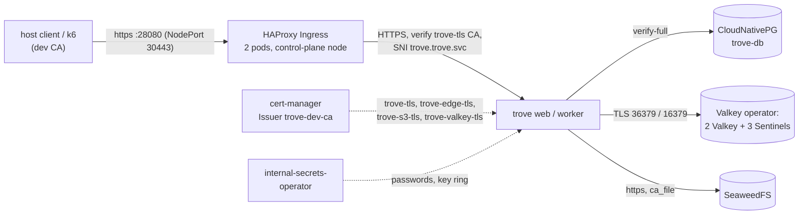

# Local development profile

The profile brings up an HA-shaped installation on a laptop with one command: a kind cluster with
one control-plane and three worker nodes in three zones, PostgreSQL with a standby, Valkey with a
replica and three Sentinels, an S3 store, an Ingress controller, the owner's stack of operators that
generate the Secrets and the certificates, and the trove chart with two `web` and two `worker` replicas.
**Every connection is TLS**: client to the edge, edge to trove, trove to PostgreSQL, Valkey, the Sentinels and
S3. It is the target of the failover and drain tests (E0.13, E0.14), of the certificate rotation drill (E0.15) and
the base of the end-to-end tests. The requirements are [R-HA-051](../spec/ha-and-helm.md),
[R-HA-063](../spec/ha-and-helm.md) and [R-ARCH-035](../spec/architecture.md); the chart it installs is described in
[helm-chart.md](helm-chart.md). Everything lives in [deploy/dev](../../deploy/dev).



## What runs

| Component | Where | What | Pinned by (`tools/versions.env`) |
|---|---|---|---|
| kind cluster `trove` | Docker | `trove-control-plane` and `trove-worker`, `trove-worker2`, `trove-worker3` in zones `trove-zone-a`, `-b`, `-c`; pod CIDR `10.244.0.0/16` | `KIND_VERSION`, `DEV_KIND_NODE_IMAGE` |
| HAProxy Ingress | namespace `ingress-controller` | Ingress controller, class `haproxy` (default), two replicas pinned to the control-plane node (never drained by the tests, and the source of every proxied request is that node's pod range, which `config.server.trusted_proxies` names); NodePort 30443 (HTTPS) mapped to `localhost:8080` (`TROVE_DEV_HTTP_PORT`); the owner's production chart pin | `DEV_HAPROXY_INGRESS_CHART_VERSION`, `DEV_HAPROXY_INGRESS_IMAGE` |
| cert-manager | namespace `cert-manager` | issues every certificate from one self-signed root (`Issuer` `trove-dev-ca`, [pki.yaml](../../deploy/dev/pki.yaml)). trust-manager is not installed: no consumer needs a distributed bundle, each reads the `ca.crt` of its own Secret | `DEV_CERT_MANAGER_CHART_VERSION`, `DEV_CERT_MANAGER_*_IMAGE` |
| internal-secrets-operator | namespace `internal-secrets-operator-system` | generates the Secrets of [secrets.yaml](../../deploy/dev/secrets.yaml) from annotations | `DEV_ISO_CHART_VERSION`, `DEV_ISO_IMAGE` |
| Valkey operator | namespace `valkey-operator-system` | owns the `Valkey` resource and its StatefulSets | `DEV_VALKEY_OPERATOR_CHART_VERSION`, `DEV_VALKEY_OPERATOR_IMAGE` |
| CloudNativePG operator | namespace `cnpg-system` | operator only | `CNPG_CHART_VERSION`, `DEV_CNPG_OPERATOR_IMAGE` |
| PostgreSQL 16 | namespace `trove` | CloudNativePG `Cluster` `trove-db`: 2 instances (primary and standby), synchronous replication with `dataDurability: preferred`, database and owner `trove`, TLS | `DEV_CNPG_POSTGRES_IMAGE` |
| Valkey 9.1 | namespace `trove` | `Valkey` resource `trove-valkey` ([valkey.yaml](../../deploy/dev/valkey.yaml)): StatefulSet `trove-valkey` (2 pods) and `trove-valkey-sentinel` (3 pods), TLS only, `emptyDir`, PodDisruptionBudgets, one pod of each tier per zone. The Alpine image has every tool the operator's scripts need (checked against `RequiredImageTools` of the operator, 1.14.12) | `DEV_VALKEY_IMAGE` |
| SeaweedFS | namespace `trove` | Deployment `trove-s3` (one `weed server` on `emptyDir`, pinned to the control-plane node like the edge, because no test drains it and an eviction would lose every blob; memory limit 4Gi: two 500 MB uploads at once were OOM-killed at 1Gi in E1.13), HTTPS on `trove-s3:9000` with `trove-s3-tls`, buckets `trove-blobs` (versioning on), `trove-pg-archive`, `trove-backups` | `DEV_SEAWEEDFS_IMAGE`, `DEV_AWSCLI_IMAGE` |
| Keycloak (test IdP) | namespace `trove` | Deployment `trove-keycloak` ([keycloak.yaml](../../deploy/dev/keycloak.yaml)), `start-dev` with a realm import, HTTPS only on `trove-keycloak:8443` with `trove-keycloak-tls`; realm `trove` with the users `alice` and `bob`, the groups `trove-team-web` and `trove-platform-admins`, the client `trove` (Q-AUTH-35, [test IdP](#the-test-idp)) | `DEV_KEYCLOAK_IMAGE` |
| trove | namespace `trove` | Helm release `trove` with [values-dev.yaml](../../deploy/dev/values-dev.yaml): 2 `web`, 2 `worker` (grace period 60 s, so a drain test does not wait 300 s), migration Job, the chart's NetworkPolicies, `tls.enabled` with `trove-tls` and `reloadInterval: 2s`, the endpoint `customers` on `:8443`; `up.sh` adds the Docker `kind` network ranges as `networkPolicy.probeCIDRs` | image `guidedtraffic/trove:dev` (the default of `up.sh`, loaded into kind from the local Docker; `make image` builds it) |

The namespace `trove` enforces the restricted Pod Security Standard (`enforce`, `audit` and `warn`),
and every dependency manifest satisfies it, the operators' generated pods included. Images are pinned by digest; the
manifests carry `${DEV_…_IMAGE}` placeholders that `lib.sh` (`render`) substitutes from `tools/versions.env`, and the
chart images are passed with `--set`, so the pins exist in one place only.

**Architecture note (arm64 hosts).** The Valkey operator and the internal-secrets-operator images are published for
`linux/amd64` only; the pins are the amd64 manifests. On an arm64 machine (Apple silicon) the Docker VM needs qemu
user-mode emulation for amd64 once: `docker run --privileged --rm "$DEV_BINFMT_IMAGE" --install amd64` (pinned in
`tools/versions.env`; the registration lasts until the Docker VM restarts). `up.sh` checks and prints the command.
CI runs on amd64 and needs nothing.

## Targets

All targets call a script in [deploy/dev](../../deploy/dev). They address the cluster through the
context `kind-trove` explicitly, so other kind clusters or whatever the kubeconfig currently
selects are never touched.

| Target | Script | What it does |
|---|---|---|
| `make dev-up` | `up.sh` | creates the cluster and installs everything; idempotent (a second run takes about 40 s) |
| `make dev-down` | `down.sh` | deletes the kind cluster `trove` and `.dev/` |
| `make dev-failover` | `failover.sh [instance]` | PostgreSQL switchover to the standby, waits until the old primary is a standby again |
| `make dev-valkey-failover` | `valkey-failover.sh` | `SENTINEL FAILOVER trove-valkey`, waits until another pod is primary |
| `make dev-valkey-kill` | `valkey-kill.sh` | force-deletes the Valkey primary pod, waits for a primary and a connected replica |
| `make dev-valkey-outage DURATION=60s` | `valkey-outage.sh 60s` | `valkey-stop.sh`, the duration, `valkey-start.sh` (below) |
| `make dev-valkey-stop`, `make dev-valkey-start` | `valkey-stop.sh`, `valkey-start.sh` | the two halves of the outage: stop the operator, scale Valkey and the Sentinels to 0 and wait for the pods to be gone; scale back, start the operator and wait for a primary. The e2e tests hold the outage for as long as a "Valkey stopped" criterion needs (E1.8, E1.11, E1.14) and start it again in their cleanup. `make dev-valkey-outage` is stop, sleep, start |
| `deploy/dev/valkey-cli.sh <command...>` | `valkey-cli.sh` | runs `valkey-cli` against the current primary (found through the Sentinels, over TLS, the password read inside the pod): `FLUSHALL` for E1.11, `CLIENT PAUSE` for the latency injection of R-ARCH-034 (E1.8) |
| `make dev-pg-kill` | `pg-kill.sh` | force-deletes the PostgreSQL primary pod, waits until the operator reports a healthy cluster |
| `make dev-pg-stop DURATION=30s` | `pg-stop.sh 30s` | fences every instance of `trove-db` (`cnpg.io/fencedInstances`, PostgreSQL stops, pods and volumes stay), waits, removes the fence, waits for a healthy cluster |
| `make dev-drain` | `drain.sh` | the E0.14 test: drains a node with a web and a worker pod under the k6 load and cursor-persisting jobs; `drain.sh <node>` is the drain alone, `drain.sh --pick` prints the node |
| `make e2e SET=push\|failover\|full\|drain\|<regexp>` | `e2e.sh` | the end-to-end suite, see [e2e.md](e2e.md) |
| `make chart-lint`, `make chart-test` | `test/chart/lint.sh`, `test/chart/test.sh` | see [helm-chart.md](helm-chart.md#value-sets-and-tests) |

The failover scripts show that the failover happens and how long it takes. What they cost the clients
is measured by [the end-to-end suite](e2e.md), which runs them under load.

### Environment

| Variable | Default | Effect |
|---|---|---|
| `TROVE_SKIP_RELEASE=1` | unset | `up.sh` installs the dependency stack only, not the trove release. Use it while the image does not serve yet, or to work on the dependencies |
| `TROVE_IMAGE` | `guidedtraffic/trove:dev` | the image `up.sh` loads into the cluster with `kind load docker-image`; build it with `make image` (its default `IMAGE`) first. `VERSION` defaults to `dev` (or the number of a `v0.*` tag on `HEAD`), the one non-release version the binary accepts ([e2e.md](e2e.md#findings-of-the-suite)) |
| `TROVE_DEV_HTTP_PORT` | `8080` | host port of the edge (HTTPS). Set it when 8080 is taken (`up.sh` checks and says so); `config.server.base_url` and `endpoints.customers.baseUrl` follow. Fixed when the cluster is created |
| `TROVE_PROFILE=scatter` | `default` | the `scatter` e2e profile, see below |
| `TROVE_POOLER=1` | unset | also installs the two transaction-mode poolers ([pooler.yaml](../../deploy/dev/pooler.yaml)) and layers [values-pooler.yaml](../../deploy/dev/values-pooler.yaml). The manifests are applied and the poolers start; the pooler profile itself is verified in M5 |
| `TROVE_HELM_EXTRA` | unset | extra arguments for the `helm upgrade` of the trove release |
| `TROVE_DEV_CLUSTER`, `TROVE_DEV_NAMESPACE` | `trove`, `trove` | cluster and namespace names. The certificates name the namespace (`trove.<namespace>.svc`, ...), and the Valkey names in values-dev.yaml are written for `trove`, so change both only with a fresh cluster and matching values |

### The `scatter` profile

`TROVE_PROFILE=scatter deploy/dev/up.sh` (also on a running cluster) switches to the profile of
R-ARCH-032 and E0.11: three `web` replicas ([values-scatter.yaml](../../deploy/dev/values-scatter.yaml)),
and two HAProxy Ingress backend keys on trove's Ingress, `balance-algorithm: roundrobin` and
`config-backend: "option http-server-close"`. The second one overrides the template's `option http-keep-alive`
for this backend only, so HAProxy keeps no idle connection to a pod and balances every request round robin on its
own. Run `up.sh` without the variable to switch back. [TestE99Scatter](../../test/e2e/e99_scatter_test.go) (E0.11)
switches to the profile, runs the M0 checks, shows sixty sequential requests reaching the three pods twenty times each
and runs the 100 requests/s load; `e2e.sh` returns the cluster to the default profile afterwards.

## How `up.sh` works

1. Checks the tools against the pins and Docker (and, on arm64, amd64 emulation); on a mismatch it prints the exact
   install command (see [Tools](#tools)).
2. `kind create cluster` with [kind.yaml](../../deploy/dev/kind.yaml) and the pinned node image, then waits for
   every node to be Ready. (Pods scheduled while a worker is still NotReady would all land on the
   nodes that are up, and the host spreading of the dependencies would be decided by luck.)
3. Creates the namespace with the restricted labels.
4. In parallel, with logs in `.dev/logs/<name>.log`: `haproxy` (HAProxy Ingress); `pki` (cert-manager, then
   [pki.yaml](../../deploy/dev/pki.yaml), then waits for every Certificate to be Ready); `secrets` (the
   internal-secrets-operator, then [secrets.yaml](../../deploy/dev/secrets.yaml), then waits until the fields are
   filled); `vko` (the Valkey operator); `postgres` (the CloudNativePG operator, `postgres.yaml`, two ready
   instances); `valkey` (waits for `pki`, `secrets` and `vko`, applies the `Valkey` resource and waits for the pods);
   `s3` (waits for `pki` and `secrets`, applies `s3.yaml`, runs the bucket Job). A task another one needs leaves a
   marker file in `.dev/logs/`, so Valkey and S3 do not wait for PostgreSQL, the longest task.
5. Writes the dev CA to `.dev/pki/ca.crt`, asks the Sentinels over TLS for the primary and prints it, prints the
   PostgreSQL primary.
6. Unless `TROVE_SKIP_RELEASE=1`: `kind load docker-image`, then
   `helm upgrade --install trove deploy/helm/trove -n trove -f deploy/dev/values-dev.yaml --wait`.
   The migration Job runs first as a hook.

Measured on an Apple-silicon laptop with Docker, cold (`make dev-down`, then `make dev-up`, the nodes pull every
image, the trove image built beforehand): __COLD__ (E0.3 budget: 15 min). A repeat run: about 40 s.

### Secrets

Generated or created in namespace `trove`; nothing in `up.sh` makes a random value:

| Secret | Keys | Made by | Used by |
|---|---|---|---|
| `trove-db-app`, `trove-db-ca` | `username`, `password`; `ca.crt` | CloudNativePG | chart: `secrets.database`, `secrets.databaseCA` |
| `trove-valkey-auth` | `password` (32 characters) | internal-secrets-operator | the Valkey resource (`spec.auth`), and the chart as `secrets.valkey` **and** `secrets.valkeySentinel`, user `default` |
| `trove-valkey-tls` | `tls.crt`, `tls.key`, `ca.crt` | the Valkey operator, through cert-manager (`unifiedCertificate: true`: one Secret for both tiers) | Valkey and Sentinels; chart: `secrets.valkeyCA` (`ca.crt`) |
| `trove-s3` | `access-key-id` (`trove-dev`), `secret-access-key` (40 characters) | internal-secrets-operator | SeaweedFS and the bucket Job; chart: `secrets.s3` |
| `trove-encryption-keys` | `dev.key`: 32 random bytes, **raw** (`iso.gtrfc.com/type: bytes`) | internal-secrets-operator | chart: `secrets.encryption`; the file name without `.key`, `dev`, is the key ID. The key ring accepts a 32-byte file as it is and base64 text of 32 bytes |
| `trove-break-glass` | `password` (32 characters, plaintext: at least 20 are required) | internal-secrets-operator, **rotated every 24 h** (`iso.gtrfc.com/rotate: 24h`) | chart: `secrets.breakGlass` (mounted into `web` pods, renders `auth.break_glass.password_file`); the e2e tests read it for E1.1 and R-AUTH-042 |
| `trove-dev-ca` | `tls.crt`, `tls.key`, `ca.crt` | cert-manager (self-signed root, ten years) | the Issuer `trove-dev-ca` |
| `trove-tls` | `tls.crt`, `tls.key`, `ca.crt` | cert-manager | trove's listeners (`tls.secretName`) and HAProxy Ingress, which verifies it (`ingress.backendTLS.caSecret`) |
| `trove-edge-tls` | `tls.crt`, `tls.key` | cert-manager | the edge's certificate for `localhost` |
| `trove-s3-tls` | `tls.crt`, `tls.key`, `ca.crt` | cert-manager | SeaweedFS; trove mounts its `ca.crt` through `secrets.s3CA`, which renders `storage.s3.ca_file` |
| `trove-customers-tls`, `trove-customers-wildcard-tls`, `trove-customers-edge-tls` | `tls.crt`, `tls.key`, `ca.crt` | cert-manager | the endpoint `customers` (below) |

**Rotation of `trove-break-glass`.** It is the one rotating Secret of the profile. The operator (1.6.14) takes `rotate` as a
Go duration plus a `d` suffix, overwrites the field when the interval has passed, and refuses intervals below its
`rotation.minInterval` (default `5m`; the profile installs it with the chart defaults) with a Warning Event on the Secret
([README of the operator](https://github.com/guided-traffic/internal-secrets-operator#automatic-rotation)). Each rotation
reaches the `web` pods through the kubelet (a directory mount, no `subPath`); trove notices the new file within
`auth.break_glass.check_interval` (10 s), then answers the local login with 503 `break_glass_rotating` for the 2-minute
`rotation_hold` and ends the break-glass sessions (Q-AUTH-14). That is acceptable in the dev profile, and it is why the interval is
24 h and not minutes: a rotation inside an e2e run (E1.1, E1.11) would turn their local logins into 503. To trigger a
rotation on demand, set a short interval and put it back:

```shell
kubectl --context kind-trove -n trove annotate secret trove-break-glass --overwrite iso.gtrfc.com/rotate=5m   # rotates when 5m passed since generated-at
kubectl --context kind-trove -n trove annotate secret trove-break-glass --overwrite iso.gtrfc.com/rotate=24h
```

OIDC sign-in is not affected by a break-glass rotation. Do not set `rotate` on any other Secret of the profile.

Never set `iso.gtrfc.com/rotate` on `trove-encryption-keys` (a rotation would destroy the encrypted data) or on
`trove-valkey-auth` (a changed password reaches no running Valkey pod, the operator's documentation). The generator
writes a field only when it is empty.

### Trusting the dev CA

The edge serves `https://localhost:8080` (or your `TROVE_DEV_HTTP_PORT`) with a certificate of the dev CA. `up.sh`
writes the CA to `.dev/pki/ca.crt` (ignored by Git):

```shell
curl --cacert .dev/pki/ca.crt https://localhost:8080/api/v1/system/ping
# to trust it system-wide (macOS), as an explicit choice of yours, not something the scripts do:
#   sudo security add-trusted-cert -d -r trustRoot -k /Library/Keychains/System.keychain .dev/pki/ca.crt
kubectl --context kind-trove -n trove get secret trove-dev-ca -o jsonpath='{.data.ca\.crt}' | base64 -d   # the same CA
```

A new cluster has a new CA; delete the old entry from your trust store when you remove the cluster.

### The second endpoint

values-dev.yaml carries `endpoints.customers` ([endpoints.md](endpoints.md)): the listener `:8443`, the host
`packages.trove.localhost` and the wildcard `*.packages.trove.localhost`, the surface `[packages, files, api]` (the raw
files and the management API are there for the exposure criteria of E1.14, Q-EP-54; `ui` is not allowed on a further
endpoint), service-account tokens bound to it and exposure by rules (the chart's defaults for a further endpoint), its own certificate
pair and a wildcard pair (`tls.existingSecret`, `tls.extraSecrets`, chosen by SNI), and its own Ingress on the same
HAProxy Ingress. HAProxy Ingress routes by `Host`, so a request with the default endpoint's host never reaches the
endpoint through its Ingress; the `421` is tested on the endpoint's Service. `*.localhost` resolves to the loopback
address on macOS and on systemd-resolved; otherwise add `127.0.0.1 packages.trove.localhost` to `/etc/hosts`.
The chart gives the default endpoint a host check too (its `hosts` are the host of `base_url`), so a request to the
default endpoint with another `Host` answers `421`.

## Valkey and Sentinel

[valkey.yaml](../../deploy/dev/valkey.yaml) is a `Valkey` resource of the Valkey operator (`vko.gtrfc.com/v1`); the
operator writes the StatefulSets, Services, ConfigMaps, the certificate request and the PodDisruptionBudgets
(Q-HA-15 option (d) is now "the operator"). Facts worth knowing, verified on the running profile:

- TLS only: `port 0`, `tls-port 16379` (Valkey) and `36379` (Sentinel), `tls-replication yes`, `tls-auth-clients
  optional`. A plaintext connection is refused. One certificate, `trove-valkey-tls`, for both tiers.
- Names the chart uses: Sentinels `trove-valkey-sentinel-{0,1,2}.trove-valkey-sentinel-headless.trove.svc.cluster.local:36379`,
  primary name `trove-valkey` (the resource name), Sentinel answers `trove-valkey-<n>.trove-valkey-headless.trove.svc.cluster.local:16379`.
  The certificate carries exactly these names (`.svc.cluster.local` only), so a cluster with another domain needs
  `certManager.extraDnsNames`.
- No persistence (`emptyDir`, `save ""`, `appendonly no`), `maxmemory-policy noeviction` and no `maxmemory`.
- Sentinels: quorum 2, `down-after-milliseconds 5000`, `failover-timeout 60000` (constants of the operator, the
  values trove's spec names). After a failover the Sentinels refuse another automatic one for twice the failover
  timeout (120 s); a `SENTINEL FAILOVER` does not wait for that.
- The operator's NetworkPolicy admits only its own components; `trove-valkey-clients` (in valkey.yaml) admits the pods
  labelled `app.kubernetes.io/name=trove` and `trove/serve=true` (the chart's `web` and `worker` pods, and the e2e driver)
  on 16379 and 36379. kind's CNI enforces both.
- Pods are spread by zone (`antiAffinity` `hard` on `topology.kubernetes.io/zone`, each StatefulSet repels its own
  kind) and have PodDisruptionBudgets (data `maxUnavailable: 1`, Sentinel `minAvailable` = quorum).
- `kubectl rollout status` does not work on these StatefulSets (update strategy `OnDelete`): the scripts wait for
  `readyReplicas` (`sts_wait_ready` in `lib.sh`).
- `valkey-kill.sh` reports two outcomes, both correct: the primary *moved* (the pod stayed away longer than 5 s) or
  *restarted in place* (the StatefulSet recreated it within 5 s, before any Sentinel declared it down; its data is
  gone and the replica resynchronised to nothing, which costs cache warmth only, R-HA-056).
- `valkey-outage.sh` cannot just scale the StatefulSets to 0: the operator restores them within seconds. The script
  stops the operator first (its Deployment to 0), scales the two StatefulSets to 0, waits, scales them back and starts
  the operator again; nothing fights the operator, it is part of the outage. The operator has no pause switch.

### Deviations from the spec in this profile (interim)

The Valkey operator has **no ACL users, no separate Sentinel password and no `maxmemory`** (it renders every client as
`user default on … ~* &* +@all`, one `requirepass` for Valkey and Sentinel, and only `maxmemory-policy`). The profile
therefore deviates from R-HA-056 and R-ARCH-031, in the dev profile only:

| Spec | Dev profile | Where the criterion is still proven |
|---|---|---|
| a Valkey ACL user limited to `~trove:*`, `&trove:*` and the listed commands, no scripting (R-ARCH-031) | trove connects as `default` with the cluster password (`secrets.valkey.usernameKey: ""`) | the integration stack keeps the ACL user (`test/integration/valkey`) |
| a Sentinel credential separate from the data credential (R-HA-056) | `secrets.valkeySentinel` points at the same Secret, `trove-valkey-auth` | integration stack |
| `maxmemory` set on Valkey (R-HA-056) | not set; the container limit (320 MiB) bounds it and the pod would be OOM-killed and restart empty, which costs cache warmth only (INV-3) | integration stack |

This is an owner decision pending (operator feature or another route); until then E0.12 on this profile proves the
connection names, TLS only, the start-up cases and the failovers, not the ACL.

### The anonymous rate limit

The management API limits requests without a credential per client address (R-API-016, `api.rate_limits.anonymous`, default
5 requests per second, burst 20). The e2e suite's load scripts (k6) and probes poll `/api/v1/system/ping` and
`/api/v1/system/replicas` anonymously, all from the one address of the host behind the edge, with hundreds of requests per
second. `values-dev.yaml` therefore sets `config.api.rate_limits.anonymous` to 1000 requests per second and a burst of 10000:
the limiter stays on, with a budget the load never reaches. The production default is unchanged; the limits themselves are
tested in `test/integration/api`. The integration environments that start the binary and poll anonymously
(`test/integration/server`, `test/integration/tls`) set the same budget through `TROVE_API_RATE_LIMITS_ANONYMOUS_*`.

## Reaching things

```shell
kubectl --context kind-trove -n trove get pods -o wide                                    # everything
curl -s --cacert .dev/pki/ca.crt https://localhost:8080/api/v1/system/ping                # through the edge (once trove serves)
kubectl --context kind-trove -n trove get cluster trove-db                                # PostgreSQL, primary and standby
kubectl --context kind-trove -n trove get valkey,certificate                              # Valkey and every certificate
```

Sentinel and Valkey from inside their pods (the password is in the pod's environment, never typed):

```shell
kubectl --context kind-trove -n trove exec trove-valkey-sentinel-0 -c sentinel -- sh -c \
  'valkey-cli --tls --cacert /tls/ca.crt -p 36379 --no-auth-warning -a "$VALKEY_PASSWORD" \
   sentinel get-master-addr-by-name trove-valkey'
kubectl --context kind-trove -n trove exec trove-valkey-0 -c valkey -- sh -c \
  'valkey-cli --tls --cacert /tls/ca.crt -p 16379 --no-auth-warning -a "$VALKEY_PASSWORD" client list'
```

PostgreSQL and S3 from the host: `kubectl --context kind-trove -n trove port-forward svc/trove-db-rw 5432`
and `svc/trove-s3 9000` (https; trust `.dev/pki/ca.crt` and use the name `trove-s3.trove.svc`, for example with
`curl --resolve trove-s3.trove.svc:9000:127.0.0.1`); the credentials are in `trove-db-app` and `trove-s3`.

To renew trove's certificate by hand, the way cert-manager's `cmctl renew` does (the e2e drill uses the same trigger):

```shell
kubectl --context kind-trove -n trove patch certificate trove-tls --subresource=status --type=json -p \
  '[{"op":"add","path":"/status/conditions/-","value":{"type":"Issuing","status":"True","reason":"ManuallyTriggered","message":"Certificate re-issuance manually triggered","lastTransitionTime":"'"$(date -u +%FT%TZ)"'"}}]'
```

### The test IdP

Keycloak in [keycloak.yaml](../../deploy/dev/keycloak.yaml) is the OpenID Provider of E1.1 and of the login criteria of
R-AUTH-013 (RP-initiated logout ends the IdP session) and R-AUTH-008 (a groups claim). Dex through dex-operator renders
neither the logout configuration nor users with groups, which is why the profile runs Keycloak (Q-AUTH-35).

| What | Value |
|---|---|
| Issuer | `https://trove-keycloak.trove.svc:8443/realms/trove` |
| Users (passwords in Secret `trove-keycloak`, fields `alice-password`, `bob-password`) | `alice`: groups `trove-team-web`, `trove-platform-admins`; `bob`: `trove-team-web` |
| Client | `trove`, confidential (`client-secret` of the same Secret), PKCE S256, redirect URI `https://localhost:8080/auth/oidc/keycloak/callback`, post-logout URI `https://localhost:8080/ui/logged-out` |
| Claims | `preferred_username`, `email` (verified), `name`, `groups` (plain group names) on the ID token and userinfo, `sid` |
| Administrator console | user `admin`, field `admin-password` |

The issuer is the Service name, so trove's pods reach it directly and the issuer in the discovery document is the one
trove is configured with. A browser on the host needs the name and a port-forward; the hosts entry needs administrator
rights and is yours to add. (The e2e tests need neither: their HTTP client dials the name through a port-forward of its
own and verifies the certificate against the dev CA for that name, [e2e.md](e2e.md#m1-tests).)

```shell
kubectl --context kind-trove -n trove port-forward svc/trove-keycloak 8443:8443
# once, as an explicit choice of yours:
#   echo '127.0.0.1 trove-keycloak.trove.svc' | sudo tee -a /etc/hosts
kubectl --context kind-trove -n trove get secret trove-keycloak -o jsonpath='{.data.alice-password}' | base64 -d
```

The provider entry is part of values-dev.yaml. The client secret (Secret `trove-keycloak`) and the break-glass password
(Secret `trove-break-glass`) are the chart values `secrets.oidc` and `secrets.breakGlass`, which mount them into the `web` pods
and render `client_secret_file` and `password_file`. Only the CA of `trove-keycloak-tls` is still a volume of the dev values
(`extraVolumes` / `extraVolumeMounts` at `/var/run/secrets/trove-dev/keycloak-ca.crt`): the chart has no `trustedCA` value yet
(R-HA-043 is not built). That CA is in `proxy.outbound.tls.ca_files`, so the outbound client trusts the IdP's
certificate. The group rule maps the claim values `trove-team-web` and `trove-platform-admins` to the groups `team-web`
and `platform-admins`, which `create_groups` creates on the first login:

```yaml
auth:
  oidc:
    providers:
      keycloak:                                     # example: the ID in the redirect URI above
        display_name: Keycloak (dev)                # example
        issuer: https://trove-keycloak.trove.svc:8443/realms/trove   # example
        client_id: trove                            # example
        # client_secret_file is set by the chart from secrets.oidc (/var/run/secrets/trove/oidc-keycloak/client-secret)
        scopes: [openid, profile, email]            # default
        group_sync:
          rules:
            - match_regex: "trove-(.+)"             # example
              group: "$1"                           # example
        create_groups: true                         # example: the groups of the rules are created on login
```

and in the chart values:

```yaml
secrets:
  oidc:
    - {providerId: keycloak, existingSecret: trove-keycloak, key: client-secret}   # example
  breakGlass: {existingSecret: trove-break-glass, key: password}                    # example; password_file is rendered by the chart
```

`up.sh` sets `KC_TROVE_BASE_URL` on the Deployment from the edge port of the cluster (`https://localhost:<port>`), and the
realm file takes its redirect and post-logout URIs from it at import, so another `TROVE_DEV_HTTP_PORT` needs nothing
else (a changed port restarts Keycloak once, which imports the realm again).

## Tools

| Tool | Pin | Check |
|---|---|---|
| kind | `KIND_VERSION` | `kind version` |
| kubectl | `KUBECTL_VERSION` | `kubectl version --client` |
| Helm | `HELM_VERSION` | `helm version` |
| openssl | `OPENSSL_IMAGE` (a container image, no host install; used by the e2e probes) | `docker run --rm "$OPENSSL_IMAGE" version` |
| Docker | none | the daemon must answer; on arm64 it must run amd64 binaries (above) |

`up.sh` fails when kind, kubectl or Helm differs from its pin and prints the install command. The charts come from
their own repositories (`helm upgrade --install … --repo <url> --version <pin>`), nothing is added with `helm repo add`.
No script makes certificates by hand any more; cert-manager does. The scripts run under macOS `/bin/bash` 3.2 as well
as bash 5.

## Troubleshooting

| Symptom | Cause and fix |
|---|---|
| `port 8080 on localhost is in use` | another process holds the port. `TROVE_DEV_HTTP_PORT=18080 make dev-up`; `base_url` follows. The port is fixed per cluster: `make dev-down` first to change it |
| `kind create cluster failed` | see `.dev/logs/kind.log`; usually Docker is out of memory or a stale `trove-*` container exists (`docker ps -a --filter name=trove-`) |
| a dependency FAILED | the last lines of its log are printed; the full log is `.dev/logs/<haproxy\|pki\|secrets\|vko\|postgres\|valkey\|s3>.log`. Re-run `make dev-up`, it is idempotent |
| `the image … is not in the local Docker` | build it (`make image`), or `TROVE_SKIP_RELEASE=1` for the dependencies only |
| trove pods never ready after install | `kubectl logs` of a pod and `kubectl get pod -o yaml`; a replica waits for the schema until the migration Job has run, and refuses a version that is not `major.minor.patch` or `dev`: build with `make image VERSION=dev` |
| an operator pod `ImagePullBackOff` with `no match for platform` | the image is amd64 only and the node arm64: pin the amd64 manifest digest (already done) and register the emulator (above) |
| an operator pod `exec format error` | the Docker VM has no amd64 emulation: `docker run --privileged --rm "$DEV_BINFMT_IMAGE" --install amd64` |
| `curl: (60) SSL certificate problem` | the client does not trust the dev CA: `--cacert .dev/pki/ca.crt` |
| `trove-db-2` Pending after a drain | its volume is local to the drained node; it starts again after `kubectl uncordon`. `drain.sh` uncordons for you |
| drain hangs on a CloudNativePG pod | the primary's own PodDisruptionBudget (`trove-db-primary`, `minAvailable: 1`) refuses its eviction. Run `make dev-failover` first, or let `drain.sh` choose the node |
| Valkey kill: no failover although the pod is gone | a failover less than 120 s ago blocks the next automatic one (see above); the script waits up to 4 minutes |
| helm release stuck `pending-install` | `helm --kube-context kind-trove -n trove uninstall trove`; the hook Job, ConfigMap and ServiceAccount `trove-migrate` outlive an uninstall by design, delete them with `kubectl delete job,cm,sa trove-migrate` |
| a clean start | `make dev-down && make dev-up` |

## What is verified, and what is not

Verified by [the end-to-end suite](e2e.md) on this profile, with the release image, over TLS on every connection: the
cold `make dev-up` (2 min 33 s, budget 15 min), every trove pod answering `200` on `:8081/readyz`, the replica list and
ping through the Ingress, the restricted Pod Security Standard and the chart's NetworkPolicy (enforced by kindnet: a
pod of another namespace reaches `:8080` and not `:8081`), the failing migration Job, the lease failover, the Valkey
connection names and the start-up cases, the Valkey failover, kill and outage under load, the `scatter` profile on
HAProxy Ingress, the PostgreSQL failovers under load, the node drain, plaintext refused on trove and the object store,
the renewal of trove's certificate by cert-manager under load, and the second endpoint. [e2e.md](e2e.md) has the
numbers.

Not verified here, or not configured:

- The ACL user, the separate Sentinel credential and `maxmemory` of Valkey (deviations above); R-ARCH-031's ACL
  criterion is proven by the integration stack only.
- The chart renders `auth.break_glass.enabled: false` without `secrets.breakGlass`; the dev values set it. The Keycloak CA is
  still the `extraVolumes` workaround (no `trustedCA` value). A real rotation of `trove-break-glass` by the operator (the 24 h
  interval, the hold and the ended sessions in a running cluster) is verified by the chart render and the code, not by a drill.
- Valkey and the S3 gateway read their certificates at start: a cert-manager renewal reaches the Valkey pods through
  the operator's own rolling restart (ADR 0030 of the operator, not exercised here) and SeaweedFS at its next restart.
  trove re-reads the Valkey CA per handshake and the S3 CA per request.
- The operators' amd64 images run under qemu on an arm64 host; their timing there says nothing about production.
- WAL archiving to `trove-pg-archive` (point-in-time recovery is M5), the backup CronJob (the chart skeleton has
  none), the Playwright journeys of R-UI-047 (E1.11): the harness has no browser; the e2e tests drive the login with an HTTP
  client ([e2e.md](e2e.md#m1-tests)), and `TestE1_11Journeys` runs the suite as soon as `web/e2e` exists.
