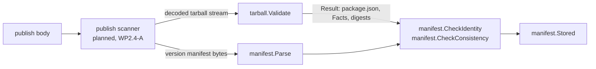

# npm format

The npm registry format ([spec/formats/npm.md](../spec/formats/npm.md)). This page grows with the format: each work package adds
its section under "Package layout" and its own heading. Today it describes the four leaf libraries every other part of the
format builds on: package names and versions, manifests and tarballs. The format package itself (`internal/formats/npm`, routes, publish, documents,
remote and virtual repositories, exposure) is *planned* and not built yet.

## Package layout

```text
internal/formats/npm/
├── name/      package names: lookup rules, new-name rules, the canonical form, the look-alike fold     (built)
├── semver/    SemVer 2.0.0 versions, node-semver ranges and their pre-release rule, dist-tag names     (built)
├── manifest/  publish manifest normalization and the consistency compare                               (built)
├── tarball/   streaming validation of a package tarball                                                (built)
└── ...        the format, its store port, publish, documents, remote, merge, exposure                  (planned)
```

The sub-packages are leaves: the standard library and [internal/errs](../../internal/errs/) only (and, for `tarball`, its
sibling `manifest`), no format contract. The format import rule of R-ARCH-008 ([archtest](../../internal/archtest/imports.go)) allows exactly that inside a
format's own tree, so a leaf that grows an import of another layer fails `go test ./internal/archtest/...`.

## Names and versions

### `name`

R-NPM-002. Code: [internal/formats/npm/name](../../internal/formats/npm/name/).

| File | Responsibility |
|---|---|
| [name.go](../../internal/formats/npm/name/name.go) | `Name`, `Parse` (an already decoded name, lookup rules), `ParseEscaped` (decode once, then `Parse`), `Normalize`, `Name.EscapedPath`, `Fold`, `LookAlike`; the error shape |
| [new.go](../../internal/formats/npm/name/new.go) | `ValidateNew` and `ParseNew` (the rules for a newly published name), `IsCoreModule` |

Two rule sets, one canonical form. `@scope/name` or `name`, case kept, is the package identity in the request descriptor, in
include and exclude patterns ([R-NPM-003](../spec/formats/npm.md)) and in permission and claim coordinates.

| Question | Function |
|---|---|
| A name from a request path (`@acme%2fui`, `%40acme%2Fui`, `@acme/ui`) | `ParseEscaped`: decodes exactly once and refuses a `%` that is left, so `a%2525b` never reaches an upstream. The router must hand it the *escaped* path segment(s), never a path in which `%2f` has become `/` |
| A name that is only looked up (remote and virtual repositories serve upstream names unchanged) | `Parse`: legacy capitals allowed; refuses empty, `.` and `..` segments, control characters, a backslash, `%`, invalid UTF-8, more than one `/`, more than 512 bytes (Q-NPM-14) and `-` |
| A name being published | `ParseNew`: also lower case, `[a-z0-9._-]` only, 1 to 214 characters, scope and name start with a letter or digit (Q-NPM-14), unscoped names are no core module, `node_modules` or `favicon.ico` |
| The look-alike check of a local repository | `Fold` (value stored in `npm_packages.name_fold`) and `LookAlike`. The unique index on `name_fold` is what enforces it under concurrency; `LookAlike` is for messages and tests |
| A request path to build | `Name.EscapedPath`: `@scope%2fname`, the form npm clients use |

Every refusal is an `*errs.Error` of kind `Invalid` and code `npm_invalid_name` (`name.CodeInvalid`). The detail quotes the name as
printable ASCII, cut at 64 characters, so it is safe to log and to return.

The Node.js core-module list (`IsCoreModule`) is a `switch`, not a package variable (R-ARCH-032 forbids package-level maps and
slices outside the registries). It is validate-npm-package-name 8.0.0's list. When a new Node.js release adds a core module,
add the name to the switch and to the table in `TestCoreModules`.

### `semver`

R-NPM-007 (version check, tag rule), R-NPM-016 (dist-tags, `latest`), R-NPM-031 (highest SemVer), R-NPM-048 (exposure ranges).
Code: [internal/formats/npm/semver](../../internal/formats/npm/semver/).

| File | Responsibility |
|---|---|
| [version.go](../../internal/formats/npm/semver/version.go) | `Version`, `Parse`, `ParseNode`, `Clean`, `Compare`, `CompareBuild`, `Sort`, `Rsort`, error codes |
| [range.go](../../internal/formats/npm/semver/range.go) | `Options`, `ParseRange`, `Range.Satisfies`, `Validate`, `ParseForExposure`, `MaxSatisfying`, `MaxSatisfyingStrings`; the port of node-semver's `Range.parseRange` |
| [tokens.go](../../internal/formats/npm/semver/tokens.go) | node-semver's token grammar as Go regular expressions (compiled on first use), the ECMAScript whitespace set |
| [tag.go](../../internal/formats/npm/semver/tag.go) | `ValidateTag`: the dist-tag name rule |
| [corpus_test.go](../../internal/formats/npm/semver/corpus_test.go) | the node-semver corpus: about 600 rows of range, options, formatted range and satisfying versions |

Which entry point to use (Q-NPM-15):

| Situation | Function |
|---|---|
| A version a client publishes | `Clean` (npm's `clean()`: trim, strip leading `=` and `v`), then `Parse` on the result, and compare `Canonical()` with it (R-NPM-007 step 3) |
| A version trove stores, compares or renders | `Parse`: SemVer 2.0.0 as written, no `v`, no whitespace. `Version.String()` keeps the build metadata, `Canonical()` is node-semver's `version` without it |
| A version from an upstream document or a tarball file name | `ParseNode(s, false)`: what `new SemVer(s)` accepts (trim, leading `v`) |
| A client's loose text (none today) | `ParseNode(s, true)` |
| A dist-tag name | `ValidateTag`: 1 to 128 characters, starts with a letter or digit, and not a strict-valid range (`1.x`, `v1.4`, `x`, `1.2.3`) |
| The version bound of an exposure rule | `ParseForExposure` (R-NPM-048, Q-NPM-16); the adapter's `ValidateRange` is `Validate` or `ParseForExposure` and discards the range |
| The highest of a document's versions | `MaxSatisfying` / `MaxSatisfyingStrings`, or `Sort` + the last element; ties of equal precedence keep the first, as node-semver does |

Ranges are a port of node-semver 7.8.5, not a reimplementation of its documentation: the same token grammar, the same
rewriting steps in the same order (build strip, hyphen, comparator trim, tilde and caret trim, caret, tilde, x-range, star, `>=0.0.0`),
so the accepted language is the library's and not a neighbour of it. `Options.IncludePrerelease` changes the desugaring (lower bounds
become `-0`) and the satisfaction test; `Options.Loose` is node-semver's loose mode, which drops comparators it cannot parse
instead of refusing the range. The pre-release rule is node-semver's: a version with a pre-release satisfies a comparator set only
when a comparator of that set has a pre-release on the same `[major, minor, patch]`, unless `IncludePrerelease`.

Deliberate differences from node-semver (everything else is identical):

| Difference | Where it is decided |
|---|---|
| Numeric pre-release and build identifiers compare exactly at any length; node-semver converts to a float, so identifiers above 2^53 compare equal there | Q-NPM-15 |
| A range longer than `MaxRangeLength` (4096 bytes) is refused | Q-NPM-16 |
| `ParseForExposure` accepts a range only if it parses with and without `IncludePrerelease` | Q-NPM-16 |

An `*errs.Error` of kind `Invalid` carries the code: `npm_invalid_version`, `npm_invalid_range`, `npm_invalid_tag`. The codes are
declared in the package and are not yet in the registry of [errs/codes.go](../../internal/errs/codes.go); the format package that
renders the npm error body (R-NPM-005) is where they are registered.

### Tests and how to extend them

| Test | What it pins |
|---|---|
| `TestParseEscaped`, `TestNormalizeAndEscape`, `TestValidateNew`, `TestCoreModules`, `TestFold` ([name_test.go](../../internal/formats/npm/name/name_test.go)) | the tables of R-NPM-002: accepted and refused names, every escaping form, the new-name rules including the length edge at 214, the fold |
| `TestParse`, `TestParseNode`, `TestClean`, `TestCompare`, `TestSort`, `TestValidateTag` ([semver_test.go](../../internal/formats/npm/semver/semver_test.go)) | the version grammar and precedence tables, the chain of SemVer 2.0.0 item 11, the tag rule |
| `TestCorpus` ([range_test.go](../../internal/formats/npm/semver/range_test.go), data in [corpus_test.go](../../internal/formats/npm/semver/corpus_test.go)) | node-semver behavior: valid or not, formatted range, satisfying versions, for strict, `includePrerelease` and loose |
| `TestPrereleaseRule`, `TestStrictAndLoose`, `TestWhitespace`, `TestRangeLength`, `TestExposureRange`, `TestMaxSatisfying` | the pre-release rule, strict against loose, ECMAScript whitespace, the size bound, R-NPM-048 |
| `FuzzName`, `FuzzRange` | no panic; the canonical name is a fixed point of normalization and `Parse`, and its escaped path parses back; `parse(format(v)) == v`; the formatted range re-parses to one that accepts the same versions |

The corpus is plain data in a Go file, with no JavaScript in the repository. To add a row, run node-semver on the range locally
(the expected values of the current rows come from 7.8.5: `new Range(text, opts)`, its `range` property, and `test` on
`corpusVersions`) and paste the result. Run the fuzz targets longer than the unit run when you touch the grammar:

```bash
go test ./internal/formats/npm/semver/ -run '^$' -fuzz FuzzRange -fuzztime 2m
go test ./internal/formats/npm/name/   -run '^$' -fuzz FuzzName  -fuzztime 2m
```

If you change `tokens.go` or the rewriting in `range.go`, compare against node-semver on a few ten thousand generated ranges before
you trust the corpus alone; the corpus pins known cases, a differential run finds the ones nobody thought of.

## Manifests and tarballs

A publish carries two descriptions of one package: the version manifest in the request body and the
`package.json` inside the tarball. R-NPM-007 requires that the tarball is what an installer would
extract, and that the two descriptions agree on everything that changes what is installed or run. The two
packages implement exactly that; neither opens a connection or touches a store.

### Request path through the libraries



Callers outside these packages: none yet. The publish path (WP2.4-A) streams the attachment into the spool
and into `tarball.Validate` in the same pass, parses the version manifest with `manifest.Parse`, and
compares with `CheckIdentity` and `CheckConsistency` (`Mismatches` in `warn` mode).

### `manifest`

| File | Responsibility |
|---|---|
| [manifest.go](../../internal/formats/npm/manifest/manifest.go) | `Manifest` (generic JSON tree, numbers kept as `json.Number`), `Limits`, `Read`, `Parse`, `Decode`, the depth scan, the three error constructors and their codes |
| [version.go](../../internal/formats/npm/manifest/version.go) | `CleanVersion`: semver's loose `clean()` |
| [steps.go](../../internal/formats/npm/manifest/steps.go) | One function per normalization step, `Facts` |
| [gitspec.go](../../internal/formats/npm/manifest/gitspec.go) | `CanonicalGitSpec`: hosted-git ranges in npm's canonical form |
| [compare.go](../../internal/formats/npm/manifest/compare.go) | `Normalize` (the union, in dependency order), `Mismatches`, `CheckConsistency`, `CheckIdentity` |
| [stored.go](../../internal/formats/npm/manifest/stored.go) | `Stored`: the request manifest with server-controlled fields replaced, `HasInstallScript` |

Steps (R-NPM-007 step 3), each tested alone and each idempotent:

| Function | Does |
|---|---|
| `NormalizeName`, `NormalizeVersion` | trim the name; clean the version |
| `NormalizeDependencies` | string and array forms to objects; drop non-string ranges; canonical hosted-git ranges |
| `NormalizeBundleDependencies` | rename, expand `true`, reduce an object, add missing names with `*`, sort |
| `NormalizeBin` | string/array to object; base-name keys; clean targets; `directories.bin` from `Facts` |
| `NormalizeScripts`, `AddGypInstall` | strip `node_modules/.bin/`; add `node-gyp rebuild` by npm's and Yarn 1's rules |
| `NormalizeEngines` | array form to object (Yarn 1) |

Bounded reading: `Read` takes at most `max+1` bytes, so a 2 GiB source costs about 1 MiB; `Parse` refuses
an oversize or too deeply nested document (default 1 MiB, depth 64) before the decoder allocates a node.
Errors are `*errs.Error` with the native npm codes `npm_bad_publish` (400), `npm_manifest_mismatch` (400) and
`npm_too_large` (413). The codes are strings of these packages; registering them in `internal/errs` (the
problem catalog) belongs to the protocol layer.

### `tarball`

| File | Responsibility |
|---|---|
| [tarball.go](../../internal/formats/npm/tarball/tarball.go) | `Validate`, `Limits`, `Result`; the reader stack; the walker with the path, link and duplicate rules |

`Validate(ctx, r, limits)` reads a gzip-compressed tar once. The reader stack, outermost first: a source
reader (context, compressed-bytes cap, count) feeds a tee into SHA-1 and SHA-512, then a buffered reader and a
byte counter (compressed position for the ratio check, and a 64 KiB guard while the gzip header is parsed),
then `compress/gzip` with multistream off, then a reader that caps the inflated bytes, then `archive/tar`. The
walker looks at each header and reads content only for `package.json` (1 MiB) and the first top-level README
(64 KiB). Everything else is skipped by the tar reader, which still inflates it, so the inflation cap is what
bounds the cost of a bomb. After the last entry the rest of the inflated stream must be zero padding, the gzip
trailer is verified, and nothing may follow the gzip member.

What a walk records: `Facts.Files` (install paths of regular files, for `binding.gyp`, `*.gyp` and
`directories.bin`), file count and unpacked size (`dist.fileCount`, `dist.unpackedSize`), `HasShrinkwrap`, the
README, the parsed `package.json`, the digests of the compressed bytes. Memory is proportional to the entry
names (capped at 32 MiB of bookkeeping) plus 1 MiB for the manifest, not to the tarball.

The limits and the reasons for each are in [Q-NPM-17](../spec/formats/npm.md#q-npm-17--limits-of-the-streaming-tarball-pass-and-of-manifest-reading);
the archive rules in [Q-NPM-18](../spec/formats/npm.md#q-npm-18--tarball-archives-that-two-readers-could-resolve-differently).

### Tests

| Tier | Where | What it proves |
|---|---|---|
| Table tests | `*_test.go`, names start with the requirement ID | every step; every path rule; every limit with a crafted input (a 2 GiB declared `package.json`, JSON nested 100,000 deep, a gzip bomb, a ratio bomb) |
| Differential corpus | [testdata/prepare/](../../internal/formats/npm/manifest/testdata/prepare/) | the manifest npm's own `prepare()` produces and the raw `package.json` compare equal under `Normalize` |
| Fuzz | `FuzzManifest`, `FuzzTarball` | no panic; limits hold; `Normalize` idempotent; every accepted tarball satisfies the path invariants and the digests match |

Crafted archives are built in the test by code ([build_test.go](../../internal/formats/npm/tarball/build_test.go));
no large blob is committed. Fuzz regressions live in `testdata/fuzz/` and replay on every `go test`.

Run the fuzz targets for two minutes each:

```sh
go test -run '^$' -fuzz '^FuzzManifest$' -fuzztime 2m ./internal/formats/npm/manifest/
go test -run '^$' -fuzz '^FuzzTarball$'  -fuzztime 2m ./internal/formats/npm/tarball/
```

### Extension checklists

Add a normalization step:

1. Add a failing case to [corpus.json](../../internal/formats/npm/manifest/testdata/prepare/corpus.json) that shows the
   rejection (a manifest and the files of the tarball).
2. Regenerate the expectation from the npm that ships the step (the script and its arguments are at the top of
   [generate.js](../../internal/formats/npm/manifest/testdata/prepare/generate.js)); commit `prepared.json`.
3. Write the step as a function in `steps.go` that mutates one manifest, is idempotent and leaves what it does
   not understand alone; call it in `Normalize` in dependency order.
4. Add a table test for the step in `steps_test.go` (the helper `runStep` also runs it twice).
5. If it touches a field that is not compared yet, add the field to `comparedFields` in `compare.go`.
6. Update the step list in R-NPM-007 and, when it is a deviation, a decision block.

Add a tarball rule:

1. Put the check where the information is available: header-only rules in `walker.entry`, tree rules in
   `walker.place`, whole-stream rules in `Validate`.
2. Add a crafted archive to `TestPathRules`, `TestLinks` or `TestStreamErrors`, and a seed to `FuzzTarball`.
3. Document the rule in R-NPM-007 step 3 and in [Q-NPM-18](../spec/formats/npm.md#q-npm-18--tarball-archives-that-two-readers-could-resolve-differently).

### Security notes

- Every byte `tarball.Validate` and `manifest.Parse` see is publisher-controlled. Entry names are never used
  as file-system paths, nothing is unpacked, and a name in an error message is cut to 80 bytes.
- The rules that exist so that the validated manifest is the installed one (duplicates, unclean names,
  case variants of `package.json`, links, global PAX headers) are listed in R-NPM-007; each has a test that
  would fail if the rule were removed.
- The comparison of `scripts.preinstall`, `install` and `postinstall` is what stops a manifest that shows no
  install script from publishing a tarball that has one.

### What is not verified

- Yarn 1's normalization steps (`binding.gyp` rule, `engines` arrays) follow the specification text; no Yarn runs
  in the development environment.
- `directories.bin` cannot see an empty folder of the source tree, which npm lists as a bin entry.
- Hosted-git ranges for the gist host and ranges that need percent-decoding are left unchanged.
- Unicode normalization collisions between entry names are not checked.
- The ratio check is approximate by design (a 128 KiB allowance for the inflater's read-ahead).
