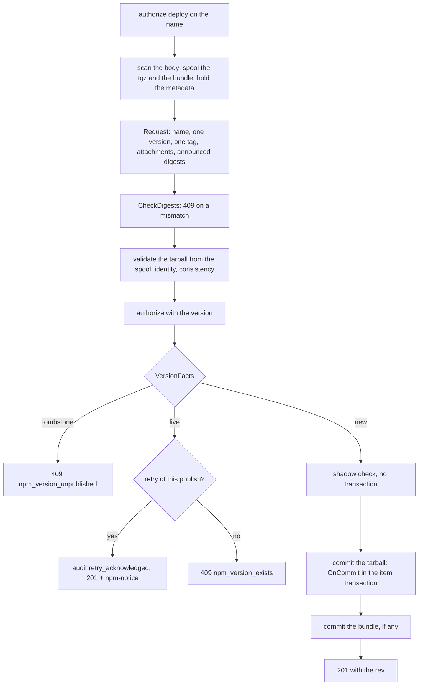
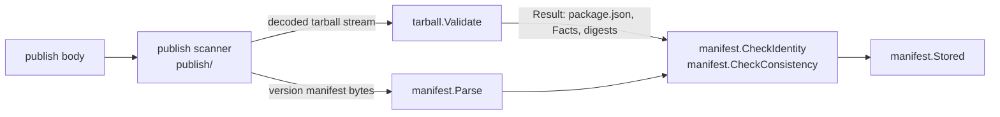

# npm format

The npm registry format ([spec/formats/npm.md](../spec/formats/npm.md)). This page grows with the format: each work package adds
its section. Built today: the format itself (routes, classification, error shape, setup snippets), the publish of a version to a local
repository, the data port and its PostgreSQL implementation, and the four leaf libraries every part builds on. Planned and not built:
package documents, tarball downloads, dist-tags, unpublish, whoami and ping (their routes answer 501 until then), and the remote and
virtual classes, merge and exposure.

## Package layout

```text
internal/formats/npm/
├── format.go        the Format: Descriptor (catalog facts, data port, limits), Names, Match, Classify, PackageDocumentPath
├── routes.go        the whole endpoint map of R-NPM-001 with the name of every handler; op() wraps each handler
├── match.go         the grammar of the escaped paths (names in one or two segments, the markers - and -rev, the deferred families)
├── paths.go         file names and item paths of a version (TarballPath, SigstorePath, VersionOfFile)
├── errors.go        WriteError: the native error body, the 401 challenge, the access-log fields npm-command and npm-session
├── publish.go       the publish handler (F1), Inspect, the acknowledged retry, the shadow check
├── hooks.go         OnCommit of a tarball and of a provenance bundle; claim(), the ownership helper of every write
├── tags.go          the dist-tag rules of R-NPM-016 on the SemVer order
├── store.go         the data port (Store), with marked blocks for the work packages that add to it
├── bind.go          Format.Bind: the settings and the metrics of one replica, kept per Host
├── rev.go           Rev: the _rev of a document and the rev of a write (R-NPM-009)
├── setup.go         the client setup snippets (R-NPM-041)
├── handlers_*.go    the handlers another work package builds; each answers 501 in the native shape until then
├── name/  semver/  manifest/  tarball/   the leaf libraries (below)
├── publish/         the streaming reader of the request body and the checks of R-NPM-007 step 3 that need no state
├── rows/            the values of the data port: a leaf the format and the data package share
└── npmtest/         the in-memory twin of the data port, for the conformance kit and tests without PostgreSQL
internal/formatdata/npm/   the data port's implementation (SQL in internal/meta/postgres/queries/npm_local.sql)
internal/audit/events_npm.go   every audit event type of R-NPM-044
```

The sub-packages `name`, `semver`, `manifest`, `tarball` and `publish` are leaves: the standard library and [internal/errs](../../internal/errs/) (and
their siblings). The format import rule of R-ARCH-008 ([archtest](../../internal/archtest/imports.go)) allows exactly that inside a format's own tree, so a leaf that grows an
import of another layer fails `go test ./internal/archtest/...`. `rows` is a layer-table leaf of its own: the domain package `internal/formatdata/npm` may import it, which it may not
do with any other package of the format.

## The format

| Question | Where |
|---|---|
| What does the format declare? | `Descriptor()` in [format.go](../../internal/formats/npm/format.go): the local class (remote and virtual join with their adapters), layout `npm`, default upstream and cache periods, pattern subject `name`, `OwnershipDefault: enforce`, property prefix `npm.`, `DataPort: Store`, `MaxDocumentBytes` 128 MiB, the limits of a `package.json` |
| How is a path matched? | `Match` = `formats.MatchRoutes` on the route table, then `name.ParseEscaped` on the name the matcher found: the name is decoded exactly once (R-NPM-002), a second layer of escapes is 400 `npm_invalid_name` for every route |
| How is a path classified? | `Classify` ([R-NPM-003](../spec/formats/npm.md)): `<name>` and `<name>/<ref>` metadata, `<name>/-/<file>` content (tarball and `.sigstore`), `-/…` computed; what it cannot read is metadata (R-REPO-003) |
| How is an error rendered? | `WriteError`: `{"error","message","code"}`, `Content-Type: application/json`; a 401 carries the stage's challenge or `Basic realm="trove"` and never `otp` or `ipaddress` (R-NPM-004) |
| What is logged and counted? | `op()` records `npm-command` and `npm-session` through `observability.RequestInfo.SetField` and counts `trove_npm_requests_total{class,operation,status}`, `trove_npm_request_duration_seconds{class,operation}`; the retry counter is `trove_npm_publish_retries_acknowledged_total{repo}` |
| Where do the settings and the metrics come from? | `Bind(host, cfg, metrics)` is called by the composition root with the Host it built; handlers find the replica by `rq.Host`. A Host nobody bound (the kit's) runs on the defaults without metrics |

## The routes

[routes.go](../../internal/formats/npm/routes.go) is the complete table of R-NPM-001, written once. Another work package adds a handler file and never edits it.

| Route (`npm.` prefix) | Method, path below the registry URL | Kind, action | Handler | State |
|---|---|---|---|---|
| `root` | GET `` | computed, read | `handleRoot` | built (200 `{}`) |
| `document.get`, `version.get` | GET `{name}`, `{name}/{ref}` | metadata, read | `handleDocument`, `handleVersion` | 501 until the documents are built |
| `tarball.get` | GET `{name}/-/{file}` | download, read | `handleTarball` | 501 |
| `publish` | PUT `{name}` | upload, deploy | `handlePublish` | built |
| `unpublish.put`, `unpublish.delete`, `unpublish.tarball` | PUT, DELETE `{name}/-rev/{rev}`, DELETE `{name}/-/{file}/-rev/{rev}` | delete, delete | `handleUnpublish*` | 501 |
| `disttags.get`, `disttag.put`, `disttag.delete` | GET `-/package/{name}/dist-tags`, PUT, DELETE `…/{tag}` | metadata read; admin deploy | `handleDistTags`, `handleDistTagSet`, `handleDistTagDelete` | 501 |
| `ping`, `whoami` | GET `-/ping`, `-/whoami` | computed, read | `handlePing`, `handleWhoami` | 501 |
| `deferred.get`, `.put`, `.delete`, `.post` | every path of the families npm defines and trove does not implement | computed or admin, read | `handleDeferred` | built (404; 501 for POST) |

The deferred families (R-NPM-043) are one matcher (`matchDeferred`): `-/user`, `-/v1`, `-/npm`, `-/org`, `-/team`, `-/all`, `-/external`, `-/stage` and `-/package/{name}/access|visibility|collaborators`.
Each family answers GET, PUT and DELETE with 404 and POST with 501, because npm's fetch layer retries a GET and a PUT on a 5xx and never a POST.

The classes of the table are all classes of the format. While the format lists the local class only, a repository is local; when the remote and virtual classes join, the write routes get `Classes: local` so that a remote
repository answers 405 `npm_class_not_writable` and a virtual one routes a write to its deployment target (the dispatcher does this for kind `upload`; the other write kinds need the virtual engine's
work package).

To add a route: add it to `buildRoutes` with an example that no other route of its method matches (`formats.Validate` checks), a matcher in `match.go` if the grammar is new, and a handler
method; then a content case or a change case in [conformance_test.go](../../internal/formats/npm/conformance_test.go) (the kit refuses a route without one).

## Publish

`PUT {name}` (R-NPM-007, flow F1). The order is fixed by what must not hold a resource while bytes arrive (R-NPM-046):



- **The body is a stream.** [publish/scan.go](../../internal/formats/npm/publish/scan.go) reads the JSON byte by byte for the metadata (budget 768 KiB, depth 64, a duplicate member or data after
  the document is an error) and pipes the `data` string through a base64 decoder into `Ingestor.Spool`; the spool hashes in one pass. `FuzzPublishScanner` and the 96 MiB streaming test
  pin the memory bound. The sink for a second `.tgz`, an unknown suffix or an oversize attachment answers before the rest is read.
- **`Request`** ([publish/request.go](../../internal/formats/npm/publish/request.go)) applies the checks of step 3 that need no state: the name equals the path's and is valid for a new package, one version (`semver.Clean`
  then `semver.Parse`, no build metadata), one tag (`semver.ValidateTag`), the manifest names that package and version and holds no NUL (jsonb cannot store one), the tarball and at most one bundle with their declared lengths, and a sha512 or shasum to check.
- **`OnCommit`** ([hooks.go](../../internal/formats/npm/hooks.go)) runs in the transaction of the item. Order: `EnsureLocked` (the package row lock), `claim` (ownership, R-AUTHZ-018), `AutoClaim` on a first version
  (R-REPO-023), `InsertVersion` (raises `rev_seq`), properties `npm.name`, `npm.version`, `npm.scope`, `Store.Tags`, the tags by `tagAfterPublish`, `Store.Publish`, the signal `metadata_changed`.
  A tombstone, a live number and a look-alike name each abort the transaction with their 409 or 400.
- **The acknowledged retry** is decided from PostgreSQL alone (`Store.VersionFacts`: publisher, age on its clock, integrity, tag) plus the stored bundle's SHA-256, so every replica decides alike. A retry that races
  its original reaches the commit with identical bytes: the item store reports an identical commit, the hook does not run, and the handler decides again from the committed facts.
- **The ownership helper.** `f.claim(ctx, writer, op, package, version, firstVersion)` is the one place a write of npm asks the ownership question: `opPublish` (claims a first version), `opDistTag`, `opDeprecate`
  (deploy) and `opUnpublish` (delete). The handlers of dist-tags, unpublish and deprecation call it under the package row lock.
- **What is deliberately not done:** a provenance bundle is stored, linked and not read; a refused publish stores nothing except a bundle-less version when the second commit fails (Q-NPM-22); an upload through `/files/` to an npm repository is refused (Q-NPM-24).

## The store port

`Store` ([store.go](../../internal/formats/npm/store.go)) is the interface the format declares (`Descriptor.DataPort`); [internal/formatdata/npm](../../internal/formatdata/npm/store.go) implements it and
[wire_formats.go](../../internal/app/wire_formats.go) binds it (`formatPorts`). The format passes the values of [rows](../../internal/formats/npm/rows/rows.go) and the transaction it received (opaque, `formats.Tx`);
the implementation unwraps it and runs the statements of [npm_local.sql](../../internal/meta/postgres/queries/npm_local.sql). The format computes every decision that needs the SemVer order and hands the store the
complete tag map.

| Method | Does |
|---|---|
| `VersionFacts` | outside a transaction: live or tombstoned, integrity, tag, publisher, age on PostgreSQL's clock |
| `Tags` | the tags of a package under its row lock |
| `Publish` | tombstone check, the npm row (`ON CONFLICT DO NOTHING`, then locked; no row of its own means the unique `(repo_id, name_fold)` refused a look-alike: 400), the version row, the tags, `modified_at = greatest(modified_at + 1 ms, clock)`, `npm.publish` |
| `RecordRetry`, `RecordMismatch` | the audit event of an acknowledged retry; the asynchronous mismatch event |
| `SetTag`, `DeleteTag`, `Tombstone` | stored tags and `npm.dist_tag.*`; the tombstone with the integrity of the version row, the tags, `npm.unpublish` with its journal entry (`repositoryId`, `package`, `version`, `integrity`, `actorId`) |

Add to the port in the `>>> M2 npm-read` and `>>> M2 npm-remote` blocks of `store.go` and `npm_local.sql`/`npm_remote.sql`; add the method to the twin in `npmtest` in the same change. The README text and the manifest are
cleaned for the columns (valid UTF-8, no NUL, 64 KiB) in `Publish`.

## Tests

| Tier | Where | Proves |
|---|---|---|
| Unit | [internal/formats/npm](../../internal/formats/npm/) `*_test.go` | the route table and every status (`TestR_NPM_001_RouteTable`, `TestR_NPM_043_UnimplementedEndpointsAnswerPredictably`), classification (`TestR_NPM_003_Classification`), the error shape over all routes and all statuses (R-NPM-005), no `otp` (R-NPM-004), the access-log fields and the metrics, the hook's order and refusals with a fake writer, the dist-tag rules, the snippet lint (R-NPM-041) |
| Conformance | `TestR_ARCH_010_Conformance` | the ten checks of the kit; checks 4 and 5 are skipped with a reason until the remote and virtual classes exist, and the kit refuses the skip then |
| Scanner | [publish](../../internal/formats/npm/publish/) | the body rules, the 96 MiB streaming bound, `FuzzPublishScanner` |
| Fuzz | `FuzzMatch` (own, escaped-path properties), `FuzzR_ARCH_028_Match`, `FuzzR_ARCH_028_Inspect`, `FuzzPublishScanner` | no panic, canonical names, classified errors |
| Integration | [test/integration/npm](../../test/integration/npm/) | against PostgreSQL and the object store, with replicas started through `app.New` (`testenv.NewStack`, `Start`, `Do`): publish rows and item, tags and the latest guard, immutability, the retry on another replica and after an edge reset, concurrent publishes of two versions, of one new name and of look-alike names, ownership races, auto claim, archive rules, limits, a slow 200 MiB publish (no connection idle in a transaction, bounded heap), the route contract over the real chain, the access log, metrics and the store's writes |

```sh
go test ./internal/formats/npm/...
go test -run '^$' -fuzz '^FuzzPublishScanner$' -fuzztime 2m ./internal/formats/npm/publish/
go test -run '^$' -fuzz '^FuzzMatch$' -fuzztime 2m ./internal/formats/npm/
set -a; . .dev/integration/env; set +a; go test -count=1 -p 1 -tags integration ./test/integration/npm/...
```

### What is not verified

- The order in which libnpmpublish, pnpm and Yarn write the members of the body (the scanner does not assume one).
- Publish with pnpm, Yarn 1 and Yarn 2+: no client runs in the development environment (the e2e work package does).
- The `repo` metric label is `_other` for every repository until a component feeds `observability.CappedLabels` the repository keys.

## Names and versions

### `name`

R-NPM-002. Code: [internal/formats/npm/name](../../internal/formats/npm/name/).

| File | Responsibility |
|---|---|
| [name.go](../../internal/formats/npm/name/name.go) | `Name`, `Parse` (an already decoded name, lookup rules), `ParseEscaped` (decode once, then `Parse`), `Normalize`, `Name.EscapedPath`, `Fold`, `LookAlike`; the error shape |
| [new.go](../../internal/formats/npm/name/new.go) | `ValidateNew` and `ParseNew` (the rules for a newly published name), `IsCoreModule` |

Two rule sets, one canonical form. `@scope/name` or `name`, case kept, is the package identity in the request descriptor, in
include and exclude patterns ([R-NPM-003](../spec/formats/npm.md)) and in permission and claim coordinates.

| Question | Function |
|---|---|
| A name from a request path (`@acme%2fui`, `%40acme%2Fui`, `@acme/ui`) | `ParseEscaped`: decodes exactly once and refuses a `%` that is left, so `a%2525b` never reaches an upstream. The router must hand it the *escaped* path segment(s), never a path in which `%2f` has become `/` |
| A name that is only looked up (remote and virtual repositories serve upstream names unchanged) | `Parse`: legacy capitals allowed; refuses empty, `.` and `..` segments, control characters, a backslash, `%`, invalid UTF-8, more than one `/`, more than 512 bytes (Q-NPM-14) and `-` |
| A name being published | `ParseNew`: also lower case, `[a-z0-9._-]` only, 1 to 214 characters, scope and name start with a letter or digit (Q-NPM-14), unscoped names are no core module, `node_modules` or `favicon.ico` |
| The look-alike check of a local repository | `Fold` (value stored in `npm_packages.name_fold`) and `LookAlike`. The unique index on `name_fold` is what enforces it under concurrency; `LookAlike` is for messages and tests |
| A request path to build | `Name.EscapedPath`: `@scope%2fname`, the form npm clients use |

Every refusal is an `*errs.Error` of kind `Invalid` and code `npm_invalid_name` (`name.CodeInvalid`). The detail quotes the name as
printable ASCII, cut at 64 characters, so it is safe to log and to return.

The Node.js core-module list (`IsCoreModule`) is a `switch`, not a package variable (R-ARCH-032 forbids package-level maps and
slices outside the registries). It is validate-npm-package-name 8.0.0's list. When a new Node.js release adds a core module,
add the name to the switch and to the table in `TestCoreModules`.

### `semver`

R-NPM-007 (version check, tag rule), R-NPM-016 (dist-tags, `latest`), R-NPM-031 (highest SemVer), R-NPM-048 (exposure ranges).
Code: [internal/formats/npm/semver](../../internal/formats/npm/semver/).

| File | Responsibility |
|---|---|
| [version.go](../../internal/formats/npm/semver/version.go) | `Version`, `Parse`, `ParseNode`, `Clean`, `Compare`, `CompareBuild`, `Sort`, `Rsort`, error codes |
| [range.go](../../internal/formats/npm/semver/range.go) | `Options`, `ParseRange`, `Range.Satisfies`, `Validate`, `ParseForExposure`, `MaxSatisfying`, `MaxSatisfyingStrings`; the port of node-semver's `Range.parseRange` |
| [tokens.go](../../internal/formats/npm/semver/tokens.go) | node-semver's token grammar as Go regular expressions (compiled on first use), the ECMAScript whitespace set |
| [tag.go](../../internal/formats/npm/semver/tag.go) | `ValidateTag`: the dist-tag name rule |
| [corpus_test.go](../../internal/formats/npm/semver/corpus_test.go) | the node-semver corpus: about 600 rows of range, options, formatted range and satisfying versions |

Which entry point to use (Q-NPM-15):

| Situation | Function |
|---|---|
| A version a client publishes | `Clean` (npm's `clean()`: trim, strip leading `=` and `v`), then `Parse` on the result, and compare `Canonical()` with it (R-NPM-007 step 3) |
| A version trove stores, compares or renders | `Parse`: SemVer 2.0.0 as written, no `v`, no whitespace. `Version.String()` keeps the build metadata, `Canonical()` is node-semver's `version` without it |
| A version from an upstream document or a tarball file name | `ParseNode(s, false)`: what `new SemVer(s)` accepts (trim, leading `v`) |
| A client's loose text (none today) | `ParseNode(s, true)` |
| A dist-tag name | `ValidateTag`: 1 to 128 characters, starts with a letter or digit, and not a strict-valid range (`1.x`, `v1.4`, `x`, `1.2.3`) |
| The version bound of an exposure rule | `ParseForExposure` (R-NPM-048, Q-NPM-16); the adapter's `ValidateRange` is `Validate` or `ParseForExposure` and discards the range |
| The highest of a document's versions | `MaxSatisfying` / `MaxSatisfyingStrings`, or `Sort` + the last element; ties of equal precedence keep the first, as node-semver does |

Ranges are a port of node-semver 7.8.5, not a reimplementation of its documentation: the same token grammar, the same
rewriting steps in the same order (build strip, hyphen, comparator trim, tilde and caret trim, caret, tilde, x-range, star, `>=0.0.0`),
so the accepted language is the library's and not a neighbour of it. `Options.IncludePrerelease` changes the desugaring (lower bounds
become `-0`) and the satisfaction test; `Options.Loose` is node-semver's loose mode, which drops comparators it cannot parse
instead of refusing the range. The pre-release rule is node-semver's: a version with a pre-release satisfies a comparator set only
when a comparator of that set has a pre-release on the same `[major, minor, patch]`, unless `IncludePrerelease`.

Deliberate differences from node-semver (everything else is identical):

| Difference | Where it is decided |
|---|---|
| Numeric pre-release and build identifiers compare exactly at any length; node-semver converts to a float, so identifiers above 2^53 compare equal there | Q-NPM-15 |
| A range longer than `MaxRangeLength` (4096 bytes) is refused | Q-NPM-16 |
| `ParseForExposure` accepts a range only if it parses with and without `IncludePrerelease` | Q-NPM-16 |

An `*errs.Error` of kind `Invalid` carries the code: `npm_invalid_version`, `npm_invalid_range`, `npm_invalid_tag`. The codes are
declared in the package and registered in [errs/codes.go](../../internal/errs/codes.go) (`CodeNPM…`, block `M2 npm`).

### Tests and how to extend them

| Test | What it pins |
|---|---|
| `TestParseEscaped`, `TestNormalizeAndEscape`, `TestValidateNew`, `TestCoreModules`, `TestFold` ([name_test.go](../../internal/formats/npm/name/name_test.go)) | the tables of R-NPM-002: accepted and refused names, every escaping form, the new-name rules including the length edge at 214, the fold |
| `TestParse`, `TestParseNode`, `TestClean`, `TestCompare`, `TestSort`, `TestValidateTag` ([semver_test.go](../../internal/formats/npm/semver/semver_test.go)) | the version grammar and precedence tables, the chain of SemVer 2.0.0 item 11, the tag rule |
| `TestCorpus` ([range_test.go](../../internal/formats/npm/semver/range_test.go), data in [corpus_test.go](../../internal/formats/npm/semver/corpus_test.go)) | node-semver behavior: valid or not, formatted range, satisfying versions, for strict, `includePrerelease` and loose |
| `TestPrereleaseRule`, `TestStrictAndLoose`, `TestWhitespace`, `TestRangeLength`, `TestExposureRange`, `TestMaxSatisfying` | the pre-release rule, strict against loose, ECMAScript whitespace, the size bound, R-NPM-048 |
| `FuzzName`, `FuzzRange` | no panic; the canonical name is a fixed point of normalization and `Parse`, and its escaped path parses back; `parse(format(v)) == v`; the formatted range re-parses to one that accepts the same versions |

The corpus is plain data in a Go file, with no JavaScript in the repository. To add a row, run node-semver on the range locally
(the expected values of the current rows come from 7.8.5: `new Range(text, opts)`, its `range` property, and `test` on
`corpusVersions`) and paste the result. Run the fuzz targets longer than the unit run when you touch the grammar:

```bash
go test ./internal/formats/npm/semver/ -run '^$' -fuzz FuzzRange -fuzztime 2m
go test ./internal/formats/npm/name/   -run '^$' -fuzz FuzzName  -fuzztime 2m
```

If you change `tokens.go` or the rewriting in `range.go`, compare against node-semver on a few ten thousand generated ranges before
you trust the corpus alone; the corpus pins known cases, a differential run finds the ones nobody thought of.

## Manifests and tarballs

A publish carries two descriptions of one package: the version manifest in the request body and the
`package.json` inside the tarball. R-NPM-007 requires that the tarball is what an installer would
extract, and that the two descriptions agree on everything that changes what is installed or run. The two
packages implement exactly that; neither opens a connection or touches a store.

### Request path through the libraries



The publish path ([publish.go](../../internal/formats/npm/publish.go)) streams the attachment into the spool, validates the tarball from the spool with
`tarball.Validate`, parses the version manifest with `manifest.Parse`, and compares with `CheckIdentity` and `Mismatches` (rejecting through `CheckConsistency` in `reject` mode).

### `manifest`

| File | Responsibility |
|---|---|
| [manifest.go](../../internal/formats/npm/manifest/manifest.go) | `Manifest` (generic JSON tree, numbers kept as `json.Number`), `Limits`, `Read`, `Parse`, `Decode`, the depth scan, the three error constructors and their codes |
| [version.go](../../internal/formats/npm/manifest/version.go) | `CleanVersion`: semver's loose `clean()` |
| [steps.go](../../internal/formats/npm/manifest/steps.go) | One function per normalization step, `Facts` |
| [gitspec.go](../../internal/formats/npm/manifest/gitspec.go) | `CanonicalGitSpec`: hosted-git ranges in npm's canonical form |
| [compare.go](../../internal/formats/npm/manifest/compare.go) | `Normalize` (the union, in dependency order), `Mismatches`, `CheckConsistency`, `CheckIdentity` |
| [stored.go](../../internal/formats/npm/manifest/stored.go) | `Stored`: the request manifest with server-controlled fields replaced, `HasInstallScript` |

Steps (R-NPM-007 step 3), each tested alone and each idempotent:

| Function | Does |
|---|---|
| `NormalizeName`, `NormalizeVersion` | trim the name; clean the version |
| `NormalizeDependencies` | string and array forms to objects; drop non-string ranges; canonical hosted-git ranges |
| `NormalizeBundleDependencies` | rename, expand `true`, reduce an object, add missing names with `*`, sort |
| `NormalizeBin` | string/array to object; base-name keys; clean targets; `directories.bin` from `Facts` |
| `NormalizeScripts`, `AddGypInstall` | strip `node_modules/.bin/`; add `node-gyp rebuild` by npm's and Yarn 1's rules |
| `NormalizeEngines` | array form to object (Yarn 1) |

Bounded reading: `Read` takes at most `max+1` bytes, so a 2 GiB source costs about 1 MiB; `Parse` refuses
an oversize or too deeply nested document (default 1 MiB, depth 64) before the decoder allocates a node.
Errors are `*errs.Error` with the native npm codes `npm_bad_publish` (400), `npm_manifest_mismatch` (400) and
`npm_too_large` (413). The codes are strings of these packages and are registered in `internal/errs` (the problem catalog).

### `tarball`

| File | Responsibility |
|---|---|
| [tarball.go](../../internal/formats/npm/tarball/tarball.go) | `Validate`, `Limits`, `Result`; the reader stack; the walker with the path, link and duplicate rules |

`Validate(ctx, r, limits)` reads a gzip-compressed tar once. The reader stack, outermost first: a source
reader (context, compressed-bytes cap, count) feeds a tee into SHA-1 and SHA-512, then a buffered reader and a
byte counter (compressed position for the ratio check, and a 64 KiB guard while the gzip header is parsed),
then `compress/gzip` with multistream off, then a reader that caps the inflated bytes, then `archive/tar`. The
walker looks at each header and reads content only for `package.json` (1 MiB) and the first top-level README
(64 KiB). Everything else is skipped by the tar reader, which still inflates it, so the inflation cap is what
bounds the cost of a bomb. After the last entry the rest of the inflated stream must be zero padding, the gzip
trailer is verified, and nothing may follow the gzip member.

What a walk records: `Facts.Files` (install paths of regular files, for `binding.gyp`, `*.gyp` and
`directories.bin`), file count and unpacked size (`dist.fileCount`, `dist.unpackedSize`), `HasShrinkwrap`, the
README, the parsed `package.json`, the digests of the compressed bytes. Memory is proportional to the entry
names (capped at 32 MiB of bookkeeping) plus 1 MiB for the manifest, not to the tarball.

The limits and the reasons for each are in [Q-NPM-17](../spec/formats/npm.md#q-npm-17--limits-of-the-streaming-tarball-pass-and-of-manifest-reading);
the archive rules in [Q-NPM-18](../spec/formats/npm.md#q-npm-18--tarball-archives-that-two-readers-could-resolve-differently).

### Tests

| Tier | Where | What it proves |
|---|---|---|
| Table tests | `*_test.go`, names start with the requirement ID | every step; every path rule; every limit with a crafted input (a 2 GiB declared `package.json`, JSON nested 100,000 deep, a gzip bomb, a ratio bomb) |
| Differential corpus | [testdata/prepare/](../../internal/formats/npm/manifest/testdata/prepare/) | the manifest npm's own `prepare()` produces and the raw `package.json` compare equal under `Normalize` |
| Fuzz | `FuzzManifest`, `FuzzTarball` | no panic; limits hold; `Normalize` idempotent; every accepted tarball satisfies the path invariants and the digests match |

Crafted archives are built in the test by code ([build_test.go](../../internal/formats/npm/tarball/build_test.go));
no large blob is committed. Fuzz regressions live in `testdata/fuzz/` and replay on every `go test`.

Run the fuzz targets for two minutes each:

```sh
go test -run '^$' -fuzz '^FuzzManifest$' -fuzztime 2m ./internal/formats/npm/manifest/
go test -run '^$' -fuzz '^FuzzTarball$'  -fuzztime 2m ./internal/formats/npm/tarball/
```

### Extension checklists

Add a normalization step:

1. Add a failing case to [corpus.json](../../internal/formats/npm/manifest/testdata/prepare/corpus.json) that shows the
   rejection (a manifest and the files of the tarball).
2. Regenerate the expectation from the npm that ships the step (the script and its arguments are at the top of
   [generate.js](../../internal/formats/npm/manifest/testdata/prepare/generate.js)); commit `prepared.json`.
3. Write the step as a function in `steps.go` that mutates one manifest, is idempotent and leaves what it does
   not understand alone; call it in `Normalize` in dependency order.
4. Add a table test for the step in `steps_test.go` (the helper `runStep` also runs it twice).
5. If it touches a field that is not compared yet, add the field to `comparedFields` in `compare.go`.
6. Update the step list in R-NPM-007 and, when it is a deviation, a decision block.

Add a tarball rule:

1. Put the check where the information is available: header-only rules in `walker.entry`, tree rules in
   `walker.place`, whole-stream rules in `Validate`.
2. Add a crafted archive to `TestPathRules`, `TestLinks` or `TestStreamErrors`, and a seed to `FuzzTarball`.
3. Document the rule in R-NPM-007 step 3 and in [Q-NPM-18](../spec/formats/npm.md#q-npm-18--tarball-archives-that-two-readers-could-resolve-differently).

### Security notes

- Every byte `tarball.Validate` and `manifest.Parse` see is publisher-controlled. Entry names are never used
  as file-system paths, nothing is unpacked, and a name in an error message is cut to 80 bytes.
- The rules that exist so that the validated manifest is the installed one (duplicates, unclean names,
  case variants of `package.json`, links, global PAX headers) are listed in R-NPM-007; each has a test that
  would fail if the rule were removed.
- The comparison of `scripts.preinstall`, `install` and `postinstall` is what stops a manifest that shows no
  install script from publishing a tarball that has one.

### What is not verified

- Yarn 1's normalization steps (`binding.gyp` rule, `engines` arrays) follow the specification text; no Yarn runs
  in the development environment.
- `directories.bin` cannot see an empty folder of the source tree, which npm lists as a bin entry.
- Hosted-git ranges for the gist host and ranges that need percent-decoding are left unchanged.
- Unicode normalization collisions between entry names are not checked.
- The ratio check is approximate by design (a 128 KiB allowance for the inflater's read-ahead).
