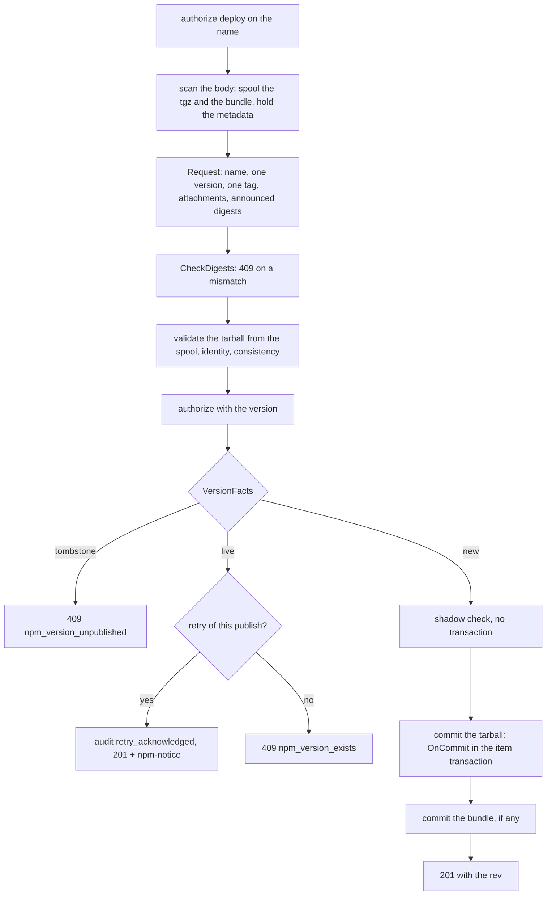
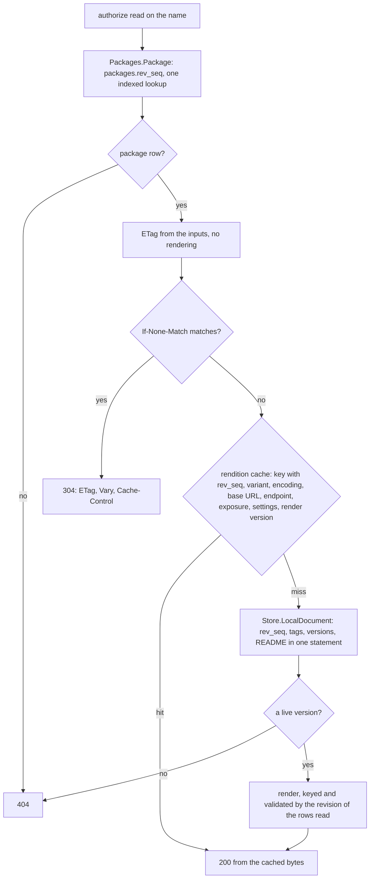
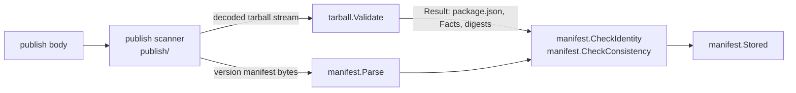

# npm format

The npm registry format ([spec/formats/npm.md](../spec/formats/npm.md)). This page grows with the format: each work package adds
its section. Built today: the format itself (routes, classification, error shape, setup snippets), the local repository end to end
(publish, the package documents and their validators, tarball downloads, dist-tags, unpublish, whoami and ping, the serve-time check and the
removal hooks), the remote and virtual classes with the merge, the data port and its PostgreSQL implementation, the leaf libraries every part builds on, and the exposure adapter with the
filter of documents on endpoints with rules (R-NPM-048), and the format's settings as the `npm` member of the repository document
(Q-NPM-59). Not built: deprecate (R-NPM-018, P1): a `PUT` of a document without an attachment answers 404 `not_found`, the answer
R-NPM-043 gives an unimplemented `PUT`.

## Package layout

```text
internal/formats/npm/
├── format.go        the Format: Descriptor (catalog facts, data port, limits), Names, Match, Classify, PackageDocumentPath
├── routes.go        the whole endpoint map of R-NPM-001 with the name of every handler; op() wraps each handler
├── match.go         the grammar of the escaped paths (names in one or two segments, the markers - and -rev, the deferred families)
├── paths.go         file names and item paths of a version (TarballPath, SigstorePath, VersionOfFile)
├── errors.go        WriteError: the native error body, the 401 challenge, the access-log fields npm-command and npm-session
├── publish.go       the publish handler (F1), Inspect, the acknowledged retry, the shadow check
├── hooks.go         OnCommit of a tarball and of a provenance bundle; claim(), the ownership helper of every write
├── hooks_remove.go  OnItemsRemoved (the unpublish of a version), OnItemsRestored, removeVersions
├── servecheck.go    ServeCheck: a tombstoned or withheld version is 404 on the tarball route and on /files/
├── handlers_document.go  GET {name}, {name}/{ref}: validator, rendition cache, rendering; ?write=true
├── handlers_tarball.go   GET {name}/-/{file}: the item with the headers of an immutable file
├── handlers_disttags.go  the dist-tag read and writes
├── handlers_unpublish.go the three unpublish requests
├── handlers_identity.go  whoami and ping
├── handlers_deprecate.go the metadata PUT; answers 404 until deprecate is built (R-NPM-018, R-NPM-043), 400 for a body without versions
├── tags.go          the dist-tag rules of R-NPM-016 on the SemVer order
├── exposure.go      the exposure adapter (ranges, pre-releases, dimensions) and the filter of rows and documents (R-NPM-048)
├── store.go         the data port (Store), with marked blocks for the work packages that add to it
├── bind.go          Format.Bind: the settings and the metrics of one replica, kept per Host
├── rev.go           Rev: the _rev of a document and the rev of a write (R-NPM-009)
├── setup.go         the client setup snippets (R-NPM-041)
├── name/  semver/  manifest/  tarball/   the leaf libraries (below)
├── document/        the renderings (full, abbreviated, single version), the ETag, content negotiation, gzip; a leaf
├── publish/         the streaming reader of the request body and the checks of R-NPM-007 step 3 that need no state
├── rows/            the values of the data port: a leaf the format and the data package share
└── npmtest/         the in-memory twin of the data port, for the conformance kit and tests without PostgreSQL
internal/formatdata/npm/   the data port's implementation (SQL in internal/meta/postgres/queries/npm_local.sql)
internal/audit/events_npm.go   every audit event type of R-NPM-044
```

The sub-packages `name`, `semver`, `manifest`, `tarball` and `publish` are leaves: the standard library and [internal/errs](../../internal/errs/) (and
their siblings). The format import rule of R-ARCH-008 ([archtest](../../internal/archtest/imports.go)) allows exactly that inside a format's own tree, so a leaf that grows an
import of another layer fails `go test ./internal/archtest/...`. `rows` is a layer-table leaf of its own: the domain package `internal/formatdata/npm` may import it, which it may not
do with any other package of the format.

## The format

| Question | Where |
|---|---|
| What does the format declare? | `Descriptor()` in [format.go](../../internal/formats/npm/format.go): the local class (remote and virtual join with their adapters), layout `npm`, default upstream and cache periods, pattern subject `name`, `OwnershipDefault: enforce`, property prefix `npm.`, `DataPort: Store`, `MaxDocumentBytes` 128 MiB, the limits of a `package.json` |
| How is a path matched? | `Match` = `formats.MatchRoutes` on the route table, then `name.ParseEscaped` on the name the matcher found: the name is decoded exactly once (R-NPM-002), a second layer of escapes is 400 `npm_invalid_name` for every route |
| How is a path classified? | `Classify` ([R-NPM-003](../spec/formats/npm.md)): `<name>` and `<name>/<ref>` metadata, `<name>/-/<file>` content (tarball and `.sigstore`), `-/…` computed; what it cannot read is metadata (R-REPO-003) |
| How is an error rendered? | `WriteError`: `{"error","message","code"}`, `Content-Type: application/json`; a 401 carries the stage's challenge or `Basic realm="trove"` and never `otp` or `ipaddress` (R-NPM-004) |
| What is logged and counted? | `op()` records `npm-command` and `npm-session` through `observability.RequestInfo.SetField` and counts `trove_npm_requests_total{class,operation,status}`, `trove_npm_request_duration_seconds{class,operation}`; the retry counter is `trove_npm_publish_retries_acknowledged_total{repo}` |
| Where do the settings and the metrics come from? | `Bind(host, cfg, metrics)` is called by the composition root with the Host it built; handlers find the replica by `rq.Host`. A Host nobody bound (the kit's) runs on the defaults without metrics |

## The routes

[routes.go](../../internal/formats/npm/routes.go) is the complete table of R-NPM-001, written once. Another work package adds a handler file and never edits it.

| Route (`npm.` prefix) | Method, path below the registry URL | Kind, action | Handler | State |
|---|---|---|---|---|
| `root` | GET `` | computed, read | `handleRoot` | built (200 `{}`) |
| `document.get`, `version.get` | GET `{name}`, `{name}/{ref}` | metadata, read | `handleDocument`, `handleVersion` | built |
| `tarball.get` | GET `{name}/-/{file}` | download, read | `handleTarball` | built |
| `publish` | PUT `{name}` | upload, deploy | `handlePublish` | built |
| `unpublish.put`, `unpublish.delete`, `unpublish.tarball` | PUT, DELETE `{name}/-rev/{rev}`, DELETE `{name}/-/{file}/-rev/{rev}` | delete, delete | `handleUnpublish*` | built |
| `disttags.get`, `disttag.put`, `disttag.delete` | GET `-/package/{name}/dist-tags`, PUT, DELETE `…/{tag}` | metadata read; admin deploy | `handleDistTags`, `handleDistTagSet`, `handleDistTagDelete` | built |
| `ping`, `whoami` | GET `-/ping`, `-/whoami` | computed, read | `handlePing`, `handleWhoami` | built |
| `deferred.get`, `.put`, `.delete`, `.post` | every path of the families npm defines and trove does not implement | computed or admin, read | `handleDeferred` | built (404; 501 for POST) |

The deferred families (R-NPM-043) are one matcher (`matchDeferred`): `-/user`, `-/v1`, `-/npm`, `-/org`, `-/team`, `-/all`, `-/external`, `-/stage` and `-/package/{name}/access|visibility|collaborators`.
Each family answers GET, PUT and DELETE with 404 and POST with 501, because npm's fetch layer retries a GET and a PUT on a 5xx and never a POST.

The reads serve every class of the format (local, remote, virtual). Every route whose action is not `read` has `Classes: local` (`buildRoutes`): a remote
repository answers 405, which `WriteError` words as `npm_class_not_writable`, and the dispatcher sends every write kind addressed to a virtual repository to its deployment target
(`redirectClass` in [dispatcher.go](../../internal/api/dispatch/dispatcher.go); 405 `no_deploy_target` without one, R-NPM-029, R-REPO-021).

To add a route: add it to `buildRoutes` with an example that no other route of its method matches (`formats.Validate` checks), a matcher in `match.go` if the grammar is new, and a handler
method; then a content case or a change case in [conformance_test.go](../../internal/formats/npm/conformance_test.go) (the kit refuses a route without one).

## Publish

`PUT {name}` (R-NPM-007, flow F1). The order is fixed by what must not hold a resource while bytes arrive (R-NPM-046):



- **The order before the body.** `handlePublish` authorizes the name, asks the ownership rule read-only through `Host.CheckOwnership` (`precheckOwnership`: a change of the package, never a claim; `FirstVersion` from the live versions; Q-NPM-56, Q-ARCH-226), and checks `Content-Length` against `bodyLimit`. A caller who may not write the package costs no spool and no validation. The commit decides again.
- **The body cap** is `bodyLimit`: the base64 form of `max_tarball_size` plus `bodySlack`, which is the scanner's metadata budget (768 KiB) plus the base64 form of a 256 KiB bundle, 1,110 KiB in all (Q-NPM-53); `TestR_NPM_007_BodyLimitHoldsEveryPartAtItsLimit` pins the sum.
- **The shadowing check and the commit.** `shadowCheck` reports `skipped` when the repository held a live version. `publishCommit.shadowSkipped` makes `commitVersion` refuse a first version with 503 `shadow_check_unavailable` and `Retry-After`: an unpublish took the last version in between, and R-REPO-048 has not been asked (Q-REPO-118).
- **The body is a stream.** [publish/scan.go](../../internal/formats/npm/publish/scan.go) reads the JSON byte by byte for the metadata (budget 768 KiB, depth 64, a duplicate member or data after
  the document is an error) and pipes the `data` string through a base64 decoder into `Ingestor.Spool`; the spool hashes in one pass. `FuzzPublishScanner` and the 96 MiB streaming test
  pin the memory bound. The sink for a second `.tgz`, an unknown suffix or an oversize attachment answers before the rest is read.
- **`Request`** ([publish/request.go](../../internal/formats/npm/publish/request.go)) applies the checks of step 3 that need no state: the name equals the path's and is valid for a new package, one version (`semver.Clean`
  then `semver.Parse`, no build metadata), one tag (`semver.ValidateTag`), the manifest names that package and version and holds no NUL (jsonb cannot store one), the tarball and at most one bundle with their declared lengths, and a sha512 or shasum to check.
- **`OnCommit`** ([hooks.go](../../internal/formats/npm/hooks.go)) runs in the transaction of the item. Order: `EnsureLocked` (the package row lock), `claim` (ownership, R-AUTHZ-018), `AutoClaim` on a first version
  (R-REPO-023), `InsertVersion` (raises `rev_seq`), properties `npm.name`, `npm.version`, `npm.scope`, `Store.Tags`, the tags by `tagAfterPublish`, `Store.Publish`, the signal `metadata_changed`.
  A tombstone, a live number and a look-alike name each abort the transaction with their 409 or 400.
- **The acknowledged retry** is decided from PostgreSQL alone (`Store.VersionFacts`: publisher, age on its clock, integrity, tag) plus the stored bundle's SHA-256, so every replica decides alike. A retry that races
  its original reaches the commit with identical bytes: the item store reports an identical commit, the hook does not run, and the handler decides again from the committed facts.
- **The ownership helper.** `f.claim(ctx, writer, op, package, version, firstVersion)` is the one place a write of npm asks the ownership question: `opPublish` (claims a first version), `opDistTag`, `opDeprecate`
  (deploy) and `opUnpublish` (delete). The handlers of dist-tags, unpublish and deprecation call it under the package row lock.
- **What is deliberately not done:** a provenance bundle is stored, linked and not read; a refused publish stores nothing except a bundle-less version when the second commit fails (Q-NPM-22); an upload through `/files/` to an npm repository, file or folder, is refused with `409` before its body is read (Q-ARCH-223; `OnCommit` refuses one that reached it by another road, Q-NPM-24).

## Documents

`GET {name}` and `GET {name}/{ref}` (R-NPM-009 to R-NPM-014, flow F2). A document is never stored: it is rendered from the rows of one statement and cached per replica
under a key that holds everything it depends on (Q-NPM-10, Q-NPM-26).



| Question | Answer |
|---|---|
| Which form? | `document.Negotiate(Accept)`: abbreviated when `application/vnd.npm.install-v1+json` has a higher q than `application/json` (a wildcard counts for `application/json`); `?write=true` is the full form whatever Accept says |
| What is in the ETag? | `document.Inputs.ETag()`: repository, package, `rev_seq`, variant, base URL, endpoint, exposure fingerprint, `config_version` and `npm.abbreviated_time`, and `document.RenderVersion` (npmRenderVersion), length-prefixed and hashed; weak. No input is per replica |
| What must I do when I change the bytes a rendering produces? | Increment `document.RenderVersion` in the same change, or a replica of the old release and one of the new share a validator for different bytes |
| Where are the links? | In the cached bytes. `Options.TarballPrefix` is `Links(rq).Path(name + "/-") + "/"`, built from the response base URL, which is in the key and the ETag, as are the endpoint and its exposure fingerprint |
| And on an endpoint with exposure rules? | The rows are filtered between the read and the rendering ([Exposure](#exposure)); the rendition is cached under the key that holds the endpoint and the fingerprint, so a rule change misses it and fails every earlier ETag |
| What is cached? | The identity form; the gzip form is made from it once. Each entry starts with the 8 bytes of `time.modified`, so `Last-Modified` needs no query |
| Why is `If-Modified-Since` ignored? | A date can validate bytes that differ (R-NPM-013); the handler never reads it |
| What does `?write=true` do? | Reads the rows in the request, renders the full document with its `_rev`, never caches it, no ETag, `Cache-Control: no-store` |
| What is in the versions? | The stored manifest with `dist.tarball` added, `deprecated` from the column, no `readme`; SemVer order (Q-NPM-31) |

[document](../../internal/formats/npm/document/): `FullDocument`, `AbbreviatedDocument`, `VersionDocument` (one version, exactly the entry of the full document), `Negotiate`, `Inputs.ETag`, `IfNoneMatch`,
`AcceptsGzip`, `Gzip`. Rendering 1,000 versions takes about 21 ms (`BenchmarkR_NPM_010_RenderThousandVersions`); over the integration stack a miss takes 40 to 60 ms and a hit 3 ms.

## Tarballs and the serve-time check

`handleTarball` finds the version in the file name (`VersionOfFile`, canonical or 404), authorizes `read` on the package and version, looks the item up at the canonical path and hands it to
`Items().Serve`, which runs `ServeCheck`, the strong ETag, the conditionals, Range and the statistics of R-STOR-012. The handler adds one thing: `immutableWriter` sets
`Cache-Control: private, max-age=31536000, immutable` on the status line of a 200, 206 or 304 (Q-NPM-28).

`ServeCheck` ([servecheck.go](../../internal/formats/npm/servecheck.go)) runs for every stored item the core serves, `/files/` included. For a local repository it classifies the path and, for a tarball or a
bundle of a version, asks `Store.Tombstoned`: a tombstoned or withheld version is the 404 of a missing resource. It keeps no state; a tombstone written on any replica refuses the next request on every other.

## Dist-tags

`handleDistTags` reads the tag map (`Store.DistTags`, 404 for a package without a document). The writes (`handleDistTagSet`, `handleDistTagDelete`) authorize `deploy`, check that the package row exists
(a write never creates a package), then in `Host.Write`: `EnsureLocked`, `f.claim(opDistTag)`, the live versions (`Store.LiveVersions`), the tags under the lock (`Store.Tags`), the change, `BumpRevision`
(the clock for `modified_at`), `Store.SetTag` or `DeleteTag` (which write the audit event) and the `metadata_changed` notification. A write that changes nothing writes nothing (Q-NPM-29). The tag rules
(`semver.ValidateTag`, `tagsAfterRemoval`) are in [tags.go](../../internal/formats/npm/tags.go).

## Unpublish

```mermaid
sequenceDiagram
    participant C as npm
    participant H as handleUnpublishPut
    participant W as Host.Write (one transaction)
    participant I as items.RemoveIn
    participant K as OnItemsRemoved
    C->>H: GET name?write=true, then PUT name/-rev/rev with the document
    H->>H: versionsOfBody: only the keys of versions, streamed
    H->>W: authorize delete, then EnsureLocked
    W->>W: claim(opUnpublish), LiveVersions, remove = live minus body
    W->>W: nothing to remove: 200 with the current rev; rev stale: 409
    W->>I: DeleteItems(tarball and bundle path of each version)
    I->>K: the removed items, in this transaction
    K->>K: tags without the versions, Tombstone (integrity, journal entry), version rows deleted, BumpRevision, notify
    W-->>C: 200 {ok, rev}
    C->>H: DELETE name/-/file.tgz/-rev/rev: 200, nothing changes
```

`OnItemsRemoved` ([hooks_remove.go](../../internal/formats/npm/hooks_remove.go)) is the whole unpublish; the route only decides and removes the files. It therefore also serves a raw delete through `/files/`
and the items API. Its writer is bound to no request and asks no ownership question: for a raw delete the generic layer asked it before, in the same transaction, through
`FilesSeam.CheckRemoval` (every package of the removed files, in name order under `EnsureLocked`, `delete`, Q-AUTHZ-161; `TestR_AUTHZ_018_RawRemovalsAskOwnership`). A raw path
of an npm repository is decided on the package and the version `Classify` gives it, and the repository's name patterns are matched against that package (Q-AUTHZ-160).
`removeVersions` takes versions out of a locked package: tags first (the format holds the SemVer order), then `Store.Tombstone` for the versions the document holds, then `TrashOrDeleteVersion`. A version
that is stored and tombstoned (withheld, R-NPM-047) loses its row and keeps its tombstone. The route calls `removeVersions` itself for a version whose files were not there. `OnItemsRestored` clears the
tombstone of a version that is stored again with the integrity the tombstone holds, and gives a package without `latest` the highest version (the trash can is P1; the kit drives it).

## Exposure

R-NPM-048, R-EP-018; decisions Q-NPM-38 to Q-NPM-40 and Q-NPM-16. [exposure.go](../../internal/formats/npm/exposure.go) is the adapter
`Format.Exposure()` returns and the filter the handlers call. The view is `rq.Endpoint.Exposure`, which the dispatcher reads from the
request's index ([endpoints.md](endpoints.md#package-formats-on-an-endpoint-r-ep-018-r-ep-019)); `viewOf(rq)` returns it, nil on an
endpoint without rules, and a view that exposes nothing for an endpoint with rules that has none.

| Part | Does |
|---|---|
| `ValidateRange` | `semver.ParseForExposure`: node-semver's strict syntax, accepted with and without `includePrerelease`, at most 4096 bytes; the message is a field error of the rule API |
| `Prerelease`, `InRange` | `semver.ParseNode(v, false)` (the grammar of document versions, Q-NPM-15); a range is evaluated with `includePrerelease`, so the rule's `prereleases` flag decides pre-releases. Parsed ranges are kept in a memo of the format (at most 4,096, cleared when full): the decision point asks `InRange` per version and rule |
| `exposedVersions`, `exposedTags` | The one decision: the versions the view exposes; the tags that stay (name admitted, version exposed, never moved); `latest` kept when exposed, else the highest exposed release, else the highest exposed pre-release; a missing `latest` computed the same way |
| `exposeRows` | The filter of a local document's rows before rendering: versions, tags, and the README of a moved `latest` cleared (Q-NPM-39). `time`, `maintainers` and the top-level fields are then rendered from what remains |
| `FilterDocument` | The filter of a merged or rewritten document (`{name}` full or abbreviated, `{name}/{version}`): members read like `JSON.parse` (a repeated member takes its last value at its first place), `versions`, `time`, `dist-tags` and `maintainers` filtered, the top-level fields of a moved `latest` taken from its entry or removed, other members kept (Q-NPM-40); another path is an internal error, never an unfiltered answer |
| `readOnly` | `?write=true` on an endpoint with rules: decided as `read` plus `deploy`, which the ceiling refuses with `403 endpoint_read_only` and audits |

What the handlers do on an endpoint with rules, each in a block marked `>>> WP2.9 exposure`:

| Handler | On an endpoint with rules |
|---|---|
| `handleDocument` | `?write=true` is `readOnly` |
| `serveRendering` | `exposeRows` between `rd.read` and `rd.render`; nothing exposed is `notFound()`; the key and the ETag are unchanged, they held the endpoint and the fingerprint already |
| `handleVersion` | a hidden version is `notFound()` before any lookup; a tag reads the whole document, filters it and takes the tag's version from the filtered tags (`latest` is the moved one) |
| `handleDistTags` | the tags of the filtered rows of the whole document (the moved `latest` needs the exposed versions) |
| `handleTarball` | after `Authorize` (whose ceiling decides the version), the view repeats the decision before the item lookup |

The remote and virtual handlers call `f.Exposure().FilterDocument(ctx, p, doc, viewOf(rq))` on the rewritten or merged package document before compression
(`exposedDocument` in [handlers_remote.go](../../internal/formats/npm/handlers_remote.go)), read the dist-tag map from the filtered document, and key the rendition and the
ETag with `rq.Endpoint.Name` and `rq.Endpoint.ExposureFingerprint`; a tarball repeats the version check (`hiddenVersion`). The test on the R-EP-012 fixture of a virtual
repository with a remote member is `TestR_EP_018_ACustomersEndpointOnAVirtualRepositoryWithARemoteMember` ([exposure_virtual_test.go](../../test/integration/npm/exposure_virtual_test.go)).

## Remote and virtual repositories

The remote class (R-NPM-023 to R-NPM-027) and the virtual class (R-NPM-028 to R-NPM-033). Both serve one **full** document and derive
everything else from it; neither renders from rows.

```text
internal/formats/npm/
├── remote.go          Format.Remote(): the RemoteAdapter (UpstreamRequest, PrepareFill, OnFill, Rewrite, TracksVersionRemoval), TypeExpecter and the ArtifactGate
├── virtual.go         Format.Virtual(): Strategy (Merge for a package document), LocalDocument (neutral tarball address), Merge
├── settings.go        the npm member of the repository document (settings.schema.json): latestGuard, serveRemovedVersions, latestStrategy, distTagStrategy
├── handlers_remote.go serveFull (validator, rendition cache, derivation of the forms), remote documents and tarballs, exposedDocument
├── handlers_virtual.go the merged document, the tarball through the tiers, ?write=true from the deployment target
├── remote/            the checks of R-NPM-024 (Check, a stream), Parse, Full / Abbreviated / Version, Rewrite, URL; a leaf
└── merge/             the per-version source rule, the tag strategies, time and top-level fields, conflicts; a leaf
internal/formatdata/npm/remote.go   ApplyFill, TarballFacts
internal/meta/postgres/queries/npm_remote.sql
```

| Question | Answer |
|---|---|
| What is stored? | The upstream's full document, variant `full`, for both request variants (R-NPM-024). `PrepareFill` reads it once as a stream (`remote.Check`, outside any transaction) and returns the per-version facts and the URL-map rows of tarball URLs that are not the default |
| What does `OnFill` do? | Calls `Store.ApplyFill` in the fill transaction: lock `npm_remote_packages`, read the entry as it is now, return `Stale` (older `time.modified`) or `Superseded` (same or unknown `time.modified`, stored entry fetched later) (keep the stored document, change nothing, count the stale copy), else write the records, mark unlisted versions (`npm.remote.version_removed`), and signal `metadata_changed` (Q-NPM-32); a later `time.modified` than the stored one answers `FillReplaceStored`, so the entry upsert takes the document although the stored entry was fetched later (Q-NPM-57, Q-REPO-120) |
| How is a document served? | `serveFull`: ETag from (repository, form, base URL, endpoint, exposure fingerprint, settings, the document's digest or the merge fingerprint), 304 without reading, rendition cache, else `remote.Parse` and `Full` / `Abbreviated` / `Version`, `dist.tarball` rewritten onto `Links.Registry(servingKey)`. The cache view names `<key>~cache` |
| What does the gate do? | `BeforeArtifact` (tarballs): a version without a record or a document that is not current is revalidated with `EnsureCurrent`; then the marks apply (`refuseRemoved`); the announced digests (`sha512`, else `shasum`) go to the engine (Q-NPM-33) |
| How is a virtual document built? | `Resolver.Metadata` plans (patterns, claims, pins, `read`, `MayFill`), collects `LocalDocument` and the engine's documents, calls `Merge`; a member the caller may not fill is `Restricted` and supplies cached versions only (R-AUTHZ-008). Tarball addresses are neutral in the cache and rewritten per response (Q-NPM-34) |
| Where do writes go? | Write routes are `Classes: local`. The dispatcher sends every write kind of a virtual repository to its target; a remote repository's 405 becomes `npm_class_not_writable` in `WriteError` (Q-NPM-36). `?write=true` on a virtual repository reads the target's own document |
| What does an exposure rule do here? | `exposedDocument` rewrites, filters with `FilterDocument(viewOf(rq))` and parses again; dist-tags and `latest` come from the filtered document; a hidden version is 404 before any fetch (`hiddenVersion`) (R-NPM-048, H-295) |
| Settings | `latestGuard` (local, default `true`), `serveRemovedVersions` (remote, default `false`), `latestStrategy` (virtual, default `highest-member-latest`) and `distTagStrategy` (virtual, default `member-order`) are the `npm` member of the repository document; the repository service validates it against [settings.schema.json](../../internal/formats/npm/settings.schema.json) (a member of another class is refused), and `settingsOf` reads it from the stored document of the request's repository (Q-NPM-59) |

Metrics: `trove_npm_virtual_version_conflicts_total`, `trove_npm_removed_upstream_versions_total`, `trove_npm_stale_upstream_documents_total`,
`trove_npm_tarball_document_revalidations_total{outcome}` ([bind.go](../../internal/formats/npm/bind.go)). A fill reaches its replica through the data port it is handed
(`Format.replicaOfPort`), because a storage hook has no request.

Tests: `remote/remote_test.go` and `merge/merge_test.go` (with `FuzzRewrite`, `FuzzMerge`), `remote_test.go`, `handlers_remote_test.go`, `parity_test.go` (the install and version documents derived from a full
document equal the local renderings), conformance checks 4 and 5, and in [test/integration/npm](../../test/integration/npm/) `remote_test.go`, `remote_marks_test.go`, `virtual_test.go`, `exposure_virtual_test.go`
against [test/npmstub](../../test/npmstub/) in the test process (`remote_env_test.go` builds the repositories).

## The package view

[view.go](../../internal/formats/npm/view.go) is npm's `ViewAdapter` (R-API-029, Q-API-166). Order and pre-release are SemVer's (`semver.CompareBuild`; two
strings never compare equal). `describeManifest` reads the stored manifest of a version for the screens and leaves out every member whose type is not the
documented one: description and keywords (summary); `license` or the legacy `licenses`; `dependencies`, `devDependencies`, `peerDependencies`,
`optionalDependencies`, `engines`; `author` and `contributors` as "Name <email> (url)"; `homepage`, `repository.url`, `bugs.url`; the deprecation message; and the
dist-tags of the package, restricted to versions the caller may read. The reads are in
[formatdata/npm/view.go](../../internal/formatdata/npm/view.go) over [npm_view.sql](../../internal/meta/postgres/queries/npm_view.sql): the summaries, the
details with the README on request, the two searches (description contains text case-insensitively; keywords contain a keyword exactly) and the tombstoned
versions that `Withheld` reports (R-NPM-047). The tests are `TestR_API_029_NPM*` ([view_test.go](../../internal/formats/npm/view_test.go)) and the
integration area `test/integration/packages`.

## Identity

`handleWhoami` answers `{"username": principalName(rq)}` (`sa:<name>`, `ci:<name>` for those kinds), `handlePing` answers `{}`; both are 401 for a subject without a name (anonymous, or a token the chain no longer
accepts), with the default challenge of `WriteError` (Q-NPM-29).

## The store port

`Store` ([store.go](../../internal/formats/npm/store.go)) is the interface the format declares (`Descriptor.DataPort`); [internal/formatdata/npm](../../internal/formatdata/npm/store.go) implements it and
[wire_formats.go](../../internal/app/wire_formats.go) binds it (`formatPorts`). The format passes the values of [rows](../../internal/formats/npm/rows/rows.go) and the transaction it received (opaque, `formats.Tx`);
the implementation unwraps it and runs the statements of [npm_local.sql](../../internal/meta/postgres/queries/npm_local.sql). The format computes every decision that needs the SemVer order and hands the store the
complete tag map.

| Method | Does |
|---|---|
| `VersionFacts` | outside a transaction: live or tombstoned, integrity, tag, publisher, age on PostgreSQL's clock |
| `Tags` | the tags of a package under its row lock |
| `Publish` | tombstone check, the npm row (`ON CONFLICT DO NOTHING`, then locked; no row of its own means the unique `(repo_id, name_fold)` refused a look-alike: 400), the version row, the tags, `modified_at = greatest(modified_at + 1 ms, clock)`, `npm.publish` |
| `RecordRetry`, `RecordMismatch` | the audit event of an acknowledged retry; the asynchronous mismatch event |
| `SetTag`, `DeleteTag`, `Tombstone` | stored tags and `npm.dist_tag.*`; the tombstone with the integrity of the version row, the tags, `npm.unpublish` with its journal entry (`repositoryId`, `package`, `version`, `integrity`, `actorId`) |
| `LocalDocument`, `LocalVersion` | one statement each (`NPMLocalDocument`, `NPMLocalVersion`): `rev_seq`, `created_at`, `modified_at`, the tags, the versions that are neither trashed nor tombstoned with manifest, deprecation and publish time, the README of the version `latest` points to |
| `DistTags` | the tags with their revision; found only when the document holds a version |
| `LiveVersions` | under the row lock: the versions the document holds, in publish order |
| `Tombstoned` | one lookup, for `ServeCheck` |
| `ClearTombstone` | a restore: removes the tombstone when the stored version has the integrity it holds |

Add to the port in the `>>> M2 npm-read` and `>>> M2 npm-remote` blocks of `store.go` and `npm_local.sql`/`npm_remote.sql` (the reads of the local class are in [read.go](../../internal/formatdata/npm/read.go)); add the method to the twin in `npmtest` in the same change.
The twin reads the revision of a document from `Store.Revisions`, which a test binds to the kit Host's `RevSeq`, because the database reads `packages.rev_seq` in the same statement. The README text and the manifest are
cleaned for the columns (valid UTF-8, no NUL, 64 KiB) in `Publish`.

## Tests

| Tier | Where | Proves |
|---|---|---|
| Unit, handlers | [handlers_test.go](../../internal/formats/npm/handlers_test.go), [conditional_test.go](../../internal/formats/npm/conditional_test.go), [mutations_test.go](../../internal/formats/npm/mutations_test.go), [identity_test.go](../../internal/formats/npm/identity_test.go) | the handlers over the kit's in-memory Host and the twin: the document (`TestR_NPM_010_*`, `TestR_NPM_011_*`), the write-read (`TestR_NPM_009_*`), validators and cache headers (`TestR_NPM_013_*`), the rendition cache (`TestR_ARCH_012_RenditionCache`), tarballs (`TestR_NPM_015_*`), `ServeCheck` (`TestR_NPM_047_*`), tags (`TestR_NPM_016_*`), unpublish (`TestR_NPM_017_*`), restore (`TestR_NPM_008_*`), whoami and ping (`TestR_NPM_019_*`) |
| Unit, rendering | [document](../../internal/formats/npm/document/) | the three renderings, the order, the ETag inputs, negotiation, the benchmark for 1,000 versions |
| Unit, exposure | [exposure_test.go](../../internal/formats/npm/exposure_test.go) | the ranges of rules (`TestR_NPM_048_RangesOfRules`: strict syntax, `includePrerelease`, the catalog facts, the bounded memo); the rows of the R-EP-012 fixture (`TestR_NPM_048_TheFilterOfALocalDocument`, with the bytes filter of the rendered document compared to the rendering of the filtered rows); upstream-shaped documents with duplicate members, unpublished times, e-mails and a moved `latest` (`TestR_NPM_048_TheFilterOfAMergedOrRewrittenDocument`); the handlers on the kit's Host with endpoint facts (`TestR_NPM_048_HandlersOnAnEndpointWithRules`) |
| Unit | [internal/formats/npm](../../internal/formats/npm/) `*_test.go` | the route table and every status (`TestR_NPM_001_RouteTable`, `TestR_NPM_043_UnimplementedEndpointsAnswerPredictably`), classification (`TestR_NPM_003_Classification`), the error shape over all routes and all statuses (R-NPM-005), no `otp` (R-NPM-004), the access-log fields and the metrics, the hook's order and refusals with a fake writer, the dist-tag rules, the snippet lint (R-NPM-041) |
| Conformance | `TestR_ARCH_010_Conformance` | the ten checks of the kit; check 7 over every document, tarball, tag and identity route (a subject is set in `HostOptions.Subject`), check 9 over a change case for publish, tag set and remove, the unpublish `PUT` and `DELETE` and the removal hook; checks 4 (rewrite) and 5 (merge) over the fixtures `Remote` (an unscoped and a scoped upstream document) and `Merge` (a local and a remote member sharing a version; a remote member with a cached tarball before one without) |
| Scanner | [publish](../../internal/formats/npm/publish/) | the body rules, the 96 MiB streaming bound, `FuzzPublishScanner` |
| Fuzz | `FuzzMatch` (own, escaped-path properties), `FuzzR_ARCH_028_Match`, `FuzzR_ARCH_028_Inspect`, `FuzzPublishScanner` | no panic, canonical names, classified errors |
| Integration | [test/integration/npm](../../test/integration/npm/) | against PostgreSQL and the object store, with replicas started through `app.New` (`testenv.NewStack`, `Start`, `Do`): publish rows and item, tags and the latest guard, immutability, the retry on another replica and after an edge reset, concurrent publishes of two versions, of one new name and of look-alike names, ownership races, auto claim, archive rules, limits, a slow 200 MiB publish (no connection idle in a transaction, bounded heap), the route contract over the real chain, the access log, metrics and the store's writes; [documents_test.go](../../test/integration/npm/documents_test.go): publish then view on another of three replicas 100 times with Valkey reachable and unreachable, 50 iterations of publish, tag and unpublish, validators and `304` on every replica, the clock rules, 1,000 versions; [mutations_test.go](../../test/integration/npm/mutations_test.go): the tarball, tag writes, the unpublish sequence with its tombstone and journal entry, stale revisions and the retry, a raw delete, withheld versions, concurrent writes of all kinds, whoami and ping; [exposure_test.go](../../test/integration/npm/exposure_test.go): R-NPM-048 and R-EP-018 on a second endpoint `customers` with the rule of R-EP-012 (see [endpoints.md](endpoints.md#tests)) |

```sh
go test ./internal/formats/npm/...
go test -run '^$' -fuzz '^FuzzPublishScanner$' -fuzztime 2m ./internal/formats/npm/publish/
go test -run '^$' -fuzz '^FuzzMatch$' -fuzztime 2m ./internal/formats/npm/
set -a; . .dev/integration/env; set +a; go test -count=1 -p 1 -tags integration ./test/integration/npm/...
```

### What is not verified

- The order in which libnpmpublish, pnpm and Yarn write the members of the body (the scanner does not assume one).
- Publish with pnpm, Yarn 1 and Yarn 2+ in the unit and integration tiers: the clients run in the end-to-end client matrix only ([e2e.md](e2e.md)), which is not part of `make test`.
- The revocation criterion of R-NPM-019 (`npm ping` fails on every replica within 2 s of a revocation) is not tested here: the authentication stage's bound is tested in the identity area (R-AUTH-023); ping and whoami answer 401 for the subject that stage produces.
- The restore's replay (`trove admin npm reinstate`, the journal) does not exist yet; the withheld state is written by hand in `TestR_NPM_047_WithheldVersionsAreNotServed`. `OnItemsRestored` is driven through the kit only: the trash can is P1.
- Compression of documents is tested with gzip only; a client that sends another coding gets the identity form.
- Publish, `npm view`, `npm unpublish`, `npm dist-tag`, `pnpm` and Yarn against the documents in the unit and integration tiers: the real clients run in the end-to-end client matrix ([e2e.md](e2e.md)).
- The `repo` metric label is `_other` for every repository until a component feeds `observability.CappedLabels` the repository keys.

## Names and versions

### `name`

R-NPM-002. Code: [internal/formats/npm/name](../../internal/formats/npm/name/).

| File | Responsibility |
|---|---|
| [name.go](../../internal/formats/npm/name/name.go) | `Name`, `Parse` (an already decoded name, lookup rules), `ParseEscaped` (decode once, then `Parse`), `Normalize`, `Name.EscapedPath`, `Fold`, `LookAlike`; the error shape |
| [new.go](../../internal/formats/npm/name/new.go) | `ValidateNew` and `ParseNew` (the rules for a newly published name), `IsCoreModule` |

Two rule sets, one canonical form. `@scope/name` or `name`, case kept, is the package identity in the request descriptor, in
include and exclude patterns ([R-NPM-003](../spec/formats/npm.md)) and in permission and claim coordinates.

| Question | Function |
|---|---|
| A name from a request path (`@acme%2fui`, `%40acme%2Fui`, `@acme/ui`) | `ParseEscaped`: decodes exactly once and refuses a `%` that is left, so `a%2525b` never reaches an upstream. The router must hand it the *escaped* path segment(s), never a path in which `%2f` has become `/` |
| A name that is only looked up (remote and virtual repositories serve upstream names unchanged) | `Parse`: legacy capitals allowed; refuses empty, `.` and `..` segments, control characters, a backslash, `%`, invalid UTF-8, more than one `/`, more than 512 bytes (Q-NPM-14) and `-` |
| A name being published | `ParseNew`: also lower case, `[a-z0-9._-]` only, 1 to 214 characters, scope and name start with a letter or digit (Q-NPM-14), unscoped names are no core module, `node_modules` or `favicon.ico` |
| The look-alike check of a local repository | `Fold` (value stored in `npm_packages.name_fold`) and `LookAlike`. The unique index on `name_fold` is what enforces it under concurrency; `LookAlike` is for messages and tests |
| A request path to build | `Name.EscapedPath`: `@scope%2fname`, the form npm clients use |

Every refusal is an `*errs.Error` of kind `Invalid` and code `npm_invalid_name` (`name.CodeInvalid`). The detail quotes the name as
printable ASCII, cut at 64 characters, so it is safe to log and to return.

The Node.js core-module list (`IsCoreModule`) is a `switch`, not a package variable (R-ARCH-032 forbids package-level maps and
slices outside the registries). It is validate-npm-package-name 8.0.0's list. When a new Node.js release adds a core module,
add the name to the switch and to the table in `TestCoreModules`.

### `semver`

R-NPM-007 (version check, tag rule), R-NPM-016 (dist-tags, `latest`), R-NPM-031 (highest SemVer), R-NPM-048 (exposure ranges).
Code: [internal/formats/npm/semver](../../internal/formats/npm/semver/).

| File | Responsibility |
|---|---|
| [version.go](../../internal/formats/npm/semver/version.go) | `Version`, `Parse`, `ParseNode`, `Clean`, `Compare`, `CompareBuild`, `Sort`, `Rsort`, error codes |
| [range.go](../../internal/formats/npm/semver/range.go) | `Options`, `ParseRange`, `Range.Satisfies`, `Validate`, `ParseForExposure`, `MaxSatisfying`, `MaxSatisfyingStrings`; the port of node-semver's `Range.parseRange` |
| [tokens.go](../../internal/formats/npm/semver/tokens.go) | node-semver's token grammar as Go regular expressions (compiled on first use), the ECMAScript whitespace set |
| [tag.go](../../internal/formats/npm/semver/tag.go) | `ValidateTag`: the dist-tag name rule |
| [corpus_test.go](../../internal/formats/npm/semver/corpus_test.go) | the node-semver corpus: about 600 rows of range, options, formatted range and satisfying versions |

Which entry point to use (Q-NPM-15):

| Situation | Function |
|---|---|
| A version a client publishes | `Clean` (npm's `clean()`: trim, strip leading `=` and `v`), then `Parse` on the result, and compare `Canonical()` with it (R-NPM-007 step 3) |
| A version trove stores, compares or renders | `Parse`: SemVer 2.0.0 as written, no `v`, no whitespace. `Version.String()` keeps the build metadata, `Canonical()` is node-semver's `version` without it |
| A version from an upstream document or a tarball file name | `ParseNode(s, false)`: what `new SemVer(s)` accepts (trim, leading `v`) |
| A client's loose text (none today) | `ParseNode(s, true)` |
| A dist-tag name | `ValidateTag`: 1 to 128 characters, starts with a letter or digit, and not a strict-valid range (`1.x`, `v1.4`, `x`, `1.2.3`) |
| The version bound of an exposure rule | `ParseForExposure` (R-NPM-048, Q-NPM-16); the adapter's `ValidateRange` calls it and discards the range, its `InRange` keeps the parsed range in the format's memo ([Exposure](#exposure)) |
| The highest of a document's versions | `MaxSatisfying` / `MaxSatisfyingStrings`, or `Sort` + the last element; ties of equal precedence keep the first, as node-semver does |

Ranges are a port of node-semver 7.8.5, not a reimplementation of its documentation: the same token grammar, the same
rewriting steps in the same order (build strip, hyphen, comparator trim, tilde and caret trim, caret, tilde, x-range, star, `>=0.0.0`),
so the accepted language is the library's and not a neighbour of it. `Options.IncludePrerelease` changes the desugaring (lower bounds
become `-0`) and the satisfaction test; `Options.Loose` is node-semver's loose mode, which drops comparators it cannot parse
instead of refusing the range. The pre-release rule is node-semver's: a version with a pre-release satisfies a comparator set only
when a comparator of that set has a pre-release on the same `[major, minor, patch]`, unless `IncludePrerelease`.

Deliberate differences from node-semver (everything else is identical):

| Difference | Where it is decided |
|---|---|
| Numeric pre-release and build identifiers compare exactly at any length; node-semver converts to a float, so identifiers above 2^53 compare equal there | Q-NPM-15 |
| A range longer than `MaxRangeLength` (4096 bytes) is refused | Q-NPM-16 |
| `ParseForExposure` accepts a range only if it parses with and without `IncludePrerelease` | Q-NPM-16 |

An `*errs.Error` of kind `Invalid` carries the code: `npm_invalid_version`, `npm_invalid_range`, `npm_invalid_tag`. The codes are
declared in the package and registered in [errs/codes.go](../../internal/errs/codes.go) (`CodeNPM…`, block `M2 npm`).

### Tests and how to extend them

| Test | What it pins |
|---|---|
| `TestParseEscaped`, `TestNormalizeAndEscape`, `TestValidateNew`, `TestCoreModules`, `TestFold` ([name_test.go](../../internal/formats/npm/name/name_test.go)) | the tables of R-NPM-002: accepted and refused names, every escaping form, the new-name rules including the length edge at 214, the fold |
| `TestParse`, `TestParseNode`, `TestClean`, `TestCompare`, `TestSort`, `TestValidateTag` ([semver_test.go](../../internal/formats/npm/semver/semver_test.go)) | the version grammar and precedence tables, the chain of SemVer 2.0.0 item 11, the tag rule |
| `TestCorpus` ([range_test.go](../../internal/formats/npm/semver/range_test.go), data in [corpus_test.go](../../internal/formats/npm/semver/corpus_test.go)) | node-semver behavior: valid or not, formatted range, satisfying versions, for strict, `includePrerelease` and loose |
| `TestPrereleaseRule`, `TestStrictAndLoose`, `TestWhitespace`, `TestRangeLength`, `TestExposureRange`, `TestMaxSatisfying` | the pre-release rule, strict against loose, ECMAScript whitespace, the size bound, R-NPM-048 |
| `FuzzName`, `FuzzRange` | no panic; the canonical name is a fixed point of normalization and `Parse`, and its escaped path parses back; `parse(format(v)) == v`; the formatted range re-parses to one that accepts the same versions |

The corpus is plain data in a Go file, with no JavaScript in the repository. To add a row, run node-semver on the range locally
(the expected values of the current rows come from 7.8.5: `new Range(text, opts)`, its `range` property, and `test` on
`corpusVersions`) and paste the result. Run the fuzz targets longer than the unit run when you touch the grammar:

```bash
go test ./internal/formats/npm/semver/ -run '^$' -fuzz FuzzRange -fuzztime 2m
go test ./internal/formats/npm/name/   -run '^$' -fuzz FuzzName  -fuzztime 2m
```

If you change `tokens.go` or the rewriting in `range.go`, compare against node-semver on a few ten thousand generated ranges before
you trust the corpus alone; the corpus pins known cases, a differential run finds the ones nobody thought of.

## Manifests and tarballs

A publish carries two descriptions of one package: the version manifest in the request body and the
`package.json` inside the tarball. R-NPM-007 requires that the tarball is what an installer would
extract, and that the two descriptions agree on everything that changes what is installed or run. The two
packages implement exactly that; neither opens a connection or touches a store.

### Request path through the libraries



The publish path ([publish.go](../../internal/formats/npm/publish.go)) streams the attachment into the spool, validates the tarball from the spool with
`tarball.Validate`, parses the version manifest with `manifest.Parse`, and compares with `CheckIdentity` and `Mismatches` (rejecting through `CheckConsistency` in `reject` mode).

### `manifest`

| File | Responsibility |
|---|---|
| [manifest.go](../../internal/formats/npm/manifest/manifest.go) | `Manifest` (generic JSON tree, numbers kept as `json.Number`), `Limits`, `Read`, `Parse`, `Decode`, the depth scan, the three error constructors and their codes |
| [version.go](../../internal/formats/npm/manifest/version.go) | `CleanVersion`: semver's loose `clean()` |
| [steps.go](../../internal/formats/npm/manifest/steps.go) | One function per normalization step, `Facts` |
| [gitspec.go](../../internal/formats/npm/manifest/gitspec.go) | `CanonicalGitSpec`: hosted-git ranges in npm's canonical form |
| [compare.go](../../internal/formats/npm/manifest/compare.go) | `Normalize` (the union, in dependency order), `Mismatches`, `CheckConsistency`, `CheckIdentity` |
| [stored.go](../../internal/formats/npm/manifest/stored.go) | `Stored`: the request manifest with server-controlled fields replaced, `HasInstallScript` |

Steps (R-NPM-007 step 3), each tested alone and each idempotent:

| Function | Does |
|---|---|
| `NormalizeName`, `NormalizeVersion` | trim the name; clean the version |
| `NormalizeDependencies` | string and array forms to objects; drop non-string ranges; canonical hosted-git ranges |
| `NormalizeBundleDependencies` | rename, expand `true`, reduce an object, add missing names with `*`, sort |
| `NormalizeBin` | string/array to object; base-name keys; clean targets; `directories.bin` from `Facts` |
| `NormalizeScripts`, `AddGypInstall` | strip `node_modules/.bin/`; add `node-gyp rebuild` by npm's and Yarn 1's rules |
| `NormalizeEngines` | array form to object (Yarn 1) |

Bounded reading: `Read` takes at most `max+1` bytes, so a 2 GiB source costs about 1 MiB; `Parse` refuses
an oversize or too deeply nested document (default 1 MiB, depth 64) before the decoder allocates a node.
Errors are `*errs.Error` with the native npm codes `npm_bad_publish` (400), `npm_manifest_mismatch` (400) and
`npm_too_large` (413). The codes are strings of these packages and are registered in `internal/errs` (the problem catalog).

### `tarball`

| File | Responsibility |
|---|---|
| [tarball.go](../../internal/formats/npm/tarball/tarball.go) | `Validate`, `Limits`, `Result`; the reader stack; the walker with the path, link and duplicate rules |

`Validate(ctx, r, limits)` reads a gzip-compressed tar once. The reader stack, outermost first: a source
reader (context, compressed-bytes cap, count) feeds a tee into SHA-1 and SHA-512, then a buffered reader and a
byte counter (compressed position for the ratio check, and a 64 KiB guard while the gzip header is parsed),
then `compress/gzip` with multistream off, then a reader that caps the inflated bytes, then `archive/tar`. The
walker looks at each header and reads content only for `package.json` (1 MiB) and the first top-level README
(64 KiB). Everything else is skipped by the tar reader, which still inflates it, so the inflation cap is what
bounds the cost of a bomb. After the last entry the rest of the inflated stream must be zero padding, the gzip
trailer is verified, and nothing may follow the gzip member.

Two more rules sit beside the per-entry limits. The inflating reader caps the whole archive at `MaxTotalRatio` (100) times the compressed bytes the inflater has consumed plus 8 MiB, so a publish that costs gigabytes of inflation
pays for them in upload (Q-NPM-54). The walker keeps the link entries, and `linkChains` runs after the last entry: a link target that passes through another link before its last component is refused, because the lexical check
resolves `sub/l2/../..` as if `l2` were a folder (Q-NPM-55).

What a walk records: `Facts.Files` (install paths of regular files, for `binding.gyp`, `*.gyp` and
`directories.bin`), file count and unpacked size (`dist.fileCount`, `dist.unpackedSize`), `HasShrinkwrap`, the
README, the parsed `package.json`, the digests of the compressed bytes. Memory is proportional to the entry
names (capped at 32 MiB of bookkeeping) plus 1 MiB for the manifest, not to the tarball.

The limits and the reasons for each are in [Q-NPM-17](../spec/formats/npm.md#q-npm-17--limits-of-the-streaming-tarball-pass-and-of-manifest-reading);
the archive rules in [Q-NPM-18](../spec/formats/npm.md#q-npm-18--tarball-archives-that-two-readers-could-resolve-differently).

### Tests

| Tier | Where | What it proves |
|---|---|---|
| Table tests | `*_test.go`, names start with the requirement ID | every step; every path rule; every limit with a crafted input (a 2 GiB declared `package.json`, JSON nested 100,000 deep, a gzip bomb, a ratio bomb) |
| Differential corpus | [testdata/prepare/](../../internal/formats/npm/manifest/testdata/prepare/) | the manifest npm's own `prepare()` produces and the raw `package.json` compare equal under `Normalize` |
| Fuzz | `FuzzManifest`, `FuzzTarball` | no panic; limits hold; `Normalize` idempotent; every accepted tarball satisfies the path invariants and the digests match |

Crafted archives are built in the test by code ([build_test.go](../../internal/formats/npm/tarball/build_test.go));
no large blob is committed. Fuzz regressions live in `testdata/fuzz/` and replay on every `go test`.

Run the fuzz targets for two minutes each:

```sh
go test -run '^$' -fuzz '^FuzzManifest$' -fuzztime 2m ./internal/formats/npm/manifest/
go test -run '^$' -fuzz '^FuzzTarball$'  -fuzztime 2m ./internal/formats/npm/tarball/
```

### Extension checklists

Add a normalization step:

1. Add a failing case to [corpus.json](../../internal/formats/npm/manifest/testdata/prepare/corpus.json) that shows the
   rejection (a manifest and the files of the tarball).
2. Regenerate the expectation from the npm that ships the step (the script and its arguments are at the top of
   [generate.js](../../internal/formats/npm/manifest/testdata/prepare/generate.js)); commit `prepared.json`.
3. Write the step as a function in `steps.go` that mutates one manifest, is idempotent and leaves what it does
   not understand alone; call it in `Normalize` in dependency order.
4. Add a table test for the step in `steps_test.go` (the helper `runStep` also runs it twice).
5. If it touches a field that is not compared yet, add the field to `comparedFields` in `compare.go`.
6. Update the step list in R-NPM-007 and, when it is a deviation, a decision block.

Add a tarball rule:

1. Put the check where the information is available: header-only rules in `walker.entry`, tree rules in
   `walker.place`, whole-stream rules in `Validate`.
2. Add a crafted archive to `TestPathRules`, `TestLinks` or `TestStreamErrors`, and a seed to `FuzzTarball`.
3. Document the rule in R-NPM-007 step 3 and in [Q-NPM-18](../spec/formats/npm.md#q-npm-18--tarball-archives-that-two-readers-could-resolve-differently).

### Security notes

- Every byte `tarball.Validate` and `manifest.Parse` see is publisher-controlled. Entry names are never used
  as file-system paths, nothing is unpacked, and a name in an error message is cut to 80 bytes.
- The rules that exist so that the validated manifest is the installed one (duplicates, unclean names,
  case variants of `package.json`, links, global PAX headers) are listed in R-NPM-007; each has a test that
  would fail if the rule were removed.
- The comparison of `scripts.preinstall`, `install` and `postinstall` is what stops a manifest that shows no
  install script from publishing a tarball that has one.

### What is not verified

- Yarn 1's normalization steps (`binding.gyp` rule, `engines` arrays) follow the specification text; no Yarn runs
  in the development environment.
- `directories.bin` cannot see an empty folder of the source tree, which npm lists as a bin entry.
- Hosted-git ranges for the gist host and ranges that need percent-decoding are left unchanged.
- Unicode normalization collisions between entry names are not checked.
- The ratio check is approximate by design (a 128 KiB allowance for the inflater's read-ahead).
