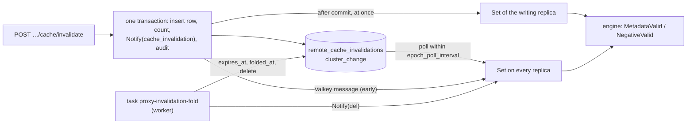
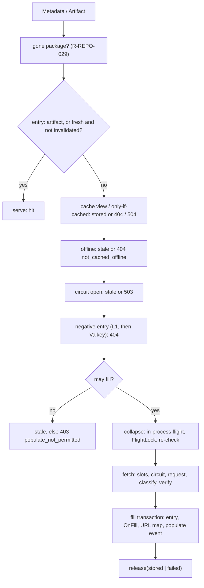

# The pull-through proxy

The remote class of [R-REPO-024 to R-REPO-049](../spec/repositories-and-proxy.md). This page has one section per part: the upstream
clients, the cache invalidation of remote repositories and the engine that answers a request for a remote repository (the request
path, the flights, the circuit, the fill). Code: [internal/proxy](../../internal/proxy/).

## The upstream clients

Package [internal/proxy/upstream](../../internal/proxy/upstream/): the HTTP client of each remote repository, the credentials it
sends, the cache that keeps it, and the upstream test. It sits in the domain layer: it imports `internal/outbound` (the factory,
the only place that builds an HTTP client, R-ARCH-002), `internal/repository` (the settings) and `internal/secrets`.

### Files

| File | Responsibility |
|---|---|
| [clients.go](../../internal/proxy/upstream/clients.go) | `Clients`, `New`, `For` (cached per repository and `config_version`), `Ephemeral` (uncached, for the unsaved test), the build of an outbound client from the settings, the registered cache `proxy_upstream_clients` |
| [client.go](../../internal/proxy/upstream/client.go) | `Client` (`HTTP`, `Settings`, `Origin`, `Allowed`, `Close`), the `guard` transport that fails a request whose credential cannot be resolved |
| [secret.go](../../internal/proxy/upstream/secret.go) | the credential: `secretValue` (fixed, or a reference read again after `RefreshInterval`), `resolver` (file under `config_as_code.secrets_dir`, `TROVE_CAC_` variable), the `Authorization` header, `secretUnavailable` |
| [probe.go](../../internal/proxy/upstream/probe.go) | `TestSaved`, `TestUnsaved`, the probe request, `Classify` and the codes of the result |

### How a client is built

`Clients.For(ctx, repository, settings)` returns the client of a repository in its current `config_version`, building it on a miss. Concurrent
misses of one key share one build; the build belongs to every caller and does not end with the first one's request. `build` applies the settings
to `outbound.Factory.Client(PurposeRemote, …)`:

| Setting | Option |
|---|---|
| `connectTimeoutMs`, `readTimeoutMs` | `WithConnectTimeout`, `WithResponseHeaderTimeout` |
| `proxy.max_redirects` | `WithMaxRedirects` |
| `sourceNetwork` | `WithLocalPrefix(prefix, nil)`: the replica's first interface address inside the prefix, re-enumerated every 60 s; none: `outbound.ErrSourceNetworkUnavailable`, no fallback |
| `outboundProxy.mode: direct` | `WithDirect` |
| `url`, `extraHosts[].sendCredentials`, `forwardAuthOnRedirect`, the credential | `WithHopPolicy(&outbound.CredentialPolicy{Origin, SendCredentials, ForwardOnRedirect, Headers})` |
| the repository key | `WithLogAttrs(repo)` |

The credential reaches the wire only through `CredentialPolicy.Headers`, which reads the current secret on every request. Nothing that builds
a request for an upstream sets `Authorization`: the policy removes any header of that name from every hop and adds the credential where the
rule allows (R-REPO-033, R-REPO-039). The client's transport is wrapped in `guard`, which fails a request with `502 upstream_secret_unavailable`
before it is sent when the credential cannot be resolved, so a vanished secret file never becomes an anonymous request that the upstream
answers with 401.

### Secrets

`authMode: none` reads nothing. Otherwise `buildSaved` reads the repository's rows (`repository.SecretStore`, the field `/remote/password`):

- a sealed value is opened with `repository.OpenSecret` under the row key `(repository id, field)`; a value that was moved, sealed under a key
  the ring lacks or damaged fails;
- a reference is read again by `secretValue.get` when its last read is `RefreshInterval` (10 s) old, `RetryInterval` (1 s) after a failure,
  so a rotated file reaches the next request on every replica without a new client (Q-REPO-89). The rules of R-OPS-029 are checked again when
  the reference is read, so a row written around the API cannot make the client read a file outside `secrets_dir` or a variable outside
  `TROVE_CAC_`.

A failure is `502 upstream_secret_unavailable` (`errs.CodeUpstreamSecretUnavailable`), logged once when the build fails with the cause (the log
line names the repository and the field, never the value); the text for the client names the repository only. `Clients` remembers the refusal
for 5 s. The `Ephemeral` client of the unsaved test takes the inline value or a reference from the request and reads no row.

### The cache

`proxy_upstream_clients` is a registered cache (R-ARCH-018, R-ARCH-032, R-REPO-049) in the area `repo_config`, keyed by `(repository id,
config_version)`, bounded to 2,048 entries, with `cache.snapshot_safety_ttl` as its `SafetyTTL`. A `repo_config` change evicts the clients of
that repository (the payload is `{id, key, op}`); an unreadable payload flushes the cache. When a newer version of a repository is built, the
idle connections of the older one are closed. A change of a secret value moves `config_version` (Q-REPO-88), so a rotated sealed value is a
new key.

### `Allowed`

`Client.Allowed(u)` is the foreign-host check of R-REPO-043: the host of `u` must be the upstream's (same host name and effective port, with
the default ports of the two schemes treated as equal) or match an `extraHosts` pattern (`path.Match` over the lower-case host); otherwise the
answer is `502 foreign_host_denied` and the engine sends no request. It is for URLs that come out of upstream metadata; redirects are decided
by the hop policy and the egress rules.

### The upstream test

`Clients` implements `repository.UpstreamProber`. `TestSaved` and `TestUnsaved` return a `repository.UpstreamTestResult`; every failure is in
the result. The probe is one GET of the format's `ProbePath` below the upstream URL (the URL itself when the path is empty), through the same
client, with `outbound.Call{Repo, FlightRole: "probe"}` for the upstream log. The local address of the connection (`httptrace.GotConn`) is the
`sourceAddress`, reported only when the repository has a `sourceNetwork`. `Classify(err)` maps an error to the stable code (`egress_denied`,
`source_network_unavailable`, `dns_error`, `tls_untrusted`, `connection_refused`, `timeout`, `too_many_redirects`, `insecure_redirect`,
`upstream_secret_unavailable`, `request_failed`); the engine uses it too. The messages are built from the code and the host, never from the
error text of the request, which repeats the URL. An offline repository and `proxy.global_offline` are not contacted. The test touches no
circuit state: this package has no handle on it.

### Wiring

[wire_proxy.go](../../internal/app/wire_proxy.go) builds `Clients` (the outbound factory, `repository.NewSecretStore`, the key ring, the cache
registry, `config_as_code.secrets_dir`) inside the `M2 upstream` marker and binds it to the repository service with `Service.Bind`. The step
is called from the `M2 proxy` marker of the bootstrap, after the repository component.

### Tests

| Tier | Where | Proves |
|---|---|---|
| unit | [upstream_test.go](../../internal/proxy/upstream/upstream_test.go) | Basic and Bearer arrive at a TLS test upstream, references (file, variable, rotation, vanishing, escape attempts), sealed values (copied, moved, damaged, unknown key), the hop policy on a redirect, `Allowed`, the cache and its eviction, the source network with an injected lister, the upstream test (reachable, 401, DNS error, `egress_denied`, untrusted certificate, refused, timeout, offline), `Classify` |
| integration | [test/integration/repository/remote_test.go](../../test/integration/repository/remote_test.go) | the same against PostgreSQL: nothing of a secret in any table or audit event, a copied sealed value, a rotation and `ResealSecrets`, the upstream test leaving the circuit alone |
| integration | [test/integration/api/upstream_test.go](../../test/integration/api/upstream_test.go) | both operations over HTTP with the contract validator |

### Decisions

[Q-REPO-88 to Q-REPO-91](../spec/repositories-and-proxy.md#q-repo-88--a-secret-field-reads-set-true-and-keeps-its-value-in-repository_secrets).

## Cache invalidation

An invalidation makes the cached metadata (scope `metadata`), the cached misses (`negative`) or both
(`all`) of a remote repository under a path prefix count as expired. It deletes nothing and touches no
cache entry: it is one row in `remote_cache_invalidations`, so invalidating a million entries costs one
insert and a count. Each replica holds the rows in memory and answers the engine's question per request
without a query.



### Files

| File | Responsibility |
|---|---|
| [prefix.go](../../internal/proxy/invalidation/prefix.go) | `CheckPrefix` (the grammar of a prefix, Q-REPO-100), `Covers` (whole segments), the scopes |
| [payload.go](../../internal/proxy/invalidation/payload.go) | The payload of the change area `cache_invalidation` and its kinds (Q-OPS-154) |
| [set.go](../../internal/proxy/invalidation/set.go) | `Set`: the replica's copy of the rows, the matcher (`Matcher`), the `cluster.Listener`, the reload loop |
| [store.go](../../internal/proxy/invalidation/store.go) | The load of the rows through the sqlc queries |
| [service.go](../../internal/proxy/invalidation/service.go) | `Service.Invalidate` (the write side) and `Service.Entries` (the entry list of R-REPO-032) |
| [fold.go](../../internal/proxy/invalidation/fold.go) | `Folder` and the job kind and task `proxy-invalidation-fold` |
| [invalidation.sql](../../internal/meta/postgres/queries/invalidation.sql) | Every statement of the package |
| [cache_api.go](../../internal/api/v1/cache_api.go) | The two operations of the management API |
| [wire_invalidation.go](../../internal/app/wire_invalidation.go) | The wiring: one component with the set, the service and the folder |

### What the engine calls

The engine (R-REPO-025 steps 4 and 8) takes a `invalidation.Matcher`. `*invalidation.Set` implements it,
and `(*app.App).InvalidationMatcher()` returns the replica's set (nil on a replica without a client
listener, which serves no proxy request).

```go
package invalidation

type Matcher interface {
	// MetadataValid reports whether a metadata entry of the repository that was last
	// validated at validatedAt still counts: no invalidation of scope metadata or all
	// whose prefix covers path is newer than validatedAt.
	MetadataValid(repoID int64, path string, validatedAt time.Time) bool

	// NegativeValid reports whether a negative entry whose upstream request was sent at
	// sentAt (the "c" of the Valkey value, R-REPO-028) still counts: no invalidation of
	// scope negative or all with a covering prefix was created later than sentAt minus 5 s.
	NegativeValid(repoID int64, path string, sentAt time.Time) bool
}
```

Both answer from memory, take no lock and allocate nothing (about 30 ns with 50,000 rows). Rules for
the caller:

- `repoID` is the repository's identity column (`remote_cache_entries.repo_id`, the `<repo id>` of the
  negative key), not its key. `path` is the canonical path of the entry, the one stored in
  `remote_cache_entries.path`.
- `validatedAt` is the `validated_at` that the engine read from the entry, so the comparison is against a
  time the database wrote. If the engine stamps `validated_at` with a replica clock, the comparison needs
  the allowance that negative entries have (Q-REPO-101).
- An entry for which `MetadataValid` is false is expired for this request whatever its `expires_at` says:
  the engine revalidates it conditionally and serves the stale copy if the upstream fails (INV-11,
  R-REPO-027). An entry that is refreshed gets a new `validated_at` and counts again; nothing else has to
  be done.
- A negative entry for which `NegativeValid` is false is ignored like a malformed one (R-REPO-028). The
  entry is not deleted from Valkey.
- A request for the cache view (`<key>~cache`) and `Cache-Control: only-if-cached` ignore expiry and
  negative entries (R-REPO-032), so they do not ask the matcher.
- An artifact is never invalidated; do not ask for one.

The matcher is empty and answers "valid" until `Set.Start` has loaded the rows. The wiring starts it at
step 8, before the listener opens, and a failing load stops the start-up.

### The write side

`Service.Invalidate(ctx, caller, repo, prefix, scope) (int64, error)`:

| Class of `repo` | What happens | Answer |
|---|---|---|
| remote | One transaction: insert the row (its time is `clock_timestamp()`, Q-REPO-101), count the covered metadata entries (scope `negative`: 0), `Notify(cache_invalidation, {k: add, …})`, record `repository.cache_invalidated` | the count |
| virtual | `Notify(cache_invalidation, {k: virt, r: <virtual id>, p, s})` and the audit event; no row. The merged-metadata cache of the virtual engine consumes the change ([`ParsePayload`](../../internal/proxy/invalidation/payload.go)) | 0 |
| local | Nothing is written | `400 not_applicable` |

A prefix or scope that is invalid answers `422 validation_failed` with the pointer. A repository whose
lifecycle is not `active` is `404 repository_not_found`. The audit record is part of the transaction: a
failing recorder rolls the row and the epoch back (R-OPS-015). The operation is allowed in read-only mode;
the mode itself is not built yet, so nothing in this code consults it.

### Reaching the other replicas

The area `cache_invalidation` is a change area with payload version 1
([areas.go](../../internal/cluster/areas.go)); its `cluster_epoch` row is seeded by migration 00014. A
payload is `{"k","r","i","p","s","t"}` ([payload.go](../../internal/proxy/invalidation/payload.go)); the
prefix is base64url because the payload is limited to 1 KiB and `json.Marshal` writes `<` as six bytes.

| Kind | Written by | A replica's `Set` |
|---|---|---|
| `add` | `Invalidate` on a remote repository | applies the row from the payload, without a query; applying twice changes nothing |
| `del` | the fold task, after it deleted rows | reloads that repository's rows from PostgreSQL |
| `virt` | `Invalidate` on a virtual repository | ignores it |
| unknown, or unreadable | a newer build | reloads every repository |

The poll applies a change within `cluster.epoch_poll_interval`; the Valkey message is an early eviction
and the writing replica applies its own change right after the commit. A `FlushArea` (a gap in the change
log, an epoch that went backwards, an unknown payload version) reloads everything, and so does the timer
`cache.snapshot_safety_ttl`, which covers the rows that the cascade of a repository deletion removed
without a notice. A reload merges the rows that arrived by payload while its query ran, so a row is never
lost to the race; a failed reload keeps what is in memory and tries again. **A row leaves memory only when
a reload no longer finds it in the database**: an `all` row whose fold is late must keep invalidating
(R-REPO-045), so the set is bounded by the table and never drops a row by itself.

### The fold task

`proxy-invalidation-fold` (Q-OPS-153) is a scheduled task on the `maintenance` queue, exclusive, every five
minutes unless `maintenance.tasks.proxy-invalidation-fold` says otherwise; it can be started with
`POST /api/v1/system/tasks/proxy-invalidation-fold/run`. One run:

1. For each unfolded row, oldest first, in batches of 5,000 entries, each batch a transaction:
   `expires_at = LEAST(expires_at, row time)` for the metadata entries under the prefix with
   `validated_at` before and `expires_at` after the row time, locked in key order and not skipped
   (Q-REPO-103). Then `folded_at` is set. A `negative` row has nothing to fold and is marked at once.
2. For each row that is due, one more fold pass, then the delete, and a `Notify(del)` per repository in the
   same transaction. Due is: a `metadata` row one hour after `folded_at`; a `negative` or `all` row 86,405 s
   after `created_at` (`NegativeRetention`), the largest `notFoundTtlSeconds` plus the clock allowance, and
   only if it is folded.

The task is idempotent and resumable by the columns alone. The clock of the retention checks is an option
of `Folder`, which is how the tests move time. It takes about 70 s for a million entries on the
integration stack; the call that created the row does not wait for it.

### The management API

| Operation | Declaration | Handler |
|---|---|---|
| `POST /api/v1/repositories/{repoKey}/cache/invalidate` | `action: manage` on the path's repository; the system administrator holds it | `InvalidateRepositoryCache` |
| `GET /api/v1/repositories/{repoKey}/cache/entries` | `authenticated: true`; the handler admits a holder of `repositories:read-config` or of `manage` and applies the endpoint ceiling to both (Q-OPS-155) | `ListCacheEntries` |

Both live in [cache_api.go](../../internal/api/v1/cache_api.go) and follow the shared authorization step:
the request's holder (`edge.Access`) is the one the step took, and the handler asks it. The services
arrive in `v1.Options.Cache` (`CacheServices`); a nil member answers 503. The entry list pages by
`(path, variant)` with the cursor of R-API-010 and lists `kind=metadata` (default) or `kind=artifact`; it
answers `400 not_applicable` for a repository that is not remote. It reads PostgreSQL: it is a
diagnostic, not a request path.

### Wiring

[wire_invalidation.go](../../internal/app/wire_invalidation.go) builds one component, `invalidation`, at the
M2 proxy marker of step 8: the `Set` (only on a replica with a client listener), the `Service` and the
`Folder`. It adds no field to `App`: the accessors find the component in the list of started ones. The
registration lines in the core files are three, each inside an `M2 proxy` marker:
`a.wireInvalidation(ctx, infra)` in [app.go](../../internal/app/app.go) (the bootstrap),
`Cache: a.cacheAPI()` in the same file (the handler options) and `a.registerInvalidationJobs(r)` in
[wire_jobs.go](../../internal/app/wire_jobs.go) (the job registry).

### Tests

| Test | Tier | Requirement |
|---|---|---|
| `internal/proxy/invalidation` unit tests (`TestCovers`, `TestCheckPrefix`, `TestMatcher`, `TestSetApplyChange`, `TestSetReload`, `TestSetLoop`, `TestPayloadFitsAChangeMessage`) | unit | R-REPO-045, R-REPO-028 allowance, R-ARCH-018 payload limit |
| `internal/api/v1` `TestCacheAPI` | unit, answers validated against the OpenAPI document | R-API-024, R-REPO-032, R-API-003 |
| `test/integration/repository` `TestInvalidationAtScale` (1,000,000 entries, under 1 s, one row) | integration | R-REPO-045 |
| `test/integration/repository` `TestInvalidationPrefixes`, `TestInvalidationNegativeRetention` (86,405 s with a test clock), `TestInvalidationRetention`, `TestInvalidationService`, `TestCacheEntryList` | integration | R-REPO-045, R-REPO-032, R-OPS-015 |
| `test/integration/coordination` `TestInvalidationPropagation` (two replicas: without Valkey, with the Valkey client unavailable, with Valkey) | integration | R-OPS-021 |
| `test/integration/files` `TestR_API_024_CacheOperations` (the real decision point, two replicas) | integration | R-API-024, R-REPO-032 |

Not covered here, and owned by the engine's package: the conditional upstream request after an invalidation
and the stale copy served while the stub is down (R-REPO-045 acceptance), because they need the engine.
The variant of R-OPS-021 with Valkey really stopped belongs to the end-to-end set; here the client is
unavailable through an unreachable Sentinel, which is the same path of the client.

### Security notes

- `manage` on the repository is the only permission that invalidates (or the administrator role); the
  call is the one way to cut a forged negative entry short without a Valkey credential (H-49).
- An invalidation can force a conditional upstream request for every cached package of a repository. The
  rate limit of the management API applies, and the call is audited with the prefix, the scope and the
  count.
- The entry list shows the upstream URLs a repository was fetched from (without user info, R-REPO-025);
  it is open to the holders of `repositories:read-config` and `manage` only.

## The engine

Package [internal/proxy](../../internal/proxy/): the request path of [R-REPO-025](../spec/repositories-and-proxy.md), the collapsing protocol
of R-REPO-026, freshness, the negative cache, failure handling and the circuit (R-REPO-027 to R-REPO-031), the cache view (R-REPO-032),
the limits and verification of R-REPO-040 to R-REPO-042 and the observability of R-REPO-047. It is a domain package and knows no format:
the format reaches it through [formathost/remote.go](../../internal/formathost/remote.go), which adapts a `formats.RemoteAdapter` to
`proxy.Adapter` for one request and the decision point to `proxy.Populate` (Q-ARCH-200).



### Files

| File | Responsibility |
|---|---|
| [types.go](../../internal/proxy/types.go) | `Request`, `Remote`, `Document`, `Adapter`, `Populate`, the URL builder `UpstreamBase` (every segment encoded again) |
| [engine.go](../../internal/proxy/engine.go) | `Options`, `New`, `Drain`/`Quiesce`, the cheap steps (offline, fill check), the gone-package gate, `EntryState`, `CachedArtifacts` |
| [metadata.go](../../internal/proxy/metadata.go) | `Metadata`, `EnsureCurrent`, freshness, the document answer, the metadata fill transaction and the URL map |
| [artifact.go](../../internal/proxy/artifact.go) | `Artifact`, `Cached`, `HEAD`, the artifact fetch, the entry written in the item commit, the immutability checks |
| [flight.go](../../internal/proxy/flight.go) | the in-process flight, `lead` (Acquire, Wait, re-check, bypass), `recheck` |
| [fetch.go](../../internal/proxy/fetch.go), [classify.go](../../internal/proxy/classify.go) | one fetch: slots, circuit, request, the retry, classification of the outcome (R-REPO-029 table) |
| [state.go](../../internal/proxy/state.go) | the per-repository state cache (circuit, gone documents), the probe slot, `markGone` |
| [negative.go](../../internal/proxy/negative.go) | the negative L1 and its readers' validation (R-REPO-028) |
| [integrity.go](../../internal/proxy/integrity.go), [body.go](../../internal/proxy/body.go) | digests, the withheld tail (`stream`), the size limit, the idle timeout of a body |
| [slots.go](../../internal/proxy/slots.go), [probe.go](../../internal/proxy/probe.go), [cachestatus.go](../../internal/proxy/cachestatus.go), [metrics.go](../../internal/proxy/metrics.go), [store.go](../../internal/proxy/store.go) | fetch slots, `Probe`, the `Cache-Status` header, metrics, the reads of the sqlc queries |
| [proxy.sql](../../internal/meta/postgres/queries/proxy.sql) | every statement of the engine |
| [proxytest/](../../internal/proxy/proxytest/) | a counting adapter, a counting TLS upstream and a counting `Populate`, for tests that need no format |

### The collapsing protocol in code

`collapse` joins the in-process flight of the key or leads one. The leader's flight runs in its own goroutine on a context detached from
the client (it ends only at `Quiesce`), so a client that leaves does not stop a fetch others wait for. `lead` is R-REPO-026 steps 3 to 6:
re-check (steps 4 to 8), `Acquire`, `Wait` and re-check in a loop bounded by `proxy.fetch_wait_timeout_seconds`, a bypass with its reason
(`valkey_unavailable`, `wait_timeout`, `draining`) when no lock can be had, the fetch, and `Release` with `stored` or `failed`. A draining
replica never calls `Acquire`; it waits for another replica's flight and fetches under its own single-flight otherwise. The re-check counts an
entry whose `validated_at` differs from the one the request read first as fresh, so a period of 0 does not make every waiter fetch again.
`flight_role` is defined in Q-REPO-92.

The leader's own client is streamed (`stream`) only when the upstream announced a length and the request is a plain `GET`; the last 64 KiB
wait for the commit. A failure after the status line is `panic(http.ErrAbortHandler)` in the handler goroutine, which the format dispatcher
lets through. The stream is the request's, not the flight's: `detach` ends its share before the handler returns.

### State per replica (R-ARCH-032, R-REPO-049)

| State | Registered as | Kept fresh by |
|---|---|---|
| circuit and gone documents of a repository | cache `proxy_upstream_state`, area `upstream_state` | a change reloads the repository in the background; the writer takes the state from `RETURNING` |
| negative L1 | cache `proxy_negative_l1` (`proxy.negative_l1_entries`) | nothing: readers validate window and invalidations |
| bytes of metadata by digest | cache `proxy_metadata_bytes` (`proxy.metadata_cache_bytes`) | nothing: content-addressed |
| flights, probe slots, fetch slots | plain fields of the engine | end with the process |

### The fill

A metadata document: `PrepareFill` (outside any transaction), then `blob.Commit` with a link function that locks the entry, runs
`OnFill`, upserts the entry (the newer `fetched_at` wins), records the URL map, attaches the `metadata_changed` signal and writes the
populate event. An artifact: `items.Commit` (origin `fill`, `MayOverwrite`) with an `Extra` that locks the entry, refuses another digest
(`proxy.upstream_digest_changed`), inserts the entry and writes the populate and `artifact.cached` events. No transaction is open during a
transfer, a wait or an extension.

### Wiring

[wire_proxy_engine.go](../../internal/app/wire_proxy_engine.go) is the area `proxy-engine` (a component with `Drain` and `Quiesce`); its
inputs are the upstream clients, the invalidation set, the item store and the replica count. The format host takes it as `Options.Engine`.

### Binding to the virtual engine

[formathost/virtual_remotes.go](../../internal/formathost/virtual_remotes.go) implements `virtual.Remotes` over the engine (`NewVirtualRemotes`),
and the area `virtual-engine` takes it ([wire_virtual_engine.go](../../internal/app/wire_virtual_engine.go)). Per call it builds the engine's
request for the member (the format's adapter, the kind from the format's classification of the path) with a populate check that answers the
`MayFill` the virtual engine decided; `Engine.Peek` supplies `Negative`, `Offline` and `CircuitOpenFor` of the explanation. A fill made for a
virtual request records its allowed populate event with the grant reason of the caller (the call carries no grant index to name sources).

### Tests

| Tier | Where | Proves |
|---|---|---|
| unit | [proxy_test.go](../../internal/proxy/proxy_test.go) | the URL builder (`%2e%2e`, `a b`), the `Cache-Status` forms, digest policies, the withheld tail, the size limit, the idle timeout, slot shares, the classification table, the negative readers, `withStatus` |
| unit | [remote_test.go](../../internal/formathost/remote_test.go) | mode, settings member, currency of the bridge |
| integration | [test/integration/proxy](../../test/integration/proxy/) | R-REPO-025 order and download order (R-ARCH-013); R-REPO-026 on two replicas (100 requests, killed and cancelled holders, draining, polling without messages, foreign locks, duplicate fills); R-REPO-027 to R-REPO-032; R-REPO-040 to R-REPO-043; R-REPO-047, R-OPS-011; R-AUTHZ-008 and R-EP-019 at the engine |

The variants that need the real outage (Valkey stopped, `SIGKILL` of a pod, `kubectl drain`, S3 stopped, `FLUSHALL`) are end-to-end tests: here Valkey
is unavailable through a client whose Sentinels do not answer, the holder is a second client that is closed, and the object store fails through a
wrapper. Not tested here: the criteria with a `sourceNetwork` on two pods (R-REPO-024), `npm` clients, the dispatcher setting `CacheView`.

### Decisions

[Q-REPO-92 to Q-REPO-99](../spec/repositories-and-proxy.md#q-repo-92--the-role-of-an-upstream-request-in-the-flight-is-how-its-request-came-to-send-it),
[Q-ARCH-200 to Q-ARCH-204](../spec/architecture.md#q-arch-200--the-engine-takes-a-format-through-its-own-adapter-and-the-populate-check-through-an-interface).

### Security notes

- The engine never sets `Authorization`; the client's hop policy adds the credential (R-REPO-033). The upstream URL of an artifact comes from
  the recorded map only after `Client.Allowed` accepted its host, and no client path can choose a host (R-REPO-043).
- The URL builder encodes every canonical segment again and refuses `.` and `..`: a client that sent `%252e%252e` cannot make trove request `..`
  with the upstream credentials.
- A value read from Valkey (a negative entry, a lock) can only make a request answer 404 or wait at most `proxy.fetch_wait_timeout_seconds`;
  the probe of a shadowing check reads neither (R-ARCH-030).
- A refused fill (`populate_not_permitted`, an endpoint without `cache_fill`) writes no negative entry and sends no request.
