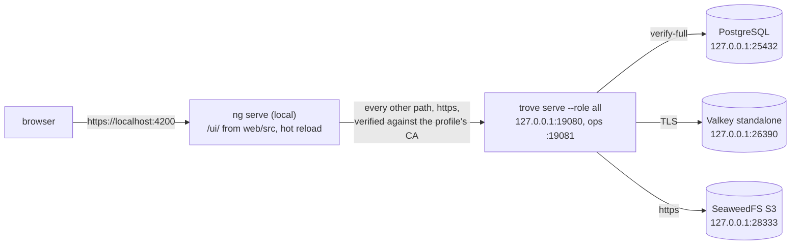

# Web UI: workspace, build and serving

The UI is an Angular 22 workspace in [web/](../../web/) and a small Go package,
[internal/webui/](../../internal/webui/), that embeds the build and serves it under `/ui/{locale}/`.
Requirements: [R-ARCH-004](../spec/architecture.md), [R-UI-001](../spec/api-and-ui.md),
[R-UI-045](../spec/api-and-ui.md), [R-UI-046](../spec/api-and-ui.md),
[R-UI-047](../spec/api-and-ui.md).

The shell (skip link, top bar with the mark, the repository search, the Admin button, the Documentation link, the theme button and the user menu, a sidebar per area
pinned from 1024 CSS px with folding groups, collapsible, and a drawer below, the content panel with the breadcrumb bar, banner area, notice regions, router outlet; see
[Shell, design tokens and the list components](#shell-design-tokens-and-the-list-components)), the HTTP layer, the session handling and every
cross-cutting UI mechanism are in place, so the screens are content. Built: sign-in, signed out, the system status
screen with its jobs screen, the repository list, wizard and edit form with the format settings rendered from the format's schema (see
[The repository settings form](#the-repository-settings-form-rendered-from-the-formats-schema)), the file tree, the endpoint screens with the exposure rule editor and
the audit log (see [Screens of the catalog area](#screens-of-the-catalog-area)), and the package screens: the list, the details with the install panel and the README, and the client setup page (see [Package screens and client setup](#package-screens-and-client-setup)), and the guides area with the How to use tab of the repository screen (see [Guides](#guides)), the help area with the manual (see [manual.md](manual.md)), the Bastions screen (see [The Bastions screen](#the-bastions-screen)), and the vulnerability screens with the package page's tab (see [The vulnerability screens](#the-vulnerability-screens)); the other routed M1 screens are placeholders with their final
path and title until their work package replaces them. Requirements: [R-UI-002 to R-UI-005](../spec/api-and-ui.md),
[R-UI-010, R-UI-011](../spec/api-and-ui.md), [R-UI-020, R-UI-021](../spec/api-and-ui.md), [R-UI-037, R-UI-038](../spec/api-and-ui.md),
[R-UI-042 to R-UI-047](../spec/api-and-ui.md), [R-EP-017](../spec/endpoints.md); decisions Q-UI-10 to Q-UI-19 and Q-UI-68 (shell and list layout) on the same page.

## Workspace layout

| Path | Responsibility |
|---|---|
| [web/package.json](../../web/package.json), `package-lock.json` | Exact versions (no `^`/`~`), committed lockfile. `overrides` lets openapi-typescript 7 (peer `typescript ^5`) install next to TypeScript 6, which Angular 22 uses |
| [web/.nvmrc](../../web/.nvmrc) | The one Node.js version for local runs and CI. Angular 22.2 requires `^22.22.3 \|\| ^24.15.0 \|\| >=26.0.0` (`engines` in package.json) |
| [web/angular.json](../../web/angular.json) | Locales (`en` source, `de`), `baseHref: /ui/`, `localize: true`, `i18nMissingTranslation: error`, bundle budgets, the Vitest unit-test builder |
| [web/tsconfig.json](../../web/tsconfig.json) | `strict`, `noUncheckedIndexedAccess`, `strictTemplates`, extended diagnostics as errors |
| [web/src/index.html](../../web/src/index.html) | Root element `<trove-root ngCspNonce="TROVE_CSP_NONCE">`; `internal/webui` replaces the literal on every response |
| [web/src/main.ts](../../web/src/main.ts) | `bootstrapApplication(App, appConfig)` |
| [web/src/locale/](../../web/src/locale/) | `messages.xlf` (extracted source), `messages.de.xlf`, [GLOSSARY.md](../../web/src/locale/GLOSSARY.md) |
| [web/src/styles/](../../web/src/styles/) | `_tokens.scss` (trove custom properties: spacing, type, radii, elevation, content colours, the navigation and search-field colours, light/dark), `_controls.scss` (trove's own buttons, fields and checkboxes, Q-UI-126), `_icons.scss` (self-hosted icon font), `_shell.scss` (top bar, sidebar, rail, breadcrumbs, the frame of the screens without the shell), `_list-screens.scss` (data table, filter toggle, filter panel, list layout), `_catalog-screens.scss` (older shared classes), `main.scss` (Material theme, the palette of the design language as `mat.theme-overrides`, button shape, density -2; [design-language.md](design-language.md)), `palette.spec.ts` (the contrast of the accent pairs, computed from `main.scss` and `_tokens.scss`, which it imports as text through `stylesheet-text.d.ts`) |
| [web/src/app/app.ts](../../web/src/app/app.ts), `app.html` | Root standalone component: skip link, top bar (mark, repository search, project filter, Admin button, Documentation link to the screen's manual page, theme menu, user menu with initial badge: profile, client setup, language, sign out), the sidebar of the current area from `core/navigation.ts` (collapsible, a drawer below 1024 CSS px), the content panel with breadcrumbs, banner, notices, outlet; screens with `data.bare` without any of it; opens the session dialogs |
| [web/src/app/app.config.ts](../../web/src/app/app.config.ts) | Router (component input binding, `TroveTitleStrategy`), `HttpClient` on fetch with the XSRF configuration of R-AUTH-012 and the three interceptors, `provideApiServices()`, global error listeners |
| [web/src/app/app.routes.ts](../../web/src/app/app.routes.ts) | `/login` and `/logged-out` without a guard; everything else under `authGuard`; one lazy `loadChildren` per area |
| [web/src/app/api/](../../web/src/app/api/) | `client.ts` (`ApiClient`), `problem.ts` (`Problem`, `ApiError`), `pagination.ts` (`collectAll`, `PagedList`), `types.ts` (helpers over the generated types), one `*-api.ts` per endpoint family (abstract service class, hand-typed DTO where the OpenAPI document lacks the operation, HTTP implementation), `providers.ts`, `testing/fakes.ts`. Catalog services typed from the generated schema: `repositories-api.ts` (repositories and the format catalog), `files-api.ts` (items, children, statistics, delete, upload and folder creation; the XHR client of Q-UI-16), `endpoints-api.ts` (endpoints, exposure rules, the dry run), `audit-api.ts`, `jobs-api.ts` (jobs and tasks); `csrf.ts` holds the CSRF cookie and header names; their fakes are in `testing/fakes-catalog.ts` and `provideFakeApis()` spreads them |
| `web/src/app/api/generated/` | `schema.d.ts` from openapi-typescript, committed, never edited |
| [web/src/app/core/](../../web/src/app/core/) | `session-store.ts`, `authz-epoch.ts`, `auth-guard.ts`, `navigation.ts` (areas, groups, icons, capabilities, the area of a route), `nav-state.ts` (collapsed and folded groups per principal), `breadcrumbs.ts`, `preferences-store.ts`, `project-filter.ts` (the projects of the header filter and the selected one), `notifier.ts`, `title-strategy.ts`, `focus-on-navigation.ts`, `storage.ts` (the only user of browser storage), `browser-navigation.ts` (`safeReturnTo`), `layout.ts`, `banner-store.ts`; `http/interceptors.ts` and `http/problem-messages.ts` |
| [web/src/app/shared/](../../web/src/app/shared/) | `ErrorNotice`, `Notices`, `SessionDialog`, `ConflictDialog` with `ConflictResolver`, `Banner`, `ScreenPlaceholder` and `placeholderRoute`; `access/` (building blocks of the identity and permission screens, see below); for the forms and lists of the catalog area: `PagedResource` (a "Load more" list as signals, with `start`, `more`, `reload`, `replace`, `remove`; used by every list screen) with `asApiError`, and `valueOf` (a resource's value without the throw of the error state), `merge-patch.ts` (RFC 7396 diff and apply), `field-errors.ts` (`ErrorSummary`, `fieldMessage`, `fieldErrorAt`, `problemsAt`), `unsaved-guard.ts`, `drafts.ts` (`DraftStore`: a draft across a re-authentication and the registry behind "Copy draft as JSON"), `ui/data-table.ts` and `ui/filter-panel.ts` (the list components, see below), `confirm-dialog.ts` (`Confirm`: confirm, type-to-confirm, an optional choice that starts ticked or not), `diff-dialog.ts`, `copy-button.ts`, `job-progress.ts` (polling progress component) |
| [web/src/app/features/](../../web/src/app/features/) | One folder per area with an `<area>.routes.ts` (`login`, the identity and permission areas of the section below, `system`, `repositories`, `browse`, `endpoints` and `audit` carry built screens), `not-found` |
| [web/src/app/testing/](../../web/src/app/testing/) | `axe.ts`, the accessibility helper of the component specs; `screen.ts`, `renderScreen` (a screen against the fakes, dialogs without animation, a catch-all route), `settle`, `sleep`, `expectAccessible`, `browserStorage` and `storedText`, and the small DOM helpers of the specs (`text`, `button`, `buttonByText`, `type`, `typeInto`, `openFilters`) |
| [web/e2e/](../../web/e2e/) | The Playwright journeys of R-UI-047 and their support code, a TypeScript project of its own (`web/e2e/tsconfig.json`, type-checked with `npx tsc -p e2e/tsconfig.json`); `@playwright/test`, `@axe-core/playwright` and `@types/node` are devDependencies of this workspace, so one lockfile pins them. Not part of the Angular build or of `make web-lint`. Described in [e2e.md](e2e.md#browser-journeys) |
| [web/scripts/](../../web/scripts/) | `build-embed.mjs`, `check-budget.mjs`, `check-rules.mjs`, `brand-logo.mjs` (writes the logo, see [design-language.md](design-language.md#logo)) |
| [web/public/brand/](../../web/public/brand/) | The logo as SVG, generated by `scripts/brand-logo.mjs`: `trove-mark.svg`, `trove-square.svg`, `trove-horizontal.svg`; `drafts/` holds the variants the sign-in screen's preview shows in development builds while the logo is designed |
| [web/eslint.config.js](../../web/eslint.config.js) | angular-eslint plus the R-UI-046 rules |

## Commands

Run in `web/` after `nvm use` (or any Node matching `.nvmrc`).

| Command | What it does |
|---|---|
| `npm ci` | Install exactly the lockfile |
| `npm start` | Dev server, English only (the `development` configuration builds one locale), without a backend |
| `npm run start:local` | Dev server of the `local` configuration: HTTPS, and every path outside `/ui/` proxied to the trove of the [UI development profile](#local-ui-development) |
| `npm run lint` | ESLint (including the four R-UI-046 rules) and `scripts/check-rules.mjs` |
| `npm test` | Vitest through `@angular/build:unit-test`, jsdom, single run, headless; `src/test-setup.ts` raises the per-test timeout to 30 s, because the accessibility check of a large screen takes several seconds on a shared CI runner (the default of 5 s guards against hangs, it is no budget) |
| `npm run test:coverage` | The same with a V8 coverage report (`src/app/**`, generated code excluded) |
| `npm run extract-i18n` | Rewrites `src/locale/messages.xlf`; then add the `<target>` units to `messages.de.xlf` |
| `npm run generate:api` | `openapi-typescript ../api/openapi.yaml` into `src/app/api/generated/schema.d.ts`, committed. Rerun it whenever `api/openapi.yaml` changes |
| `npm run build` | Localized production build into `web/dist/web/browser/<locale>/` |
| `npx playwright install --with-deps chromium` | The browser build of the locked Playwright version, outside the repository (needed for the journeys, not for `npm test`) |
| `npm run build:embed` | `build`, the compressed-size budget check, the check of the hashed names ([hashed.mjs](../../web/scripts/hashed.mjs)), then copy each locale to `internal/webui/dist/<locale>/`. `TROVE_UI_BUNDLE_MARK=1` builds the second bundle of the upgrade test (`--extract-licenses=false`: the same code under other hashed names, Q-HA-124) |

`make web` runs `make web-ci` (`npm ci`) and `make web-embed` (`npm run build:embed`); lint and the unit tests are
`make web-lint` and `make web-test`.

## Local UI development

Hot reload against a real trove, without the kind cluster: the Angular dev server serves the UI from the
working tree, and everything else goes to one trove replica on the host, backed by its own small set of
containers ([deploy/ui-dev/](../../deploy/ui-dev/)). Containers, volumes and ports are its own, so it runs next to
the integration stack (`trove-it-*`) and the [kind profile](local-profile.md) (cluster `trove`, edge on `:8080`)
without touching either.



```shell
make web-ci            # once, and after a change of web/package-lock.json
make ui-dev-up         # the containers, the buckets, .dev/ui-dev (certificates, secrets, key ring, trove.yaml)
make ui-dev-backend    # terminal 1: builds trove, migrates, runs it in the foreground; prints the sign-in
make ui-dev-web        # terminal 2: https://localhost:4200/ui/
make ui-dev-down       # stops the containers, keeps the data; PURGE=1 removes the data and .dev/ui-dev
```

Sign in with `admin` and the password `make ui-dev-backend` prints (`.dev/ui-dev/secrets/break-glass-password`,
random per checkout). A change under `web/src` reaches the open page at once; a change of the Go code needs
Ctrl-C and `make ui-dev-backend` again, which rebuilds the binary and applies new migrations. Repositories,
packages and users created in the UI stay in the volumes across restarts.

**The dev server is the edge.** trove's `server.base_url` is `https://localhost:4200`, so the `__Host-` cookies,
the origin check of R-AUTH-012 and trove's redirects work exactly as behind a real edge, and the proxy rewrites
nothing: it keeps the Host header, adds `X-Forwarded-For` (trove trusts `127.0.0.1` as its edge) and verifies
trove's certificate against the profile's CA, which `npm run start:local` hands to Node.js in
`NODE_EXTRA_CA_CERTS`. The proxy is [web/proxy.conf.mjs](../../web/proxy.conf.mjs) (one rule, `^/(?!ui(/|$))`); the
`local` configuration of the `serve` target in [web/angular.json](../../web/angular.json) sets it, HTTPS and the
certificate. `TROVE_UI_DEV_BACKEND` points the proxy at another trove (default `https://localhost:19080`); a sign-in
through the dev server works only against a trove whose base URL is `https://localhost:4200`.

| Piece | Where | Set by |
|---|---|---|
| PostgreSQL, Valkey (standalone), SeaweedFS | containers `trove-ui-dev-*`, volumes `trove-ui-dev_*`; images `INTEGRATION_POSTGRES_IMAGE`, `VALKEY_91_IMAGE`, `SEAWEEDFS_IMAGE` of [tools/versions.env](../../tools/versions.env) | [compose.yaml](../../deploy/ui-dev/compose.yaml), [up.sh](../../deploy/ui-dev/up.sh) |
| Certificates: a CA of its own, one certificate per service with the SANs `localhost` and `127.0.0.1` | `.dev/ui-dev/certs` | [test/integration/certs.sh](../../test/integration/certs.sh), called by `up.sh` |
| Secret files, the key ring (`dev`), the break-glass password | `.dev/ui-dev/secrets`, written once | `up.sh` |
| trove's configuration | `.dev/ui-dev/trove.yaml`, rewritten by every `up.sh` | `up.sh` |
| trove binary | `.dev/ui-dev/bin/trove` | [serve.sh](../../deploy/ui-dev/serve.sh) |

**Where it differs from an installation**, so a finding is checked in the embedded build before it is called a defect:

- English only. The dev server builds one locale and serves it at `/ui/`, not `/ui/en/`. Choosing German in the user
  menu stores the preference and loads `/ui/de/…`, which the dev server does not have; keep the language on English
  here and check German with `make web` and the embedded build.
- No Content Security Policy. The dev server sends `index.html` without trove's CSP header and leaves the nonce
  placeholder in place, so a CSP or Trusted Types violation shows only in the embedded build.
- Break-glass sessions last 8 h idle and 24 h absolute instead of 15 min and 1 h, so the session-expiry dialogs
  do not appear during a normal working session; there is no OpenID provider, so the sign-in screen shows the
  local form only.
- The advisory sources (OSV, KEV) are off: the vulnerability screens stay empty.
- A new installation is empty: repositories and packages are created through the UI or the API.

The browser warns about the dev server's certificate until the CA is trusted. Trusting it system-wide is your choice,
not something the scripts do (macOS: `sudo security add-trusted-cert -d -r trustRoot -k /Library/Keychains/System.keychain .dev/ui-dev/certs/ca.crt`).
The CA has no name constraints and its key lies in `.dev/ui-dev/certs/ca.key` (mode 0600): whoever can read that file
can then issue certificates your machine trusts for any host. Remove the trust entry when you run `make ui-dev-down PURGE=1`.

## How the build reaches the binary

```text
web/ ──npm run build:embed──> web/dist/web/browser/{en,de}/ ──copy──> internal/webui/dist/{en,de}/
                                                                       internal/webui/dist/index.html  (committed placeholder)
internal/webui:  //go:embed all:dist
```

- `internal/webui/dist/index.html` is committed. It is a one-page notice and carries the nonce
  placeholder, so `go build ./cmd/trove` works on a clean checkout without Node.js (R-ARCH-003).
- The locale directories `internal/webui/dist/<locale>/` are **not committed**
  ([internal/webui/.gitignore](../../internal/webui/.gitignore) ignores `/dist/*/`). Release builds
  run `npm run build:embed` first. `build:embed` deletes stale locale directories and copies the new
  ones; it never touches `dist/index.html`, so a clean checkout and a built tree both start.
- `webui.New` decides at start-up: no locale directory in the tree means placeholder mode (every
  configured locale serves the placeholder page, `Handler.Placeholder()` is true); every configured
  locale built means normal mode; a mix fails start-up, so a half-built UI cannot ship.
- `build:embed` checks every locale directory against the hashed pattern of
  [internal/webui/hashed.go](../../internal/webui/hashed.go) (Q-UI-140): every file but `index.html` and the copies of
  `web/public` must match it, and no copy of `web/public` may. A change of the builder's names fails here, not in a rolling
  upgrade; `TestHashedPatternOfTheBuild` keeps [hashed.mjs](../../web/scripts/hashed.mjs) equal to the Go pattern.
- The Go package does not compress. Compression belongs to the edge or a middleware of the server
  shell.

## Serving rules

[internal/webui/webui.go](../../internal/webui/webui.go), mounted at `/ui/` by the server shell:

| Request | Answer |
|---|---|
| `/ui/` or `/ui/<route>` without locale | `302` to `/ui/<locale>/<route>` with the query kept. Locale: `Options.Preference` (the app sets it to `uiLocalePreference` in [internal/app/ui_locale.go](../../internal/app/ui_locale.go): it resolves the `__Host-trv_session` cookie with the read-only `session.Store.Peek` (no touch, no ending of sessions), because the authentication stage ignores the cookie on `/ui/`, and reads `user_preferences.locale`; Q-API-184), then `Accept-Language` (q-values, `de-DE` matches `de`), then `Options.DefaultLocale`. `Cache-Control: no-store`, `Vary: Accept-Language` |
| `/ui/<locale>` | `302` to `/ui/<locale>/` |
| `/ui/<locale>/` and any path whose last segment has no `.` | The locale's `index.html` with nonce and document headers (SPA fallback) |
| `/ui/<locale>/<file with extension>` | The file; `404` problem+json if missing or a directory. It never falls back to the index |
| `/ui/<locale>/<hashed file>` the build lacks | From the shared asset store with the headers of the build's own files; `404` when no release published it, `503` with `Retry-After: 1` and `no-store` when the store cannot be asked ([The shared asset store](#the-shared-asset-store)) |
| Method other than `GET`, `HEAD` | `405` with `Allow` |

**Nonce.** `New` reads each `index.html` once. Per response it draws 128 bits from `crypto/rand`
(`rand.Text()`), replaces every `TROVE_CSP_NONCE` with it, and puts the same value in
`style-src 'nonce-…'`. The Angular build copies the placeholder into the `nonce` attribute of the
script, modulepreload and stylesheet tags and keeps `ngcspnonce` on the root element, from which
Angular reads the nonce for styles it inserts. `New` refuses an `index.html` without the
placeholder. The CSP is the one of R-UI-001; image origins come from `Options.ImageOrigins` and
must be exact `https://host[:port]` values.

**Caching.** Hashed files get `Cache-Control: public, max-age=31536000, immutable`: a last segment
`<name>-<8 characters of A–Z, a–z, 0–9, _ and ->.<extension>` in at most two plain directories (`webui.IsHashed`, Q-UI-140).
esbuild names the entry files with eight upper-case base32 characters (`main-6E6OBYEH.js`), the chunk optimizer the chunks with
eight base64url characters of either case (`chunk-Bo__WLzq.js`, `chunk-b3RHWPW-.js`); the earlier pattern took only the first, so
the chunks were served `no-cache`. `index.html` and other files (`favicon.ico`, `favicon.svg`) get `no-cache`. The build runs with
`outputHashing: all`, so every script, stylesheet and font is hashed. Unhashed files have no validator yet, so `no-cache` means a
full download each time; that is acceptable for the favicon and revisited if the unhashed set grows.

Mount and options:

```go
h, err := webui.New(webui.Options{
    Locales:       []string{"en", "de"}, // ui.locales
    DefaultLocale: "en",                 // ui.default_locale
    ImageOrigins:  nil,                  // exact https origins, appended to img-src
    Preference:    nil,                  // func(*http.Request) string, the user's stored locale
})
mux.Handle("/ui/", h) // do not strip the prefix
```

The app sets two more: `Shared` (the shared asset store, `nil` on a replica without the area `ui-assets`) and `OnSharedError`
(the log line of a `503`); `Assets` replaces the embedded build in tests (`app.Options.UIAssets`, `testenv.ReplicaOptions.UI`).

## The shared asset store

A rolling upgrade runs two releases side by side, and the edge spreads one page's requests over both: the `index.html` of one
release names `main-<hash>.js`, `polyfills-<hash>.js` and `chunk-<hash>.js`, which the other release's build does not have (F-58,
R-HA-020). Every replica that serves the UI therefore publishes the hashed files of its build to a store that every replica reads,
and serves a hashed file its own build lacks from there ([Q-HA-120](../spec/ha-and-helm.md#q-ha-120--how-a-replica-serves-a-hashed-ui-file-of-the-other-release)
to [Q-HA-125](../spec/ha-and-helm.md#q-ha-125--the-rolling-upgrade-from-a-release-without-the-store-stays-strict)).

```text
replica of release N (api, web, all)                         replica of release N-1
  start-up: wireUIAssets ─ Publish(build of N) ─┐              GET /ui/en/main-<N>.js
  hourly:   Keeper ─ renew, publish missing,    │                own build? no ─ hashed? yes
            prune rows not renewed for 7 days   ▼                       │
                                     blob store (content, INV-4)  ◄─────┤ Store.Asset: ui_assets (locale, path) → blob,
                                     ui_assets  (locale, path,         │ read and verified, kept in memory
                                                 blob, seen_at)  ──────┘ → 200 with the headers of its own files
```

| File | Responsibility |
|---|---|
| [internal/webui/hashed.go](../../internal/webui/hashed.go) | `IsHashed` (the pattern of R-UI-001, Q-UI-140), `HashedFiles` (a build's hashed files by locale and path), `Tree` (the embedded build or `Options.Assets`) |
| [internal/webui/shared.go](../../internal/webui/shared.go) | The interface `Shared` and `ErrNotShared`; the replica's memory of the store (files up to 32 MiB, read again after an hour and served on while the store cannot be asked, misses for 10 s, one read per name in flight that ends even when the store panics, 10 s per read); `serveShared`: the file, `404` or `503` (Q-UI-141) |
| [internal/webui/shared/shared.go](../../internal/webui/shared/shared.go) | `Store`: `Asset` (the row, then `readVerified`: the blob read with verification whatever `storage.download.verify` says and a second check of the length and the SHA-256, Q-UI-143), `Publish` (hash the build's files; renew the rows that hold its bytes; read which files have a row with its bytes and a live, `ok` blob; commit the others in batches of 32 through `blob.CommitAll`, whose link inserts or replaces a row as Q-UI-142 says; a blob whose row stays with other bytes is queued for the collector), `Prune` |
| [internal/webui/shared/keeper.go](../../internal/webui/shared/keeper.go) | `Keeper`: `PublishAtStart` (attempts and retries within `PublishWait`, a minute, as one deadline), the loop (`RenewEvery` after a cycle that succeeded, a minute after one that failed), the retention (`Retention`, 7 days) |
| [internal/app/wire_ui_assets.go](../../internal/app/wire_ui_assets.go) | The area `ui-assets` (`api`, `web`, `all`): the store over the `infra` area's database and blob store, the publish before ready, the keeper; `uiShared` for `startClient` |
| [00043_ui_assets.sql](../../internal/meta/postgres/migrations/00043_ui_assets.sql), [ui_assets.sql](../../internal/meta/postgres/queries/ui_assets.sql) | The table (primary key `(locale, path)`, `blob_sha256` with the guard and release triggers of R-STOR-003, `seen_at`), export class transient ([tables_ui.go](../../internal/meta/postgres/tables_ui.go)); the statements `GetUIAsset`, `UIAssetsPresent`, `InsertUIAsset`, `TouchUIAssets`, `PruneUIAssets` |

Rules the code keeps:

- A file is named by its locale and its path. The name's hash covers the code before the translations are inlined, so the `en` and
  `de` builds share every name and most of the files differ between them; a later release that changes only a translation keeps the
  names too. A replica always serves its own file first. A replica renews only the rows that hold its own bytes; a row with other
  bytes stays while a build with those bytes renews it, and is replaced when no such build renewed it for 2 hours or its blob is
  damaged ([Q-UI-142](../spec/api-and-ui.md#q-ui-142--which-bytes-the-shared-store-keeps-for-a-name-that-two-builds-fill-differently)).
- Every read of the store is verified, whatever `storage.download.verify` says
  ([Q-UI-143](../spec/api-and-ui.md#q-ui-143--a-file-of-the-shared-store-is-verified-whatever-storagedownloadverify-says)).
- Only `IsHashed` paths are published and looked up; `index.html`, the routes and `favicon.ico` are always the replica's own.
- The publish at start-up runs before the client listener opens, so the first `index.html` a new replica serves names only files the
  old replicas can already serve. A store that does not take the build within a minute is logged and the replica starts anyway
  (Q-HA-123).
- The first release with the store cannot serve the files of a release before it (they were never published): an upgrade from such
  a release can still meet the `404` once (Q-HA-125).

Tests: `TestIsHashed`, `TestHashedFiles`, `TestSharedAssets`, `TestSharedCacheBound`, `TestChunkCaching` and
`TestHashedPatternOfTheBuild` ([internal/webui](../../internal/webui/shared_test.go)); `TestAssetAsksOnlyForHashedNames`,
`TestKeeperLifecycle` ([internal/webui/shared](../../internal/webui/shared/shared_test.go)); `TestR_HA_020_SharedUIAssets` and
`TestR_HA_020_SharedUIAssetsWithoutTheObjectStore` ([test/integration/uiassets](../../test/integration/uiassets/uiassets_test.go)): two
replicas with different builds on one database and object store, every file of one's `index.html` loaded from the other with its
own bytes, a lazy chunk and a font, an unknown name `404`, an unhashed path never from the store, the rows put back after they were
deleted, the retention and the queued blobs, and `503` while the object store is away; `TestUpgrade_R_HA_020_AcrossTwoBundles`
([e2e.md](e2e.md#the-upgrade-tests)).

## Screens of the catalog area

| Route | Component | Services | Notes |
|---|---|---|---|
| `/admin/repositories` | [repository-list](../../web/src/app/features/repositories/repository-list.ts) | `RepositoriesApi`, `JobsApi` (progress) | Data table (no sort control: the API takes no `sort`); filter panel with `q`, `class`, `format`, `state`, applied into the query; cursor "Load more"; delete with typed key and job progress; "recently viewed" in browser storage |
| `/admin/repositories/new` | [repository-wizard](../../web/src/app/features/repositories/repository-wizard.ts) | `RepositoriesApi` | Five steps, the format first ([Q-UI-112](../spec/api-and-ui.md#q-ui-112--the-repository-wizard-asks-for-the-format-first)): a searchable grid of format tiles (a single-choice `@angular/aria` listbox, [Q-UI-114](../spec/api-and-ui.md#q-ui-114--the-format-tiles-are-a-listbox-of-angulararia-the-icon-is-the-one-of-the-package-list)), then the class (a class the format lacks is shown disabled with the reason, [Q-UI-113](../spec/api-and-ui.md#q-ui-113--a-class-the-chosen-format-does-not-implement-is-shown-disabled-with-the-reason)); formats and classes only from `GET /api/v1/formats`; live key check; the format's settings, and for a remote repository the [Upstream](#the-upstream-section-of-a-remote-repository) and the Mirror section, in the fourth step ("Access and npm settings", "Access, upstream and npm settings", ...) and in the review; `Idempotency-Key` from the moment the wizard opens; field errors mapped by pointer |
| `/admin/repositories/:key` | [repository-detail](../../web/src/app/features/repositories/repository-detail.ts) | `RepositoriesApi`, `GuidesApi` | Tabs General, Access, Upstream (a remote), the format's settings ("npm settings", only when its schema has a member for the class), Mirror (a remote of a format that can mirror, with the [status panel](#the-mirror-status-panel) when it is stored in mode mirror, rendered when opened), How to use (only for a format with clients, rendered when opened), API; merge patch with `If-Match`; 412 conflict dialog; consumer view without a form, with the guide below its facts; delete |
| `/browse`, `/browse/{repo}/{path…}` | [browse](../../web/src/app/features/browse/browse.ts) | `RepositoriesApi`, `FilesApi`, `SessionStore.check` | Two bordered panes of full height ([Q-UI-98](../spec/api-and-ui.md#q-ui-98--the-file-browser-is-two-panes-with-a-toolbar-and-a-details-header), [_browse.scss](../../web/src/styles/_browse.scss)): a tree pane (filter field that sets `q` 250 ms after the last keystroke, the shared filter panel for `class` and `format` inside the pane with chips, a sort menu, a count) with the `@angular/aria` tree and lazy pages, a virtual repository's members from `virtual.members` as `member` nodes (`tree-node.ts`, id `<virtual>><member>`); a details pane with a breadcrumb, the action toolbar `#browse-actions`, and tabs by kind (repository: General, API; folder: Contents, General, API; file: General, Statistics, API). The folder table is the shared data table over the children of the selected node, so the tree and the table share one load. A node keeps the promise of its load in flight (`TreeNode.pending`): a second request for the same folder, such as the reveal of a deep link past the first page while "Load more" runs, awaits it instead of looping (`findChild`). A node read again takes the new size, time and class (`nodeFor` with `refresh`), a node whose kind changed is replaced, and the `nodes` map drops the children that left a folder with their subtrees (`setChildren`, `forget`) Upload and New folder need `deploy`, a local repository and a format whose `protocolBasePath` is a files address; upload and folder dialogs, delete (204 or job) |
| `/admin/endpoints` | [endpoint-list](../../web/src/app/features/endpoints/endpoint-list.ts) | `EndpointsApi` | Data table; name and rule count sort in the browser because the API answers the whole list; inert names flagged |
| `/admin/endpoints/:endpoint` | [endpoint-detail](../../web/src/app/features/endpoints/endpoint-detail.ts) | `EndpointsApi`, `RepositoriesApi` | Read-only configuration, mode `all` banner, rule table with the enable switch (`PATCH {enabled}`), client addresses |
| `/admin/endpoints/:endpoint/rules/new`, `…/rules/:name` | [exposure-rule-editor](../../web/src/app/features/endpoints/exposure-rule-editor.ts) | `EndpointsApi`, `RepositoriesApi` | Dimensions by pattern subject; preview through `check-exposure` after 500 ms; diff dialog before `PUT`; create with an idempotency key |
| `/admin/audit` | [audit-log](../../web/src/app/features/audit/audit-log.ts) | `AuditApi` | Data table (always newest first, no sort control); filter panel; filters and the open event in the query; keyset "Load more"; UTC switch; export links |
| `/admin/dashboard` | [dashboard](../../web/src/app/features/system/dashboard.ts), [dashboard-model.ts](../../web/src/app/features/system/dashboard-model.ts) | `SystemApi` (`info`, `replicas`, `overview`), `EncryptionApi` | The first admin screen ([Q-OPS-175](../spec/operations-and-observability.md#q-ops-175--the-admin-dashboards-runtime-figures-come-from-a-snapshot-each-replica-writes-with-its-heartbeat)); `/admin` leads here with `settings:read` (`adminHomeGuard`). Cards: instance bar; one per role from `roleGroups` with `roleLoad` (sums of the replicas' `runtime` snapshots, worst p95, lost replicas left out); PostgreSQL, Valkey and the object store with `checkSummary` (slowest `durationMs`); counts of `/system/overview` with links. Refresh every 15 s with a pause; reads every resource through `valueOf`, because a resource in its error state throws on `value()` and would stop the whole template |
| `/admin/system` | [system-status](../../web/src/app/features/system/system-status.ts) | `SystemApi`, `EncryptionApi`, `JobsApi` | Replicas by role (`roleGroups` in [system-status-model.ts](../../web/src/app/features/system/system-status-model.ts): the groups `api`, `packages`, `worker`, then `web` and `all` while listed, a sub-group per pool, Q-UI-107, Q-UI-110), key card with per-replica rings, scheduled tasks card, recent jobs |
| `/admin/system/jobs` | [jobs-page](../../web/src/app/features/system/jobs-page.ts) | `JobsApi` | Filters `kind` and `state`; refresh with a pause control; cancel |

Every screen has a loading, an empty, an error and a filled state, covered by component specs that run axe (no serious or critical violation).
Decisions: Q-UI-14 (forms), Q-UI-15 (`ui.*` constants), Q-UI-16 (upload), Q-UI-17 (tree), Q-UI-18 (repositories), Q-UI-19 (endpoints, audit, status),
Q-UI-78 to Q-UI-81 (the format settings).

## The repository settings form rendered from the format's schema

R-UI-021 and R-ARCH-004: the member of the repository document named after the format (`npm`) is edited in a form rendered from the
format's settings schema, `settingsSchema` of `GET /api/v1/formats` (Q-ARCH-229; npm's is
[settings.schema.json](../../internal/formats/npm/settings.schema.json)). Nothing in the UI names a setting: a format adds, changes or removes one
by editing its schema, and the wizard and the edit form follow. The server validates the member against the whole schema; the form only
offers controls ([Q-UI-78](../spec/api-and-ui.md#q-ui-78--the-repository-settings-form-renders-the-subset-of-json-schema-the-formats-use)).

| File | Responsibility |
|---|---|
| [settings-schema.ts](../../web/src/app/features/repositories/settings-schema.ts) | `settingNodes(schema, class, format)`: the members that apply to the class, as a tree of nodes with pointer, control id, label, description and default; `pruneDefaults`, `valueAt`, `withValue`, `numberOrText`, `targetOf` and `errorTarget` (the control a field error belongs to), `settingEntries` (the review) |
| [format-settings.ts](../../web/src/app/features/repositories/format-settings.ts) | `<trove-format-settings [nodes] [pointer] [(value)] [fieldErrors]>`: the controls, the defaults, the descriptions and the field errors |
| [repository-model.ts](../../web/src/app/features/repositories/repository-model.ts) | `RepositoryForm.formatMember` holds the member; `settingsOf(form, {name, schema})` writes it without its defaults; `documentOf` names it after the format |

**What each schema construct becomes.**

| Schema | Control |
|---|---|
| `type: object` with `properties` | a fieldset, legend = `title` or the member name, the description below it, its members inside; left out when no member applies to the class |
| `type: boolean` | a checkbox showing the value in effect (stored, else `default`); "Default: on" or "Default: off" |
| `enum` (any type) | a select of the values as written; the default is selected while the member is absent; "Not set" as a first option when there is no default |
| `type: string` | a text field, empty while absent; `format: uri` makes it a URL field. Durations and byte sizes (`30s`, `10MiB`) are strings with a pattern: the field takes the text, the server checks the pattern |
| `type: integer` or `number` | a text field with a numeric keyboard; a number is sent when the text is one as JSON writes it, otherwise the text, which the server refuses at the field |
| `type: [<type>, "null"]` | the control of `<type>`; an empty field leaves the member out, so the default (which may be `null`) applies |
| `x-trove-classes` | at every level, a member whose list lacks the repository's class is not rendered (the server checks it at the top level and answers `not_applicable`) |
| `default`, `description`, `title` | the value shown while a member is absent, the hint below the control (`lang="en"`), the label |
| anything else (`array`, `oneOf`, `$ref`, an object without `properties`) | the label, the description, the stored value as JSON and "Set it through the API"; the value is kept as it is |

**Rules.**

- *A default is not written* ([Q-UI-80](../spec/api-and-ui.md#q-ui-80--a-setting-equal-to-its-default-is-not-written)). `settingsOf` leaves out a setting equal to its default, an
  object left empty by that, and the member when nothing is left; a `required` member and a member the schema does not know stay. Both sides of the
  edit form's merge patch are pruned the same way, so a stored explicit default is no change, and a value set back to its default sends `null`.
- *Texts* ([Q-UI-79](../spec/api-and-ui.md#q-ui-79--the-labels-and-descriptions-of-the-settings-form-are-the-schemas)). Labels and descriptions are the schema's, in English;
  only the texts the form adds are translated (`repo.format.*`).
- *Where it is* ([Q-UI-81](../spec/api-and-ui.md#q-ui-81--the-format-settings-are-a-section-of-the-class-specific-step-and-a-tab-of-the-edit-form)). The fourth wizard step and a
  tab of the edit form, only when `settingNodes` is not empty. Choosing another class or format in the wizard empties the member
  (`resetDependent` in [repository-wizard.ts](../../web/src/app/features/repositories/repository-wizard.ts)).
- *Field errors.* The control id is the pointer with every run of other characters than letters, digits and `_` turned into `-`, prefixed with `f`
  (`/npm/audit/timeout` is `f-npm-audit-timeout`). An error goes to the deepest rendered member its pointer names, else to the enclosing object, else
  to the section (`f-npm`); the error summary focuses the same element.
- *Tests.* [settings-schema.spec.ts](../../web/src/app/features/repositories/settings-schema.spec.ts) and
  [format-settings.spec.ts](../../web/src/app/features/repositories/format-settings.spec.ts) run against `RICH_SETTINGS_SCHEMA` of
  [fakes-catalog.ts](../../web/src/app/api/testing/fakes-catalog.ts) (npm's members plus a nested object of the remote class with an enum, a nullable URL,
  durations, an integer and an array); the wizard and edit specs against `NPM_SETTINGS_SCHEMA`, a copy of npm's schema. The browser journey
  `08-packages.spec.ts` creates and edits an npm repository with it ([e2e.md](e2e.md#browser-journeys)).

### The Mirror section of a remote repository

[mirror-settings.ts](../../web/src/app/features/repositories/mirror-settings.ts) (`trove-mirror-settings`) renders `remote.mode` and the members of `remote.mirror`
for a remote repository of a format whose descriptor has `mirror: true` (R-UI-021, R-REPO-050; [Q-UI-117](../spec/api-and-ui.md#q-ui-117--the-mirror-section-where-it-sits-what-it-writes-who-may-change-it)).
The wizard shows it in the class-specific step, the edit form on a tab **Mirror**, which also holds the status panel ([below](#the-mirror-status-panel)).

- *The form holds* `remoteMode` and `mirror` (the members that were set) in `RepositoryForm`. `FormatMemberOf.remote` says how `settingsOf` writes them:
  `sparse` for a create (nothing in mode `pullThrough`; in mode `mirror` the mode and the members that differ from `MIRROR_DEFAULTS`) and `structural` for
  the edit form (the mode and the mirror object are always present on both sides of the merge patch, so a patch carries only the changed members, clears a member set
  back to its default with `null` and never touches the rest of `remote`).
- *Who.* `restricted` is `!SessionStore.has('repositories:write-config')`: a project administrator sees every member disabled except **Paused**, cannot choose
  mode `mirror`, and has a **Turn off** button (Q-REPO-142; the server's `422 mirror_restricted` is the check).
- *The bound notice* (`unbounded`, `boundsMirror`) repeats the rule of `discover.Bounding` in `internal/mirror/discover/discover.go` and the sentences of
  `checkMirrorBound` in `internal/repository/validate_mirror.go`; the server decides ([Q-UI-118](../spec/api-and-ui.md#q-ui-118--the-unbounded-mirror-notice-is-an-early-warning-with-the-servers-rule)).
  The notice follows the URL of the upstream form (`upstreamUrl` input, Q-UI-122): the URL entered, or the format's `defaultUpstreamUrl` while it is empty.
- *Field errors.* `/remote/mode` is `f-remote-mode`, `/remote/mirror/<member>` is `f-remote-mirror-<member>`, anything else under `/remote` the section (`f-remote-mirror`);
  `mirrorTarget` and `mirrorPointerLabel` serve the error summaries of both screens.
- *Tests.* [mirror-settings.spec.ts](../../web/src/app/features/repositories/mirror-settings.spec.ts) (the rules, the wizard, the edit form, axe).

### The Upstream section of a remote repository

[upstream-settings.ts](../../web/src/app/features/repositories/upstream-settings.ts) (`trove-upstream-settings`) edits `form.upstream` (`UpstreamForm` of
[repository-model.ts](../../web/src/app/features/repositories/repository-model.ts)) of every remote repository: the URL, the authentication, a write-only password, the two
cache periods, the offline switch and **Test connection** (F-54, R-UI-021, R-REPO-024, R-REPO-033; Q-UI-122 to Q-UI-124). The wizard shows it in the class-specific step above the format's settings
and the Mirror section; the edit form on a tab **Upstream**.

- *What is written.* `upstreamOf(form, defaults, write)` returns only what differs from the defaults of `upstreamDefaultsOf(format)` (`defaultUpstreamUrl`, `defaultMetadataTtlSeconds`,
  `defaultNotFoundTtlSeconds`); `remoteOf(form, write, {mirror, upstream})` merges it with the mirror part. `FormatMemberOf` carries `remote` (`sparse` or `structural`), `mirror` (the
  format has the mirror section; default true) and `upstream` (the defaults, present when the form edits the upstream). `structural` writes the URL as entered and `cache` and `availability` as
  objects even when empty, so the merge patch clears a member inside them with `null` and never nulls an object that holds members the form does not edit.
- *The wizard's start.* `resetDependent` gives a new remote `initialUpstream(format)` (the preset URL) when the class or the format changes; a draft restored after a sign-in is merged over `EMPTY_FORM`.
- *The password.* `UpstreamForm.password` is what was typed; `passwordStored` (`none`, `sealed`, `reference`) is read from `password: {set: true}` or `{secretRef}`; `clearPassword` writes `null`.
  `maskSecrets` replaces `password.value` in the request shown on the review and on the **API** tab; both screens blank the password in what they hand to `DraftStore.keep`
  (R-UI-043). `FakeRepositoriesApi` seals a given value into `{set: true}` the way the server does.
- *Test connection.* `RepositoriesApi.testUpstream` posts `upstreamTestBody(form.upstream, format)`: the format and the section with the URL the repository would use, without a stored password. The
  result is a verdict sentence plus the facts of `UpstreamTestResult`; any change of the form clears it.
- *Field errors.* `/remote/url` is `f-remote-url`, `/remote/password/...` is `f-remote-password`, the cache periods `f-remote-cache-<member>`, `/remote/availability/mode` `f-remote-availability-mode`, any
  other member under `/remote` that is not the mode or the mirror the section (`f-remote-upstream`); `upstreamTarget` and `upstreamPointerLabel` are consulted before the mirror's.
- *Tests.* [upstream-settings.spec.ts](../../web/src/app/features/repositories/upstream-settings.spec.ts) (the rules, the wizard, the edit form, axe) and the journey `14-mirror.spec.ts`
  ([e2e.md](e2e.md#browser-journeys)).

### The Mirror status panel

[mirror-status.ts](../../web/src/app/features/repositories/mirror-status.ts) (`trove-mirror-status`) is the top of the Mirror tab of a remote repository that is stored in mode `mirror`
(R-UI-021, R-REPO-056; Q-UI-104, Q-UI-105, Q-UI-119 to Q-UI-121). The tab content is a `matTabContent` template, so the panel exists, and polls, only while the tab is open.

- *Reading.* `RepositoriesApi.mirrorStatus` (`GET …/mirror`). `mirrorActive(state)` (`running`, `waiting`) keeps a `setTimeout` loop at `intervalMs` (`MIRROR_POLL_INTERVAL_MS`, 5 s, the value of the jobs screen);
  `DestroyRef` and every new load end the old loop. The `refresh` input is a counter the parent bumps when the document changed (a save, a pause); the panel reads again at once.
- *The words.* `stateInfo(status)` gives the label, icon, tone and sentence of each of the seven states; only `scheduled` after a complete pass is `ok` (green), `failing` is `bad`, `bound_reached` is `warn`, `running` uses the primary colour.
- *Buttons.* `canChange` is `canWrite() && lifecycle !== 'deleting'` of the edit form, the permission of Save (Q-UI-120). **Pause** and **Resume** emit `setPaused`; `RepositoryDetail.setMirrorPaused`
  patches `{remote: {mirror: {paused}}}` with the loaded `ETag`, takes the answer as the new baseline with `takeStored` (the form keeps its other edits) and settles a 412 in `handlePauseError`: a stored
  document that already says it is a success, otherwise `ConflictResolver.resolve` with the two sides of the settings. **Run a pass now** and **Run a full pass** call `RepositoriesApi.runMirror`
  (`POST …/mirror/run`, `{full}`, a fresh `Idempotency-Key`); `runError` turns `mirror_pass_running` (with its `job` extension), `mirror_off`, `mirror_paused` and `not_applicable` into the sentences under the buttons and
  leaves every other error to `trove-error-notice`. The jobs screen has no route per job, so the job is shown with its id and state and a link to `/admin/system/jobs?kind=mirror-pass`.
- *Tests.* [mirror-status.spec.ts](../../web/src/app/features/repositories/mirror-status.spec.ts) (the panel alone: every state, the facts, polling, buttons, run, axe) and
  [mirror-tab.spec.ts](../../web/src/app/features/repositories/mirror-tab.spec.ts) (the tab in the edit form: who sees what, pause and resume with `If-Match`, the 412 paths).

**A format that needs more.** A setting the subset cannot express (a list of strings, a choice between shapes) is first a case for extending
`settingNodes` and the component with one more kind; a panel under `features/formats/<id>/` is for an interaction a schema cannot express at all
(R-ARCH-004), such as NuGet's view of the effective `deleteMode`.

## Package screens and client setup

R-UI-006 to R-UI-009, R-UI-016 and R-UI-017 against the contract of R-API-029 and R-API-030, which the server implements
([packages.md](packages.md)); the component specs run against the generated types and the fakes of
[fakes-packages.ts](../../web/src/app/api/testing/fakes-packages.ts), and the Playwright journeys against the real server. The clients are the
format's own ids (`npm`, `pnpm`, `yarn`, `yarn-classic`, Q-UI-77; `curl` for generic, R-GENERIC-016). The setup fake answers the npm repositories with
npm's snippets and `generic-local` with curl's.

| Route | Component | Services | Notes |
|---|---|---|---|
| `/packages` | [package-list](../../web/src/app/features/packages/package-list.ts) | `PackagesApi`, `RepositoriesApi`, `PackageMemory` | Shared data table and filter panel; columns type, name, latest version, description, first created, updated (relative, absolute in `datetime` and the title), versions, repositories, downloads; sortable: name, first created, updated, as the API sorts; filters package type, repository, name or description, keyword, created period; chips; tabs All, Recently viewed, Saved views (`tab`) |
| `/packages/{format}/{name…}` | [package-detail](../../web/src/app/features/packages/package-detail.ts) | `PackagesApi` | `packageMatcher` in [packages.routes.ts](../../web/src/app/features/packages/packages.routes.ts); `lookup`, then the versions (all pages, newest first by version), then the selected version; `?version=`, `?tab=`, `?prerelease=true`; header facts, version combobox, tabs README (only with `hasReadme`), Metadata, Files, Repositories, All versions; install panel above the tabs and, from 60 rem of content width, in a sticky right column |
| (inside the package page) | [install-panel](../../web/src/app/features/packages/install-panel.ts) | `ClientSetupApi` | Client and repository pickers; the install snippet with `credentials=none`; copy; collapsed above three lines; link to `/setup` |
| (inside the package page) | [package-readme](../../web/src/app/features/packages/package-readme.ts) | none | Binds the server's sanitized HTML; finishes it (below), including a `.readme-table` container per table that scrolls sideways (Q-UI-97) |
| `/setup` | [client-setup](../../web/src/app/features/setup/client-setup.ts) | `ClientSetupApi`, `RepositoriesApi`, `TokensApi`, `SessionStore` | Steps package type, client, repository, credentials; tabs Configure, Install, Publish; `?format=&client=&repository=` |

Files by purpose: [clients.ts](../../web/src/app/features/setup/clients.ts) (the clients per format and the explanation by snippet `id`),
[token-shape.ts](../../web/src/app/features/setup/token-shape.ts) (prefix, length, alphabet and CRC-32 of a pasted token),
[package-links.ts](../../web/src/app/features/packages/package-links.ts) (`safeHttpUrl`: only `http` and `https` metadata links become links; `packageCommands`),
[package-memory.ts](../../web/src/app/features/packages/package-memory.ts) (recent packages and saved views in browser storage per principal),
[format-size.ts](../../web/src/app/features/packages/format-size.ts), [format-time.ts](../../web/src/app/features/packages/format-time.ts).

**Rules the screens follow.**

- *Sorting and filtering are the server's.* The list screen sorts and filters nothing; a column is sortable only where `PackageSort` of
  [packages-api.ts](../../web/src/app/api/packages-api.ts) names it. Every change of filter or sort restarts the cursor walk.
- *The setup page owns its token* (R-UI-043, Q-UI-74). The token is a private signal of the component; `fillToken` replaces `{{token}}` literally; a
  pasted value that fails `checkTokenShape` never reaches the snippets; choosing another repository or credential mode, and leaving the route, clears it.
  The specs scan both storage areas and the URL. Security note: [tokens-and-credentials.md](../security/tokens-and-credentials.md#tokens-in-the-browser-the-client-setup-page).
- *The README component finishes the HTML* (Q-UI-71). Angular's sanitizer removes every `id` and `name`, so the component derives `user-content-<slug>`
  from each heading with `headingSlug`; the server's renderer uses the same rule for its table-of-contents links
  (`readme.HeadingSlug`), and both tests carry one corpus of 35 headings (Q-UI-76: a change of the rule is made in both). The CSP lists the image origins
  of `ui.readme.external_image_origins` ([csp.go](../../internal/webui/csp.go)); the component keeps an `https` image or a path of this origin and removes
  anything else.
- *Metadata links* (`homepage`, `repositoryUrl`, `bugsUrl`) become links only for `http` and `https`, with `rel="nofollow noopener noreferrer"`.
- *Breadcrumbs.* A matcher route with `data.crumbParam` adds one step with that parameter (`@team-a/ui`); see `collect` in
  [breadcrumbs.ts](../../web/src/app/core/breadcrumbs.ts).
- *New texts.* Snippet explanations are `$localize` texts keyed by the snippet's stable `id`; a snippet with an unknown `id` is shown without one.

## Guides

R-UI-049 against the operations of R-API-053; decisions Q-UI-83 to Q-UI-87. The text of a guide is the format's, rendered and sanitized by the server;
the UI knows no format. Everything it offers comes from `GET /api/v1/formats`: a format with `clients` has a guide (kit check 8).

| Route or place | Component | Services | Notes |
|---|---|---|---|
| `/guides` | [guide-page](../../web/src/app/features/guides/guide-page.ts) | `GuidesApi`, `RepositoriesApi` | Fieldsets package type (formats with clients), client, repository (none, or a readable repository of the format, virtual first) and, without a repository, the class (virtual preselected); `?format=&client=&repository=&class=`; a repository opens `GuidesApi.repository`, a class `GuidesApi.format`; a link to `/setup` with the same choice |
| "How to use" tab and the consumer view | [repository-guide](../../web/src/app/features/repositories/repository-guide.ts) | `GuidesApi` | The format's clients as radios; links to `/setup` and `/guides` with format, client and repository |
| (inside both) | [guide-view](../../web/src/app/features/guides/guide-view.ts) | none | A `nav` contents list whose links focus the section heading; one `section` per guide section with its `h2`, the HTML through `trove-package-readme`, the snippets with a copy button; `lang="en"` on the guide's own text (Q-UI-86) |
| `/setup` | [client-setup](../../web/src/app/features/setup/client-setup.ts) | | A link "Read the guide" with the page's format, client and repository |

Files: [guides-api.ts](../../web/src/app/api/guides-api.ts) (`GuidesApi`, `HttpGuidesApi`, the types `Guide`, `GuideSection`, `FormatClient`),
[fakes-guides.ts](../../web/src/app/api/testing/fakes-guides.ts) (`FakeGuidesApi`: the section ids and topics of npm's guide and of generic's for curl, snippets taken from the setup fake, `anonymous`
and `exposureRules` switches, `failure`), [guides.routes.ts](../../web/src/app/features/guides/guides.routes.ts); the side bar entry in
[navigation.ts](../../web/src/app/core/navigation.ts). Specs: [guides.spec.ts](../../web/src/app/features/guides/guides.spec.ts) (the formats offered, the
defaults, a repository and a class from the query, the snippets equal the setup fake's answer with the variable, the anonymous reader, the contents
links, the README binding, a failure), the How to use tab and the consumer view in
[repository-detail.spec.ts](../../web/src/app/features/repositories/repository-detail.spec.ts), `/guides` in the route map of `app.routes.spec.ts`. The browser
journey is `09-guides.spec.ts` ([e2e.md](e2e.md#browser-journeys)).

**Rules.**

- *The guide never handles a token.* Its answer carries `credentials` `env` or `none` (Q-API-176); the copy buttons copy what the server sent. A token is the
  setup page's (Q-UI-74), which the guide links to.
- *A section's HTML is bound like a README* (Q-UI-85): the same component finishes it (link targets, image sources, heading anchors). The anchors of the
  sections are `<prefix>-<section id with dots as hyphens>`, so the guides page (`guide-…`) and the tab (`repo-guide-…`) never share an id.
- *Clients come from the catalog.* The guides area and the tab read `clients` of the format descriptor; the setup page and the install panel still read
  the table of [clients.ts](../../web/src/app/features/setup/clients.ts) (Q-UI-70, revisited for NuGet), which names npm's four clients and
  generic's curl. The guides area and the setup page offer the formats in the order of the catalog, by name, and open the first one when the query names none:
  generic, then npm.

## Conventions that CI enforces

- **No NgModule, no zone** ([check-rules.mjs](../../web/scripts/check-rules.mjs)): `NgModule(`,
  `provideZoneChangeDetection` and `zone.js` do not occur in `web/src` or `angular.json`
  (R-ARCH-004). Zoneless and `OnPush` are the Angular 22 defaults, so no provider or option names
  them.
- **R-UI-046 lint rules** ([eslint.config.js](../../web/eslint.config.js)): no `.subscribe(`, no
  `NgZone`, no `bypassSecurityTrust*`, no `localStorage`/`sessionStorage` outside
  `src/app/core/storage.ts`.
- **R-UI-001**: no `bypassSecurityTrust` or `addSvgIcon` in `web/src`. Icons are font ligatures
  (`<span class="material-icons" aria-hidden="true">menu</span>`).
- **R-ARCH-007**: no string literal starting with `/files/` or `/api/<id>/` (other than `/api/vN/`)
  outside `web/src/app/api/`. Content URLs come from `downloadUrl` fields (copy buttons, for clients with a token) and from `contentUrl` fields
  (the Download links, which the session cookie authenticates on `api`, Q-UI-106); the one upload URL is `contentPath` in `api/files-api.ts`.
- **Missing translation fails the build** (`i18nMissingTranslation: error`): every UI text carries an
  `i18n` attribute or `$localize` with an `@@id`; ids are dotted (`shell.nav`). Add the German
  target in the same change and any new product term to the glossary.
- **Bundle budget** (R-UI-001): `build:embed` fails when the gzip size of the scripts that
  `index.html` loads exceeds 400 kB. Angular's own budget measures raw bytes, so `angular.json`
  keeps a loose raw guard (warning 800 kB, error 1500 kB).

## Test tiers (R-UI-047)

| Tier | State |
|---|---|
| Unit | In place: Vitest through the Angular builder, specs next to code (`*.spec.ts`), requirement IDs in test names. Covers the interceptors (`HttpTestingController`), the session store, pagination, problem messages, the status model |
| Component | In place with `TestBed` on jsdom; screens run against the fakes of `api/testing/fakes.ts` and `fakes-catalog.ts` through `testing/screen.ts`. Vitest browser mode (real Chromium) is **not** set up: it needs a browser provider package and browser binaries in CI. A spec that uses fake timers switches back to real timers before it calls axe, which schedules its own |
| Contract | Partly: the clients are typed against `schema.d.ts` and compile with it. Mock answers validated against the document are not written yet |
| Accessibility | Two tiers. On jsdom: `axe-core` (pinned in the lockfile) through `src/app/testing/axe.ts`; `app.routes.spec.ts` renders every routed screen and fails on a serious or critical violation (Q-UI-11). axe cannot compute colours on jsdom, so [palette.spec.ts](../../web/src/styles/palette.spec.ts) computes the contrast of the accent, link, container and status pairs from the stylesheets (4.5:1 for text, 3:1 for marks, both schemes). In the browser: `@axe-core/playwright` on every screen a journey visits (`expectAccessible` in [web/e2e/support.ts](../../web/e2e/support.ts)), with `color-contrast` and the document-level rules, in English with the light theme and in German with the dark theme (Q-UI-66). Focus order across a real navigation, reflow at 320 CSS px and the manual pass of R-UI-044 are not automated |
| End-to-end, security | In place: the Playwright journeys in [web/e2e](../../web/e2e) against the chart-installed build in the `scatter` profile, run by `TestE1_11Journeys` ([e2e.md](e2e.md#browser-journeys)). Every page is watched for `securitypolicyviolation`; one fails the test. Chromium only (Firefox and WebKit are not run), and the README XSS corpus is not part of the journeys |
| Internationalization | In place as the production build itself; verified by removing one German unit, which fails the build |

Go side: [webui_test.go](../../internal/webui/webui_test.go) covers nonces, headers, deep links,
caching, 404s, locale redirects, placeholder mode and start-up validation; [shared_test.go](../../internal/webui/shared_test.go)
the hashed pattern and the shared asset store. Subtest names carry the
requirement ID (`R-ARCH-004`, `R-UI-001`, ...) for the coverage generator.

## Cross-cutting mechanisms

**HTTP layer** ([core/http/interceptors.ts](../../web/src/app/core/http/interceptors.ts)). Interceptors apply to
`/api/v1/` and `/auth/` only. Outermost first:

| Interceptor | Does |
|---|---|
| `problemInterceptor` | Maps a failed answer to `ApiError` (`status`, `problem`, `requestId`, `retryAfterSeconds`, `afterRetry`). 401 `unauthenticated` during use ends the session (`SessionStore.ended`, dialog "Your session has ended"); the probes `whoami` and `login-options` are exempt. 401 `reauthentication_required` sets `reauthRequired`. 403 drops the cached permission decisions |
| `resilienceInterceptor` | The one automatic retry of R-UI-042 (rules in Q-UI-12) |
| `conventionsInterceptor` | `Accept`, `Trove-Authz-Min-Epoch` from `AuthzEpoch`, `Idempotency-Key` from the request context; stores `Trove-Authz-Epoch` of an answer |

CSRF is not an interceptor of ours: `withXsrfConfiguration` makes Angular send `X-CSRF-Token` from the cookie
`__Host-trv_csrf` on unsafe same-origin requests (R-AUTH-012).

**ApiClient** ([api/client.ts](../../web/src/app/api/client.ts)). `get(path)` is typed from the generated document, `getJson<T>(url)`
for endpoints it lacks. `page<T>(url, filters)` returns a `PageFetcher` for `collectAll` (walk to the last page) and `PagedList`
("Load more"). `post(url, body, { idempotencyKey })` with `newIdempotencyKey()` generated when the form opens. `put` and `patch` take the
loaded `ETag` as a required argument; there is no wildcard. Answers carry `body`, `etag`, `location`. Reads for lists may also use `httpResource`
on the same URLs; the interceptors apply to it as well.

**Errors in screens.** `<trove-error-notice [error]="apiError" (retry)="...">` renders the translated message of the `code`
(`describeProblem`), or the English `detail` plus the request ID and a copy button for an unknown code. `ApiError.fieldErrors` maps
`errors[].pointer` to form controls. A 412 goes to `ConflictResolver.resolve({ mine, theirs })` (reload, overwrite, copy). `Notifier`
feeds the two live regions of `<trove-notices>`: `status` is polite, `alert` is immediate, an action keeps a notice until dismissed.

**Session.** `SessionStore` holds `whoami`, `authz/me`, the 60-second check cache (`check()` batches 100 per call), the `ended` and
`reauthRequired` flags. `signOut()` posts `/auth/logout`, goes to the returned `redirectTo` or `/logged-out`, and tells other tabs over a
`BroadcastChannel`. `authGuard` loads the session and sends an unauthenticated caller to `/login?returnTo=<route>` unless
`login-options` allows anonymous access. `safeReturnTo` keeps only server-relative paths. The sign-in screen builds
`return_to=/ui/<locale><route>` (R-AUTH-009) and appends `purpose=reauth` for a re-authentication.
`has(capability)` asks for a capability; `hasRole(role)` asks for a system role of `authz/me` and is for the operations the server checks as a role, not as a capability (creating and rotating the token of a service account needs the administrator role). A control follows what the handler checks (R-UI-005): never a capability that merely sounds related.

**Secrets** never enter these services (R-UI-043): token values live in component signals only. `core/storage.ts` is for non-secret
convenience data and answers as if empty when the browser blocks storage.

## Shell, design tokens and the list components

Decision [Q-UI-68](../spec/api-and-ui.md#q-ui-68--layout-of-the-application-shell-and-the-list-screens); requirements
[R-UI-002](../spec/api-and-ui.md), [R-UI-005](../spec/api-and-ui.md), [R-UI-044](../spec/api-and-ui.md).

### The shell

| Piece | Where | What it does |
|---|---|---|
| Top bar | [app.html](../../web/src/app/app.html), `header.topbar` | A grid of three columns ([Q-UI-127](../spec/api-and-ui.md#q-ui-127--the-admin-area-has-a-sidebar-of-its-own-behind-an-admin-button-and-the-shell-takes-the-references-frame)): "Open navigation" (only while the sidebar is collapsed or the drawer closed) and the mark with the name ([shared/brand/trove-mark.ts](../../web/src/app/shared/brand/trove-mark.ts), drawn inline from the generated geometry so it follows the theme); the repository search in the middle (`form[role=search]`; submit goes to `/admin/repositories?q=`; shown only with `repositories:read-config`, because the repository list is its API); then `.topbar-actions`: the project filter (R-UI-041, a quiet button with the selected key or "All projects" and a CDK menu of `menuitemradio` entries, shown when `ProjectFilter.visible()`; the choice is the `projectFilter` preference), the **Admin** button (a link to `/admin` as `btn-default` at full height, shown when `SessionStore.hasAdminArea()`; inside the admin area only `aria-current` changes, the look stays), the **Documentation** link (`btn-tertiary` with icon and text; below 768 CSS px both labels, `.topbar-label`, are visually hidden and stay the accessible names; target from `helpFor(url)` of [core/help-topics.ts](../../web/src/app/core/help-topics.ts)), the theme button (a CDK menu of three `menuitemradio` entries, R-API-021) and the user button: a round `.avatar` with the first letter, the name (`.user-name`) in its accessible name and on top of its menu (Profile and tokens, Client setup, Language with its submenu, Sign out). The menus are `@angular/cdk/menu`; their items are buttons, because a CDK menu item handles Enter itself and a link would not navigate. The slot for the global search (R-UI-015) stays empty until its API exists |
| Navigation model | [core/navigation.ts](../../web/src/app/core/navigation.ts) | `NAV_AREAS`: the areas `content` ("Artifacts") and `admin` ("Admin area"), each with items and folding groups; an item has `route`, `label`, `icon` (a ligature of the icon font, decoration only) and the `capability` that shows it, and optionally `projectAdmin: true`, which shows it to a caller that administers a project whatever its capabilities (only **Projects** has it). `Navigation.areas()` keeps the admin area when `SessionStore.hasAdminArea()` (any capability, or `authz/me` `projects` is not empty) and drops entries the caller lacks and groups left empty; `Navigation.areaOf(url)` says which area a route belongs to (`/admin` and below), `area(id)` gives its entries |
| Sidebar | `aside.sidebar` | The area of the current route under its title, entries as pills (the current page `aria-current="page"` with a tinted fill, an accent bar and bold text), group headings as buttons with `aria-expanded`. Pinned from 1024 CSS px (`Layout.pinned`); "Collapse sidebar" at its foot removes it and "Open navigation" in the top bar brings it back. Below that width it is a drawer (`.drawer`) over the content: rendered only while open, `cdkTrapFocus`, closed by Escape (a host listener of `App`), the backdrop button "Close navigation" or a link |
| Persisted state | [core/nav-state.ts](../../web/src/app/core/nav-state.ts) | Collapsed or not, and the folded group ids, in `localStorage` through `BrowserStorage` under `trove.nav.<principal name>`; blocked storage means the state lasts for the tab. Non-secret (R-UI-043) |
| Content panel | `.panel` | The page's fill with a hairline and a rounded corner (`--trove-panel-radius`) where it meets the frame; the banner, the breadcrumb bar (`--trove-breadcrumb-height`, 40 px with its hairline, Q-UI-128) and `main`, which scrolls. A bare screen (`data.bare`, Q-UI-125) has the panel without border |
| Breadcrumbs | [core/breadcrumbs.ts](../../web/src/app/core/breadcrumbs.ts) | `collect()` walks the activated route snapshot: `data.crumbs` of a route (`{ label, link }`, used for the area names and for lazy wrapper routes, see `wrapper()` in [app.routes.ts](../../web/src/app/app.routes.ts)), a string `title`, a `:param` segment (shows the value), and the file tree's matcher (one crumb per segment). A trail of one step is dropped. A new area adds `data: wrapper(<title>)` to its `loadChildren` route, otherwise its detail screens lose the link to the list |
| Styles | [styles/_shell.scss](../../web/src/styles/_shell.scss) | Global and scoped under `trove-root`, because the root component's own stylesheet is held to the component style budget of `angular.json` |

### Design tokens

[styles/_tokens.scss](../../web/src/styles/_tokens.scss) holds the custom properties; components use them and no literal colour or length. Material's own
`--mat-sys-*` tokens come from `mat.theme` in `main.scss`.

| Group | Properties | Notes |
|---|---|---|
| Spacing | `--trove-space-1` to `-8` | 4, 8, 12, 16, 20, 24, 32 px |
| Type | `--trove-font-sans`, `--trove-font-features`, `--trove-font-mono`, `--trove-text-size`, `--trove-text-line`, `--trove-text-muted-size`, `--trove-heading-1` to `-3`, `--trove-heading-weight`, `--trove-heading-tracking` | The reference's type (Q-UI-128): Inter with `cv05` (its lower-case l), loaded from `@fontsource-variable/inter` in `angular.json`; 14 px on 21 px, small text 12 px, headings 600 in fluid sizes; the body and `h1` set in `main.scss` |
| Shape and elevation | `--trove-radius-s` (4 px), `-m` (8 px), `-l` (12 px), `-xl` (16 px), `--trove-elevation-1`, `-2` | The reference's radii: controls and menus 8 px, cards 12 px, panels 16 px. Flat: a surface is told apart by its fill; the first shadow is faint in the light scheme and none in the dark one. Material's buttons take `--trove-radius-s` (`mat.button-overrides` in `main.scss`) |
| Content | `--trove-border`, `--trove-border-strong`, `--trove-text-muted`, `--trove-heading`, `--trove-accent`, `--trove-link`, `--trove-accent-container`, `--trove-surface-raised`, `--trove-card-bg`, `--trove-table-head-bg`, `--trove-row-hover`, `--trove-focus-ring` | The accent is the Material primary, the reference's blue (Q-UI-128): one colour for active and primary states, never for a status. `--trove-link` is the text of a link (`#2f5ca0`, `#9dc7f1`); `--trove-card-bg` the strong fill around a card's content |
| Status | `--trove-status-ok`, `-warn`, `-bad` | Always with an icon and a text. Green is `--trove-status-ok` alone, so it always means a positive status ([palette.spec.ts](../../web/src/styles/palette.spec.ts) checks that no other token is green) |
| Navigation | `--trove-nav-bg` (and `-bg-deep`, `-bg-nested`, the same fill), `-fg`, `-fg-muted`, `-hover`, `-active`, `-active-fg`, `-accent`, `-border`, `--trove-nav-width` (240 px), `--trove-topbar-height` (48 px), `--trove-breadcrumb-height` (40 px), `--trove-panel-radius` (16 px), `--trove-panel-gap` (8 px) | The frame of Q-UI-127 in the reference's colours (Q-UI-128): `#ececef` / `#28272d`; the current entry tinted in the blue with its text `#0a335c` / `#cae0f7`, which is also the area's title ([design-language.md](design-language.md#the-two-schemes)) |
| Search field | `--trove-search-bg`, `-fg`, `-muted`, `-border`, `-radius` | The top bar's field on the frame, 12 px round: white (light) or a white veil at 8 % (dark), its outline 3.1:1 against the frame (the reference's hairline is 1.7:1) |
| Controls and menus | `--trove-control-*`, `--trove-accent-fill`, `-hover`, `--trove-on-accent`, `--trove-btn-default-*`, `--trove-btn-tertiary-bg-hover`, `--trove-danger-fill`, `--trove-on-danger`, `--trove-menu-bg`, `-border`, `-hover` | The controls of [_controls.scss](../../web/src/styles/_controls.scss) and the CDK menus in the reference's colours ([design-language.md](design-language.md#controls)) |
| Brand | `--trove-brand-blue`, `-red` | The logo's lane colours for the inline mark; the band and the middle lane take the text colour |

The themes are the ones of [R-API-021](../spec/api-and-ui.md): `color-scheme: light dark`, and `data-theme` on the root element for an explicit choice. The palette (Material system colours as `light-dark()` pairs) is set in `main.scss` and explained, with the measured values and the WCAG adjustments, in [design-language.md](design-language.md).

### The data table

[shared/ui/data-table.ts](../../web/src/app/shared/ui/data-table.ts), `<trove-data-table>`. It owns the frame; the rows stay in the screen.
Its look is the reference's table (Q-UI-128, `_list-screens.scss`): no border around it, 16 px in every cell, the sticky
head in the heading colour at weight 600 between two hairlines, a hairline under every row.

```html
<trove-data-table
  [caption]="caption"            <!-- accessible name, rendered as a visually hidden <caption> -->
  [columns]="columns"            <!-- TableColumn[]: id, label, help?, sortable?, numeric?, hideLabel? -->
  [sort]="sort()"                <!-- TableSort | null: { column, direction: 'asc' | 'desc' } -->
  (sortChange)="sortBy($event)"
  [loaded]="list.loaded()" [loading]="list.loading()" [error]="list.error()"
  [empty]="list.items().length === 0" emptyText="No user matches."
  [hasMore]="list.hasMore()" (more)="list.more()" (retry)="list.reload()"
>
  @for (u of list.items(); track u.id) {
    <tr><th scope="row"><a [routerLink]="...">{{ u.username }}</a></th><td>...</td></tr>
  }
</trove-data-table>
```

- **Sorting is a request.** `sortChange` carries the column and direction; the screen restarts its list with the `sort` parameter the API understands (`'-username'` for descending) or sorts a complete list itself (endpoints). Only mark a column `sortable` where one of the two is true. The `<th>` gets `aria-sort`; the header is a `<button>` that toggles ascending and descending.
- **Help.** A column with `help` gets a "?" button with the accessible name "About the column X" and a `matTooltip` whose message is also its `aria-describedby`; the tooltip opens on focus and hover and closes with Escape.
- **States.** Not loaded and loading: a status line. Loaded and `empty`: `emptyText`. `error`: `<trove-error-notice>` with the retry output. Otherwise the table in a focusable scroll region (`tabindex="0"`, `role="region"`, labelled by the caption) with a sticky header; the region scrolls, not the page. `hasMore` shows "Load more".
- **Rows.** Columns and cells must agree in number and order; an actions column uses `hideLabel` and `td.actions`; a figure column uses `numeric` and `td.num`. `.secondary` is the muted second line of a cell. A long identifier in a `<code>` wraps.
- The token table ([shared/access/token-table.ts](../../web/src/app/shared/access/token-table.ts)) wraps the data table for the three screens that list tokens and passes `hasMore`, `loading` and `more` through.

### The filter panel

[shared/ui/filter-panel.ts](../../web/src/app/shared/ui/filter-panel.ts): `<trove-filter-toggle>`, `<trove-filter-panel>`, `<trove-filter-category>`.

```html
<div class="list-layout" [class.panel-open]="panelOpen()">
  <div class="list-main">
    <div class="list-toolbar">
      <trove-filter-toggle [(open)]="panelOpen" [activeCount]="activeCount()" [controls]="panel.panelId" />
    </div>
    <trove-data-table ...>...</trove-data-table>
  </div>
  <trove-filter-panel #panel class="list-side" [(open)]="panelOpen" [activeCount]="activeCount()"
                      (apply)="apply()" (clearAll)="clear()">
    <trove-filter-category label="Status" [active]="!!status()" [expanded]="!!status()">
      <trove-select-field label="Status" [options]="statusOptions" [(value)]="status" />
    </trove-filter-category>
  </trove-filter-panel>
</div>
```

- The panel holds no values. The screen keeps the staged values as signals (or in the query parameters, as the repository and audit screens do), counts the **applied** filters for `activeCount`, and reacts to `apply` (the apply button submits the form) and `clearAll`.
- A category is a heading button with a chevron (`aria-expanded`); give it `[active]` and `[expanded]` of its filter, so that an applied filter is never hidden. A screen that can be reached with a filter in the URL (policies, audit, repositories) opens the panel itself.
- Focus moves to the panel heading on opening and back to the opener on closing; Escape closes. The form is a `search` landmark named by its heading.
- Controls inside a category need their own accessible name (`aria-label` for a native control, the label of `TextField` and `SelectField` otherwise); the category button is not their label.
- `.list-layout` puts the panel to the right of the table and below `52rem` of content width above it (container query on `.content`). Only add a filter that a request parameter of the API backs.

### Add a list screen

1. Declare the columns (`TableColumn[]` with `$localize` labels; `sortable` only where the API sorts, `help` where a column needs explaining) and bind the states of the list to `<trove-data-table>`.
2. If the API sorts, add `sort` to the filter type in `api/<family>-api.ts`, pass it through the HTTP client (it is part of `cleanQuery(filters)`), and make the fake honour it (`sorted()` in [testing/access-fakes.ts](../../web/src/app/api/testing/access-fakes.ts)).
3. If the screen has filters, add the panel, one category per filter, and the three signals (`panelOpen`, staged values, `activeCount`).
4. Specs: a table spec (sort flips `aria-sort` and the order of the rows; help buttons are named), a panel spec (the count, "Clear all", apply reaches the API or the router), `openFilters(fixture, root)` from `testing/screen.ts` before a spec types into a filter; the axe check with the panel open. The component specs [data-table.spec.ts](../../web/src/app/shared/ui/data-table.spec.ts) and [filter-panel.spec.ts](../../web/src/app/shared/ui/filter-panel.spec.ts) cover the components themselves.
5. Browser journeys: use `openFilter(page, '<category>')` from [web/e2e/support.ts](../../web/e2e/support.ts) before using a filter field.

<!-- >>> M1 ui-b -->
### The base URL rule

Every address the UI shows or copies as a client address, and the `curl` text of the repository forms, is built from the **server's configured base
URL**, never from `location` (Q-UI-69, Q-UI-75). [ServerAddress](../../web/src/app/core/server-address.ts) answers `baseUrl()` from the `baseUrl` member of
`GET /api/v1/formats` (`RepositoriesApi.baseUrl()`), which every caller that may use the UI can read: no permission, no readable repository and no second
request is needed. The server fills it from the configured base URL of the endpoint the page was served from, and never from a `Host` header;
`null` means that none is configured, and the screen shows no address (the review step of the repository wizard an en dash) instead of a wrong one. A
`null` or a failed read is not remembered.

`clientAddress(baseUrl, format, key)` and `apiAddress(baseUrl, path)` in [repository-model.ts](../../web/src/app/features/repositories/repository-model.ts)
build the strings. Lists and the consumer view show the absolute `addresses` of the server unchanged. A spec that proves the rule renders a screen under
jsdom's own origin and asserts that the shown address carries the fake's configured base URL and not `location.origin`
([server-address.spec.ts](../../web/src/app/core/server-address.spec.ts) also covers a caller with `repositories:write-config` and nothing else).

## Identity, token and permission screens

Built against the real management API with the generated types of `schema.d.ts`. Requirements: R-UI-002 to R-UI-005 (sign-in, sessions),
R-UI-024 to R-UI-027, R-UI-029 to R-UI-031, R-UI-042 to R-UI-045; decisions Q-UI-20 to Q-UI-25 in [api-and-ui.md](../spec/api-and-ui.md).

| Route | Screen (folder under `web/src/app/features/`) | Requirement | Capability that shows the entry |
|---|---|---|---|
| `/login`, `/logged-out` | `login/` (`Login`, `LoggedOut`): screens without the shell (`data.bare`, Q-UI-125); providers from `login-options`, auto-redirect, `?auto_sign_in=false` (no redirect, break-glass form), `returnTo`, `reauth=1` notice, "continue without signing in" | R-UI-004, R-AUTH-009 | none |
| `/profile` | `profile/` `Profile`: identity, groups with source, missing-group-claim notice, system roles, preferences with `If-Match` | R-UI-029 | none |
| `/profile/tokens` | `profile/` `ProfileTokens` over `tokens/` `TokenManager`: list, create, one-time display, revoke, rotate | R-UI-029 | none |
| `/profile/sessions` | `profile/` `ProfileSessions`: list, end one, end others | R-UI-029 | none |
| `/admin/users`, `/admin/users/:username` | `users/`: list with filters and paging, "Add user" dialog; detail with attributes, identities, groups, roles, tokens, sessions | R-UI-024 | `identities:read` |
| `/admin/groups`, `/admin/groups/:name` | `groups/`: list, create dialog; editor with members and their sources, roles, policies naming the group | R-UI-025 | `identities:read` |
| `/admin/service-accounts`, `/admin/service-accounts/:name` | `service-accounts/`: list, create dialog; detail with status, roles and the token section | R-UI-026 | `identities:read` |
| `/admin/roles` | `roles/` `RoleBindings`: the five roles, holders, bind and unbind with the last-administrator guard | R-UI-024 | `roles:read` |
| `/admin/permissions`, `/new`, `/:name` | `permissions/`: `PolicyList`; `PolicyEditor` (one page for create and edit, validation preview, pattern tester, "Try it", diff before save) | R-UI-027 | `policies:read` |
| `/admin/tokens` | `tokens/` `TokenAdmin`: filters, revoke one or selected, revoke by value | R-UI-030 | `tokens:read` |
| `/admin/settings/auth` | `settings/` `AuthSettings`: runtime values with ceilings, read-only status, `If-Match` save | R-UI-031 | `settings:read` |

Services of `api/` (abstract class, HTTP implementation, fake in [api/testing/access-fakes.ts](../../web/src/app/api/testing/access-fakes.ts)); every shape is a
`Schema<'…'>` of the generated document:

| Service | File | Operations |
|---|---|---|
| `SessionApi`, `LoginApi`, `PreferencesApi` | `session-api.ts`, `login-api.ts`, `preferences-api.ts` | `whoami`, `authz/me`, `authz/check`, `login-options`, `users/me/preferences` (generated types since wave 3; `PermissionCheck.action` stays a string) |
| `IdentityApi` | `identity-api.ts` | users, groups and service accounts; reads return `Versioned<T>` (body and `ETag`), merge patches take the loaded tag (`ApiClient.patch`), memberships as plain JSON without a tag (`patchJson`) |
| `TokensApi` | `tokens-api.ts` | list with filters, create (own and for a service account), rotate, revoke, revoke by value, revoke all |
| `SessionsApi` | `sessions-api.ts` | own sessions, `keepCurrent`, sessions of a user |
| `ProjectsApi` | `projects-api.ts` | projects (list, get, create, replace with `If-Match`, delete), administrators and repository assignment (plain PUT and DELETE, `?move=true`), the principal lookup; fake in [fakes-projects.ts](../../web/src/app/api/testing/fakes-projects.ts) |
| `AuthSettingsApi` | `auth-settings-api.ts` | `GET`, `PATCH /settings/auth` with `If-Match` |
| `PolicyApi`, `RolesApi` | `authz-api.ts` | policies (`PUT` with `If-Match`, `validate-policy`), roles, role bindings (`ApiClient.putBinding`) |
| `PolicyExplainer` | `policy-explainer.ts` | the preview's "why can X do Y": `DraftPolicyExplainer` today, an implementation of `POST /authz/explain` once R-AUTHZ-024 is built |

Building blocks under [shared/access/](../../web/src/app/shared/access/): `TextField` and `SelectField` (label, hint,
error text tied with `aria-describedby`), `Needs` (the reason behind a missing write control, R-UI-005),
`TokenForm`, `TokenSecret` (one-time display), `TokenTable`, `PrincipalRoles`, `formatDuration`; the shared pieces they use (`PagedResource`, `Confirm`, `DraftStore`, `fieldErrorAt`) live one level up in `shared/`. [features/tokens/token-manager.ts](../../web/src/app/features/tokens/token-manager.ts)
is the one token list-and-create component used by the profile, the user detail and the service account detail. `TokenTable` marks a token whose `unknownEndpoints` is not empty (its binding names an endpoint that is not configured, R-EP-011) with a warning in the scope cell.

Conventions these screens follow:

- **Writes.** Creates send the `Idempotency-Key` generated when the form or dialog opened. Resources with an `ETag` (users, groups, service accounts, preferences, authentication settings, policies, repositories) are written
  with it; a 412 opens the conflict dialog and "Overwrite" sends the user's version with the tag read at that moment (Q-UI-22, reversed by Q-API-42 and Q-AUTH-50). The detail screens of
  users, groups and service accounts do this through `ConflictResolver.save` ([conflict-dialog.ts](../../web/src/app/shared/conflict-dialog.ts)): the merge patch, the loaded tag and
  a re-read of the record go in, the outcome (`saved`, `reloaded`, `dismissed`) comes out. Membership changes, disable, enable and unlock carry no tag.
- **Own permission changes.** A write of a policy or role binding answers `Trove-Authz-Epoch`; `conventionsInterceptor` keeps the highest one in `AuthzEpoch` and sends it as
  `Trove-Authz-Min-Epoch` on whatever follows, so the screens re-read without extra code ([access-http.spec.ts](../../web/src/app/api/access-http.spec.ts) proves the hand-off for a
  policy `PUT` and a role binding). After such a write the screen also calls `SessionStore.refreshCapabilities()`.
- **Re-authentication and expiry.** An editor that gets 401 `reauthentication_required` stores its non-secret entries with `DraftStore.keep` (session storage, keyed by route);
  after the sign-in returns to the route, `DraftStore.take` fills the form again. Editors register their unsaved state with `DraftStore.track`, which is what "Copy draft as JSON"
  in the "Your session has ended" dialog copies. Forms that hold a secret (a token value, a pasted token) use neither.
- **Secrets.** A created or rotated token value lives in a signal of the owning component and is passed to `<trove-token-secret>` as an input; it is shown in a password input with a
  reveal toggle and a copy button, and dropped when the panel is dismissed or the component is destroyed. "Revoke by value" clears its field whatever the answer was.
- **Lost token value.** A retried create that answers 409 `token_already_issued` carries the `tokenId`; `TokenManager` revokes it and creates again with a new key (R-UI-042).
- **Permission-driven rendering.** Entries show with `identities:read`, `policies:read` and so on; controls that need a write capability are disabled with `<trove-needs>` next to them
  (list pages) or absent with the same note at the top (detail pages). The API decides in any case.
- **Tests.** Component specs use `renderScreen` from [testing/screen.ts](../../web/src/app/testing/screen.ts) against the fakes; each screen's spec runs axe on its states
  (loaded, error, read-only, open dialog), including the one-time token display and the policy editor with validation errors.
<!-- <<< M1 ui-b -->

## Projects and delegated administration

Requirements: [R-UI-041](../spec/api-and-ui.md), [R-AUTHZ-026](../spec/authorization.md), Q-AUTHZ-174 to Q-AUTHZ-185; the contract between the work packages is
[projects.md](projects.md). The manual page is [docs/manual/admin/projects.md](../manual/admin/projects.md).

| Route | Screen (folder `web/src/app/features/projects/`) | Shown to |
|---|---|---|
| `/admin/projects` | `ProjectList`: key, display name, administrators, repositories, switches; filter on key or name; "New project" and a row "Edit" (`projects:write`) | `projects:read`, or a project administrator (its projects) |
| `/admin/projects/:key` | `ProjectDetail`: overview, then `ProjectRepositories`, `ProjectPolicies`, `ProjectServiceAccounts`; edit and delete (`projects:write`) | the same |
| dialog | `ProjectDialog`: create and edit (key immutable, display name, description, the two switches, administrators through `PrincipalPicker`, repositories) | `projects:write` |

How the pieces fit:

- **Navigation rule.** `SessionStore` reads `authz/me` `projects`: `isProjectAdministrator()` (the list is not empty), `hasAdminArea()` (any capability or a project), `projectRights(key)`,
  `canWritePolicies(project)` and `canWriteRepositories(project)` (the capability, or the switch of an administered project). `Navigation` shows **Projects** for `projects:read` or a
  project administrator and every other entry only with its capability, so a project administrator without capabilities sees the area with the one entry and none of the global
  lists. `/admin` itself runs `adminHomeGuard` ([auth-guard.ts](../../web/src/app/core/auth-guard.ts)), which sends such a caller to the projects instead of the repository list; it is a guard,
  not a `redirectTo` function, because the redirect would run before the session is loaded. The API still decides every call (R-UI-005).
- **Reuse, not copies.** The project page links to the existing screens, which became project aware: the repository wizard takes `?project=<key>` (key prefilled with `<key>-`, `project` in the
  create document); the repository detail and list use `canWriteRepositories(repository.project)`; the policy editor takes `?project=<key>` or the stored policy's `project` (name prefilled,
  `project` in every body including validate and replace, the repositories of the project as selector buttons, `PrincipalPicker` over `GET /projects/{key}/principals`, `selector_outside_project`
  warning text); the service account create dialog takes `{project}` (name prefix); the service account detail and `TokenManager` let an administrator of the account's project disable,
  delete, revoke and (with `managePolicies`) enable and issue, and hide the roles section for a project account.
- **Switch off means disabled with the reason.** `createState` and `<trove-project-needs>` ([project-access.ts](../../web/src/app/features/projects/project-access.ts)) tell "switched off for this project"
  from "needs the permission X". Enabling a service account needs `managePolicies`; disabling, deleting and revoking never depend on a switch (Q-AUTHZ-177).
- **Tokens of a project account.** The token form has no "Never expires" for a project administrator and says that the installation caps the lifetime; the cap itself is not known to the UI (it is
  an authentication setting that needs `settings:read`), so a longer lifetime is refused by the server (`ttl_exceeds_maximum`, shown at the field). The form offers no `system` scope for any token.
- **Project filter.** `ProjectFilter` ([core/project-filter.ts](../../web/src/app/core/project-filter.ts)) lists the visible projects once per session and exposes `visible()` and `active()`; the
  selection is the `projectFilter` preference (`PreferencesStore.setProjectFilter`). A stored key that names no visible project is ignored (`active()` is null). The repository and policy lists
  send `project=` (the `project` query parameter of a link from the project page wins over the filter) and say so in a line above the table; the line is not a filter-panel field and does not count
  as an applied filter. Webhook and retention lists do not exist yet, so nothing filters them. "New policy" of a project-scoped list (the header filter or `?project=`) links to
  `/admin/permissions/new?project=<key>`, so the policy is the project's; only an unscoped list links to a global policy, and the policy editor names a global policy ("Global policy -
  applies to every repository") the way it names a project policy, so a pattern policy is never global by accident.
- **Saving a project is a sequence.** `ProjectDialog` sends the project (`POST`, or `PUT` with `If-Match`; a 412 opens the conflict dialog of R-UI-042), then the administrators (`PUT`/`DELETE` of
  `/admins/{ref}`), then the repositories (`PUT`/`DELETE` of `/repositories/{key}`, `?move=true` for one taken from another project, which the dialog shows as "moves from"). A step that succeeded moves
  the baseline, so a failure leaves the dialog open on the rest and a retry repeats only that. Details of the sequence: the display name (required, 1 to 128 characters) and the key
  pattern are checked before the first request; the `Idempotency-Key` of the create is replaced after every 4xx refusal except `idempotency_in_progress`, because the server stores a 4xx
  outcome under its key and a corrected retry (another key, another name) would answer 422 `idempotency_key_reused` (R-API-014); a 404 from the removal of an administrator or the
  unassignment of a repository counts as done; the repositories are read again right before the assignments, and `move=true` is sent only for an
  owner the person saw: the dialog remembers the owner each repository showed ("moves from") when it was chosen, and a repository whose owner now differs from that (or that is owned
  although it showed as unassigned) is asked about through the confirm dialog first; every assignment names the owner it read (`from`, empty for none; `ProjectsApi.assignRepository`), and a 409 `project_owner_changed` or `repository_assigned` in the window after that read reads the owner again and asks about the owner that holds the repository now (Q-AUTHZ-205)
  (declining stops the save and keeps the dialog open with the 409 notice). The repositories already assigned arrive asynchronously and are merged into the list, so one the person added
  before they arrived stays. Intended behaviour, not a gap: when someone else already did a step (an administrator or repository already removed, a repository already assigned to this
  project) the dialog treats it as done and says nothing.
- **Whitespace.** Angular drops whitespace-only text nodes: a label in an `ng-container` followed by an element on the next line needs `&ngsp;` or the words run together on screen.
- **Tests.** [projects.spec.ts](../../web/src/app/features/projects/projects.spec.ts) (list, dialog, detail), [project-dialog.spec.ts](../../web/src/app/features/projects/project-dialog.spec.ts) (the save sequence: keys, validation, 404, 409, baseline), [policy-scope.spec.ts](../../web/src/app/features/permissions/policy-scope.spec.ts) (project or global scope of a new policy), [project-screens.spec.ts](../../web/src/app/features/projects/project-screens.spec.ts)
  (policy editor, service account, wizard, session helpers, messages), [app.projects.spec.ts](../../web/src/app/app.projects.spec.ts) (navigation rule, top-bar filter, filtered lists). The
  browser journey is [12-projects.spec.ts](../../web/e2e/tests/12-projects.spec.ts) ([e2e.md](e2e.md#browser-journeys)); it needs the deployed backend and is not run by the component tier.

## CI identity

Requirements: [R-UI-035, R-UI-036, R-UI-042](../spec/api-and-ui.md), [R-CI-009 to R-CI-014, R-CI-019, R-CI-020](../spec/gitlab-ci-oidc.md), Q-CI-16, Q-CI-26, Q-UI-99 to Q-UI-103; the contract between the
work packages is [ci-oidc.md](ci-oidc.md). The manual page is `docs/manual/admin/gitlab-ci.md` (written by another work package; `HELP_TOPICS` names it, and `helpFor` maps
the project routes to it as well). Folder `web/src/app/features/ci/`; the service is [ci-api.ts](../../web/src/app/api/ci-api.ts), its fake
[fakes-ci.ts](../../web/src/app/api/testing/fakes-ci.ts).

| Route | Screen | Shown to |
|---|---|---|
| `/admin/ci` | `IssuerList`: name, kind, URL, audiences, mapping count, key status (last fetch or error), source (`configuration` marked) | `ci:read` (navigation: Identity > CI identity) |
| `/admin/ci/new` | `IssuerCreate` with `IssuerForm` (discovery and key check through `validate`) | `ci:write` |
| `/admin/ci/:issuer` | `IssuerDetail`: tabs Settings (`IssuerForm`; read-only with the source named for a configuration issuer), Keys (`IssuerKeys`, "Refresh keys"), Mappings (`MappingList`), Issuances (`IssuanceList`); `?tab=` | `ci:read` |
| `/admin/ci/:issuer/mappings/new`, `/…/mappings/:mapping` | `MappingEditor` | `ci:write` writes, `ci:read` reads |
| `/admin/ci/:issuer/test` (`?mapping=`) | `ClaimTester` | `ci:read` |
| `/admin/ci/issuances` | `IssuancesPage` over `IssuanceList` (filters, bulk revoke) | `tokens:read`; revoke `tokens:revoke` |
| `/admin/projects/:key/ci`, `…/ci/mappings/new?issuer=`, `…/ci/mappings/:mapping?issuer=`, `…/ci/test?issuer=&mapping=` | `ProjectCi`, and the same `MappingEditor`, `ClaimTester` with `key` set | `ci:read` or an administrator of the project (`managePolicies` for writes) |

How the pieces fit:

- **One implementation, two scopes.** `MappingList`, `MappingEditor`, `ClaimTester` and `IssuanceList` take the project key (`key` from the route, `project` as an input of the lists). `CiApi` takes the same
  key and picks the system or the project route; `ciRoutes` in [ci-common.ts](../../web/src/app/features/ci/ci-common.ts) builds the links for both. The project bounds are the editor's:
  the name starts `<key>-`, the repositories offered are `RepositoriesApi.list({project})` plus `@any`, the policies are `PolicyApi.list({project})`, no groups are shown or sent. The
  writability is `createState` (the capability, or `managePolicies` on): off shows `<trove-project-needs>`. The snippet is offered to `ci:read` and, in a project, to its administrator with `managePolicies` on; `CiApi.snippet` takes the project key and reads
  `GET /api/v1/projects/{key}/ci/issuers/{issuer}/snippets/gitlab-ci` for a project's mapping (`getProjectCiSnippet`), the system route otherwise.
- **Failures are the shared error notice.** Every CI call shows `<trove-error-notice>`; `ProjectCi` reads the issuers first and, when that fails (for example `403 project_switch_off`), shows that one
  message instead of three. There is no "not available yet" state any more: every CI operation is built.
- **Saves.** The mapping editor and the issuer form replace the whole record (`PUT`) with the loaded `ETag`. A `412` goes through `ConflictResolver.save`; "Overwrite" calls `send(etag, current)` with the
  record read now, and the CI callers build the body with `overwriteBody` ([ci-common.ts](../../web/src/app/features/ci/ci-common.ts)): the stored record plus only the members the user changed, so another
  administrator's narrowing (a removed `deploy`, a removed audience, `singleUseSubjectTokens`) is kept ([Q-UI-101](../spec/api-and-ui.md#q-ui-101--overwrite-of-a-whole-body-replace-re-sends-the-stored-record-with-only-the-users-changed-members)).
  A write that answers `401 reauthentication_required` keeps the write body in `DraftStore` (`keep`), the editors register it with `track` (so the session dialog offers "Copy draft as JSON"), and the editor
  opened after the sign-in takes it (`take`) and says the entries were restored. The draft is the request body, not the form model, because the node ids of the model restart with the page.
- **The condition builder** ([condition-builder.ts](../../web/src/app/features/ci/condition-builder.ts), model in [ci-model.ts](../../web/src/app/features/ci/ci-model.ts)): an immutable tree
  (`CondNode`) edited by path (`editAt`); `all`, `any`, `not` and leaves with claim, operator (`equals`, `in`, `glob`, `regex`, `present`) and `ignoreCase`; claim names are a `datalist`
  of `GITLAB_CLAIMS`; a leaf with `path` (a nested value) is kept and shown read-only; the JSON view edits the same tree and blocks the save while it does not parse. `ref_protected` and
  `environment_protected` literals are written as booleans, every other value as text.
- **Hints mirror the server, the server decides.** `unprotectedWrite`, `pinsProject` (issuer `publicIssuer`), depth four and 64 leaves, and `shared_ownership` are shown before the save; the
  422 reasons come back as `errors[].code` with a pointer and show under the member (`pointerOf` gives a leaf's pointer, `/grants/inline/<i>` groups a grant's problems) and in the error summary;
  the codes' sentences are [problem-messages-ci.ts](../../web/src/app/core/http/problem-messages-ci.ts). The warnings of a save come back in `warnings`: a replace shows them in place, a create carries them
  in the navigation state to the stored mapping's page.
- **The claim tester never keeps a token.** A pasted compact JWT is decoded in the browser (`parseClaimsInput`: header and payload, no signature check) and the text is replaced by the pretty-printed claims in
  the same input event; the request is `{subjectKind, claims}` and nothing else (the unit tests assert the body and that the signature segment appears nowhere). The claims are signals of the component, not in a store or in
  browser storage, and are cleared when the component is destroyed. `exp` in the future shows the warning. Opened from a mapping, the sample is tuned to that mapping's leaves (`claimsSatisfying`).
  A JSON / Form switch offers the form view of R-UI-036: the top-level claims as name and value rows (each value keeps its JSON type, a new row is text), and every change writes the pretty-printed JSON, which stays
  the one source ([Q-UI-103](../spec/api-and-ui.md#q-ui-103--the-claim-testers-form-view-edits-the-top-level-claims-as-rows-and-the-json-text-is-the-one-source)).
- **Issuances.** Filters are the API's (`projectId`, `projectPath`, `pipelineId`, `jobId`, `mapping`, `active`, time range; a project's list: issuer, job, state). The bulk revoke is offered for one issuer plus one narrowing filter,
  counts the active matches first and names the number in the confirmation (Q-UI-100); it is disabled, with the filters named in the note, while a filter the request cannot carry is applied (project path, issued from or
  until, the "expired or revoked" state), and the count and the request use the same members ([Q-UI-102](../spec/api-and-ui.md#q-ui-102--the-bulk-revoke-is-offered-only-for-filters-it-carries-and-the-day-filters-are-the-local-day)).
  The date filters are the bounds of the local day (`to` is the start of the next day, the API's `to` being exclusive).
- **Text answers.** `ApiClient.getText` reads the snippet (`text/plain`); the problem interceptor parses a problem document that arrives as a string.
- **Tests.** [ci-model.spec.ts](../../web/src/app/features/ci/ci-model.spec.ts) (conditions, rules, claim input), [ci-api.spec.ts](../../web/src/app/api/ci-api.spec.ts) (what leaves the browser),
  [ci-issuer-screens.spec.ts](../../web/src/app/features/ci/ci-issuer-screens.spec.ts) (list, issuer, keys, create, issuances), [ci-editor-screens.spec.ts](../../web/src/app/features/ci/ci-editor-screens.spec.ts)
  (editor, tester, project screens), [ci-routes.spec.ts](../../web/src/app/features/ci/ci-routes.spec.ts) (every route navigated with input binding, which catches a parameter named differently in the route and the screen).
  The browser journey is [13-ci.spec.ts](../../web/e2e/tests/13-ci.spec.ts), against the real backend and the issuer double ([e2e.md](e2e.md#the-ci-tests)).

## The Bastions screen

R-BAS-007 against the operations of R-BAS-004; decisions [Q-BAS-95](../spec/bastion.md#q-bas-95--the-bastions-screen-is-one-page-with-a-card-per-registration) to
[Q-BAS-97](../spec/bastion.md#q-bas-97--the-reported-address-is-matched-against-the-listed-addresses-and-the-setup-needs-no-base-url-of-its-own). The manual page is
[admin/bastion.md](../manual/admin/bastion.md), which the "?" of the screen opens.

| Route or place | Component | Services | Notes |
|---|---|---|---|
| `/admin/bastions` | [bastion-list](../../web/src/app/features/bastions/bastion-list.ts) | `BastionsApi`, `SessionStore` | Header with **New Bastion** (`endpoints:write`, with the reason when missing); one page, no paging (at most `bastions.max_registrations` registrations); the list is read again after every change and the cards stay on screen meanwhile, so a card keeps the token it shows once |
| (one per registration) | [bastion-card](../../web/src/app/features/bastions/bastion-card.ts) | `BastionsApi`, `Confirm`, `SessionStore` | Status, description, creation; **Issue token**, **Disable** or **Enable**, **Delete** (`endpoints:write`); the table of the last contact per replica (replica, time, client address, release, interface version, reported base URL); the table of the tokens (hint, creation, expiry with the mark, last use, **Revoke** with `endpoints:write` or `tokens:revoke`) |
| (dialogs) | [bastion-dialogs](../../web/src/app/features/bastions/bastion-dialogs.ts) | `BastionsApi`, `DraftStore` | `BastionCreateDialog` (the name rule shown while typing, an idempotency key for the life of the dialog); `BastionTokenDialog` (description and a lifetime in days, empty for the default; the lost-answer retry of R-UI-042; on `401 reauthentication_required` - issuing a token needs a recent sign-in, R-API-007 - the entries are kept as a `BastionTokenDraft` of the route, never the token) |

- *A re-authentication keeps the entries.* The list takes the draft of its route once (`DraftStore.take`) and hands it to the cards; the card of
  the draft's registration reopens the token dialog with it, once, and says so (R-UI-042), as the token screens do.
- *The token is shown once.* The dialog closes with the created token, the card keeps it in a signal and shows it through `trove-token-secret` (the component of the
  token screens), and drops it when the panel is dismissed or the card is destroyed (R-UI-043). The spec scans both storage areas.
- *The mark.* `tokenExpiry` marks a token that expires in less than `BASTION_TOKEN_WARN_DAYS` (30) days with text and an icon, never by colour alone, and an expired token with
  **Expired**; the remaining time is formatted by `Intl` through `formatDuration`, rounded up.
- *Disable and enable* read the registration for its `ETag` (the list carries none) and send the merge patch with it; the UI never sends `If-Match: *`.
- *Capabilities decide what is shown* (R-UI-005): the entry of the sidebar and the screen need `endpoints:read`; the actions follow the table of R-BAS-004; the API decides in any case.
- Files: [bastions-api.ts](../../web/src/app/api/bastions-api.ts) (`BastionsApi`, `HttpBastionsApi`, the generated types, `BASTION_NAME_PATTERN`),
  [fakes-bastions.ts](../../web/src/app/api/testing/fakes-bastions.ts) (`FakeBastionsApi`: the `ETag` and its 412, the token limit, the secret returned once),
  [problem-messages-bastion.ts](../../web/src/app/core/http/problem-messages-bastion.ts) (`bastion_base_url_unknown`), the route in
  [bastions.routes.ts](../../web/src/app/features/bastions/bastions.routes.ts), the sidebar entry in [navigation.ts](../../web/src/app/core/navigation.ts) and the help topic in
  [help-topics.ts](../../web/src/app/core/help-topics.ts). Specs: [bastions.spec.ts](../../web/src/app/features/bastions/bastions.spec.ts) (the list, the mark and its boundary, create,
  issue and the once-only display, the lost-answer retry, disable and enable with the tag, a stale tag, delete with the typed name, revoke, the capabilities, the states, the entry and
  the help topic), `/admin/bastions` in the route map of `app.routes.spec.ts`.
- The browser journey is not written yet; see [e2e.md](e2e.md#browser-journeys) when it is. It should create `partners`, issue a token, copy it once, show the last contact after the
  Bastion of the e2e cluster starts, and show the mark for a token that expires in 20 days.

### Client setup and guides for a Bastion

R-BAS-007 and R-UI-049, Q-BAS-96. The setup page and the guides area offer **Install from**: **This installation** and every registration that has reported a base URL
(`reportedBastions` in [bastion-targets.ts](../../web/src/app/features/setup/bastion-targets.ts), which needs `endpoints:read` and returns nothing, without an error, for a caller who lacks
it or a list that cannot be read). The query `?bastion=<name>` selects a Bastion for every caller, offered or not.

- *Setup page.* The step is numbered 4 and the credentials step 5 while it is there. The answer is `GET …/client-setup?bastion=<name>` (`ClientSetupQuery.bastion`); the page shows the Bastion's
  address, no publish snippets (the tab says why), and a sentence under the npm snippet that holds `replace-registry-host=always`. A `409 bastion_base_url_unknown` is explained
  by `describeBastionProblem`; a `404` is the ordinary not-found notice.
- *Guides.* With a Bastion as the target and a repository chosen, the page shows the Bastion's address and the configure and install snippets of the setup operation instead of the format's
  guide, which describes the installation (publishing, tags, unpublishing); without a repository it asks for one and sends no request. The links between the two pages carry the choice.
- Specs: [client-setup-bastion.spec.ts](../../web/src/app/features/setup/client-setup-bastion.spec.ts).

## The vulnerability screens

R-VULN-022 (the section) and R-VULN-023 (the package page) against the operations of R-VULN-020 and R-VULN-021; decisions
[Q-VULN-52](../spec/vulnerability-scanning.md#q-vuln-52--the-advisory-text-is-the-apis-sanitized-html-which-the-ui-binds) to
[Q-VULN-54](../spec/vulnerability-scanning.md#q-vuln-54--the-mirror-commands-name-the-repository-the-source-item-carries). The manual page is
[user/vulnerabilities.md](../manual/user/vulnerabilities.md), which the "?" of every screen under `/vulnerabilities` opens. The security view is
[security/vulnerability-scanning.md](../security/vulnerability-scanning.md). The section is in the area *Artifacts* of the sidebar for every signed-in
user; what a caller may read is narrowed by the API, so a caller without a readable repository sees an empty report.

| Route or place | Component | Services | Notes |
|---|---|---|---|
| `/vulnerabilities` | [vulnerability-report](../../web/src/app/features/vulnerabilities/vulnerability-report.ts) | `VulnerabilitiesApi`, `RepositoriesApi`, `SessionStore` | The header ([report-summary](../../web/src/app/features/vulnerabilities/report-summary.ts)), the trend ([report-trend](../../web/src/app/features/vulnerabilities/report-trend.ts)) and the list on the shared data table and filter panel. Every filter, the sort and the trend's period are query parameters bound as component inputs; a value the API does not know (a hand-edited URL) is dropped before the request, so the API's 400 is never the answer. Every applied filter is a chip |
| `/vulnerabilities/findings/{id}` | [vulnerability-finding](../../web/src/app/features/vulnerabilities/vulnerability-finding.ts) | `VulnerabilitiesApi`, `SessionStore`, `MatDialog` | The block banner with its reason, the facts, the advisory, the history, and the triage actions (`triageActions` per status). The loaded `ETag` goes with every change; the resource is read again after each dialog closes |
| `/vulnerabilities/advisories/{ecosystem}/{id}` | [vulnerability-advisory](../../web/src/app/features/vulnerabilities/vulnerability-advisory.ts) | `VulnerabilitiesApi` | A `UrlMatcher` ([vulnerabilities.routes.ts](../../web/src/app/features/vulnerabilities/vulnerabilities.routes.ts)) so that the breadcrumb has one step for the advisory; the findings of it that the caller can read, and a note when the list is cut at 1,000 |
| `/vulnerabilities/sources` | [vulnerability-sources](../../web/src/app/features/vulnerabilities/vulnerability-sources.ts) | `VulnerabilitiesApi`, `JobsApi`, `ServerAddress` | The table of R-VULN-021, "run now" for `settings:write` through `JobsApi.runTask` (`vuln-sync-osv`, `vuln-sync-osv-full`, `vuln-sync-kev`), and in mode `repository` the commands of R-VULN-005 (`mirrorCommands`) |
| (dialog) | [triage-dialog](../../web/src/app/features/vulnerabilities/triage-dialog.ts) | `VulnerabilitiesApi` | One dialog for a single finding (`PATCH` with the `ETag`) and for the bulk change (`POST …/set-status` with an idempotency key that lives as long as the dialog; one result per row, shown in the dialog). A dismissal asks for the reason; a block says whose clients are refused |
| (parts) | [vuln-parts](../../web/src/app/features/vulnerabilities/vuln-parts.ts), [vuln-labels](../../web/src/app/features/vulnerabilities/vuln-labels.ts), [advisory-view](../../web/src/app/features/vulnerabilities/advisory-view.ts) | none | `trove-severity` (icon, word, score) and `trove-finding-status` (a block shows as **Blocked** with its reason); every label of the screens in one file; the advisory as the finding and the advisory page show it |
| package page | [package-vulnerabilities](../../web/src/app/features/vulnerabilities/package-vulnerabilities.ts), additions in [package-detail](../../web/src/app/features/packages/package-detail.ts) | `VulnerabilitiesApi` | The tab `?tab=vulnerabilities` with the count of the open findings of the selected version in its label, the badge column of *All versions* (the highest open severity), and the header "Blocked in …". Both reads swallow their failure: where the scanning answers nothing the page has no tab, no badge and no banner, and no error |
| repository list and form | `repository-list.html`, `repository-detail.html` | none | A **Vulnerabilities** link to `/vulnerabilities?repository=<key>` for a local or remote repository of a format other than generic (the per-repository view) |

- *Absent controls (R-UI-005).* The selection column, "Select all loaded findings", "Change status" and the finding's actions need `vulnerabilities:triage`; the sources link needs
  `settings:read`, "run now" `settings:write`. They are not rendered without the capability; the API refuses the request in any case.
- *The counts are links.* A count of the header opens the list with its filter (`severity=…` with the three open statuses, `kind=malicious`, `status=needs_triage`, `blocked=true`) and keeps
  `repository` and `format`, so the count and the list name the same findings.
- *The banner* is built from the summary's data ages (stale, never imported) and, for a holder of `settings:read`, the sources' failures (`dataNotices`).
- *The trend* is an SVG drawn by `trendGeometry` (one path per severity, one rectangle per day), with a `<desc>` that states the last day's numbers, a legend with icons and "Show as
  table" (Q-VULN-53). Its colours are the tokens `--trove-chart-*` of [design-language.md](design-language.md#where-the-values-live); a severity is never colour alone.
- *The advisory text is the API's `detailsHtml`* (Q-VULN-52): the server's sanitized rendering of the Markdown, bound through `trove-package-readme` (the README component: Angular's sanitizer, the Trusted Types policy, its link and image rules); the UI never renders `details` itself. A reference is a link for `http` and `https` only, with `rel="nofollow noopener noreferrer"`.
- *Export.* "Export CSV" calls the export operation with the list's filters and sort, takes the text answer (`ApiClient.getText` with `accept: 'text/csv'`) and hands it to the browser through a Blob URL
  that is revoked at once; a `422 export_too_large` is shown as the problem it is, and nothing is downloaded.
- *Whitespace.* The components that build sentences from text and elements (`preserveWhitespaces: true`) keep their spaces, so that "Set by alice on …" reads as words.
- Files: [vulnerabilities-api.ts](../../web/src/app/api/vulnerabilities-api.ts) (`VulnerabilitiesApi`, `HttpVulnerabilitiesApi`, the generated types, the filter and sort vocabularies),
  [fakes-vulnerabilities.ts](../../web/src/app/api/testing/fakes-vulnerabilities.ts) (`FakeVulnerabilitiesApi`: the filters and sorts of the list, the `ETag` and its 412, the transitions of
  R-VULN-013, the block rule; an unconfigured version report answers 503 like the operation does until the scanning is wired),
  [problem-messages-vulnerability.ts](../../web/src/app/core/http/problem-messages-vulnerability.ts), the styles in [_vulnerabilities.scss](../../web/src/styles/_vulnerabilities.scss), the route in
  [app.routes.ts](../../web/src/app/app.routes.ts), the entry in [navigation.ts](../../web/src/app/core/navigation.ts), the help topic in [help-topics.ts](../../web/src/app/core/help-topics.ts).
  Specs: [vulnerability-report.spec.ts](../../web/src/app/features/vulnerabilities/vulnerability-report.spec.ts) (counts, links, columns, sort, chips, filters, banner, trend, selection,
  bulk, export, navigation), [vulnerability-finding.spec.ts](../../web/src/app/features/vulnerabilities/vulnerability-finding.spec.ts) (the facts, the plain-text advisory, the references,
  block, lift, dismiss, a stale tag, the absent controls), [vulnerability-pages.spec.ts](../../web/src/app/features/vulnerabilities/vulnerability-pages.spec.ts) (advisory, sources, the package
  tab, the badges, the header), [vulnerabilities-api.spec.ts](../../web/src/app/api/vulnerabilities-api.spec.ts) (the requests), and the screens in `app.routes.spec.ts`.
- *Browser journeys.* [15-vulnerabilities.spec.ts](../../web/e2e/vuln/15-vulnerabilities.spec.ts) (own config [playwright.vuln.config.ts](../../web/e2e/playwright.vuln.config.ts), because it needs the
  scanning against the test advisory source) writes the journeys of R-VULN-022 and R-VULN-023; the e2e wave runs them ([e2e.md](e2e.md#browser-journeys)). They have not run against a backend
  yet. The built UI was checked in Chromium against a mocked API with axe (`color-contrast` included) in the light and the dark scheme and in German: no serious or critical violation on the
  report, the table form of the trend, a blocked finding, the triage dialog, the advisory, the sources and the package tab; the page does not scroll sideways at 390 CSS px.

## How to add a feature area

1. Create `web/src/app/features/<area>/` with a standalone component per screen (`Component` with
   `selector: 'trove-…'`, no NgModule).
2. Replace the placeholder in `<area>.routes.ts` with a `loadComponent` and keep the `$localize` title with its `@@route.<area>….title` id. A new area gets a
   `<area>.routes.ts` and one `loadChildren` entry in [app.routes.ts](../../web/src/app/app.routes.ts), behind `authGuard` unless it must work without a session.
3. Read server data through the service of `api/` (add `api/<family>-api.ts`: abstract class, DTO, HTTP implementation; bind it in `providers.ts`;
   add a fake to `api/testing/fakes.ts`). Use the generated type when `schema.d.ts` has the operation. Shared state goes in an injectable store
   exposing read-only signals.
4. Create forms with an idempotency key from `newIdempotencyKey()` for creates and the loaded `ETag` for edits; show failures with `<trove-error-notice>`
   and field errors from `ApiError.fieldErrors` (`ErrorSummary` and `problemsAt` of `shared/field-errors.ts`). Forms use signals and native controls (Q-UI-14);
   read a resource's value with `valueOf(resource)` wherever the error state is shown next to it, because `resource.value()` throws in that state.
5. Add the navigation entry to `NAV_AREAS` in [core/navigation.ts](../../web/src/app/core/navigation.ts) with its icon and the capability that shows it, and `data: wrapper(<title>)` to the `loadChildren` route in `app.routes.ts` so that the breadcrumbs link the list from the detail screens.
6. Mark every text with `i18n`/`$localize`, run `npm run extract-i18n`, add the German `<target>`s to `messages.de.xlf`, extend the glossary.
7. Write specs next to the code with the requirement ID in the test name, add the route to `SCREENS` in `app.routes.spec.ts` (heading, title and the axe check come with it),
   run `npm run lint` and `npm test`.
8. If the area changes the route table of R-UI-003, update the spec in the same change.

## What is not done yet

- `GET /api/v1/system/banner` is not wired to `BannerStore`. The catalog services, `system/encryption`, `whoami`, `login-options`, `authz/me`, `authz/check` and `users/me/preferences` use the generated types (Q-UI-12).
- System status: the backups card and route are placeholders (R-UI-048).
- What the API lacks for the catalog screens, and the UI works around (Q-UI-15, Q-UI-18, Q-UI-19): the values of `ui.browser.page_size` and
  `ui.deploy.max_upload_bytes`; a creation time and a sort by creation on the repository summary view; a flag for
  formats with tags in the descriptor.
- The tree does not label the members of a virtual repository ("resolves from") or the cache of a remote one: the generic format has neither class (npm has both). Copy, move, properties and the trash can are P1.
- The repository settings forms cover the generic members and the format member rendered from the format's schema
  ([above](#the-repository-settings-form-rendered-from-the-formats-schema)). The wizard and the edit form have fields for the upstream of a remote repository (the URL, the authentication, the two cache periods, the offline switch, "Test connection"; the extra hosts, the limits, the integrity members and the source network are set through the API), and none for the members of a virtual repository; the
  member editor and the other format panels arrive with those formats. A schema construct outside the rendered subset is shown, not edited.
- The session expiry warning of R-UI-002 (WCAG 2.2.1) is not built: it needs the session deadlines in an answer the UI can read (`whoami` shows `type: session` without an
  expiry; the timeouts are in `settings/auth`, which needs `settings:read`). The `reauthentication_required` dialog leads to `/login?...&reauth=1`; the identity, token,
  settings and policy editors and the catalog editors keep and restore their non-secret drafts (see above).
- The top bar has the repository search, the help link and the theme menu. The global search over packages and files and the keyboard-shortcut switch are P1 entries of R-UI-002 (the project filter is built, see [Projects and delegated administration](#projects-and-delegated-administration)); the packages list and details (R-UI-006 to R-UI-009) are built against the contract and reuse the data table and the filter panel. The sidebar shows no version or footer text, because no API the browser may read carries the version.
- The jobs list of the system area (`/admin/system/jobs`) and the older tables of the detail screens (role bindings, group members, exposure rules, job table) still use their own `table.data` markup; they move to the data table when their screens are next touched.
- Forms: the identity, token, settings and policy forms use plain signals with `TextField` and `SelectField` (Q-UI-20), the catalog forms plain signals with native controls (Q-UI-14); in both the server's field errors by JSON pointer carry the validation, and the client checks only what saves a round trip. Signal Forms with validators derived from the OpenAPI constraints are not used.
- Browser-mode component tests and contract mocks. Of the Playwright tier, reflow at 320 CSS px, focus order across navigations, Firefox and WebKit, the client-setup journey with real `npm` and `dotnet` commands and the claim tester arrive with the screens and formats they need; the journeys of the M1 subset exist ([e2e.md](e2e.md#browser-journeys)).
- Local runs on a Node.js other than `web/.nvmrc` work only while the version satisfies `engines`; `make versions-check` names a mismatch.
- npm 11 prints `allow-scripts` warnings for the install scripts of `esbuild`, `lmdb`,
  `msgpackr-extract` and `@parcel/watcher`. Build, test and lint pass without running them; if a
  later npm turns the warning into an error, approve the scripts in the workspace configuration.
- Packages and client setup: the NuGet clients (.NET CLI, NuGet CLI, Visual Studio, `nuget.config`) wait for the NuGet format; the Owners and Builds tabs of the package page (P1), the native-exchange GitLab variant (R-NPM-022, P1) and the Playwright journey with a real `npm install` (R-UI-016) are not built. The version combobox is a native input with a `datalist`, not an ARIA combobox. The wizard of a caller who holds neither `settings:read` nor any readable repository shows no client address (Q-UI-69).

## NuGet in the UI

R-UI-007, R-UI-018 and R-UI-019 need no NuGet screen (Q-UI-93 to Q-UI-95). What the format adds:

| Where | What |
|---|---|
| [clients.ts](../../web/src/app/features/setup/clients.ts) | The `nuget` entry of `FORMAT_CLIENTS` (`dotnet`, `nuget`, `visual-studio`) and the explanations by snippet id (`dotnet.configure.add-source`, `dotnet.configure.nuget-config`, `nuget.configure.nuget-config`, `nuget.configure.sources-add`, `visual-studio.configure.source`, `<client>.install`, `dotnet.publish`, `nuget.publish`). An id the server sends that is not listed shows the snippet without a sentence |
| [package-detail.ts](../../web/src/app/features/packages/package-detail.ts) | The Metadata tab reads the NuGet members of `metadata`: `dependencyGroups`, `authors` (string or list), `projectUrl`, `licenseUrl`, `repositoryUrl`, `listed`. `listed: false` shows the banner |
| [fakes-packages.ts](../../web/src/app/api/testing/fakes-packages.ts) | `NUGET_REPOSITORIES`, the `Contoso.Logging` versions (one listed with a README and three frameworks, one unlisted) and `nugetSetup`, modelled on R-NUGET-026; it is not the output of the Go templates, so a change to the templates' ids or text is a change here and in `clients.ts` |
| [fakes-catalog.ts](../../web/src/app/api/testing/fakes-catalog.ts) | `NUGET_SETTINGS_SCHEMA`, a copy of [settings.schema.json](../../internal/formats/nuget/settings.schema.json), and `NUGET_FORMAT` |
| [11-nuget.spec.ts](../../web/e2e/tests/11-nuget.spec.ts) | The browser journey ([e2e.md](e2e.md#browser-journeys)) |

The settings form, the wizard step and the edit tab render the NuGet schema without NuGet code (`format-settings.spec.ts` shows `deleteMode` on a local repository and `forwardSearch` on a remote one).
