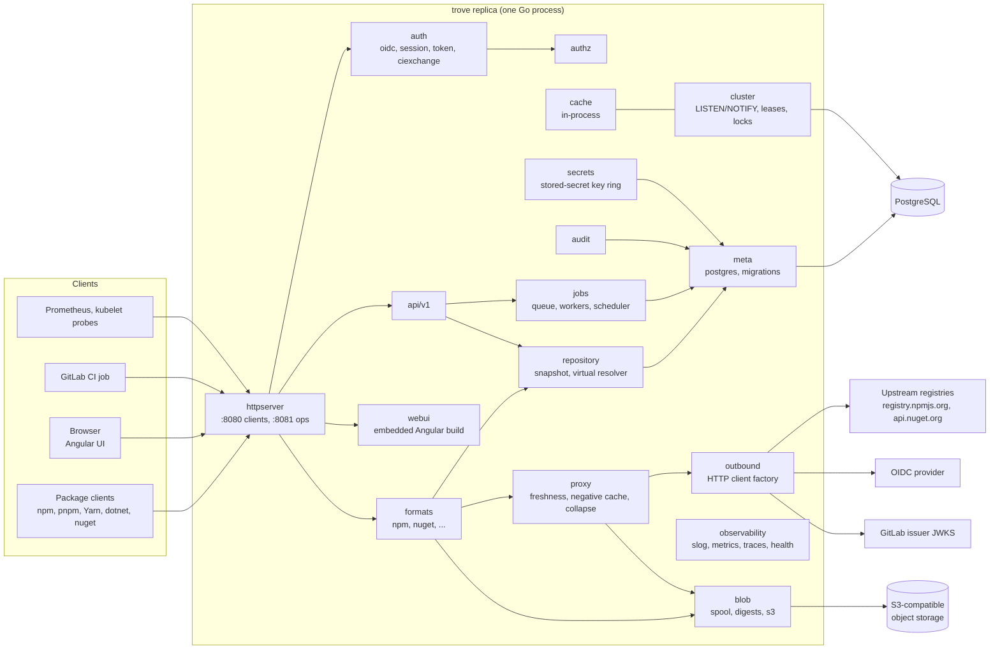
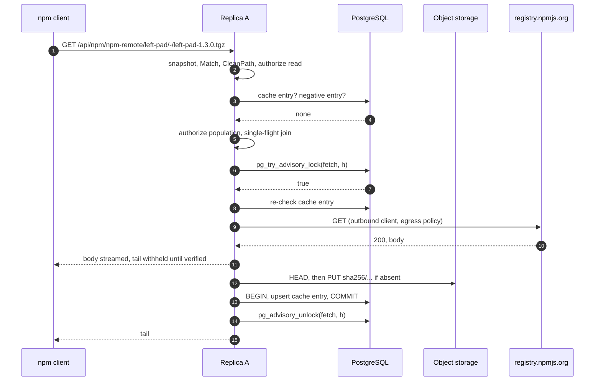

# Architecture

Status: specification — not implemented

This page fixes the skeleton of trove. It covers:
- the components inside the single binary;
- the Go and Angular code layout;
- the order in which components handle the shared request paths: local download, remote download
  (hit, miss, upstream down), upload, and virtual resolution;
- the contract every package format implements;
- the background job framework;
- the `LISTEN/NOTIFY` plumbing behind in-process caches;
- configuration loading, encryption of stored secrets and the outbound HTTP client factory;
- the error model, versioning and compatibility, and proposed performance targets.

What a feature does for the user is specified on the topic pages listed in
[README.md](README.md#pages). This page specifies the mechanisms they build on, and it names the
owning page wherever a topic hands over. Where a request path below and an owning page disagree on
a detail, the owning page wins. This page only fixes the order of steps and the boundaries between
components.

Covers: this page draws on [repositories.md](../features/repositories.md),
[remote-repositories.md](../features/remote-repositories.md),
[storage-and-blobs.md](../features/storage-and-blobs.md),
[ha-and-deployment.md](../features/ha-and-deployment.md) and
[operations-and-monitoring.md](../features/operations-and-monitoring.md). The format contract also
draws on [formats/README.md](../features/formats/README.md), and the stored-secret key on
[identity-and-access.md](../features/identity-and-access.md) (IAM-045).

## Handover to other pages

These are architecture-adjacent entries of the catalog pages listed above that another spec page
owns. This page provides only the mechanism the owner builds on.

| Catalog IDs | Owner | What this page contributes |
|---|---|---|
| OPS-051, OPS-052 (public base URL, per-request host) | [operations-and-observability.md](operations-and-observability.md) | Middleware position and client-address rules (R-ARCH-006) |
| OPS-001 to OPS-004 (probes), OPS-008 (service status), OPS-009 (lock diagnostics) | [operations-and-observability.md](operations-and-observability.md) | Start-up order, shutdown timeout (R-ARCH-024); lock categories and connection naming (R-ARCH-017, R-ARCH-019) |
| OPS-050 (content types), OPS-065 and ART-051 (tasks and job API), OPS-070 (reindex) | [operations-and-observability.md](operations-and-observability.md) | Job queue and scheduler (R-ARCH-016) |
| ART-011, ART-029, STOR-003 and the upload/download pipeline | [storage.md](storage.md) | Request order (R-ARCH-011, R-ARCH-014), format storage hooks (R-ARCH-008) |
| RMT-* settings, collapsing misses, metadata rewriting, merged-metadata cache | [repositories-and-proxy.md](repositories-and-proxy.md) | Request order (R-ARCH-013, R-ARCH-015), lock categories, notification plumbing |
| HA-022 to HA-071 except those listed below | [ha-and-helm.md](ha-and-helm.md) | Process model, roles, lifecycle and the connection formula |
| Long-running operations, client setup snippets, UI baseline | [api-and-ui.md](api-and-ui.md) (R-API-015, R-API-033, R-UI-001) | Job columns (R-ARCH-016), snippet templates in the format contract (R-ARCH-008) |

<details>
<summary>Facts this page relies on, and how they were verified (2026-10-28)</summary>

| Fact | Verified by |
|---|---|
| `net/http.ServeMux` unescapes paths segment by segment, so `%2F` stays inside one segment. `{name...}` matches the remainder. Conflicting patterns panic at registration. Paths with `.`, `..` or `//` are redirected to a cleaned URL, while escaped `%2e`/`%2f` are kept. | `go doc net/http.ServeMux` with the local go1.27.3 toolchain |
| `http.ResponseController` sets per-request read and write deadlines; a read deadline that has already passed cannot be extended. | `go doc` with go1.27.3 |
| A NOTIFY payload must be shorter than 8000 bytes by default, and notifications are delivered only after commit. Notifying transactions serialize their commits on one heavyweight lock held until after commit. The commit's WAL flush and its wait for a synchronous standby happen while that lock is held; with `synchronous_commit = off`, neither happens. | [PostgreSQL NOTIFY](https://www.postgresql.org/docs/current/sql-notify.html); `src/backend/commands/async.c`, `src/backend/access/transam/xact.c` and `src/include/replication/syncrep.h` on `REL_18_STABLE` |
| Advisory locks have a one-`bigint` key space and a two-`int4` key space, which do not overlap. `pg_locks` shows two-key locks with `objsubid = 2`. | [Lock functions](https://www.postgresql.org/docs/current/functions-admin.html#FUNCTIONS-ADVISORY-LOCKS), [pg_locks](https://www.postgresql.org/docs/current/view-pg-locks.html) |
| pgx v5 has `Conn.WaitForNotification` and the `default_query_exec_mode` values `cache_statement`, `cache_describe`, `describe_exec`, `exec`, `simple_protocol`. An `Exec` without arguments always uses the simple protocol, which accepts several statements in one string and runs them inside the open transaction. | pgx v5.11.0 source (`conn.go`, `pgconn/pgconn.go`) |
| goose v3's Provider accepts `embed.FS` sources, Go migrations, a custom table name, and an optional session locker. Its version row carries only the version number (`database.InsertRequest{Version}`); a different table layout needs a custom `database.Store` with `DialectCustom`. Every SQL file must start with `-- +goose Up`. | goose v3.29.0 source (`provider_options.go`, `provider.go`, `provider_run.go`, `database/store.go`, `internal/sqlparser/parser.go`) |
| tern v2 takes `pg_advisory_lock(9628173550095224)`, a fixed single-`bigint` key, around every migration run, with no option to disable it. | tern v2.4.3 source (`migrate/migrate.go`) |
| In aws-sdk-go-v2, the `feature/s3/manager` Uploader is marked deprecated in favour of `feature/s3/transfermanager`. `service/s3` exposes `UsePathStyle`, `RequestChecksumCalculation` and `ResponseChecksumValidation`. | SDK source |
| Zoneless change detection is the default for new Angular applications since v21. | [angular.dev zoneless guide](https://angular.dev/guide/zoneless) |
| Latest versions: pgx v5.11.0, sqlc v1.31.1, goose v3.29.0, golang-migrate v4.20.1, tern v2.4.3, aws-sdk-go-v2 `service/s3` v1.114.6, `feature/s3/transfermanager` v0.5.1, minio-go v7.4.1, River v0.50.0, chi v5.5.0 | `proxy.golang.org/<module>/@latest` |
| Licences: pgx, goose, golang-migrate and tern are MIT. aws-sdk-go-v2 and minio-go are Apache-2.0. River is MPL-2.0. | LICENSE files upstream |
| The versions in the row above are still the latest on 2026-10-28, re-checked when the questions of this page were decided. | `proxy.golang.org/<module>/@latest` |
| For user content that must not render, current guidance names `nosniff`, `Content-Disposition: attachment`, CSP `sandbox` with `default-src 'none'`, and `Cross-Origin-Resource-Policy: same-site`. It treats a separate sandbox domain as necessary only when active content must render, or when renderer compromise and Spectre-class attacks are in the threat model. Only a domain on the Public Suffix List isolates subdomains from each other. | [web.dev: Securely hosting user data in modern web applications](https://web.dev/articles/securely-hosting-user-data) |
| A cookie named with the `__Host-` prefix is accepted by the browser only with `Secure`, `Path=/` and no `Domain`. A sibling or parent subdomain therefore cannot set or shadow it. "Same-site" compares scheme and registrable domain, so a subdomain content host is same-site with the UI. | [RFC 6265bis draft](https://datatracker.ietf.org/doc/draft-ietf-httpbis-rfc6265bis/), cookie prefixes and the "same-site" definition |

Not verified: the behaviour of specific S3-compatible stores. The performance targets in R-ARCH-027
are proposals, not measurements.

</details>

## Process and components

### R-ARCH-001 · One binary, identical replicas, process roles
Priority: **MVP** · Covers: HA-001, HA-002, HA-009, HA-010, HA-015

trove MUST build into one statically linked binary, `trove` (`CGO_ENABLED=0`). It contains the
management API, every package-format protocol, the embedded Angular build, the schema migrations
and the background workers (INV-1, INV-2).

| Invocation | Purpose |
|---|---|
| `trove serve [--role all\|api\|worker]` | Runs one replica. |
| `trove migrate [up\|status]` | Applies or lists the embedded migrations behind the compatibility gate (R-ARCH-026). |
| `trove admin …` | Bootstrap and recovery: break-glass administrator ([identity-and-authentication.md](identity-and-authentication.md)), `admin config validate` ([operations-and-observability.md](operations-and-observability.md)), `admin secrets status` (R-ARCH-021; the same status is served by `GET /api/v1/system/encryption`). |
| `trove --version` | Version, commit, build date. |

| Role | Client listener `:8080` | Ops listener `:8081` | Job workers and singleton scheduler | `LISTEN` session |
|---|---|---|---|---|
| `all` (default, INV-2) | yes | yes | yes | yes |
| `api` | yes | yes | no | yes |
| `worker` | no | yes | yes | yes |

- No replica MAY hold state that another replica needs to answer a later request.
  - Sessions, tokens, upload sessions of multi-request protocols, the job queue, locks and
    cache-fill state live in PostgreSQL or object storage.
  - In-process state is limited to caches that can be rebuilt (R-ARCH-018) and to the spool file of
    the request currently running ([storage.md](storage.md)).
- There is no primary node. Work that must run once per cluster runs as a job, where the queue
  guarantees one claimant (R-ARCH-016), or under a named lease (R-ARCH-017).
- A replica registers itself on start in the replica registry
  ([operations-and-observability.md](operations-and-observability.md)). It takes traffic and jobs
  as soon as it is ready. No other step is needed to add or remove a replica.
- One replica and many run the same code path, and even a single replica uses external PostgreSQL
  and S3-compatible storage (INV-3, INV-4). Moving to a cluster means raising the replica count. An
  evaluation setup uses a single-node S3-compatible store (the local profile runs SeaweedFS,
  [ha-and-helm.md](ha-and-helm.md) R-HA-051) and a small PostgreSQL. The chart bundles no production
  database (INV-12, [ha-and-helm.md](ha-and-helm.md)).
- Splitting roles is the trove form of separately scaled workloads (HA-015). The UI is never a
  separate workload because it is embedded (INV-1).

Acceptance criteria:
- On Linux, `file trove` reports a statically linked executable, and `go version -m trove`
  shows `CGO_ENABLED=0`.
- A replica started with `--role worker` has no socket on `:8080` (`ss -ltn`). The instance ID of a
  replica started with `--role api` never appears in `job.locked_by`.
- One of three pods is deleted with `kubectl delete pod --grace-period=0 --force` during a loop of
  100 `npm ci` runs through the Service. The loop finishes with npm's default `fetch-retries`.

### R-ARCH-002 · Component model and dependency rules
Priority: **MVP** · Covers: HA-003, HA-004, HA-006



| Component | Package | Responsibility | Behaviour specified in |
|---|---|---|---|
| httpserver | `internal/httpserver` | Listeners, top-level routing, middleware, client address | R-ARCH-005, R-ARCH-006 |
| auth | `internal/auth/{oidc,session,token,ciexchange}` | Principal resolution, OIDC login, tokens, CI exchange | [identity-and-authentication.md](identity-and-authentication.md), [gitlab-ci-oidc.md](gitlab-ci-oidc.md) |
| authz | `internal/authz` | Permission decisions | [authorization.md](authorization.md) |
| api | `internal/api/v1` | Management REST API | [api-and-ui.md](api-and-ui.md) |
| webui | `internal/webui` | Embedded Angular build | [api-and-ui.md](api-and-ui.md) (R-UI-001), R-ARCH-004 |
| formats | `internal/formats`, `internal/formats/<id>` | Package protocols behind the plug-in contract | R-ARCH-008 to R-ARCH-010; [formats/npm.md](formats/npm.md), [formats/nuget.md](formats/nuget.md) |
| repository | `internal/repository` | Repository model and snapshot, request classification, virtual resolution | [repositories-and-proxy.md](repositories-and-proxy.md) |
| proxy | `internal/proxy` | Remote fetch engine | [repositories-and-proxy.md](repositories-and-proxy.md) |
| blob | `internal/blob`, `internal/blob/s3` | Spool, digests, content-addressed objects | [storage.md](storage.md) |
| meta | `internal/meta`, `internal/meta/postgres` | Transactions, generated queries, embedded migrations | [storage.md](storage.md) (schema of items and packages), R-ARCH-016, R-ARCH-019, R-ARCH-026 |
| cluster | `internal/cluster` | `LISTEN/NOTIFY`, leases, advisory-lock categories | R-ARCH-017, R-ARCH-018 |
| cache | `internal/cache` | Bounded in-process caches and their invalidation hooks | R-ARCH-018 |
| jobs | `internal/jobs` | Queue, workers, scheduler | R-ARCH-016 |
| audit | `internal/audit` | Audit events | [operations-and-observability.md](operations-and-observability.md) |
| observability | `internal/observability` | Logs, metrics, traces, health checks | [operations-and-observability.md](operations-and-observability.md) |
| outbound | `internal/outbound` | Every outbound HTTP client | R-ARCH-022; settings in [repositories-and-proxy.md](repositories-and-proxy.md) |
| secrets | `internal/secrets` | Stored-secret encryption, sealed-column registry, key-ring status | R-ARCH-021 |
| config | `internal/config` | Configuration schema and loading | R-ARCH-020; [operations-and-observability.md](operations-and-observability.md) |
| errs | `internal/errs` | Error kinds and rendering | R-ARCH-023 |

Normative rules:
- PostgreSQL and S3-compatible object storage are the only stateful dependencies (INV-3, INV-4).
- Shared binary storage (HA-004). The MVP has exactly one binary-store type: S3-compatible object
  storage that every replica reaches over the network.
  - There is no node-local file-system store, no cluster-replicated local store and no redundancy
    factor. Copies and durability are the object store's job (INV-4, INV-12).
  - The catalog leaves open which storage type a deployment gets by default. That choice does not
    arise in trove, and no default can become unsafe when the replica count is raised.
  - Any store type added later MUST be shared by every replica. A store that is safe on one node
    only (STOR-008, P2 in [storage.md](storage.md)) MUST refuse to start while the replica registry
    shows another live replica.
- Replicas never talk to each other. There are no peer addresses and no replica-to-replica HTTP.
  Configuration changes, cache invalidation, locks and job hand-off go through PostgreSQL (INV-12),
  so the catalog's per-node peer address (HA-006) does not exist in trove.
- Imports form layers:
  1. Edge: `httpserver`, `api/v1`, `webui`, format handlers.
  2. Domain: `repository`, `proxy`, `authz`, `auth`, `jobs`, `audit`.
  3. Infrastructure: `meta/postgres`, `blob/s3`, `cluster`, `outbound`, `secrets`.

  No lower layer imports a higher one.
- Only `meta/postgres` and `cluster` import pgx. Only `blob/s3` imports the S3 SDK. Format
  packages import neither (R-ARCH-008).
- `internal/archtest` walks `go list -deps -json ./...` and fails on any forbidden import.

Acceptance criteria:
- Adding an import of `internal/meta/postgres` to `internal/formats/npm` makes
  `go test ./internal/archtest` fail and name the edge.
- `grep -rn "http.Client{\|net.Dial" internal --include=*.go` finds matches only in
  `internal/outbound` and in `_test.go` files.

## Code layout

### R-ARCH-003 · Go module and package layout
Priority: **MVP** · Covers: trove-only

The repository is one Go module. `go.mod` states `go 1.27.3`, which is the minimum and also the
pin CI reads. Code generators are pinned once, and local builds and CI read the same pin:
- sqlc (Q-ARCH-2) and oapi-codegen are `tool` directives in `go.mod`.
- oapi-codegen is v2.8 or later, the first line with OpenAPI 3.1 support. It runs with the
  `models` and `std-http-server` outputs and writes `internal/api/v1/gen/`
  ([api-and-ui.md](api-and-ui.md) R-API-002, Q-API-1).
- openapi-typescript 7.x is pinned in `web/package-lock.json` and writes
  `web/src/app/api/generated/` (R-ARCH-004).

```text
trove/
├── cmd/trove/main.go          # subcommands serve, migrate, admin; flag parsing only
├── api/openapi.yaml             # OpenAPI 3.1 source of truth, served as /api/v1/openapi.json (INV-6)
├── internal/
│   ├── app/                     # composition root: builds components from config, start/stop order
│   ├── buildinfo/               # version, commit, build date (-ldflags)
│   ├── config/                  # schema, YAML + env loading, validation
│   ├── httpserver/              # listeners, ServeMux, middleware, client address
│   ├── api/v1/                  # management API handlers
│   │   └── gen/                 # oapi-codegen output: models, std-http-server interface (generated, committed)
│   ├── auth/{oidc,session,token,ciexchange}/
│   ├── authz/
│   ├── repository/              # model, snapshot, CleanPath, classification, virtual resolver
│   ├── formats/                 # contract (Format, Host), registry
│   │   ├── all/                 # imports and registers every format
│   │   ├── formattest/          # conformance kit, in-memory Host
│   │   ├── npm/
│   │   └── nuget/
│   ├── proxy/
│   ├── blob/                    # BlobStore interface, spool, digests
│   │   └── s3/
│   ├── meta/                    # Tx helper, shared types
│   │   └── postgres/            # pgx pools, transactions, migration runner (R-ARCH-026)
│   │       ├── migrations/      # NNNNN_name.sql, embedded
│   │       ├── queries/         # *.sql inputs for sqlc
│   │       ├── q/               # sqlc output (generated, committed)
│   │       └── listq/           # dynamic list/search queries: bound values, allowlisted identifiers (R-ARCH-019)
│   ├── cluster/                 # notifier, listener, leases, lock categories, FlightLock, channel registry
│   ├── cache/
│   ├── jobs/
│   ├── audit/
│   ├── outbound/
│   ├── secrets/
│   ├── errs/
│   ├── observability/
│   ├── webui/                   # go:embed all:dist; dist/ is filled by the web build
│   └── archtest/
├── web/                         # Angular workspace (R-ARCH-004)
├── deploy/helm/trove/         # Helm chart (INV-13)
├── test/
│   ├── integration/             # real PostgreSQL and SeaweedFS (S3) in containers (R-HA-051)
│   └── e2e/                     # kind + Helm + real clients (npm, pnpm, yarn, dotnet)
└── perf/                        # load scripts, reference lockfiles (R-ARCH-027)
```

- All Go code lives under `internal/`, so trove exposes no public Go API. A new format is a new
  package in this repository (R-ARCH-010).
- There is one package per bounded context. `util`, `common` and `helpers` packages are not
  allowed.
- Generated code carries the `// Code generated … DO NOT EDIT.` header and is committed. CI runs
  `go generate ./... && git diff --exit-code`.
- `internal/webui/dist/` holds a committed placeholder `index.html`, so `go build` works without a
  UI build. Release builds run the web build first.

Acceptance criteria:
- `go build ./cmd/trove` succeeds on a clean checkout without Node.js installed.
- `go generate ./... && git diff --exit-code` passes in CI.

### R-ARCH-004 · Angular workspace layout
Priority: **MVP** · Covers: trove-only

The technology baseline (standalone components, zoneless, `OnPush`, `httpResource()`, Signal Forms,
CSP nonce, localized builds under `/ui/{locale}/`) and state management are specified in
[api-and-ui.md](api-and-ui.md) (R-UI-001, R-UI-046). This requirement fixes where the code lives
and how the build reaches the binary.

```text
web/
├── angular.json                 # i18n locales; localized production build
├── package.json                 # exact versions (Angular 22.x, INV-1); package-lock.json committed
├── .nvmrc                       # the one Node.js version used locally and in CI
├── tsconfig.json
└── src/
    ├── index.html               # root element carries ngCspNonce (filled per response by webui)
    ├── main.ts                  # bootstrapApplication(App, appConfig)
    ├── locale/                  # translation files
    ├── styles/                  # design tokens, light and dark theme
    └── app/
        ├── app.ts               # root standalone component: shell, navigation, banner, outlet
        ├── app.config.ts        # router, HttpClient, interceptors, error handler
        ├── app.routes.ts        # lazy routes per area
        ├── api/                 # thin hand-written clients per resource family
        │   └── generated/       # openapi-typescript output (generated, committed)
        ├── core/                # SessionStore, interceptors (CSRF, problem mapping, 401), layout
        ├── shared/              # presentational components, pipes, directives
        └── features/
            ├── packages/  browse/  repositories/  setup/  tokens/
            ├── formats/<id>/    # optional format-specific panels, registered by format ID
            └── admin/           # users, groups, service accounts, policies, CI identities, system
```

- Generated API types live only in `src/app/api/generated/`, and nothing in that folder is edited
  by hand ([api-and-ui.md](api-and-ui.md) Q-API-1).
- The repository settings form is rendered from the format's settings JSON Schema (R-ARCH-008). A
  format adds a panel under `features/formats/<id>/` only for interactions a schema cannot express.
- The production build writes one directory per locale. The release build copies them to
  `internal/webui/dist/<locale>/`.
- `internal/webui` serves them under `/ui/{locale}/`. It injects the per-response CSP nonce into
  `index.html` and applies the cache and fallback rules of R-UI-001.

Acceptance criteria:
- `grep -rE "NgModule\(|provideZoneChangeDetection|zone\.js" web/src web/angular.json` finds
  nothing.
- After `npm ci && npx ng build` in `web/` and a release `go build`, `curl -s localhost:8080/ui/en/admin/jobs`
  returns `index.html` with a nonce, and two requests carry different nonces.

## HTTP edge

### R-ARCH-005 · HTTP listeners, routing and middleware chain
Priority: **MVP** · Covers: HA-012, HA-020, HA-021, HA-024, REPO-005

Listeners (INV-6; Q-ARCH-11 keeps the layout and the ports as they are):
- The client listener (`server.listen`) serves everything clients use. The ops listener
  (`server.ops_listen`) serves only `/healthz`, `/readyz` and `/metrics`
  ([operations-and-observability.md](operations-and-observability.md)). Neither serves the other's
  paths.
- An address without a host binds every interface on IPv4 and IPv6 (HA-020).
- HTTP/1.1 is always on. With `server.tls`, HTTP/2 is served over TLS. TLS normally ends at the
  Ingress ([ha-and-helm.md](ha-and-helm.md)).

Top-level routes on the client listener (`net/http.ServeMux`, Q-ARCH-1). The `/api/v1/` operations
are registered on the same ServeMux by the oapi-codegen `std-http-server` interface, and the
authorization declarations are looked up by the matched `http.Request.Pattern`
([api-and-ui.md](api-and-ui.md) R-API-002):

| Pattern | Handler |
|---|---|
| `/api/v1/` | Management API ([api-and-ui.md](api-and-ui.md)) |
| `/api/<id>/{repoKey}/{rest...}`, registered once per format ID | Format dispatcher (R-ARCH-008) |
| `/files/{repoKey}/{path...}` | Raw file access ([storage.md](storage.md)) |
| `/auth/` | Browser login flow ([identity-and-authentication.md](identity-and-authentication.md)) |
| `/ui/` | Embedded UI (R-ARCH-004) |
| `POST /-/npm/v1/oidc/token/exchange/package/{name...}` | npm plug-in: trusted-publishing token exchange at the host root ([formats/npm.md](formats/npm.md) R-NPM-022, P1; Q-NPM-1) |
| `/v2/` | Reserved for the OCI format ([ha-and-helm.md](ha-and-helm.md) R-HA-041, Q-HA-4). `404` until the OCI format exists: no pattern is registered here yet, so `/v2/` and every path below it fall through to the last row. No other pattern may start with `/v2/` (route-table test below). |
| `GET /{$}` | `302` to `/ui/` |
| anything else | `404` problem (R-ARCH-023) |

- Format IDs match `^[a-z][a-z0-9-]{1,31}$` and MUST NOT match `^v[0-9]+$`, which is reserved for API
  versions. Registering literal format segments keeps `/api/v1/` and the format routes free of
  ServeMux conflicts. A conflicting registration panics at start-up, so a collision cannot ship.
- A host-root route exists only where a client fixes the path and cannot be configured to use
  `/api/<format>/<repoKey>/`. The format's owning page adds it to INV-6 and registers it as a literal
  ServeMux pattern in the table above. It never carries a repository key and never changes the
  `/api/<format>/<repoKey>/` layout (Q-ARCH-11). The decided host-root routes:
  - **npm** ([formats/npm.md](formats/npm.md) Q-NPM-1). The only host-root route is
    `POST /-/npm/v1/oidc/token/exchange/package/{name...}`. npm builds the exchange URL against the
    host root of the registry URL. trove owns that host root, because `server.base_url` is an origin
    without a path ([operations-and-observability.md](operations-and-observability.md) R-OPS-005).
    - The registry-relative form of the same exchange,
      `/api/npm/<repoKey>/-/npm/v1/oidc/token/exchange/package/{name}`, used by Yarn 4 and current
      pnpm, is an ordinary npm route behind the format dispatcher. Both entry points run one handler.
    - Like the dispatcher, the handler takes the name from `r.URL.EscapedPath()`, so `@scope%2fname`
      stays one name.
  - Any other path below `/-/` has no route and falls through to the `404` problem. That includes
    npm's attestation path `/-/npm/v1/attestations/…`. Attestations are served later below the
    registry URL ([formats/npm.md](formats/npm.md) R-NPM-027).
  - **OCI** ([ha-and-helm.md](ha-and-helm.md) Q-HA-4, R-HA-041). `/v2/` and everything below it
    belong to the OCI distribution API, with the repository key as the first path segment after
    `/v2/`. The reservation is MVP; the OCI format itself is P1. Until it exists, nothing is
    registered under `/v2/`, and those paths answer the `404` problem.
    - A route-table test in `internal/httpserver` fails when any registered client-listener pattern
      other than the OCI format's has a path that is `/v2` or starts with `/v2/`, whatever its
      method or host prefix (`GET /v2/x`, `/v2/{name...}`). It also fails when a pattern other than
      the catch-all for "anything else" and `GET /{$}` has a wildcard as its first path segment
      (`/{seg}/…`), because such a pattern matches below `/v2/` as well.
    - ServeMux's start-up conflict check does not replace this test. A more specific pattern such as
      `/v2/x` does not conflict with `/v2/`, so it would register without a panic and take those
      paths, before or after the OCI format exists.
    - The test reads the patterns from the one wrapper through which `internal/httpserver` registers
      every client-listener route, the generated `/api/v1/` operations and the format plug-ins'
      host-root routes included. A route registered on the ServeMux around that wrapper is a defect.
  - No host-root route is served on the content host (`server.content_base_url`, R-ARCH-029).
- The dispatcher hands the format the remaining path exactly as received: `r.URL.EscapedPath()`
  minus `/api/<id>/<repoKey>/`. It never hands over the unescaped wildcard value. This keeps an
  encoded slash in a package name (`@scope%2fname`) apart from a separator. Repository keys contain
  nothing that needs escaping (INV-5), so the prefix looks the same escaped and unescaped.
- Every repository-relative path passes `repository.CleanPath` before authorization runs.
  `CleanPath` decodes percent-escapes exactly once and answers `400` with code `invalid_path` when a
  segment is `.`, `..` or empty, or contains NUL, `\` or a control character
  ([authorization.md](authorization.md)). ServeMux's own cleaning does not cover escaped dots
  (`%2e%2e`), so trove does not rely on it.

Middleware, outermost first:
1. Panic recovery: `500` with code `internal`, and the stack goes to the log.
2. Trace context and request ID ([operations-and-observability.md](operations-and-observability.md)).
   Every response carries `X-Request-Id`.
3. Request log and metrics. The route label is the ServeMux pattern or the format route name
   (R-ARCH-008), never the raw path.
4. In-flight limit (`server.max_in_flight`, client listener only): `503` with `Retry-After: 1` and
   code `server_busy`.
5. Client address (R-ARCH-006) and the base URL of the response
   ([operations-and-observability.md](operations-and-observability.md)).
6. Authentication: a principal or anonymous. Credentials that are present but invalid always give
   `401` ([identity-and-authentication.md](identity-and-authentication.md)). The one exception is a
   `POST` to an exchange endpoint, at the host root or below a registry URL. There the
   `Authorization` header carries an ID token, the stage does not evaluate it, and the request
   reaches the handler unauthenticated
   ([identity-and-authentication.md](identity-and-authentication.md) R-AUTH-001).
7. Rate limits on `/api/v1/`, `/files/` and `/auth/` ([api-and-ui.md](api-and-ui.md)).
8. The handler. Authorization runs inside the handler, as soon as the repository and the path or
   package are known ([authorization.md](authorization.md)).

Transfer rules:
- A handler MUST finish authentication and the coarse authorization of its route (R-ARCH-008)
  before it reads the request body. Go sends `100 Continue` only on the first body read, so a
  rejected upload never transfers its body.
- `http.Server.ReadTimeout` and `WriteTimeout` stay at 0, because they would cut long transfers.
  Requests are bounded by `server.read_header_timeout` and by a stall timeout: after every
  successful chunk, the handler moves the read and write deadlines forward by
  `server.transfer_stall_timeout` through `http.ResponseController` (HA-024).
- Bodies are streamed. Only documents a format declares as bounded are held in memory
  (R-ARCH-028). Upload size limits belong to [storage.md](storage.md), and JSON body limits on
  `/api/v1/` to [api-and-ui.md](api-and-ui.md).

```yaml
server:
  listen: ":8080"                    # default (proposed), INV-6
  ops_listen: ":8081"                # default (proposed), INV-6
  read_header_timeout: 10s           # default (proposed)
  idle_timeout: 120s                 # default (proposed)
  transfer_stall_timeout: 60s        # default (proposed)
  max_header_bytes: 65536            # default (proposed)
  max_in_flight: 4096                # default (proposed), per replica
  shutdown_timeout: 25s              # default (proposed), R-ARCH-024
  tls:
    cert_file: ""                    # default (proposed): empty = plain HTTP
    key_file: ""                     # default (proposed)
```

Acceptance criteria:
- `curl -s -o /dev/null -w '%{http_code}' http://localhost:8080/healthz` prints `404`. The same
  request on `:8081` prints `200`.
- `curl -s http://localhost:8080/api/npm/npm-all/@types%2fnode | jq -r .name` prints `@types/node`.
  A request to `…/api/npm/npm-all/%2e%2e/x` gets `400` with code `invalid_path`.
- `curl -T 5GiB.bin --limit-rate 5M` to a generic repository (P1) completes. A client that stops
  sending for 61 s has its connection closed.
- `curl -v -T pkg.tgz -H 'Expect: 100-continue'` without credentials, against a repository that
  needs authentication, gets `401` and no `100 Continue`.
- `curl -g -s http://[::1]:8080/ui/` answers.
- `GET /-/npm/v1/attestations/left-pad@1.3.0` and `GET /-/whoami` at the host root answer `404`
  with a problem body. From P1, `POST /-/npm/v1/oidc/token/exchange/package/@acme%2Fui` with a
  GitLab ID token as `Bearer` reaches the npm exchange handler instead of being rejected with `401`
  by the authentication step.
- Until the OCI format exists, `GET /v2/` and `GET /v2/docker-all/manifests/latest` answer `404`
  with a problem body. The route-table test fails on a fixture plug-in that registers
  `GET /v2/x` as a host-root route, and passes again once the fixture is removed.

### R-ARCH-006 · Client address and trusted proxies
Priority: **MVP** · Covers: HA-025

Several pages rely on this mechanism: rate limits, audit, authorization conditions, and token
exchange limits.
- The client address is the TCP peer, unless the peer lies in `server.trusted_proxies`. In that case
  it is the right-most address in `X-Forwarded-For`, or in `Forwarded: for=`
  ([RFC 7239](https://www.rfc-editor.org/rfc/rfc7239)), that is not itself a trusted proxy.
- Forwarded scheme and host are evaluated only under the rules of the public base URL. Those rules,
  the `server.base_url`, `server.trusted_proxies` and `server.additional_base_urls` keys, and their
  defaults are owned by [operations-and-observability.md](operations-and-observability.md).
- The resolved client address and base URL are placed in the request context once, by middleware
  step 5 of R-ARCH-005. No handler, format or job reads `Host`, `X-Forwarded-*` or `Forwarded`
  itself.
- Rendered metadata that contains links is cached under a key that includes the base URL
  (R-ARCH-018), so one host name never sees another's links.

Acceptance criteria:
- `grep -rnE 'X-Forwarded|\.Host\b|"Forwarded"' internal --include=*.go` matches only in
  `internal/httpserver` and in tests.
- With `trusted_proxies: ["10.42.0.0/16"]`, a request from `10.42.1.7` carrying
  `X-Forwarded-For: 198.51.100.4, 10.42.0.9` is logged with client address `198.51.100.4`. The same
  header from `203.0.113.5` is logged as `203.0.113.5`.

### R-ARCH-007 · One origin for UI and package content
Priority: **MVP** · Covers: trove-only

In the MVP, the UI, the management API and the package endpoints share one origin: one host name
and one listener (INV-6). [formats/nuget.md](formats/nuget.md) handed this decision to this page.
An optional separate content origin is P1 (R-ARCH-029, Q-ARCH-10). With it unset, which remains the
default in P1, everything below stays the complete defence.

Consequences, normative for every component:
- Every response whose body comes from package content or package metadata carries the content
  headers:
  - `X-Content-Type-Options: nosniff`;
  - `Content-Security-Policy: sandbox; default-src 'none'`;
  - `Cross-Origin-Resource-Policy: same-site`;
  - for files, `Content-Disposition: attachment` with the file name ([storage.md](storage.md)).

  This covers `/files/` and every format route of kind `Download`, `Metadata` or `Computed`
  (R-ARCH-008). It also covers uploaded and cached README, license, icon and manifest files.
  One exception: the HTML directory index of a folder `GET` under `/files/` is rendered by trove,
  not stored content. For it the wrapper selects the header set of
  [storage.md](storage.md) R-STOR-017 (`nosniff`, `Cross-Origin-Resource-Policy: same-site`, the
  CSP without `sandbox`, no `Content-Disposition`); the handler cannot weaken that set either.
- **The core sets the headers, not the handler.** The format dispatcher and the `/files/` handler
  wrap the `http.ResponseWriter` of every route of those kinds before the handler runs.
  - The wrapper writes the headers and checks them again at `WriteHeader`, so a handler can change
    `Content-Type` but cannot remove or weaken them.
  - A route of another kind (`Upload`, `Delete`, `Admin`, `Volatile`) that returns package-derived
    bytes is a contract violation, which the conformance kit detects (R-ARCH-010 check 7).
- The UI never embeds package-provided HTML. It renders README content only as sanitized output of
  its own Markdown renderer ([api-and-ui.md](api-and-ui.md)).
- **Content links from one place.** Every absolute URL to package content that a response hands to
  a browser comes from `LinkBuilder` (R-ARCH-009) or from a `downloadUrl` field of the API. Examples
  are `downloadUrl`, README images generated by the renderer, and file links in directory indexes.
  The UI never assembles such a URL from strings. This is the seam R-ARCH-029 uses to move these
  links to the content origin without touching formats or the UI.
- The conformance kit (R-ARCH-010) fails a format whose content routes lack these headers.

Acceptance criteria:
- An `evil.svg` with an embedded script, stored in a generic repository and opened from `/files/`
  in a browser, does not run the script. The response carries all four headers.
- An npm package document and a NuGet `.nuspec` response both carry `nosniff`, the sandbox CSP and
  `Cross-Origin-Resource-Policy: same-site`.
- A test format whose download handler calls `w.Header().Del("Content-Security-Policy")` before
  writing still sends the header.
- A web unit test fails on any string literal in `web/src` that starts with `/files/` or with
  `/api/<id>/`, where `<id>` is a registered format ID. Exempt are the `files` client in
  `web/src/app/api/`, which performs the UI upload (`PUT /files/…`,
  [api-and-ui.md](api-and-ui.md) R-UI-012) against the UI origin, and the generated code in
  `web/src/app/api/generated/`.

### R-ARCH-029 · Optional separate content origin
Priority: **P1** · Covers: trove-only

With `server.content_base_url` set, package content that a browser could render is served from a
second origin. That origin never sees the UI's session cookie and is not the UI's origin. The header
defence of R-ARCH-007 stays in force on both origins. The content origin adds a second, independent
layer (Q-ARCH-10).

Origin rules, checked at start-up. On a violation the process exits and names the rule:
- `server.content_base_url` is an `https` origin with no path.
- Its host name differs from the host name of `server.base_url` and of every
  `server.additional_base_urls` entry
  ([operations-and-observability.md](operations-and-observability.md)). A different port on the same
  host is refused: browsers do not isolate cookies by port, so such an origin would receive the
  session cookie.
- Recommended form: a separate registrable domain, such as `https://trove-content.example.net`.
  - A subdomain of the UI's registrable domain is accepted. Every trove cookie carries the
    `__Host-` prefix ([identity-and-authentication.md](identity-and-authentication.md) Q-AUTH-2), so
    it is host-only: the content host neither receives `__Host-trv_session` or `__Host-trv_csrf` nor
    can it plant or shadow them.
  - Such a host is still same-site with the UI, so `SameSite` and `Sec-Fetch-Site` do not mark its
    requests as foreign. Start-up therefore logs a warning that names the registrable domain. The
    registrable domain is determined with the Public Suffix List (`golang.org/x/net/publicsuffix`).

Routing on the client listener. The host is resolved by R-ARCH-006, never read from raw headers.
The content host counts as a known host under the base-URL rules of
[operations-and-observability.md](operations-and-observability.md):
- On the content host, only `GET` and `HEAD` of `/files/…` and of format routes of kind `Download`,
  `Metadata` or `Computed` are served. Every other path answers `404`, including `/api/v1/`,
  `/auth/`, `/ui/` and the host-root routes of R-ARCH-005, such as npm's token exchange.
- On the UI host, a `GET` of those routes is answered `303 See Other` to the same path on the
  content host when either of these holds, whatever other credential the request carries:
  - it carries the session cookie;
  - it carries `Sec-Fetch-Dest` with a value other than `empty`, which marks a browser navigation
    or subresource load.

  A request that matches neither is served on the UI host as before. That covers every package
  client and script (npm, pnpm, Yarn, dotnet, nuget.exe, curl), which send no session cookie and no
  `Sec-Fetch-Dest`, so they are not affected.

Authentication on the content host:
- The session cookie is never accepted there. Bearer and Basic tokens are accepted as on the UI
  host, and anonymous access follows the repository's grants.
- A redirect for a session-cookie request carries a signed, short-lived grant in the query:
  `trv_exp=<unix seconds>&trv_sid=<session row id>&trv_sig=v1.<key id>.<base64url HMAC-SHA-256>`.
  - The MAC covers the content host, the escaped path, `trv_exp` and `trv_sid`.
  - The MAC key is derived with HKDF-SHA-256 from the stored-secret key `<key id>` of R-ARCH-021,
    with info `trove content-url v1`. A key rotation therefore keeps outstanding URLs valid until
    they expire.
- At use, the content host:
  1. verifies the MAC and `trv_exp`;
  2. loads the session, which must still be valid;
  3. authorizes `read` for the session's user on the path, exactly as on the UI host. A grant
     removed after signing takes effect at once.
- Content responses on the content host additionally carry `Referrer-Policy: no-referrer`, so a
  signed URL does not leak through a `Referer` header. They carry
  `Cross-Origin-Resource-Policy: cross-origin` instead of `same-site`, because they hold no ambient
  credential and the UI must be able to load README images from them.

Further rules:
- The content headers of R-ARCH-007 are unchanged, `Content-Disposition: attachment` included. This
  requirement does not render active content inline. Inline browsing (ART-045, P2) builds on this
  origin and is specified with it.
- The UI does not read package content with `fetch` or XHR. Package content reaches the browser only
  as a navigation or an `img` load, so no CORS configuration is needed on the content host.
- The chart renders the second host name in the Ingress or HTTPRoute, routed to the same Service,
  with its own TLS certificate ([ha-and-helm.md](ha-and-helm.md)). The UI's CSP adds the content
  origin to `img-src` when it is set ([api-and-ui.md](api-and-ui.md) R-UI-001).

```yaml
server:
  content_base_url: ""            # default (proposed): empty = one origin (R-ARCH-007)
  # content_base_url: "https://trove-content.example.net"   # example
  content_url_ttl: 300s           # default (proposed): lifetime of a signed content URL
```

Acceptance criteria:
- Set-up: `content_base_url: https://trove-content.example.net`, and a browser logged in to
  `https://trove.example.com`.
  - Opening `https://trove.example.com/files/generic-local/evil.svg` ends on the content host with
    `trv_sig` in the URL, and the response carries the content headers.
  - The Playwright request log shows no request to the content host carrying
    `__Host-trv_session` or `__Host-trv_csrf`, and the browser's cookie store holds no cookie for
    the content host.
- `curl -H "Authorization: Bearer $T" https://trove.example.com/files/generic-local/x.bin`
  answers `200` without a redirect. `npm ci` and `dotnet restore` against the UI host make no
  request to the content host.
- A signed URL is a credential, so a failed check never falls back to anonymous access
  (R-ARCH-005 step 6):
  - used after `content_url_ttl`, it answers `401` with code `content_url_expired`;
  - used with a wrong MAC, or after the session ended (logout), it answers `401` with code
    `content_url_invalid`;
  - used after the user's `read` grant is removed, it answers `404`
    ([authorization.md](authorization.md) R-AUTHZ-016).
- `GET https://trove-content.example.net/api/v1/repositories` answers `404`.
- `content_base_url: https://trove.example.com:8443` with `base_url: https://trove.example.com`
  stops start-up with `content_base_url must use a host name other than base_url`.
- `content_base_url: https://content.trove.example.com` starts and logs a warning that the content
  host shares the registrable domain `example.com` with the UI.

## Format plug-in contract

### R-ARCH-008 · Format plug-in contract
Priority: **MVP** · Covers: FMT-001, FMT-006, FMT-008, FMT-011, REPO-002, REPO-006

Each package format is a Go package `internal/formats/<id>` that implements `formats.Format`.

A format owns:
- its route table and path grammar;
- how each path behaves in caches;
- package identity and namespaced properties;
- the storage hooks [storage.md](storage.md) needs;
- upstream request mapping and metadata rewriting;
- merging across virtual members;
- client setup templates;
- its native error shape.

The core owns authentication, authorization, the upload and download pipeline, freshness, negative
caching, collapsing misses, offline state, audit, jobs and metrics. Formats reach the core only
through `Host` (R-ARCH-009). They MUST NOT open outbound connections, run SQL or touch the object
store.

```go
package formats

// ContractVersion changes whenever a method below changes meaning (R-ARCH-025).
const ContractVersion = 1

type ID string // "npm", "nuget"; ^[a-z][a-z0-9-]{1,31}$, never ^v[0-9]+$

type Class uint8

const (
	Local Class = iota + 1
	Remote
	Virtual
)

type Format interface {
	Descriptor() Descriptor

	// Routes lists every protocol operation below /api/<id>/<repoKey>/.
	Routes() []Route
	// Match resolves method + repository-relative path (still percent-encoded) to a route.
	// It returns errs.NotFound or errs.MethodNotAllowed and never touches storage.
	Match(method, escapedPath string) (*Route, Params, error)
	// Classify says how a repository path behaves in caches (request classification,
	// repositories-and-proxy.md).
	Classify(p Path) PathKind
	// PackageDocumentPath returns the canonical path of the package document of a normalized
	// package name: the document whose existence upstream stands for the package's existence
	// (npm: the package document; NuGet: "{lower_id}/index.json"). ok is false for a format
	// without package names. Used by R-REPO-029 (gone packages) and R-REPO-048 (shadowing check).
	PackageDocumentPath(name string) (p Path, ok bool)

	// Storage hooks required by storage.md.
	IngestOptions(rq *Request) IngestOptions                         // expected digests, SHA-512, media type
	Inspect(ctx context.Context, in InspectInput) (*Inspection, error) // identity and namespaced properties (FMT-008)
	OnCommit(ctx context.Context, tx Tx, c CommitEvent) error          // package and version rows, lead item
	OnItemsRemoved(ctx context.Context, tx Tx, e ItemsEvent) error
	OnItemsRestored(ctx context.Context, tx Tx, e ItemsEvent) error
	RemoveVersion(ctx context.Context, tx Tx, v VersionRef) ([]ItemRef, error) // retention and caps
	VersionGroup(v VersionRef) string                                          // group a cap counts

	Remote() RemoteAdapter   // nil when Descriptor().Classes lacks Remote
	Virtual() VirtualAdapter // nil when Descriptor().Classes lacks Virtual
	Indexes() IndexBuilder   // nil when the format has no rebuildable derived metadata

	// SetupTemplates returns the client setup templates (text/template) used by api-and-ui.md R-API-033.
	SetupTemplates() []SetupTemplate

	// WriteError renders a core error in the client's native error shape (R-ARCH-023).
	WriteError(w http.ResponseWriter, r *http.Request, err error)
}

type Descriptor struct {
	ID               ID
	DisplayName      string
	Classes          []Class   // the authoritative class matrix (FMT-001, REPO-006)
	Clients          []Client  // native clients and tested versions (FMT-002, FMT-003)
	SettingsSchema   []byte    // JSON Schema 2020-12 of format-specific repository settings
	PropertyPrefix   string    // reserved property namespace, e.g. "npm." (FMT-008)
	MaxDocumentBytes int64     // bound for documents held in memory (R-ARCH-028)
	RepositoryIndex  bool      // has repository-wide derived indexes; enables the per-repository revision (R-ARCH-012)
}

type Route struct {
	Name     string       // stable metric, log and audit label, e.g. "npm.tarball.get"
	Method   string
	Template string       // documentation form, e.g. "/{package}/-/{file}"
	Action   authz.Action // coarse check before the body is read (INV-9 action)
	Kind     RouteKind    // Download, Metadata, Computed, Upload, Delete, Admin, Volatile
	Handler  HandlerFunc
}

type HandlerFunc func(ctx context.Context, rq *Request, w http.ResponseWriter) error

type Request struct {
	*http.Request
	Repo      *repository.Repository // immutable snapshot entry
	Route     *Route
	Params    Params
	Path      Path                   // canonical repository path (R-ARCH-005)
	Principal auth.Principal
	Host      Host
}

type PathKind uint8

const (
	Content  PathKind = iota + 1 // immutable once stored
	Metadata                     // upstream document that expires after the metadata cache period
	Computed                     // rendered by trove from stored rows, never fetched
	Volatile                     // passed through, never cached (search, advisory queries)
)

type RemoteAdapter interface {
	// UpstreamRequest maps a repository path to the upstream request.
	UpstreamRequest(ctx context.Context, rc RemoteContext, p Path) (*http.Request, error)
	// AcceptResponse checks status, headers and declared type before a byte is stored or sent.
	AcceptResponse(p Path, resp *http.Response) error
	// Rewrite renders a stored upstream document for one response (repositories-and-proxy.md).
	Rewrite(ctx context.Context, rc RemoteContext, p Path, doc []byte, links LinkBuilder) ([]byte, error)
}

type VirtualAdapter interface {
	Strategy(p Path) Strategy
	// Merge combines member documents. Each part carries its member's tier and position,
	// so the format can apply the per-version source rule of repositories-and-proxy.md.
	Merge(ctx context.Context, p Path, parts []MemberDocument, links LinkBuilder) ([]byte, error)
}

type Strategy uint8

const (
	FirstMatch Strategy = iota + 1 // tiered lookup, first eligible member that has it wins
	Merge                          // every eligible member contributes
	Newest                         // Merge, with remote members revalidated first (REPO-036)
)

type IndexBuilder interface {
	// Rebuild recomputes derived metadata of a local repository from stored rows; runs as a job.
	Rebuild(ctx context.Context, repo RepoRef, scope Path, opts RebuildOptions) (RebuildResult, error)
}

type SetupTemplate struct {
	ID       string // stable, e.g. "npm.npmrc.configure"
	Client   string // "npm", "pnpm", "yarn", "dotnet", "nuget"
	Section  string // "configure", "publish", "install"
	Lang     string // "shell", "ini", "xml", "yaml"
	File     string // target file when the snippet is file content, e.g. ".npmrc"
	Template string // text/template; never receives a token (api-and-ui.md R-API-030)
}
```

Normative rules:
- `Descriptor().Classes` is the single source of truth for the classes a format supports. Creating
  a repository with any other class is rejected ([repositories-and-proxy.md](repositories-and-proxy.md)).
  - In the catalog, two lists of formats per class disagree (FMT-001). trove settles this by keeping
    no second list.
  - The per-class format sets of the OpenAPI document, the `classes` of `GET /api/v1/formats` and
    the formats the UI offers for a chosen class are all generated from `Classes` (R-ARCH-010).
- `Classify` MUST put every path a route serves into exactly one kind. A `Content` path is never
  refreshed. A `Metadata` path is never treated as immutable.
- `PackageDocumentPath` is the only place where the core learns which document stands for a
  package. [repositories-and-proxy.md](repositories-and-proxy.md) R-REPO-003 lists it in the format
  registration. Two rules use it, and neither keeps a list per format:
  - the upstream-gone rule of R-REPO-029, which marks a package gone when this document is gone;
  - the shadowing check of R-REPO-048, which probes this document.

  Names that the format normalizes to the same name MUST yield the same path.
- `Inspect` writes properties only under `PropertyPrefix`. Who may change that namespace is
  decided in [authorization.md](authorization.md). For uploads, the name `Inspect` reads from the
  content is the name authorization checks ([authorization.md](authorization.md)).
- `Route.Action` is a coarse check that the core runs before the body is read: "may this principal
  do this action anywhere in this repository?". The handler then decides on the concrete path or
  package through `Host.Authorize`.
- `OnCommit`, `OnItemsRemoved` and `OnItemsRestored` run inside the storage transaction and MUST
  NOT perform I/O outside PostgreSQL.

Acceptance criteria:
- The conformance kit (R-ARCH-010) passes for `npm` and `nuget`.
- Creating a repository whose class is not in the format's `Classes` fails with `422`.

### R-ARCH-009 · Core services offered to formats
Priority: **MVP** · Covers: FMT-007, STOR-001, STOR-002

```go
type Host interface {
	Authorize(ctx context.Context, rq *Request, a authz.Action, res authz.Resource) error
	InTx(ctx context.Context, fn func(tx Tx) error) error // R-ARCH-019

	Ingest() Ingestor            // upload pipeline of storage.md: admission, spool, digests, commit
	Items() ItemStore            // repository paths <-> blobs, Range and conditional reads (storage.md)
	Packages() PackageStore      // package and version rows behind the package view (FMT-007)
	Remote() RemoteFetcher       // remote engine (repositories-and-proxy.md)
	Resolver() Resolver          // virtual resolution (repositories-and-proxy.md)
	Links() LinkBuilder          // absolute URLs from the request's base URL (R-ARCH-006)
	Renditions() RenditionCache  // rendered documents (R-ARCH-018)
	Jobs() JobEnqueuer           // R-ARCH-016
	Notify(tx Tx, ch Channel, payload any) // attaches to tx; sent as the channel's class says (R-ARCH-018)
}

type PackageStore interface {
	Versions(ctx context.Context, repo RepoRef, name string) ([]PackageVersion, RevSeq, error)
	// RevSeqs returns packages.rev_seq per repository; a repository without the package maps to 0.
	RevSeqs(ctx context.Context, repos []RepoRef, name string) (map[RepoID]RevSeq, error)
	// Writes happen through the storage hooks (OnCommit, OnItemsRemoved, ...), not here.
}
```

- Formats never see blob addresses, bucket names or SQL. Item, package and blob schemas belong to
  [storage.md](storage.md).
- This page requires one thing of that schema: a revision sequence `rev_seq bigint NOT NULL DEFAULT 1`
  on storage.md's generic `packages` row, not in a format's side table.
  - The core reads it for read-your-writes (R-ARCH-012) and for the merged-metadata check
    (R-ARCH-015) without format code, so a format keeps no second counter of its own.
  - It is incremented in the transaction that changes the package, by every storage hook or format
    write that changes the package's rows. Conformance kit check 9 (R-ARCH-010) catches a write that
    forgets it.
- Copy, move and delete change rows only, never blob content (STOR-002, [storage.md](storage.md)).
- Everything one client request writes goes through one transaction: items, package rows,
  properties, audit event and job enqueue. Its notifications are attached to that transaction and
  leave it as their channel's class decides (R-ARCH-018): administrative ones inside it, hot-path
  ones through the coalescer after commit.

Acceptance criteria:
- `go test ./internal/formats/...` passes with no PostgreSQL and no object store running, using the
  in-memory `Host` in `formattest`.

### R-ARCH-010 · Format registry and conformance kit
Priority: **MVP** · Covers: FMT-001, FMT-002, FMT-003

- Formats are registered at compile time: `internal/formats/all` imports every format package and
  calls `formats.Register`. There are no Go `plugin` shared objects and no out-of-process formats:
  - the `plugin` package requires identical toolchain and dependency versions and does not run on
    every platform;
  - an external process would add a network hop to every package request.
- At start-up, `Register` panics, and the process exits, on any of these:
  - a duplicate or reserved ID;
  - a `ContractVersion` mismatch;
  - a route set that fails the kit's ambiguity check;
  - a class matrix with no matching adapter, for example `Remote` listed but `Remote()` returning
    nil.
- The registry feeds these ([api-and-ui.md](api-and-ui.md)):
  - the format list of the client setup API;
  - the repository create form (settings schema);
  - the OpenAPI enum of format IDs, and one enum per class listing the formats whose `Classes`
    contain that class.

  The create form offers, for the chosen class, only those formats. No hand-maintained list of
  formats per class exists anywhere in the code or the API document.

The conformance kit (`internal/formats/formattest`) is table-driven. Every format runs it in its
own tests:
1. Every route matches its documented examples, and no other route matches them.
2. `Match` rejects `..`, `%2e%2e`, NUL, control characters and paths longer than 4 KiB.
3. `Classify` returns a kind for every route example. No `Content` path is `Metadata`.
4. `Rewrite` is deterministic and idempotent. No upstream host remains in a download link of a
   rewritten document.
5. `Merge` is deterministic and follows the per-version source rule of
   [repositories-and-proxy.md](repositories-and-proxy.md): the version entry comes from the member
   that tier resolution would choose for that version's file.
6. `Inspect` enforces the limits of R-ARCH-028 against crafted inputs that the kit ships.
7. Responses of `Download`, `Metadata` and `Computed` routes carry the content headers of
   R-ARCH-007, including when the handler tries to remove them. No route of another kind returns a
   body taken from package content.
8. Every client in `Descriptor().Clients` has `configure` and `install` templates. No template
   contains a token placeholder that the server would fill.
9. Every storage hook, and every route of kind `Upload`, `Delete` or `Admin` that changes package
   rows, leaves the affected package's `rev_seq` higher than before (R-ARCH-009), measured on the
   in-memory `Host`.
10. For every sample package name the kit ships, `PackageDocumentPath` returns a path that `Match`
    resolves to a `GET` route, and two spellings of the same normalized name yield the same path.

End-to-end, every listed client runs its tested versions against a local, a remote and a virtual
repository in `test/e2e` (FMT-002, FMT-003). The versions are fixed on the format pages.

Acceptance criteria:
- A format that registers `/{package}` and `/{scope}/{name}` without a disambiguating rule fails
  kit check 1.
- Registering the npm tarball route with kind `Volatile` instead of `Download` fails kit check 7.
- A test format whose tag-changing `Admin` route updates package rows without incrementing
  `rev_seq` fails kit check 9.
- A unit test compares each per-class format enum in `api/openapi.yaml` with the registry and fails
  on any difference.

## Request paths

Each path below fixes the order in which components act. It names the page that owns each step and
introduces no rules of its own beyond that order.

### R-ARCH-011 · Request path: download from a local repository
Priority: **MVP** · Covers: ART-011, REPO-016, STOR-001

1. ServeMux matches `/api/<id>/{repoKey}/…` or `/files/{repoKey}/…`. Middleware resolves the
   client address, base URL and principal.
2. The repository comes from the in-process snapshot. An unknown key, or a format segment that does
   not match the repository's format, answers `404` with code `repository_not_found`.
3. `Format.Match` selects the route, and `repository.CleanPath` canonicalises the path.
4. Authorization checks `read` on the repository and the path or package
   ([authorization.md](authorization.md)). Denial answers `401` with a challenge for an anonymous
   caller, and `403` or `404` for an authenticated one, as that page decides.
5. Include and exclude patterns apply ([repositories-and-proxy.md](repositories-and-proxy.md)).
6. What happens next depends on the route kind:
   - `Content`: the item lookup, `HEAD`, conditional, `Range` and streaming rules of
     [storage.md](storage.md). Conditional requests and `HEAD` never reach object storage.
   - `Computed`: R-ARCH-012.
7. The response carries the content headers (R-ARCH-007).
8. Download statistics are counted in memory and flushed in batches. The request path never writes
   them ([storage.md](storage.md)).

Acceptance criteria:
- `npm install @acme/lib@1.0.0 --registry https://trove.example.com/api/npm/npm-local/` succeeds.
- A conditional request with the item's ETag answers `304`, and the object-store GET counter does
  not move.

### R-ARCH-012 · Read-your-writes package metadata for local repositories
Priority: **MVP** · Covers: FMT-011

- Some formats have clients that read per-package metadata, for example the npm package document,
  and the NuGet registration and flat-container lists. For these formats, a local repository MUST
  render that metadata at request time from committed package rows. It MUST NOT serve a file that a
  background job rebuilds.
- After a publish has returned 2xx, the next metadata read on any replica MUST include the new
  version.
- The rendering is cached in the rendition cache under (repository, package, `rev_seq`, base URL,
  encoding). Each request reads the current `rev_seq` with one indexed query, so a cached rendering
  can never outlive a commit, whether or not a notification has arrived.
  [formats/npm.md](formats/npm.md) and [formats/nuget.md](formats/nuget.md) apply this rule.
- Every change that reaches package rows through the storage hooks of R-ARCH-008 increments
  `rev_seq` in its own transaction. Those changes are: publish or upload, delete, trash restore,
  copy, move, import, retention removal and remote cache fill. The catalog lists deploy, delete,
  copy and move as triggers (FMT-011); every such operation in trove goes through these hooks, so
  none can bypass the metadata.
- Clients never upload derived metadata. No route accepts a write to a path that `Classify` marks
  `Computed`.
- Repository-wide indexes of later formats, such as a Helm `index.yaml` or Debian `Packages`,
  follow Q-ARCH-12:
  1. **Default: rendered per request.** The index is rendered from rows and cached under a
     per-repository revision. The commit transaction increments that revision only for
     repositories whose format sets `Descriptor().RepositoryIndex`. npm and NuGet do not set it, so
     their repositories never contend on a per-repository row.
  2. **Exception: built by a job.** An index may be built by a job only when its format page shows
     one of two things: rendering per request cannot meet the P-4 bound of R-ARCH-027 at the
     format's reference repository size, or the index must be signed or stored in several
     compressed variants. The job then follows these rules:
     - it is a `coalesce` job of R-ARCH-016, one waiting per repository;
     - the previous index keeps being served until the new one commits in one transaction, so a
       client never reads a partial index;
     - the format page states a delay bound, and an acceptance test measures it under load.
  3. **No publish waits for an index.** A publish answers when its own commit is durable
     (R-ARCH-014), and never waits for an index rebuild.
- Through a virtual repository the same guarantee holds for local members (R-ARCH-015).

Acceptance criteria, against three replicas, 50 iterations, no sleep, zero failures:

```sh
npm version patch --no-git-tag-version
npm publish --registry https://trove.example.com/api/npm/npm-local/
npm view "@acme/lib@$(node -p 'require("./package.json").version')" version \
  --registry https://trove.example.com/api/npm/npm-all/
```

```sh
dotnet nuget push "Acme.Lib.1.0.$i.nupkg" --api-key "$TOKEN" \
  --source https://trove.example.com/api/nuget/nuget-local/v3/index.json
dotnet add package Acme.Lib --version "1.0.$i" \
  --source https://trove.example.com/api/nuget/nuget-all/v3/index.json
```

### R-ARCH-013 · Request path: download through a remote repository
Priority: **MVP** · Covers: RMT-001, RMT-018, RMT-019, RMT-020, RMT-029, RMT-033

Steps 1 to 5 are those of R-ARCH-011. The semantics of each later step, its settings and its
status codes are owned by [repositories-and-proxy.md](repositories-and-proxy.md). This requirement
fixes their order and the components involved.

6. `Format.Classify`. A `Volatile` path passes through without being stored.
7. The proxy looks up the cache entry in PostgreSQL. The outcomes are owned by the proxy page; the
   codes shown are those it uses:

| Case | Owner's behaviour (summary) | Client sees |
|---|---|---|
| Hit (artifact, or metadata not expired) | Serve from the blob store; metadata through `Rewrite` and the rendition cache | `200`, `Cache-Status` hit |
| Metadata expired, upstream reachable | Conditional refresh within the metadata retrieval timeout | `200` |
| Refresh times out or fails | Serve the stored copy as stale | `200`, `Cache-Status` stale |
| Negative entry | No upstream call | `404` |
| Repository or system offline, nothing stored | No upstream call | `404` `not_cached_offline` |
| Assumed-offline circuit open, nothing stored | No upstream call | `503` `upstream_assumed_offline` with `Retry-After` |
| Caller may read but not populate | No upstream call ([authorization.md](authorization.md)) | `403` `populate_not_permitted` or stored content |
| Miss | Collapse, fetch, verify, store, serve (below) | `200` |
| Upstream `401`/`403` | Never forwarded as `401`/`403` | `502` `upstream_auth_failed` |
| Upstream unreachable / timeout | Counted toward the circuit | `502` `upstream_unreachable` / `504` `upstream_timeout` |
| Destination refused by the egress policy | No connection | `502` `egress_denied` |

The order on a miss:
1. Single-flight within the replica, then the cross-replica advisory lock (category `fetch`,
   R-ARCH-017), both per the collapse protocol of the proxy page (INV-11).
2. `RemoteAdapter.UpstreamRequest` builds the request. A client from `internal/outbound`
   (R-ARCH-022) sends it.
3. `RemoteAdapter.AcceptResponse` checks status and declared type before any byte is stored or
   sent.
4. The body enters the upload pipeline of [storage.md](storage.md): spool and single-pass digests.
   The leader's own client MAY receive the body while it arrives, under the proxy page's
   withheld-tail rule, so no client completes an unverified download. Waiters are served from the
   stored entry.
5. One short transaction stores the blob reference and the cache entry. The fill-complete
   notification follows it (R-ARCH-018).
6. The lock is released. No database transaction is ever open while bytes are transferred.



Acceptance criteria (metric names per [operations-and-observability.md](operations-and-observability.md)):
- On an empty remote, `npm cache clean --force && npm install lodash@4.17.21 --registry https://trove.example.com/api/npm/npm-remote/`
  fetches from the upstream. A second run after `npm cache clean --force` makes no upstream request.
- After the metadata cache period has passed and with the upstream unreachable,
  `npm install lodash@4.17.21` still succeeds from stale metadata and the cached tarball.

### R-ARCH-014 · Request path: upload
Priority: **MVP** · Covers: ART-002, ART-008, STOR-004, STOR-019, HA-005, REPO-038

1. Route, principal and repository as in R-ARCH-011.
   - A remote repository answers `405`.
   - A virtual repository resolves to its default deployment target, or answers `405` with code
     `no_deploy_target` ([repositories-and-proxy.md](repositories-and-proxy.md)).
2. The coarse check (`Route.Action`) runs before the body is read (R-ARCH-005).
3. The format parses the request envelope, such as the npm publish document or a NuGet
   `multipart/form-data` body. It passes each binary part, with its `IngestOptions`, to
   `Host.Ingest()`. Admission, spooling to the replica-local spool directory (HA-005), single-pass
   digests (INV-4) and size and digest verification follow [storage.md](storage.md).
4. `Format.Inspect` reads the spooled file and returns the declared identity and namespaced
   properties.
5. Fine-grained authorization runs on the declared identity: `deploy` on the repository, path and
   package, plus `overwrite` when the path exists (INV-9, [authorization.md](authorization.md)).
   Whether a format forbids replacing a version at all is decided on its format page (npm does).
   - The shadowing check of [repositories-and-proxy.md](repositories-and-proxy.md) R-REPO-048 runs
     next, after this authorization and before step 6. It runs only for the first version of a
     name in a local repository that no claim covers. It comes after authorization because its
     outcome depends on whether the caller holds `manage`.
   - The check probes the package document (`PackageDocumentPath`, R-ARCH-008) on the exposed
     remote members. The probes run concurrently and outside any database transaction.
   - A refusal (`403 shadows_remote_package`, `503 shadow_check_unavailable`) ends the request
     before anything is written to object storage or PostgreSQL.
6. The commit protocol of [storage.md](storage.md) runs: the object is written unless it already
   exists, then one transaction holds the item rows, `Format.OnCommit` (package rows, `rev_seq` + 1),
   properties, the audit event and any job enqueue. `201`, or whatever the protocol expects, is sent
   only after the object is durable and the transaction has committed (STOR-019).
7. Notifications for caches follow the commit (R-ARCH-018), and the spool file is removed on every
   path.

Acceptance criteria:
- After `npm publish` and `dotnet nuget push`,
  `aws s3api head-object --bucket "$B" --key "$P/sha256/ab/cd/<hex>"` succeeds, and `<hex>` equals
  `sha256sum` of the uploaded file.
- `npm publish` with a token that only has `read` is rejected, and the object-store PUT counter does
  not move.
- An npm tarball whose `package.json` declares `@other/lib`, published to the URL for `@acme/lib`,
  is rejected with `400` before it is stored.
- With `npm-all` = [`npm-local`, `npm-remote`], a first `npm publish` of `left-pad` to `npm-local`
  by a caller with `deploy` but not `manage` answers `403` with `shadows_remote_package`. The
  object-store PUT counter does not move, and while the probe runs, `pg_stat_activity` shows no
  session of that replica in state `idle in transaction`.

### R-ARCH-015 · Request path: virtual resolution
Priority: **MVP** · Covers: REPO-033, REPO-035, REPO-036, REPO-037, REPO-038

The resolution algorithm, nesting rules, eligibility, pin rules, the merged-metadata cache and the
default deployment target are owned by [repositories-and-proxy.md](repositories-and-proxy.md). The
components act in this order:

1. `repository` reads the virtual repository's effective member list from the snapshot.
2. `repository` filters out ineligible members: by patterns, by state, and by the caller's
   permissions as `authz` decides them. Virtual repositories are never named in permission policies.
3. The format's `Strategy(path)` picks the mode:
   - `FirstMatch` walks the tiers: local members, then the remote members' caches, then the remote
     members' upstreams through R-ARCH-013. The first hit wins.
   - `Merge` and `Newest` collect each eligible member's document. Local documents come from
     R-ARCH-012, remote documents from R-ARCH-013, with stale serving and the circuit applying. The
     format then merges them under the per-version source rule.
4. The merged result is cached as the proxy page specifies. The cache key includes the eligible
   member set and the base URL.
   - Each entry also records the `rev_seq` of every eligible local member, with `0` for a member
     that does not hold the package, and one `RevSeqs` query per request checks them. A local
     publish, including the first publish of a name that so far came only from a remote member, is
     then visible through the virtual repository on every replica without waiting for a
     notification. This MUST hold for every format (Q-ARCH-9). The check sits in the core's
     merged-metadata cache, not in the format's `Merge`, so a new format gets it without code of its
     own. [formats/npm.md](formats/npm.md) states the same rule for npm.
   - One virtual metadata period governs every format: `mergedMetadataTtlSeconds` of
     [repositories-and-proxy.md](repositories-and-proxy.md) R-REPO-020. No format has a default of
     its own. The catalog names two competing defaults (FMT-011, REPO-037); trove settles this with
     the one period. Local member changes bypass the period (above), and a merged entry never
     outlives the remote entries it was built from.
5. Links in the response point at the virtual repository. Writes go to the default deployment
   target through R-ARCH-014.

Acceptance criteria, with `npm-all` = [`npm-local`, `npm-remote`]:
- `npm view lodash versions --registry …/npm-all/` lists the upstream versions, and
  `npm view @acme/lib versions --registry …/npm-all/` lists the local ones.
- A user with `read` on `npm-remote` only cannot see `@acme/lib` through `npm-all`. A user with
  `read` on both can.
- With the notification coalescer disabled in a test build, the next `npm view @acme/lib versions`
  through `npm-all` on replica B lists a version just published to `npm-local` on replica A. The
  same test passes for `nuget-all` with the registration index, and for the `formattest` fake
  format.
- With the coalescer disabled and `local.autoClaim: false` on `npm-local` (so no new claim changes
  the member fingerprint), `npm view lodash versions --registry …/npm-all/` is cached on replica
  B, then `lodash@99.0.0` is published to `npm-local` on replica A by a caller with `manage`
  ([repositories-and-proxy.md](repositories-and-proxy.md) Q-REPO-6). The next `npm view` on B lists
  `99.0.0`.

## Background jobs and coordination

### R-ARCH-016 · Background job framework on PostgreSQL
Priority: **MVP** · Covers: HA-002, STOR-037, FMT-011, FMT-012, OPS-074

The queue backs three things: maintenance tasks and the job API
([operations-and-observability.md](operations-and-observability.md)), long-running API operations
([api-and-ui.md](api-and-ui.md) R-API-015), and internal work such as index rebuilds, webhook
delivery and data migrations. Its columns serve all three.

```sql
CREATE TYPE job_state AS ENUM ('queued', 'running', 'succeeded', 'failed', 'cancelling', 'cancelled');

CREATE TABLE job (
    id             uuid        PRIMARY KEY,                 -- UUIDv7, generated by trove
    kind           text        NOT NULL,                    -- 'gc', 'index_rebuild', 'repository_deletion', ...
    queue          text        NOT NULL DEFAULT 'default',
    args           jsonb       NOT NULL DEFAULT '{}',
    state          job_state   NOT NULL DEFAULT 'queued',
    priority       smallint    NOT NULL DEFAULT 100,        -- lower runs first
    run_at         timestamptz NOT NULL DEFAULT now(),
    attempt        integer     NOT NULL DEFAULT 0,
    max_attempts   integer     NOT NULL DEFAULT 10,
    dedup_key      text,                                    -- see enqueue modes
    dedup_mode     text        CHECK (dedup_mode IN ('exclusive', 'coalesce')),
    task           text,                                    -- maintenance task name for scheduled runs
    scheduled_for  timestamptz,                             -- schedule slot of a scheduled run
    target_kind    text,                                    -- R-API-015 operation target
    target_key     text,
    locked_by      uuid,                                    -- replica instance id (replica registry)
    locked_until   timestamptz,                             -- lease, extended by heartbeat
    progress_done  bigint,
    progress_total bigint,
    progress_unit  text,
    checkpoint     jsonb,                                   -- resumable handler state
    result         jsonb,
    error          jsonb,                                   -- problem object (R-ARCH-023)
    created_by     uuid,                                    -- principal; NULL for system and scheduled runs
    created_at     timestamptz NOT NULL DEFAULT now(),
    started_at     timestamptz,
    finished_at    timestamptz,
    CHECK ((dedup_key IS NULL) = (dedup_mode IS NULL))
);
CREATE INDEX job_fetch ON job (queue, priority, run_at) WHERE state = 'queued';
CREATE INDEX job_lease ON job (locked_until) WHERE state IN ('running', 'cancelling');
CREATE INDEX job_running_key ON job (dedup_key) WHERE state IN ('running', 'cancelling');
CREATE UNIQUE INDEX job_one_waiting ON job (dedup_key)
    WHERE dedup_key IS NOT NULL AND state = 'queued';
CREATE UNIQUE INDEX job_one_active ON job (dedup_key)
    WHERE dedup_mode = 'exclusive' AND state IN ('queued', 'running', 'cancelling');
CREATE UNIQUE INDEX job_task_slot ON job (task, scheduled_for) WHERE task IS NOT NULL;
```

Workers claim jobs on the main pool, in short transactions that work through a transaction pooler:

```sql
WITH next AS (
    SELECT j.id FROM job j
    WHERE j.state = 'queued' AND j.queue = ANY($1) AND j.kind = ANY($2) AND j.run_at <= now()
      AND (j.dedup_key IS NULL OR NOT EXISTS (
             SELECT 1 FROM job r
             WHERE r.dedup_key = j.dedup_key AND r.state IN ('running', 'cancelling')))
    ORDER BY j.priority, j.run_at
    FOR UPDATE SKIP LOCKED
    LIMIT $3)
UPDATE job SET state = 'running', locked_by = $4, locked_until = now() + $5::interval,
               attempt = job.attempt + 1, started_at = coalesce(job.started_at, now())
FROM next WHERE job.id = next.id
RETURNING job.*;
```

Normative rules:
- Delivery is at least once, so handlers MUST be idempotent. Long handlers, such as garbage
  collection and data migrations, checkpoint into `checkpoint` and resume from it.
- A replica claims only the job kinds it knows (`$2`). During a rolling upgrade, an N-1 replica
  never picks up a kind introduced in N.
- Enqueue modes:
  - `exclusive`: no new job while one with the same key is queued or running. A conflicting enqueue
    returns the existing job. Maintenance tasks use this mode, and their manual trigger answers
    `409` with that job ([operations-and-observability.md](operations-and-observability.md)).
  - `coalesce`: at most one job waits while another runs, so work that arrives during a run is not
    lost. Automatic index rebuilds (the job-built exception of R-ARCH-012) use this mode. Jobs with
    the same key never run at the same time.
  - A manual reindex ([repositories-and-proxy.md](repositories-and-proxy.md) R-REPO-016) is
    `exclusive`, so its trigger answers `409` naming the running job. Both kinds use the key
    `index:<repository id>`, so a manual reindex and an automatic rebuild of one repository never
    run at the same time. Neither takes an advisory-lock lease: leases carry registered numbers
    only (R-ARCH-017).
  - If a coalesced job returns to `queued` (retry, reaper) while another waits, it ends
    `cancelled` with `error.code = superseded`.
- The heartbeat extends `locked_until` every `jobs.heartbeat_interval`. A heartbeat that no longer
  matches its row cancels the handler's context. So does one that finds the state `cancelling`; the
  handler then ends the job `cancelled` at its next checkpoint.
- The reaper runs on every worker replica. Expired `running` jobs go back to `queued` with backoff
  (`run_at = now() + min(2^attempt s, 1 h)` ± 20 % jitter), or to `failed` once `max_attempts` is
  used up.
- Workers wake on `NOTIFY trove_jobs` (R-ARCH-018) and also poll every `jobs.poll_interval`.
- The scheduler is a singleton under the `scheduler` lease (R-ARCH-017). Every
  `jobs.schedule_tick` it reads the schedules: `maintenance.tasks.<name>` from configuration, and
  the schedules other pages keep in PostgreSQL, such as cleanup policies in
  [storage.md](storage.md). For each one it inserts the latest due slot as
  `(task, scheduled_for)` with `ON CONFLICT DO NOTHING`. Missed slots are not caught up, and a slot
  is never enqueued twice, even across a lease hand-over.
- **A refused slot is offered again.** The scheduler keeps no record of the slots it has tried.
  The `ON CONFLICT DO NOTHING` names no conflict target, so a refusal by any unique index is
  silent. On every tick it offers each task's latest due slot again:
  - A slot refused by `job_task_slot`, the `(task, scheduled_for)` key, is already enqueued, so
    offering it again changes nothing.
  - A slot refused by an exclusive dedup key (`job_one_active`, or `job_one_waiting`) is not lost.
    This happens when another job with that key, of the same task or of a task that shares the key,
    is queued or running. The slot is offered on every later tick while it remains the task's latest
    due slot, and it is enqueued on the first tick after the blocking job has ended. Once a newer
    slot of the task is due, the newer one is offered instead.
  - [storage.md](storage.md) R-STOR-025 relies on this: the weekly `gc-full` slot that collides
    with a `gc` run is postponed until that run ends, not dropped.
- Finished jobs are deleted after `jobs.retention`. The default matches the 30-day operation
  retention of [api-and-ui.md](api-and-ui.md).
  - One exception: the job of each task's most recent enqueued slot is kept until a newer slot of
    that task is enqueued, or until the task no longer exists.
  - That row is what makes `job_task_slot` refuse the slot. Without it, a task scheduled less often
    than `jobs.retention` would have its latest due slot enqueued a second time once the row was
    deleted, for example a cleanup policy on `@monthly`.
- **Liveness watchdog** ([operations-and-observability.md](operations-and-observability.md)
  R-OPS-001, Q-OPS-1). Each long-running loop registers with the watchdog through
  `observability.Watch(name, bound)`, under the loop name that the `stuck` list of `/healthz`
  shows. It calls `Progress()` at the end of every iteration, failed iterations included. Besides
  the health check loop, which R-OPS-001 watches itself, the watched loops are:
  - the claim loop `jobs.claim` and the reaper `jobs.reaper`, on replicas whose role runs workers;
  - the scheduler tick `jobs.scheduler`, while this replica holds the `scheduler` lease;
  - the coordination-session loop `cluster.session` (R-ARCH-017);
  - the outbox dispatcher `webhooks.dispatch` of
    [operations-and-observability.md](operations-and-observability.md) R-OPS-035 (P1), while
    webhooks are enabled.

  Rules for these loops:
  - The claim loop records progress while every worker is busy. Waiting for a worker slot is
    outside the iteration, so a long job on the single `maintenance` worker never fails liveness.
    The wait for `NOTIFY trove_jobs` inside an iteration ends after `jobs.poll_interval`.
  - Every call a watched loop makes carries a context deadline shorter than
    `health.watchdog_timeout`: the claim query, the reaper's update, the slot insert and the
    dispatcher's batch. A blackholed PostgreSQL then produces failed iterations, not a stuck loop.
    A unit test per loop asserts the deadline.
  - A loop that stops on purpose, during shutdown or when its lease is lost, calls `Leave()` first
    (R-ARCH-024).
- Kinds are registered in code: `jobs.Register(kind, handler, Options{Queue, Timeout, MaxAttempts, DedupMode})`.
  Each kind's semantics belong to its owning page. A kind that a maintenance task enqueues carries
  the task's name, because the job reference of
  [operations-and-observability.md](operations-and-observability.md) R-OPS-019 and
  `GET /api/v1/system/jobs?kind=<task>` select a task's runs by kind. Unless the table says
  otherwise, a task's dedup key is its name, in `exclusive` mode. A kind exists from the release
  that ships its owning requirement.

| Kind | Owner | Registration |
|---|---|---|
| `gc`, `gc-full` | [storage.md](storage.md) R-STOR-025 | Dedup key `gc`, shared by both kinds, `exclusive`: one collection run at a time, whichever task started it. `gc-full` checkpoints its keyset position. |
| `orphan-sweep` | [storage.md](storage.md) R-STOR-026 (P1) | `exclusive`; checkpoints after each prefix |
| `scrub` | [storage.md](storage.md) R-STOR-027 (P1) | `exclusive` |
| `remote-cache-cleanup` | [storage.md](storage.md) R-STOR-045 (P1) | `exclusive`; checkpoints after each batch |
| `build-retention` | [storage.md](storage.md) R-STOR-043 (P1) | Dedup key `build-retention:<build name>`, `coalesce`: one run per build name at a time, and a build published during a run is covered by the waiting one |
| `retention-run` | [storage.md](storage.md) R-STOR-040 (P1) | Dedup key `retention:<policy key>`, `exclusive`. `MaxAttempts: 1`, so the reaper fails a run whose worker was lost instead of re-queueing it. The kind name is fixed here, because storage.md names none. |
| `secrets-reencrypt` | R-ARCH-021 | Manual task without a schedule, `exclusive`. It refuses to start while the replicas' key rings are incompatible. |
| `data_migration_<name>` | R-ARCH-026 | Resumable through `checkpoint` |

Tasks of other pages, such as those in R-OPS-019's table, register their kinds by the same rule.

```yaml
jobs:
  workers:                         # concurrent jobs per replica and queue
    default: 4                     # default (proposed)
    maintenance: 1                 # default (proposed)
    index: 2                       # default (proposed)
    delivery: 8                    # default (proposed), webhooks (P1)
  poll_interval: 2s                # default (proposed)
  lease_duration: 60s              # default (proposed)
  heartbeat_interval: 15s          # default (proposed)
  schedule_tick: 10s               # default (proposed)
  retention: 720h                  # default (proposed), 30 days
```

Acceptance criteria:
- `kill -9` on the replica running an index rebuild makes the job `queued` again within
  `lease_duration` plus one reaper pass, and another replica completes it.
- 100 coalesced enqueues of one repository's index rebuild within one second produce at most two
  executions.
- Three replicas with a task scheduled `*/5 * * * *` produce exactly 12 jobs in one hour. Deleting
  the scheduler pod in that hour produces no duplicate.
- A `gc` job is held running past the Sunday 02:00 slot of `gc-full`. The `gc-full` job for that
  slot, with `scheduled_for` = 02:00, is enqueued on the first scheduler tick after the `gc` job
  ends, and exactly once.
- With `jobs.retention: 1h` and a task scheduled `0 0 1 * *`, the job of the month's slot is still
  present a day later, and the slot has not been enqueued a second time.
- In a fault-injection build, the claim query is held by a `pg_sleep` longer than
  `health.watchdog_timeout`. Each claim ends with a deadline error, `jobs.claim` keeps recording
  progress, and `/healthz` stays `200`.

### R-ARCH-017 · Coordination session, leases and advisory-lock categories
Priority: **MVP** · Covers: HA-002, HA-006, HA-007

- Each replica keeps one coordination session. It is a dedicated PostgreSQL connection outside the
  pool, with `application_name` `trove:<replica>:notify`, opened against `cluster.coordination_url`.
  - It runs `LISTEN` on every registered channel (R-ARCH-018).
  - It holds the session-level advisory locks behind named leases.
  - Its state is the `notify` readiness check
    ([operations-and-observability.md](operations-and-observability.md)).
- The loop that serves the session is watched by liveness as `cluster.session` (R-ARCH-016,
  [operations-and-observability.md](operations-and-observability.md) R-OPS-001).
  - One iteration waits for notifications for at most `cluster.ping_interval`, then pings. It records
    progress whether the wait, the ping or a reconnect attempt succeeded or failed.
  - `WaitForNotification`, the ping and every reconnect attempt carry a deadline shorter than
    `health.watchdog_timeout`.
  - A lost session therefore produces failed iterations and a failing `notify` check, never a failed
    liveness probe.
- When the session is lost, the replica:
  1. cancels every lease holder's context;
  2. fails the `notify` check;
  3. reconnects with backoff and runs `LISTEN` again;
  4. flushes every registered cache (R-ARCH-018);
  5. tries the leases again.
- Every advisory lock uses the two-`int4` form, and the first key is a registered category. This
  lets the lock-diagnostics view of
  [operations-and-observability.md](operations-and-observability.md) name every lock:

| classid | Category | objid | Holder |
|---|---|---|---|
| 1 | `lease` | registered lease number (`scheduler` = 1) | coordination session for named leases; a lease-pool connection for singleton work with fencing ([ha-and-helm.md](ha-and-helm.md) R-HA-006); session lock |
| 2 | `fetch` | first 4 bytes of SHA-256(repository id ‖ 0x00 ‖ path ‖ 0x00 ‖ variant) as `int4` | proxy lock pool, session lock ([repositories-and-proxy.md](repositories-and-proxy.md)) |
| 3 | `migration` | 0 | `trove migrate`, session lock (R-ARCH-026) |
| 4 | `config` | registered object type (virtual membership = 1) | `pg_advisory_xact_lock` inside configuration transactions |

- A collision in a hashed `objid` only serializes two unrelated operations. New categories are
  added in `internal/cluster/locks.go`, never as ad-hoc keys.
- The single-`bigint` forms of the advisory-lock functions are not used anywhere (Q-ARCH-7). That
  includes transaction-scoped locks such as virtual membership changes, which take
  `pg_advisory_xact_lock(4, 1)`.
- Not every serialisation needs a category. `audit_maintain_partitions()`
  ([operations-and-observability.md](operations-and-observability.md) R-OPS-015) is called by every
  replica at start-up, by `trove migrate` and by the daily task. Concurrent calls serialise on a row
  lock of `audit_policy` (`SELECT … FOR UPDATE`) and take no advisory lock. The category test below
  is therefore unaffected.
- The `fetch` category is used only through `cluster.FlightLock`, with the operations acquire,
  wait and release. The proxy never calls the lock functions itself. The lease-row form that
  Q-ARCH-6 keeps in reserve can therefore replace the advisory lock without changing
  `internal/proxy`.
- The coordination session and the proxy lock pool depend on session state, so a transaction-mode
  pooler breaks them. At start, `trove serve` runs `SELECT pg_backend_pid()` twice on the
  coordination session. If the values differ, it exits with
  `coordination connection must keep session state; set cluster.coordination_url to a direct or session-mode endpoint`.
- Leases are retried every `cluster.lease_retry_interval`. Lease holders are shown in the replica
  registry ([operations-and-observability.md](operations-and-observability.md)).

```yaml
cluster:
  coordination_url: ""             # default (proposed): empty = the database URL (storage.md, ha-and-helm.md);
                                   # secret-typed, with companion coordination_url_file
  ping_interval: 5s                # default (proposed), SELECT 1 on the coordination session
  lease_retry_interval: 15s        # default (proposed)
```

Acceptance criteria:
- With three replicas,
  `SELECT count(*) FROM pg_locks WHERE locktype = 'advisory' AND objsubid = 2 AND classid = 1 AND objid = 1`
  returns 1. After the holder pod is deleted, another replica holds the lease within 15 s.
- With `cluster.coordination_url` pointing at PgBouncer in transaction mode, `trove serve` exits
  non-zero with the message above.
- A test over `internal/meta/postgres/queries/*.sql` and every Go source fails on any
  `pg_advisory*` or `pg_try_advisory*` call with one argument, or with a first argument that is not
  a category constant of `internal/cluster/locks.go`.
- After `SELECT pg_terminate_backend(<notify pid>)`, `/readyz` turns `503`, the replica logs a
  reconnect and a cache flush, and `/readyz` is back to `200` within two ping intervals.

### R-ARCH-018 · In-process caches and LISTEN/NOTIFY plumbing
Priority: **MVP** · Covers: HA-006, RMT-026

Each owning page decides what it caches. This page provides the mechanism every cache uses, and
the rules for it.

- A cache is registered with `cache.Register(name, Options{MaxBytes|MaxEntries, SafetyTTL, OnFlush})`.
  `SafetyTTL` is mandatory and bounds staleness if an invalidation is ever missed. Every cache exports
  `trove_cache_requests_total{cache,result}` and its size
  ([operations-and-observability.md](operations-and-observability.md)).
- Keys that make an entry self-validating are preferred over notifications: a source digest, a
  `rev_seq`, or an epoch counter like the one in [authorization.md](authorization.md). Notifications
  then only evict early.
- Channels are registered in `internal/cluster/channels.go` and named `trove_<area>`. A payload is
  JSON under 1 KiB. A change that would need more becomes a coarse flush of the affected cache.
  PostgreSQL's limit is 8000 bytes.
- Delivery: PostgreSQL serializes the commits of all notifying transactions on one lock held until
  after commit (`async.c`). The plumbing therefore separates two classes of notification
  (Q-ARCH-8). Each channel is registered with its class in `internal/cluster/channels.go`.
  `Host.Notify` and `cluster.Notify` attach a notification to the writing transaction, and the
  class decides how it leaves:
  - **Administrative** channels (configuration, policies, revocation, settings): `NOTIFY` runs
    inside the writing transaction and is delivered on commit.
  - **Hot-path** channels, whose notifications client traffic produces (publish, delete, cache
    fill, metadata refresh, and the job wake-ups those transactions enqueue): the notification is
    handed to the replica's coalescer once the transaction has committed, and dropped if it rolls
    back. The coalescer sends at most one `NOTIFY` per channel per 50 ms per replica, batching the
    payloads.
    - Each coalescer `NOTIFY` runs in its own transaction with `SET LOCAL synchronous_commit = off`.
      It carries no data, so it does not wait for the WAL flush or a synchronous standby while it
      holds the notify lock.
    - Delivery after commit is preserved, and the serialized commit rate stays bounded however many
      uploads or fills run.
    - No hot-path transaction issues `NOTIFY` itself. That includes the cache-fill upsert of
      [repositories-and-proxy.md](repositories-and-proxy.md) R-REPO-026: its fill-complete
      notification goes through the coalescer.
- Only `internal/cluster` issues `NOTIFY` or calls `pg_notify`.
- The writing replica applies its own invalidation right after commit, without waiting for the round
  trip.
- After the coordination session reconnects, every registered cache is flushed through `OnFlush`,
  because notifications sent in the gap are lost.

The owning page may move one of its channels to the other class. Until it does, this table holds:

| Channel | Owner | Class | Purpose |
|---|---|---|---|
| `trove_jobs` | this page | hot-path | Wake workers of a queue |
| `trove_cache` | this page | administrative | System settings, flush requests |
| `trove_auth` | [identity-and-authentication.md](identity-and-authentication.md) | administrative | Token, session, membership revocation |
| `trove_authz` | [authorization.md](authorization.md) | administrative | Policy epoch |
| `trove_repo_config`, `trove_claims`, `trove_cache_invalidation` | [repositories-and-proxy.md](repositories-and-proxy.md) | administrative | Repository snapshot, claims and pin rules, cache invalidation (RMT-026) |
| `trove_proxy_fetch`, `trove_metadata_changed`, `trove_upstream_state` | [repositories-and-proxy.md](repositories-and-proxy.md) | hot-path | Fill completion (R-REPO-026); merged-metadata eviction; circuit state and the reload of one repository's gone packages (R-REPO-029), sent after the marking or clearing commit |
| `trove_system_state`, `trove_support`, `trove_webhooks` | [operations-and-observability.md](operations-and-observability.md) | administrative | Read-only mode, support bundles, webhook configuration |
| `trove_events` | [operations-and-observability.md](operations-and-observability.md) | hot-path | Outbox dispatch wake-up (R-OPS-035, P1); outbox rows are written in publish and cache-fill transactions, and a five-second poll covers lost notifications |
| `trove_ci_issuer_keys`, `trove_ci_mappings` | [gitlab-ci-oidc.md](gitlab-ci-oidc.md) | administrative | Key-set reload (R-CI-003) and mapping reload (R-CI-009); a mapping disable revokes, so it is sent on commit |

```yaml
cache:
  rendition_bytes: 268435456       # default (proposed), 256 MiB per replica, rendered package documents
  snapshot_safety_ttl: 5m          # default (proposed), full reload of the repository snapshot
```

Acceptance criteria:
- A repository's include pattern is changed through the API on replica A. Within 1 s (p99 over 100
  trials), a request on replica B honours it.
- 1,000 cache fills per second across three replicas cause at most 3 × 20 `NOTIFY` commits per
  second on `trove_proxy_fetch`, as `pg_stat_statements` counts them. The same holds for
  `trove_jobs` when 1,000 transactions per second each enqueue a job.
- A test over `internal/meta/postgres/queries/*.sql` and every Go source fails on `NOTIFY` or
  `pg_notify` outside `internal/cluster`.
- After the coordination session of replica B is killed and restored, B's `trove_cache_requests_total{result="miss"}`
  rises for every registered cache, which shows the flush.

### R-ARCH-019 · Database access, connection naming and budget
Priority: **MVP** · Covers: HA-062

- The driver is pgx v5 with its native API (Q-ARCH-2). `pgxpool` is the main pool. `database/sql`
  and `pgx/v5/stdlib` are not used anywhere, the migration runner included (Q-ARCH-3).
- Static queries, meaning every query whose SQL text does not depend on the request, are `.sql`
  files compiled by sqlc into `internal/meta/postgres/q`.
- Dynamic list and search queries are built in `internal/meta/postgres/listq`. Those are the API
  lists of [api-and-ui.md](api-and-ui.md) with optional filters, sort keys and cursors. The
  builder's rules:
  - values are always bound parameters;
  - column and sort identifiers come from a per-endpoint allowlist;
  - no other package concatenates SQL.
- Every connection sets `application_name` to `trove:<replica>:<pool>`, with pool one of `main`,
  `notify`, `lease`, `locks` or `migrate`. The lock diagnostics of
  [operations-and-observability.md](operations-and-observability.md) depend on it.
- Transactions run at `READ COMMITTED`.
  - `meta.InTx` retries SQLSTATE `40001` and `40P01` up to three times.
  - No outbound HTTP and no object-store call runs inside a transaction.
  - Request-path transactions set `SET LOCAL statement_timeout` (5 s, proposed). Jobs set their own
    timeout.
- Connections per replica = main pool size + lease pool + 1 (coordination session) + the proxy lock
  pool ([repositories-and-proxy.md](repositories-and-proxy.md)); [ha-and-helm.md](ha-and-helm.md)
  R-HA-016 gives the formula with its keys. The cluster needs replicas × that sum +
  1 (migration Job) + headroom. Pool sizes and the database URL are configured in the
  `database` section of [ha-and-helm.md](ha-and-helm.md), and the chart checks the total (HA-062).
- In the MVP trove connects directly or through a session-mode pooler; transaction-mode poolers
  are excluded (ADR-077, [ha-and-helm.md](ha-and-helm.md) Q-HA-6). For the P2 option (b) of Q-HA-6,
  the main pool's exec mode is set in its URL (`default_query_exec_mode=cache_describe`, `exec` or
  `simple_protocol`), as the pooler's prepared-statement support requires, and the
  session-dependent connections (coordination session, lease pool, proxy lock pool) use
  `cluster.coordination_url` (R-ARCH-017).

Acceptance criteria:
- Under a 500-connection load test,
  `SELECT application_name, count(*) FROM pg_stat_activity WHERE application_name LIKE 'trove:%' GROUP BY 1`
  shows only the five pool names and never more connections than the formula allows.
- A request-path query held up by an injected `pg_sleep(10)` returns `503` with code
  `database_timeout` after 5 s.
- A list request whose `sort` names a column outside the endpoint's allowlist answers `400` and
  sends no SQL. A unit test fails if any package other than `listq` builds SQL with `fmt.Sprintf`
  or with string concatenation.

## Configuration, secrets and outbound connections

### R-ARCH-020 · Configuration schema in code and the file/database split
Priority: **MVP** · Covers: OPS-040

The file location, precedence, environment mapping, strict validation, secret companions
(`<name>_file`) and `trove admin config validate` are specified in
[operations-and-observability.md](operations-and-observability.md). This page fixes how the
schema is built and which data belongs in the file.

- The schema is one Go struct tree in `internal/config`. Each key's tags give its YAML name
  (snake_case), default, validation and secret flag. The environment variable names, the JSON
  Schema and the redacted effective-configuration view are generated from that tree. No key exists
  outside it.
- File or database: if a value is needed before the database is reachable, or is specific to a
  deployment, it goes in the file. That covers listeners, database and object-store connections,
  OIDC provider connection, base URL, pools, caches, jobs, logging and schedules of maintenance
  tasks. If a value must be identical on every replica and can change without a restart, it goes in
  PostgreSQL. That covers repositories, permission policies, users, groups, tokens, CI identity
  mappings and runtime settings (INV-15).
- Sections owned by this page: `server` (listeners, timeouts, shutdown), `jobs`, `cluster`,
  `cache`, `secrets`.

Acceptance criteria:
- A unit test fails if two keys derive the same environment variable name, or if a struct field has
  no YAML tag.
- `trove admin config validate` lists every key of this page with its source.

### R-ARCH-021 · Encryption of stored secrets and the stored-secret key
Priority: **MVP** · Covers: HA-016, IAM-045

Secrets that trove stores in PostgreSQL to reach other systems are sealed by `internal/secrets`
before they are written. Examples are remote upstream credentials and webhook secrets (P1).
[identity-and-authentication.md](identity-and-authentication.md) and
[repositories-and-proxy.md](repositories-and-proxy.md) hand this key to this page.

- Algorithm: AES-256-GCM with a random 96-bit nonce.
  - Ciphertext format: `v1:<key id>:<base64(nonce ‖ ciphertext ‖ tag)>`.
  - The additional authenticated data is the table, the row's primary key and the column. A database
    writer cannot move a ciphertext to another row and have it decrypt there.
- Key ring: `secrets.encryption_key_files` lists files. Each file holds 32 random bytes, base64,
  and the file name without `.key` is the key ID. `secrets.active_key_id` names the key used for
  encryption; every listed key decrypts. The Helm chart mounts them from a Kubernetes Secret
  ([ha-and-helm.md](ha-and-helm.md)). There is no default key and no generated key: a missing key
  ring stops start-up.
- Sealed-column registry. Every column that holds sealed values is registered with
  `internal/secrets`, with its table, primary key and column. The per-key counts of the status
  below and the `secrets-reencrypt` job walk this one registry. No second list of sealed columns
  exists.
- Key-ring status. `trove admin secrets status` and `GET /api/v1/system/encryption`
  ([api-and-ui.md](api-and-ui.md) R-API-049, Q-API-8) share one implementation in
  `internal/secrets`. It reports:
  - the key IDs;
  - the sealed values per key ID;
  - the canary state;
  - the key IDs of every live replica.

  It never reports key material, fingerprints, ciphertext or plaintext.
- Each replica publishes the key IDs of its ring and its active key ID with its heartbeat in the
  replica registry ([operations-and-observability.md](operations-and-observability.md) R-OPS-003).
  It publishes IDs only. The rings are compatible when every live replica's ring holds every key ID
  that is active on any live replica or that a sealed value references.
- Fingerprints: configuration-as-code diffs compare secrets by HMAC-SHA-256
  ([operations-and-observability.md](operations-and-observability.md)). The HMAC key is derived with
  HKDF-SHA-256 ([RFC 5869](https://www.rfc-editor.org/rfc/rfc5869)) from the active key, with info
  `trove fingerprint v1`. After a key rotation, fingerprints change once, so the next diff reports
  every secret as changed.
- Rotation. Every replica must be able to decrypt with a key before any replica seals with it.
  Rotation therefore takes two roll-outs before the re-encryption; the chart side is in
  [ha-and-helm.md](ha-and-helm.md) R-HA-027.
  1. Add the new key file to the ring, leaving `active_key_id` unchanged, and roll out. The new key
     is decrypt-only everywhere.
  2. Set `active_key_id` to the new key, then roll out.
  3. Start the manual task `secrets-reencrypt` (R-ARCH-016) with
     `POST /api/v1/system/tasks/secrets-reencrypt/run` (system administrator).
     - The job reseals every value of the sealed-column registry that is not under the active key.
       It is idempotent.
     - The trigger answers `409` with code `key_ring_incompatible` while the rings are
       incompatible, that is, while a live replica's ring lacks a key ID that is active anywhere or
       that a sealed value references. Running then would seal values that replica cannot open.
     - While a run is queued or running, the trigger answers `409` with that job.
  4. When `trove admin secrets status` or `GET /api/v1/system/encryption` reports no values under
     the old ID, remove its file and roll out again.

  HA-016 describes a single key without a rotation path. Key IDs from day one avoid that problem.
- Start-up canary: for each key ID, `secret_key_canary` holds a known plaintext sealed with that key.
  A replica refuses to start when the ring cannot open the canary of a key ID that sealed rows still
  reference. The error is `key ring does not match database: missing key <id>`. The fix is to
  restore the key file.
- Sealing is always on, and no administrator operation switches it (IAM-045).
  - There is no deactivate operation. The catalog leaves open whether secrets stay unsealed after a
    deactivation or are sealed again on the next change. Neither state can arise in trove: no code
    path writes an unsealed secret value to PostgreSQL.
  - There is no activate operation and no generated key. The key ring comes from the operator, and
    sealing runs from the first start.
  - Values written before any key existed do not exist, because a missing key ring stops start-up.
- Backups and exports never contain key material.
  - A PostgreSQL backup holds sealed values only. The configuration export of
    [operations-and-observability.md](operations-and-observability.md) R-OPS-032 replaces every
    secret with a `secretRef` and never exports a value, sealed or plain.
  - The operator backs up the key ring with the Kubernetes Secret, outside the cluster
    ([ha-and-helm.md](ha-and-helm.md) backup requirement).
  - A database restored without its key ring is refused by the canary above, before any request is
    served. There is no import path that carries a key.

```sql
CREATE TABLE secret_key_canary (
    key_id     text        PRIMARY KEY,
    ciphertext text        NOT NULL,
    created_at timestamptz NOT NULL DEFAULT now()
);
```

```yaml
secrets:
  encryption_key_files:                          # example
    - /var/run/secrets/trove/encryption/2026-10.key
  active_key_id: "2026-10"                       # example
```

Acceptance criteria:
- After a remote repository is created with an upstream password, every value in the sealed-secret
  column starts with `v1:2026-10:`.
- After the rotation sequence, `trove admin secrets status` reports `0` values under `2026-10`, and
  `GET /api/v1/system/encryption` reports `sealedValues: 0` for that key ID. After the old file is
  removed, every replica starts.
- With one replica still on a ring that lacks the newly active key,
  `POST /api/v1/system/tasks/secrets-reencrypt/run` answers `409` with `key_ring_incompatible`,
  and no `secrets-reencrypt` job is created.
- A unit test fails if a column whose values pass through `internal/secrets` sealing is missing
  from the sealed-column registry.
- During step 2 of the rotation, while old and new replicas run side by side, a secret that a new
  replica seals is opened by an old replica without error.
- `pg_dump` of a database with sealed upstream passwords contains none of the plaintext passwords.
- A replica started with an unrelated key ring exits non-zero with the mismatch message.

### R-ARCH-022 · Outbound HTTP client factory
Priority: **MVP** · Covers: HA-019, RMT-015

- Every outbound HTTP request is made by a client from `internal/outbound`. This includes upstream
  registries, OIDC discovery and JWKS, the GitLab issuer JWKS, the object store and webhooks (P1).
  The factory builds clients per purpose, and per remote repository.
- The factory applies:
  - the trust store: system roots plus configured CA bundles, with no global switch to disable
    verification;
  - client certificates;
  - outbound proxies;
  - redirect policy;
  - the egress address policy, checked in the dialer's `Control` hook at connect time, so DNS
    rebinding cannot get around it;
  - timeouts, with a remote's socket timeout (RMT-015) mapped to its connect and response-header
    timeouts;
  - the upstream request log.

  Settings and defaults are in [repositories-and-proxy.md](repositories-and-proxy.md)
  (`proxy.outbound`) and [operations-and-observability.md](operations-and-observability.md) (webhook
  delivery and the upstream log).
- Every client sends `User-Agent: trove/<version>`. No other component builds an `http.Client` or
  dials a socket (R-ARCH-002).

Acceptance criteria:
- A remote whose upstream URL is `http://169.254.169.254/latest/` answers `502` with code
  `egress_denied`, and no packet to that address leaves the pod.
- A host name that alternately resolves to a public address and to `127.0.0.1` never produces a
  connection to `127.0.0.1`.

## Errors, lifecycle and compatibility

### R-ARCH-023 · Error model
Priority: **MVP** · Covers: trove-only

The wire format on `/api/v1/`, `/auth` and `/files` is RFC 9457 problem details, as
[api-and-ui.md](api-and-ui.md) specifies (`type`, `title`, `status`, `detail`, `instance`, and the
extensions `code`, `request_id`, `errors`). Package-protocol routes keep their ecosystem's error
shape. This requirement fixes the internal model every component uses.

```go
package errs

type Kind uint8

const (
	Internal Kind = iota
	Invalid             // 400; 422 when the body parsed but failed validation
	Unauthenticated     // 401 + WWW-Authenticate
	Forbidden           // 403
	NotFound            // 404
	MethodNotAllowed    // 405 + Allow
	Conflict            // 409
	PreconditionFailed  // 412
	TooLarge            // 413
	Unsupported         // 415
	RateLimited         // 429 + Retry-After
	InsufficientStorage // 507
	Unavailable         // 503 + Retry-After
	UpstreamFailed      // 502
	UpstreamTimeout     // 504
)

type Error struct {
	Kind       Kind
	Code       string        // stable snake_case code, part of the API contract
	Detail     string        // safe for the caller
	Fields     []FieldError  // pointer, code, detail
	RetryAfter time.Duration
	Op         string        // where it happened; logged, never rendered
	Err        error         // cause; logged, never rendered
}

func E(kind Kind, code, detail string, opts ...Option) *Error
func (e *Error) Error() string
func (e *Error) Unwrap() error
```

- Only an `*errs.Error` is rendered. Any other error becomes `Internal` with code `internal` and a
  generic detail. Its cause is logged with the request ID.
- Codes are listed in `internal/errs/codes.go`, the single registry from which the problem catalog
  served under `/api/v1/problems/<code>` is generated ([api-and-ui.md](api-and-ui.md)). A code is
  never reused or renamed within an API major version (R-ARCH-025).
- Package-protocol routes render through `Format.WriteError`. The status comes from the `Kind`
  unless the protocol requires otherwise, and each format page documents its deviations.
- Upstream errors are never passed through verbatim. An upstream `401` or `403` becomes
  `UpstreamFailed` (R-ARCH-013), and an upstream body never appears in `detail`.
- Logging:
  - `5xx` responses are logged at `error`, with cause and, for panics, the stack.
  - `4xx` responses are logged at `debug`. Authentication and authorization denials also reach the
    audit stream ([operations-and-observability.md](operations-and-observability.md)).
  - A cancelled client context is not an error. It is logged with status `499`.

Acceptance criteria:
- `curl -s -D h.txt -H "Authorization: Bearer $T" https://trove.example.com/api/v1/repositories/nope`
  returns `404`, `application/problem+json` and `.code == "repository_not_found"`, and
  `.request_id` equals the `X-Request-Id` header in `h.txt`.
- With PostgreSQL unreachable, API calls return `503` with code `database_unavailable` and
  `Retry-After`, and the body contains no SQL.
- `npm view trove-nope-4711 --registry …/npm-local/` makes npm print its normal `404 Not Found`
  message.

### R-ARCH-024 · Process lifecycle: start-up, readiness, graceful shutdown
Priority: **MVP** · Covers: HA-047, OPS-002, OPS-003

The probe endpoints, the readiness checks and the drain delay are owned by
[operations-and-observability.md](operations-and-observability.md). This page owns the order of
start-up and the server shutdown timeout.

Start-up order:
1. Load and validate the configuration. Stop on any error.
2. Start logging, metrics and tracing, and open the ops listener. Readiness answers `503`.
   Liveness answers `200` while the listener is up and every watched loop started so far makes
   progress (R-ARCH-016, [operations-and-observability.md](operations-and-observability.md)
   R-OPS-001). Loops register with the watchdog when they start, so a step below that is still
   retrying never fails liveness.
3. Connect the main pool and run the schema compatibility check (R-ARCH-026), retrying until
   `startup` passes or the process exits.
4. Call `audit_maintain_partitions()`
   ([operations-and-observability.md](operations-and-observability.md) R-OPS-015). In single-role
   mode, the replica first writes `audit_policy` itself. The call is repeated with backoff until
   partitions for the current and the next month exist. A drop that the function cannot lock is
   left to its next call and is not a failure.
5. Run the key-ring canary (R-ARCH-021).
6. Run the object-store check ([storage.md](storage.md)).
7. Open the coordination session, `LISTEN`, and register in the replica registry (R-ARCH-017).
8. Load the snapshots and initialise the registered caches.
9. Open the client listener and start the job workers, as the role allows.
10. The `startup` readiness check passes. It requires that steps 3 to 9 have completed and that the
    audit partitions for the current and the next month exist (R-OPS-001).

Shutdown on `SIGTERM`:
1. Readiness fails at once (`draining`).
2. The replica keeps serving for `health.shutdown_drain_delay`.
3. `http.Server.Shutdown` runs with deadline `server.shutdown_timeout`: no new connections are
   accepted, and in-flight requests finish.
4. Workers stop claiming. Every watched loop that stops leaves the watchdog first (R-ARCH-016), so
   the stop does not fail liveness. Handlers still running 5 s before the deadline are cancelled,
   and their jobs return to `queued` without counting the attempt.
5. Statistics and coalesced notifications are flushed, leases released, the replica's registry row
   deleted, and the pools closed. The process exits `0`.

The pod's termination grace period must exceed the drain delay plus `server.shutdown_timeout`, and
the chart sets it ([ha-and-helm.md](ha-and-helm.md)). A transfer that outlasts it is cut off
(HA-047).

Acceptance criteria:
- `kubectl rollout restart deployment/trove` runs during a
  `curl --limit-rate 20M -o f.bin …/files/generic-local/400MiB.bin` (about 20 s). curl exits `0`,
  and `sha256sum f.bin` matches.
- The PostgreSQL primary is stopped for 30 s. `/healthz` stays `200` and `/readyz` turns `503`.
  Afterwards `/readyz` is back to `200`, and no restart count has increased.
- A replica started while PostgreSQL is unreachable answers `/healthz` with `200` and `/readyz`
  with `503` until the database is back. When `/readyz` first answers `200`, `pg_inherits` lists
  `audit_event` partitions for the current and the next month.

### R-ARCH-025 · Versioning and compatibility policy
Priority: **MVP** · Covers: OPS-072, EVT-072

| Surface | Version scheme | Promise |
|---|---|---|
| trove release | [SemVer 2.0.0](https://semver.org/spec/v2.0.0.html); image tag = version | Any later minor of the same major can be installed directly. Rolling upgrades with no downtime work from the previous minor (N-1 → N) and between patches (R-ARCH-026). The two latest minors receive security fixes (to be stated in `SECURITY.md`). |
| Management API | `/api/v1` | Additive changes only within v1. Deprecation headers ([RFC 9745](https://www.rfc-editor.org/rfc/rfc9745), [RFC 8594](https://www.rfc-editor.org/rfc/rfc8594)) and the support window are in [api-and-ui.md](api-and-ui.md). |
| Package protocols | Ecosystem-defined (npm registry API, NuGet v3) | trove follows the protocol. A client-visible change in behaviour is a breaking trove change unless it fixes non-conformance. |
| Error codes | snake_case strings | Stable within an API major |
| Configuration file | Key paths | Keys are only added within a major. A renamed key keeps its old name as a deprecated alias, with a start-up warning, for at least 2 minors. Removal happens only in a major. |
| Helm chart | Own SemVer; `appVersion` = trove version | Same alias rule for values ([ha-and-helm.md](ha-and-helm.md)) |
| Database schema | Migration sequence | Not a public interface. N and N-1 run against one schema (INV-3, R-ARCH-026). |
| Token formats | `trv_*_` prefixes (INV-8) | A prefix never changes meaning. New token types get new prefixes. |
| Metrics, log and audit fields | Names and labels | Stable within a major. A renamed metric is emitted under both names for at least 2 minors ([operations-and-observability.md](operations-and-observability.md)). |
| Format contract | `formats.ContractVersion` | Internal and compile-time checked; no external promise |

`helm rollback` from N to N-1 works by design (R-ARCH-026). Rolling back further is not supported.

Acceptance criteria:
- A CI job compares `api/openapi.yaml` with the latest release tag using an OpenAPI breaking-change
  checker (for example `oasdiff breaking`) and fails on a breaking change within v1.
- The upgrade end-to-end test runs `helm upgrade` from N-1 to N and then `helm rollback`. Both
  versions pass the client suite against the same database.

### R-ARCH-026 · Schema migrations and the compatibility gate
Priority: **MVP** · Covers: OPS-073, OPS-074, HA-066, HA-069

[ha-and-helm.md](ha-and-helm.md) owns what a migration may do and how an upgrade is guarded: the
step classes, the tables `schema_migration` and `schema_state`, checksums, lock timeouts and
retries, the compatibility window and the contract guard (R-HA-018), the migration Job (R-HA-019)
and background data migrations (R-HA-022). This requirement fixes the files and the runner that
implements them (Q-ARCH-3).

Files:
- Migrations are SQL files in `internal/meta/postgres/migrations/NNNNN_<name>.sql`, embedded in the
  binary (INV-3). There are no down migrations (R-HA-018).
- Each file starts with trove's header comments:
  - `-- trove:phase expand` or `-- trove:phase contract`, which is R-HA-018's class;
  - `-- trove:no-transaction` on a step that cannot run in a transaction block, such as
    `CREATE INDEX CONCURRENTLY`. Such a file holds exactly one statement (R-HA-018);
  - on a contract step, `-- trove:requires-app >= <version>`, the oldest release allowed to serve
    once the step is applied. R-HA-018's `lastUsedBy` is the release before it, and `compat_floor`
    is the highest `requires-app` of the applied contract steps.
- Expand steps never break the previous minor: new tables, nullable or defaulted columns, indexes
  built `CONCURRENTLY`, new enum values (R-HA-018 lists the classes in full). Contract steps (drop,
  rename, tighten) ship at the earliest one minor after the release that stopped using the old
  objects ([ha-and-helm.md](ha-and-helm.md) Q-HA-5).

Runner. It is trove's own code in `internal/meta/postgres` on the native pgx API; no migration
library and no `database/sql` are involved (Q-ARCH-3). `trove migrate up` runs these steps:
1. Take `pg_advisory_lock(3, 0)` (category `migration`, R-ARCH-017) and run every later step on
   that same connection.
2. Verify the SHA-256 of every applied step in `schema_migration` against the embedded file. On a
   mismatch, stop before applying anything (R-HA-018).
3. Run the contract guard (gates below).
4. Apply each pending file in order:
   - A transactional step runs as `BEGIN`, then `SET LOCAL lock_timeout` to
     `migrate.ddl_lock_timeout`, then the whole file as one `Exec` without arguments, then the
     step's `schema_migration` row, then `COMMIT`. pgx sends an argument-less `Exec` through the
     simple protocol, so PostgreSQL itself splits and parses the statements. A step and its row
     commit together, so a crash leaves neither.
   - A `no-transaction` step runs its single statement under the session's `lock_timeout` and then
     writes its row. Before a retry, an `INVALID` index left by the failed attempt is dropped
     (R-HA-018).
   - A lock timeout (SQLSTATE `55P03`) retries the step up to `migrate.ddl_lock_retries` times with
     backoff.
5. Update `schema_state`, release the lock, and print the summary of R-HA-019.

`trove migrate status` lists applied and pending steps without taking the lock.

Gates:
- **Gate in `trove migrate`** (R-HA-018's contract guard). Before a contract step is applied, the
  runner reads the replica registry ([operations-and-observability.md](operations-and-observability.md)).
  If a live replica runs a version below the step's `requires-app`, it exits `3` without applying
  anything. It lists those replicas and the two ways forward of R-HA-021. There is no override flag:
  the downtime path is to scale the replicas to zero, so that the registry shows none.
- **Gate in `trove serve`**, through the `schema` readiness check, with R-HA-018's rule: a binary
  of version V serves only if `schema_state.applied` is at least its `requiredSchema` and
  `compat_floor` is at most V.
  - Below `requiredSchema`, the replica stays unready. The Helm pre-upgrade Job normally migrates
    first.
  - With `compat_floor` above V, the process exits with `schema requires trove >= <compat_floor>`.
- Data migrations that take minutes are R-HA-022's background migrations. Each runs as a job of
  kind `data_migration_<name>` (R-ARCH-016), is resumable and is visible in the job API. Code
  reads both the old and the new form until it has finished.
- Because N and N-1 are schema-compatible, configuration changes are not blocked during a rolling
  upgrade (OPS-073 describes a system that blocks them). A feature that needs every replica on N is
  gated on the lowest version among the live replicas.

Acceptance criteria:
- Three replicas on N-1 run a continuous `npm ci` plus `npm publish` loop. `helm upgrade` to N
  completes without a failed client operation.
- A test contract migration whose `requires-app` is above a live replica's version makes
  `trove migrate` exit `3` and name that replica.
- An N-2 binary started against schema N exits with `schema requires trove >= …`.
- `trove migrate` killed with `SIGKILL` inside a transactional step leaves neither the step's
  objects nor its `schema_migration` row, and the next run applies the step.
- After an applied migration file is edited, `trove migrate up` exits non-zero, names the file and
  applies nothing.
- A unit test fails on a migration file without a valid `phase` header, on a contract step without
  `requires-app`, and on a contract-class statement (`DROP`, `RENAME`, `SET NOT NULL`) in an expand
  file.
- `internal/archtest` fails if any trove package imports `database/sql` or
  `github.com/jackc/pgx/v5/stdlib`.

## Performance and robustness

### R-ARCH-027 · Performance targets
Priority: **MVP** · Covers: trove-only

Reference environment (proposed):
- 3 replicas, each limited to 2 vCPU and 4 GiB;
- PostgreSQL with 4 vCPU and 16 GiB on SSD, at most 1 ms round trip;
- S3-compatible storage in the same region;
- the load generator inside the cluster.

Latencies are measured at the replica.

| ID | Scenario | Target (proposed) |
|---|---|---|
| P-1 | Local or cached remote binary ≤ 1 MiB, time to first byte | p50 ≤ 25 ms, p99 ≤ 100 ms (one PostgreSQL lookup plus the object GET) |
| P-2 | Same request, trove's own share without the object GET | p99 ≤ 10 ms |
| P-3 | Package document from the rendition cache (≤ 1 MiB, gzip) | p50 ≤ 5 ms, p99 ≤ 25 ms |
| P-4 | Package document, rendition miss (1 MiB) | p99 ≤ 150 ms |
| P-5 | Virtual merge, two cached members, merge not cached, 1 MiB result | p99 ≤ 200 ms |
| P-6 | Overhead of a remote miss beyond upstream time and transfer | p95 ≤ 50 ms |
| P-7 | Throughput, documents from the rendition cache | ≥ 2,000 requests/s per replica at p99 ≤ 50 ms |
| P-8 | Throughput, cached 50 KiB binaries | ≥ 1,000 requests/s per replica |
| P-9 | Streaming, files ≥ 100 MiB | ≥ 300 MiB/s per replica at ≤ 1.5 cores |
| P-10 | Concurrency | ≥ 5,000 open connections and ≥ 500 concurrent transfers per replica; ≤ 256 KiB memory per transfer |
| P-11 | Upload finish after the last byte arrives | ≤ 1 s + size ÷ 150 MiB/s |
| P-12 | Collapsing | N concurrent identical misses → 1 upstream request in the cluster |
| P-13 | Propagation of administrative invalidations | p99 ≤ 1 s with a healthy coordination session |
| P-14 | Job pick-up after enqueue | p99 ≤ 1 s |
| P-15 | Process start to ready (10,000 repositories, 50,000 policy grants) | ≤ 15 s |

Database budget per request, used to size P-1 to P-8:
- local download: 1 query;
- remote hit: 1 query;
- computed local document: 1 query (`rev_seq`) when the rendition is cached;
- virtual merge: 1 query for local `rev_seq` values, plus 1 per remote member;
- token and policy checks: 0 queries while their caches are valid.

Measurement:
- `perf/` holds k6 scripts and a Go driver for P-12. A nightly job runs them on a staging cluster
  sized like the reference.
- Pull requests run Go micro-benchmarks for `Match`, `Rewrite`, `Merge` and `authz.Decide`. A
  `benchstat` regression above 10 % produces a warning.

Acceptance criteria:
- The nightly report shows P-1 to P-15. Two consecutive misses of a target open a regression issue.

### R-ARCH-028 · Resource limits for untrusted package content
Priority: **MVP** · Covers: trove-only

- Every upload and every upstream response is untrusted input.
- `Inspect` reads only the archive entries it needs, in memory. Entry names are never used as
  file-system paths, and nothing is unpacked to disk. Defaults, which a format can only tighten:
  - 10,000 entries;
  - 64 MiB of uncompressed bytes read;
  - a compression ratio of 100:1 per entry;
  - 1 MiB per manifest entry;
  - a 30 s context deadline.
- These limits bind entries whose content is read into memory. A format MAY add a streaming pass
  that only counts entries and sums their sizes without keeping content, for example to record
  npm's `dist.unpackedSize`. That pass uses the format's own finite limits, declared on its spec
  page ([formats/npm.md](formats/npm.md) R-NPM-007, [formats/nuget.md](formats/nuget.md)
  R-NUGET-005), and runs within the same deadline.
- Archive entries that two readers could resolve differently (duplicate names, link entries in
  place of a manifest, ZIP central-directory and local-header names that disagree) are rejected by
  the format's `Inspect`; the format pages define the rule per archive type.
- A document held in memory is capped by the smaller of the format's `MaxDocumentBytes` and the
  proxy's metadata size limit ([repositories-and-proxy.md](repositories-and-proxy.md)).
- JSON and XML decoders run with depth limits. XML document type declarations are rejected, and no
  entity is expanded.
- A panic in a format handler, a storage hook, `Rewrite`, `Merge` or a job handler is recovered. The
  request answers `500` and the job is retried. The process never crashes, and the log names the
  format and route.
- `GOMEMLIMIT` follows the container memory limit, as the chart sets it
  ([ha-and-helm.md](ha-and-helm.md)).

Acceptance criteria:
- The conformance kit's crafted inputs are rejected within 5 s with `413` or `422`. The replica's
  RSS stays within 512 MiB of its baseline. The inputs are a `.nupkg` that expands to 10 GiB, an npm
  tarball with a 2 GiB `package.json`, a JSON document nested 100,000 deep, and a `.nuspec` with a
  DOCTYPE.

## Deferred

| Catalog ID | Priority | One line |
|---|---|---|
| HA-011 | P2 | Active-passive warm standby: trove has only active-active replicas. |
| HA-013 | Later | Internal service registry and health-gated routing: one process per replica, nothing to route internally. |
| HA-014 | P2 | Availability-zone affinity for internal routing: replicas never call each other (R-ARCH-002). |
| HA-018 | P2 | Internal TLS from a built-in certificate authority: `server.tls` or a service mesh covers the MVP. |
| STOR-007 | P2 | Composable storage provider chain: one S3 implementation behind one interface. |
| STOR-009 | P2 | Node-local read cache: can be added as a `BlobStore` decorator without changing callers. |
| STOR-016 | P2 | Asynchronous upload to the persistent store: would change what `201` means (INV-4 writes synchronously). |
| RMT-025 | P2 | Eager fetching of companion files: a `RemoteAdapter` extension that enqueues jobs. |
| RMT-046 | P2 | Parallel chunked download of large upstream files. |
| REPO-039 | P2 | Uncached retrieval through a virtual repository for requests from other instances. |
| OPS-041 | P2 | Advanced runtime properties: every key is in the schema (R-ARCH-020); there are no hidden knobs. |
| OPS-042 | P2 | Central configuration descriptor: configuration is split between the file and PostgreSQL by rule (R-ARCH-020). |
| OPS-064 | P2 | Load protection per activity: the MVP has the global in-flight limit (R-ARCH-005) and the API rate limits of [api-and-ui.md](api-and-ui.md). |

## Security notes

- **Shared origin.** In the MVP, the UI, its session cookie and every package file share one origin
  (R-ARCH-007).
  - The content headers stop an uploaded HTML, SVG or XML file from becoming stored XSS against
    every logged-in user. This is live on `/files/` and on every format route that serves content or
    metadata verbatim.
  - The core sets the headers in a wrapper the handler cannot bypass, and the conformance kit tests
    them.
  - From P1, an optional content origin (R-ARCH-029) moves browser-facing content off the UI's
    origin. The residual risk is H-3.
- **Signed content URLs (P1).** A signed content URL is a read capability for one path, bound to
  one session and valid for `server.content_url_ttl`. It is checked against the session and the
  current grants at every use. Content responses send no `Referer`. A link copied out of the browser
  therefore stops working at logout, at grant removal, or once `content_url_ttl` has passed (five
  minutes by default).
- **Forwarded headers.** These are evaluated only in middleware (R-ARCH-006) and only from trusted
  proxies. No handler can derive links or client addresses from attacker-supplied headers.
- **Path canonicalisation.** It happens once, before authorization (R-ARCH-005). Encoded traversal
  (`%2e%2e`) gets past ServeMux and is rejected by `CleanPath`.
- **Upload authorization before the body.** The coarse check runs before the first body read
  (R-ARCH-005). An unauthenticated caller cannot make a replica spool data.
- **Declared identity is authorized.** Fine-grained authorization runs on the identity `Inspect`
  reads from the content, not on the URL (R-ARCH-014). A token scoped to `@acme/*` cannot publish
  `@other/lib` by choosing the URL.
- **Stored secrets.** Sealed secrets are bound to their row by GCM additional data (R-ARCH-021). A
  principal with database write access cannot move one remote's credentials to another. A principal
  with read access gets no plaintext, and no secret fingerprint is unkeyed.
- **Egress at connect time.** The egress policy runs in the dialer (R-ARCH-022). A repository
  manager (`manage` can be delegated, INV-9) cannot reach the cloud metadata address through DNS
  rebinding.
- **Notifications are early eviction, not correctness.** Revocation-sensitive caches belong to
  their pages, which give them self-validating keys or short safety TTLs. The `notify` readiness
  check takes a replica that has lost its `LISTEN` session out of the Service. Revocations use
  administrative channels, which deliver on commit rather than through the coalescer (R-ARCH-018).

## Decisions

Each question below was decided by the development agent from the listed options; the owner reviews the choices at the walkthrough.

### Q-ARCH-1 · HTTP router

Status: **Decided by the development agent** — selected from the options below; the owner reviews it at the walkthrough.

| Option | What it means | For | Against |
|---|---|---|---|
| (a) `net/http.ServeMux` | Standard-library mux for every top-level route and for the `/api/v1/` operations; each format matches the escaped remainder itself | No dependency. Method patterns with automatic `405`. A panic on conflicting patterns at registration. `%2F` stays inside one segment (verified with go1.27.3). Sets `http.Request.Pattern`, which the API's authorization lookup keys on ([api-and-ui.md](api-and-ui.md) R-API-002). | No route groups, so per-group middleware is a handler wrapper |
| (b) chi v5.5.0 | A third-party `net/http`-compatible router for every route | Route groups and a mature middleware set | A dependency on the hottest path. It does not solve the ambiguity of npm scoped names, so formats still parse their paths themselves. |
| (c) Echo or Gin | A framework with its own handler and context type | Binding and validation helpers, a large ecosystem | Every handler is tied to a non-stdlib context. The stall deadlines of R-ARCH-005 via `http.ResponseController` go through the framework's writer wrapper. |
| (d) Hybrid | ServeMux at the top, with chi as a sub-router for `/api/v1/` only | Route groups where the management API has many routes | Two routing semantics in one binary and two places where conflicts are detected. The gain is syntax only. |

**Choice:** (a) — `net/http.ServeMux` serves every route, and each format resolves its own escaped path behind its literal prefix.

**Rationale:**
- The hard routing problem is in the package protocols: npm's `@scope%2fname` versus
  `/{package}/{version}`, and NuGet's lower-cased paths. No pattern router resolves those. The
  format's own `Match` on the escaped path does (R-ARCH-005, R-ARCH-008). A router library would
  therefore only ever serve `/api/v1/`.
- For `/api/v1/`, [api-and-ui.md](api-and-ui.md) Q-API-1 chose oapi-codegen's `std-http-server`
  output, which registers ServeMux patterns. R-API-002 looks up each operation's authorization
  declaration by `http.Request.Pattern`, which ServeMux sets. (a) is what those decisions already
  build on. (b) to (d) would need another generator mode and a re-check of that lookup, without
  routing anything (a) cannot.
- (a) adds no dependency, and its conflict detection at registration means a route collision cannot
  ship.
- Revisit if the generated `std-http-server` interface cannot express an operation the API needs.
  The fallback is (d), with chi below ServeMux for `/api/v1/` only, never for the protocol routes.

**Applied in the spec:**
- R-ARCH-005 states that the `/api/v1/` operations are registered on the same ServeMux through the
  generated `std-http-server` interface, and that authorization declarations are looked up by
  `http.Request.Pattern`.
- R-ARCH-003 and R-ARCH-004 show the generator outputs `internal/api/v1/gen/` and
  `web/src/app/api/generated/`, and the pins of oapi-codegen (`tool` directive) and
  openapi-typescript (lockfile). Q-API-1 handed these layout edits to this page.

### Q-ARCH-2 · PostgreSQL driver and query layer

Status: **Decided by the development agent** — selected from the options below; the owner reviews it at the walkthrough.

| Option | What it means | For | Against |
|---|---|---|---|
| (a) pgx + sqlc for every query | pgx v5.11.0 native API; every query is a `.sql` file compiled by sqlc v1.31.1 | SQL is checked against the migrations at generation time. Locking-sensitive SQL stays reviewable. | Optional filters need `sqlc.narg` and `col = $1 OR $1 IS NULL` patterns, which a cached generic plan cannot prune. A sort key chosen by the caller needs `CASE` in `ORDER BY`, which no index can serve for a cursor. |
| (b) pgx, handwritten | pgx native API, every query written by hand in Go | Full control | No generation-time check of the large majority of queries, which are static |
| (c) `database/sql` + ORM | GORM, ent or bun | Fast CRUD | Hides exactly the SQL this design depends on (`SKIP LOCKED`, advisory locks, `ON CONFLICT`). Loses `WaitForNotification`, COPY and pgx's exec modes. |
| (d) pgx + sqlc + a small list builder | sqlc for every static query; dynamic list and search queries built in one package with bound values and allowlisted identifiers | Keeps the generation-time check where it fits and plain SQL where it does not. Injection is ruled out by construction. | A second, small query path to maintain and test |

**Choice:** (d) — pgx's native API, with sqlc for every static query and one confined builder, `listq`, for the dynamic list and search queries.

**Rationale:**
- pgx provides what the design needs: `WaitForNotification`, `pgxpool`, COPY and the exec modes
  (verified in its source).
- sqlc keeps the static, locking-sensitive SQL checked and readable in review.
- The cursor-paged, filterable lists of [api-and-ui.md](api-and-ui.md) (Q-API-6) are where (a)
  breaks down: each combination of filters and sort key needs its own plan and its own index order.
  A builder confined to one package emits exactly that SQL, with bound values and allowlisted
  identifiers, without giving up sqlc anywhere else.
- A general query-builder library was considered as a variant of (d). The fragments are a handful
  of allowlisted `WHERE` and `ORDER BY` pieces per endpoint, so a library would add a second SQL
  dialect to review and save little code.
- (c) hides the SQL the HA design relies on. (b) gives up the generation-time check for the static
  majority.
- Revisit if `listq` grows beyond list and search endpoints. That would mean query logic is leaking
  out of sqlc for reasons other than optional filters.

**Applied in the spec:**
- R-ARCH-019 names pgx's native API, splits queries into static ones (sqlc,
  `internal/meta/postgres/q`) and dynamic list and search queries (`internal/meta/postgres/listq`,
  bound values, allowlisted identifiers, no SQL concatenation elsewhere), and has an acceptance
  criterion for both rules.
- R-ARCH-003's layout tree shows `listq/`.

### Q-ARCH-3 · Migration runner

Status: **Decided by the development agent** — selected from the options below; the owner reviews it at the walkthrough.

| Option | What it means | For | Against |
|---|---|---|---|
| (a) goose v3.29.0 Provider API | goose applies the embedded SQL files under trove's `migration` lock. R-HA-018's `schema_migration` table is written through a custom `database.Store`. | A tested apply loop and SQL parser. `embed.FS` sources. An *optional* locker, so trove's lock stays the only one (verified in its source). | Its version write carries only the version number (`InsertRequest{Version}`), so R-HA-018's row needs a custom `database.Store` under `DialectCustom` that follows goose's version-0 convention. Every file also needs `-- +goose Up` next to trove's headers. Brings `database/sql` and `pgx/v5/stdlib` into the binary for this one use. |
| (b) golang-migrate v4.20.1 | The widely used migration library | Many drivers and a large user base | A failed migration leaves the version marked dirty and needs a manual `force` before the next deploy. It takes its own lock, outside trove's lock categories. Its version table cannot hold R-HA-018's columns. |
| (c) tern v2.4.3 | pgx-native migrator | Same author as pgx. Go and SQL migrations, a `disable-tx` magic comment, `fs.FS` sources ([README](https://github.com/jackc/tern)). | Takes `pg_advisory_lock(9628173550095224)` on every run: a fixed single-`bigint` key that R-ARCH-017 forbids, with no switch (verified in its source). Its version table holds one number. |
| (d) A trove-owned runner on native pgx | A small runner (a few hundred lines, estimated) in `internal/meta/postgres`. Each embedded file runs as one argument-less `Exec` inside a transaction, together with its R-HA-018 row. | Writes R-HA-018's table directly, in the step's own transaction. PostgreSQL parses the SQL, because pgx sends an argument-less `Exec` through the simple protocol (verified), so trove needs no parser. One header dialect. No `database/sql`. | The apply loop is trove's own code and is exercised only by trove's tests |

**Choice:** (d) — a trove-owned runner on native pgx that applies each embedded file and its R-HA-018 `schema_migration` row in one transaction; this revises the earlier choice of goose.

**Rationale:**
- [ha-and-helm.md](ha-and-helm.md) R-HA-018 and R-HA-019 already make trove own the substance of
  the upgrade path:
  - the version table with class, release, checksum and duration;
  - checksum verification;
  - the per-step lock timeout and retries, and the clean-up of invalid indexes;
  - the compatibility floor and the contract guard.

  A library can only add the apply loop and a SQL parser.
- The parser is not needed. pgx sends an argument-less `Exec` through the simple protocol, and
  PostgreSQL parses a file of several statements itself, inside the open transaction (verified in
  pgx v5.11.0).
- The loop is where R-HA-018's row, lock timeout and retries have to go anyway. Under (a), the
  same code becomes a goose `database.Store` that receives only a version number and must follow
  goose's version-0 convention, plus a wrapper around `UpByOne`. That is as much code as (d), and
  it is coupled to a library's internals.
- (b) and (c) bring their own locks outside R-ARCH-017's categories; (c) uses a fixed
  single-`bigint` key. (b) adds a manual dirty-state repair during an outage.
- The risk of own code on the upgrade path is covered by tests that run on every change:
  - every migration against each supported PostgreSQL major (R-HA-013);
  - the N-1 compatibility test (R-HA-018);
  - the crash and checksum criteria of R-ARCH-026.
- The earlier choice of (a) assumed that goose's own version table could stand in for R-HA-018's.
  It cannot, and adapting goose to it costs what it saves.
- Revisit if trove needs Go-code migrations inside the migration Job. R-HA-018 moves data changes to
  background migrations, so none are planned.

**Applied in the spec:**
- R-ARCH-026 is rewritten:
  - it defers tables, classes, checksums, retries and the guard to R-HA-018, R-HA-019 and R-HA-022;
  - it defines the file headers `phase`, `no-transaction` and `requires-app`, and maps them to
    `lastUsedBy` and `compat_floor`;
  - it specifies the runner's steps on one connection under `pg_advisory_lock(3, 0)`;
  - it removes the `schema_compat` table, the library's version table and the `--allow-downtime`
    override. Overriding the guard while old replicas are live would let a contract step break
    them. R-HA-021's downtime path, scaling to zero, makes the guard pass without an override.
  - it adds acceptance criteria for crash atomicity, edited files, the header lint and the absence
    of `database/sql`.
- R-ARCH-019: `database/sql` and `pgx/v5/stdlib` are not used anywhere.
- R-ARCH-003: the runner lives in `internal/meta/postgres`.
- Verified-facts table: goose's version-row and annotation rules, tern's fixed lock key, and pgx's
  simple protocol for an argument-less `Exec`.

### Q-ARCH-4 · S3 client library

Status: **Decided by the development agent** — selected from the options below; the owner reviews it at the walkthrough.

| Option | What it means | For | Against |
|---|---|---|---|
| (a) aws-sdk-go-v2 `service/s3` v1.114.6, trove-owned multipart | The AWS SDK's S3 client; trove uploads the spool file in parts through `io.SectionReader` | AWS S3 is a primary target. Workload identity through the default credential chain (INV-13). First-class presigning and KMS. A stable 1.x module. Every call [storage.md](storage.md) R-STOR-030 lists is directly available. | About 150 lines of multipart code owned by trove (estimated) |
| (b) aws-sdk-go-v2 + `feature/s3/transfermanager` v0.5.1 | The SDK's new transfer helper | Ready-made multipart upload | Pre-1.0. The previous `feature/s3/manager` Uploader is already deprecated in its favour. A helper between trove and the part-level calls R-STOR-006 needs. |
| (c) minio-go v7.4.1 | The MinIO client library | A stable major, tuned for S3-compatible stores | Implements its own credential providers. Each AWS mechanism trove relies on (workload identity, KMS) has to be re-checked against it. |
| (d) A portable blob API (Go CDK `blob` with its S3 driver) | One API over S3, GCS and Azure | Other object stores without new code | Lowest common denominator. It exposes neither per-part checksums nor the multipart lifecycle (part size, part budget, listing and aborting incomplete uploads) that R-STOR-006 and the orphan sweep of R-STOR-026 require. The owner fixed S3, and trove's `BlobStore` interface is already the seam for other stores (STOR-007, P2). |

**Choice:** (a) — the stable `service/s3` client, with a trove-owned multipart upload that reads its parts straight from the spool file.

**Rationale:**
- R-STOR-006 needs control that the helpers do not give:
  - parts read through section readers on the spool file;
  - a part size raised to fit 10,000 parts;
  - a per-replica cap on concurrent parts;
  - a SHA-256 checksum on each part;
  - `AbortMultipartUpload` on failure;
  - listing of incomplete uploads for the orphan sweep (R-STOR-026).

  `service/s3` exposes every one of these calls. (b) and (d) put a helper between trove and them,
  and (b) is pre-1.0 while its predecessor is already deprecated.
- (a) and (c) are both stable majors. (a) wins on credentials: the AWS SDK's default chain covers
  workload identity (IRSA and similar, INV-13) as AWS maintains it, while minio-go's own providers
  would have to be re-checked for each mechanism.
- S3-compatible stores need `UsePathStyle`, an explicit endpoint and region, and the checksum
  options set to "when required" (verified in the SDK source). [storage.md](storage.md) R-STOR-030
  exposes these settings.
- Revisit, by switching to (c), only if the storage integration suite of R-STOR-030, with the store
  set of [ha-and-helm.md](ha-and-helm.md) Q-HA-3, shows the AWS SDK failing on a store trove must
  support.

**Applied in the spec:** No change; the requirement text already follows this option (R-ARCH-002, [storage.md](storage.md) R-STOR-006 and R-STOR-030).

### Q-ARCH-5 · Job queue implementation

Status: **Decided by the development agent** — selected from the options below; the owner reviews it at the walkthrough.

| Option | What it means | For | Against |
|---|---|---|---|
| (a) The queue of R-ARCH-016 | One `job` table, claimed with `FOR UPDATE SKIP LOCKED`; migrations in trove's single migration path | Carries the operation columns of [api-and-ui.md](api-and-ui.md) and the task slots of [operations-and-observability.md](operations-and-observability.md). Rolling-upgrade safe through claiming by known kind. | trove owns the reaper, backoff and scheduler code |
| (b) River v0.50.0 | pgx-native queue library (MPL-2.0) | Mature features, an admin UI | Pre-1.0. It manages its own tables and migrations (`rivermigrate`), a second migration path next to INV-3's single one. Its schema does not hold the operation and task-slot columns. |

**Choice:** (a) — the PostgreSQL job table and claim query of R-ARCH-016, owned by trove.

**Rationale:**
- INV-3 has one migration path, and the job row is shared by three consumers: maintenance tasks,
  long-running API operations and internal work.
- (b) would split the schema and still need a side table for those columns.
- The queue code is small, and the claim query is given in full on this page.
- Revisit if webhook delivery (P1) produces job volumes far above maintenance work and the claim
  query shows up in `pg_stat_statements` as a top consumer.

**Applied in the spec:** No change; the requirement text already follows this option (R-ARCH-016).

### Q-ARCH-6 · Cross-replica collapse holds a connection for the whole upstream transfer

Status: **Decided by the development agent** — selected from the options below; the owner reviews it at the walkthrough.

| Option | What it means | For | Against |
|---|---|---|---|
| (a) Advisory lock, bounded pool, bypass | Keep INV-11's session lock on a dedicated lock pool. When the pool stays exhausted for 100 ms, fetch without the cross-replica lock and count it ([repositories-and-proxy.md](repositories-and-proxy.md) R-REPO-026). | Released by PostgreSQL as soon as the holder's connection closes. No heartbeat. Simple. | Pins one connection for the whole transfer. That is harmless for npm and NuGet files and costly for multi-gigabyte container layers (P1). |
| (b) Lease row with heartbeat | A `fetch_lease` row, renewed while the transfer runs; waiters watch the row | Holds no connection | Crash detection only after the lease expires. A heartbeat per active fetch. More code. |
| (c) Collapse within a replica only | Single-flight per process, no cross-replica lock | No database cost | N replicas cause up to N identical upstream fetches, which breaks P-12 and multiplies upstream rate-limit use |

**Choice:** (a) — the session advisory lock on a bounded lock pool with a bypass, behind `cluster.FlightLock` so that (b) can replace it later without touching the proxy.

**Rationale:**
- The MVP formats move small files, so (a)'s connection cost is bounded by `proxy.lock_pool_size`
  and the bypass.
- (a) frees the lock the moment the holder's connection closes. That covers the common failures, a
  process crash and a pod deletion, without any heartbeat.
- On node loss without a closed socket, the server's TCP keepalive frees the lock
  ([ha-and-helm.md](ha-and-helm.md) R-HA-013, about 2 minutes with the recommended settings).
  Waiters are bounded meanwhile by `proxy.fetch_wait_timeout_seconds` (R-REPO-026). (b) would
  detect that case after its lease period, but it pays a heartbeat per active fetch for that.
- (c) gives up a measurable target (P-12).
- Putting the lock behind `cluster.FlightLock` makes (b) a local change in `internal/cluster`.
- Revisit as soon as OCI or Docker remotes exist: if the bypass counter rises under normal load,
  INV-11 is refined to (b).

**Applied in the spec:**
- R-ARCH-017: the `fetch` category is used only through `cluster.FlightLock`, and the proxy never
  calls the lock functions itself.
- R-ARCH-003's layout tree names `FlightLock` in `internal/cluster`.

### Q-ARCH-7 · Lock key form for cache fills

Status: **Decided by the development agent** — selected from the options below; the owner reviews it at the walkthrough.

| Option | What it means | For | Against |
|---|---|---|---|
| (a) Two-key form, category `fetch` | `pg_try_advisory_lock(2, <first 4 bytes of SHA-256 of the flight key>)` | `pg_locks` shows `classid = 2`, so the lock-diagnostics view of [operations-and-observability.md](operations-and-observability.md) and any operator can name every lock. One key space for all of trove's locks. | 32-bit hash: a collision makes two unrelated fetches wait for each other |
| (b) Single 64-bit hash | `pg_try_advisory_lock(<bigint>)` | Collisions are practically impossible | Anonymous in `pg_locks`. A second key space next to the categories, which must never be mixed up with them. |

**Choice:** (a) — every advisory lock uses the two-key form with a registered category, and the fetch lock is `(2, <32-bit hash of the flight key>)`.

**Rationale:**
- A collision under (a) only serializes two fetches, and correctness never depends on the lock
  (R-REPO-026 calls it an optimization). The chance that two of k concurrent fills collide is
  about k²/2³³: for 1,000 concurrent fills, about 1 in 8,600.
- Every lock can be named. The lock view of [operations-and-observability.md](operations-and-observability.md)
  R-OPS-026 (P1) depends on it, and from the MVP on an operator reads `pg_locks` with the same
  categories. (b) cannot offer that.
- Revisit only if the bypass or wait metrics show contention that traces back to hash collisions,
  which needs on the order of tens of thousands of concurrent fills.

**Applied in the spec:**
- The text across pages agrees, as checked on 2026-10-28:
  - R-ARCH-017's category table;
  - [repositories-and-proxy.md](repositories-and-proxy.md) R-REPO-026, with
    `pg_try_advisory_lock(2, <lock id>)` and the same hash input;
  - [ha-and-helm.md](ha-and-helm.md) R-HA-006's lock-key registry and R-HA-019's
    `pg_advisory_lock(3, 0)`;
  - the lock view of [operations-and-observability.md](operations-and-observability.md) R-OPS-026.
- R-ARCH-017 forbids the single-`bigint` forms everywhere and names the transaction-scoped
  membership lock `pg_advisory_xact_lock(4, 1)`. It adds a test that fails on any one-argument or
  uncategorized advisory-lock call. That rule also excludes migration libraries with a fixed
  single-`bigint` lock (Q-ARCH-3).
- R-ARCH-016 states that neither a manual reindex nor an automatic rebuild takes a lease, because
  leases carry registered numbers only.
- Two places on [repositories-and-proxy.md](repositories-and-proxy.md) still word it differently
  and get cross-page edits: R-REPO-018 ("one fixed key") and R-REPO-016 ("advisory-lock lease"
  for reindexing).

### Q-ARCH-8 · NOTIFY on hot-path commits

Status: **Decided by the development agent** — selected from the options below; the owner reviews it at the walkthrough.

| Option | What it means | For | Against |
|---|---|---|---|
| (a) Post-commit coalescer | Hot-path changes are handed to a per-replica coalescer after commit. It sends at most one `NOTIFY` per channel per 50 ms, with batched payloads. | Delivery after commit is kept. Wake-up within 50 ms. Notifying commits are capped at 20 per second per channel and replica, whatever the load. | A crash between commit and flush loses those notifications. Self-validating keys and waiter polling already cover that case (R-ARCH-018, R-REPO-026). |
| (b) `NOTIFY` inside each writing transaction | The textbook pattern | Simplest; exactly one notification per change | PostgreSQL serializes the commits of notifying transactions on one lock (`async.c`), so upload and fill throughput becomes bound to that lock |
| (c) No `NOTIFY` for fills | Waiters only poll the lock | No notification traffic | Adds up to one poll interval (1 s by default) to every collapsed request |

**Choice:** (a) — every notification that client traffic produces, cache fills and job wake-ups included, leaves through a per-replica post-commit coalescer, while administrative notifications stay inside their transaction.

**Rationale:**
- Cold-cache CI runs produce hundreds of fills per second. Under (b) each fill becomes a notifying
  commit, and those commits run one at a time across the whole cluster.
- With the synchronous standby that [ha-and-helm.md](ha-and-helm.md) R-HA-013 recommends, each such
  commit holds the lock across its WAL flush and the standby round trip (verified in the
  PostgreSQL 18 source). That makes the cap roughly the inverse of the commit latency, for every
  publish and fill in the cluster together.
- (a) bounds the notifying commits per replica and keeps the latency within 50 ms. The coalescer's
  own commits run with `synchronous_commit = off`: they carry no data, so they need not wait for the
  WAL flush while they hold the lock.
- Registering the class with each channel makes the rule structural: a format or page calls
  `Host.Notify` the same way for both classes and cannot put a hot-path `NOTIFY` into its
  transaction by mistake.
- (c) adds latency to every collapsed request for no gain over (a).
- Revisit if a hot-path consumer turns out to need per-change ordering that batching breaks. None
  does today: every consumer re-reads the database.

**Applied in the spec:**
- R-ARCH-018:
  - each channel is registered with a class, administrative or hot-path, and the channel table shows
    it, with the exact channel names of [repositories-and-proxy.md](repositories-and-proxy.md);
  - `Host.Notify` and `cluster.Notify` attach a notification to the transaction, and the class
    decides whether it is sent inside the transaction or through the coalescer after commit;
  - job wake-ups enqueued by hot-path transactions are hot-path;
  - coalescer commits use `synchronous_commit = off`;
  - only `internal/cluster` issues `NOTIFY`, with a test for that;
  - the cache-fill upsert of R-REPO-026 issues no `NOTIFY`;
  - the `trove_jobs` bound has an acceptance criterion.
- R-ARCH-009 states that notifications are attached to the request's transaction and leave it as
  their channel's class decides.
- The security notes state that revocations use administrative channels.
- [repositories-and-proxy.md](repositories-and-proxy.md) R-REPO-026 still shows `NOTIFY` inside the
  upsert transaction and gets the matching cross-page edit.

### Q-ARCH-9 · Freshness of merged metadata for local members

Status: **Decided by the development agent** — selected from the options below; the owner reviews it at the walkthrough.

| Option | What it means | For | Against |
|---|---|---|---|
| (a) `rev_seq` check on every merged hit, in the core | The merged-metadata cache records each eligible local member's `rev_seq` and checks them with one `RevSeqs` query per request | A publish is visible through the virtual repository on every replica at once, notification or not. Implemented once, so every format has it. | One indexed query per request (in the P-5 budget) |
| (b) `NOTIFY` eviction only | Merged entries are dropped when the metadata-change notification arrives | No extra query | A publish-then-install CI job that hits another replica before the notification gets the old document. A lost `LISTEN` session widens the gap to the safety TTL. |

**Choice:** (a) — the core's merged-metadata cache checks the `rev_seq` of every eligible local member on each hit, mandatory for every format.

**Rationale:**
- "Publish in one job step, install in the next" is the most common CI pattern, and (b) makes it
  flaky in exactly the HA setup the owner requires.
- The check is one indexed query on (repository, name) for all local members together, and it is
  already in the database budget of R-ARCH-027.
- Putting the check in the core rather than in each `Merge` means later formats cannot forget it.
  This works only if the core can read the counter without format code. The counter therefore
  lives on the generic `packages` row and not in a format's side table, as the npm and NuGet pages
  currently have it.
- A member that does not yet hold the package is recorded with `rev_seq` 0. Otherwise the first
  local publish of a name that so far came only from a remote member would stay invisible until
  the merged entry expired.
- Revisit only if P-5 is missed and profiling shows `RevSeqs` as the cause.

**Applied in the spec:**
- R-ARCH-015:
  - raises the rule from SHOULD to MUST for every format;
  - places the check in the core's merged-metadata cache;
  - records every eligible local member, with 0 for a member without the package;
  - has acceptance criteria with the coalescer disabled for npm, NuGet, the `formattest` fake
    format and a first local publish of a name a remote member serves.
- R-ARCH-009 places `rev_seq` on [storage.md](storage.md)'s `packages` row, and `RevSeqs` documents
  the 0 for an absent package.
- R-ARCH-010 adds kit check 9, which fails a write that forgets to increment `rev_seq`.
- [storage.md](storage.md), [formats/npm.md](formats/npm.md) and [formats/nuget.md](formats/nuget.md)
  get the matching cross-page edits.

### Q-ARCH-10 · Separate content origin for package content a browser can render

Status: **Decided by the development agent** — selected from the options below; the owner reviews it at the walkthrough.

H-3 records that the UI and package content share one origin. The question is whether trove should
serve browser-renderable content from a separate, configurable content host: in the prototype,
later, or never. Such content is raw files under `/files/`, and README, license, icon and other
package files.

| Option | What it means | For | Against |
|---|---|---|---|
| (a) Never | One origin for good; the content headers are the only defence | Simplest: one host name, one certificate | H-3 stays forever. Inline viewing of files (ART-045, HTML reports in generic repositories) can never be offered safely. |
| (b) Prototype, mandatory | Every installation needs a second host name; browser content is served only there | Removes the shared-origin class from day one | Every installation, evaluation included, needs a second DNS name, certificate and edge route, plus the signed-URL flow in the prototype. Package clients gain nothing. |
| (c) Prototype, optional | The content origin is built into the prototype, off by default | Hardening is available from the start | Prototype effort and a second test matrix for a switch that is off by default, while the default path already has three independent header layers against script |
| (d) MVP: one origin with core-enforced headers and a link seam; P1: optional content origin | The MVP keeps R-ARCH-007's headers, now set by the core so no handler can drop them, plus `Cross-Origin-Resource-Policy`, and builds every content link in one place. P1 adds `server.content_base_url` (R-ARCH-029); inline browsing (P2) builds on it. | No cost to installations that do not need it. The P1 switch touches neither formats nor the UI. It keeps the door open for ART-045. | Until P1, and wherever the switch stays off, the defence remains header-based (H-3) |

**Choice:** (d) — the MVP keeps one origin with content headers that the core enforces and one place that builds content links, and the optional content origin is P1 requirement R-ARCH-029.

**Rationale:**
- For content that must not render, the current guidance on hosting user data
  ([web.dev](https://web.dev/articles/securely-hosting-user-data)) recommends `nosniff`,
  `Content-Disposition: attachment`, CSP `sandbox` and `default-src 'none'`, and
  `Cross-Origin-Resource-Policy`. It calls a separate sandbox domain necessary only for content that
  has to render, or for a threat model that includes renderer compromise and Spectre-class attacks.
  trove renders no package content in the MVP.
- `attachment` and CSP `sandbox` each stop script execution on their own in current browsers. The
  first prevents rendering; the second gives a rendered document an opaque origin without script.
  `nosniff` keeps a harmless declared type from being sniffed into an active one. The remaining
  failure mode the MVP controls, a handler that omits the headers, is closed by setting them in the
  core.
- None of these headers affects package clients. npm, pnpm, Yarn, dotnet and nuget.exe ignore them,
  and the UI loads package images with `img`, which `attachment` and the CSP do not block and
  `same-site` permits.
- The residual cases need either an edge that strips response headers or a browser that ignores
  them. Those are deployment-level and are what R-ARCH-029 covers when an operator enables it.
- (b) and (c) charge every installation, or the prototype, for that residual.
- (a) would close the door on inline viewing, which needs a separate origin.
- Cookies are isolated by host name, not by port or origin. R-ARCH-029 therefore requires a content
  host name that differs from the UI's.
  - [identity-and-authentication.md](identity-and-authentication.md) Q-AUTH-2 gave every trove
    cookie the `__Host-` prefix, so a subdomain content host can neither receive nor plant them.
  - Such a host is still same-site with the UI, so R-ARCH-029 accepts it with a start-up warning
    and recommends a separate registrable domain.
- Revisit and pull R-ARCH-029 into the MVP if any of these happens:
  - the prototype has to render a package-provided file inline;
  - a target installation's edge is known to rewrite response headers;
  - a header bypass is reported in a supported browser.

**Applied in the spec:**
- R-ARCH-007:
  - adds `Cross-Origin-Resource-Policy: same-site`;
  - makes the core, not the handler, set the content headers through a writer wrapper the handler
    cannot weaken;
  - requires every browser-facing content link to come from `LinkBuilder` or `downloadUrl`;
  - points at P1 R-ARCH-029;
  - has acceptance criteria for the wrapper and for URL-building in the UI.
- New R-ARCH-029 (P1, trove-only) specifies `server.content_base_url` and
  `server.content_url_ttl`:
  - origin checks at start-up: an `https` origin, a host name other than the UI's (a different port
    is refused), and a warning for a host on the UI's registrable domain;
  - host-based routing;
  - a `303` hand-off of browser requests that carry the session cookie or a non-`empty`
    `Sec-Fetch-Dest`, whatever other credential they carry, while package clients stay on the UI
    host;
  - session-bound HMAC URLs keyed from R-ARCH-021's key ring;
  - `Referrer-Policy: no-referrer`;
  - chart and CSP hooks;
  - acceptance criteria, with the `__Host-` cookie names of Q-AUTH-2.
- R-ARCH-010 check 7 also fails a handler that removes the headers, and a content body on a route
  of another kind.
- The security notes and H-3 are updated.

### Q-ARCH-11 · URL layout and port numbers (INV-6)

Status: **Decided by the development agent** — selected from the options below; the owner reviews it at the walkthrough.

A consistency review asked whether the package path layout `/api/<format>/<repoKey>/…` and the
port pair 8080/8081 should change, so that trove does not look like existing repository managers.
The owner's white-label rule forbids naming other products; it does not forbid functional
resemblance. The question is whether trove keeps INV-6 or adopts a distinct layout and ports.

| Option | What it means | For | Against |
|---|---|---|---|
| (a) Keep INV-6 | `/api/<format>/<repoKey>/…` for protocols, `/api/v1/` for the management API, client port 8080, operations port 8081 | Every spec page already agrees. The format segment allows per-format routing and edge rules without reserving top-level names. A layout with a format segment migrates by prefix rewrite. | Protocols and the management API share the `/api/` prefix, so format IDs must never look like `v<n>` (enforced at registration). The layout resembles some existing tools. |
| (b) Format at the top level | `/<format>/<repoKey>/…` (`/npm/npm-all/`); `/api/` holds only the management API | `/api/` means one contract. Slightly shorter client URLs. | Format IDs share the top-level namespace with `api`, `auth`, `ui`, `files`, `v2`, `-` and `.well-known`, so every future host-root route competes with format IDs. Resembles other existing tools. About 190 references in 15 documents change. |
| (c) Format-free repository prefix | `/r/<repoKey>/…`; the format comes from the repository (INV-5 keys are unique and single-format) | Shortest URLs. No format mismatch case. A regex maps any other layout onto it. | The URL no longer shows the format, so edge rules per format are impossible. `/r/` and `/files/` overlap for generic repositories. Same churn as (b). |
| (d) Keep the paths, move the operations port | For example 9090 instead of 8081 | Removes the port resemblance | Every port number is someone's default (9090 is the Prometheus server's). 8080/8081 for application and admin listener is a generic convention. Changes 13 references in [ha-and-helm.md](ha-and-helm.md) for no functional gain. |

**Choice:** (a) — INV-6 stays as it is: protocols under `/api/<format>/<repoKey>/`, the management API under `/api/v1/`, client port 8080 and operations port 8081.

**Rationale:**
- **Client configuration.** Every MVP client (npm, pnpm, Yarn, dotnet, nuget.exe) takes a full
  registry or service-index URL with a path, and the setup snippets are generated (R-API-033). Path
  length and shape do not change what a user types.
- **Collisions with `/api/v1`.** In (a), formats are registered as literal segments, `^v[0-9]+$` is
  reserved, and ServeMux panics on a conflicting registration, so a collision cannot reach a
  release. (b) only moves the same problem to the root. There, the host-root routes that clients
  fix (npm's `/-/npm/v1/…`, Q-NPM-1; OCI's `/v2/`, Q-HA-4) and future well-known paths compete
  with format IDs.
- **Migration.** Every layout needs one edge rewrite from any other manager's layout. A source with
  a format segment maps onto (a) with a plain prefix strip. A format-free source maps onto (a) only
  with per-repository rules, and onto (c) with one regex. None of this decides it.
- **Resemblance.** It is functional, not a reference, and every candidate layout matches some
  existing tool. Distinctness cannot be a design goal here; only clarity can.
- **Ports.** 8080/8081 is the common application/admin pair. Neither collides with common sidecars
  (Istio uses 15000 to 15090,
  [ports used by Istio](https://istio.io/latest/docs/ops/deployment/application-requirements/#ports-used-by-istio)).
  The operations listener is internal anyway: it is reached only through the `-ops` Service and the
  NetworkPolicy.
- **Cost.** This argument is secondary. (b) and (c) would rewrite about 190 references in 15
  documents (counted on 2026-10-28) for a gain in clarity that (a) already gets by documenting
  `/api/v1/` as the only management API.
- Revisit before the first external client is configured against a running trove, and only for
  this reason: the owner finds the resemblance unacceptable for the white-label product at the
  walkthrough. Then (b) is the fallback. After clients exist, any change breaks every `.npmrc` and
  `nuget.config`.

**Applied in the spec:**
- No change to INV-6 from this decision. Its host-root rows come from Q-NPM-1 and Q-HA-4.
- R-ARCH-005 refers to this decision at the listeners and states that a conflicting registration
  cannot ship.
- R-ARCH-005's route table lists the host-root routes that
  [formats/npm.md](formats/npm.md) Q-NPM-1 and [ha-and-helm.md](ha-and-helm.md) Q-HA-4 decided. It
  states when a host-root route may exist at all: only where a client fixes the path. Such a route
  never carries a repository key and never changes the `/api/<format>/<repoKey>/` layout.

### Q-ARCH-12 · Repository-wide indexes: rendered per request or built by jobs, and does a publish wait?

Status: **Decided by the development agent** — selected from the options below; the owner reviews it at the walkthrough.

The catalog computes format indexes asynchronously after a deploy, with delays from seconds to a
minute, and leaves open whether any format holds the publish response until its index is updated
(FMT-011). npm and NuGet are settled: their per-package metadata is rendered per request
(R-ARCH-012). Later formats have repository-wide indexes, such as Helm `index.yaml`, Debian
`Packages` and Conda `repodata.json`. This question sets trove's rule for them.

| Option | What it means | For | Against |
|---|---|---|---|
| (a) Always per request | Every index of every format is rendered from rows at request time and cached by revision | Read-your-writes everywhere. No index jobs. | Signed indexes (Debian `InRelease`, RPM `repomd.xml.asc`) and several compressed variants of a large `Packages` file would be re-signed and recompressed after every change, on the request path |
| (b) Repository-wide indexes always by job | Per-package documents per request; repository-wide indexes rebuilt by a coalesced job; publish returns at once; each format page states its delay | Cheap requests. The pattern the catalog describes. | A publish-then-install CI step can miss the new version for the length of the delay, even where rendering per request would have been cheap |
| (c) Jobs, and the publish waits | Indexes by job, but the publish response is held until the rebuild commits (with a timeout) | Read-your-writes for job-built indexes | Publish latency and success are bound to worker capacity and queue health. A stuck queue makes publishes time out. Clients retry and duplicate work. |
| (d) Per request by default, jobs by exception, publish never waits | Every derived index is rendered per request and cached under a revision. A format may build an index by job only when its page shows that per-request rendering misses P-4 at its reference size, or that the index must be signed or stored in several compressed variants. Such a job is coalesced, the old index is served until the new one commits, and the delay bound is stated and tested. | Read-your-writes wherever it is affordable, and bounded staleness only where it is not. Publish latency never depends on the job queue. | Two mechanisms, and each job-built format must justify its exception |

**Choice:** (d) — derived indexes are rendered per request by default, built by a job only by justified exception, and no publish ever waits for an index.

**Rationale:**
- Rendering from rows is what makes R-ARCH-012's guarantee hold in an active-active cluster without
  coordination. It should be the norm, not an npm and NuGet special case.
- A per-repository revision is incremented only for formats that declare a repository-wide index.
  It keeps the rendition cache exact without making npm and NuGet publishes contend on a
  repository row.
- Signing and multi-variant compression are where per-request rendering really costs too much, so
  the exception is limited to that, with a measured delay instead of an open-ended one.
- (c) couples the client-facing write path to background capacity, which is exactly the failure
  coupling the HA design avoids.
- Revisit for a format whose job-built index cannot hold its stated delay bound under the R-ARCH-027
  reference load.

**Applied in the spec:**
- R-ARCH-012 now:
  - lists every change that increments `rev_seq` (publish or upload, delete, restore, copy, move,
    import, retention, cache fill), which settles the catalog's trigger list;
  - forbids client-uploaded derived metadata;
  - replaces "MAY be rebuilt by a job" with the three rules of option (d).
- R-ARCH-008's `Descriptor` gains `RepositoryIndex`, which switches the per-repository revision on.
- R-ARCH-016 separates the automatic rebuild of the exception (`coalesce`) from a manual reindex
  ([repositories-and-proxy.md](repositories-and-proxy.md) R-REPO-016, `exclusive`, `409` while one
  runs). Both use the key `index:<repository id>`, so the two never run at the same time.
- Settled alongside, under FMT-011: R-ARCH-015 fixes one virtual metadata period for every format
  (`mergedMetadataTtlSeconds`, R-REPO-020), which settles the catalog's competing defaults.

## What this does not cover

### H-1 · Format code runs in-process without isolation

Stage: `Inspect`, the storage hooks, `Rewrite` and `Merge`, on every upload and every upstream
document, for every registered format (npm and NuGet at MVP).

Live on every upload and every cache fill of a remote repository.

A logic flaw in a format's parser runs with everything the replica holds: database credentials,
object-store credentials and the stored-secret key ring. R-ARCH-028 bounds memory, time and archive
expansion, and Go's memory safety rules out a class of exploits. Neither confines a flaw to the
format. No sandbox is specified: no separate process, no seccomp profile, no reduced credentials
for parsing.

### H-2 · The upload spool is not encrypted by trove

Stage: the spool of the upload pipeline ([storage.md](storage.md)), used by R-ARCH-013 and
R-ARCH-014.

Live for every upload and every cache fill, for the duration of the transfer. After a crash it
remains live until that replica starts again and empties its spool.

The bytes of private packages rest unencrypted on the replica's spool volume. Their protection
depends on the platform: node disk encryption, and access to the volume backing the pod. trove
neither encrypts the spool nor wipes spool files securely.

### H-3 · UI and package content share one origin

Stage: every response from `/files/` and every format content or metadata route (R-ARCH-007), on the
UI's host name.

Live in the MVP for every installation, for every repository that holds files a browser can render
(HTML, SVG, XML, PDF), and for package metadata that echoes author-controlled text. From P1 it stays
live wherever `server.content_base_url` is unset, which is the default. With it set (R-ARCH-029),
browser requests for content leave the UI's origin, and H-3 is reduced to clients without fetch
metadata that carry no session cookie.

The defence on the UI's origin is a set of response headers:
- `nosniff`;
- CSP `sandbox` with `default-src 'none'`;
- `Cross-Origin-Resource-Policy: same-site`;
- `attachment`.

The core sets them in a writer wrapper that format handlers cannot bypass, and the conformance kit
tests them (Q-ARCH-10). Uploaded content still becomes script running on the UI's origin in either
case:
- a proxy in front of trove strips the headers;
- a browser ignores both `attachment` and CSP `sandbox`.

The content origin that removes the session cookie from that path is optional and P1 (R-ARCH-029,
Q-ARCH-10). A content origin on the UI's registrable domain keeps the cookies out only because every
trove cookie carries the `__Host-` prefix
([identity-and-authentication.md](identity-and-authentication.md) Q-AUTH-2). It also stays
same-site with the UI, which R-ARCH-029 reports with a start-up warning.
