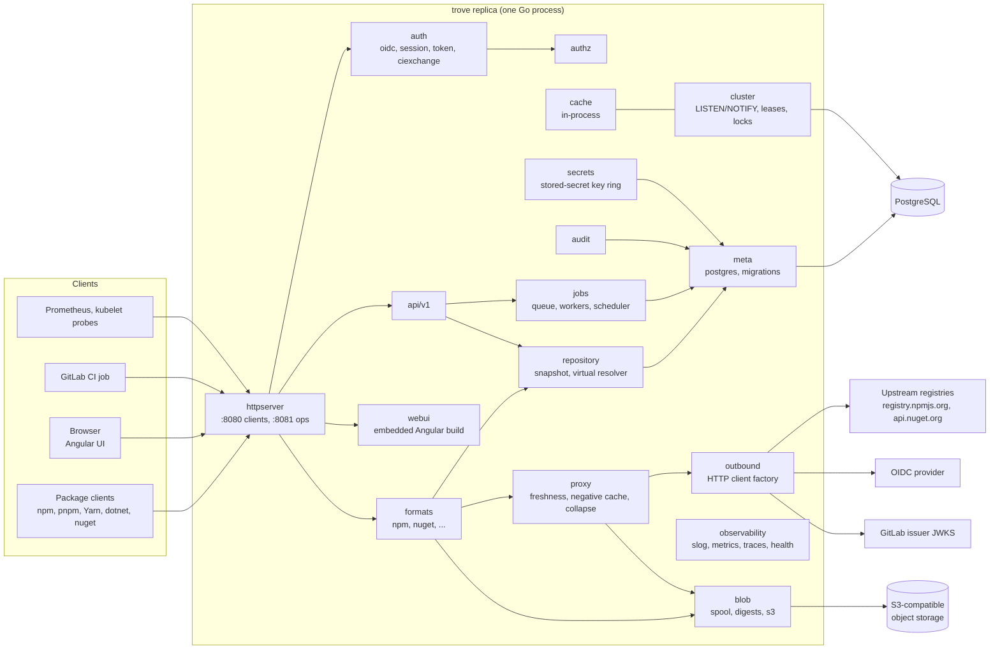
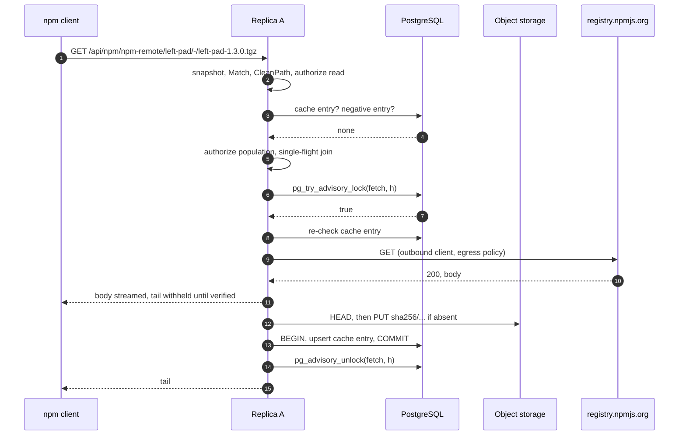

# Architecture

Status: specification — not implemented

This page fixes the skeleton of trove. It covers:
- the components inside the single binary;
- the Go and Angular code layout;
- the order in which components handle the shared request paths: local download, remote download
  (hit, miss, upstream down), upload, and virtual resolution;
- the contract every package format implements;
- the background job framework;
- the `LISTEN/NOTIFY` plumbing behind in-process caches;
- configuration loading, encryption of stored secrets and the outbound HTTP client factory;
- the error model, versioning and compatibility, and proposed performance targets.

What a feature does for the user is specified on the topic pages listed in
[README.md](README.md#pages). This page specifies the mechanisms they build on, and it names the
owning page wherever a topic hands over. Where a request path below and an owning page disagree on
a detail, the owning page wins. This page only fixes the order of steps and the boundaries between
components.

Covers: this page draws on [repositories.md](../features/repositories.md),
[remote-repositories.md](../features/remote-repositories.md),
[storage-and-blobs.md](../features/storage-and-blobs.md),
[ha-and-deployment.md](../features/ha-and-deployment.md) and
[operations-and-monitoring.md](../features/operations-and-monitoring.md). The format contract also
draws on [formats/README.md](../features/formats/README.md), and the stored-secret key on
[identity-and-access.md](../features/identity-and-access.md) (IAM-045).

## Handover to other pages

These are architecture-adjacent entries of the catalog pages listed above that another spec page
owns. This page provides only the mechanism the owner builds on.

| Catalog IDs | Owner | What this page contributes |
|---|---|---|
| OPS-051, OPS-052 (public base URL, per-request host) | [operations-and-observability.md](operations-and-observability.md) | Middleware position and client-address rules (R-ARCH-006) |
| OPS-001 to OPS-004 (probes), OPS-008 (service status), OPS-009 (lock diagnostics) | [operations-and-observability.md](operations-and-observability.md) | Start-up order, shutdown timeout (R-ARCH-024); lock categories and connection naming (R-ARCH-017, R-ARCH-019) |
| OPS-050 (content types), OPS-065 and ART-051 (tasks and job API), OPS-070 (reindex) | [operations-and-observability.md](operations-and-observability.md) | Job queue and scheduler (R-ARCH-016) |
| ART-011, ART-029, STOR-003 and the upload/download pipeline | [storage.md](storage.md) | Request order (R-ARCH-011, R-ARCH-014), format storage hooks (R-ARCH-008) |
| RMT-* settings, collapsing misses, metadata rewriting, merged-metadata cache | [repositories-and-proxy.md](repositories-and-proxy.md) | Request order (R-ARCH-013, R-ARCH-015), lock categories, notification plumbing |
| HA-022 to HA-071 except those listed below | [ha-and-helm.md](ha-and-helm.md) | Process model, roles, lifecycle and the connection formula |
| Long-running operations, client setup snippets, UI baseline | [api-and-ui.md](api-and-ui.md) (R-API-015, R-API-033, R-UI-001) | Job columns (R-ARCH-016), snippet templates in the format contract (R-ARCH-008) |

<details>
<summary>Facts this page relies on, and how they were verified (2026-10-28)</summary>

| Fact | Verified by |
|---|---|
| `net/http.ServeMux` unescapes paths segment by segment, so `%2F` stays inside one segment. `{name...}` matches the remainder. Conflicting patterns panic at registration. Paths with `.`, `..` or `//` are redirected to a cleaned URL, while escaped `%2e`/`%2f` are kept. | `go doc net/http.ServeMux` with the local go1.27.3 toolchain |
| `http.ResponseController` sets per-request read and write deadlines; a read deadline that has already passed cannot be extended. | `go doc` with go1.27.3 |
| A NOTIFY payload must be shorter than 8000 bytes by default, and notifications are delivered only after commit. Notifying transactions serialize their commits on one heavyweight lock held until after commit. | [PostgreSQL NOTIFY](https://www.postgresql.org/docs/current/sql-notify.html); `src/backend/commands/async.c` on `REL_18_STABLE` |
| Advisory locks have a one-`bigint` key space and a two-`int4` key space, which do not overlap. `pg_locks` shows two-key locks with `objsubid = 2`. | [Lock functions](https://www.postgresql.org/docs/current/functions-admin.html#FUNCTIONS-ADVISORY-LOCKS), [pg_locks](https://www.postgresql.org/docs/current/view-pg-locks.html) |
| pgx v5 has `Conn.WaitForNotification` and the `default_query_exec_mode` values `cache_statement`, `cache_describe`, `describe_exec`, `exec`, `simple_protocol`. | pgx source (`conn.go`) |
| goose v3's Provider accepts `embed.FS` sources, Go migrations, a custom table name, and an optional session locker. | goose source (`provider_options.go`, `lock/postgres.go`) |
| In aws-sdk-go-v2, the `feature/s3/manager` Uploader is marked deprecated in favour of `feature/s3/transfermanager`. `service/s3` exposes `UsePathStyle`, `RequestChecksumCalculation` and `ResponseChecksumValidation`. | SDK source |
| Zoneless change detection is the default for new Angular applications since v21. | [angular.dev zoneless guide](https://angular.dev/guide/zoneless) |
| Latest versions: pgx v5.11.0, sqlc v1.31.1, goose v3.29.0, golang-migrate v4.20.1, tern v2.4.3, aws-sdk-go-v2 `service/s3` v1.114.6, `feature/s3/transfermanager` v0.5.1, minio-go v7.4.1, River v0.50.0, chi v5.5.0 | `proxy.golang.org/<module>/@latest` |
| Licences: pgx, goose, golang-migrate and tern are MIT. aws-sdk-go-v2 and minio-go are Apache-2.0. River is MPL-2.0. | LICENSE files upstream |

Not verified: the behaviour of specific S3-compatible stores. The performance targets in R-ARCH-027
are proposals, not measurements.

</details>

## Process and components

### R-ARCH-001 · One binary, identical replicas, process roles
Priority: **MVP** · Covers: HA-001, HA-002, HA-009, HA-010, HA-015

trove MUST build into one statically linked binary, `trove` (`CGO_ENABLED=0`). It contains the
management API, every package-format protocol, the embedded Angular build, the schema migrations
and the background workers (INV-1, INV-2).

| Invocation | Purpose |
|---|---|
| `trove serve [--role all\|api\|worker]` | Runs one replica. |
| `trove migrate [up\|status]` | Applies or lists the embedded migrations behind the compatibility gate (R-ARCH-026). |
| `trove admin …` | Bootstrap and recovery: break-glass administrator ([identity-and-authentication.md](identity-and-authentication.md)), `admin config validate` ([operations-and-observability.md](operations-and-observability.md)), `admin secrets status` (R-ARCH-021). |
| `trove --version` | Version, commit, build date. |

| Role | Client listener `:8080` | Ops listener `:8081` | Job workers and singleton scheduler | `LISTEN` session |
|---|---|---|---|---|
| `all` (default, INV-2) | yes | yes | yes | yes |
| `api` | yes | yes | no | yes |
| `worker` | no | yes | yes | yes |

- No replica MAY hold state that another replica needs to answer a later request.
  - Sessions, tokens, upload sessions of multi-request protocols, the job queue, locks and
    cache-fill state live in PostgreSQL or object storage.
  - In-process state is limited to caches that can be rebuilt (R-ARCH-018) and to the spool file of
    the request currently running ([storage.md](storage.md)).
- There is no primary node. Work that must run once per cluster runs as a job, where the queue
  guarantees one claimant (R-ARCH-016), or under a named lease (R-ARCH-017).
- A replica registers itself on start in the replica registry
  ([operations-and-observability.md](operations-and-observability.md)). It takes traffic and jobs
  as soon as it is ready. No other step is needed to add or remove a replica.
- One replica and many run the same code path, and even a single replica uses external PostgreSQL
  and S3-compatible storage (INV-3, INV-4). Moving to a cluster means raising the replica count. An
  evaluation setup uses single-node MinIO and a small PostgreSQL. The chart bundles no production
  database (INV-12, [ha-and-helm.md](ha-and-helm.md)).
- Splitting roles is the trove form of separately scaled workloads (HA-015). The UI is never a
  separate workload because it is embedded (INV-1).

Acceptance criteria:
- On Linux, `file trove` reports a statically linked executable, and `go version -m trove`
  shows `CGO_ENABLED=0`.
- A replica started with `--role worker` has no socket on `:8080` (`ss -ltn`). The instance ID of a
  replica started with `--role api` never appears in `job.locked_by`.
- One of three pods is deleted with `kubectl delete pod --grace-period=0 --force` during a loop of
  100 `npm ci` runs through the Service. The loop finishes with npm's default `fetch-retries`.

### R-ARCH-002 · Component model and dependency rules
Priority: **MVP** · Covers: HA-003, HA-004, HA-006



| Component | Package | Responsibility | Behaviour specified in |
|---|---|---|---|
| httpserver | `internal/httpserver` | Listeners, top-level routing, middleware, client address | R-ARCH-005, R-ARCH-006 |
| auth | `internal/auth/{oidc,session,token,ciexchange}` | Principal resolution, OIDC login, tokens, CI exchange | [identity-and-authentication.md](identity-and-authentication.md), [gitlab-ci-oidc.md](gitlab-ci-oidc.md) |
| authz | `internal/authz` | Permission decisions | [authorization.md](authorization.md) |
| api | `internal/api/v1` | Management REST API | [api-and-ui.md](api-and-ui.md) |
| webui | `internal/webui` | Embedded Angular build | [api-and-ui.md](api-and-ui.md) (R-UI-001), R-ARCH-004 |
| formats | `internal/formats`, `internal/formats/<id>` | Package protocols behind the plug-in contract | R-ARCH-008 to R-ARCH-010; [formats/npm.md](formats/npm.md), [formats/nuget.md](formats/nuget.md) |
| repository | `internal/repository` | Repository model and snapshot, request classification, virtual resolution | [repositories-and-proxy.md](repositories-and-proxy.md) |
| proxy | `internal/proxy` | Remote fetch engine | [repositories-and-proxy.md](repositories-and-proxy.md) |
| blob | `internal/blob`, `internal/blob/s3` | Spool, digests, content-addressed objects | [storage.md](storage.md) |
| meta | `internal/meta`, `internal/meta/postgres` | Transactions, generated queries, embedded migrations | [storage.md](storage.md) (schema of items and packages), R-ARCH-016, R-ARCH-019, R-ARCH-026 |
| cluster | `internal/cluster` | `LISTEN/NOTIFY`, leases, advisory-lock categories | R-ARCH-017, R-ARCH-018 |
| cache | `internal/cache` | Bounded in-process caches and their invalidation hooks | R-ARCH-018 |
| jobs | `internal/jobs` | Queue, workers, scheduler | R-ARCH-016 |
| audit | `internal/audit` | Audit events | [operations-and-observability.md](operations-and-observability.md) |
| observability | `internal/observability` | Logs, metrics, traces, health checks | [operations-and-observability.md](operations-and-observability.md) |
| outbound | `internal/outbound` | Every outbound HTTP client | R-ARCH-022; settings in [repositories-and-proxy.md](repositories-and-proxy.md) |
| secrets | `internal/secrets` | Stored-secret encryption | R-ARCH-021 |
| config | `internal/config` | Configuration schema and loading | R-ARCH-020; [operations-and-observability.md](operations-and-observability.md) |
| errs | `internal/errs` | Error kinds and rendering | R-ARCH-023 |

Normative rules:
- PostgreSQL and S3-compatible object storage are the only stateful dependencies (INV-3, INV-4).
- Replicas never talk to each other. There are no peer addresses and no replica-to-replica HTTP.
  Configuration changes, cache invalidation, locks and job hand-off go through PostgreSQL (INV-12),
  so the catalog's per-node peer address (HA-006) does not exist in trove.
- Imports form layers:
  1. Edge: `httpserver`, `api/v1`, `webui`, format handlers.
  2. Domain: `repository`, `proxy`, `authz`, `auth`, `jobs`, `audit`.
  3. Infrastructure: `meta/postgres`, `blob/s3`, `cluster`, `outbound`, `secrets`.

  No lower layer imports a higher one.
- Only `meta/postgres` and `cluster` import pgx. Only `blob/s3` imports the S3 SDK. Format
  packages import neither (R-ARCH-008).
- `internal/archtest` walks `go list -deps -json ./...` and fails on any forbidden import.

Acceptance criteria:
- Adding an import of `internal/meta/postgres` to `internal/formats/npm` makes
  `go test ./internal/archtest` fail and name the edge.
- `grep -rn "http.Client{\|net.Dial" internal --include=*.go` finds matches only in
  `internal/outbound` and in `_test.go` files.

## Code layout

### R-ARCH-003 · Go module and package layout
Priority: **MVP** · Covers: trove-only

The repository is one Go module. `go.mod` states `go 1.27.3`, which is the minimum and also the
pin CI reads. Code generators (sqlc, and any OpenAPI generator chosen in
[api-and-ui.md](api-and-ui.md)) are pinned as `tool` directives in `go.mod`, so local builds and CI
run the same versions.

```text
trove/
├── cmd/trove/main.go          # subcommands serve, migrate, admin; flag parsing only
├── api/openapi.yaml             # OpenAPI 3.1 source of truth, served as /api/v1/openapi.json (INV-6)
├── internal/
│   ├── app/                     # composition root: builds components from config, start/stop order
│   ├── buildinfo/               # version, commit, build date (-ldflags)
│   ├── config/                  # schema, YAML + env loading, validation
│   ├── httpserver/              # listeners, ServeMux, middleware, client address
│   ├── api/v1/                  # management API handlers
│   ├── auth/{oidc,session,token,ciexchange}/
│   ├── authz/
│   ├── repository/              # model, snapshot, CleanPath, classification, virtual resolver
│   ├── formats/                 # contract (Format, Host), registry
│   │   ├── all/                 # imports and registers every format
│   │   ├── formattest/          # conformance kit, in-memory Host
│   │   ├── npm/
│   │   └── nuget/
│   ├── proxy/
│   ├── blob/                    # BlobStore interface, spool, digests
│   │   └── s3/
│   ├── meta/                    # Tx helper, shared types
│   │   └── postgres/
│   │       ├── migrations/      # NNNNN_name.sql, embedded
│   │       ├── queries/         # *.sql inputs for sqlc
│   │       └── q/               # sqlc output (generated, committed)
│   ├── cluster/                 # notifier, listener, leases, lock categories, channel registry
│   ├── cache/
│   ├── jobs/
│   ├── audit/
│   ├── outbound/
│   ├── secrets/
│   ├── errs/
│   ├── observability/
│   ├── webui/                   # go:embed all:dist; dist/ is filled by the web build
│   └── archtest/
├── web/                         # Angular workspace (R-ARCH-004)
├── deploy/helm/trove/         # Helm chart (INV-13)
├── test/
│   ├── integration/             # real PostgreSQL and MinIO in containers
│   └── e2e/                     # kind + Helm + real clients (npm, pnpm, yarn, dotnet)
└── perf/                        # load scripts, reference lockfiles (R-ARCH-027)
```

- All Go code lives under `internal/`, so trove exposes no public Go API. A new format is a new
  package in this repository (R-ARCH-010).
- There is one package per bounded context. `util`, `common` and `helpers` packages are not
  allowed.
- Generated code carries the `// Code generated … DO NOT EDIT.` header and is committed. CI runs
  `go generate ./... && git diff --exit-code`.
- `internal/webui/dist/` holds a committed placeholder `index.html`, so `go build` works without a
  UI build. Release builds run the web build first.

Acceptance criteria:
- `go build ./cmd/trove` succeeds on a clean checkout without Node.js installed.
- `go generate ./... && git diff --exit-code` passes in CI.

### R-ARCH-004 · Angular workspace layout
Priority: **MVP** · Covers: trove-only

The technology baseline (standalone components, zoneless, `OnPush`, `httpResource()`, Signal Forms,
CSP nonce, localized builds under `/ui/{locale}/`) and state management are specified in
[api-and-ui.md](api-and-ui.md) (R-UI-001, R-UI-046). This requirement fixes where the code lives
and how the build reaches the binary.

```text
web/
├── angular.json                 # i18n locales; localized production build
├── package.json                 # exact versions (Angular 22.x, INV-1); package-lock.json committed
├── .nvmrc                       # the one Node.js version used locally and in CI
├── tsconfig.json
└── src/
    ├── index.html               # root element carries ngCspNonce (filled per response by webui)
    ├── main.ts                  # bootstrapApplication(App, appConfig)
    ├── locale/                  # translation files
    ├── styles/                  # design tokens, light and dark theme
    └── app/
        ├── app.ts               # root standalone component: shell, navigation, banner, outlet
        ├── app.config.ts        # router, HttpClient, interceptors, error handler
        ├── app.routes.ts        # lazy routes per area
        ├── api/                 # generated types + thin hand-written clients per resource family
        ├── core/                # SessionStore, interceptors (CSRF, problem mapping, 401), layout
        ├── shared/              # presentational components, pipes, directives
        └── features/
            ├── packages/  browse/  repositories/  setup/  tokens/
            ├── formats/<id>/    # optional format-specific panels, registered by format ID
            └── admin/           # users, groups, service accounts, policies, CI identities, system
```

- Generated API types live only in `src/app/api/`, and nothing in that folder is edited by hand.
- The repository settings form is rendered from the format's settings JSON Schema (R-ARCH-008). A
  format adds a panel under `features/formats/<id>/` only for interactions a schema cannot express.
- The production build writes one directory per locale. The release build copies them to
  `internal/webui/dist/<locale>/`.
- `internal/webui` serves them under `/ui/{locale}/`. It injects the per-response CSP nonce into
  `index.html` and applies the cache and fallback rules of R-UI-001.

Acceptance criteria:
- `grep -rE "NgModule\(|provideZoneChangeDetection|zone\.js" web/src web/angular.json` finds
  nothing.
- After `npm ci && npx ng build` in `web/` and a release `go build`, `curl -s localhost:8080/ui/en/admin/jobs`
  returns `index.html` with a nonce, and two requests carry different nonces.

## HTTP edge

### R-ARCH-005 · HTTP listeners, routing and middleware chain
Priority: **MVP** · Covers: HA-012, HA-020, HA-021, HA-024, REPO-005

Listeners (INV-6):
- The client listener (`server.listen`) serves everything clients use. The ops listener
  (`server.ops_listen`) serves only `/healthz`, `/readyz` and `/metrics`
  ([operations-and-observability.md](operations-and-observability.md)). Neither serves the other's
  paths.
- An address without a host binds every interface on IPv4 and IPv6 (HA-020).
- HTTP/1.1 is always on. With `server.tls`, HTTP/2 is served over TLS. TLS normally ends at the
  Ingress ([ha-and-helm.md](ha-and-helm.md)).

Top-level routes on the client listener (`net/http.ServeMux`, Q-ARCH-1):

| Pattern | Handler |
|---|---|
| `/api/v1/` | Management API ([api-and-ui.md](api-and-ui.md)) |
| `/api/<id>/{repoKey}/{rest...}`, registered once per format ID | Format dispatcher (R-ARCH-008) |
| `/files/{repoKey}/{path...}` | Raw file access ([storage.md](storage.md)) |
| `/auth/` | Browser login flow ([identity-and-authentication.md](identity-and-authentication.md)) |
| `/ui/` | Embedded UI (R-ARCH-004) |
| `GET /{$}` | `302` to `/ui/` |
| anything else | `404` problem (R-ARCH-023) |

- Format IDs match `^[a-z][a-z0-9-]{1,31}$` and MUST NOT match `^v[0-9]+$`, which is reserved for API
  versions. Registering literal format segments keeps `/api/v1/` and the format routes free of
  ServeMux conflicts.
- The dispatcher hands the format the remaining path exactly as received: `r.URL.EscapedPath()`
  minus `/api/<id>/<repoKey>/`. It never hands over the unescaped wildcard value. This keeps an
  encoded slash in a package name (`@scope%2fname`) apart from a separator. Repository keys contain
  nothing that needs escaping (INV-5), so the prefix looks the same escaped and unescaped.
- Every repository-relative path passes `repository.CleanPath` before authorization runs.
  `CleanPath` decodes percent-escapes exactly once and answers `400` with code `invalid_path` when a
  segment is `.`, `..` or empty, or contains NUL, `\` or a control character
  ([authorization.md](authorization.md)). ServeMux's own cleaning does not cover escaped dots
  (`%2e%2e`), so trove does not rely on it.

Middleware, outermost first:
1. Panic recovery: `500` with code `internal`, and the stack goes to the log.
2. Trace context and request ID ([operations-and-observability.md](operations-and-observability.md)).
   Every response carries `X-Request-Id`.
3. Request log and metrics. The route label is the ServeMux pattern or the format route name
   (R-ARCH-008), never the raw path.
4. In-flight limit (`server.max_in_flight`, client listener only): `503` with `Retry-After: 1` and
   code `server_busy`.
5. Client address (R-ARCH-006) and the base URL of the response
   ([operations-and-observability.md](operations-and-observability.md)).
6. Authentication: a principal or anonymous. Credentials that are present but invalid always give
   `401` ([identity-and-authentication.md](identity-and-authentication.md)).
7. Rate limits on `/api/v1/`, `/files/` and `/auth/` ([api-and-ui.md](api-and-ui.md)).
8. The handler. Authorization runs inside the handler, as soon as the repository and the path or
   package are known ([authorization.md](authorization.md)).

Transfer rules:
- A handler MUST finish authentication and the coarse authorization of its route (R-ARCH-008)
  before it reads the request body. Go sends `100 Continue` only on the first body read, so a
  rejected upload never transfers its body.
- `http.Server.ReadTimeout` and `WriteTimeout` stay at 0, because they would cut long transfers.
  Requests are bounded by `server.read_header_timeout` and by a stall timeout: after every
  successful chunk, the handler moves the read and write deadlines forward by
  `server.transfer_stall_timeout` through `http.ResponseController` (HA-024).
- Bodies are streamed. Only documents a format declares as bounded are held in memory
  (R-ARCH-028). Upload size limits belong to [storage.md](storage.md), and JSON body limits on
  `/api/v1/` to [api-and-ui.md](api-and-ui.md).

```yaml
server:
  listen: ":8080"                    # default (proposed), INV-6
  ops_listen: ":8081"                # default (proposed), INV-6
  read_header_timeout: 10s           # default (proposed)
  idle_timeout: 120s                 # default (proposed)
  transfer_stall_timeout: 60s        # default (proposed)
  max_header_bytes: 65536            # default (proposed)
  max_in_flight: 4096                # default (proposed), per replica
  shutdown_timeout: 25s              # default (proposed), R-ARCH-024
  tls:
    cert_file: ""                    # default (proposed): empty = plain HTTP
    key_file: ""                     # default (proposed)
```

Acceptance criteria:
- `curl -s -o /dev/null -w '%{http_code}' http://localhost:8080/healthz` prints `404`. The same
  request on `:8081` prints `200`.
- `curl -s http://localhost:8080/api/npm/npm-all/@types%2fnode | jq -r .name` prints `@types/node`.
  A request to `…/api/npm/npm-all/%2e%2e/x` gets `400` with code `invalid_path`.
- `curl -T 5GiB.bin --limit-rate 5M` to a generic repository (P1) completes. A client that stops
  sending for 61 s has its connection closed.
- `curl -v -T pkg.tgz -H 'Expect: 100-continue'` without credentials, against a repository that
  needs authentication, gets `401` and no `100 Continue`.
- `curl -g -s http://[::1]:8080/ui/` answers.

### R-ARCH-006 · Client address and trusted proxies
Priority: **MVP** · Covers: HA-025

Several pages rely on this mechanism: rate limits, audit, authorization conditions, and token
exchange limits.
- The client address is the TCP peer, unless the peer lies in `server.trusted_proxies`. In that case
  it is the right-most address in `X-Forwarded-For`, or in `Forwarded: for=`
  ([RFC 7239](https://www.rfc-editor.org/rfc/rfc7239)), that is not itself a trusted proxy.
- Forwarded scheme and host are evaluated only under the rules of the public base URL. Those rules,
  the `server.base_url`, `server.trusted_proxies` and `server.additional_base_urls` keys, and their
  defaults are owned by [operations-and-observability.md](operations-and-observability.md).
- The resolved client address and base URL are placed in the request context once, by middleware
  step 5 of R-ARCH-005. No handler, format or job reads `Host`, `X-Forwarded-*` or `Forwarded`
  itself.
- Rendered metadata that contains links is cached under a key that includes the base URL
  (R-ARCH-018), so one host name never sees another's links.

Acceptance criteria:
- `grep -rnE 'X-Forwarded|\.Host\b|"Forwarded"' internal --include=*.go` matches only in
  `internal/httpserver` and in tests.
- With `trusted_proxies: ["10.42.0.0/16"]`, a request from `10.42.1.7` carrying
  `X-Forwarded-For: 198.51.100.4, 10.42.0.9` is logged with client address `198.51.100.4`. The same
  header from `203.0.113.5` is logged as `203.0.113.5`.

### R-ARCH-007 · One origin for UI and package content
Priority: **MVP** · Covers: trove-only

The UI, the management API and the package endpoints share one origin: one host name and one
listener (INV-6). This decision was handed to this page by [formats/nuget.md](formats/nuget.md).
A separate content origin is not supported in the MVP.

Consequences, normative for every component:
- Every response whose body comes from package content or package metadata carries the content
  headers of [storage.md](storage.md):
  - `X-Content-Type-Options: nosniff`;
  - `Content-Security-Policy: sandbox; default-src 'none'`;
  - for files, `Content-Disposition: attachment`.

  This covers `/files/` and every format route of kind `Download`, `Metadata` or `Computed`
  (R-ARCH-008). It also covers uploaded and cached README, license, icon and manifest files.
- The UI never embeds package-provided HTML. It renders README content only as sanitized output of
  its own Markdown renderer ([api-and-ui.md](api-and-ui.md)).
- The conformance kit (R-ARCH-010) fails a format whose content routes lack these headers.

Acceptance criteria:
- An `evil.svg` with an embedded script, stored in a generic repository and opened from `/files/`
  in a browser, does not run the script. The response carries all three headers.
- An npm package document and a NuGet `.nuspec` response both carry `nosniff` and the sandbox CSP.

## Format plug-in contract

### R-ARCH-008 · Format plug-in contract
Priority: **MVP** · Covers: FMT-001, FMT-006, FMT-008, FMT-011, REPO-002, REPO-006

Each package format is a Go package `internal/formats/<id>` that implements `formats.Format`.

A format owns:
- its route table and path grammar;
- how each path behaves in caches;
- package identity and namespaced properties;
- the storage hooks [storage.md](storage.md) needs;
- upstream request mapping and metadata rewriting;
- merging across virtual members;
- client setup templates;
- its native error shape.

The core owns authentication, authorization, the upload and download pipeline, freshness, negative
caching, collapsing misses, offline state, audit, jobs and metrics. Formats reach the core only
through `Host` (R-ARCH-009). They MUST NOT open outbound connections, run SQL or touch the object
store.

```go
package formats

// ContractVersion changes whenever a method below changes meaning (R-ARCH-025).
const ContractVersion = 1

type ID string // "npm", "nuget"; ^[a-z][a-z0-9-]{1,31}$, never ^v[0-9]+$

type Class uint8

const (
	Local Class = iota + 1
	Remote
	Virtual
)

type Format interface {
	Descriptor() Descriptor

	// Routes lists every protocol operation below /api/<id>/<repoKey>/.
	Routes() []Route
	// Match resolves method + repository-relative path (still percent-encoded) to a route.
	// It returns errs.NotFound or errs.MethodNotAllowed and never touches storage.
	Match(method, escapedPath string) (*Route, Params, error)
	// Classify says how a repository path behaves in caches (request classification,
	// repositories-and-proxy.md).
	Classify(p Path) PathKind

	// Storage hooks required by storage.md.
	IngestOptions(rq *Request) IngestOptions                         // expected digests, SHA-512, media type
	Inspect(ctx context.Context, in InspectInput) (*Inspection, error) // identity and namespaced properties (FMT-008)
	OnCommit(ctx context.Context, tx Tx, c CommitEvent) error          // package and version rows, lead item
	OnItemsRemoved(ctx context.Context, tx Tx, e ItemsEvent) error
	OnItemsRestored(ctx context.Context, tx Tx, e ItemsEvent) error
	RemoveVersion(ctx context.Context, tx Tx, v VersionRef) ([]ItemRef, error) // retention and caps
	VersionGroup(v VersionRef) string                                          // group a cap counts

	Remote() RemoteAdapter   // nil when Descriptor().Classes lacks Remote
	Virtual() VirtualAdapter // nil when Descriptor().Classes lacks Virtual
	Indexes() IndexBuilder   // nil when the format has no rebuildable derived metadata

	// SetupTemplates returns the client setup templates (text/template) used by api-and-ui.md R-API-033.
	SetupTemplates() []SetupTemplate

	// WriteError renders a core error in the client's native error shape (R-ARCH-023).
	WriteError(w http.ResponseWriter, r *http.Request, err error)
}

type Descriptor struct {
	ID               ID
	DisplayName      string
	Classes          []Class   // the authoritative class matrix (FMT-001, REPO-006)
	Clients          []Client  // native clients and tested versions (FMT-002, FMT-003)
	SettingsSchema   []byte    // JSON Schema 2020-12 of format-specific repository settings
	PropertyPrefix   string    // reserved property namespace, e.g. "npm." (FMT-008)
	MaxDocumentBytes int64     // bound for documents held in memory (R-ARCH-028)
}

type Route struct {
	Name     string       // stable metric, log and audit label, e.g. "npm.tarball.get"
	Method   string
	Template string       // documentation form, e.g. "/{package}/-/{file}"
	Action   authz.Action // coarse check before the body is read (INV-9 action)
	Kind     RouteKind    // Download, Metadata, Computed, Upload, Delete, Admin, Volatile
	Handler  HandlerFunc
}

type HandlerFunc func(ctx context.Context, rq *Request, w http.ResponseWriter) error

type Request struct {
	*http.Request
	Repo      *repository.Repository // immutable snapshot entry
	Route     *Route
	Params    Params
	Path      Path                   // canonical repository path (R-ARCH-005)
	Principal auth.Principal
	Host      Host
}

type PathKind uint8

const (
	Content  PathKind = iota + 1 // immutable once stored
	Metadata                     // upstream document that expires after the metadata cache period
	Computed                     // rendered by trove from stored rows, never fetched
	Volatile                     // passed through, never cached (search, advisory queries)
)

type RemoteAdapter interface {
	// UpstreamRequest maps a repository path to the upstream request.
	UpstreamRequest(ctx context.Context, rc RemoteContext, p Path) (*http.Request, error)
	// AcceptResponse checks status, headers and declared type before a byte is stored or sent.
	AcceptResponse(p Path, resp *http.Response) error
	// Rewrite renders a stored upstream document for one response (repositories-and-proxy.md).
	Rewrite(ctx context.Context, rc RemoteContext, p Path, doc []byte, links LinkBuilder) ([]byte, error)
}

type VirtualAdapter interface {
	Strategy(p Path) Strategy
	// Merge combines member documents. Each part carries its member's tier and position,
	// so the format can apply the per-version source rule of repositories-and-proxy.md.
	Merge(ctx context.Context, p Path, parts []MemberDocument, links LinkBuilder) ([]byte, error)
}

type Strategy uint8

const (
	FirstMatch Strategy = iota + 1 // tiered lookup, first eligible member that has it wins
	Merge                          // every eligible member contributes
	Newest                         // Merge, with remote members revalidated first (REPO-036)
)

type IndexBuilder interface {
	// Rebuild recomputes derived metadata of a local repository from stored rows; runs as a job.
	Rebuild(ctx context.Context, repo RepoRef, scope Path, opts RebuildOptions) (RebuildResult, error)
}

type SetupTemplate struct {
	ID       string // stable, e.g. "npm.npmrc.configure"
	Client   string // "npm", "pnpm", "yarn", "dotnet", "nuget"
	Section  string // "configure", "publish", "install"
	Lang     string // "shell", "ini", "xml", "yaml"
	File     string // target file when the snippet is file content, e.g. ".npmrc"
	Template string // text/template; never receives a token (api-and-ui.md R-API-030)
}
```

Normative rules:
- `Descriptor().Classes` is the single source of truth for the classes a format supports. Creating
  a repository with any other class is rejected ([repositories-and-proxy.md](repositories-and-proxy.md)).
- `Classify` MUST put every path a route serves into exactly one kind. A `Content` path is never
  refreshed. A `Metadata` path is never treated as immutable.
- `Inspect` writes properties only under `PropertyPrefix`. Who may change that namespace is
  decided in [authorization.md](authorization.md). For uploads, the name `Inspect` reads from the
  content is the name authorization checks ([authorization.md](authorization.md)).
- `Route.Action` is a coarse check that the core runs before the body is read: "may this principal
  do this action anywhere in this repository?". The handler then decides on the concrete path or
  package through `Host.Authorize`.
- `OnCommit`, `OnItemsRemoved` and `OnItemsRestored` run inside the storage transaction and MUST
  NOT perform I/O outside PostgreSQL.

Acceptance criteria:
- The conformance kit (R-ARCH-010) passes for `npm` and `nuget`.
- Creating a repository whose class is not in the format's `Classes` fails with `422`.

### R-ARCH-009 · Core services offered to formats
Priority: **MVP** · Covers: FMT-007, STOR-001, STOR-002

```go
type Host interface {
	Authorize(ctx context.Context, rq *Request, a authz.Action, res authz.Resource) error
	InTx(ctx context.Context, fn func(tx Tx) error) error // R-ARCH-019

	Ingest() Ingestor            // upload pipeline of storage.md: admission, spool, digests, commit
	Items() ItemStore            // repository paths <-> blobs, Range and conditional reads (storage.md)
	Packages() PackageStore      // package and version rows behind the package view (FMT-007)
	Remote() RemoteFetcher       // remote engine (repositories-and-proxy.md)
	Resolver() Resolver          // virtual resolution (repositories-and-proxy.md)
	Links() LinkBuilder          // absolute URLs from the request's base URL (R-ARCH-006)
	Renditions() RenditionCache  // rendered documents (R-ARCH-018)
	Jobs() JobEnqueuer           // R-ARCH-016
	Notify(tx Tx, ch Channel, payload any) // R-ARCH-018
}

type PackageStore interface {
	Versions(ctx context.Context, repo RepoRef, name string) ([]PackageVersion, RevSeq, error)
	RevSeqs(ctx context.Context, repos []RepoRef, name string) (map[RepoID]RevSeq, error)
	// Writes happen through the storage hooks (OnCommit, OnItemsRemoved, ...), not here.
}
```

- Formats never see blob addresses, bucket names or SQL. Item, package and blob schemas belong to
  [storage.md](storage.md).
- This page requires one thing of that schema: every package row carries a revision sequence
  (`rev_seq`, as [formats/npm.md](formats/npm.md) names it). It is incremented in the transaction
  that changes the package (R-ARCH-012).
- Copy, move and delete change rows only, never blob content (STOR-002, [storage.md](storage.md)).
- Everything one client request writes goes through one transaction: items, package rows,
  properties, audit event, job enqueue and the notifications of R-ARCH-018.

Acceptance criteria:
- `go test ./internal/formats/...` passes with no PostgreSQL and no object store running, using the
  in-memory `Host` in `formattest`.

### R-ARCH-010 · Format registry and conformance kit
Priority: **MVP** · Covers: FMT-001, FMT-002, FMT-003

- Formats are registered at compile time: `internal/formats/all` imports every format package and
  calls `formats.Register`. There are no Go `plugin` shared objects and no out-of-process formats:
  - the `plugin` package requires identical toolchain and dependency versions and does not run on
    every platform;
  - an external process would add a network hop to every package request.
- At start-up, `Register` panics, and the process exits, on any of these:
  - a duplicate or reserved ID;
  - a `ContractVersion` mismatch;
  - a route set that fails the kit's ambiguity check;
  - a class matrix with no matching adapter, for example `Remote` listed but `Remote()` returning
    nil.
- The registry feeds the format list of the client setup API, the repository create form
  (settings schema) and the OpenAPI enum of format IDs ([api-and-ui.md](api-and-ui.md)).

The conformance kit (`internal/formats/formattest`) is table-driven. Every format runs it in its
own tests:
1. Every route matches its documented examples, and no other route matches them.
2. `Match` rejects `..`, `%2e%2e`, NUL, control characters and paths longer than 4 KiB.
3. `Classify` returns a kind for every route example. No `Content` path is `Metadata`.
4. `Rewrite` is deterministic and idempotent. No upstream host remains in a download link of a
   rewritten document.
5. `Merge` is deterministic and follows the per-version source rule of
   [repositories-and-proxy.md](repositories-and-proxy.md): the version entry comes from the member
   that tier resolution would choose for that version's file.
6. `Inspect` enforces the limits of R-ARCH-028 against crafted inputs that the kit ships.
7. Responses of `Download`, `Metadata` and `Computed` routes carry the content headers of
   R-ARCH-007.
8. Every client in `Descriptor().Clients` has `configure` and `install` templates. No template
   contains a token placeholder that the server would fill.

End-to-end, every listed client runs its tested versions against a local, a remote and a virtual
repository in `test/e2e` (FMT-002, FMT-003). The versions are fixed on the format pages.

Acceptance criteria:
- A format that registers `/{package}` and `/{scope}/{name}` without a disambiguating rule fails
  kit check 1.
- Removing `nosniff` from the npm tarball handler fails kit check 7.

## Request paths

Each path below fixes the order in which components act. It names the page that owns each step and
introduces no rules of its own beyond that order.

### R-ARCH-011 · Request path: download from a local repository
Priority: **MVP** · Covers: ART-011, REPO-016, STOR-001

1. ServeMux matches `/api/<id>/{repoKey}/…` or `/files/{repoKey}/…`. Middleware resolves the
   client address, base URL and principal.
2. The repository comes from the in-process snapshot. An unknown key, or a format segment that does
   not match the repository's format, answers `404` with code `repository_not_found`.
3. `Format.Match` selects the route, and `repository.CleanPath` canonicalises the path.
4. Authorization checks `read` on the repository and the path or package
   ([authorization.md](authorization.md)). Denial answers `401` with a challenge for an anonymous
   caller, and `403` or `404` for an authenticated one, as that page decides.
5. Include and exclude patterns apply ([repositories-and-proxy.md](repositories-and-proxy.md)).
6. What happens next depends on the route kind:
   - `Content`: the item lookup, `HEAD`, conditional, `Range` and streaming rules of
     [storage.md](storage.md). Conditional requests and `HEAD` never reach object storage.
   - `Computed`: R-ARCH-012.
7. The response carries the content headers (R-ARCH-007).
8. Download statistics are counted in memory and flushed in batches. The request path never writes
   them ([storage.md](storage.md)).

Acceptance criteria:
- `npm install @acme/lib@1.0.0 --registry https://trove.example.com/api/npm/npm-local/` succeeds.
- A conditional request with the item's ETag answers `304`, and the object-store GET counter does
  not move.

### R-ARCH-012 · Read-your-writes package metadata for local repositories
Priority: **MVP** · Covers: FMT-011

- Some formats have clients that read per-package metadata, for example the npm package document,
  and the NuGet registration and flat-container lists. For these formats, a local repository MUST
  render that metadata at request time from committed package rows. It MUST NOT serve a file that a
  background job rebuilds.
- After a publish has returned 2xx, the next metadata read on any replica MUST include the new
  version.
- The rendering is cached in the rendition cache under (repository, package, `rev_seq`, base URL,
  encoding). Each request reads the current `rev_seq` with one indexed query, so a cached rendering
  can never outlive a commit, whether or not a notification has arrived.
  [formats/npm.md](formats/npm.md) and [formats/nuget.md](formats/nuget.md) apply this rule.
- Repository-wide indexes of later formats (a Helm `index.yaml`, Debian `Packages`) MAY be rebuilt
  by a job (R-ARCH-016) with one waiting job per repository. The format page states the delay.
- Through a virtual repository the same guarantee holds for local members (R-ARCH-015).

Acceptance criteria, against three replicas, 50 iterations, no sleep, zero failures:

```sh
npm version patch --no-git-tag-version
npm publish --registry https://trove.example.com/api/npm/npm-local/
npm view "@acme/lib@$(node -p 'require("./package.json").version')" version \
  --registry https://trove.example.com/api/npm/npm-all/
```

```sh
dotnet nuget push "Acme.Lib.1.0.$i.nupkg" --api-key "$TOKEN" \
  --source https://trove.example.com/api/nuget/nuget-local/v3/index.json
dotnet add package Acme.Lib --version "1.0.$i" \
  --source https://trove.example.com/api/nuget/nuget-all/v3/index.json
```

### R-ARCH-013 · Request path: download through a remote repository
Priority: **MVP** · Covers: RMT-001, RMT-018, RMT-019, RMT-020, RMT-029, RMT-033

Steps 1 to 5 are those of R-ARCH-011. The semantics of each later step, its settings and its
status codes are owned by [repositories-and-proxy.md](repositories-and-proxy.md). This requirement
fixes their order and the components involved.

6. `Format.Classify`. A `Volatile` path passes through without being stored.
7. The proxy looks up the cache entry in PostgreSQL. The outcomes are owned by the proxy page; the
   codes shown are those it uses:

| Case | Owner's behaviour (summary) | Client sees |
|---|---|---|
| Hit (artifact, or metadata not expired) | Serve from the blob store; metadata through `Rewrite` and the rendition cache | `200`, `Cache-Status` hit |
| Metadata expired, upstream reachable | Conditional refresh within the metadata retrieval timeout | `200` |
| Refresh times out or fails | Serve the stored copy as stale | `200`, `Cache-Status` stale |
| Negative entry | No upstream call | `404` |
| Repository or system offline, nothing stored | No upstream call | `404` `not_cached_offline` |
| Assumed-offline circuit open, nothing stored | No upstream call | `503` `upstream_assumed_offline` with `Retry-After` |
| Caller may read but not populate | No upstream call ([authorization.md](authorization.md)) | `403` `populate_not_permitted` or stored content |
| Miss | Collapse, fetch, verify, store, serve (below) | `200` |
| Upstream `401`/`403` | Never forwarded as `401`/`403` | `502` `upstream_auth_failed` |
| Upstream unreachable / timeout | Counted toward the circuit | `502` `upstream_unreachable` / `504` `upstream_timeout` |
| Destination refused by the egress policy | No connection | `502` `egress_denied` |

The order on a miss:
1. Single-flight within the replica, then the cross-replica advisory lock (category `fetch`,
   R-ARCH-017), both per the collapse protocol of the proxy page (INV-11).
2. `RemoteAdapter.UpstreamRequest` builds the request. A client from `internal/outbound`
   (R-ARCH-022) sends it.
3. `RemoteAdapter.AcceptResponse` checks status and declared type before any byte is stored or
   sent.
4. The body enters the upload pipeline of [storage.md](storage.md): spool and single-pass digests.
   The leader's own client MAY receive the body while it arrives, under the proxy page's
   withheld-tail rule, so no client completes an unverified download. Waiters are served from the
   stored entry.
5. One short transaction stores the blob reference and the cache entry. The fill-complete
   notification follows it (R-ARCH-018).
6. The lock is released. No database transaction is ever open while bytes are transferred.



Acceptance criteria (metric names per [operations-and-observability.md](operations-and-observability.md)):
- On an empty remote, `npm cache clean --force && npm install lodash@4.17.21 --registry https://trove.example.com/api/npm/npm-remote/`
  fetches from the upstream. A second run after `npm cache clean --force` makes no upstream request.
- After the metadata cache period has passed and with the upstream unreachable,
  `npm install lodash@4.17.21` still succeeds from stale metadata and the cached tarball.

### R-ARCH-014 · Request path: upload
Priority: **MVP** · Covers: ART-002, ART-008, STOR-004, STOR-019, HA-005, REPO-038

1. Route, principal and repository as in R-ARCH-011.
   - A remote repository answers `405`.
   - A virtual repository resolves to its default deployment target, or answers `405` with code
     `no_deploy_target` ([repositories-and-proxy.md](repositories-and-proxy.md)).
2. The coarse check (`Route.Action`) runs before the body is read (R-ARCH-005).
3. The format parses the request envelope, such as the npm publish document or a NuGet
   `multipart/form-data` body. It passes each binary part, with its `IngestOptions`, to
   `Host.Ingest()`. Admission, spooling to the replica-local spool directory (HA-005), single-pass
   digests (INV-4) and size and digest verification follow [storage.md](storage.md).
4. `Format.Inspect` reads the spooled file and returns the declared identity and namespaced
   properties.
5. Fine-grained authorization runs on the declared identity: `deploy` on the repository, path and
   package, plus `overwrite` when the path exists (INV-9, [authorization.md](authorization.md)).
   Whether a format forbids replacing a version at all is decided on its format page (npm does).
6. The commit protocol of [storage.md](storage.md) runs: the object is written unless it already
   exists, then one transaction holds the item rows, `Format.OnCommit` (package rows, `rev_seq` + 1),
   properties, the audit event and any job enqueue. `201`, or whatever the protocol expects, is sent
   only after the object is durable and the transaction has committed (STOR-019).
7. Notifications for caches follow the commit (R-ARCH-018), and the spool file is removed on every
   path.

Acceptance criteria:
- After `npm publish` and `dotnet nuget push`,
  `aws s3api head-object --bucket "$B" --key "$P/sha256/ab/cd/<hex>"` succeeds, and `<hex>` equals
  `sha256sum` of the uploaded file.
- `npm publish` with a token that only has `read` is rejected, and the object-store PUT counter does
  not move.
- An npm tarball whose `package.json` declares `@other/lib`, published to the URL for `@acme/lib`,
  is rejected with `400` before it is stored.

### R-ARCH-015 · Request path: virtual resolution
Priority: **MVP** · Covers: REPO-033, REPO-035, REPO-036, REPO-037, REPO-038

The resolution algorithm, nesting rules, eligibility, pin rules, the merged-metadata cache and the
default deployment target are owned by [repositories-and-proxy.md](repositories-and-proxy.md). The
components act in this order:

1. `repository` reads the virtual repository's effective member list from the snapshot.
2. `repository` filters out ineligible members: by patterns, by state, and by the caller's
   permissions as `authz` decides them. Virtual repositories are never named in permission policies.
3. The format's `Strategy(path)` picks the mode:
   - `FirstMatch` walks the tiers: local members, then the remote members' caches, then the remote
     members' upstreams through R-ARCH-013. The first hit wins.
   - `Merge` and `Newest` collect each eligible member's document. Local documents come from
     R-ARCH-012, remote documents from R-ARCH-013, with stale serving and the circuit applying. The
     format then merges them under the per-version source rule.
4. The merged result is cached as the proxy page specifies. The cache key includes the eligible
   member set and the base URL.
   - Each entry also records the `rev_seq` of every local member it used, and one `RevSeqs` query
     per request checks them. A local publish is then visible through the virtual repository on
     every replica without waiting for a notification. This is the rule
     [formats/npm.md](formats/npm.md) applies, and it SHOULD hold for every format (Q-ARCH-9).
5. Links in the response point at the virtual repository. Writes go to the default deployment
   target through R-ARCH-014.

Acceptance criteria, with `npm-all` = [`npm-local`, `npm-remote`]:
- `npm view lodash versions --registry …/npm-all/` lists the upstream versions, and
  `npm view @acme/lib versions --registry …/npm-all/` lists the local ones.
- A user with `read` on `npm-remote` only cannot see `@acme/lib` through `npm-all`. A user with
  `read` on both can.

## Background jobs and coordination

### R-ARCH-016 · Background job framework on PostgreSQL
Priority: **MVP** · Covers: HA-002, STOR-037, FMT-011, FMT-012, OPS-074

The queue backs three things: maintenance tasks and the job API
([operations-and-observability.md](operations-and-observability.md)), long-running API operations
([api-and-ui.md](api-and-ui.md) R-API-015), and internal work such as index rebuilds, webhook
delivery and data migrations. Its columns serve all three.

```sql
CREATE TYPE job_state AS ENUM ('queued', 'running', 'succeeded', 'failed', 'cancelling', 'cancelled');

CREATE TABLE job (
    id             uuid        PRIMARY KEY,                 -- UUIDv7, generated by trove
    kind           text        NOT NULL,                    -- 'gc', 'index_rebuild', 'repository_deletion', ...
    queue          text        NOT NULL DEFAULT 'default',
    args           jsonb       NOT NULL DEFAULT '{}',
    state          job_state   NOT NULL DEFAULT 'queued',
    priority       smallint    NOT NULL DEFAULT 100,        -- lower runs first
    run_at         timestamptz NOT NULL DEFAULT now(),
    attempt        integer     NOT NULL DEFAULT 0,
    max_attempts   integer     NOT NULL DEFAULT 10,
    dedup_key      text,                                    -- see enqueue modes
    dedup_mode     text        CHECK (dedup_mode IN ('exclusive', 'coalesce')),
    task           text,                                    -- maintenance task name for scheduled runs
    scheduled_for  timestamptz,                             -- schedule slot of a scheduled run
    target_kind    text,                                    -- R-API-015 operation target
    target_key     text,
    locked_by      uuid,                                    -- replica instance id (replica registry)
    locked_until   timestamptz,                             -- lease, extended by heartbeat
    progress_done  bigint,
    progress_total bigint,
    progress_unit  text,
    checkpoint     jsonb,                                   -- resumable handler state
    result         jsonb,
    error          jsonb,                                   -- problem object (R-ARCH-023)
    created_by     uuid,                                    -- principal; NULL for system and scheduled runs
    created_at     timestamptz NOT NULL DEFAULT now(),
    started_at     timestamptz,
    finished_at    timestamptz,
    CHECK ((dedup_key IS NULL) = (dedup_mode IS NULL))
);
CREATE INDEX job_fetch ON job (queue, priority, run_at) WHERE state = 'queued';
CREATE INDEX job_lease ON job (locked_until) WHERE state IN ('running', 'cancelling');
CREATE INDEX job_running_key ON job (dedup_key) WHERE state IN ('running', 'cancelling');
CREATE UNIQUE INDEX job_one_waiting ON job (dedup_key)
    WHERE dedup_key IS NOT NULL AND state = 'queued';
CREATE UNIQUE INDEX job_one_active ON job (dedup_key)
    WHERE dedup_mode = 'exclusive' AND state IN ('queued', 'running', 'cancelling');
CREATE UNIQUE INDEX job_task_slot ON job (task, scheduled_for) WHERE task IS NOT NULL;
```

Workers claim jobs on the main pool, in short transactions that work through a transaction pooler:

```sql
WITH next AS (
    SELECT j.id FROM job j
    WHERE j.state = 'queued' AND j.queue = ANY($1) AND j.kind = ANY($2) AND j.run_at <= now()
      AND (j.dedup_key IS NULL OR NOT EXISTS (
             SELECT 1 FROM job r
             WHERE r.dedup_key = j.dedup_key AND r.state IN ('running', 'cancelling')))
    ORDER BY j.priority, j.run_at
    FOR UPDATE SKIP LOCKED
    LIMIT $3)
UPDATE job SET state = 'running', locked_by = $4, locked_until = now() + $5::interval,
               attempt = job.attempt + 1, started_at = coalesce(job.started_at, now())
FROM next WHERE job.id = next.id
RETURNING job.*;
```

Normative rules:
- Delivery is at least once, so handlers MUST be idempotent. Long handlers, such as garbage
  collection and data migrations, checkpoint into `checkpoint` and resume from it.
- A replica claims only the job kinds it knows (`$2`). During a rolling upgrade, an N-1 replica
  never picks up a kind introduced in N.
- Enqueue modes:
  - `exclusive`: no new job while one with the same key is queued or running. A conflicting enqueue
    returns the existing job. Maintenance tasks use this mode, and their manual trigger answers
    `409` with that job ([operations-and-observability.md](operations-and-observability.md)).
  - `coalesce`: at most one job waits while another runs, so work that arrives during a run is not
    lost. Index rebuilds use this mode. Jobs with the same key never run at the same time.
  - If a coalesced job returns to `queued` (retry, reaper) while another waits, it ends
    `cancelled` with `error.code = superseded`.
- The heartbeat extends `locked_until` every `jobs.heartbeat_interval`. A heartbeat that no longer
  matches its row cancels the handler's context. So does one that finds the state `cancelling`; the
  handler then ends the job `cancelled` at its next checkpoint.
- The reaper runs on every worker replica. Expired `running` jobs go back to `queued` with backoff
  (`run_at = now() + min(2^attempt s, 1 h)` ± 20 % jitter), or to `failed` once `max_attempts` is
  used up.
- Workers wake on `NOTIFY trove_jobs` (R-ARCH-018) and also poll every `jobs.poll_interval`.
- The scheduler is a singleton under the `scheduler` lease (R-ARCH-017). Every
  `jobs.schedule_tick` it reads the schedules: `maintenance.tasks.<name>` from configuration, and
  the schedules other pages keep in PostgreSQL, such as cleanup policies in
  [storage.md](storage.md). For each one it inserts the latest due slot as
  `(task, scheduled_for)` with `ON CONFLICT DO NOTHING`. Missed slots are not caught up, and a slot
  is never enqueued twice, even across a lease hand-over.
- Finished jobs are deleted after `jobs.retention`. The default matches the 30-day operation
  retention of [api-and-ui.md](api-and-ui.md).
- Kinds are registered in code: `jobs.Register(kind, handler, Options{Queue, Timeout, MaxAttempts, DedupMode})`.
  Each kind's semantics belong to its owning page. `data_migration_<name>` belongs to R-ARCH-026,
  and `secrets_reencrypt` to R-ARCH-021.

```yaml
jobs:
  workers:                         # concurrent jobs per replica and queue
    default: 4                     # default (proposed)
    maintenance: 1                 # default (proposed)
    index: 2                       # default (proposed)
    delivery: 8                    # default (proposed), webhooks (P1)
  poll_interval: 2s                # default (proposed)
  lease_duration: 60s              # default (proposed)
  heartbeat_interval: 15s          # default (proposed)
  schedule_tick: 10s               # default (proposed)
  retention: 720h                  # default (proposed), 30 days
```

Acceptance criteria:
- `kill -9` on the replica running an index rebuild makes the job `queued` again within
  `lease_duration` plus one reaper pass, and another replica completes it.
- 100 coalesced enqueues of one repository's index rebuild within one second produce at most two
  executions.
- Three replicas with a task scheduled `*/5 * * * *` produce exactly 12 jobs in one hour. Deleting
  the scheduler pod in that hour produces no duplicate.

### R-ARCH-017 · Coordination session, leases and advisory-lock categories
Priority: **MVP** · Covers: HA-002, HA-006, HA-007

- Each replica keeps one coordination session. It is a dedicated PostgreSQL connection outside the
  pool, with `application_name` `trove:<replica>:notify`, opened against `cluster.coordination_url`.
  - It runs `LISTEN` on every registered channel (R-ARCH-018).
  - It holds the session-level advisory locks behind named leases.
  - Its state is the `notify` readiness check
    ([operations-and-observability.md](operations-and-observability.md)).
- When the session is lost, the replica:
  1. cancels every lease holder's context;
  2. fails the `notify` check;
  3. reconnects with backoff and runs `LISTEN` again;
  4. flushes every registered cache (R-ARCH-018);
  5. tries the leases again.
- Every advisory lock uses the two-`int4` form, and the first key is a registered category. This
  lets the lock-diagnostics view of
  [operations-and-observability.md](operations-and-observability.md) name every lock:

| classid | Category | objid | Holder |
|---|---|---|---|
| 1 | `lease` | registered lease number (`scheduler` = 1) | coordination session for named leases; a lease-pool connection for singleton work with fencing ([ha-and-helm.md](ha-and-helm.md) R-HA-006); session lock |
| 2 | `fetch` | first 4 bytes of SHA-256(repository id ‖ 0x00 ‖ path ‖ 0x00 ‖ variant) as `int4` | proxy lock pool, session lock ([repositories-and-proxy.md](repositories-and-proxy.md)) |
| 3 | `migration` | 0 | `trove migrate`, session lock (R-ARCH-026) |
| 4 | `config` | registered object type (virtual membership = 1) | `pg_advisory_xact_lock` inside configuration transactions |

- A collision in a hashed `objid` only serializes two unrelated operations. New categories are
  added in `internal/cluster/locks.go`, never as ad-hoc keys.
- The coordination session and the proxy lock pool depend on session state, so a transaction-mode
  pooler breaks them. At start, `trove serve` runs `SELECT pg_backend_pid()` twice on the
  coordination session. If the values differ, it exits with
  `coordination connection must keep session state; set cluster.coordination_url to a direct or session-mode endpoint`.
- Leases are retried every `cluster.lease_retry_interval`. Lease holders are shown in the replica
  registry ([operations-and-observability.md](operations-and-observability.md)).

```yaml
cluster:
  coordination_url: ""             # default (proposed): empty = the database URL (storage.md, ha-and-helm.md);
                                   # secret-typed, with companion coordination_url_file
  ping_interval: 5s                # default (proposed), SELECT 1 on the coordination session
  lease_retry_interval: 15s        # default (proposed)
```

Acceptance criteria:
- With three replicas,
  `SELECT count(*) FROM pg_locks WHERE locktype = 'advisory' AND objsubid = 2 AND classid = 1 AND objid = 1`
  returns 1. After the holder pod is deleted, another replica holds the lease within 15 s.
- With `cluster.coordination_url` pointing at PgBouncer in transaction mode, `trove serve` exits
  non-zero with the message above.
- After `SELECT pg_terminate_backend(<notify pid>)`, `/readyz` turns `503`, the replica logs a
  reconnect and a cache flush, and `/readyz` is back to `200` within two ping intervals.

### R-ARCH-018 · In-process caches and LISTEN/NOTIFY plumbing
Priority: **MVP** · Covers: HA-006, RMT-026

Each owning page decides what it caches. This page provides the mechanism every cache uses, and
the rules for it.

- A cache is registered with `cache.Register(name, Options{MaxBytes|MaxEntries, SafetyTTL, OnFlush})`.
  `SafetyTTL` is mandatory and bounds staleness if an invalidation is ever missed. Every cache exports
  `trove_cache_requests_total{cache,result}` and its size
  ([operations-and-observability.md](operations-and-observability.md)).
- Keys that make an entry self-validating are preferred over notifications: a source digest, a
  `rev_seq`, or an epoch counter like the one in [authorization.md](authorization.md). Notifications
  then only evict early.
- Channels are registered in `internal/cluster/channels.go` and named `trove_<area>`. A payload is
  JSON under 1 KiB. A change that would need more becomes a coarse flush of the affected cache.
  PostgreSQL's limit is 8000 bytes.
- Delivery: PostgreSQL serializes the commits of all notifying transactions on one lock held until
  after commit (`async.c`). The plumbing therefore separates two classes of notification:
  - Administrative changes (configuration, policies, revocation, settings) call `Host.Notify` or
    `cluster.Notify` inside the writing transaction. They are delivered on commit.
  - Hot-path changes (publish, delete, cache fill, metadata refresh) are handed to the replica's
    notification coalescer once the transaction has committed. The coalescer sends at most one
    `NOTIFY` per channel per 50 ms per replica, batching the payloads. Delivery after commit is
    preserved, and the serialized commit rate stays bounded however many uploads or fills run
    (Q-ARCH-8).
- The writing replica applies its own invalidation right after commit, without waiting for the round
  trip.
- After the coordination session reconnects, every registered cache is flushed through `OnFlush`,
  because notifications sent in the gap are lost.

| Channel | Owner | Purpose |
|---|---|---|
| `trove_jobs` | this page | Wake workers of a queue |
| `trove_cache` | this page | Repository snapshot, system settings, flush requests |
| `trove_auth` | [identity-and-authentication.md](identity-and-authentication.md) | Token, session, membership revocation |
| `trove_authz` | [authorization.md](authorization.md) | Policy epoch |
| `trove_proxy_fetch`, metadata-change channel | [repositories-and-proxy.md](repositories-and-proxy.md) | Fill completion, merged-metadata eviction, invalidation (RMT-026) |
| `trove_system_state`, `trove_support`, `trove_webhooks` | [operations-and-observability.md](operations-and-observability.md) | Read-only mode, support bundles, webhook configuration |
| CI issuer keys and identity mappings | [gitlab-ci-oidc.md](gitlab-ci-oidc.md) | Key-set and mapping reload; channel names to follow the `trove_` prefix |

```yaml
cache:
  rendition_bytes: 268435456       # default (proposed), 256 MiB per replica, rendered package documents
  snapshot_safety_ttl: 5m          # default (proposed), full reload of the repository snapshot
```

Acceptance criteria:
- A repository's include pattern is changed through the API on replica A. Within 1 s (p99 over 100
  trials), a request on replica B honours it.
- 1,000 cache fills per second across three replicas cause at most 3 × 20 `NOTIFY` commits per
  second on `trove_proxy_fetch`, as `pg_stat_statements` counts them.
- After the coordination session of replica B is killed and restored, B's `trove_cache_requests_total{result="miss"}`
  rises for every registered cache, which shows the flush.

### R-ARCH-019 · Database access, connection naming and budget
Priority: **MVP** · Covers: HA-062

- The driver is pgx v5 with its native API. `pgxpool` is the main pool. `database/sql`, through
  `pgx/v5/stdlib`, is used only by the migration runner. Queries are `.sql` files compiled by sqlc
  (Q-ARCH-2).
- Every connection sets `application_name` to `trove:<replica>:<pool>`, with pool one of `main`,
  `notify`, `lease`, `locks` or `migrate`. The lock diagnostics of
  [operations-and-observability.md](operations-and-observability.md) depend on it.
- Transactions run at `READ COMMITTED`.
  - `meta.InTx` retries SQLSTATE `40001` and `40P01` up to three times.
  - No outbound HTTP and no object-store call runs inside a transaction.
  - Request-path transactions set `SET LOCAL statement_timeout` (5 s, proposed). Jobs set their own
    timeout.
- Connections per replica = main pool size + lease pool + 1 (coordination session) + the proxy lock
  pool ([repositories-and-proxy.md](repositories-and-proxy.md)); [ha-and-helm.md](ha-and-helm.md)
  R-HA-016 gives the formula with its keys. The cluster needs replicas × that sum +
  1 (migration Job) + headroom. Pool sizes and the database URL are configured in the
  `database` section of [ha-and-helm.md](ha-and-helm.md), and the chart checks the total (HA-062).
- In the MVP trove connects directly or through a session-mode pooler; transaction-mode poolers
  are excluded (ADR-077, [ha-and-helm.md](ha-and-helm.md) Q-HA-6). For the P2 option (b) of Q-HA-6,
  the main pool's exec mode is set in its URL (`default_query_exec_mode=cache_describe`, `exec` or
  `simple_protocol`), as the pooler's prepared-statement support requires, and the
  session-dependent connections (coordination session, lease pool, proxy lock pool) use
  `cluster.coordination_url` (R-ARCH-017).

Acceptance criteria:
- Under a 500-connection load test,
  `SELECT application_name, count(*) FROM pg_stat_activity WHERE application_name LIKE 'trove:%' GROUP BY 1`
  shows only the five pool names and never more connections than the formula allows.
- A request-path query held up by an injected `pg_sleep(10)` returns `503` with code
  `database_timeout` after 5 s.

## Configuration, secrets and outbound connections

### R-ARCH-020 · Configuration schema in code and the file/database split
Priority: **MVP** · Covers: OPS-040

The file location, precedence, environment mapping, strict validation, secret companions
(`<name>_file`) and `trove admin config validate` are specified in
[operations-and-observability.md](operations-and-observability.md). This page fixes how the
schema is built and which data belongs in the file.

- The schema is one Go struct tree in `internal/config`. Each key's tags give its YAML name
  (snake_case), default, validation and secret flag. The environment variable names, the JSON
  Schema and the redacted effective-configuration view are generated from that tree. No key exists
  outside it.
- File or database: if a value is needed before the database is reachable, or is specific to a
  deployment, it goes in the file. That covers listeners, database and object-store connections,
  OIDC provider connection, base URL, pools, caches, jobs, logging and schedules of maintenance
  tasks. If a value must be identical on every replica and can change without a restart, it goes in
  PostgreSQL. That covers repositories, permission policies, users, groups, tokens, CI identity
  mappings and runtime settings (INV-15).
- Sections owned by this page: `server` (listeners, timeouts, shutdown), `jobs`, `cluster`,
  `cache`, `secrets`.

Acceptance criteria:
- A unit test fails if two keys derive the same environment variable name, or if a struct field has
  no YAML tag.
- `trove admin config validate` lists every key of this page with its source.

### R-ARCH-021 · Encryption of stored secrets and the stored-secret key
Priority: **MVP** · Covers: HA-016, IAM-045

Secrets that trove stores in PostgreSQL to reach other systems are sealed by `internal/secrets`
before they are written. Examples are remote upstream credentials and webhook secrets (P1).
[identity-and-authentication.md](identity-and-authentication.md) and
[repositories-and-proxy.md](repositories-and-proxy.md) hand this key to this page.

- Algorithm: AES-256-GCM with a random 96-bit nonce.
  - Ciphertext format: `v1:<key id>:<base64(nonce ‖ ciphertext ‖ tag)>`.
  - The additional authenticated data is the table, the row's primary key and the column. A database
    writer cannot move a ciphertext to another row and have it decrypt there.
- Key ring: `secrets.encryption_key_files` lists files. Each file holds 32 random bytes, base64,
  and the file name without `.key` is the key ID. `secrets.active_key_id` names the key used for
  encryption; every listed key decrypts. The Helm chart mounts them from a Kubernetes Secret
  ([ha-and-helm.md](ha-and-helm.md)). There is no default key and no generated key: a missing key
  ring stops start-up.
- Fingerprints: configuration-as-code diffs compare secrets by HMAC-SHA-256
  ([operations-and-observability.md](operations-and-observability.md)). The HMAC key is derived with
  HKDF-SHA-256 ([RFC 5869](https://www.rfc-editor.org/rfc/rfc5869)) from the active key, with info
  `trove fingerprint v1`. After a key rotation, fingerprints change once, so the next diff reports
  every secret as changed.
- Rotation:
  1. add the new key file and set `active_key_id`, then roll out;
  2. run `secrets_reencrypt` (R-ARCH-016);
  3. when `trove admin secrets status` reports no rows under the old ID, remove its file and roll
     out again.

  HA-016 describes a single key without a rotation path. Key IDs from day one avoid that problem.
- Start-up canary: for each key ID, `secret_key_canary` holds a known plaintext sealed with that key.
  A replica refuses to start when the ring cannot open the canary of a key ID that sealed rows still
  reference. The error is `key ring does not match database: missing key <id>`. The fix is to
  restore the key file.
- Deactivation (IAM-045) is not offered: stored secrets are always sealed.

```sql
CREATE TABLE secret_key_canary (
    key_id     text        PRIMARY KEY,
    ciphertext text        NOT NULL,
    created_at timestamptz NOT NULL DEFAULT now()
);
```

```yaml
secrets:
  encryption_key_files:                          # example
    - /var/run/secrets/trove/encryption/2026-10.key
  active_key_id: "2026-10"                       # example
```

Acceptance criteria:
- After a remote repository is created with an upstream password, every value in the sealed-secret
  column starts with `v1:2026-10:`.
- After the rotation sequence, `trove admin secrets status` reports `0` rows under `2026-10`.
  After the old file is removed, every replica starts.
- A replica started with an unrelated key ring exits non-zero with the mismatch message.

### R-ARCH-022 · Outbound HTTP client factory
Priority: **MVP** · Covers: HA-019, RMT-015

- Every outbound HTTP request is made by a client from `internal/outbound`. This includes upstream
  registries, OIDC discovery and JWKS, the GitLab issuer JWKS, the object store and webhooks (P1).
  The factory builds clients per purpose, and per remote repository.
- The factory applies:
  - the trust store: system roots plus configured CA bundles, with no global switch to disable
    verification;
  - client certificates;
  - outbound proxies;
  - redirect policy;
  - the egress address policy, checked in the dialer's `Control` hook at connect time, so DNS
    rebinding cannot get around it;
  - timeouts, with a remote's socket timeout (RMT-015) mapped to its connect and response-header
    timeouts;
  - the upstream request log.

  Settings and defaults are in [repositories-and-proxy.md](repositories-and-proxy.md)
  (`proxy.outbound`) and [operations-and-observability.md](operations-and-observability.md) (webhook
  delivery and the upstream log).
- Every client sends `User-Agent: trove/<version>`. No other component builds an `http.Client` or
  dials a socket (R-ARCH-002).

Acceptance criteria:
- A remote whose upstream URL is `http://169.254.169.254/latest/` answers `502` with code
  `egress_denied`, and no packet to that address leaves the pod.
- A host name that alternately resolves to a public address and to `127.0.0.1` never produces a
  connection to `127.0.0.1`.

## Errors, lifecycle and compatibility

### R-ARCH-023 · Error model
Priority: **MVP** · Covers: trove-only

The wire format on `/api/v1/`, `/auth` and `/files` is RFC 9457 problem details, as
[api-and-ui.md](api-and-ui.md) specifies (`type`, `title`, `status`, `detail`, `instance`, and the
extensions `code`, `request_id`, `errors`). Package-protocol routes keep their ecosystem's error
shape. This requirement fixes the internal model every component uses.

```go
package errs

type Kind uint8

const (
	Internal Kind = iota
	Invalid             // 400; 422 when the body parsed but failed validation
	Unauthenticated     // 401 + WWW-Authenticate
	Forbidden           // 403
	NotFound            // 404
	MethodNotAllowed    // 405 + Allow
	Conflict            // 409
	PreconditionFailed  // 412
	TooLarge            // 413
	Unsupported         // 415
	RateLimited         // 429 + Retry-After
	InsufficientStorage // 507
	Unavailable         // 503 + Retry-After
	UpstreamFailed      // 502
	UpstreamTimeout     // 504
)

type Error struct {
	Kind       Kind
	Code       string        // stable snake_case code, part of the API contract
	Detail     string        // safe for the caller
	Fields     []FieldError  // pointer, code, detail
	RetryAfter time.Duration
	Op         string        // where it happened; logged, never rendered
	Err        error         // cause; logged, never rendered
}

func E(kind Kind, code, detail string, opts ...Option) *Error
func (e *Error) Error() string
func (e *Error) Unwrap() error
```

- Only an `*errs.Error` is rendered. Any other error becomes `Internal` with code `internal` and a
  generic detail. Its cause is logged with the request ID.
- Codes are listed in `internal/errs/codes.go`, the single registry from which the problem catalog
  served under `/api/v1/problems/<code>` is generated ([api-and-ui.md](api-and-ui.md)). A code is
  never reused or renamed within an API major version (R-ARCH-025).
- Package-protocol routes render through `Format.WriteError`. The status comes from the `Kind`
  unless the protocol requires otherwise, and each format page documents its deviations.
- Upstream errors are never passed through verbatim. An upstream `401` or `403` becomes
  `UpstreamFailed` (R-ARCH-013), and an upstream body never appears in `detail`.
- Logging:
  - `5xx` responses are logged at `error`, with cause and, for panics, the stack.
  - `4xx` responses are logged at `debug`. Authentication and authorization denials also reach the
    audit stream ([operations-and-observability.md](operations-and-observability.md)).
  - A cancelled client context is not an error. It is logged with status `499`.

Acceptance criteria:
- `curl -s -D h.txt -H "Authorization: Bearer $T" https://trove.example.com/api/v1/repositories/nope`
  returns `404`, `application/problem+json` and `.code == "repository_not_found"`, and
  `.request_id` equals the `X-Request-Id` header in `h.txt`.
- With PostgreSQL unreachable, API calls return `503` with code `database_unavailable` and
  `Retry-After`, and the body contains no SQL.
- `npm view trove-nope-4711 --registry …/npm-local/` makes npm print its normal `404 Not Found`
  message.

### R-ARCH-024 · Process lifecycle: start-up, readiness, graceful shutdown
Priority: **MVP** · Covers: HA-047, OPS-002, OPS-003

The probe endpoints, the readiness checks and the drain delay are owned by
[operations-and-observability.md](operations-and-observability.md). This page owns the order of
start-up and the server shutdown timeout.

Start-up order:
1. Load and validate the configuration. Stop on any error.
2. Start logging, metrics and tracing, and open the ops listener. Liveness answers `200`, readiness
   answers `503`.
3. Connect the main pool and run the schema compatibility check (R-ARCH-026), retrying until
   `startup` passes or the process exits.
4. Run the key-ring canary (R-ARCH-021).
5. Run the object-store check ([storage.md](storage.md)).
6. Open the coordination session, `LISTEN`, and register in the replica registry (R-ARCH-017).
7. Load the snapshots and initialise the registered caches.
8. Open the client listener and start the job workers, as the role allows.
9. The `startup` readiness check passes.

Shutdown on `SIGTERM`:
1. Readiness fails at once (`draining`).
2. The replica keeps serving for `health.shutdown_drain_delay`.
3. `http.Server.Shutdown` runs with deadline `server.shutdown_timeout`: no new connections are
   accepted, and in-flight requests finish.
4. Workers stop claiming. Handlers still running 5 s before the deadline are cancelled, and their
   jobs return to `queued` without counting the attempt.
5. Statistics and coalesced notifications are flushed, leases released, the replica's registry row
   deleted, and the pools closed. The process exits `0`.

The pod's termination grace period must exceed the drain delay plus `server.shutdown_timeout`, and
the chart sets it ([ha-and-helm.md](ha-and-helm.md)). A transfer that outlasts it is cut off
(HA-047).

Acceptance criteria:
- `kubectl rollout restart deployment/trove` runs during a
  `curl --limit-rate 20M -o f.bin …/files/generic-local/400MiB.bin` (about 20 s). curl exits `0`,
  and `sha256sum f.bin` matches.
- The PostgreSQL primary is stopped for 30 s. `/healthz` stays `200` and `/readyz` turns `503`.
  Afterwards `/readyz` is back to `200`, and no restart count has increased.

### R-ARCH-025 · Versioning and compatibility policy
Priority: **MVP** · Covers: OPS-072, EVT-072

| Surface | Version scheme | Promise |
|---|---|---|
| trove release | [SemVer 2.0.0](https://semver.org/spec/v2.0.0.html); image tag = version | Any later minor of the same major can be installed directly. Rolling upgrades with no downtime work from the previous minor (N-1 → N) and between patches (R-ARCH-026). The two latest minors receive security fixes (to be stated in `SECURITY.md`). |
| Management API | `/api/v1` | Additive changes only within v1. Deprecation headers ([RFC 9745](https://www.rfc-editor.org/rfc/rfc9745), [RFC 8594](https://www.rfc-editor.org/rfc/rfc8594)) and the support window are in [api-and-ui.md](api-and-ui.md). |
| Package protocols | Ecosystem-defined (npm registry API, NuGet v3) | trove follows the protocol. A client-visible change in behaviour is a breaking trove change unless it fixes non-conformance. |
| Error codes | snake_case strings | Stable within an API major |
| Configuration file | Key paths | Keys are only added within a major. A renamed key keeps its old name as a deprecated alias, with a start-up warning, for at least 2 minors. Removal happens only in a major. |
| Helm chart | Own SemVer; `appVersion` = trove version | Same alias rule for values ([ha-and-helm.md](ha-and-helm.md)) |
| Database schema | Migration sequence | Not a public interface. N and N-1 run against one schema (INV-3, R-ARCH-026). |
| Token formats | `trv_*_` prefixes (INV-8) | A prefix never changes meaning. New token types get new prefixes. |
| Metrics, log and audit fields | Names and labels | Stable within a major. A renamed metric is emitted under both names for at least 2 minors ([operations-and-observability.md](operations-and-observability.md)). |
| Format contract | `formats.ContractVersion` | Internal and compile-time checked; no external promise |

`helm rollback` from N to N-1 works by design (R-ARCH-026). Rolling back further is not supported.

Acceptance criteria:
- A CI job compares `api/openapi.yaml` with the latest release tag using an OpenAPI breaking-change
  checker (for example `oasdiff breaking`) and fails on a breaking change within v1.
- The upgrade end-to-end test runs `helm upgrade` from N-1 to N and then `helm rollback`. Both
  versions pass the client suite against the same database.

### R-ARCH-026 · Schema migrations and the compatibility gate
Priority: **MVP** · Covers: OPS-073, OPS-074, HA-066, HA-069

- Migrations are SQL files in `internal/meta/postgres/migrations/NNNNN_<name>.sql`, embedded in the
  binary (INV-3). `trove migrate` first takes the `migration` advisory lock (R-ARCH-017) on its
  own session, then runs the goose Provider (Q-ARCH-3) without goose's own locker, with the version
  table renamed to `schema_migrations`.
- Each file declares its phase in a header comment, `-- trove:phase expand` or `contract`. A
  contract file also declares `-- trove:requires-app >= <version>`.
- Expand steps never break the previous minor:
  - new tables;
  - nullable or defaulted columns;
  - `CREATE INDEX CONCURRENTLY` in a file without a transaction;
  - new enum values.
- Contract steps (drop, rename, tighten) ship at the earliest one minor after the release that
  stopped using the old objects.

```sql
CREATE TABLE schema_compat (
    id              smallint    PRIMARY KEY DEFAULT 1 CHECK (id = 1),
    schema_version  bigint      NOT NULL,   -- highest applied migration
    min_app_version text        NOT NULL,   -- oldest trove release allowed on this schema
    updated_at      timestamptz NOT NULL DEFAULT now()
);
```

- Gate in `trove migrate`:
  1. Compute the `min_app_version` that would result from the pending migrations.
  2. Look in the replica registry ([operations-and-observability.md](operations-and-observability.md))
     for live replicas with an older version.
  3. If there are any, exit `3` and list them, unless `--allow-downtime` is given.
- Gate in `trove serve`, through the `schema` readiness check:
  - A schema older than the binary needs keeps the replica unready. The Helm pre-upgrade Job
    normally migrates first.
  - A newer schema is accepted if the binary's version is at least `min_app_version`. Otherwise the
    process exits with `schema requires trove >= <version>`.
- Data migrations that take minutes run as `data_migration_<name>` jobs (OPS-074). They are
  resumable and visible in the job API. Code reads both the old and the new form until the job has
  finished.
- Because N and N-1 are schema-compatible, configuration changes are not blocked during a rolling
  upgrade (OPS-073 describes a system that blocks them). A feature that needs every replica on N is
  gated on the lowest version among the live replicas.

Acceptance criteria:
- Three replicas on N-1 run a continuous `npm ci` plus `npm publish` loop. `helm upgrade` to N
  completes without a failed client operation.
- A test contract migration whose `requires-app` is above a live replica's version makes
  `trove migrate` exit `3` and name that replica.
- An N-2 binary started against schema N exits with `schema requires trove >= …`.

## Performance and robustness

### R-ARCH-027 · Performance targets
Priority: **MVP** · Covers: trove-only

Reference environment (proposed):
- 3 replicas, each limited to 2 vCPU and 4 GiB;
- PostgreSQL with 4 vCPU and 16 GiB on SSD, at most 1 ms round trip;
- S3-compatible storage in the same region;
- the load generator inside the cluster.

Latencies are measured at the replica.

| ID | Scenario | Target (proposed) |
|---|---|---|
| P-1 | Local or cached remote binary ≤ 1 MiB, time to first byte | p50 ≤ 25 ms, p99 ≤ 100 ms (one PostgreSQL lookup plus the object GET) |
| P-2 | Same request, trove's own share without the object GET | p99 ≤ 10 ms |
| P-3 | Package document from the rendition cache (≤ 1 MiB, gzip) | p50 ≤ 5 ms, p99 ≤ 25 ms |
| P-4 | Package document, rendition miss (1 MiB) | p99 ≤ 150 ms |
| P-5 | Virtual merge, two cached members, merge not cached, 1 MiB result | p99 ≤ 200 ms |
| P-6 | Overhead of a remote miss beyond upstream time and transfer | p95 ≤ 50 ms |
| P-7 | Throughput, documents from the rendition cache | ≥ 2,000 requests/s per replica at p99 ≤ 50 ms |
| P-8 | Throughput, cached 50 KiB binaries | ≥ 1,000 requests/s per replica |
| P-9 | Streaming, files ≥ 100 MiB | ≥ 300 MiB/s per replica at ≤ 1.5 cores |
| P-10 | Concurrency | ≥ 5,000 open connections and ≥ 500 concurrent transfers per replica; ≤ 256 KiB memory per transfer |
| P-11 | Upload finish after the last byte arrives | ≤ 1 s + size ÷ 150 MiB/s |
| P-12 | Collapsing | N concurrent identical misses → 1 upstream request in the cluster |
| P-13 | Propagation of administrative invalidations | p99 ≤ 1 s with a healthy coordination session |
| P-14 | Job pick-up after enqueue | p99 ≤ 1 s |
| P-15 | Process start to ready (10,000 repositories, 50,000 policy grants) | ≤ 15 s |

Database budget per request, used to size P-1 to P-8:
- local download: 1 query;
- remote hit: 1 query;
- computed local document: 1 query (`rev_seq`) when the rendition is cached;
- virtual merge: 1 query for local `rev_seq` values, plus 1 per remote member;
- token and policy checks: 0 queries while their caches are valid.

Measurement:
- `perf/` holds k6 scripts and a Go driver for P-12. A nightly job runs them on a staging cluster
  sized like the reference.
- Pull requests run Go micro-benchmarks for `Match`, `Rewrite`, `Merge` and `authz.Decide`. A
  `benchstat` regression above 10 % produces a warning.

Acceptance criteria:
- The nightly report shows P-1 to P-15. Two consecutive misses of a target open a regression issue.

### R-ARCH-028 · Resource limits for untrusted package content
Priority: **MVP** · Covers: trove-only

- Every upload and every upstream response is untrusted input.
- `Inspect` reads only the archive entries it needs, in memory. Entry names are never used as
  file-system paths, and nothing is unpacked to disk. Defaults, which a format can only tighten:
  - 10,000 entries;
  - 64 MiB of uncompressed bytes read;
  - a compression ratio of 100:1 per entry;
  - 1 MiB per manifest entry;
  - a 30 s context deadline.
- These limits bind entries whose content is read into memory. A format MAY add a streaming pass
  that only counts entries and sums their sizes without keeping content, for example to record
  npm's `dist.unpackedSize`. That pass uses the format's own finite limits, declared on its spec
  page ([formats/npm.md](formats/npm.md) R-NPM-007, [formats/nuget.md](formats/nuget.md)
  R-NUGET-005), and runs within the same deadline.
- Archive entries that two readers could resolve differently (duplicate names, link entries in
  place of a manifest, ZIP central-directory and local-header names that disagree) are rejected by
  the format's `Inspect`; the format pages define the rule per archive type.
- A document held in memory is capped by the smaller of the format's `MaxDocumentBytes` and the
  proxy's metadata size limit ([repositories-and-proxy.md](repositories-and-proxy.md)).
- JSON and XML decoders run with depth limits. XML document type declarations are rejected, and no
  entity is expanded.
- A panic in a format handler, a storage hook, `Rewrite`, `Merge` or a job handler is recovered. The
  request answers `500` and the job is retried. The process never crashes, and the log names the
  format and route.
- `GOMEMLIMIT` follows the container memory limit, as the chart sets it
  ([ha-and-helm.md](ha-and-helm.md)).

Acceptance criteria:
- The conformance kit's crafted inputs are rejected within 5 s with `413` or `422`. The replica's
  RSS stays within 512 MiB of its baseline. The inputs are a `.nupkg` that expands to 10 GiB, an npm
  tarball with a 2 GiB `package.json`, a JSON document nested 100,000 deep, and a `.nuspec` with a
  DOCTYPE.

## Deferred

| Catalog ID | Priority | One line |
|---|---|---|
| HA-011 | P2 | Active-passive warm standby: trove has only active-active replicas. |
| HA-013 | Later | Internal service registry and health-gated routing: one process per replica, nothing to route internally. |
| HA-014 | P2 | Availability-zone affinity for internal routing: replicas never call each other (R-ARCH-002). |
| HA-018 | P2 | Internal TLS from a built-in certificate authority: `server.tls` or a service mesh covers the MVP. |
| STOR-007 | P2 | Composable storage provider chain: one S3 implementation behind one interface. |
| STOR-009 | P2 | Node-local read cache: can be added as a `BlobStore` decorator without changing callers. |
| STOR-016 | P2 | Asynchronous upload to the persistent store: would change what `201` means (INV-4 writes synchronously). |
| RMT-025 | P2 | Eager fetching of companion files: a `RemoteAdapter` extension that enqueues jobs. |
| RMT-046 | P2 | Parallel chunked download of large upstream files. |
| REPO-039 | P2 | Uncached retrieval through a virtual repository for requests from other instances. |
| OPS-041 | P2 | Advanced runtime properties: every key is in the schema (R-ARCH-020); there are no hidden knobs. |
| OPS-042 | P2 | Central configuration descriptor: configuration is split between the file and PostgreSQL by rule (R-ARCH-020). |
| OPS-064 | P2 | Load protection per activity: the MVP has the global in-flight limit (R-ARCH-005) and the API rate limits of [api-and-ui.md](api-and-ui.md). |

## Security notes

- **Shared origin.** The UI, its session cookie and every package file share one origin
  (R-ARCH-007). The content headers are therefore what stops an uploaded HTML, SVG or XML file from
  becoming stored XSS against every logged-in user. This is live on `/files/` and on every format
  route that serves content or metadata verbatim. The conformance kit enforces the headers; the
  residual risk is H-3.
- **Forwarded headers.** These are evaluated only in middleware (R-ARCH-006) and only from trusted
  proxies. No handler can derive links or client addresses from attacker-supplied headers.
- **Path canonicalisation.** It happens once, before authorization (R-ARCH-005). Encoded traversal
  (`%2e%2e`) gets past ServeMux and is rejected by `CleanPath`.
- **Upload authorization before the body.** The coarse check runs before the first body read
  (R-ARCH-005). An unauthenticated caller cannot make a replica spool data.
- **Declared identity is authorized.** Fine-grained authorization runs on the identity `Inspect`
  reads from the content, not on the URL (R-ARCH-014). A token scoped to `@acme/*` cannot publish
  `@other/lib` by choosing the URL.
- **Stored secrets.** Sealed secrets are bound to their row by GCM additional data (R-ARCH-021). A
  principal with database write access cannot move one remote's credentials to another. A principal
  with read access gets no plaintext, and no secret fingerprint is unkeyed.
- **Egress at connect time.** The egress policy runs in the dialer (R-ARCH-022). A repository
  manager (`manage` can be delegated, INV-9) cannot reach the cloud metadata address through DNS
  rebinding.
- **Notifications are early eviction, not correctness.** Revocation-sensitive caches belong to
  their pages, which give them self-validating keys or short safety TTLs. The `notify` readiness
  check takes a replica that has lost its `LISTEN` session out of the Service.

## Open questions

### Q-ARCH-1 · HTTP router

Options:
- (a) `net/http.ServeMux` for the fixed routes, with format-owned matchers on the escaped path.
- (b) chi v5.5.0.
- (c) A framework with its own handler type (Echo, Gin) or a non-net/http stack (Fiber).

Recommendation: **(a)**. ServeMux matches methods, answers 405, panics on conflicting patterns at
registration, and keeps `%2F` inside one segment (verified in the go1.27.3 docs). Package protocols
need format-owned parsing anyway, because npm scoped names and the `/{package}/{version}` form are
ambiguous for any pattern router. A third-party router would therefore serve only the management
API, where ServeMux is enough. Option (c) ties every handler to a non-stdlib context type.

### Q-ARCH-2 · PostgreSQL driver and query layer

Options:
- (a) pgx v5 native with sqlc-generated queries.
- (b) pgx v5 native with handwritten queries.
- (c) `database/sql` with an ORM (GORM, ent, bun).

Recommendation: **(a)** (pgx v5.11.0, sqlc v1.31.1). pgx provides what this design depends on:
`WaitForNotification`, `pgxpool`, COPY, and exec modes that work behind poolers (verified in its
source). sqlc checks SQL against the migrations when it generates code, and keeps the
locking-sensitive SQL readable in review (`SKIP LOCKED`, advisory locks, `ON CONFLICT`). An ORM hides
exactly that SQL.

### Q-ARCH-3 · Migration runner

Options:
- (a) goose v3.29.0 Provider API.
- (b) golang-migrate v4.20.1.
- (c) tern v2.4.3.
- (d) A trove-owned runner.

Recommendation: **(a)**, run under trove's own `migration` lock and compatibility gate
(R-ARCH-026). goose reads from `embed.FS` and supports Go migrations for data fixes, files without a
transaction for `CREATE INDEX CONCURRENTLY`, a custom version table and an optional locker (all
verified in its source). golang-migrate marks a version dirty after a failed migration, which needs
a manual force before the next deploy. An own runner would put unreviewed code on the upgrade path,
the most critical path there is.

### Q-ARCH-4 · S3 client library

Options:
- (a) aws-sdk-go-v2 `service/s3` (v1.114.6) with a trove-owned multipart upload from the spool
  file.
- (b) aws-sdk-go-v2 with `feature/s3/transfermanager` (v0.5.1, pre-1.0; the `feature/s3/manager`
  Uploader is marked deprecated in its favour).
- (c) minio-go v7.4.1.

Recommendation: **(a)**:
- AWS S3 is a primary target.
- Workload identity (INV-13) is covered by the default credential chain.
- Presigning and KMS encryption are first-class.
- A multipart upload from a local file with `io.SectionReader` parts is short, and it avoids both a
  deprecated helper and a pre-1.0 one.

S3-compatible stores need `UsePathStyle`, an explicit endpoint and region, and the checksum options
set to "when required" (verified in the SDK source). [storage.md](storage.md) exposes these
settings. CI runs the storage conformance suite against MinIO and Ceph RGW. Switch to (c) only if
that matrix shows the AWS SDK failing on a store trove must support.

### Q-ARCH-5 · Job queue implementation

Options:
- (a) The queue specified in R-ARCH-016.
- (b) River v0.50.0 (MPL-2.0, pgx-native).

Recommendation: **(a)**. River is pre-1.0 and manages its own tables and migrations
(`rivermigrate`), which would add a second migration path next to INV-3's single one. The queue
must also carry the operation columns of [api-and-ui.md](api-and-ui.md) and the task slots of
[operations-and-observability.md](operations-and-observability.md), which an external queue's
schema would not hold. Revisit if webhook delivery (P1) shows job volumes far above maintenance
work.

### Q-ARCH-6 · Cross-replica collapse holds a connection for the whole upstream transfer

INV-11 prescribes a PostgreSQL advisory lock. A session lock must be held on its connection until the
fetch ends. That is harmless for npm and NuGet files, but for multi-gigabyte container layers (P1) it
pins a lock-pool connection for minutes.

Options:
- (a) Keep the advisory lock with a bounded pool and bypass when the pool is exhausted, as the
  proxy page specifies.
- (b) A lease row with a heartbeat, which holds no connection.
- (c) Collapse only within a replica.

Recommendation: **(a)** for the MVP, keeping INV-11. Measure P-12 and the collapse-bypass counter as
soon as OCI or Docker remotes exist. If bypasses appear under normal load, refine INV-11 to (b).

### Q-ARCH-7 · Lock key form for cache fills

[repositories-and-proxy.md](repositories-and-proxy.md) has described the fetch lock as a single
`bigint` key. [operations-and-observability.md](operations-and-observability.md) requires the
two-key form with a category, so that locks can be diagnosed.

Options:
- (a) Two-key form, category `fetch`, 32-bit hash (R-ARCH-017).
- (b) A single 64-bit hash.

Recommendation: **(a)**. A 32-bit collision only makes two unrelated fetches wait for each other,
which is harmless. The diagnostics view, and any operator reading `pg_locks`, then sees what every
lock is. [repositories-and-proxy.md](repositories-and-proxy.md) R-REPO-026 and
[ha-and-helm.md](ha-and-helm.md) R-HA-006 use the category.

### Q-ARCH-8 · NOTIFY on hot-path commits

PostgreSQL serializes the commits of notifying transactions. Fill completions and metadata changes
can reach hundreds per second during cold-cache CI runs.

Options:
- (a) The post-commit coalescer of R-ARCH-018: at most one NOTIFY per channel per 50 ms per replica,
  with batched payloads.
- (b) NOTIFY inside each writing transaction.
- (c) No NOTIFY for fills; waiters only poll the lock.

Recommendation: **(a)**. It keeps delivery after commit and wake-up latency within 50 ms, and it
caps notifying commits at 20 per second per replica, whatever the load. (b) couples upload and fill
throughput to the commit latency of a server-wide lock. (c) adds up to one poll interval of latency
to every collapsed request.

### Q-ARCH-9 · Freshness of merged metadata for local members

Options:
- (a) Every format validates the `rev_seq` of local members on each merged-metadata hit
  (R-ARCH-015), as [formats/npm.md](formats/npm.md) already does.
- (b) Rely on NOTIFY eviction only.

Recommendation: **(a)**. One indexed query per request makes "visible through the virtual repository
at once" true on every replica, instead of true after the notification arrives. CI pipelines that
publish and then install in the next step depend on that.

## What this does not cover

### H-1 · Format code runs in-process without isolation

Stage: `Inspect`, the storage hooks, `Rewrite` and `Merge`, on every upload and every upstream
document, for every registered format (npm and NuGet at MVP).

Live on every upload and every cache fill of a remote repository.

A logic flaw in a format's parser runs with everything the replica holds: database credentials,
object-store credentials and the stored-secret key ring. R-ARCH-028 bounds memory, time and archive
expansion, and Go's memory safety rules out a class of exploits. Neither confines a flaw to the
format. No sandbox is specified: no separate process, no seccomp profile, no reduced credentials
for parsing.

### H-2 · The upload spool is not encrypted by trove

Stage: the spool of the upload pipeline ([storage.md](storage.md)), used by R-ARCH-013 and
R-ARCH-014.

Live for every upload and every cache fill, for the duration of the transfer. After a crash it
remains live until that replica starts again and empties its spool.

The bytes of private packages rest unencrypted on the replica's spool volume. Their protection
depends on the platform: node disk encryption, and access to the volume backing the pod. trove
neither encrypts the spool nor wipes spool files securely.

### H-3 · UI and package content share one origin

Stage: every response from `/files/` and every format content or metadata route (R-ARCH-007).

Live for every repository that holds files a browser can render (HTML, SVG, XML, PDF), and for
package metadata that echoes author-controlled text.

The defence is a set of response headers (`nosniff`, CSP `sandbox`, `attachment`) and the
conformance kit that checks them. A route that omits them, a proxy in front of trove that strips
them, or a browser that ignores CSP `sandbox` turns uploaded content into script running on the UI's
origin. A separate content origin, which would remove the session cookie from that origin, is not
specified.
