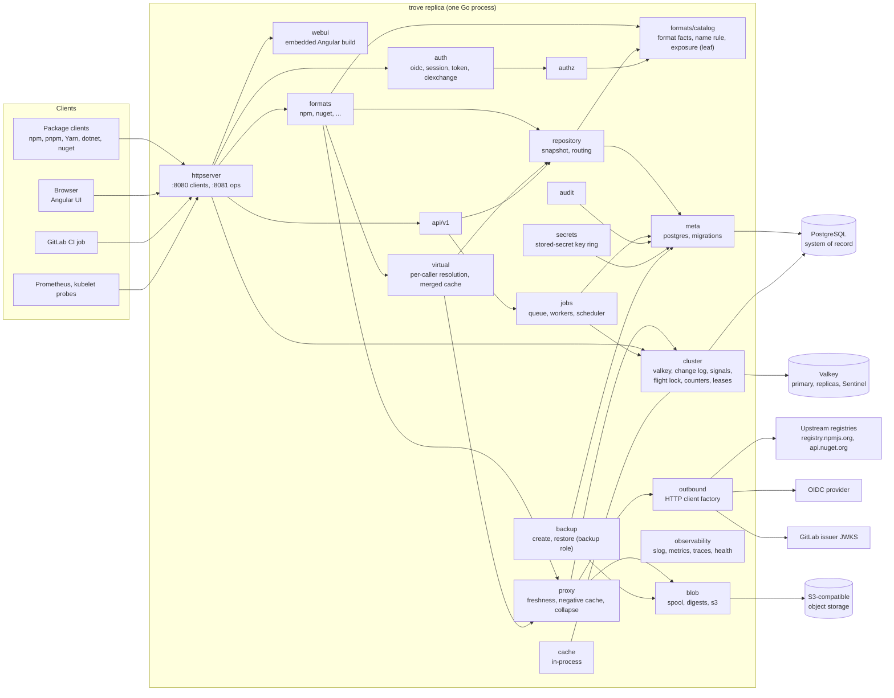
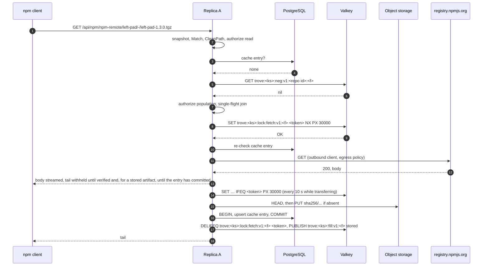

# Architecture

Status: specification — not implemented

This page fixes the skeleton of trove. It covers:
- the components inside the single binary, the process roles and what each role runs;
- the Go and Angular code layout;
- the order in which components handle the shared request paths: local download, remote download
  (hit, miss, upstream down), upload, and virtual resolution;
- the contract every package format implements;
- the background job framework;
- cross-replica coordination: which mechanism lives in PostgreSQL and which in Valkey, request
  collapsing, shared counters, cache invalidation, and the PostgreSQL connection model;
- configuration loading, encryption of stored secrets and the outbound HTTP client factory;
- the error model, the process lifecycle with drain-safe shutdown, versioning and compatibility,
  and proposed performance targets.

What a feature does for the user is specified on the topic pages listed in
[README.md](README.md#pages). This page specifies the mechanisms they build on, and it names the
owning page wherever a topic hands over. Where a request path below and an owning page disagree on
a detail, the owning page wins. This page only fixes the order of steps and the boundaries between
components.

Covers: this page draws on [repositories.md](../features/repositories.md),
[remote-repositories.md](../features/remote-repositories.md),
[storage-and-blobs.md](../features/storage-and-blobs.md),
[ha-and-deployment.md](../features/ha-and-deployment.md) and
[operations-and-monitoring.md](../features/operations-and-monitoring.md). The format contract also
draws on [formats/README.md](../features/formats/README.md), and the stored-secret key on
[identity-and-access.md](../features/identity-and-access.md) (IAM-045).

## Handover to other pages

These are architecture-adjacent entries of the catalog pages listed above that another spec page
owns. This page provides only the mechanism the owner builds on.

| Catalog IDs | Owner | What this page contributes |
|---|---|---|
| OPS-051, OPS-052 (public base URL, per-request host) | [operations-and-observability.md](operations-and-observability.md) | Middleware position and client-address rules (R-ARCH-006) |
| OPS-001 to OPS-004 (probes), OPS-008 (service status), OPS-009 (lock diagnostics) | [operations-and-observability.md](operations-and-observability.md) | Start-up order, shutdown timeout (R-ARCH-024); lock categories and connection naming (R-ARCH-017, R-ARCH-019) |
| OPS-050 (content types), OPS-065 and ART-051 (tasks and job API), OPS-070 (reindex) | [operations-and-observability.md](operations-and-observability.md) | Job queue and scheduler (R-ARCH-016) |
| ART-011, ART-029, STOR-003 and the upload/download pipeline | [storage.md](storage.md) | Request order (R-ARCH-011, R-ARCH-014), format storage hooks (R-ARCH-008) |
| RMT-* settings, collapsing misses, negative cache, metadata rewriting, merged-metadata cache | [repositories-and-proxy.md](repositories-and-proxy.md) | Request order (R-ARCH-013, R-ARCH-015), `FlightLock` on Valkey (R-ARCH-033), negative-cache keys (R-ARCH-030), change areas and signals (R-ARCH-018) |
| HA-022 to HA-071 except those listed below | [ha-and-helm.md](ha-and-helm.md) | Process model, roles, lifecycle, the connection classes behind the connection formula (R-ARCH-019), the Valkey client settings (R-ARCH-031) |
| Long-running operations, client setup snippets, UI baseline | [api-and-ui.md](api-and-ui.md) (R-API-015, R-API-033, R-UI-001) | Job columns (R-ARCH-016), snippet templates in the format contract (R-ARCH-008) |
| BEYOND-030 and the login and exchange limits (rate limits) | [api-and-ui.md](api-and-ui.md) R-API-016, [identity-and-authentication.md](identity-and-authentication.md) R-AUTH-038, [gitlab-ci-oidc.md](gitlab-ci-oidc.md) R-CI-021 | Cluster-wide counters with a per-replica fallback (R-ARCH-034) |
| Backup and restore (INV-19) | [backup-and-restore.md](backup-and-restore.md) | The `backup` role and its connection class (R-ARCH-001, R-ARCH-019), the export classes of this page's tables (R-ARCH-016, R-ARCH-018), the revision registry entry of `rev_seq` (R-ARCH-009), the runner's restore mode (R-ARCH-026) |

<details>
<summary>Facts this page relies on, and how they were verified (2026-10-28)</summary>

| Fact | Verified by |
|---|---|
| `net/http.ServeMux` unescapes paths segment by segment, so `%2F` stays inside one segment. `{name...}` matches the remainder. Conflicting patterns panic at registration. Paths with `.`, `..` or `//` are redirected to a cleaned URL, while escaped `%2e`/`%2f` are kept. | `go doc net/http.ServeMux` with the local go1.27.3 toolchain |
| `http.ResponseController` sets per-request read and write deadlines; a read deadline that has already passed cannot be extended. | `go doc` with go1.27.3 |
| A NOTIFY payload must be shorter than 8000 bytes by default, and notifications are delivered only after commit. Notifying transactions serialize their commits on one heavyweight lock held until after commit. The commit's WAL flush and its wait for a synchronous standby happen while that lock is held; with `synchronous_commit = off`, neither happens. | [PostgreSQL NOTIFY](https://www.postgresql.org/docs/current/sql-notify.html); `src/backend/commands/async.c`, `src/backend/access/transam/xact.c` and `src/include/replication/syncrep.h` on `REL_18_STABLE` |
| Advisory locks have a one-`bigint` key space and a two-`int4` key space, which do not overlap. `pg_locks` shows two-key locks with `objsubid = 2`. | [Lock functions](https://www.postgresql.org/docs/current/functions-admin.html#FUNCTIONS-ADVISORY-LOCKS), [pg_locks](https://www.postgresql.org/docs/current/view-pg-locks.html) |
| pgx v5 has `Conn.WaitForNotification` and the `default_query_exec_mode` values `cache_statement`, `cache_describe`, `describe_exec`, `exec`, `simple_protocol`. An `Exec` without arguments always uses the simple protocol, which accepts several statements in one string and runs them inside the open transaction. | pgx v5.11.0 source (`conn.go`, `pgconn/pgconn.go`) |
| goose v3's Provider accepts `embed.FS` sources, Go migrations, a custom table name, and an optional session locker. Its version row carries only the version number (`database.InsertRequest{Version}`); a different table layout needs a custom `database.Store` with `DialectCustom`. Every SQL file must start with `-- +goose Up`. | goose v3.29.0 source (`provider_options.go`, `provider.go`, `provider_run.go`, `database/store.go`, `internal/sqlparser/parser.go`) |
| tern v2 takes `pg_advisory_lock(9628173550095224)`, a fixed single-`bigint` key, around every migration run, with no option to disable it. | tern v2.4.3 source (`migrate/migrate.go`) |
| In aws-sdk-go-v2, the `feature/s3/manager` Uploader is marked deprecated in favour of `feature/s3/transfermanager`. `service/s3` exposes `UsePathStyle`, `RequestChecksumCalculation` and `ResponseChecksumValidation`. | SDK source |
| Zoneless change detection is the default for new Angular applications since v21. | [angular.dev zoneless guide](https://angular.dev/guide/zoneless) |
| Latest versions: pgx v5.11.0, sqlc v1.31.1, goose v3.29.0, golang-migrate v4.20.1, tern v2.4.3, aws-sdk-go-v2 `service/s3` v1.114.6, `feature/s3/transfermanager` v0.5.1, minio-go v7.4.1, River v0.50.0, chi v5.5.0 | `proxy.golang.org/<module>/@latest` |
| Licences: pgx, goose, golang-migrate and tern are MIT. aws-sdk-go-v2 and minio-go are Apache-2.0. River is MPL-2.0. | LICENSE files upstream |
| The versions in the row above are still the latest on 2026-10-28, re-checked when the questions of this page were decided. | `proxy.golang.org/<module>/@latest` |
| For user content that must not render, current guidance names `nosniff`, `Content-Disposition: attachment`, CSP `sandbox` with `default-src 'none'`, and `Cross-Origin-Resource-Policy: same-site`. It treats a separate sandbox domain as necessary only when active content must render, or when renderer compromise and Spectre-class attacks are in the threat model. Only a domain on the Public Suffix List isolates subdomains from each other. | [web.dev: Securely hosting user data in modern web applications](https://web.dev/articles/securely-hosting-user-data) |
| A cookie named with the `__Host-` prefix is accepted by the browser only with `Secure`, `Path=/` and no `Domain`. A sibling or parent subdomain therefore cannot set or shadow it. "Same-site" compares scheme and registrable domain, so a subdomain content host is same-site with the UI. | [RFC 6265bis draft](https://datatracker.ietf.org/doc/draft-ietf-httpbis-rfc6265bis/), cookie prefixes and the "same-site" definition |
| valkey-go v1.0.79 (Apache-2.0) is the latest release. Its Sentinel client resolves the primary through the Sentinels, checks `ROLE` on the instance it connects to, follows `+switch-master`, and reconciles periodically when `SentinelOption.TopologyRefreshInterval` is set; its documentation states that without it a missed `+switch-master` binds the client to the old primary. `SentinelOption` carries its own `TLSConfig`, `Username` and `Password`. `ClientOption.AuthCredentialsFn` supplies credentials on every connection attempt. A Sentinel or standalone client pipelines over 2^`PipelineMultiplex` connections, 4 by default. Server-assisted client-side caching is on by default with 128 MiB per connection and is switched off with `DisableCache`. The command builder has `SET … IFEQ` and `DELIFEQ`. The module requires Go 1.25. | `proxy.golang.org`; source (`valkey.go`, `sentinel.go`, `internal/cmds/gen_string.go`, `go.mod`) |
| go-redis v9.23.0 (BSD-2-Clause) lists Redis CE 8.0 to 8.10 as its supported servers and calls other servers "not officially supported". Its `FailoverOptions` carry `SentinelUsername` and `SentinelPassword`; its compare-and-delete helper targets Redis's `DELEX`, not Valkey's `DELIFEQ`. | `proxy.golang.org`; source (`README.md`, `sentinel.go`, `string_commands.go`) |
| The Go client of Valkey GLIDE (v2.5.3) uses cgo to call its Rust core. | [GLIDE Go README](https://github.com/valkey-io/valkey-glide/blob/main/go/README.md) |
| Valkey 7.2, 8.0, 8.1, 9.0 and 9.1 all received patch releases on 2026-10-26 and 2026-10-27 (9.1.3, 9.0.7, 8.1.11); 9.2.0 is at rc1. Maintenance ends: 9.0 on 2028-10-21, 9.1 on 2029-05-19 (security support until 2031-05-19), 8.1 on 2028-03-31. | GitHub releases API for `valkey-io/valkey`; [Valkey releases](https://valkey.io/topics/releases/) |
| `SET … IFEQ <value>` exists since Valkey 8.1.0. `DELIFEQ key value` exists since 9.0.0 and deletes the key only if its value matches (ACL categories `@fast @string @write`). | [SET](https://valkey.io/commands/set/), [DELIFEQ](https://valkey.io/commands/delifeq/) |
| Valkey replication is asynchronous, so Sentinel does not guarantee that acknowledged writes survive a failover. A robust deployment needs at least three Sentinels in independent failure domains. Clients resolve the primary with `SENTINEL get-master-addr-by-name`, verify it with `ROLE`, and resolve again on every reconnection; Sentinel sends `CLIENT KILL type normal` to a reconfigured instance. Sentinel authenticates to ACL-protected instances with `sentinel auth-user` and `sentinel auth-pass`. | [Sentinel](https://valkey.io/topics/sentinel/), [Sentinel clients](https://valkey.io/topics/sentinel-clients/) |
| Pub/Sub delivery is at most once: a message is lost when the subscriber is disconnected or when no one is subscribed. | [Pub/Sub](https://valkey.io/topics/pubsub/) |
| A single-instance lock is `SET key <random> NX PX <ttl>`, released by a compare-and-delete. Failover-based setups cannot guarantee mutual exclusion, because a lock written to the primary can be lost before it reaches the promoted replica. | [Distributed locks](https://valkey.io/topics/distlock/) |
| PgBouncer 1.26.1 (2026-10-14) is current. In transaction pooling, `SET`/`RESET`, `LISTEN`, `WITH HOLD` cursors, SQL `PREPARE`/`DEALLOCATE` and session-level advisory locks never work. Protocol-level prepared statements work when `max_prepared_statements` is non-zero (default 200). `application_name` is a tracked startup parameter. | GitHub releases API for `pgbouncer/pgbouncer`; [features](https://www.pgbouncer.org/features.html), [configuration](https://www.pgbouncer.org/config.html) |
| Kubernetes starts the kubelet's graceful shutdown and the removal of the pod from EndpointSlices at the same time. A terminating endpoint has `ready: false` and exposes the `serving` condition. The default `terminationGracePeriodSeconds` is 30. A `preStop` hook that overruns the grace period gets a one-off 2 s extension. The `sleep` lifecycle handler runs in the kubelet and is stable since v1.34. | [Pod termination](https://kubernetes.io/docs/concepts/workloads/pods/pod-lifecycle/#pod-termination), [container lifecycle hooks](https://kubernetes.io/docs/concepts/containers/container-lifecycle-hooks/), [KEP-3960](https://www.kubernetes.dev/resources/keps/3960/) |
| npm defaults: `fetch-retries` 2, `fetch-retry-mintimeout` 10 s, `fetch-retry-maxtimeout` 60 s, `fetch-timeout` 5 min. NuGet's enhanced retry defaults: 6 tries, 1,000 ms delay. | [npm config](https://docs.npmjs.com/cli/v11/using-npm/config), [NuGet environment variables](https://learn.microsoft.com/nuget/reference/cli-reference/cli-ref-environment-variables) |

Not verified: the behaviour of specific S3-compatible stores; the behaviour of managed Valkey
offerings, which mostly expose their own failover endpoint instead of Sentinel; the exact
endpoint-propagation delay of a given Ingress or Gateway controller. The performance targets in
R-ARCH-027 are proposals, not measurements.

</details>

## Process and components

### R-ARCH-001 · One binary, identical replicas, process roles
Priority: **MVP** · Covers: HA-001, HA-002, HA-009, HA-010, HA-015

trove MUST build into one statically linked binary, `trove` (`CGO_ENABLED=0`). It contains the
management API, every package-format protocol, the embedded Angular build, the schema migrations
and the background workers (INV-1, INV-2).

| Invocation | Purpose |
|---|---|
| `trove serve --role web\|worker\|all` | Runs one replica of a role. The flag overrides `process.role`. |
| `trove migrate [up\|status]` | Applies or lists the embedded migrations behind the compatibility gate (R-ARCH-026). |
| `trove backup create\|list\|verify\|delete\|prune\|restore` | The `backup` role: creates a consistent backup into the configured S3 target, lists, verifies, deletes or prunes the backups there, or restores one into an empty installation, then exits (INV-19, [backup-and-restore.md](backup-and-restore.md) R-BAK-009, R-BAK-016, R-BAK-018 to R-BAK-021). It has no client listener and uses no Valkey. The chart runs `create` as a CronJob and `restore` as a Job. |
| `trove admin …` | Bootstrap and recovery: break-glass administrator ([identity-and-authentication.md](identity-and-authentication.md)), `admin config validate` ([operations-and-observability.md](operations-and-observability.md)), `admin secrets status` (R-ARCH-021; the same status is served by `GET /api/v1/system/encryption`). |
| `trove --version` | Version, commit, build date. |

A role is a set of enabled subsystems (INV-2). Every replica of a role runs the same subsystems and
is interchangeable with any other replica of that role:

| Subsystem | `web` | `worker` | `backup` | `all` (local profile only) |
|---|---|---|---|---|
| Client listener `:8080`: UI, management API, package protocols, raw files (R-ARCH-005) | yes | no | no | yes |
| Ops listener `:8081`: probes and metrics | yes | yes | `/metrics` only, while a run lasts ([backup-and-restore.md](backup-and-restore.md) R-BAK-014) | yes |
| Main pool, transaction-scoped work only (R-ARCH-019) | yes | yes | no | yes |
| Session-scoped PostgreSQL connections: the lease pool (R-ARCH-017) | no | yes | its own control, snapshot and export connections (R-ARCH-019) | yes |
| Job claim loop, reaper and scheduler (R-ARCH-016); outbox dispatcher (P1) | no | yes | no | yes |
| Enqueueing jobs | yes | yes | no | yes |
| Valkey client (R-ARCH-031) | yes | yes | no | yes |
| Change-log poll and signal subscriber (R-ARCH-018) | yes | yes | no | yes |
| Replica registry row and heartbeat ([operations-and-observability.md](operations-and-observability.md) R-OPS-003) | yes | yes | no | yes |

- A role also names the **wiring areas** it enables (R-ARCH-024 step 8, Q-ARCH-209): the units of
  composition that build a typed part of the replica, such as the database, the audit recorder, the
  object store, the Valkey client and the coordination layer, and the domain areas on top of them.
  The areas are data of the role, not a consequence of which component happens to be present: a
  `worker` enables the areas whose jobs it runs, a `web` replica the areas its listener serves. The
  shell profile (an HTTP shell without PostgreSQL, Valkey and the object store, used by the
  composition root's own tests and the drain fixture) is a role with the listeners and no
  infrastructure areas, and it is only reachable through the test options, never through
  configuration.
- `process.role` has no default. `trove serve` without a role exits non-zero with
  `process.role must be web, worker or all`. The chart deploys `web` and `worker` as separate
  Deployments from the start, each with its own replica count, autoscaler, disruption budget and
  topology spread ([ha-and-helm.md](ha-and-helm.md)). `all` exists for the local development
  profile; a replica started with it logs a warning that names the role.
- A `web` replica MUST NOT:
  - claim or run jobs, or hold a lease;
  - open a session-scoped PostgreSQL connection;
  - run a background loop whose iterations take longer than a request. Its loops are each bounded
    by a deadline:
    - the change-log poll and signal subscriber (R-ARCH-018), the Valkey client (R-ARCH-031) and
      the registry heartbeat;
    - the flushes of the write-only buffers of R-ARCH-032: download statistics, the activity and
      use buffers of [repositories-and-proxy.md](repositories-and-proxy.md) R-REPO-012 and
      R-REPO-046 (P1), and the asynchronous audit buffer
      ([operations-and-observability.md](operations-and-observability.md) R-OPS-015);
    - the identity loops of [identity-and-authentication.md](identity-and-authentication.md)
      R-AUTH-042: the OIDC discovery refresh and JWKS refetch (R-AUTH-004), the re-read of the
      client-secret and break-glass files including the break-glass rotation check (R-AUTH-014),
      the last-used flush (R-AUTH-031, P1) and the pending-flow count refresh (R-AUTH-038);
  - leave work running after a response that a later request depends on.

  Work that a request starts and that outlasts it is enqueued as a job, and the request answers
  with the job reference ([api-and-ui.md](api-and-ui.md) R-API-015). Examples are reindexing,
  repository deletion, bulk copy or move, garbage collection and re-encryption. Three bounded
  exceptions remain on `web`, each ended at shutdown and none leaving anything half-stored
  (R-ARCH-024):
  - the remote fetch that collapsed waiters depend on, which runs detached from its initiating
    client ([repositories-and-proxy.md](repositories-and-proxy.md) R-REPO-026);
  - the completion of a metadata refresh after the stale copy was served (R-REPO-027);
  - the replica's own support-bundle part
    ([operations-and-observability.md](operations-and-observability.md) R-OPS-027, P1). It is
    bounded by `support.max_cpu_profile_seconds` plus the upload, never runs past
    `support.collect_timeout`, holds no database connection, and is abandoned at `SIGTERM`; the
    bundle then ends `partial`.
- A `worker` replica serves only the ops listener and is not selected by the client Service.
- Load is shared by adding replicas of a role (INV-12). No code path depends on the number of
  replicas of a role, and each role scales and drains on its own. A role can be split further, for
  example package traffic behind its own Service, through configuration and chart values without
  code changes (INV-2).
- No replica holds state that another replica needs to answer a later request (INV-18,
  R-ARCH-032).
  - Durable state lives in PostgreSQL, the system of record, and in object storage. Shared
    ephemeral state lives in Valkey (INV-3, R-ARCH-030).
  - In-process state is limited to caches that can be rebuilt (R-ARCH-018) and to the scratch
    space of the request or job currently running ([storage.md](storage.md)).
- There is no primary node. Work that must run once per cluster runs as a job, where the queue
  guarantees one claimant (R-ARCH-016), or under a named lease (R-ARCH-017). Both live in
  PostgreSQL.
- A `web` or `worker` replica registers itself on start in the replica registry, with its role
  ([operations-and-observability.md](operations-and-observability.md)). It takes traffic or jobs as
  soon as it is ready. No other step is needed to add or remove a replica.
- One replica and many run the same code path. Even a single replica uses external PostgreSQL,
  Valkey and S3-compatible storage (INV-3, INV-4).
  - The local profile runs PostgreSQL with a standby (CloudNativePG, two instances), Valkey with
    Sentinel in the reference topology of [ha-and-helm.md](ha-and-helm.md) R-HA-056, and
    SeaweedFS (R-HA-051), so failovers can be exercised locally.
  - Production runs HA PostgreSQL, Valkey with Sentinel and S3 (INV-12).
  - The chart bundles no production database and no production Valkey.
- Splitting roles is the trove form of separately scaled workloads (HA-015). The UI is never a
  separate workload because it is embedded (INV-1).

```yaml
process:
  role: ""            # no default: web | worker | all; the chart sets it per Deployment
  # role: web         # example
```

Acceptance criteria:
- On Linux, `file trove` reports a statically linked executable, and `go version -m trove`
  shows `CGO_ENABLED=0`.
- `trove serve` without `--role` and without `process.role` exits non-zero and names
  `process.role`.
- A replica started with `--role worker` has no socket on `:8080` (`ss -ltn`). The instance ID of a
  replica started with `--role web` never appears in `job.locked_by`, and `pg_stat_activity` never
  shows a connection named `trove:<that replica>:lease`.
- One of three `web` pods is deleted with `kubectl delete pod --grace-period=0 --force` during a
  loop of 100 `npm ci` runs through the Service. The loop finishes with npm's default
  `fetch-retries`.

### R-ARCH-002 · Component model and dependency rules
Priority: **MVP** · Covers: HA-003, HA-004, HA-006



| Component | Package | Responsibility | Behaviour specified in |
|---|---|---|---|
| httpserver | `internal/httpserver` | Listeners, top-level routing, middleware, client address | R-ARCH-005, R-ARCH-006 |
| auth | `internal/auth/{oidc,session,token,ciexchange}` | Principal resolution, OIDC login, tokens, CI exchange | [identity-and-authentication.md](identity-and-authentication.md), [gitlab-ci-oidc.md](gitlab-ci-oidc.md) |
| authz | `internal/authz` | Permission decisions | [authorization.md](authorization.md) |
| scope | `internal/auth/scope` | The value type of a token's scope (leaf), shared by the stage, the token service and the decision point | R-AUTH-024 |
| catalog | `internal/formats/catalog` | The format catalog (leaf): every format's facts, its package-name rule and its exposure facts; `repository` and `authz` read it | R-REPO-003, R-AUTHZ-005, Q-ARCH-188 |
| api | `internal/api/v1`, `internal/api/edge` | Management REST API; the conversions every HTTP entry point shares (the request to the `authz.Subject`, the holder of a request's index) | [api-and-ui.md](api-and-ui.md), R-AUTHZ-015 |
| dispatch | `internal/api/dispatch` | The format dispatcher: `/api/<id>/<repoKey>/…` for every format with routes, and the error shape of the prefix | R-ARCH-005, R-ARCH-011, Q-ARCH-214 |
| formathost | `internal/formathost` | The `Host` of the format contract and the adapters of the item store's hooks and the generic layer's seam; the data ports are bound by the composition root | R-ARCH-009, Q-ARCH-193, Q-ARCH-212 |
| packages | `internal/packages` | The generic package rows: the package store and the package writer that raises `packages.rev_seq` | R-ARCH-009, Q-ARCH-212 |
| webui | `internal/webui` | Embedded Angular build | [api-and-ui.md](api-and-ui.md) (R-UI-001), R-ARCH-004 |
| formats | `internal/formats`, `internal/formats/<id>` | Package protocols behind the plug-in contract | R-ARCH-008 to R-ARCH-010; [formats/npm.md](formats/npm.md), [formats/nuget.md](formats/nuget.md) |
| repository | `internal/repository` | Repository model and snapshot, request classification, caller-independent routing of virtual repositories (members, claims, pin rules) | [repositories-and-proxy.md](repositories-and-proxy.md) |
| proxy | `internal/proxy`, `internal/proxy/{upstream,invalidation}` | Remote fetch engine, per-remote upstream clients, cache invalidation | [repositories-and-proxy.md](repositories-and-proxy.md) |
| virtual | `internal/virtual` | Per-caller resolution of virtual repositories, merged-metadata cache, shadowing check (Q-ARCH-192) | [repositories-and-proxy.md](repositories-and-proxy.md) |
| formatdata | `internal/formatdata/<id>` | Implementations of the store ports that formats declare for their own tables (Q-ARCH-193) | [formats/npm.md](formats/npm.md) |
| blob | `internal/blob`, `internal/blob/s3` | Spool, digests, content-addressed objects | [storage.md](storage.md) |
| meta | `internal/meta`, `internal/meta/postgres` | Transactions, generated queries, embedded migrations | [storage.md](storage.md) (schema of items and packages), R-ARCH-016, R-ARCH-019, R-ARCH-026 |
| cluster | `internal/cluster` | Valkey client and key registry, change log and signals, `FlightLock`, shared counters, leases, advisory-lock categories | R-ARCH-017, R-ARCH-018, R-ARCH-030, R-ARCH-031, R-ARCH-033, R-ARCH-034 |
| cache | `internal/cache` | Bounded in-process caches and their invalidation hooks | R-ARCH-018 |
| jobs | `internal/jobs` | Queue, workers, scheduler | R-ARCH-016 |
| audit | `internal/audit` | Audit events | [operations-and-observability.md](operations-and-observability.md) |
| backup | `internal/backup` | `trove backup` create, restore, list, verify and delete; the table registry | [backup-and-restore.md](backup-and-restore.md) |
| observability | `internal/observability` | Logs, metrics, traces, health checks | [operations-and-observability.md](operations-and-observability.md) |
| outbound | `internal/outbound` | Every outbound HTTP client | R-ARCH-022; settings in [repositories-and-proxy.md](repositories-and-proxy.md) |
| secrets | `internal/secrets` | Stored-secret encryption, sealed-column registry, key-ring status | R-ARCH-021 |
| config | `internal/config` | Configuration schema and loading | R-ARCH-020; [operations-and-observability.md](operations-and-observability.md) |
| errs | `internal/errs` | Error kinds and rendering | R-ARCH-023 |

Normative rules:
- PostgreSQL and S3-compatible object storage hold every piece of durable state (INV-3, INV-4).
  Valkey holds shared ephemeral state only, and nothing in it is the only copy of durable data
  (R-ARCH-030). There is no other stateful dependency.
- Shared binary storage (HA-004). The MVP has exactly one binary-store type: S3-compatible object
  storage that every replica reaches over the network.
  - There is no node-local file-system store, no cluster-replicated local store and no redundancy
    factor. Copies and durability are the object store's job (INV-4, INV-12).
  - The catalog leaves open which storage type a deployment gets by default. That choice does not
    arise in trove, and no default can become unsafe when the replica count is raised.
  - Any store type added later MUST be shared by every replica. A store that is safe on one node
    only (STOR-008, P2 in [storage.md](storage.md)) MUST refuse to start while the replica registry
    shows another live replica.
- Replicas never talk to each other. There are no peer addresses and no replica-to-replica HTTP.
  Configuration changes, cache invalidation, locks, counters and job hand-off go through PostgreSQL
  and Valkey, as R-ARCH-030 assigns each mechanism (INV-12). The catalog's per-node peer address
  (HA-006) therefore does not exist in trove.
- Imports form layers:
  1. Edge: `httpserver`, `api/v1`, `api/edge`, `api/dispatch`, `webui`, `formats` (the contract and the format handlers), `formathost`.
  2. Domain: `repository`, `files`, `items`, `packages`, `proxy`, `authz`, `auth`, `jobs`, `audit`, `backup`.
  3. Infrastructure: `meta/postgres`, `blob` (the store and its spool; the S3 client is `blob/s3`), `cluster`, `outbound`, `secrets`.
  4. Leaf: `config`, `errs`, `buildinfo`, `observability`, `cache`, `meta`, `backup/tables`, `tlsfiles`, `formats/catalog`, `auth/scope`. Every layer may import them, and they import only each other.

  No lower layer imports a higher one. Format packages reach storage only through the host interface
  (R-ARCH-009), so the diagram has no arrow from `formats` to `blob`.
- Only `meta/postgres` and `cluster` import pgx. Only `cluster` imports the Valkey client
  (R-ARCH-031). Only `blob/s3` imports the S3 SDK. Format packages import none of them
  (R-ARCH-008).
- `backup` follows the same rules: it reaches PostgreSQL through an export and load API of
  `meta/postgres` (snapshot, table export, restore load), and both the blob store and the backup
  target through clients built by `blob/s3`, one per bucket and credential
  ([backup-and-restore.md](backup-and-restore.md) R-BAK-015).
- `internal/archtest` walks `go list -deps -json ./...` and fails on any forbidden import.

Acceptance criteria:
- Adding an import of `internal/meta/postgres` to `internal/formats/npm` makes
  `go test ./internal/archtest` fail and name the edge.
- `grep -rn "http.Client{\|net.Dial" internal --include=*.go` finds matches only in
  `internal/outbound` and in `_test.go` files.
- Adding an import of `github.com/valkey-io/valkey-go` to `internal/proxy` makes
  `go test ./internal/archtest` fail and name the edge.

### R-ARCH-032 · No state between requests on one replica (INV-18)
Priority: **MVP** · Covers: HA-001, HA-009

The Kubernetes Service distributes requests at random and without session affinity (INV-12). Two
requests of one client may therefore reach different replicas, even two requests on one keep-alive
connection through an edge proxy that balances per request.

- No request may depend on state that an earlier request left in one replica's memory or on its
  local disk. Every kind of per-replica state is listed here; a new kind needs a row in this table
  before it ships:

| Per-replica state | Lifetime | Why it does not break INV-18 |
|---|---|---|
| Registered in-process caches (R-ARCH-018): the repository snapshot; the proxy's copies of the claims and pin-rule trie, gone packages, circuit state, global offline switch and cache invalidations ([repositories-and-proxy.md](repositories-and-proxy.md) R-REPO-023, R-REPO-029, R-REPO-031, R-REPO-045); the grant index; the identity caches `auth_tokens`, `auth_sessions`, `auth_principals` and `auth_settings` ([identity-and-authentication.md](identity-and-authentication.md) R-AUTH-023); the rendition cache; the merged-metadata cache; the per-remote upstream HTTP clients with their connection pools (`proxy_upstream_clients`, [repositories-and-proxy.md](repositories-and-proxy.md) R-REPO-049, Q-REPO-89); CI issuer keys | Until evicted, invalidated or `SafetyTTL` | Each is a copy of PostgreSQL state. It is self-validating (`rev_seq`, epochs) or kept within the propagation bound of R-ARCH-018, and a fill never re-inserts a value that a change has already invalidated (R-ARCH-018), so another replica gives the same answer from PostgreSQL. An epoch that went backwards or was reused after a PostgreSQL failover flushes the area on every replica, for every change area (R-ARCH-018, change-area step 5). |
| Metadata-bytes cache, keyed by blob digest ([repositories-and-proxy.md](repositories-and-proxy.md) R-REPO-025) | Until evicted | Self-validating: which digest a request serves is always read from PostgreSQL, and the key is the content address, so every replica serves the same bytes. |
| Negative cache of unknown repository keys (R-ARCH-011 step 2) | Until evicted, at most `SafetyTTL` | A copy of a PostgreSQL miss. Every `repo_config` change evicts it on every replica within the bound of R-ARCH-018, so a new repository answers `404` on a replica only if that replica missed the key shortly before the creation, and for at most that bound ([api-and-ui.md](api-and-ui.md) R-API-052). |
| Negative-cache L1 (R-ARCH-030) | At most the checked lifetime of the Valkey entry it copies | A copy of an upstream `404` or `410`, not of PostgreSQL state. Any replica may answer from such an entry or ask the upstream within `notFoundTtlSeconds` ([repositories-and-proxy.md](repositories-and-proxy.md) R-REPO-028), so both answers are the same contract; an invalidation applies to the L1 as to Valkey. |
| Caches of external documents: OIDC discovery and JWKS of the login providers ([identity-and-authentication.md](identity-and-authentication.md) R-AUTH-004) | Until their refresh | A copy of what the provider publishes. An unknown `kid` makes the replica refetch, at most once per provider and replica per 60 s, so right after a provider signs with a new key, one replica may reject a login that another accepts, for at most that throttle. A provider that publishes a key before signing with it never opens this window. The GitLab issuer keys live in PostgreSQL and are a registered cache above ([gitlab-ci-oidc.md](gitlab-ci-oidc.md) R-CI-003). On an unknown `kid`, a CI issuer re-reads its `ci_issuer_keys` row at most once per issuer and replica per `cluster.epoch_poll_interval`, then refetches under the same kind of per-replica throttle (`ci.signing_keys.unknown_kid_refresh_interval`). A key that any replica has stored is accepted on every replica within one poll interval, and a forged `kid` costs no PostgreSQL query of its own ([gitlab-ci-oidc.md](gitlab-ci-oidc.md) R-CI-003, Q-CI-12). |
| Forwarded NuGet search results ([formats/nuget.md](formats/nuget.md) R-NUGET-016) | At most `nuget.search.remote_result_ttl` | A copy of an upstream answer, stored unfiltered; patterns, claims and permissions are applied on every use. Any replica may answer from its copy or ask the upstream within the period, so both answers meet the same contract. |
| Break-glass verifier and OIDC client secrets read from Secret files, and the loaded break-glass file content ([identity-and-authentication.md](identity-and-authentication.md) R-AUTH-004, R-AUTH-014) | Until the file changes | Replicas switch at different moments on a rotation. The session end of a break-glass rotation is one PostgreSQL transaction, so no replica keeps a session that another has ended (R-AUTH-014, Q-AUTH-14). |
| Pending-flow count ([identity-and-authentication.md](identity-and-authentication.md) R-AUTH-038) | At most 5 s old | A copy of a PostgreSQL count that bounds a `503` decision. |
| Per session, the newest `last_seen_at` a replica has read ([identity-and-authentication.md](identity-and-authentication.md) R-AUTH-010) | While the replica holds the session | A lower bound of the row that only saves touch statements and never decides an end; the session's deadlines are decided from its row. |
| In-process single-flight groups (R-ARCH-033), and the credential lookups shared while the freshness gate is closed ([identity-and-authentication.md](identity-and-authentication.md) R-AUTH-023) | One flight; a shared credential lookup at most `auth.revocation_bound` old | Only concurrent requests join; nothing outlives the flight, and a shared lookup is never cached. |
| Spool and temporary files (`emptyDir` or a generic ephemeral volume, INV-13) | One request or one job | Deleted on every path and at process start ([storage.md](storage.md) R-STOR-004). |
| Write-only buffers: download statistics (R-ARCH-011), `lastActivityAt` ([repositories-and-proxy.md](repositories-and-proxy.md) R-REPO-012), metadata `last_used_at` (R-REPO-046, P1), token last-used times ([identity-and-authentication.md](identity-and-authentication.md) R-AUTH-031, P1) | Until the next batch flush (the last-used buffer: 60 s) | Requests write them and never read them. They are flushed at shutdown (R-ARCH-024 step 6); a crash loses at most one batch, which the next use records again. |
| Asynchronous audit buffer and the audit deduplication windows with their open denial summaries ([operations-and-observability.md](operations-and-observability.md) R-OPS-015) | Until the next batch or deduplication window | Written by requests, never read by one; flushed at shutdown. A crash loses what they hold, normally under one second of events, at most `audit.async_buffer`. |
| Denial aggregation buffer of the CI exchange ([gitlab-ci-oidc.md](gitlab-ci-oidc.md) R-CI-021) | One minute | Requests write it and never read it; the first denial of an address and reason in a minute is written at once, so a crash loses at most one minute of counts. |
| De-duplication of `auth.csrf_failed` events ([identity-and-authentication.md](identity-and-authentication.md) R-AUTH-041) | One minute | Bounds log volume only; no answer depends on it. |
| Log ring buffer ([operations-and-observability.md](operations-and-observability.md) R-OPS-009) | The last `log.ring_buffer_records` records | Read only by the replica's own support-bundle part; no request's answer depends on it, and the records also go to the platform's log stack. |
| Cached values of the gauges read from PostgreSQL ([operations-and-observability.md](operations-and-observability.md) R-OPS-007, Q-OPS-18) | At most `metrics.db_gauge_interval` | A copy of PostgreSQL state served to scrapes only; an age gauge states how old it is. |
| Sent set of a delivery-log follow stream ([operations-and-observability.md](operations-and-observability.md) R-OPS-044, P1) | One request | Lives and ends with its stream; a reconnect on another replica continues from `Last-Event-ID` ([api-and-ui.md](api-and-ui.md) R-API-051). |
| The replica's support-bundle part being collected ([operations-and-observability.md](operations-and-observability.md) R-OPS-027, P1) | At most `support.collect_timeout` | Uploaded as a blob when done; abandoned at `SIGTERM`, which leaves the bundle `partial` (R-ARCH-001). |
| Signal coalescer queue (R-ARCH-018) | At most one coalescing window | Best-effort wake-ups that no request depends on. |
| Fallback rate-limit buckets (R-ARCH-034) | While Valkey is unavailable | The degraded mode INV-12 names. While Valkey is available, the counters are cluster-wide. |
| In-flight request counter (`server.max_in_flight`, R-ARCH-005); upstream fetch slots, which only fetching requests take ([repositories-and-proxy.md](repositories-and-proxy.md) R-REPO-040); Argon2id verification slots ([identity-and-authentication.md](identity-and-authentication.md) R-AUTH-014) | Concurrent requests | Protect the replica itself: its connections, its upstream share and its memory. A refused request succeeds on retry elsewhere. |
| Circuit breakers for the object store and for Valkey | Seconds | They describe this replica's own network path ([storage.md](storage.md) R-STOR-033, R-ARCH-031). |

- A protocol that spans requests keeps its state in PostgreSQL and its data in S3. Valkey may hold
  such state only where its loss costs nothing but one client retry; no protocol below uses it.
  The protocols, MVP unless marked:
  - browser login: the `oidc_login_flow` row and the binding cookie
    ([identity-and-authentication.md](identity-and-authentication.md) R-AUTH-006);
  - npm web login and device login polling (P1): the `cli_login` row (R-AUTH-034, R-AUTH-036);
  - UI sessions: the session row (R-AUTH-010);
  - paged lists: cursors that encode their position and never refer to replica memory
    ([api-and-ui.md](api-and-ui.md));
  - long-running operations: job rows (R-ARCH-016);
  - chunked and resumable uploads (P1): the `upload_sessions` and `upload_session_parts` rows and
    one S3 multipart upload per session ([storage.md](storage.md) R-STOR-011, Q-STOR-11).
- Neither trove nor the chart configures session affinity: Services keep `sessionAffinity: None`,
  and the edge route sets no affinity cookie ([ha-and-helm.md](ha-and-helm.md)).
- No volume is shared between pods (INV-13). A role that needed persistent local state would break
  this requirement first, so no role has any.

Acceptance criteria:
- In the e2e profile `scatter`, the edge balances every request round robin across three `web`
  replicas, with upstream keep-alive switched off. The client suite passes in that profile: npm
  publish and then install through a virtual repository, `dotnet nuget push` and then
  `dotnet restore`, the UI login, and a paged `GET /api/v1/…` list walked to its last page. From
  P1 the same profile also runs `npm login --auth-type=web` and the device login (R-AUTH-034,
  R-AUTH-036, [formats/npm.md](formats/npm.md) R-NPM-020).
- A test in `internal/archtest` fails on a package-level variable of map, slice, pointer or
  `sync.Map` type outside `internal/cache`, `internal/cluster`, `internal/observability` and the
  registries that are frozen at start-up: `internal/formats`, `internal/jobs`, `internal/errs`,
  `internal/secrets`, `internal/meta` (the revision-column registry, R-ARCH-009) and
  `internal/backup/tables` (the table registry) and `internal/audit` (the event registry, R-OPS-014).
  A package-level `*regexp.Regexp` is exempt; generated
  files, variables with a `//go:embed` directive and variables of interface type are not checked
  (Q-ARCH-19).

## Code layout

`internal/tlsfiles` is a leaf layer, like the table registry of `internal/backup/tables`: every layer may
use it, it imports only the standard library and the Prometheus client, and it never dials. The packages that present
or trust TLS material import it: `httpserver` (listeners), `meta/postgres`, `cluster` (Valkey), `outbound` (the trust
stores, which the object-store client uses), and `app` for its metric families. The OTLP trace exporter reads its CA file
directly, once ([H-69](../security/transport-encryption.md#h-69--tracingca_file-is-read-once-at-start)). The rules of
[R-ARCH-035](#r-arch-035--tls-on-troves-listeners-and-reloadable-tls-material) apply to every importer.

### R-ARCH-003 · Go module and package layout
Priority: **MVP** · Covers: trove-only

The repository is one Go module. `go.mod` states `go 1.27.3`, which is the minimum and also the
pin CI reads. Code generators are pinned once, and local builds and CI read the same pin:
- sqlc (Q-ARCH-2) and oapi-codegen are `tool` directives in `go.mod`.
- oapi-codegen is v2.8 or later, the first line with OpenAPI 3.1 support. It runs with the
  `models` and `std-http-server` outputs and writes `internal/api/v1/gen/`
  ([api-and-ui.md](api-and-ui.md) R-API-002, Q-API-1).
- openapi-typescript 7.x is pinned in `web/package-lock.json` and writes
  `web/src/app/api/generated/` (R-ARCH-004).

```text
trove/
├── cmd/trove/main.go          # subcommands serve, migrate, backup, admin; flag parsing only
├── api/openapi.yaml             # OpenAPI 3.1 source of truth, served as /api/v1/openapi.json (INV-6)
├── internal/
│   ├── app/                     # composition root: builds components from config, start/stop order
│   ├── buildinfo/               # version, commit, build date (-ldflags)
│   ├── config/                  # schema, YAML + env loading, validation
│   ├── httpserver/              # listeners, ServeMux, middleware, client address
│   │   └── content/             # the content-header wrapper of R-ARCH-007, shared with the format contract and the kit
│   ├── api/v1/                  # management API handlers
│   │   └── gen/                 # oapi-codegen output: models, std-http-server interface (generated, committed)
│   ├── api/rawfiles/            # the /files/ handler (R-API-025); content responses through api/edge
│   ├── api/dispatch/            # the format dispatcher: /api/<id>/<repoKey>/…, the error shape of a format prefix (Q-ARCH-214)
│   ├── formathost/              # the Host of the format contract, the hook and seam adapters, the data-port bindings (Q-ARCH-212)
│   ├── packages/                # the generic package rows: store and writer, rev_seq raised once per package per transaction (Q-ARCH-212)
│   ├── api/edge/                # what every entry point shares: Subject, Access, the content response, conditional and digest headers, links, list query, JSON (Q-ARCH-205)
│   ├── auth/{principal,oidc,session,token,ciexchange}/   # principal: the principal table; the others as named
│   ├── auth/scope/              # the token scope value type (leaf layer)
│   ├── authz/
│   ├── repository/              # model, snapshot, CleanPath, classification, routing of virtual repositories (members, claims, pins)
│   ├── items/                   # the item store: spool, the one commit, stat, open, listing rows, subtree delete, statistics; no authz (Q-ARCH-207)
│   ├── files/                   # the generic layer: decides on the request's index, resolves and admits, over items (R-STOR-007 to R-STOR-018, Q-ARCH-206)
│   ├── formats/                 # contract (Format, Host), registry
│   │   ├── all/                 # imports and registers every format
│   │   ├── catalog/             # the format catalog: facts, name rule, exposure (leaf layer, Q-ARCH-188)
│   │   ├── untrusted/           # resource limits and bounded readers for untrusted content (R-ARCH-028)
│   │   ├── formattest/          # conformance kit, in-memory Host (Q-ARCH-216)
│   │   │   ├── crafted/         # generators of the hostile inputs of check 6 (standard library only)
│   │   │   └── testformat/      # the kit's own test format and its defects
│   │   ├── generic/
│   │   ├── npm/
│   │   └── nuget/
│   ├── proxy/                   # remote fetch engine
│   │   ├── upstream/            # per-remote HTTP clients, credentials, hop policy
│   │   └── invalidation/        # invalidation set, fold task
│   ├── virtual/                 # per-caller resolution, merged-metadata cache, shadowing check (Q-ARCH-192)
│   ├── formatdata/              # store ports of the formats, implemented over the generated queries (Q-ARCH-193)
│   │   └── npm/
│   ├── blob/                    # BlobStore interface, spool, digests
│   │   ├── s3/
│   │   └── blobtest/            # conformance kit and in-memory store for tests
│   ├── meta/                    # Tx helper, shared types
│   │   └── postgres/            # pgx pools, transactions, migration runner (R-ARCH-026)
│   │       ├── migrations/      # NNNNN_name.sql, embedded
│   │       ├── queries/         # *.sql inputs for sqlc
│   │       ├── q/               # sqlc output (generated, committed)
│   │       └── listq/           # dynamic list/search queries: bound values, allowlisted identifiers (R-ARCH-019)
│   ├── cluster/                 # Valkey client and key registry, change log and signal areas, FlightLock,
│   │                            # shared counters, leases, lock categories (R-ARCH-017, R-ARCH-018, R-ARCH-030 to R-ARCH-034)
│   ├── cache/
│   ├── jobs/
│   ├── audit/
│   ├── backup/                  # trove backup: create, restore (backup-and-restore.md)
│   │   └── tables/              # table registry: the export class of every table (leaf layer)
│   ├── outbound/
│   ├── secrets/
│   ├── tlsfiles/                # TLS material read from PEM files and reloaded by content (leaf layer, R-ARCH-035)
│   ├── errs/
│   ├── observability/
│   ├── webui/                   # go:embed all:dist; dist/ is filled by the web build
│   ├── tools/coverage/          # requirement coverage generator (docs/coverage, Q-ROAD-4)
│   └── archtest/
├── web/                         # Angular workspace (R-ARCH-004)
├── deploy/helm/trove/         # Helm chart (INV-13)
├── test/
│   ├── integration/             # real PostgreSQL, PgBouncer, Valkey with Sentinel and SeaweedFS (S3) in containers (R-HA-051)
│   └── e2e/                     # kind + Helm + real clients (npm, pnpm, yarn, dotnet)
└── perf/                        # load scripts, reference lockfiles (R-ARCH-027)
```

- All Go code lives under `internal/`, so trove exposes no public Go API. A new format is a new
  package in this repository (R-ARCH-010).
- There is one package per bounded context. `util`, `common` and `helpers` packages are not
  allowed.
- Generated code carries the `// Code generated … DO NOT EDIT.` header and is committed. CI runs
  `go generate ./... && git diff --exit-code`.
- `internal/webui/dist/` holds a committed placeholder `index.html`, so `go build` works without a
  UI build. Release builds run the web build first. Built locale directories `dist/<locale>/` are
  not committed; `internal/webui/.gitignore` ignores them (Q-ARCH-20).

Acceptance criteria:
- `go build ./cmd/trove` succeeds on a clean checkout without Node.js installed.
- `go generate ./... && git diff --exit-code` passes in CI.

### R-ARCH-004 · Angular workspace layout
Priority: **MVP** · Covers: trove-only

The technology baseline (standalone components, zoneless, `OnPush`, `httpResource()`, Signal Forms,
CSP nonce, localized builds under `/ui/{locale}/`) and state management are specified in
[api-and-ui.md](api-and-ui.md) (R-UI-001, R-UI-046). This requirement fixes where the code lives
and how the build reaches the binary.

```text
web/
├── angular.json                 # i18n locales; localized production build
├── package.json                 # exact versions (Angular 22.x, INV-1); package-lock.json committed
├── .nvmrc                       # the one Node.js version used locally and in CI
├── tsconfig.json
└── src/
    ├── index.html               # root element carries ngCspNonce (filled per response by webui)
    ├── main.ts                  # bootstrapApplication(App, appConfig)
    ├── locale/                  # translation files
    ├── styles/                  # design tokens, light and dark theme
    └── app/
        ├── app.ts               # root standalone component: shell, navigation, banner, outlet
        ├── app.config.ts        # router, HttpClient, interceptors, error handler
        ├── app.routes.ts        # lazy routes per area
        ├── api/                 # thin hand-written clients per resource family
        │   └── generated/       # openapi-typescript output (generated, committed)
        ├── core/                # SessionStore, interceptors (CSRF, problem mapping, 401), layout
        ├── shared/              # presentational components, pipes, directives
        └── features/
            ├── packages/  browse/  repositories/  setup/  tokens/
            ├── formats/<id>/    # optional format-specific panels, registered by format ID
            └── admin/           # users, groups, service accounts, policies, CI identities, system
```

- Generated API types live only in `src/app/api/generated/`, and nothing in that folder is edited
  by hand ([api-and-ui.md](api-and-ui.md) Q-API-1).
- The repository settings form is rendered from the format's settings JSON Schema (R-ARCH-008). A
  format adds a panel under `features/formats/<id>/` only for interactions a schema cannot express.
- The production build writes one directory per locale. The release build copies them to
  `internal/webui/dist/<locale>/`.
- `internal/webui` serves them under `/ui/{locale}/`. It injects the per-response CSP nonce into
  `index.html` and applies the cache and fallback rules of R-UI-001.

Acceptance criteria:
- `grep -rE "NgModule\(|provideZoneChangeDetection|zone\.js" web/src web/angular.json` finds
  nothing.
- After `npm ci && npx ng build` in `web/` and a release `go build`, `curl -s localhost:8080/ui/en/admin/jobs`
  returns `index.html` with a nonce, and two requests carry different nonces.

## HTTP edge

### R-ARCH-005 · HTTP listeners, routing and middleware chain
Priority: **MVP** · Covers: HA-012, HA-020, HA-021, HA-024, REPO-005

Listeners (INV-6; Q-ARCH-11 keeps the layout and the ports as they are):
- The client listener (`server.listen`) serves everything clients use. The ops listener
  (`server.ops_listen`) serves only `/healthz`, `/readyz` and `/metrics`
  ([operations-and-observability.md](operations-and-observability.md)). Neither serves the other's
  paths.
- **Several client listeners.** `server.listen` is the listener of the default endpoint. Every
  further endpoint of `server.endpoints` has a client listener of its own, with its own ServeMux
  built from the endpoint's surface, its own in-flight limit and its own instance of the middleware
  chain below ([endpoints.md](endpoints.md) R-EP-001, R-EP-002, R-EP-005). The endpoint of a
  request is the listener's and is placed in the request context at step 1; it is never derived
  from request data (Q-EP-1). A `web` process opens the client listeners of the endpoints of its
  pool, a `worker` process none.
- An address without a host binds every interface on IPv4 and IPv6 (HA-020).
- HTTP/1.1 is always on. Both listeners serve TLS when `server.tls` is set, and HTTP/2 is served over
  TLS (R-ARCH-035). A reverse proxy or Ingress in front may end the client's TLS and connect to trove
  over TLS again, which the chart wires (R-HA-063). TLS at the edge alone is no longer the design: plain
  HTTP to trove is a chart choice, `tls.enabled: false` (H-38).

Top-level routes on the client listener (`net/http.ServeMux`, Q-ARCH-1). The `/api/v1/` operations
are registered on the same ServeMux by the oapi-codegen `std-http-server` interface, and the
authorization declarations are looked up by the matched `http.Request.Pattern`
([api-and-ui.md](api-and-ui.md) R-API-002):

| Pattern | Handler |
|---|---|
| `/api/v1/` | Management API ([api-and-ui.md](api-and-ui.md)) |
| `/api/<id>/{repoKey}/{rest...}` (and the bare `/api/<id>/{repoKey}`), registered once per format ID whose `Routes()` is not empty | Format dispatcher (R-ARCH-008; `internal/api/dispatch`). generic has no routes, its protocol is `/files/`, so it registers no prefix (Q-GENERIC-7) |
| `/files/{repoKey}/{path...}` | Raw file access ([storage.md](storage.md)) |
| `/auth/` | Browser login flow ([identity-and-authentication.md](identity-and-authentication.md)) |
| `/ui/` | Embedded UI (R-ARCH-004) |
| `POST /-/npm/v1/oidc/token/exchange/package/{name...}` | npm plug-in: trusted-publishing token exchange at the host root ([formats/npm.md](formats/npm.md) R-NPM-022, P1; Q-NPM-1) |
| `/v2/` | Reserved for the OCI format ([ha-and-helm.md](ha-and-helm.md) R-HA-041, Q-HA-4). `404` until the OCI format exists: no pattern is registered here yet, so `/v2/` and every path below it fall through to the last row. No other pattern may start with `/v2/` (route-table test below). |
| `/.well-known/` | Reserved for discovery documents at the host root, the first being Terraform's on a host bound to one repository (P1; [endpoints.md](endpoints.md) R-EP-006). `404` until a format registers one; no other pattern may start with `/.well-known/` (route-table test below). |
| `GET /{$}` | `302` to `/ui/`; only on an endpoint whose surface holds `ui` ([endpoints.md](endpoints.md) R-EP-005) |
| anything else | `404` problem (R-ARCH-023) |

- Format IDs match `^[a-z][a-z0-9-]{1,31}$` and MUST NOT match `^v[0-9]+$`, which is reserved for API
  versions. Registering literal format segments keeps `/api/v1/` and the format routes free of
  ServeMux conflicts. A conflicting registration panics at start-up, so a collision cannot ship.
- A host-root route exists only where a client fixes the path and cannot be configured to use
  `/api/<format>/<repoKey>/`. The format's owning page adds it to INV-6 and registers it as a literal
  ServeMux pattern in the table above. It never carries a repository key and never changes the
  `/api/<format>/<repoKey>/` layout (Q-ARCH-11). The decided host-root routes:
  - **npm** ([formats/npm.md](formats/npm.md) Q-NPM-1). The only host-root route is
    `POST /-/npm/v1/oidc/token/exchange/package/{name...}`. npm builds the exchange URL against the
    host root of the registry URL. trove owns that host root, because `server.base_url` is an origin
    without a path ([operations-and-observability.md](operations-and-observability.md) R-OPS-005).
    - The registry-relative form of the same exchange,
      `/api/npm/<repoKey>/-/npm/v1/oidc/token/exchange/package/{name}`, used by Yarn 4 and current
      pnpm, is an ordinary npm route behind the format dispatcher. Both entry points run one handler.
    - Like the dispatcher, the handler takes the name from `r.URL.EscapedPath()`, so `@scope%2fname`
      stays one name.
  - Any other path below `/-/` has no route and falls through to the `404` problem. That includes
    npm's attestation path `/-/npm/v1/attestations/…`. Attestations are served later below the
    registry URL ([formats/npm.md](formats/npm.md) R-NPM-027).
  - **OCI** ([ha-and-helm.md](ha-and-helm.md) Q-HA-4, R-HA-041). `/v2/` and everything below it
    belong to the OCI distribution API, with the repository key as the first path segment after
    `/v2/`. The reservation is MVP; the OCI format itself is P1. Until it exists, nothing is
    registered under `/v2/`, and those paths answer the `404` problem.
    - A route-table test in `internal/httpserver` fails when any registered client-listener pattern
      other than the OCI format's has a path that is `/v2` or starts with `/v2/`, whatever its
      method or host prefix (`GET /v2/x`, `/v2/{name...}`). It also fails when a pattern other than
      the catch-all for "anything else" and `GET /{$}` has a wildcard as its first path segment
      (`/{seg}/…`), because such a pattern matches below `/v2/` as well.
    - ServeMux's start-up conflict check does not replace this test. A more specific pattern such as
      `/v2/x` does not conflict with `/v2/`, so it would register without a panic and take those
      paths, before or after the OCI format exists.
    - The test reads the patterns from the one wrapper through which `internal/httpserver` registers
      every client-listener route, the generated `/api/v1/` operations and the format plug-ins'
      host-root routes included. A route registered on the ServeMux around that wrapper is a defect.
  - No host-root route is served on the content host (`server.content_base_url`, R-ARCH-029).
  - The route-table test applies the same rule to `/.well-known/` and runs over the ServeMux of
    every endpoint ([endpoints.md](endpoints.md) R-EP-002, R-EP-006).
- **Error shape of a format prefix.** Every error response below `/api/<id>/` is rendered by the
  format's `WriteError`: the handler's own errors, and the refusals of the chain's stages above
  (`401` with its challenge from step 6, `421` from step 5, `503 server_busy` from step 4, `429`
  from step 7), which the chain renders through `httpserver.Problem`. The dispatcher registers the
  format's shape for the prefix with `Router.HandleErrorShape`, and `Problem` consults that table by
  path prefix (Q-ARCH-214). The `/api/v1/` paths keep `problem+json`.
- The dispatcher hands the format the remaining path exactly as received: `r.URL.EscapedPath()`
  minus `/api/<id>/<repoKey>/`. It never hands over the unescaped wildcard value. This keeps an
  encoded slash in a package name (`@scope%2fname`) apart from a separator. Repository keys contain
  nothing that needs escaping (INV-5), so the prefix looks the same escaped and unescaped.
- Every repository-relative path passes `repository.CleanPath` before authorization runs.
  `CleanPath` decodes percent-escapes exactly once and answers `400` with code `invalid_path` when a
  segment is `.`, `..` or empty, or contains NUL, `\` or a control character
  ([authorization.md](authorization.md)). ServeMux's own cleaning does not cover escaped dots
  (`%2e%2e`), so trove does not rely on it.

Middleware, outermost first:
1. Panic recovery: `500` with code `internal`, and the stack goes to the log.
2. Trace context and request ID ([operations-and-observability.md](operations-and-observability.md)).
   Every response carries `X-Request-Id`.
3. Request log and metrics. The route label is the ServeMux pattern or the format route name
   (R-ARCH-008), never the raw path. The dispatcher sets it to `Route.Name` as soon as the format's
   `Match` has resolved the route.
4. In-flight limit (`server.max_in_flight` on the default endpoint, the endpoint's `max_in_flight`
   on a further endpoint; client listeners only): `503` with `Retry-After: 1` and code
   `server_busy`.
5. Client address (R-ARCH-006), the endpoint's host check with `421` for a foreign host, the
   base URL of the response and the host-root binding
   ([operations-and-observability.md](operations-and-observability.md) R-OPS-005,
   [endpoints.md](endpoints.md) R-EP-003, R-EP-006).
6. Authentication: a principal or anonymous. Credentials that are present but invalid always give
   `401` ([identity-and-authentication.md](identity-and-authentication.md)). The one exception is a
   `POST` to an exchange endpoint, at the host root or below a registry URL. There the
   `Authorization` header carries an ID token, the stage does not evaluate it, and the request
   reaches the handler unauthenticated
   ([identity-and-authentication.md](identity-and-authentication.md) R-AUTH-001).
7. The endpoint's rate-limit class, on every route of a further endpoint
   ([endpoints.md](endpoints.md) R-EP-015), then the rate limits on `/api/v1/`, `/files/` and
   `/auth/` ([api-and-ui.md](api-and-ui.md)). Their
   counters are cluster-wide in Valkey wherever the owning page gives a class cluster scope, and
   fall back to per-replica buckets while Valkey is unavailable (R-ARCH-034). The check never waits
   longer than `valkey.command_timeout`.
8. The handler. Authorization runs inside the handler, as soon as the repository and the path or
   package are known ([authorization.md](authorization.md)).

Transfer rules:
- A handler MUST finish authentication and the coarse authorization of its route (R-ARCH-008)
  before it reads the request body. Go sends `100 Continue` only on the first body read, so a
  rejected upload never transfers its body.
- `http.Server.ReadTimeout` and `WriteTimeout` stay at 0, because they would cut long transfers.
  Requests are bounded by `server.read_header_timeout` and by a stall timeout: after every
  successful chunk, the handler moves the read and write deadlines forward by
  `server.transfer_stall_timeout` through `http.ResponseController` (HA-024).
- Bodies are streamed. Only documents a format declares as bounded are held in memory
  (R-ARCH-028). Upload size limits belong to [storage.md](storage.md), and JSON body limits on
  `/api/v1/` to [api-and-ui.md](api-and-ui.md).

```yaml
server:
  listen: ":8080"                    # default (proposed), INV-6
  ops_listen: ":8081"                # default (proposed), INV-6
  read_header_timeout: 10s           # default (proposed)
  idle_timeout: 120s                 # default (proposed)
  transfer_stall_timeout: 60s        # default (proposed)
  max_header_bytes: 65536            # default (proposed)
  max_in_flight: 4096                # default (proposed), per replica
  shutdown_timeout: 25s              # default (proposed) outside the chart; the chart derives it from the grace period (R-ARCH-024)
  tls:
    cert_file: ""                    # default (proposed): empty = plain HTTP
    key_file: ""                     # default (proposed)
```

Acceptance criteria:
- `curl -s -o /dev/null -w '%{http_code}' http://localhost:8080/healthz` prints `404`. The same
  request on `:8081` prints `200`.
- `curl -s http://localhost:8080/api/npm/npm-all/@types%2fnode | jq -r .name` prints `@types/node`.
  A request to `…/api/npm/npm-all/%2e%2e/x` gets `400` with code `invalid_path`.
- `curl -T 5GiB.bin --limit-rate 5M` to a generic repository (P1) completes. A client that stops
  sending for 61 s has its connection closed.
- `curl -v -T pkg.tgz -H 'Expect: 100-continue'` without credentials, against a repository that
  needs authentication, gets `401` and no `100 Continue`.
- `curl -g -s http://[::1]:8080/ui/` answers.
- `GET /-/npm/v1/attestations/left-pad@1.3.0` and `GET /-/whoami` at the host root answer `404`
  with a problem body. From P1, `POST /-/npm/v1/oidc/token/exchange/package/@acme%2Fui` with a
  GitLab ID token as `Bearer` reaches the npm exchange handler instead of being rejected with `401`
  by the authentication step.
- Until the OCI format exists, `GET /v2/` and `GET /v2/docker-all/manifests/latest` answer `404`
  with a problem body. The route-table test fails on a fixture plug-in that registers
  `GET /v2/x` as a host-root route, and passes again once the fixture is removed.
- With a further endpoint configured (R-EP-001), `:8080` and the endpoint's port each answer with
  their own route families, and a request whose host is not one of the further endpoint's hosts
  answers `421` there ([endpoints.md](endpoints.md) R-EP-002, R-EP-003, R-EP-005).

### R-ARCH-006 · Client address and trusted proxies
Priority: **MVP** · Covers: HA-025

Several pages rely on this mechanism: rate limits, audit, authorization conditions, and token
exchange limits.
- The client address is the TCP peer, unless the peer lies in the trusted proxies of the request's
  endpoint (`server.trusted_proxies`, or a further endpoint's `trusted_proxies`,
  [endpoints.md](endpoints.md) R-EP-001). In that case it is the right-most address of the one header
  family that `server.forwarded_header` selects, `x-forwarded-for` (the default, `X-Forwarded-For`) or
  `forwarded` (the `for=` parameters of [RFC 7239](https://www.rfc-editor.org/rfc/rfc7239)), that is not
  itself a trusted proxy. The other family is never read, not even as a fallback
  ([Q-ARCH-35](#q-arch-35--which-forwarded-header-family-does-the-edge-rewrite)). An entry that is not an
  address stops the walk, and the peer stays the client. A prefix of length 0 is refused.
- Forwarded scheme and host are read from the same family, and evaluated only under the rules of the public base URL. Those rules,
  the `server.base_url`, `server.trusted_proxies` and `server.additional_base_urls` keys, and their
  defaults are owned by [operations-and-observability.md](operations-and-observability.md). On every
  endpoint a forwarded host counts only when it lies in that endpoint's host set; it never selects
  the endpoint ([endpoints.md](endpoints.md) R-EP-003).
- The resolved client address and base URL are placed in the request context once, by middleware
  step 5 of R-ARCH-005. No handler, format or job reads `Host`, `X-Forwarded-*` or `Forwarded`
  itself.
- Rendered metadata that contains links is cached under a key that includes the base URL and the
  endpoint (R-ARCH-018, [endpoints.md](endpoints.md) R-EP-018), so one host name never sees
  another's links and one endpoint never another's exposure.

Acceptance criteria:
- `grep -rnE 'X-Forwarded|\.Host\b|"Forwarded"' internal --include=*.go` matches only in
  `internal/httpserver` and in tests.
- With `trusted_proxies: ["10.42.0.9"]` (the edge's address, example), a request from `10.42.0.9` carrying
  `X-Forwarded-For: 198.51.100.4` is logged with client address `198.51.100.4`. The same header from
  `203.0.113.5` is logged as `203.0.113.5`.
- Spoof case: with `forwarded_header: x-forwarded-for`, a request from the trusted `10.42.0.9` carrying
  `X-Forwarded-For: 203.0.113.5` and `Forwarded: for=198.51.100.9` is logged as `203.0.113.5`; with
  `forwarded_header: forwarded` the same request is logged as `198.51.100.9`. The unselected family
  never changes the answer.

### R-ARCH-007 · One origin for UI and package content
Priority: **MVP** · Covers: trove-only

In the MVP, the UI, the management API and the package endpoints share one origin: the host name
and the listener of the default endpoint (INV-6). A further endpoint never serves the UI or the
sign-in flow ([endpoints.md](endpoints.md) R-EP-005), so it is an origin without session cookies;
the content headers below apply on every endpoint. [formats/nuget.md](formats/nuget.md) handed this
decision to this page.
An optional separate content origin is P1 (R-ARCH-029, Q-ARCH-10). With it unset, which remains the
default in P1, everything below stays the complete defence.

Consequences, normative for every component:
- Every response whose body comes from package content or package metadata carries the content
  headers:
  - `X-Content-Type-Options: nosniff`;
  - `Content-Security-Policy: sandbox; default-src 'none'`;
  - `Cross-Origin-Resource-Policy: same-site`, and `same-origin` when the session cookie
    authenticated the request (Q-ARCH-86);
  - for files, `Content-Disposition: attachment` with the file name ([storage.md](storage.md)).

  A route of kind `Metadata` or `Computed` (a package document, a service index) carries the same
  set without `Content-Disposition`: a client reads it as a response and does not save it as a file.
  This covers `/files/` and every format route of kind `Download`, `Metadata` or `Computed`
  (R-ARCH-008). It also covers uploaded and cached README, license, icon and manifest files.
  One exception: the HTML directory index of a folder `GET` under `/files/` is rendered by trove,
  not stored content. For it the wrapper selects the header set of
  [storage.md](storage.md) R-STOR-017 (`nosniff`, `Cross-Origin-Resource-Policy: same-site`, the
  CSP without `sandbox`, no `Content-Disposition`); the handler cannot weaken that set either.
- **The core sets the headers, not the handler.** The format dispatcher and the `/files/` handler
  wrap the `http.ResponseWriter` of every route of those kinds before the handler runs.
  - The wrapper writes the headers and checks them again at `WriteHeader`, so a handler can change
    `Content-Type` but cannot remove or weaken them.
  - A route of another kind (`Upload`, `Delete`, `Admin`, `Volatile`) that returns package-derived
    bytes is a contract violation, which the conformance kit detects (R-ARCH-010 check 7).
- The UI never embeds package-provided HTML. It renders README content only as sanitized output of
  its own Markdown renderer ([api-and-ui.md](api-and-ui.md)).
- **Content links from one place.** Every absolute URL to package content that a response hands to
  a browser comes from `LinkBuilder` (R-ARCH-009) or from a `downloadUrl` field of the API. Examples
  are `downloadUrl`, README images generated by the renderer, and file links in directory indexes.
  The UI never assembles such a URL from strings. This is the seam R-ARCH-029 uses to move these
  links to the content origin without touching formats or the UI.
- The conformance kit (R-ARCH-010) fails a format whose content routes lack these headers.

Acceptance criteria:
- An `evil.svg` with an embedded script, stored in a generic repository and opened from `/files/`
  in a browser, does not run the script. The response carries all four headers.
- An npm package document and a NuGet `.nuspec` response both carry `nosniff`, the sandbox CSP and
  `Cross-Origin-Resource-Policy: same-site`.
- A test format whose download handler calls `w.Header().Del("Content-Security-Policy")` before
  writing still sends the header.
- A web unit test fails on any string literal in `web/src` that starts with `/files/` or with
  `/api/<id>/`, where `<id>` is a registered format ID. Exempt are the `files` client in
  `web/src/app/api/`, which performs the UI upload (`PUT /files/…`,
  [api-and-ui.md](api-and-ui.md) R-UI-012) against the UI origin, and the generated code in
  `web/src/app/api/generated/`.

### R-ARCH-029 · Optional separate content origin
Priority: **P1** · Covers: trove-only

With `server.content_base_url` set, package content that a browser could render is served from a
second origin. That origin never sees the UI's session cookie and is not the UI's origin. The header
defence of R-ARCH-007 stays in force on both origins. The content origin adds a second, independent
layer (Q-ARCH-10).

Origin rules, checked at start-up. On a violation the process exits and names the rule:
- `server.content_base_url` is an `https` origin with no path.
- Its host name differs from the host name of `server.base_url`, of every
  `server.additional_base_urls` entry
  ([operations-and-observability.md](operations-and-observability.md)) and of every endpoint host
  ([endpoints.md](endpoints.md) R-EP-001). A different port on the same
  host is refused: browsers do not isolate cookies by port, so such an origin would receive the
  session cookie.
- Recommended form: a separate registrable domain, such as `https://trove-content.example.net`.
  - A subdomain of the UI's registrable domain is accepted. Every trove cookie carries the
    `__Host-` prefix ([identity-and-authentication.md](identity-and-authentication.md) Q-AUTH-2), so
    it is host-only: the content host neither receives `__Host-trv_session` or `__Host-trv_csrf` nor
    can it plant or shadow them.
  - Such a host is still same-site with the UI, so `SameSite` and `Sec-Fetch-Site` do not mark its
    requests as foreign. Start-up therefore logs a warning that names the registrable domain. The
    registrable domain is determined with the Public Suffix List (`golang.org/x/net/publicsuffix`).

Routing on the client listener. The host is resolved by R-ARCH-006, never read from raw headers.
The content host counts as a known host under the base-URL rules of
[operations-and-observability.md](operations-and-observability.md):
- On the content host, only `GET` and `HEAD` of `/files/…` and of format routes of kind `Download`,
  `Metadata` or `Computed` are served. Every other path answers `404`, including `/api/v1/`,
  `/auth/`, `/ui/` and the host-root routes of R-ARCH-005, such as npm's token exchange.
- On the UI host, a `GET` of those routes is answered `303 See Other` to the same path on the
  content host when either of these holds, whatever other credential the request carries:
  - it carries the session cookie;
  - it carries `Sec-Fetch-Dest` with a value other than `empty`, which marks a browser navigation
    or subresource load.

  A request that matches neither is served on the UI host as before. That covers every package
  client and script (npm, pnpm, Yarn, dotnet, nuget.exe, curl), which send no session cookie and no
  `Sec-Fetch-Dest`, so they are not affected.

Authentication on the content host:
- The session cookie is never accepted there. Bearer and Basic tokens are accepted as on the UI
  host, and anonymous access follows the repository's grants.
- A redirect for a session-cookie request carries a signed, short-lived grant in the query:
  `trv_exp=<unix seconds>&trv_sid=<session row id>&trv_sig=v1.<key id>.<base64url HMAC-SHA-256>`.
  - The MAC covers the content host, the escaped path, `trv_exp` and `trv_sid`.
  - The MAC key is derived with HKDF-SHA-256 from the stored-secret key `<key id>` of R-ARCH-021,
    with info `trove content-url v1`. A key rotation therefore keeps outstanding URLs valid until
    they expire.
- At use, the content host:
  1. verifies the MAC and `trv_exp`;
  2. loads the session, which must still be valid;
  3. authorizes `read` for the session's user on the path, exactly as on the UI host. A grant
     removed after signing takes effect at once.
- Content responses on the content host additionally carry `Referrer-Policy: no-referrer`, so a
  signed URL does not leak through a `Referer` header. They carry
  `Cross-Origin-Resource-Policy: cross-origin` instead of `same-site`, because they hold no ambient
  credential and the UI must be able to load README images from them.

Further rules:
- The content headers of R-ARCH-007 are unchanged, `Content-Disposition: attachment` included. This
  requirement does not render active content inline. Inline browsing (ART-045, P2) builds on this
  origin and is specified with it.
- The UI does not read package content with `fetch` or XHR. Package content reaches the browser only
  as a navigation or an `img` load, so no CORS configuration is needed on the content host.
- The chart renders the second host name in the Ingress or HTTPRoute, routed to the same Service,
  with its own TLS certificate ([ha-and-helm.md](ha-and-helm.md)). The UI's CSP adds the content
  origin to `img-src` when it is set ([api-and-ui.md](api-and-ui.md) R-UI-001).

```yaml
server:
  content_base_url: ""            # default (proposed): empty = one origin (R-ARCH-007)
  # content_base_url: "https://trove-content.example.net"   # example
  content_url_ttl: 300s           # default (proposed): lifetime of a signed content URL
```

Acceptance criteria:
- Set-up: `content_base_url: https://trove-content.example.net`, and a browser logged in to
  `https://trove.example.com`.
  - Opening `https://trove.example.com/files/generic-local/evil.svg` ends on the content host with
    `trv_sig` in the URL, and the response carries the content headers.
  - The Playwright request log shows no request to the content host carrying
    `__Host-trv_session` or `__Host-trv_csrf`, and the browser's cookie store holds no cookie for
    the content host.
- `curl -H "Authorization: Bearer $T" https://trove.example.com/files/generic-local/x.bin`
  answers `200` without a redirect. `npm ci` and `dotnet restore` against the UI host make no
  request to the content host.
- A signed URL is a credential, so a failed check never falls back to anonymous access
  (R-ARCH-005 step 6):
  - used after `content_url_ttl`, it answers `401` with code `content_url_expired`;
  - used with a wrong MAC, or after the session ended (logout), it answers `401` with code
    `content_url_invalid`;
  - used after the user's `read` grant is removed, it answers `404`
    ([authorization.md](authorization.md) R-AUTHZ-016).
- `GET https://trove-content.example.net/api/v1/repositories` answers `404`.
- `content_base_url: https://trove.example.com:8443` with `base_url: https://trove.example.com`
  stops start-up with `content_base_url must use a host name other than base_url`.
- `content_base_url: https://content.trove.example.com` starts and logs a warning that the content
  host shares the registrable domain `example.com` with the UI.

## Format plug-in contract

### R-ARCH-008 · Format plug-in contract
Priority: **MVP** · Covers: FMT-001, FMT-006, FMT-008, FMT-011, REPO-002, REPO-006

Each package format is a Go package `internal/formats/<id>` that implements `formats.Format`.

A format owns:
- its route table and path grammar;
- how each path behaves in caches;
- package identity and namespaced properties;
- the storage hooks [storage.md](storage.md) needs;
- upstream request mapping and metadata rewriting;
- merging across virtual members;
- client setup templates;
- its native error shape.

The core owns authentication, authorization, the upload and download pipeline, freshness, negative
caching, collapsing misses, offline state, audit, jobs and metrics. Formats reach the core only
through `Host` (R-ARCH-009). They MUST NOT open outbound connections, run SQL or touch the object
store.

```go
package formats

// ContractVersion changes whenever a method below changes meaning (R-ARCH-025). It stays 1 until
// the contract freezes at the end of M3; before the freeze a change is applied to every format in
// the same change (Q-ARCH-213). A format declares the literal it was written against.
const ContractVersion = 1

// The types of other packages under the names a format spells them: one type each, no mirrors
// (Q-ARCH-188, Q-ARCH-189). A format imports this package and nothing else of the core.
type (
	ID     = catalog.ID         // "npm", "nuget"; ^[a-z][a-z0-9-]{1,31}$, never ^v[0-9]+$
	Class  = catalog.Class      // "local", "remote", "virtual": a string, as stored and served
	Action = authz.Action       // consts ActionRead, ActionAnnotate, ActionDeploy, ActionOverwrite, ActionDelete, ActionManage
	Path   = repository.Cleaned // canonical repository path: Path ("" = root) and Folder
	Tx     = meta.Tx            // opaque: it has no way to run SQL
	Limits = untrusted.Limits   // R-ARCH-028
)

type Format interface {
	Descriptor() Descriptor

	// Routes lists every protocol operation below /api/<id>/<repoKey>/. It is empty for a format whose
	// protocol is /files/ alone: generic (Q-GENERIC-7).
	Routes() []Route
	// Match resolves method + repository-relative path (still percent-encoded) to a route. It returns
	// errs.NotFound or errs.MethodNotAllowed and never touches storage. Usually:
	// return formats.MatchRoutes(f.Routes(), method, escapedPath).
	Match(method, escapedPath string) (*Route, Params, error)
	// Classify says how a canonical path behaves in caches and which package it belongs to. It gives
	// a /files/ request its coordinate (R-EP-014) and every request its R-REPO-003 descriptor.
	Classify(p Path) PathInfo
	// PackageDocumentPath returns the canonical path of the package document of a normalized
	// package name: the document whose existence upstream stands for the package's existence
	// (npm: the package document; NuGet: "{lower_id}/index.json"). ok is false for a format without
	// package names. Used by R-REPO-029 (gone packages) and R-REPO-048 (shadowing check).
	PackageDocumentPath(name string) (p Path, ok bool)

	// Storage hooks required by storage.md. Every event carries the PackageWriter bound to the hook's
	// transaction and the format's data port (Q-ARCH-193, Q-ARCH-212).
	IngestOptions(rq *Request) IngestOptions                                   // expected digests, SHA-512, media type
	Inspect(ctx context.Context, in InspectInput) (*Inspection, error)         // identity and namespaced properties (FMT-008)
	OnCommit(ctx context.Context, tx Tx, c CommitEvent) error                  // c.Origin: Upload or Fill; package and version rows
	OnItemsRemoved(ctx context.Context, tx Tx, e ItemsEvent) error
	OnItemsRestored(ctx context.Context, tx Tx, e ItemsEvent) error
	RemoveVersion(ctx context.Context, tx Tx, v VersionRef) ([]ItemRef, error) // retention and caps
	VersionGroup(v VersionRef) string                                          // group a cap counts

	// ServeCheck runs before the core serves a stored item on any route. errs.NotFound refuses the item
	// because of format state the generic item row does not carry. It reads through h.
	ServeCheck(ctx context.Context, h Host, repo RepoRef, it ItemRef, mode ServeMode) error

	Remote() RemoteAdapter     // nil exactly when Descriptor().Classes lacks Remote
	Virtual() VirtualAdapter   // nil exactly when Descriptor().Classes lacks Virtual
	Indexes() IndexBuilder     // nil when the format has no rebuildable derived metadata
	// Exposure filters documents per endpoint; nil makes the format unservable on an endpoint with
	// exposure rules (endpoints.md R-EP-018). It is the one source of the format's exposure facts.
	Exposure() ExposureAdapter

	// SetupTemplates returns the client setup templates (text/template) used by api-and-ui.md R-API-033.
	SetupTemplates() []SetupTemplate

	// WriteError renders a core error in the client's native error shape (R-ARCH-023). The dispatcher also
	// uses it for the refusals of the chain's own stages on this format's paths (Q-ARCH-214).
	WriteError(w http.ResponseWriter, r *http.Request, err error)
}

// Descriptor is what a format registers: the catalog facts (R-REPO-003) plus what only the contract needs.
type Descriptor struct {
	catalog.Facts                    // ID, DisplayName, Classes (the authoritative class matrix), Layout, ...
	ContractVersion  int             // the literal the format was written against; Register panics on a mismatch
	Names            catalog.Names   // the one package-name normaliser; nil exactly when !PackageNames
	Clients          []Client        // native clients and tested versions (FMT-002, FMT-003)
	SettingsSchema   []byte          // JSON Schema 2020-12 of format-specific repository settings
	PropertyPrefix   string          // reserved property namespace, e.g. "npm." (FMT-008)
	MaxDocumentBytes int64           // bound for documents held in memory (R-ARCH-028)
	Limits           Limits          // tightenings of the defaults of R-ARCH-028
	RepositoryIndex  bool            // has repository-wide derived indexes; enables the per-repository revision (R-ARCH-012)
	DataPort         reflect.Type    // the interface type of the format's side-table port; nil without side tables (Q-ARCH-193)
}

type Route struct {
	Name     string   // stable metric, log and audit label, e.g. "npm.tarball.get"
	Method   string
	Template string   // documentation form and default matcher, e.g. "/{package}/-/{file}"; "{rest...}" takes the tail
	Examples []string // escaped paths this route must match and no other route of its method may (check 1)
	Action   Action   // coarse check before the body is read
	Kind     RouteKind // Download, Metadata, Computed, Upload, Delete, Admin, Volatile
	Classes  []Class  // the classes that serve the route; empty is every class of the format
	Match    func(escapedPath string) (Params, bool) // overrides the template for a grammar it cannot state
	Handler  HandlerFunc
}

type HandlerFunc func(ctx context.Context, rq *Request, w http.ResponseWriter) error

type Request struct {
	*http.Request
	Repo     *repository.Repository // the addressed repository, an immutable snapshot entry
	Route    *Route
	Params   Params
	Path     Path                   // canonical repository path (R-ARCH-005)
	Escaped  string                 // the repository-relative path as received
	Subject  authz.Subject          // who acts, and on which endpoint (Subject.Endpoint, Q-EP-20)
	Index    *authz.Index           // the index the request began on; every decision of the request runs on it
	Endpoint EndpointFacts          // Name, Rules, CacheFill, ExposureFingerprint: derived from the listener's endpoint
	Host     Host
}

// Target is what a format asks the decision point inside the addressed repository. The host completes the
// coordinate (repository, class, format, the kind of the route), so a format names neither another repository
// nor another endpoint (Q-ARCH-189).
type Target struct {
	Package, Version, Path string // normalized; all empty is the repository level
	Actions                []Action
}

type PathKind uint8

const (
	Content      PathKind = iota + 1 // immutable once stored
	PathMetadata                     // upstream document that expires after the metadata cache period
	PathComputed                     // rendered by trove from stored rows, never fetched
	PathVolatile                     // passed through, never cached (search, advisory queries)
)

// PathInfo is the format's R-REPO-003 descriptor of a canonical path.
type PathInfo struct {
	Kind        PathKind
	Package     string // normalized, "" when the path belongs to no package
	Version     string
	RoutingName string // for an artifact without a package, so patterns, claims and pins can protect it
}

// ServeRoute runs rq.Route.Handler with the guarantees the core owes every route (the dispatcher and the
// conformance kit both call it): the content headers of R-ARCH-007 for Download, Metadata and Computed
// routes, panic recovery that logs format and route (R-ARCH-028), WriteError for an error returned before
// the status line, and an aborted connection for one after it.
func ServeRoute(f Format, w http.ResponseWriter, rq *Request, sameOrigin bool)

type RemoteAdapter interface {
	// UpstreamRequest maps a repository path to the upstream request.
	UpstreamRequest(ctx context.Context, rc RemoteContext, p Path, variant string) (*http.Request, error)
	// AcceptResponse checks status, headers and declared type before a byte is stored or sent.
	AcceptResponse(p Path, resp *http.Response) error
	// PrepareFill validates a fetched metadata document before anything is stored, outside every
	// transaction (R-ARCH-019); an error keeps the previous entry and answers 502 in the format's shape.
	PrepareFill(ctx context.Context, rc RemoteContext, p Path, variant string, body io.ReaderAt, size int64) (Prepared, error)
	// OnFill runs inside a remote metadata cache-fill transaction, while the core holds the cache
	// entry's row lock and before it writes the entry. f.Replaces says whether the core's upsert
	// rule replaces the stored document or keeps a newer stored one (repositories-and-proxy.md
	// R-REPO-026 step 5). keepStored keeps the stored document and renews only its freshness.
	OnFill(ctx context.Context, tx Tx, f FillEvent) (keepStored bool, err error)
	// Rewrite renders a stored upstream document for one response (repositories-and-proxy.md).
	Rewrite(ctx context.Context, rc RemoteContext, p Path, doc []byte, links LinkBuilder) ([]byte, error)
	// TracksVersionRemoval says that the format's removal marks replace the generic gone-package rule (R-REPO-029).
	TracksVersionRemoval() bool
}

type VirtualAdapter interface {
	Strategy(p Path) Strategy
	// Merge combines member documents. Each part carries its member's tier and position, so the format
	// can apply the per-version source rule of repositories-and-proxy.md.
	Merge(ctx context.Context, rq *Request, p Path, parts []MemberDocument) ([]byte, error)
	// LocalDocument renders a local member's document from its rows (R-ARCH-012) for the core's
	// merged-metadata cache (R-ARCH-015 step 3), so no format code orchestrates that cache.
	LocalDocument(ctx context.Context, rq *Request, member RepoRef, p Path, variant string) (doc []byte, rev RevSeq, found bool, err error)
}

type Strategy uint8

const (
	FirstMatch Strategy = iota + 1 // tiered lookup, first eligible member that has it wins
	Merge                          // every eligible member contributes
	Newest                         // Merge, with remote members revalidated first (REPO-036)
)

// ExposureAdapter is a format's part of endpoint exposure (endpoints.md R-EP-018).
type ExposureAdapter interface {
	catalog.Versioning // ValidateRange, Prerelease, InRange
	Dimensions() ExposureDimensions
	FilterDocument(ctx context.Context, p Path, doc []byte, view ExposureView) ([]byte, error)
}

type IndexBuilder interface {
	// Rebuild recomputes derived metadata of a local repository from stored rows; runs as a job.
	Rebuild(ctx context.Context, repo RepoRef, scope Path, opts RebuildOptions) (RebuildResult, error)
}

type SetupTemplate struct {
	ID       string // stable, e.g. "npm.npmrc.configure"
	Client   string // "npm", "pnpm", "yarn", "dotnet", "nuget"
	Section  string // "configure", "publish", "install"
	Lang     string // "shell", "ini", "xml", "yaml"
	File     string // target file when the snippet is file content, e.g. ".npmrc"
	Template string // text/template over SetupData, which has no credential field (api-and-ui.md R-API-030)
}

// SetupData: RegistryURL, Repository, Endpoint, Scope (without "@"), Username, RegistryKey (the registry URL
// without its scheme, the key of a keyed credential line) and RequiresAuth (the repository is not anonymously readable).
```

Normative rules:
- `Descriptor().Classes` is the single source of truth for the classes a format supports. Creating
  a repository with any other class is rejected ([repositories-and-proxy.md](repositories-and-proxy.md)).
  - In the catalog, two lists of formats per class disagree (FMT-001). trove settles this by keeping
    no second list.
  - The per-class format sets of the OpenAPI document, the `classes` of `GET /api/v1/formats` and
    the formats the UI offers for a chosen class are all generated from `Classes` (R-ARCH-010).
- `Classify` MUST put every path a route serves into exactly one kind. A `Content` path is never
  refreshed. A `Metadata` path is never treated as immutable.
- `PackageDocumentPath` is the only place where the core learns which document stands for a
  package. [repositories-and-proxy.md](repositories-and-proxy.md) R-REPO-003 lists it in the format
  registration. Two rules use it, and neither keeps a list per format:
  - the upstream-gone rule of R-REPO-029, which marks a package gone when this document is gone;
  - the shadowing check of R-REPO-048, which probes this document.

  Names that the format normalizes to the same name MUST yield the same path.
- `Inspect` writes properties only under `PropertyPrefix`. Who may change that namespace is
  decided in [authorization.md](authorization.md). For uploads, the name `Inspect` reads from the
  content is the name authorization checks ([authorization.md](authorization.md)).
- `Route.Action` is a coarse check that the core runs before the body is read: "may this principal
  do this action anywhere in this repository?". The handler then decides on the concrete path or
  package through `Host.Authorize`, with a `Target` that names it; the host completes the coordinate
  with the repository, its class and format and the request kind of the route.
- A format that has side tables of its own declares the interface type of their port in
  `Descriptor.DataPort`; the port is implemented by a domain package (`internal/formatdata/<id>`) and
  bound to the format ID by the composition root (Q-ARCH-193). A hook reaches it as `event.Data`, a
  route as `Host.FormatData(id)`. A declared port without a binding, a binding that does not
  implement it and a binding for no format stop the start-up.
- A format writes its generic package rows through the `PackageWriter` of the event (R-ARCH-009) and
  its side rows through its port, which takes the opaque `Tx` per call. It runs no SQL and cannot
  unwrap the `Tx`.
- `OnCommit`, `OnItemsRemoved`, `OnItemsRestored` and `RemoteAdapter.OnFill` run inside the
  storage transaction and MUST NOT perform I/O outside PostgreSQL.
- **Remote fill.** The storage hook that runs inside a remote metadata cache-fill transaction,
  `RemoteAdapter.OnFill` (R-ARCH-012 lists remote cache fill among its triggers), MUST:
  1. tell the format whether the cache-entry upsert replaces the stored document or keeps the newer
     stored one ([repositories-and-proxy.md](repositories-and-proxy.md) R-REPO-026 step 5);
  2. let the format keep the stored document, with only its freshness renewed, when the format's
     own comparison against a value it recorded for the stored document says the received one is
     older.

  npm uses this for its stale-copy rule against `npm_remote_packages.doc_modified`
  ([formats/npm.md](formats/npm.md) R-NPM-024, Q-NPM-5). A format writes its side tables of remote
  documents in this hook, and only when the stored document is replaced. They then follow the
  stored document even under duplicate fills, which a lost `FlightLock` or an unavailable Valkey
  causes (R-ARCH-033).
- **Serve-time check.** The core calls `ServeCheck` before it serves a stored item on any route:
  `/files/<repo>/<path>`, a remote's cache view, virtual tier resolution and the format's own
  routes. The mode says what the route may do: `ServeStored` decides on the stored marks only and
  never contacts an upstream (`/files/`, the cache view, virtual tiers 1 and 2);
  `ServeMayRevalidate` lets the format's own route revalidate a stale document first (Q-NPM-13). The
  generic layer reaches the check through the `files.Formats` seam, implemented over the registry by
  `internal/formathost`. Through it a format refuses an item with `404` because of format state the generic item
  row does not carry. npm refuses items of tombstoned versions, including versions withheld by a
  restore's replay ([formats/npm.md](formats/npm.md) R-NPM-047, Q-NPM-12), and of versions removed
  upstream (R-NPM-026).
  - The hook reads through `Host` like every other format access, and runs no SQL itself.
  - The in-process state a format's check uses is listed in R-ARCH-032 like any other per-replica
    state. npm uses none: it reads PostgreSQL per request.

Acceptance criteria:
- The conformance kit (R-ARCH-010) passes for `npm` and `nuget`.
- Creating a repository whose class is not in the format's `Classes` fails with `422`.

### R-ARCH-009 · Core services offered to formats
Priority: **MVP** · Covers: FMT-007, STOR-001, STOR-002

```go
type Host interface {
	// Authorize decides the target for rq.Subject on rq.Index (authz.Decider.DecideOn) and returns the
	// refusal of R-AUTHZ-016, or nil. The host completes the coordinate and applies the repository's
	// include and exclude patterns (R-REPO-005) to the package name or the path.
	Authorize(ctx context.Context, rq *Request, t Target) error
	// Write runs fn in one transaction (R-ARCH-019) with the PackageWriter bound to rq. The allowed
	// write decisions of the request are recorded in it (R-AUTHZ-029).
	Write(ctx context.Context, rq *Request, fn func(tx Tx, w PackageWriter) error) error

	Ingest() Ingestor            // upload pipeline of storage.md: admission, spool, digests, commit
	Items() ItemStore            // repository paths <-> blobs, Range and conditional reads (storage.md)
	Packages() PackageStore      // package and version rows behind the package view (FMT-007)
	Remote() RemoteFetcher       // remote engine (repositories-and-proxy.md)
	Resolver() Resolver          // virtual resolution (repositories-and-proxy.md)
	Links(rq *Request) LinkBuilder // absolute URLs on the response base URL of rq's endpoint and host (R-ARCH-006)
	Renditions() RenditionCache  // rendered documents (R-ARCH-012), keyed by a struct the core hashes
	FormatData(id ID) any        // the data port bound to a format (Q-ARCH-193); nil without Descriptor.DataPort
	RestoredAt(ctx context.Context) (time.Time, error) // system_state restored_at; zero until a restore ran
}

type PackageStore interface {
	Package(ctx context.Context, repo RepoRef, name string) (PackageRow, bool, error)
	Versions(ctx context.Context, repo RepoRef, name string) ([]VersionRow, RevSeq, error)
	// RevSeqs returns packages.rev_seq per repository id; a repository without the package maps to 0.
	RevSeqs(ctx context.Context, repos []RepoRef, name string) (map[int64]RevSeq, error)
}

// PackageWriter writes the generic package rows inside a storage transaction. It is bound to the
// transaction of the hook or of Host.Write that handed it out (Q-ARCH-212).
type PackageWriter interface {
	EnsureLocked(ctx context.Context, repo RepoRef, name, displayName string) (pkg PackageRef, created bool, err error)
	Versions(ctx context.Context, pkg PackageRef) ([]VersionRow, error)
	InsertVersion(ctx context.Context, pkg PackageRef, v NewVersion) (VersionID, error)
	TrashOrDeleteVersion(ctx context.Context, v VersionID, purge bool) error
	SetPackageAttributes(ctx context.Context, pkg PackageRef, attrs json.RawMessage) error
	SetVersionAttributes(ctx context.Context, v VersionID, attrs json.RawMessage) error
	LinkItem(ctx context.Context, it ItemRef, v VersionID, lead bool) error
	SetProperties(ctx context.Context, it ItemRef, props map[string]string) error // below PropertyPrefix only
	// BumpRevision raises rev_seq (once per transaction) and returns it with clock_timestamp() read after
	// the row lock. It is for a change that writes only the format's side rows.
	BumpRevision(ctx context.Context, pkg PackageRef) (RevSeq, time.Time, error)
	// Claim checks ownership and claims in the commit transaction (R-AUTHZ-018); AutoClaim applies the
	// namespace auto claim (R-REPO-023) and returns what it did, which the audit event of the publish
	// records. Both refuse until the composition root binds the rule
	// (Q-ARCH-215). Notify attaches a notification to the transaction (R-ARCH-018); Enqueue a job (R-ARCH-016).
	// A change of the rows of a local package attaches PackageChanged(repoID, name) to the signal area
	// metadata_changed, which the virtual engine reads to drop merged documents early (R-REPO-020).
	Claim(ctx context.Context, t Target, w OwnershipWrite) error
	AutoClaim(ctx context.Context, name string) (AutoClaimResult, error) // Created, Pattern; or the Reason: disabled, covered, skipped, limit
	Notify(area string, payload any) error
	Enqueue(ctx context.Context, j JobSpec) error
	// DeleteItems removes the files at the paths permanently (R-STOR-018), in this transaction and as the
	// actor of the request; OnItemsRemoved runs for them in it (npm: formats/npm.md Q-NPM-27).
	DeleteItems(ctx context.Context, repo RepoRef, paths ...string) error
}
```

- Formats never see blob addresses, bucket names or SQL. Item, package and blob schemas belong to
  [storage.md](storage.md).
- This page requires one thing of that schema: a revision sequence `rev_seq bigint NOT NULL DEFAULT 1`
  on storage.md's generic `packages` row, not in a format's side table.
  - The core reads it for read-your-writes (R-ARCH-012) and for the merged-metadata check
    (R-ARCH-015) without format code, so a format keeps no second counter of its own.
  - It is incremented in the transaction that changes the package, by the `PackageWriter` itself on
    every call that writes the package's generic rows, once per package per transaction however many
    calls there are (Q-ARCH-212). A change that writes only a format's side rows calls
    `BumpRevision`. Conformance kit check 9 (R-ARCH-010) catches a write that forgets it.
  - It is the first entry of the revision-column registry below, so a restore raises it above
    every value the old installation can have issued as an `ETag`
    ([backup-and-restore.md](backup-and-restore.md) R-BAK-022).
- **Revision-column registry.** `meta.RegisterRevisionColumn(table, column)` in `internal/meta`
  registers every `bigint` column whose values clients hold as an `ETag` or send as `If-Match`, or
  that replicas compare as an epoch. A restore raises every registered column by 2^32, so no such
  value repeats with different content after a restore
  ([backup-and-restore.md](backup-and-restore.md) R-BAK-022, Q-BAK-5).
  - `packages.rev_seq` is registered first, by this page. The owning pages register their own:
    the repository and claims revisions and the revision of the proxy-offline switch of
    [repositories-and-proxy.md](repositories-and-proxy.md), the revision columns of
    [gitlab-ci-oidc.md](gitlab-ci-oidc.md), and `cluster_epoch.epoch` (R-ARCH-018).
  - The registry is frozen at start-up like the other registries (R-ARCH-032), and the restore
    reads it ([backup-and-restore.md](backup-and-restore.md) R-BAK-021 step 6). No second list of
    revision columns exists.
- `internal/formathost` implements `Host` over the item store, `internal/packages` (the package
  rows), the decision point and, when they exist, the remote and virtual engines; until an engine
  exists its calls answer an internal error that says so. It holds no request state (R-ARCH-032): the
  decisions that allowed a write travel with the request and are recorded in the write's transaction.
  The storage hooks of the item store reach the formats through it (`items.Hooks`).
- Copy, move and delete change rows only, never blob content (STOR-002, [storage.md](storage.md)).
- Everything one client request writes goes through one transaction: items, package rows,
  properties, audit event and job enqueue. Its notifications are attached to that transaction and
  leave it as their area's class decides (R-ARCH-018): a change area writes its change-log row
  inside the transaction, and a signal area is published to Valkey through the coalescer after
  commit. A rollback sends neither.

Acceptance criteria:
- `go test ./internal/formats/...` passes with no PostgreSQL and no object store running, using the
  in-memory `Host` in `formattest`.
- A unit test over the migrated schema fails on a `bigint` column named `rev_seq`, `*_version`,
  `revision` or `epoch` that is not registered with `meta.RegisterRevisionColumn`
  ([backup-and-restore.md](backup-and-restore.md) R-BAK-022).

### R-ARCH-010 · Format registry and conformance kit
Priority: **MVP** · Covers: FMT-001, FMT-002, FMT-003

- Formats are registered at compile time: `internal/formats/all` imports every format package and
  calls `formats.Register`. There are no Go `plugin` shared objects and no out-of-process formats:
  - the `plugin` package requires identical toolchain and dependency versions and does not run on
    every platform;
  - an external process would add a network hop to every package request.
- At start-up, `Register` panics, and the process exits, on any of these:
  - a duplicate or reserved ID;
  - a `ContractVersion` mismatch (the contract stays at 1 until the freeze at the end of M3; every
    change before it is applied to all formats in the same change, Q-ARCH-213);
  - a route set that fails the kit's ambiguity check, which `Register` runs itself: every route has
    a name, a method, a template, a handler, a kind, an action and at least one example, and every
    entry of `Route.Examples` is matched by its own route and by no other route of the same method;
  - a class matrix with no matching adapter, for example `Remote` listed but `Remote()` returning
    nil.
- The registry feeds these ([api-and-ui.md](api-and-ui.md)):
  - the format list of the client setup API;
  - the repository create form (settings schema);
  - the OpenAPI enum of format IDs, and one enum per class listing the formats whose `Classes`
    contain that class.

  The create form offers, for the chosen class, only those formats. No hand-maintained list of
  formats per class exists anywhere in the code or the API document. The document holds the schemas
  `FormatName`, `LocalFormatName`, `RemoteFormatName` and `VirtualFormatName`
  (`# >>> WP2.1 formats` in `api/openapi.yaml`), and `TestR_ARCH_010_PerClassFormatEnums` compares
  each with the registry.
- `Register` ends the registry's life as a free-for-all: the composition root freezes the catalog
  before the replica serves, and a registration after that panics.

The conformance kit (`internal/formats/formattest`) is table-driven. Every format runs it in its
own tests:
1. Every route matches its documented examples through the format's own `Match`, and no other route
   matches them. The kit also runs what `Register` runs (`formats.Validate` and the catalog's rules).
2. `Match` rejects `..`, `%2e%2e`, NUL, control characters and paths longer than 4 KiB. The kit runs its
   traversal inputs, and every route example mutated with them, through `Match`; it runs them for a
   format without routes as well.
3. `Classify` returns a kind for every route example. No `Content` path is `Metadata`.
4. `Rewrite` is deterministic and idempotent. No upstream host remains in a download link of a
   rewritten document.
5. `Merge` is deterministic and follows the per-version source rule of
   [repositories-and-proxy.md](repositories-and-proxy.md): the version entry comes from the member
   that tier resolution would choose for that version's file.
6. `Inspect` enforces the limits of R-ARCH-028 against crafted inputs that the kit ships
   (`formattest/crafted`): it answers `413` or `422` within 5 s, and the heap, sampled with
   `runtime/metrics`, stays within 512 MiB of its baseline.
7. Responses of `Download`, `Metadata` and `Computed` routes carry the content headers of
   R-ARCH-007, including when the handler tries to remove them. No route of another kind returns a
   body taken from package content.
8. Every client in `Descriptor().Clients` has `configure` and `install` templates. No template
   contains a token placeholder that the server would fill.
9. Every storage hook, and every route of kind `Upload`, `Delete` or `Admin` that changes package
   rows, leaves the affected package's `rev_seq` higher than before (R-ARCH-009), measured on the
   in-memory `Host`.
10. For every sample package name the kit ships, `PackageDocumentPath` returns a path that `Match`
    resolves to a `GET` route, and two spellings of the same normalized name yield the same path.

A check that cannot apply to a format is skipped in the format's test with a stated reason (generic
has no routes, no clients and no package names); a skip without a reason fails the check, so a
later class cannot pass a check vacuously. The kit also refuses a skip that the format contradicts:
checks 1, 3 and 7 on a format that has routes, check 4 on one with a remote adapter, check 5 with a
virtual adapter, check 8 with clients or setup templates, check 10 with package names. Check 2 is
never skipped. A check with nothing to run over (an empty fixture) fails unless it is skipped.

A format runs the kit as `formattest.Run(t, format, formattest.Fixture{…})` in its own test; one
subtest per check is named `R-ARCH-010 check N <name>`. The fixture holds what the format alone can
state: extra paths for checks 2 and 3, upstream documents for 4, member documents for 5, the crafted
uploads for 6 (`InspectTarGz`, `InspectZip`, `InspectJSON` and `InspectXML` give the standard ones),
requests for 7, changes for 9 and sample names for 10. The kit derives the rest from the format. It
requires a content case for every `Download`, `Metadata`, `Computed` and `Volatile` route, and a
change case, or a reasoned `NoRevision` entry, for every `Upload`, `Delete` and `Admin` route.
`formattest.Evaluate` returns the same results without a `testing.T`; the kit's own tests use it to
assert that a defective format fails the check the acceptance criteria name (`formattest/testformat`
carries one named defect per check). Check 7 runs `formats.ServeRoute` with a handler that deletes
the content headers before and while it writes, and reads the headers at the status line. Check 9
runs each change against the in-memory `Host`, whose package writer raises `rev_seq` once per package
per transaction as `internal/packages` does, and compares the revision before and after. The fuzz
helpers `FuzzMatch` and `FuzzInspect` take a format and use its route examples and the kit's inputs
as seeds.

End-to-end, every listed client runs its tested versions against a local, a remote and a virtual
repository in `test/e2e` (FMT-002, FMT-003). The versions are fixed on the format pages.

Acceptance criteria:
- A format that registers `/{package}` and `/{scope}/{name}` without a disambiguating rule fails
  kit check 1.
- Registering the npm tarball route with kind `Volatile` instead of `Download` fails kit check 7.
- A test format whose tag-changing `Admin` route updates package rows without incrementing
  `rev_seq` fails kit check 9.
- A unit test compares each per-class format enum in `api/openapi.yaml` with the registry and fails
  on any difference.

## Request paths

Each path below fixes the order in which components act. It names the page that owns each step and
introduces no rules of its own beyond that order.

### R-ARCH-011 · Request path: download from a local repository
Priority: **MVP** · Covers: ART-011, REPO-016, STOR-001

1. ServeMux matches `/api/<id>/{repoKey}/…` or `/files/{repoKey}/…`. Middleware resolves the
   client address, base URL and principal.
2. The repository comes from the in-process snapshot. A format segment that does not match the
   repository's format answers `404` with code `repository_not_found`. A key that the snapshot does
   not know is handled so that a repository is usable on every replica as soon as its creation has
   answered ([api-and-ui.md](api-and-ui.md) R-API-052, Q-API-12):
   - A key that fails INV-5's key pattern answers `404` `repository_not_found` without a query.
   - Any other key is looked up in PostgreSQL before the replica answers. Concurrent lookups of one
     key share one query.
   - If the key exists, the replica triggers one immediate change-log poll (R-ARCH-018,
     change-area step 3), coalesced with concurrent ones, and waits until the caches that poll
     invalidates are rebuilt, the grant index of [authorization.md](authorization.md) R-AUTHZ-028
     included. It then resolves and authorizes the request against them. The wait is bounded like
     a wait for the database ([ha-and-helm.md](ha-and-helm.md) R-HA-009); if the bound ends first,
     the request answers `503` with `Retry-After`.
   - If the key does not exist, the request answers `404` `repository_not_found`, and the miss is
     recorded in the negative cache of unknown repository keys. It is a registered cache
     (`repo_key_misses`, R-ARCH-018) bounded by `cache.unknown_repo_keys` per replica, with a
     `SafetyTTL` of 60 s, and every `repo_config` change evicts it. Repeated misses for one key are
     answered from it without a query, so a flood of requests for unknown keys costs at most one
     indexed query per distinct key and entry lifetime.
3. `Format.Match` selects the route, and `repository.CleanPath` canonicalises the path.
4. Authorization checks `read` on the repository and the path or package
   ([authorization.md](authorization.md)). Denial answers `401` with a challenge for an anonymous
   caller, and `403` or `404` for an authenticated one, as that page decides.
5. Include and exclude patterns apply ([repositories-and-proxy.md](repositories-and-proxy.md)).
6. What happens next depends on the route kind:
   - `Content`: the item lookup, then the format's serve-time check (`ServeCheck`, R-ARCH-008),
     then the `HEAD`, conditional, `Range` and streaming rules of [storage.md](storage.md).
     Conditional requests and `HEAD` never reach object storage.
   - `Computed`: R-ARCH-012.
7. The response carries the content headers (R-ARCH-007).
8. Download statistics are counted in memory and flushed in batches. The request path never writes
   them ([storage.md](storage.md)), and no request reads the buffer (R-ARCH-032). The buffer is
   flushed at shutdown (R-ARCH-024).

Acceptance criteria:
- `npm install @acme/lib@1.0.0 --registry https://trove.example.com/api/npm/npm-local/` succeeds.
- A conditional request with the item's ETag answers `304`, and the object-store GET counter does
  not move.
- With Valkey stopped and `cluster.epoch_poll_interval: 10s`, a repository created with
  `POST /api/v1/repositories` through replica A takes an `npm publish` through replica B at once
  after the creation answered ([api-and-ui.md](api-and-ui.md) R-API-052). 1,000 requests for one
  unknown key that matches INV-5's pattern cause one PostgreSQL lookup on a replica.

### R-ARCH-012 · Read-your-writes package metadata for local repositories
Priority: **MVP** · Covers: FMT-011

- Some formats have clients that read per-package metadata, for example the npm package document,
  and the NuGet registration and flat-container lists. For these formats, a local repository MUST
  render that metadata at request time from committed package rows. It MUST NOT serve a file that a
  background job rebuilds.
- After a publish has returned 2xx, the next metadata read on any replica MUST include the new
  version.
- The rendering is cached in the rendition cache under (repository, package, `rev_seq`, variant,
  base URL, encoding, rendering settings, render version). Each request reads the current `rev_seq`
  with one indexed query, so a cached rendering can never outlive a commit, whether or not a
  notification has arrived. [formats/npm.md](formats/npm.md) and [formats/nuget.md](formats/nuget.md)
  apply this rule.
  - The rendering settings are the format's `trove.yaml` keys that change the bytes and the serving
    repository's `config_version`. The render version is a constant of the format that a release
    increments whenever it changes the rendered bytes (npm: `npmRenderVersion`).
  - A cached rendering and the `ETag` computed for it use the same inputs, so a client never holds
    an `ETag` for bytes that a settings change or a new release would render differently
    ([formats/npm.md](formats/npm.md) R-NPM-013).
- Every change that reaches package rows through the storage hooks of R-ARCH-008 increments
  `rev_seq` in its own transaction. Those changes are: publish or upload, delete, trash restore,
  copy, move, import, retention removal and remote cache fill. The catalog lists deploy, delete,
  copy and move as triggers (FMT-011); every such operation in trove goes through these hooks, so
  none can bypass the metadata.
- Clients never upload derived metadata. No route accepts a write to a path that `Classify` marks
  `Computed`.
- Repository-wide indexes of later formats, such as a Helm `index.yaml` or Debian `Packages`,
  follow Q-ARCH-12:
  1. **Default: rendered per request.** The index is rendered from rows and cached under a
     per-repository revision. The commit transaction increments that revision only for
     repositories whose format sets `Descriptor().RepositoryIndex`. npm and NuGet do not set it, so
     their repositories never contend on a per-repository row.
  2. **Exception: built by a job.** An index may be built by a job only when its format page shows
     one of two things: rendering per request cannot meet the P-4 bound of R-ARCH-027 at the
     format's reference repository size, or the index must be signed or stored in several
     compressed variants. The job then follows these rules:
     - it is a `coalesce` job of R-ARCH-016, one waiting per repository;
     - the previous index keeps being served until the new one commits in one transaction, so a
       client never reads a partial index;
     - the format page states a delay bound, and an acceptance test measures it under load.
  3. **No publish waits for an index.** A publish answers when its own commit is durable
     (R-ARCH-014), and never waits for an index rebuild.
- Through a virtual repository the same guarantee holds for local members (R-ARCH-015).

Acceptance criteria, against three replicas, 50 iterations, no sleep, zero failures:

```sh
npm version patch --no-git-tag-version
npm publish --registry https://trove.example.com/api/npm/npm-local/
npm view "@acme/lib@$(node -p 'require("./package.json").version')" version \
  --registry https://trove.example.com/api/npm/npm-all/
```

```sh
dotnet nuget push "Acme.Lib.1.0.$i.nupkg" --api-key "$TOKEN" \
  --source https://trove.example.com/api/nuget/nuget-local/v3/index.json
dotnet add package Acme.Lib --version "1.0.$i" \
  --source https://trove.example.com/api/nuget/nuget-all/v3/index.json
```

### R-ARCH-013 · Request path: download through a remote repository
Priority: **MVP** · Covers: RMT-001, RMT-018, RMT-019, RMT-020, RMT-029, RMT-033

Steps 1 to 5 are those of R-ARCH-011. The semantics of each later step, its settings and its
status codes are owned by [repositories-and-proxy.md](repositories-and-proxy.md). This requirement
fixes their order and the components involved.

6. `Format.Classify`. A `Volatile` path passes through without being stored.
7. The proxy looks up the cache entry in PostgreSQL, and on a miss the negative entry in its
   in-process L1 and then in Valkey (R-ARCH-030). Without Valkey, only the L1 answers. The outcomes
   are owned by the proxy page; the codes shown are those it uses:

| Case | Owner's behaviour (summary) | Client sees |
|---|---|---|
| Hit (artifact, or metadata not expired) | Serve from the blob store; metadata through `Rewrite` and the rendition cache | `200`, `Cache-Status` hit |
| Metadata expired, upstream reachable | Conditional refresh within the metadata retrieval timeout | `200` |
| Refresh times out or fails | Serve the stored copy as stale | `200`, `Cache-Status` stale |
| Negative entry | No upstream call | `404` |
| Repository or system offline, nothing stored | No upstream call | `404` `not_cached_offline` |
| Assumed-offline circuit open, nothing stored | No upstream call | `503` `upstream_assumed_offline` with `Retry-After` |
| Caller may read but not populate | No upstream call ([authorization.md](authorization.md)) | `403` `populate_not_permitted` or stored content |
| Miss | Collapse, fetch, verify, store, serve (below) | `200` |
| Upstream `401`/`403` | Never forwarded as `401`/`403` | `502` `upstream_auth_failed` |
| Upstream unreachable / timeout | Counted toward the circuit | `502` `upstream_unreachable` / `504` `upstream_timeout` |
| Destination refused by the egress policy | No connection | `502` `egress_denied` |

The order on a miss:
1. Single-flight within the replica, then the cross-replica flight lock in Valkey through
   `cluster.FlightLock` (R-ARCH-033), both per the collapse protocol of the proxy page (INV-11).
   While Valkey is unavailable, only the single-flight within the replica applies.
2. `RemoteAdapter.UpstreamRequest` builds the request. A client from `internal/outbound`
   (R-ARCH-022) sends it.
3. `RemoteAdapter.AcceptResponse` checks status and declared type before any byte is stored or
   sent.
4. The body enters the upload pipeline of [storage.md](storage.md): spool and single-pass digests.
   The leader's own client MAY receive the body while it arrives, with its tail withheld until
   verified and, for a stored artifact, until the entry has committed
   ([repositories-and-proxy.md](repositories-and-proxy.md) R-REPO-041). No client therefore
   completes an unverified download, or one whose bytes a duplicate flight's commit has refused.
   Waiters are served from the stored entry.
5. One short transaction stores the blob reference and the cache entry.
6. The lock is released and the fill outcome is published on the flight's channel (R-ARCH-033).
   No database transaction is open, and no PostgreSQL connection is held, while bytes are
   transferred.



Acceptance criteria (metric names per [operations-and-observability.md](operations-and-observability.md)):
- On an empty remote, `npm cache clean --force && npm install lodash@4.17.21 --registry https://trove.example.com/api/npm/npm-remote/`
  fetches from the upstream. A second run after `npm cache clean --force` makes no upstream request.
- After the metadata cache period has passed and with the upstream unreachable,
  `npm install lodash@4.17.21` still succeeds from stale metadata and the cached tarball.
- With Valkey stopped, both criteria above still pass.

### R-ARCH-014 · Request path: upload
Priority: **MVP** · Covers: ART-002, ART-008, STOR-004, STOR-019, HA-005, REPO-038

1. Route, principal and repository as in R-ARCH-011.
   - A remote repository answers `405`.
   - A virtual repository resolves to its default deployment target, or answers `405` with code
     `no_deploy_target` ([repositories-and-proxy.md](repositories-and-proxy.md)).
2. The coarse check (`Route.Action`) runs before the body is read (R-ARCH-005).
3. The format parses the request envelope, such as the npm publish document or a NuGet
   `multipart/form-data` body. It passes each binary part, with its `IngestOptions`, to
   `Host.Ingest()`. Admission, spooling to the replica-local spool directory (HA-005), single-pass
   digests (INV-4) and size and digest verification follow [storage.md](storage.md).
4. `Format.Inspect` reads the spooled file and returns the declared identity and namespaced
   properties.
5. Fine-grained authorization runs on the declared identity: `deploy` on the repository, path and
   package, plus `overwrite` when the path exists (INV-9, [authorization.md](authorization.md)).
   Whether a format forbids replacing a version at all is decided on its format page (npm does).
   - The shadowing check of [repositories-and-proxy.md](repositories-and-proxy.md) R-REPO-048 runs
     next, after this authorization and before step 6. It runs only for the first version of a
     name in a local repository that no claim covers. It comes after authorization because its
     outcome depends on whether the caller holds `manage`.
   - The check probes the package document (`PackageDocumentPath`, R-ARCH-008) on the exposed
     remote members. The probes run concurrently and outside any database transaction.
   - A refusal (`403 shadows_remote_package`, `503 shadow_check_unavailable`) ends the request
     before anything is written to object storage or PostgreSQL.
6. The commit protocol of [storage.md](storage.md) runs: the object is written unless it already
   exists, then one transaction holds the item rows, `Format.OnCommit` (package rows, `rev_seq` + 1),
   properties, the audit event and any job enqueue. `201`, or whatever the protocol expects, is sent
   only after the object is durable and the transaction has committed (STOR-019).
7. Notifications for caches follow the commit (R-ARCH-018), and the spool file is removed on every
   path.

Acceptance criteria:
- After `npm publish` and `dotnet nuget push`,
  `aws s3api head-object --bucket "$B" --key "$P/sha256/ab/cd/<hex>"` succeeds, and `<hex>` equals
  `sha256sum` of the uploaded file.
- `npm publish` with a token that only has `read` is rejected, and the object-store PUT counter does
  not move.
- An npm tarball whose `package.json` declares `@other/lib`, published to the URL for `@acme/lib`,
  is rejected with `400` before it is stored.
- With `npm-all` = [`npm-local`, `npm-remote`], a first `npm publish` of `left-pad` to `npm-local`
  by a caller with `deploy` but not `manage` answers `403` with `shadows_remote_package`. The
  object-store PUT counter does not move, and while the probe runs, `pg_stat_activity` shows no
  session of that replica in state `idle in transaction`.

### R-ARCH-015 · Request path: virtual resolution
Priority: **MVP** · Covers: REPO-033, REPO-035, REPO-036, REPO-037, REPO-038

The resolution algorithm, nesting rules, eligibility, pin rules, the merged-metadata cache and the
default deployment target are owned by [repositories-and-proxy.md](repositories-and-proxy.md). The
components act in this order:

1. `repository` reads the virtual repository's effective member list from the snapshot.
2. `repository` filters out ineligible members: by patterns, by state, and by the caller's
   permissions as `authz` decides them. Virtual repositories are never named in permission policies.
3. The format's `Strategy(path)` picks the mode:
   - `FirstMatch` walks the tiers: local members, then the remote members' caches, then the remote
     members' upstreams through R-ARCH-013. The first hit wins.
   - `Merge` and `Newest` collect each eligible member's document. Local documents come from
     R-ARCH-012, remote documents from R-ARCH-013, with stale serving and the circuit applying. The
     format then merges them under the per-version source rule.
4. The merged result is cached as the proxy page specifies. The cache key includes the eligible
   member set with the caller's cache-fill right on each remote member, and the endpoint
   (Q-REPO-110). The base URL is not part of the key: the merge holds no absolute link, the
   format rewrites links to the response base URL after the cache (step 5).
   - Each entry also records the `rev_seq` of every eligible local member, with `0` for a member
     that does not hold the package, and one `RevSeqs` query per request checks them. A local
     publish, including the first publish of a name that so far came only from a remote member, is
     then visible through the virtual repository on every replica without waiting for a
     notification. This MUST hold for every format (Q-ARCH-9). The check sits in the core's
     merged-metadata cache, not in the format's `Merge`, so a new format gets it without code of its
     own. [formats/npm.md](formats/npm.md) states the same rule for npm.
   - One virtual metadata period governs every format: `mergedMetadataTtlSeconds` of
     [repositories-and-proxy.md](repositories-and-proxy.md) R-REPO-020. No format has a default of
     its own. The catalog names two competing defaults (FMT-011, REPO-037); trove settles this with
     the one period. Local member changes bypass the period (above), and a merged entry never
     outlives the remote entries it was built from.
5. Links in the response point at the virtual repository. Writes go to the default deployment
   target through R-ARCH-014.

Acceptance criteria, with `npm-all` = [`npm-local`, `npm-remote`]:
- `npm view lodash versions --registry …/npm-all/` lists the upstream versions, and
  `npm view @acme/lib versions --registry …/npm-all/` lists the local ones.
- A user with `read` on `npm-remote` only cannot see `@acme/lib` through `npm-all`. A user with
  `read` on both can.
- With Valkey stopped, so that no signal reaches replica B, the next `npm view @acme/lib versions`
  through `npm-all` on replica B lists a version just published to `npm-local` on replica A. The
  same test passes for `nuget-all` with the registration index, and for the `formattest` fake
  format.
- With Valkey stopped and `local.autoClaim: false` on `npm-local` (so no new claim changes
  the member fingerprint), `npm view lodash versions --registry …/npm-all/` is cached on replica
  B, then `lodash@99.0.0` is published to `npm-local` on replica A by a caller with `manage`
  ([repositories-and-proxy.md](repositories-and-proxy.md) Q-REPO-6). The next `npm view` on B lists
  `99.0.0`.

## Background jobs and coordination

### R-ARCH-016 · Background job framework on PostgreSQL
Priority: **MVP** · Covers: HA-002, STOR-037, FMT-011, FMT-012, OPS-074

The queue backs three things: maintenance tasks and the job API
([operations-and-observability.md](operations-and-observability.md)), long-running API operations
([api-and-ui.md](api-and-ui.md) R-API-015), and internal work such as index rebuilds, webhook
delivery and data migrations. Its columns serve all three.

```sql
CREATE TYPE job_state AS ENUM ('queued', 'running', 'succeeded', 'failed', 'cancelling', 'cancelled');

CREATE TABLE job (
    id             uuid        PRIMARY KEY,                 -- UUIDv7, generated by trove
    kind           text        NOT NULL,                    -- 'gc', 'index_rebuild', 'repository_deletion', ...
    queue          text        NOT NULL DEFAULT 'default',
    args           jsonb       NOT NULL DEFAULT '{}',
    state          job_state   NOT NULL DEFAULT 'queued',
    priority       smallint    NOT NULL DEFAULT 100,        -- lower runs first
    run_at         timestamptz NOT NULL DEFAULT now(),
    attempt        integer     NOT NULL DEFAULT 0,
    max_attempts   integer     NOT NULL DEFAULT 10,
    dedup_key      text,                                    -- see enqueue modes
    dedup_mode     text        CHECK (dedup_mode IN ('exclusive', 'coalesce')),
    task           text,                                    -- maintenance task name for scheduled runs
    scheduled_for  timestamptz,                             -- schedule slot of a scheduled run
    target_kind    text,                                    -- R-API-015 operation target
    target_key     text,
    locked_by      uuid,                                    -- replica instance id (replica registry)
    locked_until   timestamptz,                             -- lease, extended by heartbeat
    progress_done  bigint,
    progress_total bigint,
    progress_unit  text,
    checkpoint     jsonb,                                   -- resumable handler state
    result         jsonb,
    error          jsonb,                                   -- problem object (R-ARCH-023)
    created_by     uuid,                                    -- principal; NULL for system and scheduled runs
    traceparent    text,                                    -- W3C trace context of the enqueuing request or job, written at enqueue
    created_at     timestamptz NOT NULL DEFAULT now(),
    started_at     timestamptz,
    finished_at    timestamptz,
    CHECK ((dedup_key IS NULL) = (dedup_mode IS NULL))
);
CREATE INDEX job_fetch ON job (queue, priority, run_at) WHERE state = 'queued';
CREATE INDEX job_lease ON job (locked_until) WHERE state IN ('running', 'cancelling');
CREATE INDEX job_running_key ON job (dedup_key) WHERE state IN ('running', 'cancelling');
CREATE UNIQUE INDEX job_one_waiting ON job (dedup_key)
    WHERE dedup_key IS NOT NULL AND state = 'queued';
CREATE UNIQUE INDEX job_one_active ON job (dedup_key)
    WHERE dedup_mode = 'exclusive' AND state IN ('queued', 'running', 'cancelling');
CREATE UNIQUE INDEX job_task_slot ON job (task, scheduled_for) WHERE task IS NOT NULL;
```

Only replicas of role `worker` (or `all`) run the claim loop, the reaper and the scheduler
(R-ARCH-001). A `web` replica enqueues jobs and never claims one. Workers claim jobs on the main
pool, in short transactions that work through a transaction-mode pooler (R-ARCH-019):

```sql
WITH next AS (
    SELECT j.id FROM job j
    WHERE j.state = 'queued' AND j.queue = ANY($1) AND j.kind = ANY($2) AND j.run_at <= now()
      AND (j.dedup_key IS NULL OR NOT EXISTS (
             SELECT 1 FROM job r
             WHERE r.dedup_key = j.dedup_key AND r.state IN ('running', 'cancelling')))
    ORDER BY j.priority, j.run_at
    FOR UPDATE SKIP LOCKED
    LIMIT $3)
UPDATE job SET state = 'running', locked_by = $4, locked_until = now() + $5::interval,
               attempt = job.attempt + 1, started_at = coalesce(job.started_at, now())
FROM next WHERE job.id = next.id
RETURNING job.*;
```

Normative rules:
- Delivery is at least once, so handlers MUST be idempotent. Long handlers, such as garbage
  collection and data migrations, checkpoint into `checkpoint` and resume from it.
- **Claim only while ready.** The claim loop claims only while the replica is ready, that is while
  every gating check of [operations-and-observability.md](operations-and-observability.md)
  R-OPS-001 passes. While it is not ready, for example while PostgreSQL does not answer or the
  replica drains, the loop claims nothing and still records watchdog progress, so liveness never
  fails because readiness does.
- **Kind-specific claim steps.** A kind may add a step that runs inside the claim transaction. The
  claim of kind `webhook.deliver` ([operations-and-observability.md](operations-and-observability.md)
  R-OPS-042, P1) locks the subscription row with `FOR UPDATE SKIP LOCKED`, counts the
  subscription's `in_flight` deliveries whose job is still `running`, and claims only below
  `webhooks.max_in_flight_per_subscription`; otherwise the job stays `queued`. The row lock
  serialises the claims of one subscription across every replica, which a count inside the claim
  query alone would not do under `READ COMMITTED`.
- **Trace context.** An enqueue writes the `traceparent` of the request or job that enqueues it, so
  the job's spans link to the web request that started it
  ([operations-and-observability.md](operations-and-observability.md) R-OPS-018). The column holds
  trace context only, never a credential.
- A replica claims only the job kinds it knows (`$2`). During a rolling upgrade, an N-1 replica
  never picks up a kind introduced in N.
- Enqueue modes:
  - `exclusive`: no new job while one with the same key is queued or running. A conflicting enqueue
    returns the existing job. Maintenance tasks use this mode, and their manual trigger answers
    `409` with that job ([operations-and-observability.md](operations-and-observability.md)).
  - `coalesce`: at most one job waits while another runs, so work that arrives during a run is not
    lost. Automatic index rebuilds (the job-built exception of R-ARCH-012) use this mode. Jobs with
    the same key never run at the same time.
  - A manual reindex ([repositories-and-proxy.md](repositories-and-proxy.md) R-REPO-016) is
    `exclusive`, so its trigger answers `409` naming the running job. Both kinds use the key
    `index:<repository id>`, so a manual reindex and an automatic rebuild of one repository never
    run at the same time. Neither takes an advisory-lock lease: leases carry registered numbers
    only (R-ARCH-017).
  - If a coalesced job returns to `queued` (retry, reaper) while another waits, it ends
    `cancelled` with `error.code = superseded`.
- The heartbeat extends `locked_until` every `jobs.heartbeat_interval`. One statement per replica
  extends all of its running jobs, on the replica's control connection (R-ARCH-019), so a pool
  drained by busy handlers cannot make a live worker lose its jobs. A heartbeat that no longer
  matches its row cancels the handler's context. So does one that finds the state `cancelling`; the
  handler then ends the job `cancelled` at its next checkpoint.
- `locked_until` is the job's visibility timeout. A worker that dies without releasing its jobs
  holds them at most until `locked_until`; the heartbeat keeps it in the future while the handler
  runs.
- The reaper runs on every worker replica. Expired `running` jobs go back to `queued` with backoff
  (`run_at = now() + min(2^attempt s, 1 h)` ± 20 % jitter), or to `failed` once `max_attempts` is
  used up.
- **Release on shutdown.** On `SIGTERM` a worker stops claiming at once. Running handlers keep
  running until 5 s before the shutdown deadline (R-ARCH-024). A handler that has not finished by
  then is cancelled; it persists its checkpoint if it has one, and its job is released in one
  statement:

  ```sql
  UPDATE job SET state = 'queued', locked_by = NULL, locked_until = NULL,
                 attempt = attempt - 1, run_at = now()
  WHERE id = $1 AND locked_by = $2 AND state IN ('running', 'cancelling');
  ```

  A released job does not count the interrupted attempt. Another worker claims it at its next poll
  or wake-up and resumes from `checkpoint`. A job in `cancelling` ends `cancelled` instead of being
  released. A drain therefore costs a job its progress since the last checkpoint, never an attempt
  and never the job itself. A release counts in `trove_jobs_completed_total{outcome="released"}`
  ([operations-and-observability.md](operations-and-observability.md) R-OPS-008).
  - Before its job is released, a handler cancels its outstanding object-store calls and waits for
    them to return, so it sends nothing after the release. It may then run one short statement that
    hands its own claims over: the garbage collector records step 5 for the rows whose delete
    succeeded and back-dates `state_changed_at` of its unfinished claims
    ([storage.md](storage.md) R-STOR-024). The hand-over rule of R-STOR-024 depends on both, so
    the run that continues the job finishes those rows after `storage.gc.delete_settle` instead of
    `storage.gc.handover_delay`.
- Workers wake on the signal area `jobs` (R-ARCH-018), published to Valkey after an enqueue
  commits, and also poll every `jobs.poll_interval`. While Valkey is unavailable, pick-up waits for
  the poll.
- The scheduler is a singleton under the `scheduler` lease (R-ARCH-017). Every
  `jobs.schedule_tick` it reads the schedules: `maintenance.tasks.<name>` from configuration, and
  the schedules other pages keep in PostgreSQL, such as cleanup policies in
  [storage.md](storage.md). For each one it inserts the latest due slot as
  `(task, scheduled_for)` with `ON CONFLICT DO NOTHING`. Missed slots are not caught up, and a slot
  is never enqueued twice, even across a lease hand-over.
- **A refused slot is offered again.** The scheduler keeps no record of the slots it has tried.
  The `ON CONFLICT DO NOTHING` names no conflict target, so a refusal by any unique index is
  silent. On every tick it offers each task's latest due slot again:
  - A slot refused by `job_task_slot`, the `(task, scheduled_for)` key, is already enqueued, so
    offering it again changes nothing.
  - A slot refused by an exclusive dedup key (`job_one_active`, or `job_one_waiting`) is not lost.
    This happens when another job with that key, of the same task or of a task that shares the key,
    is queued or running. The slot is offered on every later tick while it remains the task's latest
    due slot, and it is enqueued on the first tick after the blocking job has ended. Once a newer
    slot of the task is due, the newer one is offered instead.
  - [storage.md](storage.md) R-STOR-025 relies on this: the weekly `gc-full` slot that collides
    with a `gc` run is postponed until that run ends, not dropped.
- Finished jobs are deleted after `jobs.retention`. The default matches the 30-day operation
  retention of [api-and-ui.md](api-and-ui.md).
  - One exception: the job of each task's most recent enqueued slot is kept until a newer slot of
    that task is enqueued, or until the task no longer exists.
  - That row is what makes `job_task_slot` refuse the slot. Without it, a task scheduled less often
    than `jobs.retention` would have its latest due slot enqueued a second time once the row was
    deleted, for example a cleanup policy on `@monthly`.
- **Liveness watchdog** ([operations-and-observability.md](operations-and-observability.md)
  R-OPS-001, Q-OPS-1). Each long-running loop registers with the watchdog through
  `cluster.WatchLoop(watchdog, name, bound)`, which returns a `*cluster.WatchedLoop`, under the loop
  name that the `stuck` list of `/healthz` shows. It calls `Beat()` at the end of every iteration,
  failed iterations included. Besides
  the health check loop, which R-OPS-001 watches itself, the watched loops are:
  - the claim loop `jobs.claim` and the reaper `jobs.reaper`, on replicas whose role runs workers;
  - the scheduler tick `jobs.scheduler`, while this replica holds the `scheduler` lease;
  - the lease loop `cluster.leases`, on replicas whose role runs workers (R-ARCH-017);
  - the change-log poll `cluster.changes` and the Valkey subscriber `cluster.signals`, on every
    `web` and `worker` replica (R-ARCH-018, R-ARCH-031). The subscriber records progress while
    Valkey is unreachable, so a Valkey outage never fails liveness;
  - the outbox dispatcher `webhooks.dispatch` of
    [operations-and-observability.md](operations-and-observability.md) R-OPS-035 (P1), while
    webhooks are enabled.

  Rules for these loops:
  - The claim loop records progress while every worker is busy. Waiting for a worker slot is
    outside the iteration, so a long job on the single `maintenance` worker never fails liveness.
    The wait for a `jobs` signal inside an iteration ends after `jobs.poll_interval`.
  - Every call a watched loop makes carries a context deadline shorter than
    `health.watchdog_timeout`: the claim query, the reaper's update, the slot insert and the
    dispatcher's batch. A blackholed PostgreSQL then produces failed iterations, not a stuck loop.
    A unit test per loop asserts the deadline.
  - A loop that stops on purpose, during shutdown or when its lease is lost, calls `Stop()` first
    (R-ARCH-024).
- Kinds are registered in code: `jobs.RegisterKind(kind, KindSpec{Handler, Queue, Timeout, MaxAttempts, DedupMode, Priority})`,
  and periodic tasks with `jobs.RegisterTask(name, TaskSpec{Kind, Schedule, Disabled})`.
  Each kind's semantics belong to its owning page. A kind that a maintenance task enqueues carries
  the task's name, because the job reference of
  [operations-and-observability.md](operations-and-observability.md) R-OPS-019 and
  `GET /api/v1/system/jobs?kind=<task>` select a task's runs by kind. Unless the table says
  otherwise, a task's dedup key is its name, in `exclusive` mode. A kind exists from the release
  that ships its owning requirement.

| Kind | Owner | Registration |
|---|---|---|
| `gc`, `gc-full` | [storage.md](storage.md) R-STOR-025 | Queue `maintenance`. Dedup key `gc`, shared by both kinds, `exclusive`: one collection run at a time, whichever task started it. `gc-full` checkpoints its keyset position. |
| `orphan-sweep` | [storage.md](storage.md) R-STOR-026 (P1) | Queue `maintenance`, `exclusive`; checkpoints after each prefix |
| `scrub` | [storage.md](storage.md) R-STOR-027 (P1) | Queue `maintenance`, `exclusive` |
| `remote-cache-cleanup` | [storage.md](storage.md) R-STOR-045 (P1) | Queue `maintenance`, `exclusive`; checkpoints after each batch |
| `build-retention` | [storage.md](storage.md) R-STOR-043 (P1) | Queue `default`. Dedup key `build-retention:<build name>`, `coalesce`: one run per build name at a time, and a build published during a run is covered by the waiting one |
| `retention-run` | [storage.md](storage.md) R-STOR-040 (P1) | Queue `default`. Dedup key `retention:<policy key>`, `exclusive`. `MaxAttempts: 1`, so the reaper fails a run whose worker was lost instead of re-queueing it. The kind name is fixed here, because storage.md names none. |
| `secrets-reencrypt` | R-ARCH-021 | Manual task without a schedule, `exclusive`. It refuses to start while the replicas' key rings are incompatible. |
| `data_migration_<name>` | R-ARCH-026 | Resumable through `checkpoint` |
| `nuget-symbol-index` | [formats/nuget.md](formats/nuget.md) R-NUGET-021 (P1) | Queue `index`, dedup key `nuget-symbol-index:<version id>`, `exclusive`: one job per symbol package, enqueued in the symbol push's commit and, for the backfill, by a data migration. The handler re-checks `indexed_at` under the `nuget_symbol_package` row lock, so a released, retried or reindex-started run commits nothing twice; a package that cannot be indexed ends with `index_error` instead of failing the job. |
| `cluster-change-prune` | R-ARCH-018 | Scheduled every 10 minutes, `exclusive`. Deletes a `cluster_change` row once the next row of its area is older than `cluster.change_retention`. The newest row of each area is therefore always kept, and a replica that polled within the retention still finds the row at its last applied epoch, which change-area step 5 of R-ARCH-018 checks. Idempotent. |

Tasks of other pages, such as those in R-OPS-019's table, register their kinds by the same rule.
None of the storage kinds above takes an advisory-lock lease: their exclusion is the job key, and
their safety rests on row locks ([storage.md](storage.md) Q-STOR-13).

The `job` table has the backup export class `data` ([backup-and-restore.md](backup-and-restore.md)
R-BAK-004). A restore returns its `running` rows to `queued` without counting the attempt, as a
graceful release does, and turns its `cancelling` rows into `cancelled`, because their
cancellation was requested before the snapshot ([backup-and-restore.md](backup-and-restore.md)
R-BAK-022 owns this rule).

```yaml
jobs:
  workers:                         # concurrent jobs per replica and queue
    default: 4                     # default (proposed)
    maintenance: 1                 # default (proposed)
    index: 2                       # default (proposed)
    delivery: 8                    # default (proposed), webhooks (P1)
  poll_interval: 2s                # default (proposed)
  lease_duration: 60s              # default (proposed)
  heartbeat_interval: 15s          # default (proposed)
  schedule_tick: 10s               # default (proposed)
  retention: 720h                  # default (proposed), 30 days
```

Acceptance criteria:
- `kill -9` on the replica running an index rebuild makes the job `queued` again within
  `lease_duration` plus one reaper pass, and another replica completes it.
- 100 coalesced enqueues of one repository's index rebuild within one second produce at most two
  executions.
- Three replicas with a task scheduled `*/5 * * * *` produce exactly 12 jobs in one hour. Deleting
  the scheduler pod in that hour produces no duplicate.
- A `gc` job is held running past the Sunday 02:00 slot of `gc-full`. The `gc-full` job for that
  slot, with `scheduled_for` = 02:00, is enqueued on the first scheduler tick after the `gc` job
  ends, and exactly once.
- With `jobs.retention: 1h` and a task scheduled `0 0 1 * *`, the job of the month's slot is still
  present a day later, and the slot has not been enqueued a second time.
- In a fault-injection build, the claim query is held by a `pg_sleep` longer than
  `health.watchdog_timeout`. Each claim ends with a deadline error, `jobs.claim` keeps recording
  progress, and `/healthz` stays `200`.
- `kubectl drain` of the node that runs a `gc-full` job, which checkpoints after every batch: the
  job is `queued` again before the pod exits, with `attempt` unchanged, and another worker finishes
  it from its checkpoint.
- With Valkey stopped, an enqueued job is picked up within `jobs.poll_interval` plus 1 s, and no
  worker replica turns unready.

### R-ARCH-017 · Session connections, leases and advisory-lock categories
Priority: **MVP** · Covers: HA-002, HA-006, HA-007

Mutual exclusion whose failure would corrupt data stays in PostgreSQL (INV-3): named leases, the
singleton work of [ha-and-helm.md](ha-and-helm.md) R-HA-006, the migration lock and the
transaction-scoped configuration locks. Since 2026-10-28 there is no per-replica coordination
session and no `LISTEN` (Q-ARCH-15), and only replicas that run singleton work hold session
connections (Q-ARCH-14).

- **Lease pool.** Each replica of role `worker` (or `all`) keeps the lease pool: up to
  `database.lease_pool_size` session-scoped connections named `trove:<replica>:lease`, opened
  against the session host. That is `database.session_host` when the main pool goes through a
  transaction-mode pooler, and the database host otherwise ([ha-and-helm.md](ha-and-helm.md)
  R-HA-058). A `web` replica opens none (R-ARCH-001).
  - The `scheduler` lease and every fenced singleton lease of R-HA-006 is a session-level advisory
    lock held on one of these connections. The singleton's writes run on the same connection
    (fencing, R-HA-006).
  - `trove migrate` and `trove backup` open their own session connection against the same endpoint
    (R-ARCH-019).
- The loop that checks the held leases is watched by liveness as `cluster.leases` (R-ARCH-016,
  [operations-and-observability.md](operations-and-observability.md) R-OPS-001).
  - One iteration pings each lease connection with `SELECT 1`, every
    `database.lease_check_interval`. It records progress whether the ping succeeded or failed.
  - Every ping and every reconnect attempt carries a deadline shorter than
    `health.watchdog_timeout`.
- When a lease connection is lost, the replica cancels the holder's context, records the loss
  (R-HA-006), and tries the lease again every `cluster.lease_retry_interval`. No cache is flushed,
  because no cache depends on this session (R-ARCH-018). Readiness is not affected.
- On shutdown, the replica releases its leases explicitly (`pg_advisory_unlock`) and closes the
  connections, so another worker takes a lease at its next retry instead of waiting for the
  session to end (R-ARCH-024).
- Every advisory lock uses the two-`int4` form, and the first key is a registered category. This
  lets the lock-diagnostics view of
  [operations-and-observability.md](operations-and-observability.md) name every lock:

| classid | Category | objid | Holder |
|---|---|---|---|
| 1 | `lease` | registered lease number (`scheduler` = 1) | a lease-pool connection of a `worker` replica; session lock with fencing ([ha-and-helm.md](ha-and-helm.md) R-HA-006) |
| 2 | `fetch` (retired) | — | Not used since 2026-10-28: the fetch lock lives in Valkey (R-ARCH-033, Q-ARCH-6). The number stays reserved and is never reused. |
| 3 | `migration` | 0 | Session locks on the session host: `trove migrate`, exclusive (R-ARCH-026, [ha-and-helm.md](ha-and-helm.md) R-HA-019); the database phase of `trove backup create`, shared `pg_advisory_lock_shared(3, 0)` on the snapshot connection ([backup-and-restore.md](backup-and-restore.md) R-BAK-005); `trove backup restore`, exclusive, until it finishes (R-BAK-021) |
| 4 | `config` | registered object type (virtual membership = 1, configuration documents = 2) | `pg_advisory_xact_lock` inside configuration transactions; works through a transaction-mode pooler |

- No category hashes its `objid`. New categories are added in `internal/cluster/locks.go`, never as
  ad-hoc keys.
- The single-`bigint` forms of the advisory-lock functions are not used anywhere (Q-ARCH-7). That
  includes transaction-scoped locks such as virtual membership changes, which take
  `pg_advisory_xact_lock(4, 1)`, and the apply of configuration documents, which takes
  `pg_advisory_xact_lock(4, 2)` as the first statement of its transaction
  ([operations-and-observability.md](operations-and-observability.md) R-OPS-030, R-OPS-031). Both
  end with their transaction.
- The migration lock excludes backups and migrations from each other
  ([ha-and-helm.md](ha-and-helm.md) R-HA-019): a backup's database phase holds it shared, while
  `trove migrate` and `trove backup restore` hold it exclusively. A restore holds it until it
  finishes, and the migration runner it calls runs on that same connection (R-ARCH-026). Whether
  two backup runs may overlap is decided elsewhere ([backup-and-restore.md](backup-and-restore.md)
  R-BAK-010), not by this lock.
- Not every serialisation needs a category. `audit_maintain_partitions()`
  ([operations-and-observability.md](operations-and-observability.md) R-OPS-015) is called by every
  replica at start-up, by `trove migrate` and by the daily task. Concurrent calls serialise on a row
  lock of `audit_policy` (`SELECT … FOR UPDATE`) and take no advisory lock. The category test below
  is therefore unaffected.
- `cluster.FlightLock` uses no PostgreSQL lock; R-ARCH-033 specifies it.
- Session-scoped connections depend on session state, so a transaction-mode pooler breaks them.
  Before a `worker` replica takes its first lease, and before `trove migrate` or `trove backup`
  starts, the process runs `SELECT pg_backend_pid()` five times, outside a transaction, on its
  session connection. If the values differ, it exits with
  `session connection must keep session state; set database.session_host to a direct or session-mode endpoint`.
  The check is a guard, not a proof. A `web` replica runs no such check: it holds no session state,
  and its main pool may use a transaction-mode pooler (R-ARCH-019).
- Lease holders are shown in the replica registry
  ([operations-and-observability.md](operations-and-observability.md)).

```yaml
cluster:
  lease_retry_interval: 15s        # default (proposed)
# The session host is database.session_host and database.session_port (ha-and-helm.md R-HA-058).
# Until 2026-10-28 this section had cluster.coordination_url and cluster.ping_interval; both are gone.
```

Acceptance criteria:
- With three `worker` replicas,
  `SELECT count(*) FROM pg_locks WHERE locktype = 'advisory' AND objsubid = 2 AND classid = 1 AND objid = 1`
  returns 1. After the holder pod is deleted, another worker holds the lease within 15 s.
- With six `web` and two `worker` replicas,
  `SELECT count(*) FROM pg_stat_activity WHERE application_name LIKE 'trove:%:lease'` never exceeds
  2 × `database.lease_pool_size`, and no row names a `web` replica.
- With `database.session_host` pointing at PgBouncer in transaction mode, a `worker` replica and
  `trove migrate` exit non-zero with the message above. A `web` replica whose database URL points
  at the same PgBouncer starts and becomes ready.
- A test over `internal/meta/postgres/queries/*.sql` and every Go source fails on any
  `pg_advisory*` or `pg_try_advisory*` call with one argument, or with a first argument that is not
  a category constant of `internal/cluster/locks.go`, or with the retired category 2. It accepts
  the shared form `pg_advisory_lock_shared(3, 0)` in the backup export code and fails on a shared
  advisory-lock call anywhere else.
- After `SELECT pg_terminate_backend(<pid of the connection holding the scheduler lease>)`, the
  replica logs the lease loss, `/readyz` stays `200`, and a worker holds the `scheduler` lease again
  within `cluster.lease_retry_interval` plus 1 s.

### R-ARCH-018 · In-process caches and cross-replica invalidation
Priority: **MVP** · Covers: HA-006, RMT-026

Each owning page decides what it caches. This page provides the mechanism every cache uses, and
the rules for it. Since 2026-10-28 trove issues no `LISTEN` and no `NOTIFY` (Q-ARCH-15). A change
reaches the other replicas through a change log in PostgreSQL, which carries correctness, and
through Valkey, which carries speed.

Caches:
- A cache is registered with `cache.Register(registry, name, Options{MaxBytes|MaxEntries, Weigh, SafetyTTL, Areas, OnChange, OnFlush})`,
  where `registry` is the process's `*cache.Registry`.
  `SafetyTTL` is mandatory and bounds staleness if an invalidation is ever missed. Every cache exports
  `trove_cache_requests_total{cache,result}` and its size
  ([operations-and-observability.md](operations-and-observability.md)).
- Keys that make an entry self-validating are preferred over change messages: a source digest, a
  `rev_seq`, or an epoch counter like the one in [authorization.md](authorization.md). Change
  messages then only evict early.
- Caches live in the replica's memory. Valkey holds no shared copy of a cache that serves clients
  or decides access (R-ARCH-030, Q-ARCH-16).
- **A fill never re-inserts an invalidated value.** A cache filled from PostgreSQL on a miss reads,
  before its query, the applied epoch of every change area that invalidates it
  (`cluster.Applied(area)`), and inserts the result only if those epochs are unchanged after the
  query. Otherwise the result serves the current request and is not cached. Without this check, a
  fill whose query ran before a change committed, and whose insert lands after the poll applied
  that change, would keep the old value until `SafetyTTL`. For the token cache that would be a
  revoked token accepted for up to `cache_ttl` on one replica. A Valkey message needs no such check:
  it never advances the applied epoch, so the poll that follows evicts again.

Areas. Every source of invalidation is an *area*, registered in `internal/cluster/areas.go` with a
name matching `^[a-z][a-z0-9_]{1,31}$`, its owner and one of two classes. `Host.Notify` and
`cluster.Notify` attach a notification to the writing transaction, and the class decides how it
leaves:

- **Change areas** carry changes whose propagation an owning page bounds: configuration, policies,
  revocations, settings.
  1. Inside the writing transaction, `cluster.Notify` runs:

     ```sql
     UPDATE cluster_epoch SET epoch = epoch + 1, changed_at = now() WHERE area = $1 RETURNING epoch;
     INSERT INTO cluster_change (area, epoch, payload) VALUES ($1, $2, $3);
     ```

     The `UPDATE` holds the area's row until commit. A second writer of the same area gets its
     epoch only after the first has committed
     ([UPDATE under READ COMMITTED](https://www.postgresql.org/docs/current/transaction-iso.html#XACT-READ-COMMITTED)),
     so each area's epochs become visible in order and without gaps. A rollback leaves neither the
     row nor the epoch.

     `meta.InTx` runs the two statements last, just before `COMMIT`, whatever point of the
     transaction called `cluster.Notify`. The row is therefore held for the commit only, and writers
     of one area serialize on their commits, not on their whole transactions. A change area is
     written by administrative actions and revocations, never once per package download, upload
     or cache fill; a change that client traffic produces at that rate uses a signal area and a
     self-validating key instead. Three writers of
     [repositories-and-proxy.md](repositories-and-proxy.md) fit this rule at rates of their own:
     - the auto claim of a name's first publish writes `claims` once per name and repository,
       never per upload, and it needs the 2 s bound of the change log for dependency-confusion
       protection (R-REPO-023);
     - the repository-delete job writes `claims` for each batch that removes claims (R-REPO-013);
     - the fold job writes `cache_invalidation` when it deletes folded invalidation rows
       (R-REPO-045).

     Both job writes happen per batch, not per client request.

     A transaction that notifies several change areas updates their `cluster_epoch` rows in
     area-name order, so two such transactions cannot deadlock. A project repository assignment
     (P1), for example, notifies both `authz` and `repo_config`
     ([authorization.md](authorization.md) R-AUTHZ-028).
  2. After commit, the writer applies its own invalidation at once and publishes
     `{"a": <area>, "e": <epoch>, "v": <payload version>, "p": <payload>}` on the Valkey channel
     `trove:<ks>:inv:v1` (R-ARCH-030).
  3. Every `web` and `worker` replica polls the change log every `cluster.epoch_poll_interval`,
     on its control connection (R-ARCH-019), so a request pool that is exhausted under load cannot
     stall the poll.
     - One query reads `epoch` and `changed_at` of every area from `cluster_epoch`. The poll
       exposes both values per area to the area's owners, which compare them as
       [authorization.md](authorization.md) R-AUTHZ-028 does with its index label.
     - For each area whose epoch is higher than the replica's last applied epoch, a second query
       reads the `cluster_change` row at the last applied epoch and the rows above it, in epoch
       order. Before it applies the rows above, the replica checks the row at its last applied
       epoch against step 5.
     - The replica applies the rows and advances the area's last applied epoch. With it, it keeps
       the `created_at` of the row it applied last, which equals the `changed_at` that the same
       transaction wrote. Only this poll advances the last applied epoch.
     - Besides the interval, a request may trigger one immediate poll: R-ARCH-011 step 2 does so
       for a repository key that PostgreSQL knows and the replica's snapshot does not. Concurrent
       triggers, and a trigger that meets a running poll, coalesce into one poll on the control
       connection. The triggering request waits until the caches that poll invalidates are
       rebuilt.
  4. A message from Valkey is applied at once, as an early eviction, and never advances the last
     applied epoch. A lost, delayed, duplicated or forged message can therefore neither suppress nor
     reorder a change: the poll applies every committed change from PostgreSQL within its interval.
  5. The replica flushes the area's caches through `OnFlush` and takes the database's current
     epoch of the area, with its `changed_at`, as its new last applied epoch, even when that epoch
     is lower, in each of these cases:
     - the rows above the last applied epoch, or the row at it, are no longer there, because
       `cluster-change-prune` (R-ARCH-016) removed them
       (`trove_cache_flushes_total{reason="change_log_gap"}`). The replica cannot tell from a
       missing row whether its history still holds, so a missing row at the last applied epoch is
       handled like an epoch that went backwards;
     - a row carries a payload version the replica does not know (a rolling upgrade,
       [ha-and-helm.md](ha-and-helm.md) R-HA-020; `reason="unknown_payload"`);
     - **the epoch went backwards** (`reason="epoch_regressed"`). After a PostgreSQL failover that
       lost committed transactions (asynchronous replication, [ha-and-helm.md](ha-and-helm.md)
       R-HA-013), or after a point-in-time restore, the area's history in PostgreSQL can differ
       from the one the replica applied ([ha-and-helm.md](ha-and-helm.md) R-HA-004). It counts as
       gone backwards when the area's epoch in `cluster_epoch` is lower than the last applied
       epoch; when it is equal but its `changed_at` differs from the one the replica applied; or
       when it is higher but the `cluster_change` row at the last applied epoch carries a different
       `created_at`.

     Taking the lower epoch as the starting point keeps later changes from being skipped as
     already applied. Comparing `changed_at` and `created_at` catches a *reused* epoch: later
     writes can raise an area to the same number before the replica's first poll after the
     failover, so the epoch never looks lower, yet it stands for different changes. Without the
     check, a token revocation (area `auth`) committed at a reused epoch number would be skipped
     until `SafetyTTL`. `changed_at` is written by the same statement that raises the epoch, and two
     transactions separated by a failover never share it. A replica started after a restore starts
     from the current epochs anyway (R-ARCH-024).

  A committed change is in force on every replica within `cluster.epoch_poll_interval` plus one
  query and the cache rebuild, whether Valkey is available or not. With Valkey it is typically in
  force within milliseconds.
- **Signal areas** carry wake-ups and early evictions that client traffic produces: job enqueues,
  remote metadata refreshes, the outbox wake-up and the delivery-log wake-up. They write nothing to
  PostgreSQL.
  - After commit, the signal goes to the replica's coalescer; a rollback drops it. The coalescer
    publishes at most one message per area per `cluster.signal_coalesce_window` on
    `trove:<ks>:sig:v1:<area>`, batching the payloads.
  - Delivery is at most once ([Pub/Sub](https://valkey.io/topics/pubsub/)). Every consumer of a
    signal area MUST stay correct without the signal, through self-validating keys, `SafetyTTL` or
    its own polling (`jobs.poll_interval`, the lock poll of R-ARCH-033). While Valkey is
    unavailable, signals are dropped and counted in `trove_cluster_signals_dropped_total{area}`.
  - The completion of a collapsed fetch is not an area. It uses the flight's own channel
    (R-ARCH-033).

Rules:
- A payload is versioned JSON under 1 KiB. A change that would need more becomes a coarse flush of
  the affected cache. A payload never carries a secret, or a value from which a live credential can
  be derived: it carries IDs, and hashes of credentials that have just ended.
- Only `internal/cluster` writes `cluster_epoch` and `cluster_change` and publishes to Valkey. No code
  issues `LISTEN`, `NOTIFY` or `pg_notify`.
- The `invalidation` readiness check passes while the last successful change-log poll is younger
  than `cluster.epoch_max_staleness`. It depends on PostgreSQL only; Valkey never gates readiness
  (INV-12). Because the poll has its own connection, the check fails when PostgreSQL does not
  answer, not when the replica is merely busy; under overload, replicas do not leave the Service
  one after another and push their load onto the rest.
  - **No check undercuts the PostgreSQL window** ([ha-and-helm.md](ha-and-helm.md) R-HA-008).
    `cluster.epoch_max_staleness` MUST be at least the readiness window of the `database` check
    (about 15 s), so `invalidation` never turns a replica unready sooner than `database` does. A
    PostgreSQL switchover of a few seconds, which requests ride out in their retry loop (R-HA-009),
    then never empties the Service through `invalidation`. The default is 20 s.
  - Code paths that must fail closed sooner read the change-log freshness directly instead of
    relying on readiness:

    ```go
    package cluster

    // Fresh reports whether the last successful change-log poll is younger than
    // cluster.epoch_max_staleness: the condition of the `invalidation` check.
    func (c *Changes) Fresh() bool

    // FreshWithin reports whether the replica's last completed change-log poll started
    // less than d ago, measured on the replica's monotonic clock. A poll reads every change
    // committed before it started (READ COMMITTED), so a true result proves that every change
    // older than d is applied.
    func (c *Changes) FreshWithin(d time.Duration) bool
    ```

    [authorization.md](authorization.md) R-AUTHZ-028 bounds the staleness of its grant index this
    way with `authz.cache.max_staleness`, and the freshness gate of
    [identity-and-authentication.md](identity-and-authentication.md) R-AUTH-023 calls
    `(*cluster.Changes).FreshWithin(auth.revocation_bound)`.
- After the Valkey subscriber reconnects, the replica runs one change-log poll at once. Caches of
  signal areas are not flushed, because they never rely on signals for correctness.
- Metrics ([operations-and-observability.md](operations-and-observability.md) R-OPS-008):
  `trove_cluster_poll_last_success_timestamp_seconds`, whose age the `invalidation` check compares
  with `cluster.epoch_max_staleness`; `trove_cluster_changes_applied_total{area,source}`, with
  `source` = `poll` for changes applied from the change log, `message` for early evictions from
  Valkey and `local` for changes the replica applies to itself; `trove_cluster_changes_published_total{area}`,
  `trove_cluster_changes_dropped_total{area}` and `trove_cluster_poll_errors_total` for the change
  messages and the polls; `trove_cluster_signals_published_total{area}` and
  `trove_cluster_signals_dropped_total{area}` for signals; and `trove_cache_flushes_total{cache,reason}` for
  the flushes of change-area step 5.
- A migration inserts the `cluster_epoch` row of a change area in the release that introduces the
  area (an expand step).
- Backup export classes ([backup-and-restore.md](backup-and-restore.md) R-BAK-004): `cluster_change`
  is `transient`, and `cluster_epoch` is `data`, so the area rows that migrations created survive a
  restore. `cluster_epoch.epoch` is registered with `meta.RegisterRevisionColumn` (R-BAK-022). The
  offset is harmless: no replica outlives a restore, and every replica reads the current epochs at
  start-up (R-ARCH-024).

```sql
CREATE TABLE cluster_epoch (
    area       text        PRIMARY KEY,           -- a change area of internal/cluster/areas.go
    epoch      bigint      NOT NULL DEFAULT 0,
    changed_at timestamptz NOT NULL DEFAULT now()
);

CREATE TABLE cluster_change (
    area       text        NOT NULL REFERENCES cluster_epoch (area),
    epoch      bigint      NOT NULL,
    payload    jsonb       NOT NULL,              -- versioned, under 1 KiB
    created_at timestamptz NOT NULL DEFAULT now(),
    PRIMARY KEY (area, epoch)
);
```

The owning page may move one of its areas to the other class. Until it does, this table holds:

| Area | Owner | Class | Purpose |
|---|---|---|---|
| `jobs` | this page | signal | Wake the workers of a queue; the payload names the queues |
| `cache` | this page | change | System settings, and flush requests: the installation-wide cache flush of [operations-and-observability.md](operations-and-observability.md) R-OPS-047 (P1) writes the flush entries, counted as `trove_cache_flushes_total{reason="admin"}` |
| `auth` | [identity-and-authentication.md](identity-and-authentication.md) | change | Token revocation and rotation, session end, principal status (disable, enable, delete), membership changes, runtime auth settings, and the break-glass rotation end. The payload carries the token ID with the hash of the ended credential, the session ID or the principal ID (R-AUTH-023). |
| `authz` | [authorization.md](authorization.md) | change | Policies (entries, selectors, patterns), role bindings, projects, project administrators and project repository assignments. Its epoch is the authorization epoch of R-AUTHZ-028 and of the `Trove-Authz-Epoch` header (R-AUTHZ-032); the grant index also rebuilds on `repo_config`. |
| `repo_config`, `claims`, `cache_invalidation` | [repositories-and-proxy.md](repositories-and-proxy.md) | change | Repository snapshot, claims and pin rules, cache invalidation (RMT-026). `claims` is also written by the auto claim of a first publish and by the repository-delete job, `cache_invalidation` by the fold job (change-area step 1 above). |
| `upstream_state` | [repositories-and-proxy.md](repositories-and-proxy.md) | change | Circuit state, the global offline switch (R-REPO-031) and the reload of one repository's gone packages (R-REPO-029). Moved from the hot-path class: its transitions are rare, and R-REPO-029's 2 s bound then holds without Valkey. |
| `metadata_changed` | [repositories-and-proxy.md](repositories-and-proxy.md) | signal | Early merged-metadata eviction after a remote refresh; R-ARCH-015's `rev_seq` check keeps local members exact without it |
| `system_state`, `support`, `webhooks` | [operations-and-observability.md](operations-and-observability.md) | change | Read-only mode, support bundles, webhook configuration |
| `events` | [operations-and-observability.md](operations-and-observability.md) | signal | Outbox dispatch wake-up (R-OPS-035, P1); outbox rows are written in publish and cache-fill transactions, and a five-second poll covers lost signals |
| `deliveries` | [operations-and-observability.md](operations-and-observability.md) | signal | Wakes the delivery-log follow stream (R-OPS-044, P1); the payload carries delivery record IDs. The stream's own poll covers lost signals ([api-and-ui.md](api-and-ui.md) R-API-051). |
| `ci_issuer_keys`, `ci_mappings` | [gitlab-ci-oidc.md](gitlab-ci-oidc.md) | change | Key-set reload, written only when a stored key set changes (R-CI-003). Issuer and mapping reload, written by every issuer, mapping and delegation write (R-CI-002, R-CI-009). A mapping disable revokes. The exchange does not depend on the timing of either: it re-reads the key row on an unknown `kid` (throttled per replica), and it re-reads the issuer row and checks its `version` and `mappings_version` (R-CI-007). |

The channel `trove_proxy_fetch` of the earlier design no longer exists: fill completion uses the
flight channel of R-ARCH-033.

```yaml
cluster:
  epoch_poll_interval: 1s          # default (proposed)
  epoch_max_staleness: 20s         # default (proposed): the `invalidation` readiness check; at least the readiness window of ha-and-helm.md R-HA-008 (about 15 s)
  change_retention: 1h             # default (proposed): cluster-change-prune
  signal_coalesce_window: 50ms     # default (proposed)
cache:
  rendition_bytes: 268435456       # default (proposed), 256 MiB per replica, rendered package documents
  snapshot_safety_ttl: 5m          # default (proposed), full reload of the repository snapshot
  unknown_repo_keys: 10000         # default (proposed), per replica: negative cache of unknown repository keys (R-ARCH-011 step 2)
```

Acceptance criteria:
- A repository's include pattern is changed through the API on replica A. Within 1 s (p99 over 100
  trials), a request on replica B honours it. With Valkey stopped, the same holds within
  `cluster.epoch_poll_interval` plus 1 s.
- With Valkey stopped, a token revoked through replica A is rejected by replica B within 2 s.
- A fault-injection build drops every second message on `trove:<ks>:inv:v1` and injects forged messages
  with random epochs and payloads. Over 1,000 policy changes, no replica serves a decision older
  than `cluster.epoch_poll_interval` plus 1 s after the change committed, and the forged messages
  cause evictions only.
- 1,000 transactions per second across three replicas, each enqueueing a job, cause at most
  3 × 20 `PUBLISH` per second on `trove:<ks>:sig:v1:jobs` (Valkey `INFO commandstats`), and
  `pg_stat_statements` shows no `NOTIFY`.
- A test over `internal/meta/postgres/queries/*.sql` and every Go source fails on `LISTEN`,
  `NOTIFY` or `pg_notify`, and on a write to `cluster_epoch` or `cluster_change` outside
  `internal/cluster`.
- A replica is paused for longer than `cluster.change_retention` while changes are made. After it
  resumes, it flushes the affected areas (`trove_cache_flushes_total{reason="change_log_gap"}`) and
  serves current data.
- A test lowers the epoch of area `repo_config` in `cluster_epoch` below the epoch the replicas
  have applied, as a failover with lost transactions or a point-in-time restore would. Every
  replica flushes the area's caches (`trove_cache_flushes_total{reason="epoch_regressed"}`) and
  takes the lower epoch as its starting point, and the next change of the area takes effect on
  every replica within `cluster.epoch_poll_interval` plus 1 s, with Valkey stopped.
- A reused epoch in area `auth`: token T1 is revoked through replica A as `auth` epoch `e`, and B
  applies it. Valkey is then stopped and B's poll paused by a test hook. As a failover that lost
  the commit would, the test clears T1's revocation, deletes that `cluster_change` row and resets
  the `auth` row of `cluster_epoch` to `e − 1` with its earlier `changed_at`. Token T2, which B
  holds in its token cache, is then revoked through A, which commits as epoch `e` again. When the
  hook is lifted, B flushes its `auth` caches within `cluster.epoch_poll_interval` plus 1 s
  (`trove_cache_flushes_total{reason="epoch_regressed"}` rises), and B answers a request with T2
  with `401`.
- With `cluster.epoch_max_staleness` at its default, a PostgreSQL switchover of 10 s makes no
  replica fail the `invalidation` check, and `/readyz` answers `200` on every replica throughout
  ([ha-and-helm.md](ha-and-helm.md) R-HA-008, R-HA-059 variant C).
- A test build pauses a token-cache fill on replica B between its query and its insert. The token is
  revoked through replica A, B's poll applies the change, and the fill resumes. The next request
  with the token on B answers `401`.
- A test transaction calls `cluster.Notify` on area `cache` and then runs for another 2 s. A second
  writer of `cache` that starts within those 2 s commits within 100 ms, without waiting for the
  first.

### R-ARCH-019 · Database access, connection naming and budget
Priority: **MVP** · Covers: HA-062

- The driver is pgx v5 with its native API (Q-ARCH-2). `pgxpool` is the main pool. `database/sql`
  and `pgx/v5/stdlib` are not used anywhere, the migration runner included (Q-ARCH-3).
- Static queries, meaning every query whose SQL text does not depend on the request, are `.sql`
  files compiled by sqlc into `internal/meta/postgres/q`.
- Dynamic list and search queries are built in `internal/meta/postgres/listq`. Those are the API
  lists of [api-and-ui.md](api-and-ui.md) with optional filters, sort keys and cursors. The
  builder's rules:
  - values are always bound parameters;
  - column and sort identifiers come from a per-endpoint allowlist;
  - no other package concatenates SQL.
- Connection classes (Q-ARCH-14):

| Class (`application_name` suffix) | Opened by | Endpoint | What runs on it | Connections |
|---|---|---|---|---|
| `main` | `web`, `worker`, `all` | the database host ([ha-and-helm.md](ha-and-helm.md)); direct, session-mode or transaction-mode pooler. With a transaction-mode pooler, the control connection uses the control endpoint (below). | The request pool: every request-path transaction, job claims and completions, job handlers, the grant-index build. The control connection: the change-log poll, the `database` check, the registry heartbeat, the job heartbeats. | `database.pool.max_conns` per replica, one of them the control connection |
| `lease` | `worker`, `all` | the session host: `database.session_host` with a transaction-mode pooler, the database host otherwise (R-HA-058); direct or session-mode only | Session-level advisory locks and the fenced writes of singleton work (R-ARCH-017, R-HA-006) | `database.lease_pool_size` per `worker` replica |
| `migrate` | `trove migrate` | the session host | The migration lock and the migration steps (R-ARCH-026) | 1 |
| `backup` | `trove backup` | the session host | The control, snapshot and export connections of a backup and the writes of a restore ([backup-and-restore.md](backup-and-restore.md) R-BAK-005, R-BAK-021) | as that page sets |

- **Main-pool rules.** Work on the main pool keeps no state beyond its own transaction, so it works
  directly, through a session-mode pooler and through a transaction-mode pooler.
  - Allowed: `SET LOCAL`, `pg_advisory_xact_lock`, `SELECT … FOR UPDATE SKIP LOCKED`, `COPY`
    inside a transaction, protocol-level prepared statements.
  - Forbidden: session-level `SET` and `RESET`, `LISTEN`, session-level advisory locks, temporary
    tables, `WITH HOLD` cursors, SQL `PREPARE` (the PgBouncer feature table lists all of them as
    never working in transaction pooling).
  - pgx's default exec mode, `cache_statement`, uses protocol-level prepared statements. PgBouncer
    supports them in transaction mode when `max_prepared_statements` is non-zero (default 200).
    Behind a pooler without that support, the main pool's URL sets
    `default_query_exec_mode=exec`.
- **No connection is held across a wait.** A request or a job holds a main-pool connection for one
  query or one transaction only. It never holds one while it reads from or writes to a client, the
  object store, an upstream or Valkey. The number of concurrent transfers per replica (P-10: 500) is
  therefore independent of `database.pool.max_conns`, and a slow client never occupies a database
  connection.
- **Control connection.** One connection of each replica's main class is reserved, as a pool of
  size 1 next to the request pool, which gets `database.pool.max_conns` − 1. It carries the loops
  that readiness and job ownership depend on: the change-log poll (R-ARCH-018), the `database`
  readiness check ([operations-and-observability.md](operations-and-observability.md) R-OPS-001),
  the replica-registry heartbeat and, on `worker` replicas, the job heartbeat, one statement for
  all of the replica's running jobs (R-ARCH-016).
  - Without the reservation, a request pool exhausted under overload for longer than
    `cluster.epoch_max_staleness` would fail the `invalidation` check on one replica after another,
    and each replica leaving the Service would push its load onto the rest. Busy job handlers would
    likewise delay heartbeats until a live worker lost its jobs.
  - **Its own server pool behind a pooler** ([ha-and-helm.md](ha-and-helm.md) R-HA-058, Q-HA-20).
    The client-side reservation does not reach the server through a shared transaction-mode
    pooler: when every server connection of the request pooler is busy, the control queries of
    every replica would queue behind request transactions. With a transaction-mode pooler, the
    control connection therefore connects to `database.control_host`, `database.control_port` and
    `database.control_name`: a server pool that request traffic cannot exhaust, such as a second
    pooler or a database entry with its own pool size. Empty keys mean the main endpoint, which is
    correct without a pooler and with a session-mode pooler, where the control connection has a
    server backend of its own.
  - Only these loops run on it. Work of an owning page never does: the grant-index build of
    [authorization.md](authorization.md) R-AUTHZ-028 and its epoch reads run on the request pool,
    so authorization work never delays the poll, the checks or the heartbeats.
  - The control connection is an ordinary `main`-class connection: transaction-scoped, pooler-safe
    and named `trove:<replica>:main`. The replica's total stays `database.pool.max_conns`, so the
    budget of R-HA-016 is unchanged. `database.pool.max_conns` must be at least 2; start-up refuses
    a smaller value and names the key.
- Every connection sets `application_name` to `trove:<replica>:<class>`. `<replica>` is the pod
  name; `trove migrate` and `trove backup` use their Job's pod name. PgBouncer tracks
  `application_name` as a startup parameter, so `pg_stat_activity` shows it on the server
  connection while that connection serves trove. The lock diagnostics of
  [operations-and-observability.md](operations-and-observability.md) depend on it.
- Transactions run at `READ COMMITTED`.
  - Two exceptions run at `REPEATABLE READ READ ONLY`. The first is the backup's snapshot and
    export transactions on the `backup` class ([backup-and-restore.md](backup-and-restore.md)
    R-BAK-005). The second is the grant-index build of [authorization.md](authorization.md)
    R-AUTHZ-028: one transaction on the request pool of the `main` class, never on the control
    connection. It is transaction-scoped and therefore pooler-safe, and it runs with a context
    deadline and `SET LOCAL statement_timeout` equal to `authz.cache.max_staleness`. A read-only
    transaction never meets a serialization failure.
  - `meta.InTx` retries SQLSTATE `40001` and `40P01` up to three times.
  - **Every read of the main pool on a request path retries like a transaction.** A handler that reads
    without a transaction uses `DB.Read`, never the raw pool. It repeats the read on a failover error
    (SQLSTATE `57P01`, `57P02`, `57P03`, `25006`, `53300`, class `08`, a refused or timed-out connection)
    with the jittered backoff of `meta.InTx` until `database.retry.max_elapsed` or the request deadline,
    destroys the connection that failed so the retry finds the new primary, and ends as `503`
    `database_unavailable` (R-ARCH-023) when the bound is used up. Any other error is returned unchanged.
    A read through `DB.Read` is not one snapshot: a handler that needs several statements to agree uses
    `meta.InTx`. A read that is best effort by nature (the installation facts of `GET /api/v1/system/info`)
    bounds the whole call with its own short context, so it never waits out the retry bound.
  - No outbound HTTP, no object-store call and no Valkey call runs inside a transaction.
  - Request-path transactions set `SET LOCAL statement_timeout` (5 s, proposed). Jobs set their own
    timeout.
- **Connection count** (INV-12). A `web` replica opens `main` only. A `worker` replica opens `main`
  and `lease`. There is no listener session and no lock pool (Q-ARCH-14, Q-ARCH-6).
  - With direct connections, the server sees Σ replicas × `database.pool.max_conns` +
    Σ `worker` replicas × `database.lease_pool_size` + the one-off connections. That grows with the
    number of `web` replicas, and the chart's budget check keeps it below `max_connections`
    ([ha-and-helm.md](ha-and-helm.md) R-HA-016).
  - With a transaction-mode pooler in front of the `main` class, the server sees the pooler's server
    pool, which does not depend on the replica count, plus the worker leases and the one-off
    connections. This is the supported way to scale `web` beyond the direct budget, and the
    recommended production setup when `web` autoscales.
  - [ha-and-helm.md](ha-and-helm.md) R-HA-016 owns the formula, its keys and the chart check.
- Transaction-mode poolers are supported for the `main` class from the MVP on. The session classes
  refuse to run behind them (R-ARCH-017). Statement-mode poolers are not supported for any class:
  they refuse transactions of more than one statement, and trove's write paths run exactly such
  transactions (R-ARCH-009).

Acceptance criteria:
- Three `web` and two `worker` replicas run with the database URL pointing at PgBouncer
  (`pool_mode = transaction`, `max_prepared_statements = 200`, `default_pool_size = 40`) and with
  `database.session_host` direct. The client suite and the job suite pass. While `web` scales
  from 3 to 12 replicas under the reference load, the server connections of the `main` class never
  exceed 40.
- Under a 500-connection load test,
  `SELECT application_name, count(*) FROM pg_stat_activity WHERE application_name LIKE 'trove:%' GROUP BY 1`
  shows only the classes `main`, `lease`, `migrate` and `backup`, never more connections than the
  formula allows, and no `lease` connection of a `web` replica.
- A test over `internal/meta/postgres/queries/*.sql` and every Go source fails:
  - on a session-level `SET` or `RESET` (anything but `SET LOCAL`) and on a session-level
    advisory-lock function, outside the code of the session classes: the lease code of
    `internal/cluster`, the migration runner, and the backup export and restore load
    ([backup-and-restore.md](backup-and-restore.md) R-BAK-005, R-BAK-021);
  - on `CREATE TEMP` outside the restore load, which fills `CycleBreak` columns from a temporary
    table (R-BAK-021);
  - on an isolation level other than `READ COMMITTED` (`REPEATABLE READ`, `SERIALIZABLE`) outside
    the backup snapshot and export code and the grant-index build of
    [authorization.md](authorization.md) R-AUTHZ-028;
  - on `LISTEN` and `WITH HOLD` anywhere.
- A load test exhausts the request pool of every `web` replica for 30 s. `/readyz` stays `200` on
  every replica throughout, and no job of a `worker` replica returns to `queued` because a
  heartbeat was late.
- In the pooler profile of [ha-and-helm.md](ha-and-helm.md) R-HA-058, a test build holds every
  server connection of the request pooler busy for 60 s. `/readyz` stays `200` on every replica
  throughout, and `pg_stat_activity` shows each replica's `trove:<replica>:main` control queries
  on the control pooler's server connections.
- A request-path query held up by an injected `pg_sleep(10)` returns `503` with code
  `database_timeout` after 5 s.
- A list request whose `sort` names a column outside the endpoint's allowlist answers `400` and
  sends no SQL. A unit test fails if any package other than `listq` builds SQL with `fmt.Sprintf`
  or with string concatenation.

## Shared ephemeral state (Valkey)

**Named exception for the catalog-driven SQL builder.** `internal/meta/postgres/blobrefs.go` builds SQL
from catalog table names by string formatting, for the discovery of R-STOR-024 rule 3. It is the one such
place outside the `listq` builder. The source rule of R-ARCH-032 names that file and no other.

### R-ARCH-030 · Valkey usage map
Priority: **MVP** · Covers: HA-006, HA-007

Valkey holds shared ephemeral state (INV-3). This requirement assigns every cross-replica mechanism
to PostgreSQL or Valkey, and fixes the keys, their lifetimes and what happens when Valkey is
unavailable or loses its data. Two rules decide where a mechanism lives:
1. State whose loss would cost correctness or data lives in PostgreSQL. That includes every mutual
   exclusion whose failure would corrupt data (INV-3).
2. No content, metadata or credential that trove serves to a client, and no positive
   authentication or authorization result, is read from Valkey (Q-ARCH-16). A value read from
   Valkey can at most make trove refuse: a negative entry answers `404` for a remote path, and a
   counter answers `429`. A throttle exemption marker can only lift the throttle for one
   credential, which then costs one PostgreSQL lookup; it never accepts a credential. Valkey's
   content can therefore cost availability, never access or integrity (H-49).

The keys are shown with the default prefix `trove:`.

| Mechanism | Lives in | Keys and channels | Lifetime | Valkey unavailable | Valkey lost its data (failover, flush, restart) | Specified in |
|---|---|---|---|---|---|---|
| Collapsing of remote fetches | Valkey, behind the in-process single-flight | `trove:<ks>:lock:fetch:v1:<f>`; channel `trove:<ks>:fill:v1:<f>` | `cluster.flight_lock_ttl` (30 s), extended while the fetch runs | Single-flight per replica only: at most one upstream fetch per replica and flight | A second replica may fetch too; content addressing and the entry upsert rules make the duplicate harmless | R-ARCH-033, [repositories-and-proxy.md](repositories-and-proxy.md) R-REPO-026 |
| Negative cache of remote repositories | Valkey, behind a bounded per-replica L1 (`proxy.negative_l1_entries`, 100,000 entries per replica by default) | `trove:<ks>:neg:v1:<repo id>:<f>` → `{"s": 404 or 410, "c": <time the upstream request was sent, Unix ms, replica clock>}`; written by the flight's holder before it releases the flight; a malformed value is ignored and removed with a compare-and-delete (Q-ARCH-197) | the repository's `notFoundTtlSeconds` | L1 only: more upstream requests for missing paths | More upstream requests. An entry that an older primary brings back is ignored when a newer invalidation covers it | R-REPO-028, R-REPO-045 |
| Rate-limit counters with cluster scope | Valkey | `trove:<ks>:rl:v1:<limiter>:<b>:<window>` | 2 × the window | Per-replica buckets at the configured values divided by the live replicas of the role | Counters restart: at most one extra window of budget | R-ARCH-034 |
| Throttle exemption markers of recently validated credentials | Valkey | `trove:<ks>:tokseen:v1:<t>` | `auth.rate_limit.recent_token_window` (10 min) | Only the replica's own cache exempts | Colleagues behind a throttled address may get `429` until they are revalidated | R-AUTH-038 |
| Change messages, the fast path of change areas | Valkey Pub/Sub; correctness lies in the PostgreSQL change log | channel `trove:<ks>:inv:v1` | none (Pub/Sub) | Changes apply at the next change-log poll | Lost messages: as unavailable | R-ARCH-018 |
| Signals: job wake-ups, remote metadata refreshes, outbox wake-up | Valkey Pub/Sub only | channel `trove:<ks>:sig:v1:<area>` | none | Dropped; consumers poll | Lost; consumers poll | R-ARCH-018 |
| Valkey health probe | Valkey | `trove:<ks>:probe:v1:<instance uid>` | 30 s | `valkey` reported as degraded | Recreated by the next probe | R-ARCH-031 |
| Cache entries and stale copies of remote repositories, upstream circuit state | PostgreSQL and S3 | — | — | Unaffected | Unaffected | R-REPO-026 to R-REPO-029 |
| Rendered package documents, merged metadata | In-process only | — | Self-validating keys (R-ARCH-012, R-ARCH-015) | Unaffected | Unaffected | R-ARCH-018 |
| Token, session, permission, CI-mapping and issuer-key caches | In-process only; Valkey carries only their change messages | — | The owner's `SafetyTTL` | Unaffected: the change-log poll keeps the bound | Unaffected | R-AUTH-023, R-AUTHZ-028, R-CI-003 |
| Browser login flows, npm web login and device login polling, UI sessions | PostgreSQL | — | — | Unaffected | Unaffected | R-AUTH-006, R-AUTH-010, R-AUTH-034, R-AUTH-036 |
| Job queue, scheduler slots, named and singleton leases, migration lock, configuration locks | PostgreSQL | — | — | Unaffected | Unaffected | R-ARCH-016, R-ARCH-017 |
| Replica registry, break-glass lockout and rotation hold (R-AUTH-014, R-AUTH-038), multi-request upload sessions (P1), download statistics, CI subject-token replay set, its restore cut-off and CI issuance records | PostgreSQL | — | — | Unaffected | Unaffected | R-OPS-003, R-AUTH-014, R-AUTH-038, R-STOR-011, [storage.md](storage.md), [gitlab-ci-oidc.md](gitlab-ci-oidc.md) R-CI-018, R-CI-020 |

`<ks>` is the keyspace: the first 12 hex digits of `system_state.keyspace_id` after its dashes are removed
([backup-and-restore.md](backup-and-restore.md) R-BAK-022), read from PostgreSQL at start-up. `<f>`
is the lowercase hex SHA-256 of `repository id ‖ 0x00 ‖ canonical path ‖ 0x00 ‖ variant` (the id in decimal digits), the
flight key of R-REPO-026. `<b>` is the lowercase hex of the first 16 bytes of the SHA-256 of the
limiter's bucket key. `<t>` is the lowercase hex of the first 16 bytes of
SHA-256(`"tokseen"` ‖ 0x00 ‖ `secret_sha256`), where `secret_sha256` is the stored hash of the
credential ([identity-and-authentication.md](identity-and-authentication.md) R-AUTH-038).

Normative rules:
- **Prefix.** Every key and every channel starts with `valkey.key_prefix` (default `trove:`, which
  must end in `:`), followed by the keyspace and `:`. Installations that share one Valkey use
  different prefixes and different ACL users (R-ARCH-031).
- **Keyspace.** A restore gives the installation a new keyspace ID (R-BAK-022). The restored
  installation therefore never reads a key or message of the installation it was restored from,
  even on the same Valkey, and nothing needs to be flushed; the old keys expire by their TTLs. A
  replica reads the keyspace once, at start-up, after any restore has finished (R-ARCH-024), so it
  never changes keyspace while it runs.
- **Versioned areas.** The segment after the mechanism name (`v1`) is the encoding version. A
  release that changes the encoding of a value or payload uses a new version segment, so N and N-1
  replicas never misread each other's entries during a rolling upgrade; they only miss them.
- **No raw identifiers.** Keys hold IDs and hashes only: never package names, paths, principal
  names, token values or client addresses.
- **Every key expires.** Every write sets an expiry. A key without one is a defect.
- **Readers validate.** A value read from Valkey is checked before use, and a malformed one is
  ignored and deleted.
  - A negative entry counts only while `c`, the time its upstream request was sent by the
    replica clock, lies between now minus `notFoundTtlSeconds` and now plus 5 s, and no covering
    invalidation of scope `negative` or `all` was created later than `c` minus 5 s (R-REPO-028,
    R-REPO-045). The 5 s are the clock allowance, applied in the invalidation's favour. The key's
    own expiry is not trusted. Invalidation rows of scope `negative` or `all` are therefore kept
    86,405 s, the largest `notFoundTtlSeconds` plus the allowance, so readers can apply them to
    every entry that could still count.
  - A rate-limit counter cannot block a bucket for longer than its window, because each window has
    its own key.
- **Small values.** No value or payload exceeds 1 KiB.
- **One gateway.** Only `internal/cluster` talks to Valkey. Key families and channel families are registered in
  `internal/cluster/valkey_keys.go`, and a key is formed only by `(*Valkey).Key(family, parts...)`.
  A part matches `^[A-Za-z0-9_-]{1,128}$`, so a dotted name such as `auth.credential_failures` is
  written with underscores. Other packages use `FlightLock`, the negative-cache store, the limiter
  and `Notify`.
- **No persistence assumed.** trove treats every Valkey restart as a loss of all its data. AOF and
  RDB persistence are the operator's choice. trove works under every `maxmemory-policy`: an
  eviction counts as an expiry. A Valkey that refuses a write (`noeviction` at its memory limit, a
  demoted primary) counts as unavailable for that call.
- **Primary only.** Every command goes to the primary. Replicas are never read, because their state
  lags behind the primary's (asynchronous replication).
- **Not backed up.** A backup holds no Valkey data (INV-19). A restore needs no access to Valkey:
  the new keyspace starts empty ([backup-and-restore.md](backup-and-restore.md) R-BAK-022).

Acceptance criteria:
- After the integration suite, `valkey-cli --scan` lists only keys that start with the prefix, and
  `TTL` returns a positive value for each of them.
- With Valkey stopped for the whole e2e client suite, the suite passes, and every replica stays
  ready with `"degraded":["valkey"]`.
- `valkey-cli FLUSHALL` in the middle of the reference load test makes no client request fail.
- A negative entry for `left-pad` is written into Valkey with a creation time one hour in the
  future, and another with a creation time older than an invalidation of `left-pad`. Both are
  ignored, and the request reaches the upstream.

### R-ARCH-031 · Valkey client, Sentinel discovery, TLS, ACL and degradation
Priority: **MVP** · Covers: trove-only

[ha-and-helm.md](ha-and-helm.md) R-HA-056 owns the keys of the `valkey` configuration section, the
supported topologies and the server settings; R-HA-057 owns the degraded-mode contract, the circuit
breaker and the metrics. This requirement fixes the client that implements them and its behaviour
inside the process.

- **Library.** valkey-go (Q-ARCH-13), pinned once in `go.mod`. Server-assisted client-side caching
  is switched off (`DisableCache`), because trove's caches are its own (R-ARCH-018). trove uses no
  blocking command, so the client opens no blocking-pool connection. Only `internal/cluster` imports
  it (R-ARCH-002).
- **Servers.** Valkey 9.0 and every later minor line (Q-ARCH-13). While trove is in development,
  the integration tier tests the newest patch of the newest line only (9.1 today) and no older
  line is guaranteed (owner, 2026-10-29); the version check below still refuses every server
  older than 9.0, because trove needs `DELIFEQ`. At connect, trove
  reads the server version from the `HELLO` reply. Below 9.0 it logs
  `valkey <version> is not supported; trove requires 9.0 or later` and treats Valkey as
  unavailable. Valkey cluster mode and other servers are not supported.
- **Sentinel protocol.** The client follows R-HA-056's discovery steps. It asks the Sentinels of
  `valkey.sentinel.addresses` for `valkey.sentinel.primary_name`, checks `ROLE` on the instance it
  connects to, and resolves again after every reconnection, timeout, closed connection and
  `READONLY` error. In addition, it reconciles with the Sentinels every
  `valkey.sentinel.refresh_interval` (valkey-go's `TopologyRefreshInterval`). Trove's own Sentinel
  loop probes every configured Sentinel once per interval on a short connection that it closes
  again, so the replica holds one connection to the current Sentinel and no more. A demoted primary can
  keep its connections open, and valkey-go's documentation states that a client which missed
  `+switch-master` then stays bound to it; the reconciliation bounds that case.
- **Subscriptions follow the primary.** After every primary change, whether learned from
  `+switch-master`, from a failed call or from the reconciliation, the Pub/Sub connection is
  re-established on the new primary and re-subscribes every channel the replica listens on. The
  replica then runs one change-log poll (R-ARCH-018), and every flight-lock waiter re-checks its key
  (R-ARCH-033). A subscriber left on a demoted primary would otherwise hear nothing until its
  connection breaks. Correctness never depends on these messages, but P-13 and P-14 do.
- **Primary only.** Every command goes to the primary. Replicas are never read (R-ARCH-030).
- **Connections.** Per replica: four pipelined connections to the primary (valkey-go's default for
  Sentinel clients), one Pub/Sub connection and one connection to the current Sentinel, each named
  `trove:<pod name>:<purpose>` (R-HA-056). Commands are pipelined automatically, so the count does
  not grow with the request rate.
- **Calls.** Every call carries `valkey.command_timeout` as its deadline, and no call runs inside a
  PostgreSQL transaction (R-ARCH-019). Every call passes the replica's circuit breaker of R-HA-057
  (`valkey.circuit_breaker`). While the breaker is open, every call returns `cluster.ErrUnavailable`
  at once, without network I/O.
- **Degradation.** `cluster.ErrUnavailable` is never returned to a client and never fails a
  request; each mechanism degrades as R-ARCH-030 states. Valkey being unreachable never makes a
  replica unready (INV-12): `/readyz` lists `valkey` under `degraded`, and start-up does not wait
  for Valkey (R-ARCH-024). A configuration error found at a replica's first connection (an unknown
  primary name, rejected credentials, a rejected certificate) is handled as
  [ha-and-helm.md](ha-and-helm.md) Q-HA-13 decides.
- **TLS.** `valkey.tls` applies to the data nodes and, with `valkey.sentinel.tls`, to the Sentinels.
  Certificates are verified as `valkey.tls.mode` says, `verify-full` by default; `disable` needs
  `valkey.allow_insecure` (R-HA-056).
- **Credentials.** The username and password files of the data nodes and of the Sentinels
  (R-HA-056) are read in `AuthCredentialsFn` on every connection attempt, and connections are
  recycled after `valkey.max_conn_lifetime`. A rotated Secret therefore takes effect without a
  restart. Passwords never appear in the configuration file, in logs or in metrics.
- **Least privilege.** trove needs only these commands, on keys and channels under its prefix:
  `GET`, `SET`, `DELIFEQ`, `INCR`, `EXPIRE`, `MULTI`, `EXEC`, `DISCARD`, `PUBLISH`,
  `SUBSCRIBE`, `UNSUBSCRIBE`, `SUNSUBSCRIBE`, `PUNSUBSCRIBE`, `PING`, `HELLO`, `ROLE`,
  `CLIENT SETNAME` and `CLIENT SETINFO`. `DISCARD`, `SUNSUBSCRIBE` and `PUNSUBSCRIBE` are sent by
  the client library when it resets a Pub/Sub connection; trove issues no sharded or pattern
  subscription. It runs no scripts. An example ACL rule, which the integration tier and the dev
  profile use:

  ```text
  user trove on >… resetkeys ~trove:* resetchannels &trove:* -@all +get +set +delifeq +incr +expire +multi +exec +publish +subscribe +unsubscribe +sunsubscribe +punsubscribe +discard +ping +hello +role +client|setname +client|setinfo
  ```

- **Metrics.** Those of R-HA-057 (`trove_valkey_available`, `trove_valkey_circuit_open`,
  `trove_valkey_primary_changes_total`, `trove_valkey_errors_total{kind}`), plus
  `trove_valkey_command_duration_seconds{command}`, per mechanism that ran its fallback
  `trove_valkey_degraded_total{mechanism}`, `trove_valkey_pubsub_subscribed` (1 while the Pub/Sub
  connection is subscribed on the current primary) and `trove_valkey_cache_lookups_total{cache,result}`
  for lookups in Valkey after an L1 miss ([operations-and-observability.md](operations-and-observability.md)
  R-OPS-045).
- **Logs.** The client logs one record per transition of the `valkey` check, `WARN` when it turns
  degraded and `INFO` when it recovers, and one `INFO` record per primary change with the old and
  the new address. It never logs one record per failed call; failed calls are counted in
  `trove_valkey_errors_total{kind}`.
- **Configuration.** One key joins R-HA-056's `valkey` block (cross-page):

  ```yaml
  valkey:
    sentinel:
      refresh_interval: 5s         # default (proposed): periodic reconciliation with the Sentinels
  ```

Acceptance criteria:
- Against a Valkey 8.1 server, trove logs the unsupported-version message and runs degraded.
- With the example ACL rule in place, the integration suite passes and `ACL LOG` shows no denial.
- A failover is forced while the Sentinels' Pub/Sub traffic to trove is blocked, so that no
  `+switch-master` arrives and the old primary keeps its connections. Every replica writes to the
  new primary within `valkey.sentinel.refresh_interval` plus 1 s. Within the same bound,
  `CLIENT LIST TYPE pubsub` on the new primary shows every replica's Pub/Sub connection. With
  `cluster.epoch_poll_interval` raised to 60 s for this test, a change made through replica A is
  then applied on replica B within 1 s, which only the Valkey message can achieve.
- During a client-suite run, `CLIENT LIST` on the primary shows at most six connections per
  replica, whatever the request rate.

### R-ARCH-033 · Cross-replica request collapsing through Valkey (`FlightLock`)
Priority: **MVP** · Covers: HA-007

[repositories-and-proxy.md](repositories-and-proxy.md) R-REPO-026 owns the collapse protocol and
its settings. This requirement specifies `cluster.FlightLock`, the only way the proxy reaches the
cross-replica lock (INV-11, Q-ARCH-6).

```go
package cluster

// FlightKey is <f> of R-ARCH-030; the only way to form one is NewFlightKey(repoID, path, variant).
type FlightKey struct{ /* the 64 hex digits */ }

// Outcome is "stored" (an entry or a negative entry exists now) or "failed" (the holder gave
// up). Wait alone also returns "gone": the lock key is absent and no outcome was heard.
type Outcome string

type FlightLock interface {
	// Acquire tries once. ok is false while another holder has the flight.
	// An error that wraps ErrUnavailable means: go on without the cross-replica lock.
	Acquire(ctx context.Context, f FlightKey) (h *FlightHold, ok bool, err error)
	// Wait returns when the holder publishes an outcome, when the lock is gone,
	// or when ctx ends (then with ctx's error). The caller then repeats the proxy's checks
	// and may call Acquire again.
	Wait(ctx context.Context, f FlightKey) (Outcome, error)
}

// Release deletes the lock if this hold still owns it and publishes the outcome, with the
// leader's traceparent when it has one (empty: none). It may be called again and then does nothing.
func (h *FlightHold) Release(ctx context.Context, o Outcome, traceparent string) error

// Lost reports that an extension found the key gone or owned by another token.
func (h *FlightHold) Lost() bool
```

- **Acquire.** `SET trove:<ks>:lock:fetch:v1:<f> <token> NX PX <cluster.flight_lock_ttl>`. The token is
  `<instance uid>.<16 random bytes, base64url>`, unique for each acquisition.
- **Hold.** While the holder fetches, verifies and commits, the hold extends the lock every third
  of the TTL with `SET <key> <token> IFEQ <token> PX <ttl>`. If an extension finds the key gone or
  owned by another token, the holder carries on, because its fetch stays correct. It stops
  extending, counts `trove_flight_lock_lost_total`, and never deletes the other holder's key.
- **Release.** After the entry has committed, after an upstream `404` or `410` has been recorded
  as a negative entry, or after the fetch has failed, the hold runs `DELIFEQ <key> <token>` and then
  `PUBLISH trove:<ks>:fill:v1:<f> <stored|failed>`, in that order, so a woken waiter finds the lock gone. A recorded
  `404` or `410` is `stored`: the outcome says that an entry or a negative entry exists now (Q-ARCH-195). Both run even when the initiating client is gone,
  since R-REPO-026 runs the fetch detached. The outcome message may also carry the leader's
  `traceparent` after a space (`stored 00-…`), still under 1 KiB, so waiters on other replicas can add a span link
  ([operations-and-observability.md](operations-and-observability.md) R-OPS-018). On shutdown, a
  fetch still running 5 s before the deadline is cancelled and released with `failed`
  (R-ARCH-024 step 4; [storage.md](storage.md) R-STOR-004 step 8).
- **Wait.** The waiter first subscribes to `trove:<ks>:fill:v1:<f>`, then checks that the lock key still
  exists, so a release between its failed `Acquire` and the subscription is not missed. It then
  waits for the outcome, for `proxy.lock_poll_interval_ms` (after which it checks the key again), for
  the re-subscription of the Pub/Sub connection after a primary change or a broken connection
  (R-ARCH-031; the key is checked again then too), or for its context deadline
  (`proxy.fetch_wait_timeout_seconds`). The waiters of one flight on a replica share one subscription,
  so 50 waiters cost one `SUBSCRIBE`. When `Wait` returns, the caller
  repeats the proxy's checks (the entry, the circuit and the negative entry;
  [repositories-and-proxy.md](repositories-and-proxy.md) R-REPO-026 step 4) and answers from them,
  or calls `Acquire` again.
- **Expiry instead of session end.** A holder that dies without releasing (process killed, node
  lost) frees the flight when the key expires, after at most `cluster.flight_lock_ttl`. A holder
  that shuts down gracefully releases at once.
- **Unavailable.** When the breaker is open or a call fails, `Acquire` and `Wait` return an error
  that wraps `ErrUnavailable` at once (Q-ARCH-196). A call that fails during the hold is retried at the next
  extension; the lock may expire meanwhile, and the next call that reaches Valkey then finds it gone. The proxy then fetches under its in-process single-flight only and
  counts `trove_flight_lock_bypass_total{reason="valkey_unavailable"}`.
- **Bypass reasons.** `trove_flight_lock_bypass_total{reason}` counts every fetch that goes on
  without the cross-replica lock:
  - `valkey_unavailable`: above;
  - `wait_timeout`: the wait bound `proxy.fetch_wait_timeout_seconds` ended without a valid entry,
    and the proxy fetches without the lock (R-REPO-026 step 4);
  - `draining`: the replica is shutting down and no other replica holds the flight.
- **Draining.** A replica whose readiness is `draining` never calls `FlightLock.Acquire`, so it
  leads no new cross-replica flight (R-ARCH-024 shutdown step 1). It may still call `Wait` and join
  a flight that another replica holds ([repositories-and-proxy.md](repositories-and-proxy.md)
  R-REPO-026, Q-REPO-7).
- **Lost lock.** If a failover loses the key, a second replica may acquire the flight while the
  first still fetches. Both fetches are correct: blob commits are idempotent by content address,
  and the entry upsert keeps the newer metadata and refuses a different digest for an artifact
  ([repositories-and-proxy.md](repositories-and-proxy.md) R-REPO-041). A leader withholds its
  client's tail until its entry has committed (R-REPO-041), so the losing side of a duplicate fetch
  aborts before that client completes. Correctness never relies on mutual exclusion here (INV-11).
- **No PostgreSQL connection is held** while acquiring, waiting, transferring or extending. The lock
  uses none.
- **Clock.** Valkey measures the TTL; no replica clock decides expiry.

```yaml
cluster:
  flight_lock_ttl: 30s             # default (proposed); extended every ttl/3 while the fetch runs
```

Acceptance criteria (two replicas, a counting stub upstream that delays every response by 2 s):
- 100 concurrent requests for one uncached tarball, 50 per replica: the stub records exactly one
  `GET`, and all 100 responses are `200` with identical bytes. Meanwhile `pg_stat_activity` shows
  no trove connection in state `idle in transaction`, and `pg_locks` shows no advisory lock.
- The stub streams a 200 MiB artifact slowly, and the holder's pod is killed with `SIGKILL`
  mid-transfer. A waiter on the other replica acquires the flight within `cluster.flight_lock_ttl`
  plus `proxy.lock_poll_interval_ms`, fetches, and completes every waiting request. No entry for a
  partial body exists at any time.
- The same with a graceful `kubectl delete pod`: the waiter acquires within
  `proxy.lock_poll_interval_ms`, because the holder released with `failed`.
- With Valkey stopped, all 100 requests succeed, and the stub records at most one `GET` per
  replica.
- A Sentinel failover is forced while the holder transfers, and the lock key is deleted on the new
  primary to simulate the lost write. The stub records at most two `GET`s, the responses are
  identical, and exactly one cache entry exists.
- A test over `internal/proxy` fails on an import of the Valkey client and on any `pg_advisory*`
  call.

### R-ARCH-034 · Cluster-wide rate-limit counters
Priority: **MVP** · Covers: trove-only

The owning pages define the limit classes, their bucket keys and their values
([api-and-ui.md](api-and-ui.md) R-API-016,
[identity-and-authentication.md](identity-and-authentication.md) R-AUTH-038,
[gitlab-ci-oidc.md](gitlab-ci-oidc.md) R-CI-021). This requirement provides the limiter they use
(Q-ARCH-17).

- A limiter is registered with `LimiterSet.NewLimiter(name, scope, rate, burst)` (Q-ARCH-38). Scope `cluster`
  counts across all replicas. Scope `replica` counts in the replica's memory and is meant for limits
  that protect the replica itself.
- **Cluster scope** uses a sliding-window counter in Valkey.
  - The window is `W = burst ÷ rate` seconds, at least 1 s, and at most `burst` requests are
    admitted per window.
  - A check is one round trip: `MULTI`, `INCR` of the current window's key,
    `EXPIRE <key> <2W> NX`, `GET` of the previous window's key, `EXEC`.
  - A request is admitted when `previous × (1 − elapsed ÷ W) + current ≤ burst`. Otherwise it is
    refused, and the owning page renders the `429` with its `Retry-After`.
  - The `INCR` runs before the decision, so refused requests count too. A caller that keeps sending
    while refused stays refused until its rate drops below the limit; a caller that honours
    `Retry-After` gets the configured rate.
  - No script is used.
- **Count-only form.** Some limits count failures, not requests: a request is checked before it
  is processed, and only a failed one is counted afterwards. For these the limiter offers two
  calls with the same sliding-window arithmetic and the same per-replica fallback:

  ```go
  // Exceeded pipelines a GET of the current and the previous window's key, without INCR, and
  // reports whether previous × (1 − elapsed ÷ W) + current reaches burst: a limit of n failures
  // admits n and refuses the next (Q-AUTH-20).
  func (l *Limiter) Exceeded(ctx context.Context, bucket string) bool
  // Count records one failure: MULTI, INCR of the current window's key, EXPIRE <key> <2W> NX, EXEC.
  func (l *Limiter) Count(ctx context.Context, bucket string)
  ```

  [identity-and-authentication.md](identity-and-authentication.md) R-AUTH-038 registers
  `auth.credential_failures`, `auth.flow_starts` and `auth.device_code_failures`, each with burst
  = the configured value and a window of one minute, or `auth.cli_login.ttl` for wrong device
  codes; the first and the last use the count-only form.
- **Fallback.** While Valkey is unavailable, a cluster-scoped limiter answers from an in-memory token
  bucket with rate `rate ÷ n` and burst `max(1, burst ÷ n)`. `n` is the number of live replicas that
  serve the client endpoints of the replica's pool in the replica registry, at least 1, refreshed
  with the heartbeat by one component that every limiter of the client listener shares
  ([Q-ARCH-147](#q-arch-147--one-replica-count-per-pool-for-every-limiter-of-the-client-listener));
  a limiter may still count its own set (`LimiterSet.NewLimiterShared`,
  [Q-ARCH-45](#q-arch-45--a-limiter-may-divide-its-fallback-share-by-its-own-count)). The
  cluster-wide budget thus stays close to the configured one. This is the per-replica degradation
  INV-12 names; `trove_ratelimit_fallback{limiter}` is 1 while it lasts.
- A limiter never fails a request because Valkey failed, and its check waits at most
  `valkey.command_timeout` (R-ARCH-031).
- Every decision counts in `trove_ratelimit_decisions_total{limiter,mode,outcome}`, with `mode` =
  `cluster`, `fallback` or `replica` and `outcome` = `admitted` or `refused`
  ([operations-and-observability.md](operations-and-observability.md) R-OPS-008).
- Further cluster-scoped limiters are registered by their owners, for example `webhook_test`, 10
  test deliveries per minute per principal
  ([operations-and-observability.md](operations-and-observability.md) R-OPS-043, P1).
- Bucket keys are hashed (R-ARCH-030). A counter lost in a failover restarts, which admits at most
  one extra window of requests.
- The cluster-wide break-glass lockout stays in PostgreSQL
  ([identity-and-authentication.md](identity-and-authentication.md) R-AUTH-038). It guards a
  credential, so it must survive a loss of Valkey's data.

Acceptance criteria:
- Three `web` replicas run one limiter with cluster scope, rate 50 and burst 200. 1,000 requests
  with one token, sent round robin over the replicas within 2 s, are admitted at most 300 times.
  The same test against one replica gives the same bound.
- With Valkey stopped, the same test is admitted at most 300 times as well, and
  `trove_ratelimit_fallback` is 1 on every replica.
- With 1 s of latency injected in front of Valkey, the limiter adds at most `valkey.command_timeout`
  to at most `valkey.circuit_breaker.failure_threshold` checks per replica, and nothing once the breaker is
  open.

## Configuration, secrets and outbound connections

### R-ARCH-035 · TLS on trove's listeners and reloadable TLS material
Priority: **MVP** · Covers: HA-018

Every listener of trove serves TLS when `server.tls` is set, and every TLS material that trove presents
or trusts can be replaced without a restart (INV-20, [ADR-127](../decisions.md#adr-127--transport-encryption-on-every-connection-troves-listeners-included)).

Listener side:
- `server.tls.certificates` is a list of `{cert_file, key_file}` pairs of PEM files, leaf first. The first
  pair is the default; SNI picks the pair whose names hold the requested name exactly, else the first pair a
  wildcard covers that the client accepts, else the default. An empty list is plain HTTP. The pairs serve the
  client listener; the ops listener takes them through `server.ops_tls` (below).
- `server.ops_tls.inherit` (default `true`) gives the ops listener the client listener's pairs, `min_version` and
  `reload_interval`, and no client authentication, because the kubelet's probes present no certificate. With
  `inherit: false` the ops listener has its own `certificates`, `client_ca_file`, `client_auth`, `min_version`
  and `reload_interval` (Q-ARCH-33); with `inherit: true` a setting of the block other than `inherit` is refused.
- `server.tls.client_auth` is `none` (default: no certificate is requested), `verify_if_given` (a presented
  certificate must chain to `client_ca_file`; a client without one is admitted) or `require` (a client without a
  verifying certificate is refused in the handshake). A `client_auth` other than `none` needs `client_ca_file`,
  and `client_ca_file` with `none` is refused. Mutual TLS lets a proxy connect to trove (Q-ARCH-32); it is off by default.
- Minimum TLS 1.2 (default) or 1.3, TLS 1.3 preferred. TLS 1.2 is offered with ECDHE key exchange and AES-GCM or
  ChaCha20-Poly1305 only. HTTP/2 is negotiated over TLS with ALPN (`h2`, `http/1.1`).
- A reloader checks both files every `server.tls.reload_interval` (default `10s`). It compares the
  content, not the file times, and a change is loaded into a new `tls.Config.GetCertificate` lookup, so
  the new certificate serves every new handshake at once. Connections already open keep the certificate
  they negotiated until they close (Q-ARCH-31).
- A changed pair or bundle is compared by content, not by time, once per pass. A new pair that does not load
  (unreadable, an incomplete PEM block, a key that does not match its certificate, an expired leaf or one that is
  not valid yet) keeps the
  previous content in service, counts once per distinct content in
  `trove_tls_reload_errors_total{kind,listener,name}`, and logs an error with the file names and the reason.
  Readiness does not change, and no other piece of the material is affected.
- A pair that is missing or broken at start does not stop the process: the listener binds, the `tls` readiness
  check holds the first readiness until every listener's material has loaded, then clears without a restart. The
  client listener and an endpoint listener refuse handshakes until their pair loads. The ops listener answers with a
  temporary certificate meanwhile (in memory, ECDSA P-256, valid one hour, CN = the instance, never written to disk),
  so the kubelet's HTTPS probes, which do not verify, reach `/healthz` (200) and `/readyz` (503, check `tls`) instead
  of failing and restarting the container; `trove_tls_temporary_certificate{listener="ops"}` is 1 while it serves
  ([Q-ARCH-36](#q-arch-36--the-ops-listener-before-its-certificate-loads)). A listener that asks for client
  certificates without a `client_ca_file` is refused at construction. Client-side material that is missing at start (PostgreSQL, Valkey, outbound CA bundles)
  fails the construction of that client, and the process ends ([tls.md](../developer/tls.md)).
- The expiry of every served piece is `trove_tls_certificate_expiry_timestamp_seconds{kind,listener,name}`: the
  notAfter of a pair's leaf, or the earliest notAfter of a CA bundle, so an expiry alert needs no log parsing.
  `trove_tls_reloads_total{kind,listener,name}` counts the swaps after the first load. The label values are
  fixed in [Q-EP-14](endpoints.md#q-ep-14--labels-of-the-tls-series-and-of-the-ops-series) for endpoint listeners.
- **Endpoint listeners.** The listener of every further endpoint uses the same reloader, bound and
  failure rule for each pair of its certificate set, and chooses among its own pairs by the TLS
  server name, wildcard certificates included; with no pair of its own it serves the pair of
  `server.tls`. The TLS series of an endpoint listener carry `listener="client:<endpoint>"`
  ([endpoints.md](endpoints.md) R-EP-004, [Q-EP-14](endpoints.md#q-ep-14--labels-of-the-tls-series-and-of-the-ops-series)).

Client side: every TLS material trove presents or trusts is re-read without a restart, and an error
keeps the last good material in service:
- PostgreSQL root CA, client certificate and key: read for each new connection
  ([ha-and-helm.md](ha-and-helm.md) R-HA-015).
- Valkey and Sentinel CA, client certificate and key: read for each new handshake
  ([ha-and-helm.md](ha-and-helm.md) R-HA-056).
- Outbound CA bundles, and the object store's `storage.s3.ca_file` (supported since M0, R-STOR-030): reloaded
  within the bound of [repositories-and-proxy.md](repositories-and-proxy.md) R-REPO-035 and R-ARCH-022.

Acceptance criteria:
- Rotating the listener certificate under a constant k6 load (E0.15) produces no failed request, the new
  certificate is served within `server.tls.reload_interval` + 1 s, and the process start time does not change.
- A new pair whose key does not match its certificate keeps the old pair in service, increments
  `trove_tls_reload_errors_total`, and logs an error; the next valid pair is served.
- A connection opened before a rotation keeps the old certificate until it closes; a connection opened after
  the bound sees the new certificate.
- With `client_ca_file` set, a client certificate that does not chain to it is refused in the TLS handshake,
  before any HTTP request is read.
- A rotated PostgreSQL or Valkey client certificate is used by the next new connection or handshake, with no
  restart and no failed request on the replica.

### R-ARCH-020 · Configuration schema in code and the file/database split
Priority: **MVP** · Covers: OPS-040

The file location, precedence, environment mapping, strict validation, secret companions
(`<name>_file`) and `trove admin config validate` are specified in
[operations-and-observability.md](operations-and-observability.md). This page fixes how the
schema is built and which data belongs in the file.

- The schema is one Go struct tree in `internal/config`. Each key's tags give its YAML name
  (snake_case), default, validation and secret flag. The environment variable names, the JSON
  Schema and the redacted effective-configuration view are generated from that tree. No key exists
  outside it.
- File or database: if a value is needed before the database is reachable, or is specific to a
  deployment, it goes in the file. That covers the process role, listeners, database, Valkey and
  object-store connections, OIDC provider connection, base URL, pools, caches, jobs, logging and
  schedules of maintenance tasks, and endpoints with their hosts, certificates and surfaces. If a value must be identical on every replica and can change without a restart, it goes in
  PostgreSQL. That covers repositories, permission policies, the exposure rules of endpoints, users,
  groups, tokens, CI identity mappings and runtime settings (INV-15,
  [endpoints.md](endpoints.md) Q-EP-2).
- Sections owned by this page: `process` (role), `server` (listeners, timeouts, shutdown), `jobs`,
  `cluster`, `cache`, `secrets`. The `valkey` section belongs to [ha-and-helm.md](ha-and-helm.md)
  R-HA-056, and R-ARCH-031 implements it.

Acceptance criteria:
- A unit test fails if two keys derive the same environment variable name, or if a struct field has
  no YAML tag.
- `trove admin config validate` lists every key of this page with its source.

### R-ARCH-021 · Encryption of stored secrets and the stored-secret key
Priority: **MVP** · Covers: HA-016, IAM-045

Secrets that trove stores in PostgreSQL to reach other systems are sealed by `internal/secrets`
before they are written. Examples are remote upstream credentials and webhook secrets (P1).
[identity-and-authentication.md](identity-and-authentication.md) and
[repositories-and-proxy.md](repositories-and-proxy.md) hand this key to this page.

- Algorithm: AES-256-GCM with a random 96-bit nonce.
  - Ciphertext format: `v1:<key id>:<base64(nonce ‖ ciphertext ‖ tag)>`.
  - The additional authenticated data is the number of primary-key parts, then the strings `trove/sealed/v1`,
    the table, the column and each primary-key part, every string prefixed with its length (an unsigned
    varint). A composite key is registered as `repository_id,name` and passed as `secrets.Row(parts...)`; a
    row key whose part count differs from the registered key fails with `ErrRowKey`, and two row keys that
    differ only in where a separator falls encode differently. A database writer cannot move a ciphertext to
    another row or column and have it decrypt there.
- Key ring: `secrets.encryption_key_files` lists files. Each file holds 32 random bytes, either as
  base64 text (43 or 44 characters, surrounding white space ignored) or raw (a file of exactly 32
  bytes, as a random-byte generator writes it; Q-ARCH-34), and the file name without `.key` is the
  key ID. `secrets.active_key_id` names the key used for
  encryption; every listed key decrypts. The Helm chart mounts them from a Kubernetes Secret
  ([ha-and-helm.md](ha-and-helm.md)). There is no default key and no generated key: a missing key
  ring stops start-up.
- Sealed-column registry. Every column that holds sealed values is registered with
  `internal/secrets`, with its table, primary key and column. The per-key counts of the status
  below and the `secrets-reencrypt` job walk this one registry. No second list of sealed columns
  exists.
- Key-ring status. `trove admin secrets status` and `GET /api/v1/system/encryption`
  ([api-and-ui.md](api-and-ui.md) R-API-049, Q-API-8) share one implementation in
  `internal/secrets`. It reports:
  - the key IDs;
  - the sealed values per key ID;
  - the canary state;
  - the key IDs of every live replica.

  It never reports key material, fingerprints, ciphertext or plaintext.
- Each replica publishes the key IDs of its ring and its active key ID with its heartbeat in the
  replica registry ([operations-and-observability.md](operations-and-observability.md) R-OPS-003).
  It publishes IDs only. The rings are compatible when every live replica's ring holds every key ID
  that is active on any live replica or that a sealed value references.
- Fingerprints: configuration-as-code diffs compare secrets by HMAC-SHA-256
  ([operations-and-observability.md](operations-and-observability.md)). The HMAC key is derived with
  HKDF-SHA-256 ([RFC 5869](https://www.rfc-editor.org/rfc/rfc5869)) from the active key, with info
  `trove fingerprint v1`. After a key rotation, fingerprints change once, so the next diff reports
  every secret as changed.
- Rotation. Every replica must be able to decrypt with a key before any replica seals with it.
  Rotation therefore takes two roll-outs before the re-encryption; the chart side is in
  [ha-and-helm.md](ha-and-helm.md) R-HA-027.
  1. Add the new key file to the ring, leaving `active_key_id` unchanged, and roll out. The new key
     is decrypt-only everywhere.
  2. Set `active_key_id` to the new key, then roll out.
  3. Start the manual task `secrets-reencrypt` (R-ARCH-016) with
     `POST /api/v1/system/tasks/secrets-reencrypt/run` (system administrator).
     - The job reseals every value of the sealed-column registry that is not under the active key.
       It is idempotent.
     - The trigger answers `409` with code `key_ring_incompatible` while the rings are
       incompatible, that is, while a live replica's ring lacks a key ID that is active anywhere or
       that a sealed value references. Running then would seal values that replica cannot open.
     - While a run is queued or running, the trigger answers `409` with that job.
  4. When `trove admin secrets status` or `GET /api/v1/system/encryption` reports no values under
     the old ID, remove its file and roll out again.

  HA-016 describes a single key without a rotation path. Key IDs from day one avoid that problem.
- Start-up canary: for each key ID, `secret_key_canary` holds a known plaintext sealed with that key.
  A replica refuses to start when the ring cannot open the canary of a key ID that sealed rows still
  reference. The error is `key ring does not match database: missing key <id>`. The fix is to
  restore the key file.
- Sealing is always on, and no administrator operation switches it (IAM-045).
  - There is no deactivate operation. The catalog leaves open whether secrets stay unsealed after a
    deactivation or are sealed again on the next change. Neither state can arise in trove: no code
    path writes an unsealed secret value to PostgreSQL.
  - There is no activate operation and no generated key. The key ring comes from the operator, and
    sealing runs from the first start.
  - Values written before any key existed do not exist, because a missing key ring stops start-up.
- Backups and exports never contain key material.
  - A PostgreSQL backup holds sealed values only. The configuration export of
    [operations-and-observability.md](operations-and-observability.md) R-OPS-032 replaces every
    secret with a `secretRef` and never exports a value, sealed or plain.
  - The backup job of INV-19 copies sealed values only and never the key ring. The operator keeps
    the key ring Secret in escrow, outside the cluster and outside the target's credential domain,
    including every retired key that a retained backup still lists
    ([backup-and-restore.md](backup-and-restore.md) R-BAK-028).
  - `trove backup restore` opens the backup's canary rows with the configured key ring before it
    loads anything, and refuses with `key ring does not match backup: missing key <id>`
    ([backup-and-restore.md](backup-and-restore.md) R-BAK-020 check 3). A database restored by
    other means without its key ring is refused by the start-up canary above, before any request is
    served. There is no import path that carries a key.

```sql
CREATE TABLE secret_key_canary (
    key_id     text        PRIMARY KEY,
    ciphertext text        NOT NULL,
    created_at timestamptz NOT NULL DEFAULT now()
);
```

```yaml
secrets:
  encryption_key_files:                          # example
    - /var/run/secrets/trove/encryption/2026-10.key
  active_key_id: "2026-10"                       # example
```

Acceptance criteria:
- After a remote repository is created with an upstream password, every value in the sealed-secret
  column starts with `v1:2026-10:`.
- After the rotation sequence, `trove admin secrets status` reports `0` values under `2026-10`, and
  `GET /api/v1/system/encryption` reports `sealedValues: 0` for that key ID. After the old file is
  removed, every replica starts.
- With one replica still on a ring that lacks the newly active key,
  `POST /api/v1/system/tasks/secrets-reencrypt/run` answers `409` with `key_ring_incompatible`,
  and no `secrets-reencrypt` job is created.
- A unit test fails if a column whose values pass through `internal/secrets` sealing is missing
  from the sealed-column registry.
- During step 2 of the rotation, while old and new replicas run side by side, a secret that a new
  replica seals is opened by an old replica without error.
- `pg_dump` of a database with sealed upstream passwords contains none of the plaintext passwords.
- A replica started with an unrelated key ring exits non-zero with the mismatch message.

### R-ARCH-022 · Outbound HTTP client factory
Priority: **MVP** · Covers: HA-019, RMT-015

Every CA bundle and client certificate of an outbound client is re-read without a restart, on the reload
bound of [repositories-and-proxy.md](repositories-and-proxy.md) R-REPO-035 (60 s), so the statement that the
bundle is read once at start-up does not hold; the reload is required from M0, not in P1. The reloader is the
one of R-ARCH-035. The object store's CA trust follows Q-STOR-14 until it is supported.

- Every outbound HTTP request is made by a client from `internal/outbound`. This includes upstream
  registries, OIDC discovery and JWKS, the GitLab issuer JWKS, the object store and webhooks (P1).
  The factory builds clients per purpose, and per remote repository.
- The factory applies:
  - the trust store: system roots plus configured CA bundles, with no global switch to disable
    verification;
  - client certificates;
  - outbound proxies;
  - redirect policy;
  - the egress address policy, checked in the dialer's `Control` hook at connect time, so DNS
    rebinding cannot get around it;
  - timeouts, with a remote's socket timeout (RMT-015) mapped to its connect and response-header
    timeouts;
  - the upstream request log.

  Settings and defaults are in [repositories-and-proxy.md](repositories-and-proxy.md)
  (`proxy.outbound`) and [operations-and-observability.md](operations-and-observability.md) (webhook
  delivery and the upstream log).
- Every client sends `User-Agent: trove/<version>`. No other component builds an `http.Client` or
  dials a socket (R-ARCH-002).

Acceptance criteria:
- A remote whose upstream URL is `http://169.254.169.254/latest/` answers `502` with code
  `egress_denied`, and no packet to that address leaves the pod.
- A host name that alternately resolves to a public address and to `127.0.0.1` never produces a
  connection to `127.0.0.1`.

## Errors, lifecycle and compatibility

### R-ARCH-023 · Error model
Priority: **MVP** · Covers: trove-only

The wire format on `/api/v1/`, `/auth` and `/files` is RFC 9457 problem details, as
[api-and-ui.md](api-and-ui.md) specifies (`type`, `title`, `status`, `detail`, `instance`, and the
extensions `code`, `requestId`, `errors`). Package-protocol routes keep their ecosystem's error
shape. This requirement fixes the internal model every component uses.

```go
package errs

type Kind uint8

const (
	Internal Kind = iota
	Invalid             // 400; 422 when the body parsed but failed validation
	Unauthenticated     // 401 + WWW-Authenticate
	Forbidden           // 403
	NotFound            // 404
	MethodNotAllowed    // 405 + Allow
	Conflict            // 409
	PreconditionFailed  // 412
	TooLarge            // 413
	Unsupported         // 415
	RateLimited         // 429 + Retry-After
	InsufficientStorage // 507
	Unavailable         // 503 + Retry-After
	UpstreamFailed      // 502
	UpstreamTimeout     // 504
)

type Error struct {
	Kind       Kind
	Code       string        // stable snake_case code, part of the API contract
	Detail     string        // safe for the caller
	Fields     []FieldError  // pointer, code, detail
	RetryAfter time.Duration
	Op         string        // where it happened; logged, never rendered
	Err        error         // cause; logged, never rendered
}

func E(kind Kind, code, detail string, opts ...Option) *Error
func (e *Error) Error() string
func (e *Error) Unwrap() error
```

- Only an `*errs.Error` is rendered. Any other error becomes `Internal` with code `internal` and a
  generic detail. Its cause is logged with the request ID.
- Codes are listed in `internal/errs/codes.go`, the single registry from which the problem catalog
  served under `/api/v1/problems/<code>` is generated ([api-and-ui.md](api-and-ui.md)). A code is
  never reused or renamed within an API major version (R-ARCH-025).
- Package-protocol routes render through `Format.WriteError`. The status comes from the `Kind`
  unless the protocol requires otherwise, and each format page documents its deviations.
- Upstream errors are never passed through verbatim. An upstream `401` or `403` becomes
  `UpstreamFailed` (R-ARCH-013), and an upstream body never appears in `detail`.
- Logging:
  - `5xx` responses are logged at `error`, with cause and, for panics, the stack.
  - `4xx` responses are logged at `debug`. Authentication and authorization denials also reach the
    audit stream ([operations-and-observability.md](operations-and-observability.md)).
  - A cancelled client context is not an error. It is logged with status `499`.

Acceptance criteria:
- `curl -s -D h.txt -H "Authorization: Bearer $T" https://trove.example.com/api/v1/repositories/nope`
  returns `404`, `application/problem+json` and `.code == "repository_not_found"`, and
  `.requestId` equals the `X-Request-Id` header in `h.txt`.
- With PostgreSQL unreachable, API calls return `503` with code `database_unavailable` and
  `Retry-After`, and the body contains no SQL.
- `npm view trove-nope-4711 --registry …/npm-local/` makes npm print its normal `404 Not Found`
  message.

### R-ARCH-024 · Process lifecycle: start-up, readiness, graceful shutdown
Priority: **MVP** · Covers: HA-047, OPS-002, OPS-003

The probe endpoints, the readiness checks and the drain delay are owned by
[operations-and-observability.md](operations-and-observability.md), and the pod's grace period by
[ha-and-helm.md](ha-and-helm.md) R-HA-011. This page owns the order of start-up, the order of
shutdown and the server shutdown timeout. Together they make a node drain cause no outage when
every role runs at least two replicas on different nodes (INV-12).

Start-up order:
1. Load and validate the configuration. Stop on any error.
2. Start logging, metrics and tracing, and open the ops listener. Readiness answers `503`.
   Liveness answers `200` while the listener is up and every watched loop started so far makes
   progress (R-ARCH-016, [operations-and-observability.md](operations-and-observability.md)
   R-OPS-001). Loops register with the watchdog when they start, so a step below that is still
   retrying never fails liveness.
3. Connect the main pool and run the schema compatibility check (R-ARCH-026), retrying until
   `startup` passes or the process exits. While `system_state` marks a restore in progress
   ([backup-and-restore.md](backup-and-restore.md)), the replica waits at this step: it stays not
   ready and claims no jobs.
4. Call `audit_maintain_partitions()`
   ([operations-and-observability.md](operations-and-observability.md) R-OPS-015). In single-role
   mode, the replica first writes `audit_policy` itself. The call is repeated with backoff until
   partitions for the current and the next month exist. A drop that the function cannot lock is
   left to its next call and is not a failure.
5. Run the key-ring canary (R-ARCH-021).
6. Run the object-store check ([storage.md](storage.md)).
7. Read the keyspace ID (R-ARCH-030) and start the Valkey client in the background (R-ARCH-031).
   Start-up never waits for Valkey, and an unreachable Valkey never gates readiness; a
   configuration error at the first connection is handled as [ha-and-helm.md](ha-and-helm.md)
   Q-HA-13 decides. Run the first change-log poll (R-ARCH-018). Register in the replica registry
   with the role. On a `worker` replica, open the lease pool (R-ARCH-017).
8. Load the snapshots and initialise the registered caches.
9. Open the client listener (`web`) or start the job workers (`worker`), as the role allows.
10. The `startup` readiness check passes. It requires that steps 3 to 9 have completed and that the
    audit partitions for the current and the next month exist (R-OPS-001). It does not require a
    reachable Valkey.

Step 8 builds one area at a time, in the order of the list in `internal/app/steps.go`. Each area is a
step that takes the typed results of earlier steps and returns its own; the list is checked against the
role's areas when the replica is built (Q-ARCH-210). A replica MUST NOT start with an area missing that
a step it runs needs: the missing prerequisite stops the start-up with an error that names the area, the
missing part and the role, instead of a replica that is ready and answers `503` on the routes of the
area (Q-ARCH-209). Whether a prerequisite is reachable is a different matter: a database or an object
store that cannot be reached yet is retried as steps 3 to 7 say; a part that the role's wiring does not
provide at all is a defect and is refused before anything starts.

Shutdown on `SIGTERM`. Kubernetes removes the pod from the EndpointSlices at the same time as it
sends the signal, and every proxy in front of trove (kube-proxy, the Ingress or Gateway controller)
learns of the removal with a delay. The steps cover that delay first:
1. Readiness fails at once (`draining`), and the registry row turns `draining`.
   - A `worker` stops claiming jobs at once. If it holds the `scheduler` lease, it stops its
     scheduler tick and releases that lease at once (`pg_advisory_unlock`), so another worker
     schedules from its next retry instead of after this drain
     ([operations-and-observability.md](operations-and-observability.md) R-OPS-001, R-OPS-019).
     Its other leases stay until step 6.
   - A `web` replica holds no new cross-replica flight from now on
     ([repositories-and-proxy.md](repositories-and-proxy.md) R-REPO-026, Q-REPO-7; R-ARCH-033).
   - A support-bundle part this replica is still collecting is abandoned (R-OPS-027, P1).
2. A `web` replica keeps serving normally for `health.shutdown_drain_delay`, so that requests a
   proxy still routes to it succeed. That includes `GET /api/v1/system/ping`, which answers `200`
   until the listener closes ([operations-and-observability.md](operations-and-observability.md)
   R-OPS-002, Q-OPS-30). Every response it completes from now on carries
   `Connection: close` on HTTP/1.1, so clients and proxies reconnect through the Service to another
   replica. The drain delay must cover the endpoint-propagation time of the edge in use; the drain
   test below measures it.
3. At the start of this step, before `http.Server.Shutdown` waits for idle connections, the
   replica sends `retry: 1000` on every open event stream and ends it, through
   `http.Server.RegisterOnShutdown` ([api-and-ui.md](api-and-ui.md) R-API-051,
   [operations-and-observability.md](operations-and-observability.md) R-OPS-001 step 3). This
   covers every long-lived stream, such as the delivery-log follow stream of R-OPS-044 (P1):
   `Shutdown` waits for connections to become idle and never ends such a stream itself, so it
   would hold the replica until the deadline and then be cut. Its client reconnects through the
   Service to another replica with `Last-Event-ID`. Then `http.Server.Shutdown` runs with deadline
   `server.shutdown_timeout`. The listeners close, idle connections close, HTTP/2 connections
   receive `GOAWAY`, and in-flight requests finish. The change-log poll and the grant-index
   rebuilds keep running through this step and until step 6, because the requests still in flight
   and the commit-time re-checks of uploads that complete now depend on them
   ([authorization.md](authorization.md) R-AUTHZ-028, "Drain").
4. Every watched loop that stops leaves the watchdog first (R-ARCH-016), so the stop does not fail
   liveness. Job handlers still running 5 s before the deadline are cancelled and their jobs
   released without counting the attempt (R-ARCH-016). Remote fetches still running then are
   cancelled, and their flight locks released with `failed` (R-ARCH-033).
5. At the deadline, the requests still running are cut by closing their connections, with one
   exception. A request whose request body has been read completely is storing and committing an
   upload, and it is never cut between its commit and its status line. It runs on into the 5 s
   margin of the grace period, for at most 3 s, so the process still exits before the kubelet's
   `SIGKILL`. P-11 bounds that work (1 s plus size ÷ 150 MiB/s, proposed). Without the exception, a
   publish cut after its commit would be retried by its client and refused as an existing version
   (`409 npm_version_exists`, [formats/npm.md](formats/npm.md)), although it had succeeded. npm
   additionally acknowledges an identical retry by the same principal, with the same bytes and
   dist-tag, within `npm.publish.retry_window`, which also covers answers lost outside trove; and a
   revisioned unpublish or deprecation retried with a stale revision succeeds when it would change
   nothing ([formats/npm.md](formats/npm.md) R-NPM-007 step 4, R-NPM-009, Q-NPM-11).
   - A download cut this way is detectable by the client, because every response with a blob body
     carries `Content-Length`. A client that resumes sends `Range` with `If-Range: <ETag>` and is
     served `206` by whichever replica it reaches, because the ETag is the content address
     ([storage.md](storage.md) R-STOR-012). npm and NuGet clients retry the whole request instead
     (npm `fetch-retries` 2, NuGet 6 tries); their files are small against the grace period.
   - A streamed download whose length depends on the data, such as the audit export, is cut the
     same way. Its client sees an incomplete response and resumes on any replica as
     [api-and-ui.md](api-and-ui.md) R-API-051 specifies.
   - An upload cut this way, while its body was still arriving, leaves nothing committed
     ([storage.md](storage.md) R-STOR-004). The client retries it.
     - A cut request of an upload session (P1) keeps the parts it has recorded and never aborts
       the session's multipart upload. It cancels its outstanding part upload, waits for the call
       to return, and releases its writer claim in one short transaction before the process exits
       ([storage.md](storage.md) R-STOR-004 step 8, R-STOR-011). The client then resumes on
       another replica at once, instead of meeting `416` until the claim expires.
   - Each cut is counted in `trove_http_transfers_cut_total{direction}`. How long a single
     transfer may run without being cut is decided in Q-ARCH-18.
   - A request that finishes before the deadline is not finished when its handler returns: its last
     bytes may still sit in the replica's send queue, behind a slow reader. A connection that closes
     during the shutdown with unacknowledged bytes stays open until the peer has acknowledged them,
     at most until the end of the commit grace, because the sockets of an exited process die with
     the pod's network namespace without a `FIN` or an `RST`. A connection that is cut at the
     deadline, or still unacknowledged at that bound, is reset (`RST`), so that the peer learns of
     the end at once and not at its own timeout (Q-ARCH-187).
6. After the last request has finished, the write-only buffers of R-ARCH-032 are flushed before
   the pools close: download statistics, the `lastActivityAt` buffer
   ([repositories-and-proxy.md](repositories-and-proxy.md) R-REPO-012), the metadata
   `last_used_at` buffer (R-REPO-046, P1) and the token last-used buffer
   ([identity-and-authentication.md](identity-and-authentication.md) R-AUTH-031, P1). The open
   audit deduplication summaries, denial summaries included, are written and the asynchronous
   audit buffer is flushed ([operations-and-observability.md](operations-and-observability.md)
   R-OPS-015). Pending signals are published. Then the remaining leases are released (R-ARCH-017),
   the registry row is deleted, the change-log poll and the grant-index rebuilds stop, and the
   Valkey client and the pools close. The process exits `0`.

The pod's termination grace period must exceed `health.shutdown_drain_delay` plus
`server.shutdown_timeout` plus 5 s. The chart passes the grace period to the process and derives
`server.shutdown_timeout` from it ([ha-and-helm.md](ha-and-helm.md) R-HA-011), so the two cannot
drift apart. A transfer that outlasts it is cut off (HA-047).

No-outage drain needs, for each of the roles `web` and `worker`, at least two replicas on different
nodes and a disruption budget that evicts one pod at a time (INV-12,
[ha-and-helm.md](ha-and-helm.md) R-HA-032). A replica holds nothing the others need: its requests
are retried elsewhere (R-ARCH-032), its jobs are released or expire (R-ARCH-016), its leases are
released, or end with their sessions if it is killed (R-ARCH-017), and its flight locks are
released or expire (R-ARCH-033).

The `backup` role serves no client. A `trove backup create` on a drained node exits `75`, and its
Job retries it; a retried run copies only the blobs that are still missing
([backup-and-restore.md](backup-and-restore.md) R-BAK-013). Its garbage-collection hold counts only
while the run's lease is valid, so it cannot outlive the run (R-BAK-007, R-BAK-010).

Acceptance criteria:
- With two `web` and two `worker` replicas on four nodes and the chart's disruption budgets,
  `kubectl drain` of a node that hosts one `web` and one `worker` replica runs during a loop of
  100 `npm ci`, 20 `npm publish`, 100 `dotnet restore` and 20 `dotnet nuget push` through the
  Service, all with their default retry settings. No client operation fails, and every published
  version is installable afterwards.
- `kubectl rollout restart deployment/trove-web` runs during a
  `curl --limit-rate 20M -o f.bin …/files/generic-local/400MiB.bin` (about 20 s). curl exits `0`,
  and `sha256sum f.bin` matches.
- A `curl --limit-rate 2M -o f.bin …/files/generic-local/400MiB.bin` (about 200 s, longer than the
  grace period) runs while the serving pod is deleted. The transfer is cut at the deadline.
  `curl -C - --limit-rate 20M -o f.bin` with the same URL resumes with `206` from another replica,
  and `sha256sum f.bin` matches.
- A test build delays the commit of an `npm publish` by 2 s, and the serving pod is deleted so that
  the publish body completes 1 s before the shutdown deadline. The publish answers `201`, the
  version is installable through another replica, and the kubelet events show no `SIGKILL`.
- The PostgreSQL primary is stopped for 30 s. `/healthz` stays `200` and `/readyz` turns `503`.
  Afterwards `/readyz` is back to `200`, and no restart count has increased.
- A replica started while PostgreSQL is unreachable answers `/healthz` with `200` and `/readyz`
  with `503` until the database is back. When `/readyz` first answers `200`, `pg_inherits` lists
  `audit_event` partitions for the current and the next month.
- A replica started while Valkey is unreachable becomes ready, and `/readyz` answers `200` with
  `"degraded":["valkey"]`. The Valkey primary is then killed without a failover for 60 s: no
  replica turns unready and no restart count increases.

### R-ARCH-025 · Versioning and compatibility policy
Priority: **MVP** · Covers: OPS-072, EVT-072

| Surface | Version scheme | Promise |
|---|---|---|
| trove release | [SemVer 2.0.0](https://semver.org/spec/v2.0.0.html); image tag = version | Any later minor of the same major can be installed directly. Rolling upgrades with no downtime work from the previous minor (N-1 → N) and between patches (R-ARCH-026). The two latest minors receive security fixes (to be stated in `SECURITY.md`). |
| Management API | `/api/v1` | Additive changes only within v1. Deprecation headers ([RFC 9745](https://www.rfc-editor.org/rfc/rfc9745), [RFC 8594](https://www.rfc-editor.org/rfc/rfc8594)) and the support window are in [api-and-ui.md](api-and-ui.md). |
| Package protocols | Ecosystem-defined (npm registry API, NuGet v3) | trove follows the protocol. A client-visible change in behaviour is a breaking trove change unless it fixes non-conformance. |
| Error codes | snake_case strings | Stable within an API major |
| Configuration file | Key paths | Keys are only added within a major. A renamed key keeps its old name as a deprecated alias, with a start-up warning, for at least 2 minors. Removal happens only in a major. |
| Helm chart | Own SemVer; `appVersion` = trove version | Same alias rule for values ([ha-and-helm.md](ha-and-helm.md)) |
| Database schema | Migration sequence | Not a public interface. N and N-1 run against one schema (INV-3, R-ARCH-026). |

**Major version 0.** trove releases stay on major version 0 until the owner decides otherwise
([ADR-124](../decisions.md#adr-124--releases-stay-on-major-version-0)); every completed project
phase is the next minor release. Semantic Versioning would allow any change within 0.x; trove does
not use that latitude. The promises of the table apply between 0.x minors as they would within a
major, and a breaking change in 0.x is announced in the release notes with its migration path.
| Token formats | `trv_*_` prefixes (INV-8) | A prefix never changes meaning. New token types get new prefixes. |
| Metrics, log and audit fields | Names and labels | Stable within a major. A renamed metric is emitted under both names for at least 2 minors ([operations-and-observability.md](operations-and-observability.md)). |
| Format contract | `formats.ContractVersion` | Internal and compile-time checked; no external promise |

`helm rollback` from N to N-1 works by design (R-ARCH-026). Rolling back further is not supported.

Acceptance criteria:
- A CI job compares `api/openapi.yaml` with the latest release tag using an OpenAPI breaking-change
  checker (for example `oasdiff breaking`) and fails on a breaking change within v1.
- The upgrade end-to-end test runs `helm upgrade` from N-1 to N and then `helm rollback`. Both
  versions pass the client suite against the same database.

### R-ARCH-026 · Schema migrations and the compatibility gate
Priority: **MVP** · Covers: OPS-073, OPS-074, HA-066, HA-069

[ha-and-helm.md](ha-and-helm.md) owns what a migration may do and how an upgrade is guarded: the
step classes, the tables `schema_migration` and `schema_state`, checksums, lock timeouts and
retries, the compatibility window and the contract guard (R-HA-018), the migration Job (R-HA-019)
and background data migrations (R-HA-022). This requirement fixes the files and the runner that
implements them (Q-ARCH-3).

Files:
- Migrations are SQL files in `internal/meta/postgres/migrations/NNNNN_<name>.sql`, embedded in the
  binary (INV-3). There are no down migrations (R-HA-018).
- Each file starts with trove's header comments:
  - `-- trove:phase expand` or `-- trove:phase contract`, which is R-HA-018's class;
  - `-- trove:no-transaction` on a step that cannot run in a transaction block, such as
    `CREATE INDEX CONCURRENTLY`. Such a file holds exactly one statement (R-HA-018);
  - on a contract step, `-- trove:requires-app >= <version>`, the oldest release allowed to serve
    once the step is applied. R-HA-018's `lastUsedBy` is the release before it, and `compat_floor`
    is the highest `requires-app` of the applied contract steps.
- Expand steps never break the previous minor: new tables, nullable or defaulted columns, indexes
  built `CONCURRENTLY`, new enum values (R-HA-018 lists the classes in full). Contract steps (drop,
  rename, tighten) ship at the earliest one minor after the release that stopped using the old
  objects ([ha-and-helm.md](ha-and-helm.md) Q-HA-5).

Runner. It is trove's own code in `internal/meta/postgres` on the native pgx API; no migration
library and no `database/sql` are involved (Q-ARCH-3). `trove migrate up` runs these steps:
1. Take `pg_advisory_lock(3, 0)` (category `migration`, R-ARCH-017) and run every later step on
   that same connection. A running backup's database phase holds the lock shared, and a running
   restore holds it exclusively, so the runner waits for either up to `migrate.advisory_lock_wait`
   ([ha-and-helm.md](ha-and-helm.md) R-HA-019).
2. Refuse a half-restored database. While the schema carries a restore anchor
   (`COMMENT ON SCHEMA <database.schema> IS 'trove-restore <backup-id>'`) or `system_state` holds
   `restore_in_progress` ([backup-and-restore.md](backup-and-restore.md) R-BAK-021), the runner
   exits with status `3`, applies nothing and names the backup ID. An interrupted restore is then
   resumed instead of being overtaken: steps applied beyond the backup's step before the load
   would make the resumed load fail its column comparison. The check runs after step 1, because
   the restore holds the lock while it runs. The runner's internal restore mode (below) does not
   run this check.
3. Verify the SHA-256 of every applied step in `schema_migration` against the embedded file. On a
   mismatch, stop before applying anything (R-HA-018).
4. Run the contract guard (gates below).
5. Apply each pending file in order:
   - A transactional step runs as `BEGIN`, then `SET LOCAL lock_timeout` to
     `migrate.ddl_lock_timeout`, then the whole file as one `Exec` without arguments, then the
     step's `schema_migration` row, then `COMMIT`. pgx sends an argument-less `Exec` through the
     simple protocol, so PostgreSQL itself splits and parses the statements. A step and its row
     commit together, so a crash leaves neither.
   - A `no-transaction` step runs its single statement under the session's `lock_timeout` and then
     writes its row. Before a retry, an `INVALID` index left by the failed attempt is dropped
     (R-HA-018).
   - A lock timeout (SQLSTATE `55P03`) retries the step up to `migrate.ddl_lock_retries` times with
     backoff.
6. Update `schema_state`, release the lock, and print the summary of R-HA-019.

`trove migrate status` lists applied and pending steps without taking the lock.

Restore mode. The runner offers an internal "migrate up to step N" mode for `trove backup restore`
alone, which loads a backup into exactly the schema it was exported from and then applies the
remaining steps ([backup-and-restore.md](backup-and-restore.md) R-BAK-021, R-BAK-023, Q-BAK-8).
`trove migrate` exposes no such flag.
- It runs on a connection that already holds `pg_advisory_lock(3, 0)`: the restore's session
  connection, which holds the lock from its first check to its finish. The runner neither takes
  nor releases the lock in this mode.
- It applies the embedded steps up to step N, or all remaining steps when the restore brings the
  schema forward after the load, with the same checksums, lock timeouts and retries as above. It
  skips the half-restored refusal of step 2, because the restore is the operation that set the
  anchor.
- It lets the caller add statements to the transaction of its final `schema_state` update. The
  restore commits `restore_in_progress` there, so a replica's schema check never finds a servable
  schema without the marker (R-BAK-021 step 2, R-ARCH-024 start-up step 3).
- During a restore no replica is registered (`replica` is a `transient` table, and the replicas
  wait at start-up step 3 of R-ARCH-024), so the contract guard has nothing to wait for.

Migration files are not squashed or removed within a major, in addition to never being edited
once applied (R-HA-018). Every later release of a major can therefore restore every earlier backup
of it. A major release that drops old steps names, in its release notes, the last release that
restores older backups (R-BAK-023).

Gates:
- **Gate in `trove migrate`** (R-HA-018's contract guard). Before a contract step is applied, the
  runner reads the replica registry ([operations-and-observability.md](operations-and-observability.md)).
  If a live replica runs a version below the step's `requires-app`, it exits `3` without applying
  anything. It lists those replicas and the two ways forward of R-HA-021. There is no override flag:
  the downtime path is to scale the replicas to zero, so that the registry shows none.
- **Gate in `trove serve`**, through the `schema` readiness check, with R-HA-018's rule: a binary
  of version V serves only if `schema_state.applied` is at least its `requiredSchema` and
  `compat_floor` is at most V.
  - Below `requiredSchema`, the replica stays unready. The Helm pre-upgrade Job normally migrates
    first.
  - With `compat_floor` above V, the process exits with `schema requires trove >= <compat_floor>`.
- Data migrations that take minutes are R-HA-022's background migrations. Each runs as a job of
  kind `data_migration_<name>` (R-ARCH-016), is resumable and is visible in the job API. Code
  reads both the old and the new form until it has finished.
- Because N and N-1 are schema-compatible, configuration changes are not blocked during a rolling
  upgrade (OPS-073 describes a system that blocks them). A feature that needs every replica on N is
  gated on the lowest version among the live replicas.

Acceptance criteria:
- Three replicas on N-1 run a continuous `npm ci` plus `npm publish` loop. `helm upgrade` to N
  completes without a failed client operation.
- A test contract migration whose `requires-app` is above a live replica's version makes
  `trove migrate` exit `3` and name that replica.
- An N-2 binary started against schema N exits with `schema requires trove >= …`.
- `trove migrate` killed with `SIGKILL` inside a transactional step leaves neither the step's
  objects nor its `schema_migration` row, and the next run applies the step.
- After an applied migration file is edited, `trove migrate up` exits non-zero, names the file and
  applies nothing.
- Against a database whose schema carries the restore anchor of backup `20261028T020000Z-7f3a`,
  and once more against one whose `system_state` holds `restore_in_progress`, `trove migrate up`
  exits `3`, names the backup ID and applies nothing. A restore of that backup then resumes and
  finishes (R-BAK-021).
- A CI check compares the embedded migration files with those of the latest release of the same
  major and fails when one of them is missing, renamed or changed.
- A unit test fails on a migration file without a valid `phase` header, on a contract step without
  `requires-app`, and on a contract-class statement (`DROP`, `RENAME`, `SET NOT NULL`) in an expand
  file.
- `internal/archtest` fails if any trove package imports `database/sql` or
  `github.com/jackc/pgx/v5/stdlib`.

## Performance and robustness

### R-ARCH-027 · Performance targets
Priority: **MVP** · Covers: trove-only

Reference environment (proposed):
- 3 `web` replicas and 2 `worker` replicas, each limited to 2 vCPU and 4 GiB;
- PostgreSQL with 4 vCPU and 16 GiB on SSD, at most 1 ms round trip, with PgBouncer in
  transaction mode in front of the `main` class (R-ARCH-019);
- Valkey 9.1 with one primary, two replicas and three Sentinels, 1 vCPU each, in the same cluster;
- S3-compatible storage in the same region;
- the load generator inside the cluster.

The expected load exceeds what one replica can carry (INV-12). The per-replica targets below are
therefore only half of the picture; P-16 checks that capacity grows with the replica count.

Latencies are measured at the replica.

| ID | Scenario | Target (proposed) |
|---|---|---|
| P-1 | Local or cached remote binary ≤ 1 MiB, time to first byte | p50 ≤ 25 ms, p99 ≤ 100 ms (one PostgreSQL lookup plus the object GET) |
| P-2 | Same request, trove's own share without the object GET | p99 ≤ 10 ms |
| P-3 | Package document from the rendition cache (≤ 1 MiB, gzip) | p50 ≤ 5 ms, p99 ≤ 25 ms |
| P-4 | Package document, rendition miss (1 MiB) | p99 ≤ 150 ms |
| P-5 | Virtual merge, two cached members, merge not cached, 1 MiB result | p99 ≤ 200 ms |
| P-6 | Overhead of a remote miss beyond upstream time and transfer | p95 ≤ 50 ms |
| P-7 | Throughput, documents from the rendition cache | ≥ 2,000 requests/s per replica at p99 ≤ 50 ms |
| P-8 | Throughput, cached 50 KiB binaries | ≥ 1,000 requests/s per replica |
| P-9 | Streaming, files ≥ 100 MiB | ≥ 300 MiB/s per replica at ≤ 1.5 cores |
| P-10 | Concurrency | ≥ 5,000 open connections and ≥ 500 concurrent transfers per replica; ≤ 256 KiB memory per transfer |
| P-11 | Upload finish after the last byte arrives | ≤ 1 s + size ÷ 150 MiB/s |
| P-12 | Collapsing | N concurrent identical misses → 1 upstream request in the cluster while Valkey is available; at most 1 per replica while it is not |
| P-13 | Propagation of changes in change areas (R-ARCH-018), from the return of the writer's `COMMIT` until another replica no longer serves the old value (Q-ARCH-220) | p99 ≤ 100 ms while Valkey is available; enforced by the nightly performance run, per change p50 ≤ 20 ms and delivery (Q-ARCH-220); p99 ≤ `cluster.epoch_poll_interval` + 1 s while it is not |
| P-14 | Job pick-up after enqueue | p99 ≤ 1 s while Valkey is available; enforced by the nightly performance run, per change p50 ≤ 100 ms (Q-ARCH-220); p99 ≤ `jobs.poll_interval` + 1 s while it is not |
| P-15 | Process start to ready (10,000 repositories, 50,000 policy grants) | ≤ 15 s |
| P-16 | Scale-out: throughput of P-7 and P-8 with 6 `web` replicas compared with 3 | ≥ 1.8 × at the same p99 |
| P-17 | Latency added by a Valkey outage, after the breaker has opened | p99 of P-1 and P-3 within 5 % of the baseline |

Database budget per request, used to size P-1 to P-8:
- local download: 1 query;
- remote hit: 1 query;
- computed local document: 1 query (`rev_seq`) when the rendition is cached;
- virtual merge: 1 query for local `rev_seq` values, plus 1 per remote member;
- token and policy checks: 0 queries while their caches are valid;
- per replica, not per request: one change-log poll per `cluster.epoch_poll_interval`.

Valkey budget per request: local download and remote hit 0 round trips; remote miss up to 3
(negative-cache lookup, lock acquire, release with the outcome); a route with a cluster-scoped rate
limit 1. A credential that misses the replica's cache costs 1 round trip before the PostgreSQL
lookup (the throttle check, pipelined with the exemption-marker read) and 1 after the PostgreSQL
answer (the failure count or the marker refresh;
[identity-and-authentication.md](identity-and-authentication.md) R-AUTH-038). A credential that
the replica's cache answers costs none.

Measurement:
- `perf/` holds k6 scripts and a Go driver for P-12. The full run of Test and Release on the commit that closes the phase runs them on a staging cluster
  sized like the reference, and runs P-16 with the `web` Deployment scaled from 3 to 6 replicas.
- Pull requests run Go micro-benchmarks for `Match`, `Rewrite`, `Merge` and `authz.Decide`. A
  `benchstat` regression above 10 % produces a warning.

Acceptance criteria:
- The report of that run shows P-1 to P-17. A miss of a target in that run opens a regression issue.

### R-ARCH-028 · Resource limits for untrusted package content
Priority: **MVP** · Covers: trove-only

- Every upload and every upstream response is untrusted input.
- `Inspect` reads only the archive entries it needs, in memory. Entry names are never used as
  file-system paths, and nothing is unpacked to disk. Defaults, which a format can only tighten:
  - 10,000 entries;
  - 64 MiB of uncompressed bytes read;
  - a compression ratio of 100:1 per entry;
  - 1 MiB per manifest entry;
  - a 30 s context deadline.
- The bounds the list leaves open have defaults of their own, which a format can only tighten
  (Q-ARCH-217): JSON nesting of 64 levels and 2,000,000 values per document, XML nesting of 64
  elements, and 2 GiB of inflated bytes for a pass that keeps nothing.
- `internal/formats/untrusted` holds the helpers that enforce these bounds, and formats read
  untrusted bytes through them: `Limit` and `ReadAll` (a byte cap that fails instead of cutting),
  `DecodeJSON` and `DecodeXML` (byte cap, then a scan for depth and values or for declarations, then
  the decoder), `NewTarGz` and `NewZip` (entry count, declared and read bytes, ratio, duplicate
  names, links, and for zip the names of the central directory against those of the local headers)
  and `CountTarGz` (the streaming pass). A bound that is crossed answers `413`; a structure the
  helpers refuse answers `422`. A format maps both to the codes of its own protocol.
- These limits bind entries whose content is read into memory. A format MAY add a streaming pass
  that only counts entries and sums their sizes without keeping content, for example to record
  npm's `dist.unpackedSize`. That pass uses the format's own finite limits, declared on its spec
  page ([formats/npm.md](formats/npm.md) R-NPM-007, [formats/nuget.md](formats/nuget.md)
  R-NUGET-005), and runs within the same deadline.
- Archive entries that two readers could resolve differently (duplicate names, link entries in
  place of a manifest, ZIP central-directory and local-header names that disagree) are rejected by
  the format's `Inspect`; the format pages define the rule per archive type.
- A document held in memory is capped by the smaller of the format's `MaxDocumentBytes` and the
  proxy's metadata size limit ([repositories-and-proxy.md](repositories-and-proxy.md)).
- JSON and XML decoders run with depth limits. XML document type declarations are rejected, and no
  entity is expanded.
- A panic in a format handler, a storage hook, `Rewrite`, `Merge` or a job handler is recovered. The
  request answers `500` and the job is retried. The process never crashes, and the log names the
  format and route.
- `GOMEMLIMIT` follows the container memory limit, as the chart sets it
  ([ha-and-helm.md](ha-and-helm.md)).

Acceptance criteria:
- The conformance kit's crafted inputs are rejected within 5 s with `413` or `422`. The replica's
  RSS stays within 512 MiB of its baseline. The inputs are a `.nupkg` that expands to 10 GiB, an npm
  tarball with a 2 GiB `package.json`, a JSON document nested 100,000 deep, and a `.nuspec` with a
  DOCTYPE.

## Deferred

| Catalog ID | Priority | One line |
|---|---|---|
| HA-011 | P2 | Active-passive warm standby: trove has only active-active replicas. |
| HA-013 | Later | Internal service registry and health-gated routing: one process per replica, nothing to route internally. |
| HA-014 | P2 | Availability-zone affinity for internal routing: replicas never call each other (R-ARCH-002). |
| HA-018 | P2 | Internal TLS from a built-in certificate authority: `server.tls` or a service mesh covers the MVP. |
| STOR-007 | P2 | Composable storage provider chain: one S3 implementation behind one interface. |
| STOR-009 | P2 | Node-local read cache: can be added as a `BlobStore` decorator without changing callers. |
| STOR-016 | P2 | Asynchronous upload to the persistent store: would change what `201` means (INV-4 writes synchronously). |
| RMT-025 | P2 | Eager fetching of companion files: a `RemoteAdapter` extension that enqueues jobs. |
| RMT-046 | P2 | Parallel chunked download of large upstream files. |
| REPO-039 | P2 | Uncached retrieval through a virtual repository for requests from other instances. |
| OPS-041 | P2 | Advanced runtime properties: every key is in the schema (R-ARCH-020); there are no hidden knobs. |
| OPS-042 | P2 | Central configuration descriptor: configuration is split between the file and PostgreSQL by rule (R-ARCH-020). |
| OPS-064 | P2 | Load protection per activity: the MVP has the per-replica in-flight limit (R-ARCH-005) and the rate limits of [api-and-ui.md](api-and-ui.md), whose counters can be cluster-wide (R-ARCH-034). |

## Security notes

- **Shared origin.** In the MVP, the UI, its session cookie and every package file share one origin
  (R-ARCH-007).
  - The content headers stop an uploaded HTML, SVG or XML file from becoming stored XSS against
    every logged-in user. This is live on `/files/` and on every format route that serves content or
    metadata verbatim.
  - The core sets the headers in a wrapper the handler cannot bypass, and the conformance kit tests
    them.
  - From P1, an optional content origin (R-ARCH-029) moves browser-facing content off the UI's
    origin. The residual risk is H-3.
- **Signed content URLs (P1).** A signed content URL is a read capability for one path, bound to
  one session and valid for `server.content_url_ttl`. It is checked against the session and the
  current grants at every use. Content responses send no `Referer`. A link copied out of the browser
  therefore stops working at logout, at grant removal, or once `content_url_ttl` has passed (five
  minutes by default).
- **Forwarded headers.** These are evaluated only in middleware (R-ARCH-006) and only from trusted
  proxies. No handler can derive links or client addresses from attacker-supplied headers.
- **Path canonicalisation.** It happens once, before authorization (R-ARCH-005). Encoded traversal
  (`%2e%2e`) gets past ServeMux and is rejected by `CleanPath`.
- **Upload authorization before the body.** The coarse check runs before the first body read
  (R-ARCH-005). An unauthenticated caller cannot make a replica spool data.
- **Declared identity is authorized.** Fine-grained authorization runs on the identity `Inspect`
  reads from the content, not on the URL (R-ARCH-014). A token scoped to `@acme/*` cannot publish
  `@other/lib` by choosing the URL.
- **Stored secrets.** Sealed secrets are bound to their row by GCM additional data (R-ARCH-021). A
  principal with database write access cannot move one remote's credentials to another. A principal
  with read access gets no plaintext, and no secret fingerprint is unkeyed.
- **Egress at connect time.** The egress policy runs in the dialer (R-ARCH-022). A repository
  manager (`manage` can be delegated, INV-9) cannot reach the cloud metadata address through DNS
  rebinding.
- **Change messages are early eviction, not correctness.** Revocation-sensitive caches belong to
  their pages, which give them self-validating keys or short safety TTLs. Revocations use change
  areas: the PostgreSQL change log applies them on every replica within
  `cluster.epoch_poll_interval`, whatever Valkey does, and the `invalidation` readiness check takes a
  replica whose poll has stalled out of the Service (R-ARCH-018).
- **Valkey is outside the trust path.** No content, metadata or credential that trove serves, no
  positive authentication or authorization result and no key material is read from Valkey
  (R-ARCH-030, Q-ARCH-16); a Valkey value can at most make trove refuse with `404` or `429`, or,
  as a throttle exemption marker, cost one more PostgreSQL lookup for one credential. A message
  from Valkey can only evict early; it never advances a replica's applied change epoch, so a forged
  or suppressed message cannot hide a revocation (R-ARCH-018). Values read from Valkey are validated
  before use. What remains is availability: H-49.
- **Valkey credentials and transport.** trove connects to Valkey and to the Sentinels with TLS by
  default and verifies the server certificate, with its host name under the default `verify-full`
  and without it under `verify-ca`. There is no mode that encrypts without verifying; TLS can be
  switched off only as `valkey.tls.mode: disable` together with `valkey.allow_insecure: true`
  ([ha-and-helm.md](ha-and-helm.md) R-HA-056). trove authenticates as an ACL user that can reach
  only its own key and channel prefix and is denied scripting (R-ARCH-031). Passwords come from
  mounted files and are re-read on reconnection.
- **No session state on the request path.** The `main` class keeps no state beyond its transaction
  (R-ARCH-019), so a transaction-mode pooler cannot leak one request's session settings into
  another's.

## Decisions

Each question below was decided by the development agent from the listed options; the owner reviews the choices at the walkthrough.

### Q-ARCH-1 · HTTP router

Status: **Decided by the development agent** — selected from the options below; the owner reviews it at the walkthrough.

| Option | What it means | For | Against |
|---|---|---|---|
| (a) `net/http.ServeMux` | Standard-library mux for every top-level route and for the `/api/v1/` operations; each format matches the escaped remainder itself | No dependency. Method patterns with automatic `405`. A panic on conflicting patterns at registration. `%2F` stays inside one segment (verified with go1.27.3). Sets `http.Request.Pattern`, which the API's authorization lookup keys on ([api-and-ui.md](api-and-ui.md) R-API-002). | No route groups, so per-group middleware is a handler wrapper |
| (b) chi v5.5.0 | A third-party `net/http`-compatible router for every route | Route groups and a mature middleware set | A dependency on the hottest path. It does not solve the ambiguity of npm scoped names, so formats still parse their paths themselves. |
| (c) Echo or Gin | A framework with its own handler and context type | Binding and validation helpers, a large ecosystem | Every handler is tied to a non-stdlib context. The stall deadlines of R-ARCH-005 via `http.ResponseController` go through the framework's writer wrapper. |
| (d) Hybrid | ServeMux at the top, with chi as a sub-router for `/api/v1/` only | Route groups where the management API has many routes | Two routing semantics in one binary and two places where conflicts are detected. The gain is syntax only. |

**Choice:** (a) — `net/http.ServeMux` serves every route, and each format resolves its own escaped path behind its literal prefix.

**Rationale:**
- The hard routing problem is in the package protocols: npm's `@scope%2fname` versus
  `/{package}/{version}`, and NuGet's lower-cased paths. No pattern router resolves those. The
  format's own `Match` on the escaped path does (R-ARCH-005, R-ARCH-008). A router library would
  therefore only ever serve `/api/v1/`.
- For `/api/v1/`, [api-and-ui.md](api-and-ui.md) Q-API-1 chose oapi-codegen's `std-http-server`
  output, which registers ServeMux patterns. R-API-002 looks up each operation's authorization
  declaration by `http.Request.Pattern`, which ServeMux sets. (a) is what those decisions already
  build on. (b) to (d) would need another generator mode and a re-check of that lookup, without
  routing anything (a) cannot.
- (a) adds no dependency, and its conflict detection at registration means a route collision cannot
  ship.
- Revisit if the generated `std-http-server` interface cannot express an operation the API needs.
  The fallback is (d), with chi below ServeMux for `/api/v1/` only, never for the protocol routes.

**Applied in the spec:**
- R-ARCH-005 states that the `/api/v1/` operations are registered on the same ServeMux through the
  generated `std-http-server` interface, and that authorization declarations are looked up by
  `http.Request.Pattern`.
- R-ARCH-003 and R-ARCH-004 show the generator outputs `internal/api/v1/gen/` and
  `web/src/app/api/generated/`, and the pins of oapi-codegen (`tool` directive) and
  openapi-typescript (lockfile). Q-API-1 handed these layout edits to this page.

### Q-ARCH-2 · PostgreSQL driver and query layer

Status: **Decided by the development agent** — selected from the options below; the owner reviews it at the walkthrough.

Revisited on 2026-10-28 after the owner added the Valkey, horizontal-scale, backup and storage-class constraints: the choice is unchanged. trove no longer uses `LISTEN` (Q-ARCH-15), so `WaitForNotification` drops out of the rationale; pgx's exec modes now also let the `main` class run through a transaction-mode pooler (Q-ARCH-14).

| Option | What it means | For | Against |
|---|---|---|---|
| (a) pgx + sqlc for every query | pgx v5.11.0 native API; every query is a `.sql` file compiled by sqlc v1.31.1 | SQL is checked against the migrations at generation time. Locking-sensitive SQL stays reviewable. | Optional filters need `sqlc.narg` and `col = $1 OR $1 IS NULL` patterns, which a cached generic plan cannot prune. A sort key chosen by the caller needs `CASE` in `ORDER BY`, which no index can serve for a cursor. |
| (b) pgx, handwritten | pgx native API, every query written by hand in Go | Full control | No generation-time check of the large majority of queries, which are static |
| (c) `database/sql` + ORM | GORM, ent or bun | Fast CRUD | Hides exactly the SQL this design depends on (`SKIP LOCKED`, advisory locks, `ON CONFLICT`). Loses COPY and pgx's exec modes. |
| (d) pgx + sqlc + a small list builder | sqlc for every static query; dynamic list and search queries built in one package with bound values and allowlisted identifiers | Keeps the generation-time check where it fits and plain SQL where it does not. Injection is ruled out by construction. | A second, small query path to maintain and test |

**Choice:** (d) — pgx's native API, with sqlc for every static query and one confined builder, `listq`, for the dynamic list and search queries.

**Rationale:**
- pgx provides what the design needs: `pgxpool`, COPY and the exec modes (verified in its source).
  The exec modes let the `main` class work behind a transaction-mode pooler, including one without
  prepared-statement support (`default_query_exec_mode=exec`, R-ARCH-019).
- sqlc keeps the static, locking-sensitive SQL checked and readable in review.
- The cursor-paged, filterable lists of [api-and-ui.md](api-and-ui.md) (Q-API-6) are where (a)
  breaks down: each combination of filters and sort key needs its own plan and its own index order.
  A builder confined to one package emits exactly that SQL, with bound values and allowlisted
  identifiers, without giving up sqlc anywhere else.
- A general query-builder library was considered as a variant of (d). The fragments are a handful
  of allowlisted `WHERE` and `ORDER BY` pieces per endpoint, so a library would add a second SQL
  dialect to review and save little code.
- (c) hides the SQL the HA design relies on. (b) gives up the generation-time check for the static
  majority.
- Revisit if `listq` grows beyond list and search endpoints. That would mean query logic is leaking
  out of sqlc for reasons other than optional filters.

**Applied in the spec:**
- R-ARCH-019 names pgx's native API, splits queries into static ones (sqlc,
  `internal/meta/postgres/q`) and dynamic list and search queries (`internal/meta/postgres/listq`,
  bound values, allowlisted identifiers, no SQL concatenation elsewhere), and has an acceptance
  criterion for both rules.
- R-ARCH-003's layout tree shows `listq/`.
- 2026-10-28: the rationale no longer names `WaitForNotification`, and option (c) no longer counts
  its loss; R-ARCH-019 states the exec-mode setting for poolers without prepared-statement support.

### Q-ARCH-3 · Migration runner

Status: **Decided by the development agent** — selected from the options below; the owner reviews it at the walkthrough.

| Option | What it means | For | Against |
|---|---|---|---|
| (a) goose v3.29.0 Provider API | goose applies the embedded SQL files under trove's `migration` lock. R-HA-018's `schema_migration` table is written through a custom `database.Store`. | A tested apply loop and SQL parser. `embed.FS` sources. An *optional* locker, so trove's lock stays the only one (verified in its source). | Its version write carries only the version number (`InsertRequest{Version}`), so R-HA-018's row needs a custom `database.Store` under `DialectCustom` that follows goose's version-0 convention. Every file also needs `-- +goose Up` next to trove's headers. Brings `database/sql` and `pgx/v5/stdlib` into the binary for this one use. |
| (b) golang-migrate v4.20.1 | The widely used migration library | Many drivers and a large user base | A failed migration leaves the version marked dirty and needs a manual `force` before the next deploy. It takes its own lock, outside trove's lock categories. Its version table cannot hold R-HA-018's columns. |
| (c) tern v2.4.3 | pgx-native migrator | Same author as pgx. Go and SQL migrations, a `disable-tx` magic comment, `fs.FS` sources ([README](https://github.com/jackc/tern)). | Takes `pg_advisory_lock(9628173550095224)` on every run: a fixed single-`bigint` key that R-ARCH-017 forbids, with no switch (verified in its source). Its version table holds one number. |
| (d) A trove-owned runner on native pgx | A small runner (a few hundred lines, estimated) in `internal/meta/postgres`. Each embedded file runs as one argument-less `Exec` inside a transaction, together with its R-HA-018 row. | Writes R-HA-018's table directly, in the step's own transaction. PostgreSQL parses the SQL, because pgx sends an argument-less `Exec` through the simple protocol (verified), so trove needs no parser. One header dialect. No `database/sql`. | The apply loop is trove's own code and is exercised only by trove's tests |

**Choice:** (d) — a trove-owned runner on native pgx that applies each embedded file and its R-HA-018 `schema_migration` row in one transaction; this revises the earlier choice of goose.

**Rationale:**
- [ha-and-helm.md](ha-and-helm.md) R-HA-018 and R-HA-019 already make trove own the substance of
  the upgrade path:
  - the version table with class, release, checksum and duration;
  - checksum verification;
  - the per-step lock timeout and retries, and the clean-up of invalid indexes;
  - the compatibility floor and the contract guard.

  A library can only add the apply loop and a SQL parser.
- The parser is not needed. pgx sends an argument-less `Exec` through the simple protocol, and
  PostgreSQL parses a file of several statements itself, inside the open transaction (verified in
  pgx v5.11.0).
- The loop is where R-HA-018's row, lock timeout and retries have to go anyway. Under (a), the
  same code becomes a goose `database.Store` that receives only a version number and must follow
  goose's version-0 convention, plus a wrapper around `UpByOne`. That is as much code as (d), and
  it is coupled to a library's internals.
- (b) and (c) bring their own locks outside R-ARCH-017's categories; (c) uses a fixed
  single-`bigint` key. (b) adds a manual dirty-state repair during an outage.
- The risk of own code on the upgrade path is covered by tests that run on every change:
  - every migration against each supported PostgreSQL major (R-HA-013);
  - the N-1 compatibility test (R-HA-018);
  - the crash and checksum criteria of R-ARCH-026.
- The earlier choice of (a) assumed that goose's own version table could stand in for R-HA-018's.
  It cannot, and adapting goose to it costs what it saves.
- Revisit if trove needs Go-code migrations inside the migration Job. R-HA-018 moves data changes to
  background migrations, so none are planned.

**Applied in the spec:**
- R-ARCH-026 is rewritten:
  - it defers tables, classes, checksums, retries and the guard to R-HA-018, R-HA-019 and R-HA-022;
  - it defines the file headers `phase`, `no-transaction` and `requires-app`, and maps them to
    `lastUsedBy` and `compat_floor`;
  - it specifies the runner's steps on one connection under `pg_advisory_lock(3, 0)`;
  - it removes the `schema_compat` table, the library's version table and the `--allow-downtime`
    override. Overriding the guard while old replicas are live would let a contract step break
    them. R-HA-021's downtime path, scaling to zero, makes the guard pass without an override.
  - it adds acceptance criteria for crash atomicity, edited files, the header lint and the absence
    of `database/sql`.
- R-ARCH-019: `database/sql` and `pgx/v5/stdlib` are not used anywhere.
- R-ARCH-003: the runner lives in `internal/meta/postgres`.
- Verified-facts table: goose's version-row and annotation rules, tern's fixed lock key, and pgx's
  simple protocol for an argument-less `Exec`.

### Q-ARCH-4 · S3 client library

Status: **Decided by the development agent** — selected from the options below; the owner reviews it at the walkthrough.

| Option | What it means | For | Against |
|---|---|---|---|
| (a) aws-sdk-go-v2 `service/s3` v1.114.6, trove-owned multipart | The AWS SDK's S3 client; trove uploads the spool file in parts through `io.SectionReader` | AWS S3 is a primary target. Workload identity through the default credential chain (INV-13). First-class presigning and KMS. A stable 1.x module. Every call [storage.md](storage.md) R-STOR-030 lists is directly available. | About 150 lines of multipart code owned by trove (estimated) |
| (b) aws-sdk-go-v2 + `feature/s3/transfermanager` v0.5.1 | The SDK's new transfer helper | Ready-made multipart upload | Pre-1.0. The previous `feature/s3/manager` Uploader is already deprecated in its favour. A helper between trove and the part-level calls R-STOR-006 needs. |
| (c) minio-go v7.4.1 | The MinIO client library | A stable major, tuned for S3-compatible stores | Implements its own credential providers. Each AWS mechanism trove relies on (workload identity, KMS) has to be re-checked against it. |
| (d) A portable blob API (Go CDK `blob` with its S3 driver) | One API over S3, GCS and Azure | Other object stores without new code | Lowest common denominator. It exposes neither per-part checksums nor the multipart lifecycle (part size, part budget, listing and aborting incomplete uploads) that R-STOR-006 and the orphan sweep of R-STOR-026 require. The owner fixed S3, and trove's `BlobStore` interface is already the seam for other stores (STOR-007, P2). |

**Choice:** (a) — the stable `service/s3` client, with a trove-owned multipart upload that reads its parts straight from the spool file.

**Rationale:**
- R-STOR-006 needs control that the helpers do not give:
  - parts read through section readers on the spool file;
  - a part size raised to fit 10,000 parts;
  - a per-replica cap on concurrent parts;
  - a SHA-256 checksum on each part;
  - `AbortMultipartUpload` on failure;
  - listing of incomplete uploads for the orphan sweep (R-STOR-026).

  `service/s3` exposes every one of these calls. (b) and (d) put a helper between trove and them,
  and (b) is pre-1.0 while its predecessor is already deprecated.
- (a) and (c) are both stable majors. (a) wins on credentials: the AWS SDK's default chain covers
  workload identity (IRSA and similar, INV-13) as AWS maintains it, while minio-go's own providers
  would have to be re-checked for each mechanism.
- S3-compatible stores need `UsePathStyle`, an explicit endpoint and region, and the checksum
  options set to "when required" (verified in the SDK source). [storage.md](storage.md) R-STOR-030
  exposes these settings.
- Revisit, by switching to (c), only if the storage integration suite of R-STOR-030, with the store
  set of [ha-and-helm.md](ha-and-helm.md) Q-HA-3, shows the AWS SDK failing on a store trove must
  support.

**Applied in the spec:** No change; the requirement text already follows this option (R-ARCH-002, [storage.md](storage.md) R-STOR-006 and R-STOR-030).

### Q-ARCH-5 · Job queue implementation

Status: **Decided by the development agent** — selected from the options below; the owner reviews it at the walkthrough.

Revisited on 2026-10-28 after the owner added the Valkey, horizontal-scale, backup and storage-class constraints: the choice is unchanged. A Valkey-based queue was added as option (c) and rejected. Only the `worker` role claims jobs, wake-ups come from Valkey with polling as the bound, and the release of running jobs on shutdown is spelled out.

| Option | What it means | For | Against |
|---|---|---|---|
| (a) The queue of R-ARCH-016 | One `job` table, claimed with `FOR UPDATE SKIP LOCKED`; migrations in trove's single migration path | Carries the operation columns of [api-and-ui.md](api-and-ui.md) and the task slots of [operations-and-observability.md](operations-and-observability.md). Rolling-upgrade safe through claiming by known kind. Claims are short transactions that work through a transaction-mode pooler (R-ARCH-019). | trove owns the reaper, backoff and scheduler code |
| (b) River v0.50.0 | pgx-native queue library (MPL-2.0) | Mature features, an admin UI | Pre-1.0. It manages its own tables and migrations (`rivermigrate`), a second migration path next to INV-3's single one. Its schema does not hold the operation and task-slot columns. |
| (c) A queue in Valkey (Streams with consumer groups) | Jobs are stream entries; workers read them through a consumer group and acknowledge them | Pushes jobs to workers without polling; takes the claim load off PostgreSQL | INV-3 puts the durable job queue in PostgreSQL: a Sentinel failover can lose acknowledged writes ([Sentinel](https://valkey.io/topics/sentinel/)), and a lost job is lost work. An enqueue could no longer commit atomically with the change that causes it. The operation and task-slot columns would need PostgreSQL anyway. |

**Choice:** (a) — the PostgreSQL job table and claim query of R-ARCH-016, owned by trove.

**Rationale:**
- INV-3 has one migration path, and the job row is shared by three consumers: maintenance tasks,
  long-running API operations and internal work.
- (b) would split the schema and still need a side table for those columns.
- (c) breaks INV-3 for the one piece of state where loss means lost work, and it gives up the
  enqueue in the same transaction as the change.
- The queue code is small, and the claim query is given in full on this page.
- The horizontal-scale constraint does not press on the queue: `web` replicas only insert rows, and
  only the few `worker` replicas claim. `locked_until` already is the visibility timeout, and the
  heartbeat keeps it current, so a drained or lost worker gives its jobs back without coordination.
- Revisit if webhook delivery (P1) produces job volumes far above maintenance work and the claim
  query shows up in `pg_stat_statements` as a top consumer.

**Applied in the spec:**
- 2026-10-28, R-ARCH-016:
  - only `worker` (or `all`) replicas run the claim loop, the reaper and the scheduler;
  - `locked_until` is named as the visibility timeout;
  - the release statement on shutdown, which does not count the interrupted attempt;
  - wake-ups through the signal area `jobs` in Valkey, with `jobs.poll_interval` as the bound;
  - the watched loops `cluster.leases`, `cluster.changes` and `cluster.signals`;
  - the kind `cluster-change-prune`;
  - acceptance criteria for a drain during `gc-full` and for pick-up without Valkey.
- R-ARCH-001's role table lists which role runs the queue's loops.

### Q-ARCH-6 · Cross-replica collapse holds a connection for the whole upstream transfer

Status: **Decided by the development agent** — selected from the options below; the owner reviews it at the walkthrough.

Revisited on 2026-10-28 after the owner added the Valkey, horizontal-scale, backup and storage-class constraints: the choice changed from (a), the PostgreSQL session advisory lock on a lock pool, to (d), a lock in Valkey with a TTL that the holder extends. No PostgreSQL connection is held during a fetch any more, and the lock pool is gone.

| Option | What it means | For | Against |
|---|---|---|---|
| (a) Advisory lock, bounded pool, bypass | The earlier choice: INV-11's session lock on a dedicated lock pool. When the pool stays exhausted for 100 ms, fetch without the cross-replica lock and count it. | Released by PostgreSQL as soon as the holder's connection closes. No heartbeat. | Pins one PostgreSQL session for the whole transfer. Every `web` replica needs `proxy.lock_pool_size` (16) direct session connections, so connections grow with the replica count, against INV-12, and a transaction-mode pooler cannot carry them. INV-11 now names a Valkey lock. |
| (b) Lease row with heartbeat | A `fetch_lease` row, renewed while the transfer runs; waiters watch the row | Holds no connection | A PostgreSQL write per fetch start, per heartbeat and per release: hot-path writes and row churn on the system of record, for an optimization |
| (c) Collapse within a replica only | Single-flight per process, no cross-replica lock | No shared state | n replicas cause up to n identical upstream fetches, and n grows with the load. Breaks P-12 and multiplies upstream rate-limit use. |
| (d) Valkey lock with TTL and extension | `SET … NX PX` to acquire, `SET … IFEQ` to extend every third of the TTL, `DELIFEQ` to release; waiters subscribe to the flight's channel and poll; the in-process single-flight stays in front; without Valkey, (c) | Holds no PostgreSQL connection while acquiring, waiting or transferring. Works with any pooler. A crashed holder frees the flight within the TTL. Valkey's own commands do compare-and-extend and compare-and-delete, so no script is needed. | A holder killed without shutdown delays waiters by up to the TTL, where (a) released at once on a closed socket. A failover can lose the lock (asynchronous replication, [distributed locks](https://valkey.io/topics/distlock/)); the result is a duplicate fetch. |

**Choice:** (d) — a Valkey lock per flight with a 30 s TTL that the holder extends, behind `cluster.FlightLock`, with the in-process single-flight in front and collapsing per replica as the fallback.

**Rationale:**
- Connections decide it. Under (a) every `web` replica holds up to 16 lock-pool connections plus a
  listener, all of them direct sessions: at 20 replicas that is 340 connections a pooler cannot
  absorb. (d) needs none, which is what lets the `main` class run behind a transaction-mode pooler
  (Q-ARCH-14).
- The lock is an optimization and stays one (R-REPO-026): blob commits are idempotent by content
  address, and the entry upsert keeps the newer metadata and refuses a different digest. Losing the
  lock in a failover therefore costs one duplicate upstream fetch. That is exactly the loss INV-3
  allows Valkey to cause.
- Failure timing is comparable. A graceful shutdown releases at once (R-ARCH-024). A killed holder
  frees the flight after at most 30 s. Under (a), node loss freed it only after the server's TCP
  keepalive, about 2 minutes (R-HA-013); only a process crash with a closed socket was faster.
- (b) moves the cost into PostgreSQL writes on the hot path. (c) gives up P-12 exactly when the load
  needs many replicas.
- `cluster.FlightLock` keeps the proxy independent of the mechanism, as before.
- Revisit if `trove_flight_lock_lost_total` or the bypass counter rises under normal load, or if
  container-layer remotes (P1) show waiters timing out behind killed holders; the TTL is then the
  first lever.

**Applied in the spec:**
- New R-ARCH-033 specifies `FlightLock` on Valkey: acquire, extension, release with the outcome,
  waiting through the flight channel and polling, expiry, the bypass without Valkey, the lost-lock
  case and acceptance criteria.
- R-ARCH-013 orders the miss through the Valkey lock, and its sequence diagram shows the Valkey
  calls.
- R-ARCH-017 retires the advisory-lock category 2 `fetch` and keeps its number reserved.
- R-ARCH-019 has no lock pool, and R-ARCH-030 lists the keys and the degradation.
- R-ARCH-003's layout tree still names `FlightLock` in `internal/cluster`.
- Cross-page: [repositories-and-proxy.md](repositories-and-proxy.md) R-REPO-026 (steps 1, 3, 4, 5
  and 6, the lock pool and `proxy.lock_pool_size`), [ha-and-helm.md](ha-and-helm.md) R-HA-006,
  R-HA-012 and R-HA-016, and INV-11 is already worded for this choice.

### Q-ARCH-7 · Lock key form for cache fills

Status: **Decided by the development agent** — selected from the options below; the owner reviews it at the walkthrough.

Revisited on 2026-10-28 after the owner added the Valkey, horizontal-scale, backup and storage-class constraints: the fetch lock moved to Valkey (Q-ARCH-6), so its key is now the full SHA-256 of the flight key in a Valkey key (option (c)). Option (a), the two-key form with a registered category, stays the rule for every remaining PostgreSQL advisory lock, and the category `fetch` is retired.

| Option | What it means | For | Against |
|---|---|---|---|
| (a) Two-key form, category `fetch` | `pg_try_advisory_lock(2, <first 4 bytes of SHA-256 of the flight key>)` | `pg_locks` shows `classid = 2`, so the lock-diagnostics view of [operations-and-observability.md](operations-and-observability.md) and any operator can name every lock. One key space for all of trove's locks. | 32-bit hash: a collision makes two unrelated fetches wait for each other. Needs the PostgreSQL lock that Q-ARCH-6 gave up. |
| (b) Single 64-bit hash | `pg_try_advisory_lock(<bigint>)` | Collisions are practically impossible | Anonymous in `pg_locks`. A second key space next to the categories, which must never be mixed up with them. |
| (c) Valkey key with the full hash | `trove:<ks>:lock:fetch:v1:<64 hex of SHA-256 of the flight key>` | No collisions to reason about; the key says what it locks; listed by `SCAN` on the prefix | Not visible in `pg_locks`; diagnostics read the Valkey prefix instead |

**Choice:** (c) for the fetch lock — the Valkey key `trove:<ks>:lock:fetch:v1:<SHA-256 hex of the flight key>`; every remaining PostgreSQL advisory lock keeps (a)'s two-key form with a registered category.

**Rationale:**
- The 32-bit hash was a concession to PostgreSQL's advisory-lock key width. A Valkey key has no such
  limit, so the full SHA-256 removes the collision case altogether.
- The categories stay valuable for the locks that remain in PostgreSQL (lease, migration, config):
  every one of them is still named in `pg_locks`, and the category test still rejects ad-hoc keys.
- Retiring category 2 without reusing its number keeps old dashboards and runbooks from misreading
  a new lock.
- Revisit if a later mechanism needs a hashed PostgreSQL advisory lock again; it then follows (a).

**Applied in the spec:**
- R-ARCH-017's category table marks category 2 `fetch` as retired and reserved. Its test also
  rejects category 2, and it states that no category hashes its `objid` any more.
- R-ARCH-030 and R-ARCH-033 define the Valkey key with the full hash.
- The two-key rule, the single-`bigint` ban and `pg_advisory_xact_lock(4, 1)` are unchanged in
  R-ARCH-017.
- Cross-page: [repositories-and-proxy.md](repositories-and-proxy.md) R-REPO-026 step 1,
  [ha-and-helm.md](ha-and-helm.md) R-HA-006's lock-key registry (row `fetch`), and the lock view of
  [operations-and-observability.md](operations-and-observability.md) R-OPS-026, which shows flight
  locks from Valkey or not at all.

### Q-ARCH-8 · NOTIFY on hot-path commits

Status: **Decided by the development agent** — selected from the options below; the owner reviews it at the walkthrough.

Revisited on 2026-10-28 after the owner added the Valkey, horizontal-scale, backup and storage-class constraints: the choice changed from (a), a post-commit coalescer that sends `NOTIFY`, to (d), the same coalescer publishing to Valkey. trove sends no `NOTIFY` at all now; administrative changes moved to the change log of Q-ARCH-15.

| Option | What it means | For | Against |
|---|---|---|---|
| (a) Post-commit coalescer with `NOTIFY` | The earlier choice. Hot-path changes are handed to a per-replica coalescer after commit; it sends at most one `NOTIFY` per channel per 50 ms. | Delivery after commit; bounded notifying commits | Needs a `LISTEN` session on every replica: one direct session connection each, which a transaction-mode pooler cannot carry and which grows with the replica count (INV-12). Every coalescer `NOTIFY` still takes PostgreSQL's notify commit lock (`async.c`). |
| (b) `NOTIFY` inside each writing transaction | The textbook pattern | Simplest; exactly one notification per change | PostgreSQL serializes the commits of notifying transactions on one lock (`async.c`), so upload and fill throughput becomes bound to that lock. Same `LISTEN` sessions as (a). |
| (c) No notification for hot-path changes | Consumers only poll | No notification traffic | Adds up to one poll interval to every job pick-up and collapsed request |
| (d) Post-commit coalescer publishing to Valkey | The coalescer of (a), but it publishes on `trove:<ks>:sig:v1:<area>`; fill completion uses the flight's own channel (R-ARCH-033) | No PostgreSQL work at all for a signal; no session connection; wake-ups in milliseconds; fan-out bounded by the coalescer | At-most-once delivery, and nothing while Valkey is unavailable. Every consumer already stays correct without the signal (self-validating keys, polling). |

**Choice:** (d) — signals that client traffic produces leave through the per-replica coalescer to Valkey Pub/Sub after commit; trove issues no `NOTIFY`.

**Rationale:**
- The reason for (a) was PostgreSQL's notify lock. (d) removes the lock from the picture entirely
  and also removes the `LISTEN` session, which Q-ARCH-14 needs gone so that `web` replicas hold no
  session connection.
- Hot-path signals were already best effort under (a): a crash between commit and flush lost them,
  and every consumer covered that with self-validating keys or polling. Valkey's at-most-once
  delivery changes nothing for them, and a Valkey outage degrades them to their polling bound, as
  INV-12 asks.
- The coalescer stays, because it bounds the fan-out: with n publishing replicas and m subscribers,
  at most n × 20 × m deliveries per second per area, whatever the commit rate.
- Fill completion leaves the shared channel. A per-flight channel (R-ARCH-033) reaches only the
  replicas that wait for that flight, instead of every replica on every fill.
- (c) adds latency that (d) avoids at almost no cost.
- Revisit if a signal consumer turns out to need delivery guarantees. It then becomes a change area
  (Q-ARCH-15) instead of a signal.

**Applied in the spec:**
- R-ARCH-018: signal areas, the coalescer publishing to Valkey, at-most-once delivery and the rule
  that every consumer stays correct without the signal. The area table replaces the channel table,
  `trove_proxy_fetch` is gone, `upstream_state` moves to the change class, and no code issues
  `LISTEN`, `NOTIFY` or `pg_notify` (with a test).
- R-ARCH-009: `Host.Notify` takes an area, and its comment and the transaction rule say how each
  class leaves.
- R-ARCH-016: workers wake on the signal area `jobs`.
- R-ARCH-015's acceptance criteria run with Valkey stopped instead of with the coalescer disabled.
- Cross-page: [repositories-and-proxy.md](repositories-and-proxy.md) R-REPO-026 step 5 and the
  channel names of R-REPO-029 and R-REPO-045;
  [operations-and-observability.md](operations-and-observability.md) R-OPS-035 (signal `events`);
  [ha-and-helm.md](ha-and-helm.md) R-HA-004.

### Q-ARCH-9 · Freshness of merged metadata for local members

Status: **Decided by the development agent** — selected from the options below; the owner reviews it at the walkthrough.

Revisited on 2026-10-28 after the owner added the Valkey, horizontal-scale, backup and storage-class constraints: the choice is unchanged and gains weight, because requests now reach replicas at random and no signal is guaranteed. R-ARCH-015's acceptance criteria run with Valkey stopped instead of with the coalescer disabled.

| Option | What it means | For | Against |
|---|---|---|---|
| (a) `rev_seq` check on every merged hit, in the core | The merged-metadata cache records each eligible local member's `rev_seq` and checks them with one `RevSeqs` query per request | A publish is visible through the virtual repository on every replica at once, notification or not. Implemented once, so every format has it. | One indexed query per request (in the P-5 budget) |
| (b) `NOTIFY` eviction only | Merged entries are dropped when the metadata-change notification arrives | No extra query | A publish-then-install CI job that hits another replica before the notification gets the old document. A lost `LISTEN` session widens the gap to the safety TTL. |

**Choice:** (a) — the core's merged-metadata cache checks the `rev_seq` of every eligible local member on each hit, mandatory for every format.

**Rationale:**
- "Publish in one job step, install in the next" is the most common CI pattern, and (b) makes it
  flaky in exactly the HA setup the owner requires.
- The check is one indexed query on (repository, name) for all local members together, and it is
  already in the database budget of R-ARCH-027.
- Putting the check in the core rather than in each `Merge` means later formats cannot forget it.
  This works only if the core can read the counter without format code. The counter therefore
  lives on the generic `packages` row and not in a format's side table, as the npm and NuGet pages
  currently have it.
- A member that does not yet hold the package is recorded with `rev_seq` 0. Otherwise the first
  local publish of a name that so far came only from a remote member would stay invisible until
  the merged entry expired.
- Revisit only if P-5 is missed and profiling shows `RevSeqs` as the cause.

**Applied in the spec:**
- R-ARCH-015:
  - raises the rule from SHOULD to MUST for every format;
  - places the check in the core's merged-metadata cache;
  - records every eligible local member, with 0 for a member without the package;
  - has acceptance criteria for npm, NuGet, the `formattest` fake format and a first local publish
    of a name a remote member serves, run without any cross-replica signal (since 2026-10-28: with
    Valkey stopped).
- R-ARCH-009 places `rev_seq` on [storage.md](storage.md)'s `packages` row, and `RevSeqs` documents
  the 0 for an absent package.
- R-ARCH-010 adds kit check 9, which fails a write that forgets to increment `rev_seq`.
- [storage.md](storage.md), [formats/npm.md](formats/npm.md) and [formats/nuget.md](formats/nuget.md)
  get the matching cross-page edits.

### Q-ARCH-10 · Separate content origin for package content a browser can render

Status: **Decided by the development agent** — selected from the options below; the owner reviews it at the walkthrough.

H-3 records that the UI and package content share one origin. The question is whether trove should
serve browser-renderable content from a separate, configurable content host: in the prototype,
later, or never. Such content is raw files under `/files/`, and README, license, icon and other
package files.

| Option | What it means | For | Against |
|---|---|---|---|
| (a) Never | One origin for good; the content headers are the only defence | Simplest: one host name, one certificate | H-3 stays forever. Inline viewing of files (ART-045, HTML reports in generic repositories) can never be offered safely. |
| (b) Prototype, mandatory | Every installation needs a second host name; browser content is served only there | Removes the shared-origin class from day one | Every installation, evaluation included, needs a second DNS name, certificate and edge route, plus the signed-URL flow in the prototype. Package clients gain nothing. |
| (c) Prototype, optional | The content origin is built into the prototype, off by default | Hardening is available from the start | Prototype effort and a second test matrix for a switch that is off by default, while the default path already has three independent header layers against script |
| (d) MVP: one origin with core-enforced headers and a link seam; P1: optional content origin | The MVP keeps R-ARCH-007's headers, now set by the core so no handler can drop them, plus `Cross-Origin-Resource-Policy`, and builds every content link in one place. P1 adds `server.content_base_url` (R-ARCH-029); inline browsing (P2) builds on it. | No cost to installations that do not need it. The P1 switch touches neither formats nor the UI. It keeps the door open for ART-045. | Until P1, and wherever the switch stays off, the defence remains header-based (H-3) |

**Choice:** (d) — the MVP keeps one origin with content headers that the core enforces and one place that builds content links, and the optional content origin is P1 requirement R-ARCH-029.

**Rationale:**
- For content that must not render, the current guidance on hosting user data
  ([web.dev](https://web.dev/articles/securely-hosting-user-data)) recommends `nosniff`,
  `Content-Disposition: attachment`, CSP `sandbox` and `default-src 'none'`, and
  `Cross-Origin-Resource-Policy`. It calls a separate sandbox domain necessary only for content that
  has to render, or for a threat model that includes renderer compromise and Spectre-class attacks.
  trove renders no package content in the MVP.
- `attachment` and CSP `sandbox` each stop script execution on their own in current browsers. The
  first prevents rendering; the second gives a rendered document an opaque origin without script.
  `nosniff` keeps a harmless declared type from being sniffed into an active one. The remaining
  failure mode the MVP controls, a handler that omits the headers, is closed by setting them in the
  core.
- None of these headers affects package clients. npm, pnpm, Yarn, dotnet and nuget.exe ignore them,
  and the UI loads package images with `img`, which `attachment` and the CSP do not block and
  `same-site` permits.
- The residual cases need either an edge that strips response headers or a browser that ignores
  them. Those are deployment-level and are what R-ARCH-029 covers when an operator enables it.
- (b) and (c) charge every installation, or the prototype, for that residual.
- (a) would close the door on inline viewing, which needs a separate origin.
- Cookies are isolated by host name, not by port or origin. R-ARCH-029 therefore requires a content
  host name that differs from the UI's.
  - [identity-and-authentication.md](identity-and-authentication.md) Q-AUTH-2 gave every trove
    cookie the `__Host-` prefix, so a subdomain content host can neither receive nor plant them.
  - Such a host is still same-site with the UI, so R-ARCH-029 accepts it with a start-up warning
    and recommends a separate registrable domain.
- Revisit and pull R-ARCH-029 into the MVP if any of these happens:
  - the prototype has to render a package-provided file inline;
  - a target installation's edge is known to rewrite response headers;
  - a header bypass is reported in a supported browser.

**Applied in the spec:**
- R-ARCH-007:
  - adds `Cross-Origin-Resource-Policy: same-site`;
  - makes the core, not the handler, set the content headers through a writer wrapper the handler
    cannot weaken;
  - requires every browser-facing content link to come from `LinkBuilder` or `downloadUrl`;
  - points at P1 R-ARCH-029;
  - has acceptance criteria for the wrapper and for URL-building in the UI.
- New R-ARCH-029 (P1, trove-only) specifies `server.content_base_url` and
  `server.content_url_ttl`:
  - origin checks at start-up: an `https` origin, a host name other than the UI's (a different port
    is refused), and a warning for a host on the UI's registrable domain;
  - host-based routing;
  - a `303` hand-off of browser requests that carry the session cookie or a non-`empty`
    `Sec-Fetch-Dest`, whatever other credential they carry, while package clients stay on the UI
    host;
  - session-bound HMAC URLs keyed from R-ARCH-021's key ring;
  - `Referrer-Policy: no-referrer`;
  - chart and CSP hooks;
  - acceptance criteria, with the `__Host-` cookie names of Q-AUTH-2.
- R-ARCH-010 check 7 also fails a handler that removes the headers, and a content body on a route
  of another kind.
- The security notes and H-3 are updated.

### Q-ARCH-11 · URL layout and port numbers (INV-6)

Status: **Decided by the development agent** — selected from the options below; the owner reviews it at the walkthrough.

A consistency review asked whether the package path layout `/api/<format>/<repoKey>/…` and the
port pair 8080/8081 should change, so that trove does not look like existing repository managers.
The owner's white-label rule forbids naming other products; it does not forbid functional
resemblance. The question is whether trove keeps INV-6 or adopts a distinct layout and ports.

| Option | What it means | For | Against |
|---|---|---|---|
| (a) Keep INV-6 | `/api/<format>/<repoKey>/…` for protocols, `/api/v1/` for the management API, client port 8080, operations port 8081 | Every spec page already agrees. The format segment allows per-format routing and edge rules without reserving top-level names. A layout with a format segment migrates by prefix rewrite. | Protocols and the management API share the `/api/` prefix, so format IDs must never look like `v<n>` (enforced at registration). The layout resembles some existing tools. |
| (b) Format at the top level | `/<format>/<repoKey>/…` (`/npm/npm-all/`); `/api/` holds only the management API | `/api/` means one contract. Slightly shorter client URLs. | Format IDs share the top-level namespace with `api`, `auth`, `ui`, `files`, `v2`, `-` and `.well-known`, so every future host-root route competes with format IDs. Resembles other existing tools. About 190 references in 15 documents change. |
| (c) Format-free repository prefix | `/r/<repoKey>/…`; the format comes from the repository (INV-5 keys are unique and single-format) | Shortest URLs. No format mismatch case. A regex maps any other layout onto it. | The URL no longer shows the format, so edge rules per format are impossible. `/r/` and `/files/` overlap for generic repositories. Same churn as (b). |
| (d) Keep the paths, move the operations port | For example 9090 instead of 8081 | Removes the port resemblance | Every port number is someone's default (9090 is the Prometheus server's). 8080/8081 for application and admin listener is a generic convention. Changes 13 references in [ha-and-helm.md](ha-and-helm.md) for no functional gain. |

**Choice:** (a) — INV-6 stays as it is: protocols under `/api/<format>/<repoKey>/`, the management API under `/api/v1/`, client port 8080 and operations port 8081.

**Rationale:**
- **Client configuration.** Every MVP client (npm, pnpm, Yarn, dotnet, nuget.exe) takes a full
  registry or service-index URL with a path, and the setup snippets are generated (R-API-033). Path
  length and shape do not change what a user types.
- **Collisions with `/api/v1`.** In (a), formats are registered as literal segments, `^v[0-9]+$` is
  reserved, and ServeMux panics on a conflicting registration, so a collision cannot reach a
  release. (b) only moves the same problem to the root. There, the host-root routes that clients
  fix (npm's `/-/npm/v1/…`, Q-NPM-1; OCI's `/v2/`, Q-HA-4) and future well-known paths compete
  with format IDs.
- **Migration.** Every layout needs one edge rewrite from any other manager's layout. A source with
  a format segment maps onto (a) with a plain prefix strip. A format-free source maps onto (a) only
  with per-repository rules, and onto (c) with one regex. None of this decides it.
- **Resemblance.** It is functional, not a reference, and every candidate layout matches some
  existing tool. Distinctness cannot be a design goal here; only clarity can.
- **Ports.** 8080/8081 is the common application/admin pair. Neither collides with common sidecars
  (Istio uses 15000 to 15090,
  [ports used by Istio](https://istio.io/latest/docs/ops/deployment/application-requirements/#ports-used-by-istio)).
  The operations listener is internal anyway: it is reached only through the `-ops` Service and the
  NetworkPolicy.
- **Cost.** This argument is secondary. (b) and (c) would rewrite about 190 references in 15
  documents (counted on 2026-10-28) for a gain in clarity that (a) already gets by documenting
  `/api/v1/` as the only management API.
- Revisit before the first external client is configured against a running trove, and only for
  this reason: the owner finds the resemblance unacceptable for the white-label product at the
  walkthrough. Then (b) is the fallback. After clients exist, any change breaks every `.npmrc` and
  `nuget.config`.

**Applied in the spec:**
- No change to INV-6 from this decision. Its host-root rows come from Q-NPM-1 and Q-HA-4.
- R-ARCH-005 refers to this decision at the listeners and states that a conflicting registration
  cannot ship.
- R-ARCH-005's route table lists the host-root routes that
  [formats/npm.md](formats/npm.md) Q-NPM-1 and [ha-and-helm.md](ha-and-helm.md) Q-HA-4 decided. It
  states when a host-root route may exist at all: only where a client fixes the path. Such a route
  never carries a repository key and never changes the `/api/<format>/<repoKey>/` layout.

### Q-ARCH-12 · Repository-wide indexes: rendered per request or built by jobs, and does a publish wait?

Status: **Decided by the development agent** — selected from the options below; the owner reviews it at the walkthrough.

The catalog computes format indexes asynchronously after a deploy, with delays from seconds to a
minute, and leaves open whether any format holds the publish response until its index is updated
(FMT-011). npm and NuGet are settled: their per-package metadata is rendered per request
(R-ARCH-012). Later formats have repository-wide indexes, such as Helm `index.yaml`, Debian
`Packages` and Conda `repodata.json`. This question sets trove's rule for them.

| Option | What it means | For | Against |
|---|---|---|---|
| (a) Always per request | Every index of every format is rendered from rows at request time and cached by revision | Read-your-writes everywhere. No index jobs. | Signed indexes (Debian `InRelease`, RPM `repomd.xml.asc`) and several compressed variants of a large `Packages` file would be re-signed and recompressed after every change, on the request path |
| (b) Repository-wide indexes always by job | Per-package documents per request; repository-wide indexes rebuilt by a coalesced job; publish returns at once; each format page states its delay | Cheap requests. The pattern the catalog describes. | A publish-then-install CI step can miss the new version for the length of the delay, even where rendering per request would have been cheap |
| (c) Jobs, and the publish waits | Indexes by job, but the publish response is held until the rebuild commits (with a timeout) | Read-your-writes for job-built indexes | Publish latency and success are bound to worker capacity and queue health. A stuck queue makes publishes time out. Clients retry and duplicate work. |
| (d) Per request by default, jobs by exception, publish never waits | Every derived index is rendered per request and cached under a revision. A format may build an index by job only when its page shows that per-request rendering misses P-4 at its reference size, or that the index must be signed or stored in several compressed variants. Such a job is coalesced, the old index is served until the new one commits, and the delay bound is stated and tested. | Read-your-writes wherever it is affordable, and bounded staleness only where it is not. Publish latency never depends on the job queue. | Two mechanisms, and each job-built format must justify its exception |

**Choice:** (d) — derived indexes are rendered per request by default, built by a job only by justified exception, and no publish ever waits for an index.

**Rationale:**
- Rendering from rows is what makes R-ARCH-012's guarantee hold in an active-active cluster without
  coordination. It should be the norm, not an npm and NuGet special case.
- A per-repository revision is incremented only for formats that declare a repository-wide index.
  It keeps the rendition cache exact without making npm and NuGet publishes contend on a
  repository row.
- Signing and multi-variant compression are where per-request rendering really costs too much, so
  the exception is limited to that, with a measured delay instead of an open-ended one.
- (c) couples the client-facing write path to background capacity, which is exactly the failure
  coupling the HA design avoids.
- Revisit for a format whose job-built index cannot hold its stated delay bound under the R-ARCH-027
  reference load.

**Applied in the spec:**
- R-ARCH-012 now:
  - lists every change that increments `rev_seq` (publish or upload, delete, restore, copy, move,
    import, retention, cache fill), which settles the catalog's trigger list;
  - forbids client-uploaded derived metadata;
  - replaces "MAY be rebuilt by a job" with the three rules of option (d).
- R-ARCH-008's `Descriptor` gains `RepositoryIndex`, which switches the per-repository revision on.
- R-ARCH-016 separates the automatic rebuild of the exception (`coalesce`) from a manual reindex
  ([repositories-and-proxy.md](repositories-and-proxy.md) R-REPO-016, `exclusive`, `409` while one
  runs). Both use the key `index:<repository id>`, so the two never run at the same time.
- Settled alongside, under FMT-011: R-ARCH-015 fixes one virtual metadata period for every format
  (`mergedMetadataTtlSeconds`, R-REPO-020), which settles the catalog's competing defaults.

### Q-ARCH-13 · Valkey client library and supported Valkey versions

Status: **Decided by the development agent** — selected from the options below; the owner reviews it at the walkthrough.

INV-3 and INV-12 make Valkey with Sentinel part of every production installation. The client must
follow Sentinel failovers, speak TLS and ACL to the data nodes and to the Sentinels, and fit
R-ARCH-001's static binary without cgo. The supported server versions decide whether the flight
lock needs a script.

| Option | What it means | For | Against |
|---|---|---|---|
| (a) valkey-go v1.0.79, Valkey 9.0 and later | The Valkey project's Go client (Apache-2.0), against servers of the 9.0 line and later | Its Sentinel client checks `ROLE`, follows `+switch-master` and reconciles periodically. TLS and an ACL user for data nodes and for Sentinels. Credentials are read on every connection attempt. Builders for `SET … IFEQ` and `DELIFEQ` (all verified in its source). From 9.0, `DELIFEQ` exists, so the lock needs no script and the ACL user needs no scripting. | Frequent patch releases (v1.0.79). Client-side caching is on by default and has to be switched off. An installation on Valkey 8.x has to upgrade. |
| (b) valkey-go, Valkey 8.1 and later | The same client, one more server line | Covers 8.1 installations (maintained until 2028-03-31) | 8.1 has `SET … IFEQ` but no `DELIFEQ`. The release then needs a script, so the ACL user must be allowed scripting, and two code paths exist until 8.1 is dropped. |
| (c) go-redis v9.23.0 | Redis Inc.'s client (BSD-2-Clause) with `FailoverClient` for Sentinel | Large user base; Sentinel with an ACL user | Its supported servers are Redis CE 8.0 to 8.10, and other servers are "not officially supported". Its compare-and-delete helper targets Redis's `DELEX`, not Valkey's `DELIFEQ`. Divergence between the servers would surface in trove's tests, not upstream's. |
| (d) Valkey GLIDE for Go v2.5.3 | The Valkey project's multi-language client on a Rust core | Official Valkey client with one core across languages | Needs cgo, which R-ARCH-001's `CGO_ENABLED=0` static binary rules out. Its Go documentation names no Sentinel mode. |

**Choice:** (a) — valkey-go, against Valkey 9.0 and every later minor line, in Sentinel mode for production.

**Rationale:**
- (d) is ruled out by the static binary. Between (a) and (c), (a) is maintained by the Valkey
  project and tested against Valkey, while (c) is tested against Redis CE, whose commands are
  diverging from Valkey's (`DELEX` against `DELIFEQ`).
- (a)'s Sentinel client does what the Valkey client guide asks for: resolve through the Sentinels,
  verify with `ROLE`, resolve again on every reconnection. Its periodic reconciliation covers a
  missed `+switch-master`, the failure mode its own documentation names.
- Reading credentials on every connection attempt lets a rotated Secret take effect without a
  restart (R-ARCH-031).
- Floor 9.0 rather than 8.1: the flight lock is the only place that needs compare-and-delete. With
  `DELIFEQ` and `SET … IFEQ`, trove runs no scripts, so its ACL user can be denied scripting, which
  narrows what a stolen trove credential can do inside Valkey. 9.0 is maintained until 2028-10-21
  and 9.1 until 2029-05-19, which covers the prototype and the first releases. Valkey enters trove
  with this change, so no installation is already bound to an older line.
- Revisit if a target installation must run Valkey 8.1 (then (b), with a script for the release
  only), if valkey-go stops following Valkey releases, or if GLIDE ships a Go client without cgo
  and with Sentinel support.

**Applied in the spec:**
- New R-ARCH-031 implements [ha-and-helm.md](ha-and-helm.md) R-HA-056 and R-HA-057 with this
  library: the server floor and its check at connect, the Sentinel protocol plus periodic
  reconciliation, primary-only commands, the connection count, the breaker path, TLS, credentials
  read per connection attempt, the least-privilege command list with an example ACL rule, and
  acceptance criteria.
- R-ARCH-002: only `cluster` imports the Valkey client, with an archtest criterion.
- The verified-facts table lists the client, server and Sentinel facts this choice rests on.
- Cross-page: [ha-and-helm.md](ha-and-helm.md) R-HA-056 (version floor 9.0 instead of 8.0, CI on
  9.0 and 9.1, the new key `valkey.sentinel.refresh_interval`, the local profile on Valkey 9.1).

### Q-ARCH-14 · PostgreSQL connection model for n replicas and transaction-mode poolers

Status: **Decided by the development agent** — selected from the options below; the owner reviews it at the walkthrough.

INV-12 says the load exceeds one replica, and PostgreSQL connections must not grow without bound
with the replica count. Until 2026-10-28 every replica opened the main pool (20), the lease pool (4),
the fetch lock pool (16) and one `LISTEN` session, all as direct or session-mode connections, and
transaction-mode poolers were excluded ([ha-and-helm.md](ha-and-helm.md) Q-HA-6). The example below
uses 20 `web` and 3 `worker` replicas plus one surge pod.

| Option | What it means | For | Against |
|---|---|---|---|
| (a) Direct or session-mode only | The earlier model: every replica opens main, lease, lock pool and listener | Nothing to change; session features everywhere | 24 × 41 = 984 server connections in the example, growing by 41 per replica. Violates INV-12 at the scale the owner expects. |
| (b) Split by class and role | The `main` class keeps no session state and may run through a transaction-mode pooler. Session connections exist only on `worker` replicas (the lease pool) and in `trove migrate` and `trove backup`. No listener (Q-ARCH-15), no lock pool (Q-ARCH-6). | With a pooler, the server sees the pooler's pool (for example 40) plus 4 × 4 lease connections plus the one-off ones, about 60 in the example, whatever the `web` count. Without a pooler, still 24 × 20 + 4 × 4 = 496 instead of 984. Fencing of singleton work is unchanged. | Two endpoints to configure where a pooler is used. Every request-path query must stay transaction-scoped, which a test enforces. |
| (c) Everything through a transaction-mode pooler | (b), and leases become table rows with fencing tokens, so no session connection remains | Zero session connections | Gives up R-HA-006's fencing on the lease's own session and the immediate release on session end. `worker` replicas are few, so it saves a dozen connections. |
| (d) (b) plus one `LISTEN` session per replica | Pooled main pool, but invalidation stays on `LISTEN/NOTIFY` | Delivery on commit as before | Still one direct session per replica, growing with the count; every `web` replica needs a direct endpoint, and readiness depends on that session |

**Choice:** (b) — the `main` class is transaction-scoped and may run through a transaction-mode pooler from the MVP on; session connections exist only for the lease pool on `worker` replicas and for `trove migrate` and `trove backup`.

**Rationale:**
- Only (b) and (c) keep server connections independent of the number of `web` replicas, which is
  the number that grows with load. (c) pays for a dozen saved connections with weaker fencing, the
  property that keeps a partitioned worker from committing the scheduler's slots and the writes of
  the singleton work that remains under a lease in [ha-and-helm.md](ha-and-helm.md) R-HA-006, such
  as background migrations. Garbage collection holds no lease ([storage.md](storage.md) Q-STOR-13).
- The main pool's work is already transaction-scoped: job claims, `InTx` with `SET LOCAL`, and
  `pg_advisory_xact_lock(4, 1)`. What needed a session was the listener, the lock pool and the
  leases. Q-ARCH-15 and Q-ARCH-6 remove the first two, and the leases move to the role that runs
  singleton work.
- PgBouncer's feature table confirms the boundary: in transaction pooling, session `SET`, `LISTEN`,
  SQL `PREPARE`, `WITH HOLD` cursors and session-level advisory locks never work, while
  protocol-level prepared statements work with `max_prepared_statements` (default 200). pgx's
  default exec mode uses exactly those, and `default_query_exec_mode=exec` covers poolers without
  them.
- Direct connections stay supported. The chart's budget check (R-HA-016) bounds them, and an
  installation whose `web` autoscaling would exceed the budget adds a pooler instead of raising
  `max_connections`.
- Moving the change-log poll from a dedicated session onto the main class must not tie readiness to
  request load. One reserved control connection inside `database.pool.max_conns` keeps the poll
  and the heartbeats independent of a saturated request pool without adding a connection
  (R-ARCH-019).
- Revisit if a managed PostgreSQL's pooler supports neither prepared statements nor `exec` mode
  without measurable latency, or if `worker` counts grow so large that their lease sessions matter;
  (c) is then the next step.

**Applied in the spec:**
- R-ARCH-019: the connection classes, the main-pool rules, the exec-mode setting, the connection
  count with and without a pooler, and acceptance criteria with PgBouncer in transaction mode and
  a source test against session state.
- R-ARCH-017: the lease pool exists only on `worker` replicas; the session check runs in the
  processes that hold sessions; a `web` replica starts behind a transaction-mode pooler.
- R-ARCH-001: the role table shows which role opens which class.
- R-ARCH-027: the reference environment has PgBouncer in transaction mode.
- R-ARCH-019, after review on 2026-10-28: one control connection per replica is reserved inside
  `database.pool.max_conns` for the change-log poll and the heartbeats, so a request pool saturated
  under overload cannot fail readiness on one replica after another, and the connection budget is
  unchanged. No connection is held across a wait on a client, the object store, an upstream or
  Valkey. Statement-mode poolers are excluded. The backup's snapshot transactions are the one
  exception to `READ COMMITTED`, and session-scoped statements are confined to the code of the
  session classes.
- After cross-page review on 2026-10-28: behind a transaction-mode pooler, the control connection
  uses a control endpoint with a server pool of its own and also carries the `database` check
  (R-ARCH-019, [ha-and-helm.md](ha-and-helm.md) Q-HA-20); the grant-index build of
  [authorization.md](authorization.md) R-AUTHZ-028 is a second `REPEATABLE READ READ ONLY`
  exception on the request pool; the first rationale bullet no longer names garbage collection as
  lease-fenced work ([storage.md](storage.md) Q-STOR-13).
- Cross-page: [ha-and-helm.md](ha-and-helm.md) Q-HA-6 (option (b) becomes supported in the MVP,
  and the P2 Deferred row goes), R-HA-006 item 5, R-HA-016 (formula without the lock pool and the
  listener, per role, with a pooler form), R-HA-004 and R-HA-017 step 3 (no listener);
  [operations-and-observability.md](operations-and-observability.md) R-OPS-001 and R-OPS-026;
  ADR-077 in [docs/decisions.md](../decisions.md).

### Q-ARCH-15 · Cross-replica invalidation without LISTEN/NOTIFY

Status: **Decided by the development agent** — selected from the options below; the owner reviews it at the walkthrough.

Caches on n replicas must learn of changes within the bounds that pages promise, for example a
revoked token rejected within 2 s (R-AUTH-023). INV-3 says that losing Valkey's data must not cost
correctness. INV-12 says that a Valkey outage must not make replicas unready. Q-ARCH-14 needs `web`
replicas without session connections.

| Option | What it means | For | Against |
|---|---|---|---|
| (a) Keep `LISTEN/NOTIFY` for administrative changes | One direct `LISTEN` session per replica, `NOTIFY` in the writing transaction | Delivery on commit, already specified | One direct session per replica, which a transaction-mode pooler cannot carry and which grows with the count. A lost session makes the replica unready (`notify` check). |
| (b) Valkey Pub/Sub only | Changes are published after commit; nothing in PostgreSQL | Fast; no PostgreSQL work | Delivery is at most once. A message lost in an outage or a failover leaves a revoked token valid until `SafetyTTL`. Correctness would depend on Valkey, against INV-3. |
| (c) Change log in PostgreSQL, polled, with Valkey as the fast path | Each change area has an epoch row; the writing transaction increments it and inserts a change row. Every replica polls the log on a reserved main-class connection. Valkey carries the same change at once, as an early eviction that never advances the applied epoch. | Correct from PostgreSQL alone, within the poll interval; fast with Valkey. No session connection. The area's row lock orders the commits, so epochs have no gaps. Lost, duplicated or forged messages cannot hide a change. | One small query per replica per poll interval (100 replicas at 1 s: 100 queries per second). Writers of one area serialize on its row, for their commits only, because the row is written last. Each change is applied twice, once from the message and once from the poll. |
| (d) Outbox with one global sequence, polled | Change rows numbered from one sequence, polled by "greater than the last seen" | One query for all areas | Concurrent transactions commit out of sequence order, so the poll can skip a row that commits late. That needs gap tracking or a delay window. |

**Choice:** (c) — a per-area epoch and change log in PostgreSQL, polled by every replica, with Valkey Pub/Sub as the fast path that can only evict early.

**Rationale:**
- (c) keeps correctness where INV-3 puts it and speed where INV-12 allows it. With Valkey, a change
  takes effect within milliseconds. Without Valkey, it takes effect within the poll interval, which
  also bounds revocations that R-AUTH-023 requires within 2 s.
- Ordering comes for free. The `UPDATE` of the area's epoch row holds that row until commit, so the
  next writer of the same area gets its epoch only after the previous one committed. Polling by
  "epoch greater than the last applied" therefore cannot miss a committed change. (d) needs extra
  machinery for the same guarantee.
- Because only the poll advances the applied epoch, a forged or suppressed Valkey message can never
  hide a revocation; it can at most cause an extra eviction. That keeps Valkey outside the trust
  path (Q-ARCH-16).
- The cost is small: change areas carry administrative changes only (configuration, policies,
  revocations), and the poll reads a table with one row per area. [authorization.md](authorization.md)
  R-AUTHZ-028 uses the `authz` area itself and has no epoch row or poll of its own
  ([authorization.md](authorization.md) Q-AUTHZ-11).
- Readiness keeps a guard that depends on PostgreSQL alone: the `invalidation` check fails when the
  poll has stalled.
- Revisit if the poll load matters (beyond about 200 replicas), with a longer interval for areas
  without a tight bound, or if one area's write rate makes its row contend, for example CI token
  revocations at the end of every job at thousands per second; that area then splits into shards.

**Applied in the spec:**
- R-ARCH-018 is rewritten: change and signal areas, the `cluster_epoch` and `cluster_change`
  tables, the poll, the rule that only the poll advances the applied epoch, the `invalidation`
  readiness check, the area table and acceptance criteria with Valkey stopped and with forged
  messages.
- R-ARCH-016: the watched loops `cluster.changes` and `cluster.signals`, and the job kind
  `cluster-change-prune`.
- R-ARCH-017: there is no per-replica coordination session, and a lost lease connection flushes no
  cache.
- R-ARCH-024: start-up runs the first poll; R-ARCH-027: P-13 with and without Valkey; the security
  notes.
- R-ARCH-018, after review on 2026-10-28: `cluster.Notify` writes the epoch row as the last
  statements before `COMMIT`, so writers of an area serialize on their commits only; change areas
  are never written per package request; a cache fill checks the applied epochs around its query, so
  it cannot re-insert a value the poll has just invalidated (a revoked token, for example); the poll
  runs on the control connection of R-ARCH-019; `cluster_change` is `transient` for backups and
  `cluster_epoch.epoch` is a registered revision column.
- R-ARCH-018, after cross-page review on 2026-10-28: the poll reads `changed_at` with each epoch
  and checks the row at the last applied epoch, so an epoch that went backwards or was reused
  after a failover or a point-in-time restore flushes the area, for every change area
  ([ha-and-helm.md](ha-and-helm.md) R-HA-004, [authorization.md](authorization.md) R-AUTHZ-028);
  `cluster-change-prune` keeps a row until its successor is older than the retention;
  `cluster.epoch_max_staleness` defaults to 20 s, at least the readiness window of R-HA-008, and
  fail-closed paths read `cluster.ChangesFresh()` or `cluster.ChangesFreshWithin(d)`; writers of
  several areas update them in area-name order.
- Cross-page: [operations-and-observability.md](operations-and-observability.md) R-OPS-001
  (`notify` becomes `invalidation`, and the watched loops); [ha-and-helm.md](ha-and-helm.md)
  R-HA-004 (rewritten onto the change log) and R-HA-001;
  [identity-and-authentication.md](identity-and-authentication.md) R-AUTH-023;
  [authorization.md](authorization.md) R-AUTHZ-028; [repositories-and-proxy.md](repositories-and-proxy.md)
  R-REPO-045; [gitlab-ci-oidc.md](gitlab-ci-oidc.md) R-CI-003 and R-CI-009.

### Q-ARCH-16 · What Valkey may hold

Status: **Decided by the development agent** — selected from the options below; the owner reviews it at the walkthrough.

INV-3 lists shared caches among Valkey's uses. The question is which caches, given that whoever can
write to Valkey can change what a shared cache returns.

| Option | What it means | For | Against |
|---|---|---|---|
| (a) Coordination only | Locks, counters and signals in Valkey; every cache in process or in PostgreSQL | Smallest trust surface | The negative cache stays an `UNLOGGED` PostgreSQL table: an insert per upstream 404 and a cleanup job on the system of record, for state its own page calls disposable |
| (b) Coordination plus caches that serve nothing | (a) plus the negative cache. Token, session, permission, rendered and merged documents stay in process; Valkey carries only their change messages. | Disposable write load leaves PostgreSQL. Valkey's content can cost availability, never access or integrity. | A remote miss gains one Valkey round trip. Forged negative entries can hide packages for their checked lifetime (H-49). |
| (c) A shared second level for every cache | Also token validation results, permission decisions, rendered package documents and merged metadata in Valkey | Fewer database reads and less rendering per replica | Anyone who can write to Valkey could grant access or serve altered package metadata, for example a tarball URL with a matching integrity hash. Rendered documents of several MiB per entry load Valkey's network. A token check miss costs one indexed query, so the saving is small. |

**Choice:** (b) — Valkey holds coordination state and the negative cache; nothing served to a client and no positive authentication or authorization result is ever read from Valkey.

**Rationale:**
- The line follows the trust boundary. Under (b), a compromised Valkey can make trove slower or
  make packages temporarily unavailable, but it cannot grant access or change what a client
  installs. Under (c), Valkey would become part of the supply chain.
- The negative cache is the one cache whose entries are small, written on the hot path and
  disposable by their owner's own words (R-REPO-028). Moving it takes those writes off PostgreSQL,
  and its readers validate creation time and invalidations, so even a forged entry is bounded.
- The in-process caches lose little. Their entries are self-validating (`rev_seq`, epochs) or cheap
  to refill, and their invalidation stays exact through the change log (Q-ARCH-15).
- Revisit if profiling at the reference load shows rendering (P-4, P-5) as the limit on scale-out.
  A shared rendition cache would then need integrity protection, an HMAC under a key Valkey never
  sees, before it could be considered.

**Applied in the spec:**
- R-ARCH-030: the two placement rules, the usage table and the reader-validation rule.
- R-ARCH-018: caches live in process. R-ARCH-013: the negative entry is looked up in the L1, then
  in Valkey.
- The security notes and H-49.
- Cross-page: [repositories-and-proxy.md](repositories-and-proxy.md) R-REPO-028 (the negative cache
  moves to Valkey and its table and cleanup job go) and R-REPO-045 (the fold job no longer deletes
  negative entries; readers apply the invalidation time);
  [identity-and-authentication.md](identity-and-authentication.md) R-AUTH-023 (the token cache
  stays in process by rule).

### Q-ARCH-17 · Rate-limit counters across replicas

Status: **Decided by the development agent** — selected from the options below; the owner reviews it at the walkthrough.

R-API-016, R-AUTH-038 and R-CI-021 keep their buckets in each replica's memory
([api-and-ui.md](api-and-ui.md) Q-API-3), so the cluster-wide budget is the configured value times
the replica count (H-43). Under the new constraints the replica count grows with the load and
changes with autoscaling, and requests reach replicas at random. INV-12 names per-replica limits as
the degraded mode while Valkey is unavailable, which makes cluster-wide limits the normal mode.

| Option | What it means | For | Against |
|---|---|---|---|
| (a) Per replica, in memory | The earlier model | No network round trip; the budget grows with capacity | The effective limit is the configured value times a replica count that autoscaling changes. A throttled address is unthrottled on the next replica, so the failed-credential throttle weakens with every replica, and the answer depends on the replica a request reaches (INV-18). |
| (b) Cluster scope in Valkey, per-replica fallback | A sliding-window counter per bucket in Valkey; while Valkey is unavailable, local buckets at the configured value divided by the live replicas of the role | One budget whatever the replica count; the same answer on every replica; the fallback stays close to the budget | One Valkey round trip on each limited request; the sliding window is an approximation |
| (c) Cluster scope in PostgreSQL | Counter rows | Durable | A write per request on the system of record |
| (d) Per replica at the configured value divided by the replica count | No shared state | No round trip | kube-proxy balances connections, not requests: a client with keep-alive stays on one replica and gets 1/n of its budget. Small bursts round down to nothing. |

**Choice:** (b) — the limiter of R-ARCH-034 counts cluster-wide in Valkey and falls back to per-replica shares; the owning pages choose the scope per class, and every class that limits callers uses cluster scope.

**Rationale:**
- A limit that changes with the replica count is not a limit an operator can set. With the load
  spread over many replicas by design, (a) multiplies every budget, and it hands a credential
  guesser one fresh throttle per replica.
- The fallback divides by the live replicas of the role, so a Valkey outage keeps the cluster-wide
  budget roughly where it was instead of multiplying it. That is the "per replica" INV-12 names.
- The round trip is pipelined, bounded by `valkey.command_timeout`, and skipped while the breaker is
  open (R-ARCH-031). It is budgeted in R-ARCH-027.
- Limits that protect the replica itself, such as `server.max_in_flight`, stay per replica.
- The break-glass lockout stays in PostgreSQL: it guards a credential and must survive a loss of
  Valkey's data.
- Revisit if the limiter's round trip shows up in P-2. Read classes could then check a local bucket
  first and consult Valkey only near the limit.

**Applied in the spec:**
- New R-ARCH-034: the limiter, its scopes, the sliding-window algorithm without scripts, the
  fallback, and acceptance criteria with and without Valkey.
- R-ARCH-005 step 7, R-ARCH-030's usage table, R-ARCH-032's state table and the Deferred row of
  OPS-064.
- Cross-page: [api-and-ui.md](api-and-ui.md) Q-API-3, R-API-016 and H-43 (per-replica budgets only
  while Valkey is unavailable); [identity-and-authentication.md](identity-and-authentication.md)
  R-AUTH-038 (the failed-credential throttle and the start limits count cluster-wide);
  [gitlab-ci-oidc.md](gitlab-ci-oidc.md) R-CI-021.

### Q-ARCH-18 · Transfers that outlast the termination grace period

Status: **Decided by the development agent** — selected from the options below; the owner reviews it at the walkthrough.

A node drain or a rollout sends `SIGTERM`. The grace period of [ha-and-helm.md](ha-and-helm.md)
R-HA-011 (120 s by default for `web` pods) bounds how long a replica may finish its transfers. A
slow client or a large file can need longer. The owner requires a drain without outage when the
setup is sized for it.

| Option | What it means | For | Against |
|---|---|---|---|
| (a) Cut at the deadline; clients resume or retry | The grace period is sized to the p99 transfer. Every blob response carries `Content-Length`, a strong `ETag` and `Accept-Ranges`, so a cut is detectable and resumable on any replica. | Drains stay bounded. No new component. npm and NuGet retry by default, and resuming works on any replica because the ETag is the content address. | A client that neither retries nor resumes fails a transfer longer than the grace period |
| (b) A grace period as long as the longest transfer | For example one hour | No transfer is cut | Each drained pod blocks for up to the grace period. With a disruption budget of one pod at a time, a node-pool upgrade takes hours, and one stuck connection holds a node. |
| (c) Hand large downloads to the object store | Presigned redirects ([storage.md](storage.md) R-STOR-014, P2) | Transfers bypass the replicas, so a drain never cuts them | Clients and networks must reach the store directly, which private stores often prevent. A presigned URL is a bearer capability until it expires, and authorization at use and the content headers move to the store. P2 today. |
| (d) Move live connections to another replica | — | — | Not possible for TCP without a connection-migrating proxy in front, which the platform does not offer |

**Choice:** (a) — a transfer still running at the shutdown deadline is cut, and clients resume with `Range` and `If-Range` or retry; (c) remains the later path for formats with very large artifacts.

**Rationale:**
- The MVP formats move small files. At 1 MiB/s, 120 s cover 120 MiB, far above a typical npm
  tarball or `.nupkg`. npm retries twice and NuGet six times by default.
- Statelessness makes resuming work: any replica serves the `206`, because the ETag is the content
  address and the item lookup is in PostgreSQL (INV-18).
- Uploads are atomic (R-STOR-004), so a cut upload costs one retry, never a corrupt or partial
  package. An upload whose body has fully arrived is not cut before its status line, because a
  commit whose answer is lost turns the client's retry into a version conflict.
- (b) trades a bounded drain for an unbounded one. (c) has its own security trade-offs and is P2.
- Revisit when container-image or generic large-file repositories (P1) show transfers cut at
  shutdown in `trove_http_transfers_cut_total`; (c) for those formats, or a longer grace period for
  a dedicated `web` Deployment that serves them, is then the next step.

**Applied in the spec:**
- R-ARCH-024: shutdown step 5 cuts the remaining transfers at the deadline, states how downloads
  resume and uploads retry, and counts the cuts; an acceptance criterion resumes a cut download on
  another replica.
- R-ARCH-024, after review on 2026-10-28: an upload whose body has arrived completely is never cut
  between its commit and its status line. It runs on for at most 3 s of the grace period's 5 s
  margin, so a retried publish never meets its own committed version as a conflict; an acceptance
  criterion publishes across the deadline.
- Cross-page: [storage.md](storage.md) R-STOR-012 (`Content-Length` on every blob response and
  `If-Range` support); [ha-and-helm.md](ha-and-helm.md) R-HA-011 (size the grace period to the p99
  transfer, and name this decision).

### Q-ARCH-19 · Package-level state the state rule allows

Status: **Decided by the development agent** — selected from the options below; the owner reviews it at the walkthrough.

| Option | What it means | For | Against |
|---|---|---|---|
| (a) No exemption | Every package-level pointer outside the allowed trees is reported | Strictest reading of R-ARCH-032 | Compiled regular expressions must move into functions or into wrappers, for no gain in safety |
| (b) Exact exemption of `*regexp.Regexp` (chosen) | A compiled regular expression is exempt by package path and type name; every other pointer is still reported | An immutable program is not state a request can leave behind. The exemption names one type, so nothing else slips through. | One more named exception to keep in the archtest list |
| (c) Exemption of every immutable type | Any type the author declares immutable is exempt | Covers future immutable values | An author decides what "immutable" means, which is the judgement the rule exists to avoid |

**Choice:** (b) — `*regexp.Regexp` is exempt, matched exactly by package path and type name.

**Rationale:** The rule protects against state that a request leaves in a replica's memory. A regular
expression compiled at start-up is shared and never written after compilation, so it cannot carry
state between requests. Generated files, variables with a `//go:embed` directive and variables of
interface type are skipped for the same reason: they are not hand-written state of these kinds. The
development agent would revisit this if a regular expression were compiled from request data, or if
the rule had to cover lazily filled package variables, which would need their own exemption with a
reason.

**Applied in the spec:** R-ARCH-032, acceptance criterion on package-level state: the frozen registries
are named exactly (`formats`, `jobs`, `errs`, `secrets`, `meta`, `backup/tables`), and the exemptions
of this block are stated.

### Q-ARCH-20 · Web build output in git and the placeholder

Status: **Decided by the development agent** — selected from the options below; the owner reviews it at the walkthrough.

| Option | What it means | For | Against |
|---|---|---|---|
| (a) Commit the built locale directories | `internal/webui/dist/<locale>/` is in git, so a clone builds a working UI without Node | No build step before `go build` | Large generated diffs on every UI change; a stale build can be committed |
| (b) No placeholder; the UI is built only in CI and releases | `go build` depends on a UI build | Nothing generated in git | `go build` needs Node.js, against R-ARCH-003's acceptance criterion |
| (c) Committed placeholder `index.html`; built locale directories ignored | `internal/webui/dist/index.html` is committed; `dist/<locale>/` is ignored by `internal/webui/.gitignore`. With no locale directory the placeholder serves every locale. With some but not all configured locales built, `webui.New` fails. (chosen) | `go build` works without Node.js; a release build runs the web build first; a half-built UI cannot start | A binary built without the web build shows a placeholder page, which the release procedure must never ship |

**Choice:** (c) — the placeholder is committed, the locale directories are not, and a partially built
UI fails at start-up.

**Rationale:** R-ARCH-003 requires `go build ./cmd/trove` on a clean checkout without Node.js, and
the release build must still embed the real UI. Ignoring the locale directories keeps the diffs
generated by the build out of git. Failing when some locales are missing is the fail-fast choice:
a UI that serves one language and 404s another is worse than a start-up error. The development agent
would revisit this when the release pipeline builds the UI in CI and no release can be produced
without it.

**Applied in the spec:** R-ARCH-003 states that built locale directories are not committed and
`internal/webui/.gitignore` ignores them; the placeholder rule is unchanged.

### Q-ARCH-21 · Setup failures of the outbound factory and the object-store exception

Status: **Decided by the development agent** — selected from the options below; the owner reviews it at the walkthrough.

| Option | What it means | For | Against |
|---|---|---|---|
| (a) `outbound.New` returns an error on a setup problem | A failed trust store stops start-up | Problems surface at start-up | Local repositories and the probes stop because of one remote setting |
| (b) `outbound.New` returns a `*Factory` whose `Err()` reports the setup problem; every request through the factory fails (chosen) | A failed trust store (`proxy.outbound.tls.ca_files`, or `use_system_roots: false` without files) is kept in the factory. Clients built by it fail every request with that error. | Replica stays up for the parts that need no outbound client; the failure is visible on every use | A misconfigured replica answers remote requests with errors until the configuration is fixed |
| (c) Silent fallback to the system roots | A failed trust store is ignored | Nothing breaks | Certificates are verified against a different trust store than configured |

For the egress policy of R-REPO-038 (the address policy of [repositories-and-proxy.md](repositories-and-proxy.md)):

| Option | What it means | For | Against |
|---|---|---|---|
| (a) Every purpose | The policy applies to the object-store client too | One rule for every outbound connection | The object-store endpoint is operator-configured and is often a private address (MinIO, SeaweedFS, Ceph RGW in the cluster), so the default policy refuses it |
| (b) Every purpose except `objectstore` (chosen) | The `objectstore` purpose sets the egress check off; its transfers keep their own stall detection | The endpoint is configuration the operator writes, not input from a client | The gap of [H-56](#h-56--the-object-store-endpoint-skips-the-egress-address-policy) |
| (c) Per-purpose allowlist in configuration | A setting lists the purposes that may reach private addresses | Explicit per deployment | One more setting to get wrong |

**Choice:** (b) for the policy, and (b) for setup failures — the factory keeps its setup error, and every request through it fails with that error.

**Rationale:** The endpoint of the object store is written by the operator in the configuration, so
its address is not untrusted input in the way an upstream's redirect is. Refusing it by default would
break every on-premises installation. The gap stays recorded as H-56 rather than hidden. For setup
failures, a replica that cannot verify upstream certificates must not contact upstreams, and it still
serves what needs no upstream. The development agent would revisit the object-store exception when
a deployment shows that the endpoint can come from a request, or when the configuration of endpoints
moves into the database.

**Applied in the spec:** H-56 records the object-store exception as an open gap. R-ARCH-022 is
unchanged.

### Q-ARCH-22 · Sealed-column registry and the envelope format

Status: **Decided by the development agent** — selected from the options below; the owner reviews it at the walkthrough.

| Option | What it means | For | Against |
|---|---|---|---|
| (a) Column names passed to `Seal` as strings | Any table and column may be sealed by name | No registration step | A column can be sealed under a binding that no reader expects, and nothing checks it |
| (b) Registry values only (chosen) | `secrets.Register(table, primaryKey, column)` returns a `Column`; only the registry creates one. `Seal` on any other column fails with `ErrUnregistered`. | The binding (table, primary key, column) is fixed by the code that owns it | One call per sealed column at start-up |
| (c) Registry in the database | The list of sealed columns is a table | Editable at run time | The list would decide what is encrypted, so a row change could leave secrets in plaintext |

Envelope: `v1:<key id>:<base64(nonce ‖ ciphertext ‖ tag)>`, AES-256-GCM, additional authenticated data
`trove/sealed/v1` followed by the table, the primary key and the column name (chosen).

**Choice:** (b) for the registry; the envelope as stated above.

**Rationale:** The additional authenticated data binds a sealed value to its row and column, so a
value copied to another row or column fails authentication instead of decrypting to a foreign secret.
A version segment at the front of the envelope lets a later format be read beside this one. The
development agent would revisit the envelope when a second cipher or a key service (KMS) is needed.

**Applied in the spec:** R-ARCH-021 keeps the mechanism; the envelope and the registry rule are the
choice of this block.

### Q-ARCH-23 · Query execution mode behind a transaction-mode pooler

Status: **Decided by the development agent** — selected from the options below; the owner reviews it at the walkthrough.

| Option | What it means | For | Against |
|---|---|---|---|
| (a) pgx default `cache_statement` everywhere | Prepared statements are cached per connection | Fastest for repeated queries on direct connections | A transaction-mode pooler hands the next transaction a connection whose named statements are gone |
| (b) `QueryExecModeExec` for the pooled main class when `database.pooler.mode` is `transaction`; the default elsewhere (chosen) | Parameters are sent through the extended protocol on the unnamed statement | Works through any transaction-mode pooler, with or without `max_prepared_statements` | Slower than cached statements for hot queries, measured at M5 |
| (c) A configuration key that selects the mode | The operator chooses per deployment | Explicit | An operator choice that breaks the pooler case silently |

Refusal rule (chosen with (b)): a session-scoped connection that lands on a pooler refusing session
parameters (SQLSTATE `08P01`) fails with `ErrSessionState` and is never retried.

**Choice:** (b), with the refusal rule.

**Rationale:** Exec mode costs little on the main class and removes a whole failure class without a
setting to get wrong. The session classes cannot run behind a transaction pooler at all, so the
refusal is the only correct answer for them; retrying it would only repeat the same refusal.

**Applied in the spec:** R-ARCH-019 already states the exec mode of the transaction-mode pooler; no
requirement text changed. The session-state refusal is not yet in R-ARCH-019 and is recorded here only.

### Q-ARCH-24 · Opening the PostgreSQL pool, and a connection lost during COMMIT

Status: **Decided by the development agent** — selected from the options below; the owner reviews it at the walkthrough.

| Option | What it means | For | Against |
|---|---|---|---|
| (a) Retry every failure within `database.retry.max_elapsed` | Connection errors, version errors and privilege errors all retry | One rule | A wrong version or missing privilege waits for the full bound before it is reported |
| (b) Connection errors retry within `database.retry.max_elapsed`, then `IsUnavailable`; version, encoding and superuser failures fail at once (chosen) | At start-up and per transaction, a failover error is retried with jittered backoff until the bound or the request deadline. A COMMIT that the server rejects with a failover error did not commit and is retried. A COMMIT whose outcome is unknown (the connection closed without a server answer) is never retried and answers `503` `database_unavailable`. | Configuration errors surface at once; a failover is absorbed | An unknown COMMIT outcome leaves one case where a client retry may duplicate a committed write |
| (c) Never retry at open | The first failed connect ends the process | Simple | A replica restarts for every failover window |

**Choice:** (b).

**Rationale:** A failover is normal in an HA deployment and must not surface as an error to clients.
A configuration error will not heal by waiting, so it fails at once. The unknown COMMIT outcome cannot be
retried safely by the server, so the replica reports it. The gap is accepted: idempotent operations
(npm identical publish, NuGet identical push, idempotency keys of [api-and-ui.md](api-and-ui.md)
R-API-014) absorb a retry, and other writes are not retried by the server. The development agent would
revisit this if a write without an idempotency key shows a duplicate in the audit trail.

**Applied in the spec:** R-ARCH-019 does not yet state the unknown-COMMIT rule; this block is its record
and no requirement text changed in this round.

### Q-ARCH-25 · READONLY replies and the circuit breaker

Status: **Decided by the development agent** — selected from the options below; the owner reviews it at the walkthrough.

| Option | What it means | For | Against |
|---|---|---|---|
| (a) Count a `READONLY` reply as a failure | The breaker opens on a demotion | One rule for every error | A demoted primary keeps the replica away from the new primary for `valkey.circuit_breaker.open_duration` on top of the refresh that finds it |
| (b) Neutral for the breaker; counted as `trove_valkey_errors_total{kind="readonly"}`; the next probe or refresh marks Valkey degraded (chosen) | The client moves on at once | The demotion is visible in metrics, and the bound stays the refresh interval plus 1 s | A replica that cannot reach the new primary is not counted as failing until the probe runs |
| (c) Ignore `READONLY` entirely | No metric, no state change | Smallest code | Blind to a demotion |

**Choice:** (b).

**Rationale:** A `READONLY` reply says that the node was demoted and that the client is about to move
on. It does not say that Valkey is down. Opening the circuit for it would delay the failover that the
replica is already following. The development agent would revisit this if the metric shows
`READONLY` replies that do not end in a primary change.

**Applied in the spec:** R-ARCH-031 states the bound of the failover (refresh interval plus 1 s);
the breaker treatment is the choice of this block.

### Q-ARCH-26 · Valkey key families, expiry and keyspace

Status: **Decided by the development agent** — selected from the options below; the owner reviews it at the walkthrough.

| Option | What it means | For | Against |
|---|---|---|---|
| (a) Free-form key strings with an expiry chosen per call | Any code may write any key | No registration | A key without an expiry is possible, and nothing checks the name |
| (b) Key families registered at package initialisation with a mandatory positive maximum expiry (chosen) | `RegisterKeyFamily(mechanism, version, maxTTL)` creates the family; `(*Valkey).Key(family, parts...)` forms a key with the family's maximum expiry; `KeyTTL` may shorten it, never lengthen it | A key without expiry cannot be written through the API. Names are checked in one place. | A new mechanism needs a family registration |
| (c) One global key builder with string concatenation | A helper joins its arguments | Short code | Raw names can reach a key, which the rule against raw identifiers forbids |

Rules of the chosen option: the mechanism matches `^[a-z][a-z0-9_]*(:[a-z][a-z0-9_]*)*$`; a part matches
`^[A-Za-z0-9_-]{1,128}$`; the keyspace is the first 12 hex digits of `system_state.keyspace_id` after its
dashes are removed (the UUID is read once at start-up, `internal/app`).

**Choice:** (b).

**Rationale:** The registry makes "every key expires" a property of the code, not a review item. The part
pattern keeps raw names out of keys. Removing the dashes keeps the keyspace in a fixed hexadecimal form
for every installation. The development agent would revisit this if a mechanism needs keys that are
built from more than one family, or a part that cannot be an identifier or a hash.

**Applied in the spec:** R-ARCH-030: the registry file is `internal/cluster/valkey_keys.go`; the part
form and the `Key` call are stated; the keyspace derivation says that the dashes are removed.

### Q-ARCH-27 · Valkey connections: data, Pub/Sub and Sentinel probes

Status: **Decided by the development agent** — selected from the options below; the owner reviews it at the walkthrough.

| Option | What it means | For | Against |
|---|---|---|---|
| (a) One connection for commands and subscriptions | Pub/Sub shares the data connection | Fewest connections | A subscription holds a connection that commands need; a demotion is harder to follow |
| (b) One dedicated Pub/Sub connection that follows the primary; a short probe connection per Sentinel at each refresh (chosen) | The data client is `valkey-go`; the Pub/Sub connection is named `trove:<instance>:pubsub` and re-subscribes after every primary change; trove's own Sentinel loop opens a short connection per Sentinel every `valkey.sentinel.refresh_interval` and closes it | The subscriber and the commands do not block each other; the connection count stays fixed | Two connections more than (a) |
| (c) A Pub/Sub connection per change area | Each area subscribes on its own connection | Isolation per area | The connection count grows with the areas, against the bound of R-ARCH-031 |

**Choice:** (b).

**Rationale:** A replica needs a fixed, small number of connections to Valkey, and a subscription must
never stop the commands that a request waits for. The name of the Pub/Sub connection makes it visible
in `CLIENT LIST`. The development agent would revisit this if the replica count makes the fixed set of
connections a problem at the Valkey server's connection limit.

**Applied in the spec:** R-ARCH-031: the Sentinel reconciliation paragraph states the probe connections.
The naming of the Pub/Sub connection follows from the same choice; the subscriptions paragraph is consistent with it.

### Q-ARCH-28 · Layering of the blob store, and where its garbage-collection job registers

Status: **Decided by the development agent** — selected from the options below; the owner reviews it at the walkthrough.

| Option | What it means | For | Against |
|---|---|---|---|
| (a) `blob` as a domain package that formats call directly | An arrow from `formats` to `blob` | Formats can store bytes without the host | Formats hold storage logic, and the layer rule has no leaf for shared types |
| (b) `blob` as infrastructure; formats reach it only through the host interface; the GC job registers in `internal/app` through `Collector.RunJob` (chosen) | `blob` imports neither `jobs` nor the formats. `internal/app` builds the job kinds from a `JobRun` adapter. | The layer rule holds; `blob` is testable without the job framework | One adapter in the composition root |
| (c) `blob` imports `jobs` to register its own kinds | The store registers its job kinds itself | Local registration | `blob` depends on the domain layer, which R-ARCH-002 forbids |

**Choice:** (b).

**Rationale:** The layer rule of R-ARCH-002 puts `blob` below the domain. Formats must not hold storage
handles, so the host interface is the only path to storage (R-ARCH-009). The composition root is the one
place where all layers are visible, which is where the registration belongs.

**Applied in the spec:** R-ARCH-002: the layer list has the leaf layer and names `blob` as infrastructure;
the diagram has no arrow from `formats` to `blob`. The archtest rule for format packages is an
allowlist that does not admit `internal/blob` (R-ARCH-008).

### Q-ARCH-29 · What the scheduler enqueues on each tick

Status: **Decided by the development agent** — selected from the options below; the owner reviews it at the walkthrough.

| Option | What it means | For | Against |
|---|---|---|---|
| (a) Run a task only at its first scheduled time | A new installation waits for the first matching time | No surprise run at start-up | A weekly task waits up to a week after install |
| (b) Each tick enqueues the latest due slot of every enabled task (chosen) | The scheduler inserts the most recent due slot of each enabled task into `job` with the task name as its key; the unique index `job_task_slot` on `(task, scheduled_for)` refuses a second insert of the same slot | A fresh installation runs each task once; missed runs during an outage collapse into one | A task that was due long ago runs once, not once per missed slot |
| (c) Run every missed slot | Each due slot is enqueued | Complete history | A long outage replays hours of maintenance at once |

**Choice:** (b).

**Rationale:** The coalescing of missed runs is what [ha-and-helm.md](ha-and-helm.md) R-HA-005 already
requires for outages. The unique slot index makes a double insert harmless, which is also what keeps
the task single across replicas. The development agent would revisit this if a task needs every slot,
for example one that must process each day's data.

**Applied in the spec:** R-HA-005 names `job_task_slot` as the slot record (see [ha-and-helm.md](ha-and-helm.md)).

### Q-ARCH-30 · Fencing of singleton writes

Status: **Decided by the development agent** — selected from the options below; the owner reviews it at the walkthrough.

| Option | What it means | For | Against |
|---|---|---|---|
| (a) No token: writes on the lease's own session (chosen) | Every state change of a singleton runs on the session that holds the lease advisory lock; if the session dies, the lock and the write fail together ([ha-and-helm.md](ha-and-helm.md) R-HA-006) | The fence is the database's own lock on the connection that writes; nothing to hand out or compare | The fence works only where the session is kept, so the session host must be direct or session-mode |
| (b) `pg_current_xact_id()` as a fencing token, checked against `pg_locks` in the write transaction | Each acquisition yields an `xid8`, which the writer presents | Looks like a classic fencing token | Not monotonic across an asynchronous failover, so a later holder can carry a lower token; and a `pg_locks` check on another session is not a fence. Rejected also because nothing in the code used it (architecture review, A7) |
| (c) Table-based leases with fencing tokens | Lease rows with a counter | Works through any pooler | Gives up the immediate release on session end that R-HA-006 builds on (Q-ARCH-14) |

**Choice:** (a).

**Rationale:** The lock and the write share one session, so a replica that lost its lease cannot commit. A token
adds a second mechanism that is weaker than the session. The development agent would revisit this only if a
singleton must write through a pooler that cannot keep a session, which Q-ARCH-14 already excludes.

**Applied in the spec:** R-HA-006 is the rule and is unchanged; R-HA-052's stale "lease table" wording is fixed.
No token is specified anywhere.

### Q-ARCH-31 · How TLS material is reloaded

Status: **Decided by the development agent** — selected from the options below; the owner reviews it at the walkthrough.

| Option | What it means | For | Against |
|---|---|---|---|
| (a) Poll the file content every `server.tls.reload_interval` and compare a hash (chosen) | A timer reads both files and swaps the certificate when the content changes | Works on every volume type, including Kubernetes Secret volumes whose files are replaced by a symlink swap; no watcher to lose events | A change takes up to one interval to appear (default 10 s) |
| (b) Watch the files with a filesystem notifier (fsnotify) | The kernel reports changes | Immediate | Missed events when a Secret volume swaps a symlink, which needs a watch on the directory; a dependency for each platform |
| (c) Restart the process on a change | The pod is restarted | Simplest | Violates the owner constraint of 2026-10-29 (no restart) |

**Choice:** (a), with the interval as the one knob. The bound of R-ARCH-035 (reload_interval + 1 s) follows.

**Rationale:** The owner requires that rotation needs no restart, and Secret volumes are the mechanism the chart uses. A
polling loop is the one design that every mounted file type satisfies. The development agent would revisit this if
the interval must be below one second, which would move the check to a watcher on the directory.

**Applied in the spec:** R-ARCH-035 states the reloader and its bound.

### Q-ARCH-32 · Client certificates on trove's client listener

Status: **Decided by the development agent** — selected from the options below; the owner reviews it at the walkthrough.

| Option | What it means | For | Against |
|---|---|---|---|
| (a) Client certificates required on every connection | The listener refuses clients without a certificate | Strong authentication of the transport | Breaks every package client and browser, and the kubelet probes cannot present one |
| (b) Optional: `server.tls.client_ca_file` set means verified, off by default (chosen) | Only an installation that sets the CA requires a certificate, typically for a proxy that connects to trove | Proxies can prove themselves; clients are unaffected by default | An operator must decide per installation |
| (c) No client certificates | Verification is never offered | Smallest code | No way to pin a proxy to trove |

**Choice:** (b).

**Rationale:** The owner needs trove to accept TLS from a reverse proxy. Client certificates are a stronger tie for that
proxy, not for people, which is why the identity model (INV-7) stays with the external provider. The development agent
would revisit this when a proxy-to-trove setup needs per-client identities, which the authentication work would carry.

**Applied in the spec:** R-ARCH-035 states the switch and its default.

### Q-ARCH-33 · One certificate pair for both listeners, or one pair each

Status: **Decided by the development agent** — selected from the options below; the owner reviews it at the walkthrough.

| Option | What it means | For | Against |
|---|---|---|---|
| (a) One pair for both listeners by default; `server.ops_tls` may name its own pair (chosen) | `server.tls` serves `:8080` and `:8081`; an installation that wants a separate ops certificate sets `server.ops_tls` | One rotation covers both; the chart needs one Secret | Both listeners share one private key unless the ops pair is set |
| (b) Separate pairs always | Two Secrets, two rotations | Separation by construction | Twice the rotation and mounts for every installation |
| (c) Ops listener in plain HTTP | Probes and metrics unencrypted | Simplest probes | Violates INV-20 |

**Choice:** (a), with `server.ops_tls` as the override.

**Rationale:** The probes and the metrics live on the same pod and the same trust domain, and one pair keeps the
rotation simple. The override covers the case where the monitoring side requires a different CA. The development agent
would revisit this when an installation has a monitoring CA that must not sign client traffic.

**Applied in the spec:** R-ARCH-035 states the default pair and the override.

### Q-ARCH-34 · Key files: base64 text only, or raw bytes too

Status: **Decided by the development agent** — selected from the options below; the owner reviews it at the walkthrough.

| Option | What it means | For | Against |
|---|---|---|---|
| (a) Base64 text only | A key file is 43 or 44 base64 characters; a generator that writes random bytes needs a conversion step | One format | The owner's secret generator (internal-secrets-operator, `type: bytes`) writes the 32 bytes themselves, so its Secret cannot be mounted as it is |
| (b) A file of exactly 32 bytes is the key; anything else is base64 text (chosen) | The length decides, before anything is trimmed. Base64 text of 32 bytes is 43 or 44 characters (45 with a newline), never 32 | A generated Secret is usable as written; the existing base64 files keep working; no flag, no second key list | A 32-character text file is read as a raw key, and a raw key plus a stray newline (33 bytes) is refused with its size |
| (c) A second key list for raw files (`encryption_key_raw_files`) | The operator says which format a file has | No guessing | Two lists and a rule for their order for a distinction the length already makes |

**Choice:** (b).

**Rationale:** The two formats cannot be confused at the length of a key, so the file needs no marker. The check runs
before `TrimSpace` because a random key may begin or end with a white-space byte. The error for any other size says
"32 random bytes, either raw or base64-encoded". The development agent would revisit this if a key length other than
256 bits is ever allowed, since the length then no longer tells the formats apart.

**Applied in the spec:** R-ARCH-021 states both formats in the key-ring bullet.

### Q-ARCH-35 · Which forwarded header family does the edge rewrite?

Status: **Decided by the development agent** — selected from the options below; the owner reviews it at the walkthrough.

A client can send both `X-Forwarded-For` and `Forwarded`; the edge writes one of them. An audit of the first design
found that the address resolver preferred `Forwarded` and fell back to `X-Forwarded-For`, so a client could choose the
address the log records.

| Option | What it means | For | Against |
|---|---|---|---|
| (a) One family, chosen by `server.forwarded_header` (`x-forwarded-for`, the default, or `forwarded`), no fallback | the other family is never read | a client cannot choose the address through the family the edge does not write; one rule for address, scheme and host | an edge that writes the other family needs the setting changed |
| (b) `Forwarded` first, `X-Forwarded-For` second | the first design | works with either edge | the client chooses whenever it sends the preferred family |
| (c) `X-Forwarded-For` only | no RFC 7239 support | one family, one format | an edge that writes only `Forwarded` cannot be configured |

**Choice:** (a). The chart's default is `x-forwarded-for`, which is what the ingress controllers write.

**Rationale:** The client address is the input of rate limits, audit and authorization conditions, so it is the most
exposed input of the request. One family and no fallback make the trust rule a statement about one header. The
development agent would revisit this when an edge can write only the other family; the change is the setting, not the rule.

**Applied in the spec:** [R-ARCH-006](#r-arch-006--client-address-and-trusted-proxies) (the family rule and the spoof
acceptance case), [R-OPS-005](operations-and-observability.md#r-ops-005--external-base-url-and-forwarded-hosts) and
[endpoints.md](endpoints.md) R-EP-003 ([Q-EP-15](endpoints.md#q-ep-15--which-forwarded-host-counts-on-an-endpoint)).

### Q-ARCH-36 · The ops listener before its certificate loads

Status: **Decided by the development agent** — selected from the options below; the owner reviews it at the walkthrough.

Under HTTPS probes the kubelet does not verify the certificate, but it needs a completed handshake. A listener that
refuses every handshake until its pair loads fails the startup and liveness probes, and the container is restarted in a
loop, although R-ARCH-035 says the replica stays unready and serves once the files are valid (H-68).

| Option | What it means | For | Against |
|---|---|---|---|
| (a) Refuse handshakes (as before) | Probes fail until the pair loads | Nothing unverified is ever served | A restart loop that hides the cause (a missing secret) behind kubelet back-off |
| (b) Ops listener serves a temporary self-generated certificate until its pair loads (chosen) | In memory, ECDSA, one hour, CN = instance; `/healthz` 200, `/readyz` 503 with `tls` failing; the client listener still refuses | The replica stays up, unready, with the cause visible in `/readyz?verbose=1`, the log and a metric | An ops client that does not verify talks to an unauthenticated endpoint for that time; probes and metrics only, no secrets |
| (c) Probes over plain HTTP while the pair is missing | A second plain port | Simple | A plaintext switch the chart cannot express; against INV-20 |

**Choice:** (b). The temporary certificate is never offered by the client or an endpoint listener. A client that verifies
(a scraper with the CA) still fails, as it should. `trove_tls_temporary_certificate{listener}` and one warning log mark
the state. A pair whose leaf is not valid yet (SA10) is refused like an expired one, the old pair stays, and the same
content loads once its time has come.

**Rationale:** A restart does not fix a missing file; unready does. The ops listener carries probes and metrics, no
credentials. The development agent would revisit this if the ops listener ever carries an operator API.

**Applied in the spec:** [R-ARCH-035](#r-arch-035--tls-on-troves-listeners-and-reloadable-tls-material).

### Q-ARCH-37 · Who may build an endpoint, and what an endpoint answers outside its surface

Status: **Decided by the development agent** — selected from the options below; the owner reviews it at the walkthrough.

| Option | What it means | For | Against |
|---|---|---|---|
| (a) The text rule of R-EP-002 (a regular expression over sources) | Names `httpserver.WithEndpoint(` and `Endpoint{` | Cheap | An import alias, a function value, `new(T)` or a type alias get around it |
| (b) A typed rule over `go/packages` plus an unexported setter (chosen) | `withEndpoint` is unexported; `NewEndpoint`, `Chain` and a value of `Endpoint` appear only in `internal/app` and `internal/httpserver`; the check resolves types, so aliases and function values are found | Cannot be spelled around | Loads the module's types (about 2 s) |

**Choice:** (b), with three rules that close the same hole from the other side: a packages-family pattern that can
match a path of the API or of the token exchange (`/api/{format}/…`) fails `CheckRouteTable` (SA9); a path of a family
outside the surface answers the plain `404`, never a `405` (R-EP-005); a wildcard host matches a DNS label only and a host
with a byte outside printable ASCII is no host (SA4). `base_url` hosts of a host-checking endpoint must be DNS names: an
IP literal and a trailing dot are refused at load rather than normalised, because a trailing dot is normalised on the
request side only and a silently rewritten base URL would change the URLs in responses (SA7).

**Rationale:** The endpoint of a request is its security context; the rule must hold against the next author, not only
the last one. The development agent would revisit the trailing-dot refusal if an operator needs fully qualified names.

**Applied in the spec:** [R-ARCH-005](#r-arch-005--http-listeners-routing-and-middleware-chain) and
[endpoints.md](endpoints.md) R-EP-002, R-EP-003, R-EP-005 (text edits belong to the owner of that page).

### Q-ARCH-38 · The limiter is created from a set, not by a package function

Status: **Decided by the development agent** — selected from the options below; the owner reviews it at the walkthrough.

| Option | What it means | For | Against |
|---|---|---|---|
| (a) `LimiterSet.NewLimiter(name, scope, rate, burst)` | A set holds the Valkey client, the metrics registry and the live-replica count; limiters are created from it | No package-level state (R-ARCH-032); several replicas in one test process; the Valkey client stays private to `internal/cluster` | The signature differs from R-ARCH-034's `cluster.NewLimiter(...)` |
| (b) `cluster.NewLimiter` with a package-level default client | Matches the text | One call | A global client; tests with several replicas cannot coexist |

The verdict also gained fields (`Remaining`, `Reset`, `Window`, `Mode`, `Limit`) that the `RateLimit` fields and the fallback gauge need, and the call that counts and decides is `Take` (with `Allow` as its boolean); the count-only calls are `Exceeded` and `Count` as specified.

**Choice:** (a).

**Rationale:** The set is the unit a replica owns. The development agent would revisit this if a package needs a limiter before the composition root exists.

**Applied in the spec:** R-ARCH-034: "A limiter is registered with `LimiterSet.NewLimiter(name, scope, rate, burst)`".

### Q-ARCH-39 · The start-up canary of R-ARCH-021 is built with the key-ring status

Status: **Decided by the development agent** — selected from the options below; the owner reviews it at the walkthrough.

| Option | What it means | For | Against |
|---|---|---|---|
| (a) At step 8, with the API wiring | `verifyKeyRingCanaries`: refuse when sealed values reference a key the ring lacks, seed the canary of each key ID, refuse a ring that cannot open an existing canary | The status of R-API-049 reports a canary state that exists; the guard of R-ARCH-021 exists before the first secret | New start-up step on every replica |
| (b) Leave the canary to the first sealed column | Status shows `absent` everywhere | Nothing to do now | R-ARCH-021 says the guard comes first, and a mismatched ring is cheapest to catch before data exists |

**Choice:** (a). The seed is `INSERT … ON CONFLICT DO NOTHING`, so two replicas starting together agree; a second ring with other key material under the same ID fails at start-up with `key ring does not match database`.

**Rationale:** The check costs one query at start. The development agent would revisit this if start-up must work without PostgreSQL write access.

**Applied in the spec:** R-ARCH-021's start-up canary is implemented as described; no text changes.

### Q-ARCH-45 · A limiter may divide its fallback share by its own count

Status: **Decided by the development agent** — selected from the options below; the owner reviews it at the walkthrough.

Context: the endpoint rate-limit classes of [endpoints.md](endpoints.md) R-EP-015 divide the budget by the replicas that serve
the endpoint, the replicas of a pool, while the set's count is the replicas of the role.

| Option | What it means | For | Against |
|---|---|---|---|
| (a) `LimiterSet.NewLimiterShared(name, scope, rate, burst, share)`: a limiter with a count function of its own; `NewLimiter` passes none | One set, one registry of metrics, a per-limiter `n` | The fallback gauge and the decisions counter stay one family per replica; the API classes are unchanged | Two constructors |
| (b) A second limiter set per pool | A set with another count | No new constructor | Registers the metric families twice on one registry; more state per replica |

**Choice:** (a).

**Rationale:** The share is a property of what a limiter guards, not of the replica. The development agent would revisit this if
a limiter needed a share per bucket.

**Applied in the spec:** R-ARCH-034 (the fallback bullet).

### Q-ARCH-40 · The lookup of an unknown key runs before the decision, and the decision waits for the grant index

Status: **Decided by the development agent** — selected from the options below; the owner reviews it at the walkthrough.

R-ARCH-011 looks the repository up (step 2) before it authorizes (step 4); R-AUTHZ-016 asks for authorization before the existence lookup so that the answer and its time do not depend on existence.

| Option | What it means | For | Against |
|---|---|---|---|
| (a) Authorize first, look up after | The decision runs on the grant index of the replica | R-AUTHZ-016 to the letter | A repository created through another replica is unknown to the index until its rebuild, so a request right after the creation is refused (R-API-052 broken) |
| (b) Look an unknown key up first, discard the result, bring the index up to date, then decide (chosen) | `SnapshotReader.ByKey` finds the row in PostgreSQL and runs the change-log poll; `authz.Engine.CatchUp(key)` reads the database epochs (the coalesced read of R-AUTHZ-032) and waits for an index at least that new, only for a key the index does not hold | R-ARCH-011 and R-API-052 hold; the answer is still made by the decision alone, so hidden and missing stay the same bytes; a known key costs a map lookup | A request for an unknown key costs one indexed query per key and entry lifetime (the negative cache of R-ARCH-011) before it is refused, which R-AUTHZ-016 would rather not see |

**Choice:** (b).

**Rationale:** The extra cost exists only for a key that is not in the replica's snapshot, bounded by `cache.unknown_repo_keys`, and its result never reaches the answer. The development agent would revisit this if the response-time argument of R-AUTHZ-016 is to be tested with a timing probe.

**Applied in the spec:** R-ARCH-011 and R-AUTHZ-016 read unchanged; [docs/developer/files.md](../developer/files.md).

### Q-ARCH-41 · The content headers go on responses that carry content, not on problems

Status: **Decided by the development agent** — selected from the options below; the owner reviews it at the walkthrough.

R-ARCH-007 says the wrapper sets the headers before the handler runs, "on every response whose body comes from package content".

| Option | What it means | For | Against |
|---|---|---|---|
| (a) Wrap before the handler | Every answer of the route carries them | As written | A problem answer (404, 403) would carry `Content-Disposition: attachment` and the sandbox policy for a body that is not content |
| (b) Wrap when the response carries the file or the index (chosen) | `httpserver.ContentWriter` wraps the writer where the item is resolved (200, 206, 304, HEAD and the index); it applies the headers at wrap time, at `WriteHeader` and at the first `Write` | A handler cannot weaken them; a problem is a problem | The wrapper is not in the chain but in the handler |

**Choice:** (b).

**Rationale:** The criteria of R-ARCH-007 (the four headers on `evil.svg`, a handler that deletes one still sends it) hold. The development agent would revisit this if a format route kind needs the wrapper before it knows the status.

**Applied in the spec:** R-ARCH-007 reads unchanged.

### Q-ARCH-42 · Paths that ServeMux would redirect reach the files handler

Status: **Decided by the development agent** — selected from the options below; the owner reviews it at the walkthrough.

R-GENERIC-002 answers 400 `invalid_path` for an empty or dot segment; `net/http.ServeMux` redirects a path such as `/files/r/a//b` to its cleaned form before any pattern is tried.

| Option | What it means | For | Against |
|---|---|---|---|
| (a) Accept the redirect | The client follows to `/files/r/a/b` | Nothing to build | A path the specification refuses is silently rewritten; `a/../x` becomes `x` |
| (b) `Router.HandleUncleaned("/files/", h)` (chosen) | A request below the prefix whose path the mux would clean goes to the handler, which answers 400 | The criteria of R-GENERIC-002 hold; the prefix is dropped on an endpoint without the files surface | A second dispatch in the router for one family |

**Choice:** (b).

**Rationale:** Encoded dot segments (`%2e%2e`) never reach the mux's cleaning and are decoded once by `CleanPath`. The development agent would revisit this if a format route also needs raw paths.

**Applied in the spec:** R-ARCH-005 and R-GENERIC-002 read unchanged.

### Q-ARCH-43 · The files transfer is two packages: internal/files and internal/api/rawfiles

Status: **Decided by the development agent** — selected from the options below; the owner reviews it at the walkthrough.

R-ARCH-003 names no package for the items and the raw transfer.

| Option | What it means | For | Against |
|---|---|---|---|
| (a) One package at the edge | Handler and items logic together | One place | The items operations of the management API and the format dispatcher would import an edge package for the logic |
| (b) `internal/files` (domain) and `internal/api/rawfiles` (edge) (chosen) | The service decides and writes; the handler parses the request and writes the headers | The layers of R-ARCH-002 hold; the management API, the later format dispatcher and the jobs call the service | Two packages |

**Choice:** (b).

**Rationale:** The same split as repository and API. The development agent would revisit it if the format dispatcher takes over the handler.

**Applied in the spec:** R-ARCH-003 (the tree).

Superseded by [Q-ARCH-206](#q-arch-206--the-files-transfer-is-three-packages-the-item-store-the-generic-layer-and-the-raw-routes): the revisit condition was met when the formats gained storage hooks of their own.

### Q-ARCH-86 · The resource policy of content read with the session cookie

Status: **Decided by the development agent** — selected from the options below; the owner reviews it at the walkthrough.

The session cookie is `SameSite=Lax` and `/files/` accepts it for `GET`. A browser sends such a cookie with a subresource
request from any page of the same site, so a page on a sibling host (`wiki.example.com` next to `trove.example.com`) could
embed `` or `<script src=…>` and load a private file with its visitor's
rights; `Cross-Origin-Resource-Policy: same-site` lets it through.

| Option | What it means | For | Against |
|---|---|---|---|
| (a) `same-site` for every response | As before | One header value | The embedding above |
| (b) `same-origin` when the session cookie authenticated the request (chosen) | `ContentWriterFor` chooses the value from the request's credential; a token or anonymous response keeps `same-site` | The policy binds no-cors subresource loads only: the UI's downloads, which are navigations, and its own image loads (same origin) are untouched (R-UI-001: package content reaches the browser only as a navigation or an `img` load); the content origin of R-ARCH-029 never sees the session cookie | Two values of one header |
| (c) Refuse the session cookie on `/files/` unless `Sec-Fetch-Dest` is `document` | The request is then anonymous | Also stops reads by `fetch` from the same site | Breaks the UI's `img` loads, and depends on how each browser labels a download |
| (d) `same-origin` for every response | One value | Simple | Blocks a same-site page from embedding public content that it may embed today, and the UI's image loads from the content origin (R-ARCH-029) |

**Choice:** (b).

**Rationale:** the credential that makes an embedding dangerous is the ambient one, and only the session cookie is ambient.
The development agent would revisit (c) if trove adds a route that serves package content to `fetch`.

**Applied in the spec:** R-ARCH-007 (the header list). R-STOR-017's directory index takes the same value.

### Q-ARCH-76 · The pace of the download that a rollout restart must not break

Status: **Decided by the development agent** — selected from the options below; the owner reviews it at the walkthrough.

Context: R-ARCH-024's second criterion runs `kubectl rollout restart deployment/trove-web` during
`curl --limit-rate 20M` of a 400 MiB file (about 20 s). The rollout replaces the three web pods one after the other and takes
more than a minute, so at 20 MB/s the serving pod is replaced during the transfer in about one run of three: the criterion
passes without the drain having been exercised.

| Option | What it means | For | Against |
|---|---|---|---|
| (a) 20 MB/s as written | The criterion's number | Literal | Two runs in three do not touch the serving pod |
| (b) 6 MB/s (about 70 s) | The transfer outlasts the rollout (about 50 s) and ends well inside the 110 s shutdown timeout of a drained pod; 4 MB/s (100 s) left 10 s of margin and a slow object store made the drain cut the transfer, correctly | Every run drains the serving pod while it transfers; the test asserts that it did | Not the number in the criterion |
| (c) Repeat (a) until the serving pod is replaced | Retries | Literal pace | A flaky number of rounds, 20 s each plus a rollout |

**Choice:** (b), with the assertion that the serving pod was drained before the transfer ended.

**Rationale:** The intent of the criterion is that a restart does not break a transfer, which only a drained serving pod proves.
The revisit condition is a rollout fast enough that 20 MB/s always overlaps it.

**Applied in the spec:** none; [../developer/e2e.md](../developer/e2e.md#m1-tests).

### Q-ARCH-147 · One replica count per pool for every limiter of the client listener

Status: **Decided by the development agent** — selected from the options below; the owner reviews it at the walkthrough.

The failure throttle and the API limits divided their fallback share by the live replicas of the role, the endpoint classes by those of
the pool (Q-ARCH-45); both counted in goroutines on the bootstrap context, which ended first at shutdown.

| Option | What it means | For | Against |
|---|---|---|---|
| (a) Two counters | As before | No change | Two denominators for one listener |
| (b) One component (chosen) | `replicaCount` counts the pool's serving replicas once per heartbeat interval, is a `Component`, and stops with the others; every limiter of the set uses it | One n | `NewLimiterShared` is no longer used by the composition root |

**Choice:** (b).

**Rationale:** a client request is answered by a replica of the pool, so the pool is the denominator for all of them. The development
agent would revisit this if a limiter guards a resource shared across pools.

**Applied in the spec:** R-ARCH-034 (the fallback bullet) reads "live replicas that serve the endpoint's pool".

### Q-ARCH-187 · A connection is held until the peer has taken its last bytes, and a cut is a reset

Status: **Decided by the development agent** — selected from the options below; the owner reviews it at the walkthrough.

Context: the download of E1.13 through the edge fails in about half of the runs when the serving pod is replaced. The replica
logs a complete `200` and exits 0.2 to 0.5 s later; the client has 396 to 399 MiB and waits about 80 s for the rest. At the
moment the handler returned, the replica's send queue held 2.8 MiB (measured through the shutdown log of the fix:
2902082 unacknowledged bytes) which the edge, relaying at 6 MB/s, had not taken. `net/http` closes the connection when the
handler is done; the kernel would go on sending, but the process exits and the pod's network namespace with it, and an orphaned
socket dies there without a `FIN` or an `RST`. The edge neither gets the tail nor hears of the end. The same silence is why a
download cut at the shutdown deadline is noticed by its client only after the edge's own timeout.

| Option | What it means | For | Against |
|---|---|---|---|
| (a) Hold the connection | A connection that closes during the shutdown with unacknowledged bytes (`SIOCOUTQ`) stays open until they are acknowledged or the commit bound passes; a cut or overdue connection is closed with `SO_LINGER 0` (`RST`) | Exact: waits for the one signal that matters, costs nothing when the queue is empty, bounded by the plan; the cut becomes visible at once | `SIOCOUTQ` is Linux only (elsewhere the old behaviour); the accepted conn is wrapped, which hides `ReadFrom` (no `sendfile`, unused: bodies come from the object store) |
| (b) `CloseWrite` and read to EOF | Half-close, then read until the peer closes | Portable | An edge with keep-alive does not close; the wait is as long as its idle timeout, and TLS needs `close_notify` handling on top |
| (c) A fixed sleep before exit | Wait a second or two | Trivial | Wrong for any queue larger than the sleep times the reader's speed |
| (d) Change the edge | Shorter timeouts, no keep-alive to the backend | None for the lost tail: the bytes are gone before the edge can act | Moves the symptom, costs every request |

**Choice:** (a).

**Rationale:** The loss is in the replica's own exit, so the fix lies there. The bound is the commit bound of the shutdown plan
(`planShutdown`), inside the margin that is already reserved. Revisit if a platform without `SIOCOUTQ` runs the pods, or if a
reader that is slower than the margin allows must be served to the end (then the shutdown timeout, not this wait, is the knob).

**Applied in the spec:** R-ARCH-024 step 5; [../developer/e2e.md](../developer/e2e.md#findings-of-the-suite) finding 5.

### Q-ARCH-188 · The format catalog is a leaf package that every consumer reads, not a copy in each layer

Status: **Decided by the development agent** — selected from the options below; the owner reviews it at the walkthrough.

Context: the facts of a format (classes, layout, pattern subject, package names, priority members, pins, caps) were declared in
`formats.Descriptor` and mirrored three times: `repository.FormatInfo` with `repository.FormatCatalog` (and a second `Class` and
`PatternSubject`), the adapter `app.formatCatalog`, and a fourth copy in the files integration environment. The decision point
named NuGet's case folding, the literals `"npm"` and `"nuget"` and the exposure facts of the generic format itself. `repository` and
`authz` are domain packages and `internal/formats` is edge, so they cannot import the format contract.

| Option | What it means | For | Against |
|---|---|---|---|
| (a) `internal/formats/catalog`, a leaf; consumers take a `*catalog.Registry`, nil is `catalog.Default()` | The format declares its facts once, `formats.Register` puts them into the catalog, `repository` and `authz` read them there; tests build a registry of their own | One declaration, no mirror; the facts sit next to the formats that declare them; a test shares no state and imports no format | A new leaf package; a nil option reaches the process registry silently |
| (b) `internal/catalog`, top level | The same, one level up | Short path | Reads as a product catalog; the formats' own tree is where a contributor looks |
| (c) A global registry only | `formats.Lookup` everywhere | No injection | The domain layer cannot import it; tests share state and depend on each other's registrations |

**Choice:** (a). The leaf holds `ID`, `Class`, `PatternSubject`, `RequestKind`, `Facts`, the one package-name normaliser (`Names`),
the exposure facts (`Exposure`, `Versioning`) and the `Registry` (`Register`, `Lookup`, `List`, `Freeze`, `NormalizeName`). It imports
nothing of this module. `formats.Register` derives the entry from the format and is the only production registration; a format
that has package names declares the normaliser, and grants, token scopes, exposure rules and repository patterns fold a name and a
pattern with it. A format the catalog does not know folds nothing and is not exposable (fail closed).

**Rationale:** the facts and the rule that folds a name are the same for every layer, so they are declared once and read, never
copied. The injection is what lets a test of the decision point name a case-insensitive format without importing one. The development
agent would revisit this if a fact needs the request types of the contract (then it stays in `internal/formats`), or if a second
process-wide registry becomes necessary (then the nil default is the first thing to remove).

**Applied in the spec:** R-ARCH-002 (the leaf list, the component table and the diagram) and R-ARCH-003 (the tree); Q-ARCH-28 loses
its stale remark. The contract sketch of R-ARCH-008 to R-ARCH-010 follows when the contract is written (WP2.1).

### Q-ARCH-189 · Shared value types are declared once in a leaf and named by alias, never mirrored

Status: **Decided by the development agent** — selected from the options below; the owner reviews it at the walkthrough.

Context: besides the format facts, the token scope existed three times (`token.Scope`, `httpserver.Scope` and the conversion back to
`token.Scope` in the subject), `authz.RequestKind` repeated `formats.RequestKind`, and `repository.Class` repeated `formats.Class`
(a string against a number). Every copy needed a conversion at a seam, and a field added to one was lost at the next conversion.

| Option | What it means | For | Against |
|---|---|---|---|
| (a) One declaration in a leaf, other packages alias or use it | `catalog.Class`, `PatternSubject`, `RequestKind` with aliases in `formats`, `repository` and `authz`; `internal/auth/scope` with `scope.Scope` used by the stage, `httpserver`, `token` and `authz` | No mirror, no conversion; a call site keeps its spelling through an alias | An alias hides where a type comes from |
| (b) Allow `authz` and `repository` to be imported by format packages | A format names the domain types | No alias | A format could call `NewService` or build an `Engine`; the layers meet in the contract |
| (c) Copies owned by each layer | As before | No new package | The drift this decision removes |

**Choice:** (a). The scope leaf holds `Scope`, `Grant`, `Patterns`, `Options`, `Default`, `Parse`, `ParseStored`, `Marshal` and
`Within`; `httpserver.Credential.Scope` is a `*scope.Scope` and its separate `Endpoints` field is gone (the binding is
`Scope.Endpoints`). The names `Action`, `Path` and a narrow authorization `Target` reach a format as aliases in the contract in
the same way when the contract is written (WP2.1). The token package keeps `Scope`, `ScopeGrant`, `Patterns`, `ScopeOptions`,
`DefaultScope`, `ParseScope` and `ParseStoredScope` as aliases and one-line forwards, so the identity area compiles unchanged
while it is being changed; the file is deleted when no caller spells them.

**Rationale:** a type that crosses a layer boundary is declared where both sides can import it. The development agent would
revisit this if an alias causes a wrong import in a format package, which the architecture test names.

**Applied in the spec:** R-ARCH-002 and R-ARCH-003 (the `auth/scope` leaf).

### Q-ARCH-190 · The M2 tables ship as three expand-only migrations before any package that uses them

Status: **Decided by the development agent** — selected from the options below; the owner reviews it at the walkthrough.

Context: milestone M2 adds the remote cache, the virtual repositories with claims and ownership, and the npm format, owned by about ten work packages that run in parallel. Each needs tables, the generated `q/models.go` changes with every schema change, and `RequiredSchema()` (R-HA-018) is the highest expand step, so each extra migration is another rolling-upgrade step.

| Option | What it means | For | Against |
|---|---|---|---|
| (a) One schema package, three files by area | `00014_remote_proxy`, `00015_virtual_claims_ownership` and `00016_npm` land first; later packages add query files only | The generated models change once; no package edits another's migration; the tables are registered and tested before any code uses them | A package that finds a column missing asks for a follow-up expand step |
| (b) Each package ships its own migration | A migration next to the code that needs it | The table and its owner arrive together | Parallel packages collide on the version numbers and on `q/models.go`; a gap in the numbering is an error (`ParseSteps`) |
| (c) One file for everything | `00014_m2.sql` | One step | One failure rolls back all of M2; the file mixes three owners |

**Choice:** (a). Every file is `-- trove:phase expand` without `no-transaction` or `requires-app`: no `DROP`, `RENAME` or `SET NOT NULL`, no backfill (no remote or virtual repository can exist before M2, Q-REPO-16), and the new indexes are on empty tables. A v0.3.x replica never reads the new tables, so it keeps serving against schema 16 during the rolling upgrade; the M2 binary requires 16. `repositories.claims_version` is the one change to an existing table, a column with a default. The tables are data tables (R-BAK-004), registered in `internal/meta/postgres/tables_m2.go` until their owning packages exist; the one new revision column is registered with `meta.RegisterRevisionColumn`.

**Rationale:** The packages that follow depend on the schema, not on each other's code, and the migration test (`TestTableRegistry`, `TestRevisionColumns`, `TestBlobReferenceRules`, `TestM2Migrations`) can cover the constraints before an implementation exists. The development agent would revisit this when a package needs more than one follow-up step: then it merges those into one `00017`.

**Applied in the spec:** none; [../developer/database.md](../developer/database.md#m2-tables) lists the tables.

### Q-ARCH-191 · Columns and tables the M2 schema leaves out or leaves without a constraint

Status: **Decided by the development agent** — selected from the options below; the owner reviews it at the walkthrough.

Context: three sketches reach beyond M2. `package_owner.ci_issuer_id` ([authorization.md](authorization.md) R-AUTHZ-018) references `ci_issuers`, a table of M4 (R-CI-002). `npm_packages.search_vector` (R-NPM-006, R-NPM-024) serves the search of R-NPM-037, which is P1. The tables `remote_references`, `client_certificates`, `outbound_proxies` and `proxy_offline_switch` belong to P1 requirements (R-REPO-031, R-REPO-034, R-REPO-037).

| Option | What it means | For | Against |
|---|---|---|---|
| (a) Leave out what no MVP code reads; keep the column that M2 writes, without its foreign key | `ci_issuer_id` stays a plain `uuid` with the CHECKs; M4 adds the foreign key `NOT VALID` and validates it; no `search_vector`, no P1 tables | The CHECKs that bind `owner_kind` to the columns hold from the first row; every later addition is an expand step | The column is unconstrained until M4 |
| (b) Create the P1 and M4 structures now | An empty `ci_issuers`, the `tsvector`, the P1 tables | The sketches are followed to the letter | M4's table is created early without its design; an unused `tsvector` needs maintenance in every write path for no reader |
| (c) Add the owner columns in M4 | `package_owner` without the CI columns now | No unconstrained column | The CHECK that binds `owner_kind` to the columns has to be replaced, which is a `DROP CONSTRAINT` and forbidden in an expand file |

**Choice:** (a). `NOT VALID` and `VALIDATE CONSTRAINT` are allowed in expand files, and the M4 step adds the constraint on a table whose CI rows it can check. `npm_remote_packages.doc_sha256` is a digest, not a blob reference: it has no foreign key to `blobs`, so the blob reference rule does not apply; the stored document is referenced by `remote_cache_entries.blob_sha256`.

**Rationale:** A column that nothing reads is cost without value, while the constraint on a column that is written from M2 on must not wait. The development agent would revisit this if M4 needs the owner rows of CI projects to exist before `ci_issuers`.

**Applied in the spec:** [formats/npm.md](formats/npm.md) R-NPM-006 (the sketch marks `search_vector` as added by R-NPM-037); the `ci_issuer_id` line of the R-AUTHZ-018 sketch in [authorization.md](authorization.md) is the authorization work package's write-back.

### Q-ARCH-192 · The per-caller virtual engine is a domain package of its own

Status: **Decided by the development agent** — selected from the options below; the owner reviews it at the walkthrough.

Context: R-ARCH-003 puts "virtual resolver" into `internal/repository`. Resolution needs the caller's permissions (`authz`) and the remote engine (`proxy`) for tier checks, merged documents and the shadowing probe; `authz` already imports `repository` (the grant index reads the snapshot).

| Option | What it means | For | Against |
|---|---|---|---|
| (a) Routing in `repository`, resolution in `internal/virtual` | The caller-independent steps (members, claims, pin rules) stay in `repository`; per-caller resolution, the merged-metadata cache and the shadowing check move to a new domain package that imports `repository`, `authz` and `proxy` | No import cycle; the snapshot readers (`authz`) see the routing without importing the engine | One more package |
| (b) Everything in `repository` | As R-ARCH-003's tree says | One package | `repository` cannot import `authz` or `proxy`; every per-caller step needs a callback interface |

**Choice:** (a). `internal/virtual` is a domain-layer package (archtest `layerTable`), and the R-ARCH-033 source ban (no PostgreSQL advisory lock) covers it like `internal/proxy`.

**Rationale:** The import direction `authz → repository` is fixed by the grant index; the dependency of the engine on `authz` and `proxy` can only be satisfied by a package above both. The development agent would revisit this if the routing steps turn out to need the caller after all.

**Applied in the spec:** R-ARCH-002 (component table and diagram) and R-ARCH-003 (tree); `internal/archtest/layers.go` and `internal/archtest/source.go`.

### Q-ARCH-193 · A format reaches its own tables through a store port that a domain package implements

Status: **Decided by the development agent** — selected from the options below; the owner reviews it at the walkthrough.

Context: npm keeps `npm_packages`, `npm_versions`, `npm_tombstones` and the remote document records. Formats may not contain SQL or import the query package (R-ARCH-008, R-ARCH-002), yet the correctness rules of npm rest on constraints of those tables: `UNIQUE (repo_id, name_fold)` decides the look-alike race of R-NPM-007, the primary key of `npm_tombstones` refuses a republished version.

| Option | What it means | For | Against |
|---|---|---|---|
| (a) Store port in the format, implementation in `internal/formatdata/<id>` | The port is declared in the format package; a domain package implements it over the generated queries; the composition root binds it and checks at start-up that the binding implements the port | Keeps R-ARCH-008; the constraints stay in real tables | One more package per format with tables |
| (b) Facts in the generic `attributes jsonb` | No format tables | No new package | Loses the unique constraints and the tombstone key |
| (c) Formats import a leaf query package | The format calls `q` directly | Least code | Breaks R-ARCH-002 |

**Choice:** (a). `internal/formatdata` is a domain-layer package tree (archtest `layerTable`).

**Rationale:** The rules npm needs for correctness are database constraints, and only (a) keeps them without SQL in the format. The development agent would revisit this when a second format shows that the ports have a common shape worth a shared helper.

**Applied in the spec:** R-ARCH-002 (component table) and R-ARCH-003 (tree). The `Host` method that hands a format its bound store (R-ARCH-009) is the format contract's write-back.

### Q-ARCH-194 · The areas of M2: claims, cache invalidation and upstream state are change areas, the merged-metadata eviction a signal

Status: **Decided by the development agent** — selected from the options below; the owner reviews it at the walkthrough.

Context: the table of R-ARCH-018 lists `claims`, `cache_invalidation` and `upstream_state` as change areas and `metadata_changed` as a signal. Code needs the registrations and the `cluster_epoch` rows before a package writes or watches them.

| Option | What it means | For | Against |
|---|---|---|---|
| (a) Register all four with the schema package | The areas are declared in `internal/cluster/areas.go` between `>>> M2 schema` markers; the migrations seed the epoch rows of the three change areas | No package registers another's area; a replica that sees a payload version above its own flushes the area (R-ARCH-018 step 5) from the first release | The areas exist before any writer does |
| (b) Each owning package registers its area | Registration next to the code | Locality | The `cluster_epoch` row and the registration live in different changes, so a forgotten row is found only at run time |

**Choice:** (a), payload version 1 for each change area, no `cluster_epoch` row for the signal. `00014_remote_proxy` seeds `cache_invalidation` and `upstream_state`, `00015_virtual_claims_ownership` seeds `claims`. `TestM2Migrations` checks that every registered change area has its row.

**Rationale:** The areas are part of the contract of the tables, so they travel with them. The development agent would revisit this if an area needs a payload that its first writer cannot express in version 1.

**Applied in the spec:** none; the R-ARCH-018 table already lists the four areas.

### Q-ARCH-195 · What a waiter learns when a flight ends

Status: **Decided by the development agent** — selected from the options below; the owner reviews it at the walkthrough.

Context: R-ARCH-033 has the holder publish `stored` or `failed` and has `Wait` return "when the holder publishes an outcome, when the lock is gone, or when ctx ends", without saying what `Wait` returns in each case, what `stored` means for an upstream `404` that became a negative entry, or how the leader's `traceparent` travels.

| Option | What it means | For | Against |
|---|---|---|---|
| (a) Two outcomes | `stored` and `failed`; a lock that is gone is returned as `failed` | Smallest vocabulary | A waiter, its log line and a later metric cannot tell a holder that gave up from a lock that expired or was lost in a failover |
| (b) Three values | `stored` and `failed` are published; `gone` is returned by `Wait` alone when the key is absent and no message was heard. `stored` means "an entry or a negative entry exists now". The message is the outcome, optionally followed by a space and the `traceparent` | Distinguishes the three ways a wait ends; the message stays the literal `stored` or `failed` that R-ARCH-033 shows; a recorded `404` needs no word of its own | One more value to document; callers must treat all three alike |
| (c) A word per result | `stored`, `negative`, `failed`, `gone` | The waiter knows which of the entry or the negative entry to read | The waiter repeats the checks of R-REPO-025 steps 4 to 8 in any case (R-REPO-026 step 4), so nothing is decided by the word; one more vocabulary to keep in step between the holder and the waiter |

**Choice:** (b).

**Rationale:**
- Every waiter does the same thing for every value: repeat the proxy's checks and perhaps acquire. The vocabulary is for the log and for diagnosis, so it should tell the three endings apart and no more.
- A negative entry is written before the release (R-REPO-026 step 5), so "something is stored now" is true for it, and the waiter finds it through the negative-entry check.
- The trace context rides in the message so that no second message or key is needed. Only a short printable token (at most 256 characters, no whitespace) is sent; anything else is dropped, never an error, because the release must not fail over a header.
- `Wait` returns only the outcome today. The development agent would revisit this when waiters add the span link of R-OPS-018: `Wait` then needs a second result for the `traceparent`, an additive change to the interface.

**Applied in the spec:** R-ARCH-033 (interface block, Release bullet, the unavailable bullet).

### Q-ARCH-196 · The life of a hold, and what a failed call is

Status: **Decided by the development agent** — selected from the options below; the owner reviews it at the walkthrough.

Context: R-ARCH-033 has the hold extend its lock every third of the TTL while the fetch runs, and has `Acquire` and `Wait` return `ErrUnavailable` "when the breaker is open or a call fails". Open points: who drives the extension, what a failed extension means, how long a hold may live, which errors are `ErrUnavailable`, and whether the in-process single-flight group lives in `internal/cluster`.

| Option | What it means | For | Against |
|---|---|---|---|
| (a) One goroutine per hold | `Acquire` starts a ticker goroutine bound to the Valkey client's lifetime; it extends with `SET … IFEQ <token> PX <ttl>` every TTL/3, ends at `Release`, when an extension finds the key gone or foreign, or when the client closes | The caller has nothing to remember; the hold cannot be forgotten by a code path that returns early; a failed call is retried at the next tick | One goroutine per running fetch, bounded by `proxy.max_concurrent_fetches` plus the fetches waiting for a slot |
| (b) One loop per `FlightLock` | A single loop extends every live hold, in a pipeline | Fewest goroutines | A registry of holds to keep consistent with `Release`; one slow call delays every hold; no gain at the concurrency a replica has (tens of fetches) |
| (c) The caller extends | `FlightHold.Extend` is called from the fetch loop | No goroutine | A path that forgets, or a transfer that does not return to the loop for a TTL, loses the lock: the failure is silent and in the proxy |

**Choice:** (a). Every failed call, a breaker that is open and a missing keyspace included, returns an error that wraps `ErrUnavailable` (`errors.Is`), after counting `trove_valkey_degraded_total{mechanism="flight_lock"}`; a context that ended returns its own error; a flight key that was not formed with `NewFlightKey` is a programming error and is neither. A hold has no longest life of its own: the proxy ends it (a fetch that has not finished 5 s before the shutdown deadline is released with `failed`, R-ARCH-024 step 4), and closing the client ends every extension. The in-process single-flight group is not in `internal/cluster`: it shares the fetch result between requests of one replica and is part of the proxy engine (`internal/proxy`), in front of `Acquire`.

**Rationale:**
- A transient failure of an extension must not end the hold: the next tick may reach Valkey. If the key expired meanwhile, that tick finds it gone and the loss is counted once, which is the case R-ARCH-033 describes.
- One rule for the caller keeps R-REPO-026's fallback in one place: anything that is not a context error and not `ok`, `Acquire` and `Wait` alike, means "fetch under the in-process single-flight and count `valkey_unavailable`". A Valkey reply the client does not classify (a type error) is also "go on without the lock"; the request never fails because of the lock.
- The group is generic request plumbing (`golang.org/x/sync/singleflight`, R-REPO-026 step 2) whose result type belongs to the engine. The infrastructure layer would otherwise need to know entries and documents.
- The development agent would revisit (b) when the per-replica fetch count rises into the thousands, and the lack of a longest life when a leaked hold shows up in `trove_flight_lock_lost_total` or in keys that stay for the maximum.

**Applied in the spec:** R-ARCH-033 (unavailable bullet); the single-flight placement is stated in [../developer/valkey.md](../developer/valkey.md#flightlock).

### Q-ARCH-197 · The negative store checks the form of an entry; the proxy judges its validity

Status: **Decided by the development agent** — selected from the options below; the owner reviews it at the walkthrough.

Context: R-REPO-028 has readers validate an entry (`c` within the repository's current `notFoundTtlSeconds`, no later invalidation covering the path), delete a malformed one, and keep a bounded L1 in front of Valkey. `internal/cluster` knows neither the repository's period, nor the path (the key holds a hash), nor the invalidations.

| Option | What it means | For | Against |
|---|---|---|---|
| (a) Form in the store, validity in the proxy | `NegativeStore` writes and reads `{"s", "c"}` and removes a malformed value; the proxy's wrapper holds the L1 and applies the window and the invalidations | Each layer decides what it knows; the store can be tested against Valkey alone | The metric `rejected` is split between two places |
| (b) The store validates | `Lookup` takes the period and a predicate over the invalidations | One place counts and decides | `cluster` would depend on the invalidation set and on paths, against the layering (infrastructure below the domain) |
| (c) The store holds the L1 as well | One type with L1, Valkey and validation | One object for the proxy to call | The L1 is a registered cache of the proxy (R-ARCH-032, `proxy.negative_l1_entries`) and follows the cache rules of that layer |

**Choice:** (a). `Lookup` decodes strictly (exactly `s` of 404 or 410 and `c` above 0, no other field, nothing after the value); anything else is deleted with `DELIFEQ` of the value that was read, so a writer that stored a good value meanwhile keeps it, counted as `rejected` and returned as not found. `Record` with a period of zero or less stores nothing (`notFoundTtlSeconds: 0`), refuses any status but 404 and 410, and refuses a period above 24 h plus 5 s. The L1, the validity window and the invalidations are the proxy's. `hit` is counted when the store returns an entry; an entry that the proxy then refuses is counted there as a further `rejected`.

**Rationale:**
- Only the proxy knows the period, the path and the invalidations, and R-REPO-028 already puts them with the reader.
- The deletion of a value that was read, not of the key, is what the ACL allows (`DELIFEQ`, no `DEL`) and what is safe against a concurrent writer.
- A refused entry is counted twice, as `hit` and as `rejected`: the ratio `hit ÷ (hit + miss)` of R-OPS-045 then overstates the saving by the refused entries, which are rare (they exist for the seconds after an invalidation). The development agent would revisit this if the ratio is used for alerts, and give the store a way to take back a `hit`.

**Applied in the spec:** R-ARCH-030 (the negative-cache row), R-OPS-045 (`trove_valkey_cache_lookups_total` row).

### Q-ARCH-198 · Source-address binding of a remote's connections

Status: **Decided by the development agent** — selected from the options below; the owner reviews it at the walkthrough.

Context: R-REPO-024 binds a remote's upstream connections to the first interface address inside `sourceNetwork`, enumerated at start and every 60 s, and forbids a fallback to the kernel's choice. The text leaves open who enumerates (a goroutine or the dial path), what a failing enumeration means, and what a replica does when the address it enumerated has gone.

| Option | What it means | For | Against |
|---|---|---|---|
| (a) Background goroutine per client | Each bound client starts a ticker that re-enumerates every 60 s | The dial path never enumerates | A goroutine to stop for every client that the upstream-client cache replaces; the lifetime of a client is not visible to the factory |
| (b) Enumeration on the dial path once the last one is 60 s old (chosen) | The option enumerates once when the client is built; a dial that finds the result 60 s old enumerates again, under a mutex | No goroutine, no lifetime; an idle client costs nothing; the interface lister is a plain injected function | One dial per minute and client pays for the enumeration |
| (c) Enumerate on every dial | No cache | Always current | A netlink call per connection, on the path that opens one connection per fetch |

Failure of the enumeration itself: the last good address is kept (a lister that fails says nothing about the address), and a client that never had one answers `ErrSourceNetworkUnavailable` with the lister's error joined. A successful enumeration without an address in the prefix drops the address at once: the address is gone, and using it would leave through an interface the upstream's firewall rejects. The prefix is masked before use, IPv4-mapped interface addresses are matched as IPv4, and the first match in interface order wins.

**Choice:** (b).

**Rationale:** The connection pool of a client outlives single requests, but a client is rebuilt whenever the remote's settings change, so a goroutine per client needs a close path that the factory does not have. The cost of (b) is bounded by the 60 s interval. Revisit if replicas show dial latency spikes at the interval, or if a lister can block for long: then (a) with an explicit `Close` on the cached client.

**Applied in the spec:** R-REPO-024 `sourceNetwork` bullets name the lazy re-enumeration and the failing-lister rule; the engine (WP2.2-B) counts `trove_remote_source_network_unavailable_total` and rate-limits the log line where it sees `outbound.ErrSourceNetworkUnavailable`.

### Q-ARCH-199 · Where the credential decision of each hop is made

Status: **Decided by the development agent** — selected from the options below; the owner reviews it at the walkthrough.

Context: R-REPO-033, R-REPO-036 and R-REPO-039 send credentials, custom headers and the client certificate only to the upstream origin and `sendCredentials` hosts, and to other origins of a redirect chain only with `forwardAuthOnRedirect`. `net/http` copies the headers of the first request to every redirect and strips only `Authorization`, `Cookie` and `WWW-Authenticate` when the domain changes; it also strips `Authorization` on a hop to another domain that is allowed to have it.

| Option | What it means | For | Against |
|---|---|---|---|
| (a) The caller sets the headers and a redirect check removes them | The engine puts credentials on the request; `CheckRedirect` deletes them on a foreign hop | No new interface | The first request and the redirect are decided in two places; a hop to a `sendCredentials` host loses the `Authorization` that `net/http` stripped; a forgotten header leaks |
| (b) The client decides on every hop in its round tripper (chosen) | `WithHopPolicy(p)`: the round tripper calls `p.Decorate(req, hop)` on a copy of every request it sends, `hop` counted from the `Response` links that `net/http` sets on redirect requests. `CredentialPolicy` is the implementation for a remote: it removes `Authorization` and every key of its `Headers()` and sets them again only where the host may have them | One place; the caller never puts a credential on a request; a secret that rotates is read per request; the hop number needs no state | The caller must not set `Authorization` itself (the policy removes it) |
| (c) One client per host | A client per origin, credentials baked in | No policy object | A redirect has to be followed by the engine itself, and the limit, the scheme rule and the egress rules of the client no longer apply to the chain |

The client certificate is a connection property, not a header. A policy that also implements `ClientCertPolicy` scopes it: the round tripper puts the decision for the hop in the request context, and the client certificate callback of the TLS configuration (`GetClientCertificate`, which sees the handshake context) presents none where it is false. A connection is pooled per host and the decision depends on the host and the policy only, so a pooled connection never carries a decision of another hop. The first request to a host that is neither the origin nor a `sendCredentials` host never carries credentials, also with `forwardAuthOnRedirect`; the flag widens redirect hops only. Origins compare scheme, lower-case host and effective port; `sendCredentials` hosts match by `path.Match` on the lower-case host name, ignoring the port.

**Choice:** (b).

**Rationale:** The rule has to hold for the first request, for each redirect and for the TLS handshake, and only the round tripper sees all three. The redirect limit, the `https` to `http` refusal and the egress check stay where they were, in `CheckRedirect` and the dialer. Revisit if a format needs a credential that depends on the response of a previous hop (a token handshake): that belongs to the format plug-in's own requests, each of which passes through `Decorate` as hop 0.

**Applied in the spec:** R-REPO-039 states that the client certificate follows the same rule as the credentials and that `forwardAuthOnRedirect` widens redirect hops only.

### Q-ARCH-200 · The engine takes a format through its own Adapter and the populate check through an interface

Status: **Decided by the development agent** — selected from the options below; the owner reviews it at the walkthrough.

Context: The proxy is a domain package and cannot import the format contract (an edge package), the plan sketched `MayFill bool` computed by the host, and the refusal at step 9 has to be audited while the stale path must not audit.

| Option | What it means | For | Against |
|---|---|---|---|
| (a) `proxy.Adapter` and `proxy.Populate` declared in the proxy; `internal/formathost/remote.go` adapts a `formats.RemoteAdapter` per request and the decision point to `Populate` (chosen) | `Populate` has `May` (a question), `Deny` (the audited refusal), `Record` (the allowed event in the fill transaction) and `Endpoint` | The engine decides when to ask, which `MayFill` could not; the layers hold; the engine is testable with a counting adapter | Two similar interfaces |
| (b) `MayFill bool` computed by the host | A boolean per request | Simple | Asks the decision point on every hit; cannot audit the refusal only when nothing is served |
| (c) The proxy imports the contract | No adapter | No bridge | An edge package imported by the domain |

**Choice:** (a). Three additions to the contract follow: `formats.Request.CacheView` (set by the dispatcher from the `~cache` address), `Descriptor.VerifyAnnouncedDigests` (npm always verifies, R-REPO-041) and `formats.CacheStatus.Header` and `Collapsed`.

**Rationale:** The development agent would revisit it when the second format needs an adapter method the bridge cannot derive.

**Applied in the spec:** R-ARCH-008 and R-ARCH-009 (the remote engine as the format sees it).

### Q-ARCH-201 · An error carries response headers, so a refusal of the engine carries its Cache-Status

Status: **Decided by the development agent** — selected from the options below; the owner reviews it at the walkthrough.

Context: R-REPO-047 wants `Cache-Status` on every response of a remote repository; an error is rendered by the format's `WriteError`, which has no handle on the engine's status.

| Option | What it means | For | Against |
|---|---|---|---|
| (a) `errs.WithHeader(name, value)`; `errs.Write` sets them after the headers of the kind (chosen) | A negative entry is a Document with `Status.Negative`, every other refusal an error with the header | One mechanism for any package that needs a header on an answer | A small addition to the error model |
| (b) The format reads the status from the context | A header sink in the request context | No change in `errs` | A hidden channel; every format must remember it |
| (c) Leave errors without the header | Document the gap | None | Violates the requirement |

**Choice:** (a). The headers `Content-Type` and `X-Content-Type-Options` cannot be replaced.

**Rationale:** The development agent would revisit it if a second header needs a rule.

**Applied in the spec:** R-ARCH-023 (the error model) and R-REPO-047.

### Q-ARCH-202 · The engine is a wiring area of its own and a component that drains and quiesces

Status: **Decided by the development agent** — selected from the options below; the owner reviews it at the walkthrough.

Context: The plan sketched `StartDrain` and `CancelBefore(deadline)`; the composition root already has the optional phases `Drainer` and `Quiescer` (R-ARCH-024), and the engine needs the upstream clients, the invalidation set, the item store and the replica count.

| Option | What it means | For | Against |
|---|---|---|---|
| (a) Area `proxy-engine` with those four inputs; the engine implements `Drain` and `Quiesce` (chosen) | `Drain` stops cross-replica leadership; `Quiesce` cancels the running flights, which release with `failed`, and waits for them | The shutdown sequence calls it like every other component; a missing input is a start-up error | The names differ from the plan |
| (b) Build the engine in the proxy area | One area | One file less | The proxy area is built before the item store exists |
| (c) Lazy accessors | Resolve inputs when a request needs them | No ordering | A missing prerequisite becomes a nil at request time |

**Choice:** (a).

**Rationale:** The development agent would revisit it if the engine's inputs change.

**Applied in the spec:** R-ARCH-024 (the optional phases name the engine) and R-REPO-026 (the shutdown bullet).

### Q-ARCH-203 · A fill commits through the blob commit and the item commit, and the entry is written in their transaction

Status: **Decided by the development agent** — selected from the options below; the owner reviews it at the walkthrough.

Context: R-REPO-025 and R-ARCH-013 fix the order spool, blob, one short transaction, release; R-ARCH-019 forbids a transaction across a transfer; R-REPO-041 refuses a different digest for an artifact.

| Option | What it means | For | Against |
|---|---|---|---|
| (a) A document goes through `blob.Commit` with a link function that locks the entry, runs `OnFill`, upserts the entry, records the URL map, signals and writes the populate event; an artifact goes through `items.Commit` with `Extra` that locks the entry, refuses another digest, inserts it and writes the populate and `artifact.cached` events (chosen) | Validation (`PrepareFill`) runs before, outside any transaction | Entry, rows of the format and events commit or fail together; the unique row lock serializes duplicate flights | A refused digest rolls back an item row that the commit wrote first |
| (b) Commit the blob, then a second transaction for the entry | Two steps | Smaller transaction | A crash between them leaves a blob without an entry and an item without one |
| (c) An advisory lock per entry | Serialize flights in the database | Simple | Banned in the proxy (R-ARCH-033) and holds a connection |

**Choice:** (a). `artifact.cached` has audit mode `none` and the webhook flag (R-OPS-014: webhook only); the fill transaction hands it to the recorder, which records nothing for that mode until the outbox exists.

**Rationale:** The development agent would revisit it when the outbox of R-OPS-035 is built.

**Applied in the spec:** R-REPO-025 (the data model) and R-OPS-016.

### Q-ARCH-204 · The proxy's security events: one transactional, four asynchronous and throttled

Status: **Decided by the development agent** — selected from the options below; the owner reviews it at the walkthrough.

Context: R-REPO-047 lists `proxy.upstream_gone`, `proxy.upstream_digest_changed`, `proxy.integrity_mismatch`, `proxy.tls_untrusted` and `proxy.egress_denied` and does not say how they are written; four of them concern a request that stores nothing.

| Option | What it means | For | Against |
|---|---|---|---|
| (a) `proxy.upstream_gone` in the transaction that marks the document; the others through the asynchronous buffer, `tls_untrusted` and `egress_denied` at most once a minute per repository and host, `upstream_digest_changed` at most once an hour per path and announced digest (chosen) | Category `repository` | The mark and its event commit together; a broken upstream does not flood the trail | A security event can be dropped when the buffer is full (the log copy remains, R-OPS-015) |
| (b) All transactional | A transaction for each | Never dropped | There is no transaction to join where nothing is stored |
| (c) No throttle | One event per request | Complete | A failing upstream writes one per request |

**Choice:** (a).

**Rationale:** The development agent would revisit it when an alert rule needs the count of requests rather than of episodes.

**Applied in the spec:** R-OPS-016 (the event table).

### Q-ARCH-205 · One edge package for the conversions every HTTP entry point shares

Status: **Decided by the development agent** — selected from the options below; the owner reviews it at the walkthrough.

Context: `v1.SubjectFrom` is the one place that builds an `authz.Subject`, and the raw `/files/` routes import the management API
for it, for `CallerFrom` and for the JSON helpers. The format dispatcher will need the same conversion and the holder of a request's
index (Q-AUTHZ-159).

| Option | What it means | For | Against |
|---|---|---|---|
| (a) `internal/api/edge`: conversions, the access holder, later content responses | One package that `rawfiles`, the dispatcher and `v1` import and that imports none of them | No entry point imports another; the one place that builds a subject has a package of its own, which the architecture test names | A package to keep small |
| (b) Two packages, conversions and content | Split by kind | Smaller units | More imports, no gain |
| (c) Keep them in `httpserver` | The shell holds them | No new package | `httpserver` would import `authz` and `audit` types it does not own |

**Choice:** (a). `edge.SubjectFrom(r)` and `edge.SubjectOf(ctx)` build the subject from the caller and the listener's endpoint,
`edge.ActorFrom` the audit actor, and `edge.Access` (`Begin`, `WithAccess`, `AccessFrom`, `Resolve`) holds the subject, the index
and the decider of a request. `v1.SubjectFrom(ctx)` and `v1.ActorFrom` delegate.

**Rationale:** the packages that serve content must not depend on the management API, and the conversion that carries the
exposure ceiling must exist once. The development agent would revisit this if the package starts to hold anything that is not shared
by at least two entry points.

**Applied in the spec:** R-ARCH-002 (component table, layer list) and R-ARCH-003 (the tree).

### Q-ARCH-206 · The files transfer is three packages: the item store, the generic layer and the raw routes

Status: **Decided by the development agent** — selected from the options below; the owner reviews it at the walkthrough.

Context: `internal/files` held the authorization of every operation, the repository resolution, the admission of the path, the spool, the
commit and link protocol, the listing, the subtree delete, the delete job and the statistics. The proxy commits the artifact of a
remote fill as an item of the remote repository (R-REPO-025) and a format's publish commits an upload (R-ARCH-009 `Host.Ingest()`);
both need the storage half without the decision half, and the format's storage hooks (R-ARCH-009) must run in the transaction of both.
The decision half in turn must reach the formats' serve check later (R-EP-014) without importing the registry.

| Option | What it means | For | Against |
|---|---|---|---|
| (a) Keep one package and add the proxy's and the formats' entry points | `files` gains a commit for fills and the hooks | No move | The proxy would import a package that decides and imports authz; the "no authz in the storage path" rule cannot be enforced by the layers |
| (b) `internal/items` (storage, no decision) and `internal/files` (the generic layer, decisions and admission) over it, both domain, with the format seam injected (chosen) | `items` imports no authz (architecture test); `files` imports neither `blob` nor `meta/postgres` (architecture test) and reaches storage only through `items`; the hooks arrive as an `items.Hooks` value the composition root injects | The proxy and `Host.Ingest()` import `items` only; both rules are held by the import test, not by review; `files` is testable with a fake store | One more package; the callbacks (`Check`, `Extra`) that carry the generic layer's decisions into the store's transactions |
| (c) Move `files` to the edge so that it imports `formats` directly | The generic layer is an edge package | No injection for the serve check | The management API and the jobs would import an edge package for logic; the delete job's hooks would still need injection into `items` |

**Choice:** (b). `internal/items` is the item store behind `Host.Ingest()` and `Host.Items()`; `internal/files` is the generic layer (decide on the
request's index, resolve the repository, admit the path, the overwrite pre-check, the per-entry filter of a listing, `RecordAllowed` inside the
store's transaction); `internal/api/rawfiles` is the `/files/` routes and imports neither `internal/api/v1` nor a store. Three import rules hold the
cut (`moduleBans` in `internal/archtest`): `internal/items` does not import `internal/authz`, `internal/files` does not import `internal/blob` or
`internal/meta/postgres`, `internal/api/rawfiles` and `internal/api/edge` do not import `internal/api/v1`. The format seam of the generic layer
(`Classify`, `ServeCheck`, R-EP-014) is added to `files` as an injected interface when the format contract lands; the storage hooks are
`items.Hooks`, already injected.

**Rationale:** the rule "a commit is decided before it is called" is only worth something if the commit cannot call the decision point. The
development agent would revisit this if a second consumer needs the generic layer's decisions without its HTTP shape, or if the number of callbacks
the store takes grows past what a reader can hold in mind.

**Applied in the spec:** R-ARCH-003 (the tree); Q-ARCH-43 is superseded.

### Q-ARCH-207 · One commit in the item store: the item row, then the committer's write, then the format's hook, then the audit row

Status: **Decided by the development agent** — selected from the options below; the owner reviews it at the walkthrough.

Context: three committers write an item. A client upload through the generic layer records the allowed write (R-AUTHZ-029) in the commit
transaction. A format's publish commits the upload and runs its own hook. The proxy stores a remote artifact and upserts the cache entry that
names the new item's id. All three need the same link protocol (ancestor folders, the row lock, the overwrite gate) and the same transaction
for the committer's own write, the format's hook and the audit row, so that a failing step leaves no item (R-STOR-005).

| Option | What it means | For | Against |
|---|---|---|---|
| (a) One commit function per committer | One for uploads, one for fills | Each reads simply | Three copies of the link protocol, or three wrappers of one private function |
| (b) One `Commit(CommitSpec)` with `Origin`, `UpstreamURL` and `Extra` (chosen) | Inside the one transaction: the item row (and the ancestor folders), `Extra(ctx, tx, itemRef)`, `Hooks.OnCommit(CommitEvent)`, the audit row | One protocol; `Extra` can reference the new item's id; the order is a property of one function and is tested | `Extra` is a callback that must be safe to run again, because the transaction may restart |
| (c) The committer opens the transaction and passes it | `Commit(ctx, tx, spec)` | No callback | The blob store's commit protocol owns the transaction (it holds the blob row's lock); a second owner would break R-STOR-005 |

**Choice:** (b). `items.Store.Commit(ctx, items.CommitSpec{Repo, Path, Spooled, MediaType, Declared, Origin, UpstreamURL, CreateOnly, MayOverwrite, Actor,
Source, Endpoint, Payload, Extra, BeginCommit})` returns `CommitResult{Created, Overwritten, Item}`. `Origin` is `OriginUpload` or `OriginFill`;
`items.CommitEvent` and `items.RemovedEvent` are the store's own types, which the format host turns into the contract's. An identical commit
changes no row: `Extra` runs, the hook and the audit row do not. The caller settles `MayOverwrite` before the call and outside any transaction
(Q-STOR-144); a path that holds other content when the link step runs with `MayOverwrite` false is `items.ErrOverwriteDenied` and nothing is
written. The delete path takes the same shape: `DeleteSpec.Check` (asked of every path of the subtree before anything is removed) and
`DeleteSpec.Extra` (in the removing transaction), and `Hooks.OnItemsRemoved` once per statement that removes files.

**Rationale:** one function with one order is the only way the proxy's cache entry, a format's package rows and the audit row can all be
rolled back with the item. The development agent would revisit it if a fourth committer needs a step between the hook and the audit row.

**Applied in the spec:** R-ARCH-009 (the storage hooks run in this order; the format contract writes its side of it).

### Q-ARCH-208 · A deploy decides again on a new index after its body arrived

Status: **Decided by the development agent** — selected from the options below; the owner reviews it at the walkthrough.

Context: R-AUTHZ-015 says a request takes its index once (Q-AUTHZ-159) and, separately, that a write is evaluated again when it commits "against
the grant index that the committing replica holds at that moment". The first would answer the re-check of a deploy on the index the request
began with, which is minutes old after a large upload and misses a grant removed while the body was on the wire; the integration test
`TestR_AUTHZ_015_ADeployIsDecidedAgainWhenItCommits` removes the grant mid-body and expects the refusal.

| Option | What it means | For | Against |
|---|---|---|---|
| (a) The re-check uses the request's holder | One index for the request | The statement "one index per request" is literal | The commit-time re-check is then no re-check at all |
| (b) The generic layer asks the entry point for a new holder after the body arrived (chosen) | `files.Caller.Recheck` begins a new `edge.Access` on the current index; the checks that follow the body (the existing-item check, the commit-time decision, the overwrite question, the recorded decision) use it | The re-check sees what the committing replica knows now; the decisions before the body stay on one index | A write has two indexes, by design |
| (c) Decide inside the commit transaction | Re-check as late as possible | Latest possible view | A stale index makes a decision wait while the transaction holds the blob row and the item (R-ARCH-019) |

**Choice:** (b). `Recheck` is set by the entry point (`rawfiles`, the integration environment); a caller without it re-checks on its own holder, which is
right for a caller whose request is short. Only `Deploy` re-begins; reads and deletes decide once.

**Rationale:** R-AUTHZ-015 asks for both, and they do not contradict: the consistency of one index is for the decisions that shape one answer, the
re-check is for the window between the first decision and the commit. The development agent would revisit it if a second write operation reads a
long body.

**Applied in the spec:** R-AUTHZ-015 reads unchanged.
### Q-ARCH-209 · What typed wiring makes a start-up error

Status: **Decided by the development agent** — selected from the options below; the owner reviews it at the walkthrough.

Context: the composition root grew its steps as nil-tolerant functions that return without building anything when a part they need is
absent. A `web` replica whose wiring misses the decision point or the object store therefore starts, turns ready and answers `503` on
`/files/`, and the shell of the unit tests relies on exactly that nil check. Format engines add more areas, each with prerequisites
(a data port for a format that stores rows, the proxy's flight lock), and a wrong binding must not be found by the first request.

| Option | What it means | For | Against |
|---|---|---|---|
| (a) Areas are data of the role; a step takes the typed results of earlier steps; a missing input stops the start-up; the shell is an explicit profile | `SubsystemsFor` lists the areas, `planSteps` refuses a role whose steps cannot be satisfied, a step refuses a nil input by name | A misconfigured replica never becomes ready; the engines' bindings fail at start-up; the unit-test shell stays, as a named profile | A step that used to tolerate a part now needs it; the shell's tests name their profile |
| (b) Keep the nil-tolerant steps and add a readiness check per area | The replica starts and reports the area as not ready | No change to the steps | The replica stays in the Service only if it is ready, but `503` on one route is a half-working replica; the check is another place that has to know the area's prerequisites |
| (c) Both: tolerate at start, refuse at the first request | As today with a log line | None | The failure moves to the user |

**Choice:** (a). `Subsystems.Areas` is the set a role enables, `Subsystems.Shell` marks the shell profile, and `planSteps` runs in `New`,
so a role that cannot satisfy its steps never starts. Each step checks its inputs with `requireInputs`, which names every nil one
(`files: no authorizer`). A part that is only unreachable stays a retry (steps 3 to 7 of R-ARCH-024); a part the wiring does not provide
is refused.

**Rationale:** the replica that serves `503` on `/files/` is today's failure mode (the plan of WP2.0-4 names it), and the same shape would
hide a missing data-port binding of a format. The development agent would revisit this if a role needs a part to be optional on purpose;
that part then becomes an area of its own that the role enables or not, not a nil check inside a step.

**Applied in the spec:** R-ARCH-001 (the areas of a role and the shell profile) and R-ARCH-024 (step 8).

### Q-ARCH-210 · How the step list binds types

Status: **Decided by the development agent** — selected from the options below; the owner reviews it at the walkthrough.

Context: a step takes the results of earlier steps and returns its own. The list must tell what a step needs without running it, so that
the role check can run in `New`, and adding an area has to be one file and one line.

| Option | What it means | For | Against |
|---|---|---|---|
| (a) Generic constructors by arity (`wire1`, `wire2`, ...) | The compiler checks every input type | Compile-time typing | A constructor per arity, so an area with one more input edits `steps.go`; unused arities fail the linter |
| (b) Read the types off the method with reflection (`newStep(area, (*App).wireX)`) | The method's signature is the declaration; the shape is checked when the list is built | One line per area, any number of inputs; the method is ordinary typed Go | The call is not checked by the compiler; a wrong shape panics at construction, which every test of the package hits |
| (c) A struct of all areas that every step reads from | Plain field access | No reflection | Every step sees every area; the dependency order is implicit again |

**Choice:** (b). `newStep` accepts `func(*App, context.Context, In...) (Out, error)`, records the input and output types and panics on any
other shape. `planSteps` proves, before anything starts, that every input is built by a step of an enabled area listed before the step,
that each area has one step and each type one builder. Job kinds are registered before the areas are wired, so a handler reads its
service through `late[T]`, set once by the step: a job claimed before it is retried, in one place instead of one nil check per kind.

**Rationale:** the list is short and read by people adding an area, so one line per area and no edit of the framework matters more than
a compile-time check of a call that the shape check and the tests cover. The development agent would revisit this if the list grows past
a dozen areas or a step needs a conditional input; a typed builder would then pay for itself.

The step list also says which roles run a step, so the areas of a role are not a second table to keep in step with it: adding an
area is its file and one line in the list.

**Applied in the spec:** R-ARCH-024 (step 8) names the list; the mechanism is described in docs/developer/architecture.md.

### Q-ARCH-211 · The contract's names are made unambiguous, and `Match` stays one line in each format

Status: **Decided by the development agent** — selected from the options below; the owner reviews it at the walkthrough.

Context: the sketch of R-ARCH-008 spells `Delete` as a route kind and as an action, and `Metadata`, `Computed` and `Volatile` as route kinds and
as path kinds. It cannot compile as written. It also gives `Base` a `Match` over `Routes()`, which an embedded struct cannot do: it does not see
the type that embeds it.

| Option | What it means | For | Against |
|---|---|---|---|
| (a) Prefix where two meanings meet | Route kinds keep the names the spec pages use (`Download`, `Metadata`, `Computed`, `Upload`, `Delete`, `Admin`, `Volatile`); actions are `ActionRead` to `ActionManage`; path kinds are `Content`, `PathMetadata`, `PathComputed`, `PathVolatile`; a format writes `Match` as one call of `MatchRoutes` | The format pages and the kit checks keep their words (kind `Download`, kind `Delete`) | Two spellings of "metadata" |
| (b) Sub-namespaces | `formats.Routes.Download`, `formats.Paths.Content` as struct values | No prefixes | Not constants: no `switch` over them without a helper |
| (c) Rename the route kinds | `KindDownload` and so on | One flat set | Every format page and R-ARCH-007 name kinds `Download`, `Metadata`, `Computed`, `Upload`, `Delete`, `Admin`, `Volatile` |

**Choice:** (a). `Base` offers the hooks, the nil adapters, `ServeCheck`, `SetupTemplates` and the `problem+json` `WriteError`; `Descriptor`, `Routes`, `Match`,
`Classify` and `PackageDocumentPath` stay the format's own.

**Rationale:** the route kinds are normative words on four pages and the action constants are a convenience for a format's code, so the convenience gives
way. The development agent would revisit this if a third meeting of two meanings appears.

**Applied in the spec:** R-ARCH-008 sketch.

### Q-ARCH-212 · A storage hook holds the opaque transaction, a package writer and the data port; the writer raises the revision

Status: **Decided by the development agent** — selected from the options below; the owner reviews it at the walkthrough.

Context: a hook must create package and version rows, lock the package, link items and, for npm, write side rows through its port, and every one of
those changes must raise `packages.rev_seq` (R-ARCH-009). R-ARCH-008 forbids SQL in a format, and `meta.Tx` cannot run SQL by its own rule. The
format's port (Q-ARCH-193) takes the transaction per call.

| Option | What it means | For | Against |
|---|---|---|---|
| (a) `Tx` plus a `PackageWriter` and the port in the event (chosen) | The hook signatures of the sketch stay; `PackageWriter` is bound to the hook's transaction and raises `rev_seq` once per package per transaction on every call that writes generic rows; `BumpRevision` covers a change of side rows only | The most common mistake, a generic-row write without the revision, cannot be made; the kit measures the rest (check 9); one port shape per format | The writer and the port are two places per format |
| (b) A writer only, with tx-bound copies of the port | `OnCommit(ctx, c)` and ports bound per transaction | One handle | Two port shapes per format, one for reads and one bound to a transaction |
| (c) `Tx` only | The sketch as it was | Smallest contract | A hook could not write the generic rows without SQL |

**Choice:** (a). The writer is `internal/packages` (a domain package over `packages`, `package_versions`, `items.version_id` and `item_properties`, with
sqlc statements only); `internal/formathost` adapts its types. The raise is recorded in a slot of `meta.Tx.Value`, which belongs to one attempt of the
transaction: a retry raises again, a rollback raises nothing. A package that a call creates starts at revision 1, and that counts as the
transaction's raise. `SetProperties` raises the revision of the package the item belongs to. The writer of a fill or a job has no request, so
`Claim` and `AutoClaim` refuse on it (Q-ARCH-215).

**Rationale:** the revision is what clients hold as an ETag and what the merged-metadata cache compares; making the writer raise it turns a
silent staleness into something no format can do. The development agent would revisit this if a format needs two raises of one package in one
transaction, which no ETag scheme wants.

**Applied in the spec:** R-ARCH-008 sketch, R-ARCH-009 sketch and its revision rule, storage.md hooks table.

### Q-ARCH-213 · `ContractVersion` stays 1 until the freeze

Status: **Decided by the development agent** — selected from the options below; the owner reviews it at the walkthrough.

Context: R-ARCH-025 says the version changes when a method changes meaning. E3.3 names 1 as the frozen version of the contract at the end of M3.
Until then the contract changes with every format that lands, and at most two formats exist.

| Option | What it means | For | Against |
|---|---|---|---|
| (a) Stay at 1, every change touches all formats in its change (chosen) | A format declares the literal; `Register` panics on a mismatch | The frozen version is 1, as E3.3 says; the mismatch check still works for a stale build of a format | A format outside the tree would not notice a change; there is none |
| (b) Bump per change | 1, 2, 3 before the freeze | Each change is visible | The freeze would not be 1 |

**Choice:** (a).

**Rationale:** no format is built outside the tree before the freeze, so the number guards nothing yet and costs a rename of the literal in every
format on every change. The development agent would revisit this if a format is built outside this repository.

**Applied in the spec:** R-ARCH-010.

### Q-ARCH-214 · The refusals of the chain's stages on a package path are rendered by the format

Status: **Decided by the development agent** — selected from the options below; the owner reviews it at the walkthrough.

Context: R-NPM-005 asks for npm's body and challenge on every error response of an npm endpoint. The `401`, `421`, `503 server_busy` and `429` of the chain are
written by stages that run before the dispatcher and know no format.

| Option | What it means | For | Against |
|---|---|---|---|
| (a) An error-shape table by path prefix (chosen) | `Router.HandleErrorShape("/api/<id>/", f.WriteError)`; `httpserver.Problem` finds the table through the context the first stage sets | Every stage renders through `Problem` already; the order of the chain stays; one registration per format | A format's `WriteError` must not call `Problem` |
| (b) problem+json from the stages | As before | No change | Violates R-NPM-005; a package client cannot parse it |
| (c) Authentication behind the router | The dispatcher authenticates | The format sees every refusal | Breaks the order of R-ARCH-005 and the `401`-before-the-body rule |

**Choice:** (a). The table belongs to the router, so an endpoint whose surface does not hold the `packages` family drops the shape with its patterns.

**Rationale:** the stages already agree on one function for errors; the only missing fact is which protocol a path speaks, and the path says it. The
development agent would revisit this if a family other than `/api/<id>/` needs a shape (the OCI reservation `/v2/` will).

**Applied in the spec:** R-ARCH-005 (error shape of a format prefix).

### Q-ARCH-215 · Package ownership and the namespace auto claim are seams that refuse until they are bound

Status: **Decided by the development agent** — selected from the options below; the owner reviews it at the walkthrough.

Context: a publish checks and records ownership in its commit transaction (R-AUTHZ-018, R-AUTHZ-015) and applies the auto claim of R-REPO-023. Both
rules are written in a work package of their own that has not landed. The contract needs the call now, because the kit and the first format are
written against it.

| Option | What it means | For | Against |
|---|---|---|---|
| (a) A seam in `internal/formathost` that refuses until bound (chosen) | `Ownership.EnforceTx(ctx, tx, OwnershipCheck{Index, Subject, Coordinate, Write})` and `AutoClaimer.AutoClaimTx`, bound by the composition root; unbound, `Claim` and `AutoClaim` answer an internal error | A publish that cannot be checked is not allowed; no format asks before the rule exists | A format that claims cannot publish until the binding |
| (b) Unbound means allowed | The seam answers nil | npm could publish before the rule lands | A forgotten binding is an open door |
| (c) Wait for the ownership package | The contract waits | No stand-in | Blocks the kit and the first format |

**Choice:** (a). `OwnershipWrite{Publish, FirstVersion}` says what kind of write it is: a change of a dist-tag is not a publish. A writer without a request
(a fill, a job) refuses always.

**Rationale:** the failure that matters is a package taken over by a caller who should not own it; refusing costs a visible error in a test that
has no binding, allowing costs a hole nobody sees. The development agent would revisit this when the ownership package lands: the binding replaces the refusal.

**Applied in the spec:** R-ARCH-009 sketch (`Claim`, `AutoClaim`).

### Q-ARCH-216 · The conformance kit imports what the contract imports

Status: **Decided by the development agent** — selected from the options below; the owner reviews it at the walkthrough.

Context: check 7 of R-ARCH-010 asserts the content headers of a route's response, and R-ARCH-007 says the core, not the handler, sets them.
The kit's in-memory `Host` also holds a subject, a request and an opaque transaction. The archtest allowlist of a format package refuses
`internal/authz`, `internal/repository`, `internal/meta` and `internal/httpserver/content`; the contract package imports them.

| Option | What it means | For | Against |
|---|---|---|---|
| (a) The kit may import what the contract imports (chosen) | `formattest` runs the real `formats.ServeRoute` and reads the expected headers from `content.Headers`; it builds a `formats.Request` with a `repository.Repository` | The kit tests the code that runs in production; a header set changed in one place is changed for the kit as well | The kit sees core types a format does not; its allowlist is the contract's |
| (b) The kit stays on the format allowlist | It re-implements the header wrapper and the request | A narrower kit | A mirror of production code: the kit would pass while production fails, which is the failure the check exists to catch |
| (c) The kit imports the production host | It runs against `internal/formathost` over the stores | Nothing mirrored | Needs PostgreSQL and the object store; `go test ./internal/formats/...` could no longer run alone (R-ARCH-009 acceptance) |

**Choice:** (a). The allowlist test (`internal/archtest`, `TestFormatAllowlistSplit` and the kit cases of `TestFormatImportAllowlist`) names an
edge from the kit to `internal/formathost`, to the dispatcher, to storage, to the item store, to `internal/packages` or to a concrete format.
The kit's subpackages `crafted` (standard library only) and `testformat` (the contract, the kit and `untrusted`) sit in the same tree.

**Rationale:** the check is only worth something when the thing it asserts about is the thing production runs. The in-memory `Host` is the
one place that mirrors production (the package writer's revision rule), and it is tested against the writer's documented rules in its own
tests. The development agent would revisit this when the contract package splits the header wrapper out of `ServeRoute`, which would let the
kit import the wrapper alone.

**Applied in the spec:** R-ARCH-010 (the kit's shape), the repository tree.

### Q-ARCH-217 · The bounds R-ARCH-028 leaves without a number

Status: **Decided by the development agent** — selected from the options below; the owner reviews it at the walkthrough.

Context: R-ARCH-028 demands depth limits for JSON and XML and a bounded pass over archives that are only counted, and gives numbers for
entries, bytes, ratio, manifest entry and deadline. The readers need a number for each of the others; a format may only tighten them.

| Option | What it means | For | Against |
|---|---|---|---|
| (a) JSON depth 64, 2,000,000 values, XML depth 64, 2 GiB for a pass that keeps nothing (chosen) | Four defaults in `untrusted.DefaultLimits`; `Tighten` lowers them | the package documents of npm and NuGet nest far below 64 levels, and a document of 20 MB is estimated (not measured) to hold under one million values; 2 GiB is the bound of npm's `dist.unpackedSize` pass (R-NPM-007) | A document with more values is refused until a format page argues for a higher number |
| (b) JSON depth 256, no value count | Closer to `encoding/json`'s own 10,000 | Fewer refusals | A document of a few megabytes with millions of values costs hundreds of megabytes of tree; the byte cap alone does not bound that |
| (c) Per-format bounds only | The helpers take no default | Each format fits its documents | A format that forgets one is unbounded; the failure is silent |

**Choice:** (a). A depth or value count that is crossed is `TooLarge` (413), like every other field of `Limits`; a document that does not
decode, a document type declaration and every ambiguous archive are `Unprocessable` (422). An unset field of the `Limits` a reader receives
takes the default, so a zero `Limits` is never unbounded.

**Rationale:** the byte cap bounds the text and the scan bounds the tree built from it; the two are different resources. 64 and 2,000,000
are the smallest round numbers above real documents; both are far below what makes a decoder recurse deeply or hold a gigabyte. The
development agent would revisit the value count when a format page shows a legitimate document above 2,000,000 values.

**Applied in the spec:** R-ARCH-028 (the default list and the helpers).

### Q-ARCH-218 · Node.js 26 is the one Node.js of the repository

Status: **Decided by the development agent** — selected from the options below; the owner reviews it at the walkthrough.

Context: `web/.nvmrc` and the digest-pinned clients image (`E2E_CLIENTS_NODE_IMAGE`, R-NPM-045) name one Node.js version, and the
Renovate pull request for Node.js 26 moves both. The spec's npm page records Node.js 26 as the active LTS line from 2026-10-28
([npm.md](formats/npm.md), the clients table). Checked on 2026-10-30: the `engines` of npm 12.2.1 (`^22.22.2 || ^24.15.0 || >=26.0.0`),
of Angular 22.2.4 (`^22.22.3 || ^24.15.0 || >=26.0.0`) and of the other six clients accept 26.13.0; the clients image built on
`node:26.13.0-trixie-slim` runs all eight rows at their pinned versions; `perf/npm/reference` is unchanged under the npm that image
bundles (11.20.0).

| Option | What it means | For | Against |
|---|---|---|---|
| (a) Stay on Node.js 24.22.2 | The pins of `web/.nvmrc` and the clients image do not move | No change; every row and the web build already run on it | The repository's one Node.js is the line before the active LTS; the Node.js 26 pull request stays open |
| (b) Node.js 26.13.0 for both pins (chosen) | `web/.nvmrc` and `E2E_CLIENTS_NODE_IMAGE` move together to 26.13.0 | One pin, the active LTS line; every consumer's `engines` accepts it, verified above; the reference lockfile's writer moves to npm 11.20.0 without a change of the lockfile | The host of a developer on 26.5.0 has to move to 26.13.0; the spec's npm decision (Q-NPM-45) names the Node.js of its time and is updated with it |
| (c) One Node.js per client row | Node 22 for npm 10, 24 for npm 11, 26 for npm 12, and so on | Each client runs on the Node it is bundled with | Three or more Node pins and images; it breaks the one-version rule for Node.js (the rejected option (b) of Q-NPM-45) |

**Choice:** (b). The repository keeps one Node.js for the web build, the clients and the reference lockfile, and that one is the active LTS line.

**Rationale:** The one-version rule decides between (b) and (c), and the engines of every consumer decide that the active line is usable without
any code change. The development agent would revisit the pin when a row fails on 26.13.0 only: then that row gets its own image and pin, as
Q-NPM-45 already states, and the one-version rule is re-decided on the page that owns the row.

**Applied in the spec:** [npm.md](formats/npm.md) (Q-NPM-45 names 26.13.0 and its verification); `web/.nvmrc` and `tools/versions.env`
hold the pins; [docs/developer/e2e.md](../developer/e2e.md) and [perf/README.md](../../perf/README.md) name the version. Node.js 26 links `libatomic.so.1`, which Node.js 24 did not; the CI jobs that set up the pinned Node.js on the self-hosted runners install `libatomic1` first, until the runner image ships it.

### Q-ARCH-219 · Which PostgreSQL version does the integration tier and the dev profile run?

Status: **Decided by the development agent** — selected from the options below; the owner reviews it at the walkthrough.

Context: Renovate proposed PostgreSQL 18.6 for the integration stack (`docker.io/library/postgres`) and for the dev profile
(`ghcr.io/cloudnative-pg/postgresql`). Both pins were 16.15, the floor of R-HA-013 (Q-HA-2). Three integration tests asserted
`server_version_num` in the 16 range (`test/integration/postgres/migrate_test.go`, `env_test.go`, `test/integration/smoke/postgres_test.go`).
R-HA-013 requires every supported version (16, 17, 18) to be covered by the CI matrix, and CI covers one version today. The owner's
instruction of 2026-10-30 is to take all pending changes, and the coordinator chose option (b) on that basis. The digests
were resolved on 2026-10-30: `postgres:18.6` `sha256:979bccfd…`, `cloudnative-pg/postgresql:18.6-standard-trixie` `sha256:39add80f…`.

| Option | What it means | For | Against |
|---|---|---|---|
| (a) Keep 16 | Both pins stay at 16.15; the floor is what CI runs | The floor is what CI runs against a real server; no test changes | 18 is supported (R-HA-013) and no CI run uses it; the Renovate pull requests stay open |
| (b) Move to 18 (chosen) | The integration stack and the dev profile run 18.6; the three assertions name 18; the floor is no longer run against a real server | One version in every environment (the one-version rule); the newest supported line is what CI exercises; `PGDATA` moves to the tmpfs path the stack already uses | 16 and 17 have no real-server run in CI until the matrix exists; the refusal below 16 has no test |
| (c) A 16 and an 18 leg | Two integration legs, one per version, both in CI | Covers every supported version, as R-HA-013 requires | Two PostgreSQL versions in use, against the one-version rule, unless the owner grants a matrix exception; a second stack in the compose file |

**Choice:** (b). The stack, the dev profile and the assertions move to 18.6 in one change.

**Rationale:** The one-version rule is binding: when two versions of a dependency are in use, the newer one goes everywhere, and
(c) would put 16 and 18 in use at once. The owner's instruction names the same direction. The cost is real and is recorded on
R-HA-013 ("Version under test"): the floor is no longer exercised by a real server, and the refusal below 160000 has no test.
The development agent would revisit the choice when one of these happens: the owner grants an exception that allows a matrix, so (c)
is built with a 16 leg and the refusal test; a feature of the spec needs a PostgreSQL version that the stack does not run; or
PostgreSQL 18 leaves support (2030-11-14, as R-HA-013 records).

**Applied in the spec:** R-HA-013 (the "Version under test" bullet names the gap); `test/integration/compose.yaml` (the header and
`PGDATA`); `tools/versions.env` (`INTEGRATION_POSTGRES_IMAGE`, `DEV_CNPG_POSTGRES_IMAGE`); the three assertions; the pages of
[developer](../developer/build-and-test.md) and [local profile](../developer/local-profile.md) name 18.

### Q-ARCH-220 · P-13 starts its clock at the commit, and its p99 is enforced in the nightly performance run

Status: **Decided by the owner on 2026-10-30** — option (c), after the development agent's own choice (b) failed in CI; the owner keeps the CPU limit of the runner pods.

Context: `TestChangePropagation` failed on the self-hosted runners with `n=200 p50=2.762ms p99=112.515ms` (Actions run 41061536927). The
test started its clock before the writer's transaction, so each sample held the writer's two statements and the `COMMIT`. Stamping
each stage (integration stack, host load average 15 to 40) showed the transaction at p50 3.0 ms and p99 9 to 120 ms, and the leg
P-13 names (from the return of `COMMIT` until the eviction on the other replica) at p50 1.2 to 1.3 ms and p99 3.5 to 33 ms, with
no window, batch or timer in it: change messages bypass the coalescer, the queue wait before `PUBLISH` is 30 to 180 µs, the delivery
from the subscriber's reader to the cache 3 to 30 µs, and `MaxFlushDelay` of the client is 0. With 24 CPU burners on 20 cores
the leg showed p50 4 to 9 ms and single `PUBLISH` round trips of 20 to 80 ms with every other stage unchanged. Option (b) below
(clock at the commit, p99 bound kept per change) shipped and failed again on the runners: propagation with Valkey `n=200 p50=1.532ms
p99=122.489ms` (equal to the maximum), pick-up with Valkey p99 97.6 ms in the same run, an earlier run p99 112.5 ms. Tails of 100 to
120 ms fit the throttling period of the Linux CFS bandwidth controller (100 ms) under the CPU limit of the runner pods, not a delay
in the message path. The owner keeps that limit because the cluster is shared.

| Option | What it means | For | Against |
|---|---|---|---|
| (a) Keep the clock before the transaction | The sample holds the writer's transaction | Simple | It bounds PostgreSQL commit latency, which P-1 and the database budget bound, not P-13 |
| (b) Clock at the return of `COMMIT`; the p99 bound stays per change | An After hook stamps the commit | Measures the leg P-13 states | Failed in CI again: a throttled runner stalls the process for a period of 100 ms and the p99 of 200 samples is the second largest |
| (c) Per change: delivery and p50; the p99 bound in a nightly performance run (chosen) | The integration test asserts that every change reaches replica B and that the p50 stays within 20 ms; the p99 bound of 100 ms is enforced when `TROVE_PERF_GATE=1`, which the workflow Performance (nightly) sets | The per-change tier stays free of a tail that the runner's CPU limit makes; the bound is enforced exactly as before, where it is a statement about the system; the p50 and delivery still fail a message path that is lost, polled or slow | A regression of the tail alone shows up the next night, not on the change |
| (d) Remove the CPU limit from the runner pods | The p99 stays per change | Strictest | The cluster is shared; the owner keeps the limit |

**Choice:** (c). `TestChangePropagation` (P-13 with Valkey) and `TestJobPickup` (P-14 with Valkey) always log p50, p99 and the maximum.
Per change they fail when a change does not reach replica B within 10 s, when the p50 of the propagation exceeds 20 ms or the p50 of the
pick-up exceeds 100 ms. The p99 bounds (100 ms and 1 s) fail the test only with `TROVE_PERF_GATE=1`; without it a p99 above the bound is
logged. The bounds without Valkey (`epoch_poll_interval` + 1 s, `jobs.poll_interval` + 1 s) are not tail-sensitive and stay per change.

**Rationale:** The numbers come from the measurements above. With the poll at 2 s (propagation) and 5 s (pick-up) a p50 of a few
milliseconds can only be explained by the message, so the p50 bound keeps the per-change test able to notice a lost or late message. 20 ms
is 15 times the quiet p50 of 1.3 ms and more than twice the highest p50 seen at host load 30 and with 24 CPU burners (9 ms); 100 ms for the
pick-up is 20 times its p50 of 5 ms. The bounds P-13 and P-14 state are unchanged and are enforced in the nightly job
(`.github/workflows/performance.yml`, `make test-performance`). The development agent would revisit the choice when the runners
that run the nightly job have no CPU limit (dedicated performance runners): then the p99 returns to every change, as in (b).

**Applied in the spec:** the P-13 and P-14 rows of R-ARCH-027; [docs/developer/coordination.md](../developer/coordination.md) ("Bounds P-13
and P-14"); [docs/developer/releasing.md](../developer/releasing.md) ("Performance (nightly)"); [docs/developer/build-and-test.md](../developer/build-and-test.md).

## What this does not cover

### H-1 · Format code runs in-process without isolation

Stage: `Inspect`, the storage hooks, `Rewrite` and `Merge`, on every upload and every upstream
document, for every registered format (npm and NuGet at MVP).

Live on every upload and every cache fill of a remote repository.

A logic flaw in a format's parser runs with everything the replica holds: database credentials,
object-store credentials and the stored-secret key ring. R-ARCH-028 bounds memory, time and archive
expansion, and Go's memory safety rules out a class of exploits. Neither confines a flaw to the
format. No sandbox is specified: no separate process, no seccomp profile, no reduced credentials
for parsing.

### H-2 · The upload spool is not encrypted by trove

Stage: the spool of the upload pipeline ([storage.md](storage.md)), used by R-ARCH-013 and
R-ARCH-014.

Live for every upload and every cache fill, for the duration of the transfer. After a crash it
remains live until that replica starts again and empties its spool.

The bytes of private packages rest unencrypted on the replica's spool volume. Their protection
depends on the platform: node disk encryption, and access to the volume backing the pod. trove
neither encrypts the spool nor wipes spool files securely.

### H-3 · UI and package content share one origin

Stage: every response from `/files/` and every format content or metadata route (R-ARCH-007), on the
UI's host name.

Live in the MVP for every installation, for every repository that holds files a browser can render
(HTML, SVG, XML, PDF), and for package metadata that echoes author-controlled text. From P1 it stays
live wherever `server.content_base_url` is unset, which is the default. With it set (R-ARCH-029),
browser requests for content leave the UI's origin, and H-3 is reduced to clients without fetch
metadata that carry no session cookie.

The defence on the UI's origin is a set of response headers:
- `nosniff`;
- CSP `sandbox` with `default-src 'none'`;
- `Cross-Origin-Resource-Policy: same-site`;
- `attachment`.

The core sets them in a writer wrapper that format handlers cannot bypass, and the conformance kit
tests them (Q-ARCH-10). Uploaded content still becomes script running on the UI's origin in either
case:
- a proxy in front of trove strips the headers;
- a browser ignores both `attachment` and CSP `sandbox`.

The content origin that removes the session cookie from that path is optional and P1 (R-ARCH-029,
Q-ARCH-10). A content origin on the UI's registrable domain keeps the cookies out only because every
trove cookie carries the `__Host-` prefix
([identity-and-authentication.md](identity-and-authentication.md) Q-AUTH-2). It also stays
same-site with the UI, which R-ARCH-029 reports with a start-up warning.

### H-49 · Write access to Valkey denies service

Stage: the keys and channels under trove's Valkey prefix (R-ARCH-030): negative entries, flight
locks, rate-limit counters, throttle exemption markers, change messages and signals.

Live in the MVP for every installation, because Valkey is part of every production topology
(INV-12). Subject: the availability of remote repositories and of rate-limited routes, and cache
efficiency, for every repository and principal.

An attacker who can write under the prefix can:
- write negative entries, so that a package or file of a remote repository answers `404` until the
  entry's checked lifetime ends (`notFoundTtlSeconds`, 30 minutes by default) or an invalidation
  covers it. Repeated writes keep it hidden;
- hold flight locks, so that collapsed requests wait up to `proxy.fetch_wait_timeout_seconds`
  before the proxy goes on without the lock. For expired metadata the client is served the stale
  copy meanwhile, and the refresh follows without the lock, so a held lock cannot keep a document
  stale beyond `proxy.fetch_wait_timeout_seconds`
  ([repositories-and-proxy.md](repositories-and-proxy.md) R-REPO-026 step 4);
- raise rate-limit counters to refuse a principal or address with `429`, or delete them to lift the
  cluster-wide budget. The per-replica in-flight limit still applies;
- set throttle exemption markers for credentials it guesses
  ([identity-and-authentication.md](identity-and-authentication.md) R-AUTH-038). The effect equals
  deleting the failure counter: more PostgreSQL lookups, and no credential is accepted, because a
  marker only lets a credential be validated;
- publish change messages and signals, which cause extra evictions and wake-ups. They cannot
  suppress or reorder a change, because only the PostgreSQL change log advances a replica's applied
  epoch (R-ARCH-018).

Valkey grants nothing: no access decision, no served content or metadata and no credential is read
from it (R-ARCH-030). It holds IDs and hashes only. The rate-limit bucket keys of client addresses
are unkeyed SHA-256 hashes, so a reader can recover an address by enumerating the address space.

What makes it real: a Valkey reachable from other workloads, without a NetworkPolicy that limits it
to trove's pods and the Sentinels; an ACL user shared with other applications, or the `default`
user; TLS switched off on a network an attacker can observe, which exposes the ACL password.

### H-55 · Key files of the stored-secret key ring are read once at start-up

Stage: the key files of `secrets.encryption_key_files`, read by the key-ring loader at start-up
(R-ARCH-021, [ha-and-helm.md](ha-and-helm.md) R-HA-027), for every sealed column.

Live from the first rotation: a key file that is replaced, or removed from the list, keeps its key in
memory on every replica until that replica restarts. A key that is suspected compromised therefore
stays in use on a replica that was not restarted.

Subject: the confidentiality of the sealed values under that key. What makes it real: an operator
rotates a key file and expects the old key to stop decrypting, or a key file is copied into a Secret
that other workloads can read. Mitigation today is the restart of every replica after a rotation.

### H-56 · The object-store endpoint skips the egress address policy

Stage: every object-store client of purpose `objectstore` (`internal/outbound`, used by
`internal/blob/s3`, R-ARCH-022, [storage.md](storage.md) R-STOR-030).

Live for every installation whose `storage.s3.endpoint` resolves to an address that the egress policy
would refuse, which includes every private-network object store. The endpoint comes from the
configuration the operator writes. Subject: the set of addresses that a replica may connect to with the
object-store credentials.

What makes it real: a write to the configuration, or a compromise of the operator's configuration
management, can point the object-store client at an internal address, and the policy that refuses the
same address for upstreams does not apply. Upstream requests stay under the policy.
