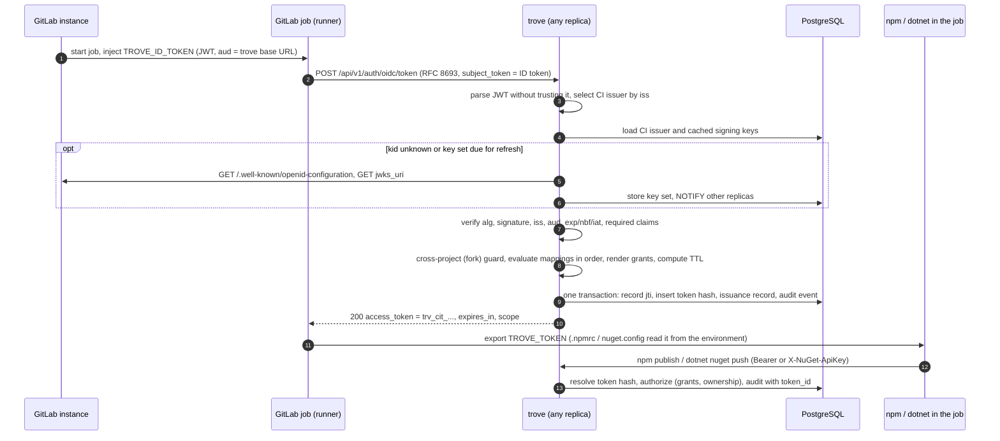
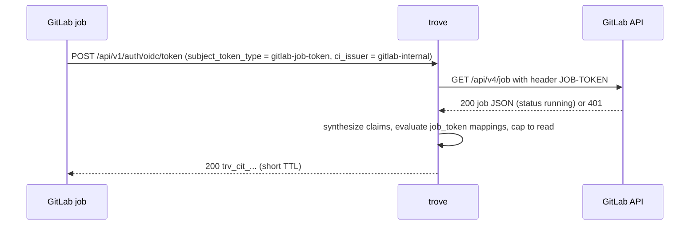

# GitLab CI OIDC federation

Status: specification — not implemented

This page specifies how a CI job gets trove permissions without a stored secret. A GitLab job
asks GitLab for an OIDC ID token addressed to trove. It exchanges that token at
`POST /api/v1/auth/oidc/token` for a short-lived `trv_cit_` token (INV-8, INV-10). With that
token it installs dependencies and publishes the packages it builds. The page covers the trusted
issuer configuration, ID-token validation, identity mappings (the ordered rules that turn
verified claims into grants), grant templating and package-ownership binding, token lifetime,
replay protection, audit, the optional `CI_JOB_TOKEN` fallback (P2), and GitHub Actions and generic
OIDC issuers as later uses of the same mechanism. The page specifies only the CI side of these
features. Other spec pages own the token store and token presentation
([identity-and-authentication.md](identity-and-authentication.md)), the permission model,
permission policies and the package-ownership store ([authorization.md](authorization.md)), the
audit pipeline ([operations-and-observability.md](operations-and-observability.md)), API
conventions and the UI ([api-and-ui.md](api-and-ui.md)), and client-IP and proxy handling
([architecture.md](architecture.md), [ha-and-helm.md](ha-and-helm.md)).

Covers: [oidc-ci-integration.md](../features/oidc-ci-integration.md) (CIOIDC-001 to CIOIDC-040),
the CI-related entries of [access-tokens.md](../features/access-tokens.md) and
[identity-and-access.md](../features/identity-and-access.md), the OIDC operations in
[api-admin-operations.md](../features/api-admin-operations.md) (ADMAPI-028 to ADMAPI-031), and
the CI identity screen gap in [ui-inventory.md](../features/ui-inventory.md) (UI-049).

## Two GitLab credentials, only one of them is OIDC

A GitLab job can hold two different credentials. They are often mixed up, and only the first is
the subject of the OIDC path:

| | ID token (`id_tokens:` keyword) | `CI_JOB_TOKEN` |
|---|---|---|
| What it is | An OIDC ID token: a JWT that GitLab signs with RS256 using the instance's dedicated signing key | A GitLab credential for calling GitLab itself (API, registries, Git) with the triggering user's access level, restricted to a fixed set of GitLab endpoints |
| Audience | Set by the job (`aud`); trove accepts only its own audience | None. Nothing ties it to a relying party. |
| How a third party verifies it | Offline: signature against the issuer's published JWKS, plus `iss`, `aud`, `exp`, `nbf`, `iat` ([RFC 7519](https://www.rfc-editor.org/rfc/rfc7519)) | Only by calling GitLab (`GET /api/v4/job` with the token), while the job is running |
| Format | JWT (compact JWS) | GitLab-internal. Since GitLab 19.0 job tokens use a JWT format by default (a group can switch back until 20.0), but GitLab documents neither claims nor verification keys for third parties. trove treats it as an opaque string. |
| Lifetime | Expires at the job's timeout, or after 5 minutes if no timeout is set | Valid while the job runs; revoked when the job finishes |
| trove use | The normal path, MVP (R-CI-001 to R-CI-021) | Optional fallback, P2, off by default (R-CI-022, Q-CI-5) |

Sources: [ID token authentication](https://docs.gitlab.com/ci/secrets/id_token_authentication/),
[CI/CD job token](https://docs.gitlab.com/ci/jobs/ci_job_token/),
[Jobs API, retrieve a job by job token](https://docs.gitlab.com/api/jobs/#retrieve-a-job-by-job-token)
(all read on 2026-10-28).

## Flow



Terms used on this page:

- **CI issuer**: a trusted external token issuer (one GitLab instance, GitHub Actions, or
  another OIDC issuer) and its validation settings. This is not the same as the OIDC provider
  that humans log in through (INV-7).
- **Identity mapping**: an ordered rule of one CI issuer. It has a claim condition and a grant
  specification.
- **Subject token**: the token the job presents (RFC 8693 term): normally the GitLab ID token.
- **CI token**: the `trv_cit_` token that trove issues.
- **Issuance record**: the stored link between a CI token and the verified job identity it was
  issued to.

## Requirements

### R-CI-001 · CI issuer configuration
Priority: **MVP** · Covers: CIOIDC-001, CIOIDC-002

trove MUST let a system administrator register any number of CI issuers. A CI issuer has a
unique name (`^[a-z0-9][a-z0-9._-]{1,63}$`), a kind (`gitlab` in the MVP; `github` and
`generic` in P1, see R-CI-025 and R-CI-026) and an issuer URL. The issuer URL MUST be an
`https` URL and MUST be unique across CI issuers, so that the `iss` claim of a token selects at
most one CI issuer (R-CI-005). For GitLab, the issuer URL is the instance's base URL, for example
`https://gitlab.com` or `https://gitlab.example.com`.

Settings of a CI issuer (API field names; durations over the API are integer seconds, so units
cannot be mixed up):

<details>
<summary>CI issuer settings (21)</summary>

| Field | Meaning | Value |
|---|---|---|
| `name` | Handle in the API, audit and metrics | — |
| `kind` | Closed enum of the lowercase literals `gitlab`, `github`, `generic` (R-CI-002) | — |
| `issuer` | Expected `iss`, compared exactly (no trailing-slash or case normalization) | — |
| `discovery_url` | OIDC discovery document | `null` = `<issuer>/.well-known/openid-configuration` # default (proposed) |
| `jwks_uri` | Overrides the key-set URL from discovery | `null` # default (proposed) |
| `allowed_audiences` | Accepted `aud` values, exact string match; at least one entry, so the audience is always checked (R-CI-004 step 7). The second default value serves npm-family trusted publishing (below) | `[<server.base_url>, "npm:<host name of server.base_url>"]` # default (proposed) |
| `exclusive_audience` | Every element of `aud` must be an entry of `allowed_audiences`, so the token names no recipient other than trove (Q-CI-3) | `true` # default (proposed) |
| `allowed_algorithms` | JWS algorithms accepted | `["RS256"]` # default (proposed) for `gitlab` and `github` |
| `allowed_typ` | Accepted `typ` header values, compared case-insensitively | `["JWT"]` # default (proposed) |
| `allow_missing_typ` | Accept tokens without a `typ` header | `true` # default (proposed) |
| `clock_skew_seconds` | Leeway for `exp`, `nbf`, `iat`; at most 300 | `60` # default (proposed) |
| `required_claims` | Claims that must be present and non-null | kind preset, see R-CI-006 |
| `public_issuer` | Anyone can obtain tokens from this issuer (e.g. GitLab.com, or any instance with open sign-up). Turns on the ID-pinning rule of R-CI-010. | `true` # default (proposed) |
| `pin_claims` | Claims that count as immutable identifiers for the pinning rule | `gitlab`: `project_id`, `namespace_id`, `job_project_id`, `job_namespace_id` # default (proposed) |
| `single_use_subject_tokens` | Reject a second exchange of the same `jti` (R-CI-018, Q-CI-4) | kind preset: `false` for `gitlab`, `true` for `github` and `generic` # default (proposed) |
| `max_ttl_seconds` | Upper bound for CI tokens of this issuer, at most `ci.token.max_ttl` | `null` (global bound only) # default (proposed) |
| `ca_bundle_ref` | Reference to a PEM bundle (file or environment variable, INV-15) for instances behind a private CA | `null` # default (proposed) |
| `use_outbound_proxy` | Route discovery, key and GitLab API calls through the system outbound proxy ([repositories-and-proxy.md](repositories-and-proxy.md)) | `false` # default (proposed) |
| `job_token_fallback` | R-CI-022 settings (P2) | `{"enabled": false}` # default (proposed) |
| `enabled` | Disabled issuers reject every exchange | `true` # default (proposed) |
| `description` | Free text | `""` |

</details>

**Default audiences.** A CI issuer created without `allowed_audiences` gets two entries, filled in
from the configuration at create time: the base URL (`https://packages.example.com`) and `npm:`
followed by its host name as `new URL(…).hostname` yields it, without port
(`npm:packages.example.com`). The second value is the audience of native trusted publishing by
npm-family clients ([formats/npm.md](formats/npm.md) R-NPM-022, Q-NPM-1, P1), checked there in the
published client sources: pnpm 11.28.6 and later and 12.12.1 and later use `NPM_ID_TOKEN` only when
its `aud` equals or contains `npm:<registry host name>`, and npm requests exactly
`npm:${new URL(registry).hostname}` on GitHub Actions (R-CI-025). Both values name this
installation and no other recipient, so `exclusive_audience` keeps its meaning: a token that also
names another service is still rejected. An administrator who sets `allowed_audiences` explicitly
and leaves out the `npm:` value breaks native trusted publishing for pnpm, which requires that
audience, and for npm on GitHub Actions, which requests it. npm and Yarn 4 in GitLab CI check no
audience on `NPM_ID_TOKEN`, and the generic exchange (R-CI-007) keeps working. Clients that reach
trove under an origin of
`server.additional_base_urls` ([operations-and-observability.md](operations-and-observability.md)
R-OPS-005) request that origin's values, which the administrator adds.

Several GitLab instances are several CI issuers (R-CI-005). trove MUST NOT accept an
`alg` of `none` or any HMAC algorithm (`HS256`, `HS384`, `HS512`) in `allowed_algorithms`
([RFC 8725 §3.1, §3.2](https://www.rfc-editor.org/rfc/rfc8725#section-3.1)). Only
`RS256/384/512`, `PS256/384/512`, `ES256/384` and `EdDSA` are valid entries.

`pin_claims` of a `gitlab` or `github` CI issuer MUST be a subset of that kind's default
`pin_claims` (the ID claims in the table above and in R-CI-025). Any other claim answers 422
`pin_claim_not_immutable`. A path or name claim in `pin_claims` would satisfy the pinning rule of
R-CI-005 with exactly the claims that rule exists to exclude. For an issuer URL that is public by
construction (`https://gitlab.com`, `https://token.actions.githubusercontent.com`),
`public_issuer: false` answers 422 `public_issuer_required`.

**Data model**

```sql
CREATE TABLE ci_issuers (
  id                         uuid PRIMARY KEY,
  name                       text NOT NULL UNIQUE CHECK (name ~ '^[a-z0-9][a-z0-9._-]{1,63}$'),
  kind                       text NOT NULL CHECK (kind IN ('gitlab', 'github', 'generic')),
  issuer                     text NOT NULL UNIQUE CHECK (issuer ~ '^https://'),
  discovery_url              text,
  jwks_uri                   text,
  allowed_audiences          text[] NOT NULL CHECK (cardinality(allowed_audiences) >= 1),
  exclusive_audience         boolean NOT NULL DEFAULT true,
  allowed_algorithms         text[] NOT NULL DEFAULT '{RS256}',
  allowed_typ                text[] NOT NULL DEFAULT '{JWT}',
  allow_missing_typ          boolean NOT NULL DEFAULT true,
  clock_skew                 interval NOT NULL DEFAULT '60 seconds'
                               CHECK (clock_skew <= interval '300 seconds'),
  required_claims            text[] NOT NULL,
  public_issuer              boolean NOT NULL DEFAULT true,
  pin_claims                 text[] NOT NULL,
  single_use_subject_tokens  boolean NOT NULL,              -- kind preset: false (gitlab), true (github, generic)
  max_ttl                    interval,
  ca_bundle_ref              text,
  use_outbound_proxy         boolean NOT NULL DEFAULT false,
  job_token_fallback         jsonb NOT NULL DEFAULT '{"enabled": false}',
  enabled                    boolean NOT NULL DEFAULT true,
  description                text NOT NULL DEFAULT '',
  version                    bigint NOT NULL DEFAULT 1,
  created_at                 timestamptz NOT NULL DEFAULT now(),
  updated_at                 timestamptz NOT NULL DEFAULT now()
);
```

**Acceptance criteria**

- Creating a second CI issuer with `issuer = https://gitlab.com` fails with 409.
- Creating a CI issuer with `allowed_algorithms: ["HS256"]` or `["none"]` fails with 422.
- Creating a CI issuer with `issuer = http://gitlab.example.com` fails with 422.
- Creating a `gitlab` CI issuer with `pin_claims: ["project_path"]` fails with 422
  `pin_claim_not_immutable`. Creating one with `issuer = https://gitlab.com` and
  `public_issuer: false` fails with 422 `public_issuer_required`.
- With `server.base_url: https://packages.example.com:8443`, a CI issuer created without
  `allowed_audiences` reads back
  `["https://packages.example.com:8443", "npm:packages.example.com"]`.

### R-CI-002 · CI issuer management API
Priority: **MVP** · Covers: CIOIDC-005, ADMAPI-028

All operations require the system administrator role (INV-9). Pagination and the error envelope
follow [api-and-ui.md](api-and-ui.md): errors are problem details (R-API-009), and the reason names
this page gives for management operations (`pin_required`, `discovery_unreachable`, …) are their
`code`. Optimistic concurrency follows R-API-012: GET returns `ETag: "<version>"`, PUT requires
`If-Match` (428 `precondition_required` without it, and nothing changes; `If-Match: *` for a
deliberate blind write), DELETE accepts it, and a stale tag answers 412 `precondition_failed` with
`currentEtag`. A lost update here is a grant change: a stale `PUT` of a mapping can restore
conditions or grants another administrator just narrowed ([api-and-ui.md](api-and-ui.md)
Q-API-2). Requests and acceptance criteria on this page that `PUT` an issuer or a mapping send the
`If-Match` the caller read, unless they say otherwise.

The representation is fixed so that the catalog's open points (CIOIDC-005) have one answer:

- `kind` is a closed enum of the lowercase literals `gitlab`, `github` and `generic`. Display
  names such as `GitHub` or `Generic OpenID Connect`, other spellings and other case answer 422
  `validation_failed` with pointer `/kind`. Until R-CI-025 and R-CI-026 ship (P1), `github` and
  `generic` answer 422 `kind_not_available`.
- Create answers 201 with `Location` (R-API-004), not 200.
- PUT replaces the full representation. An omitted optional field takes its default, so changing
  one setting is GET, modify, PUT; the read-only fields of a GET body (`version`, `created_at`,
  `updated_at`) are accepted and ignored (R-API-003). There is no PATCH.
- Field names: this page writes API fields in the snake_case of their database columns. On the
  wire, every management-API field of this page (issuers, mappings, conditions, grants,
  delegations, issuances, dry run) uses the lowerCamelCase form that R-API-003 requires, by
  mechanical conversion (`allowed_audiences` → `allowedAudiences`, `ignore_case` →
  `ignoreCase`). Claim names inside conditions and templates (`project_id`) are data, not field
  names, and keep the issuer's spelling. The exchange endpoint (R-CI-007, R-CI-008) keeps the
  OAuth names of RFC 8693 and its extensions `ci_issuer`, `ttl`, `mappings` and `reason`. Its
  error member `requestId` keeps the spelling it has in every other trove error body (R-API-009),
  so one key finds the matching log line and audit event everywhere.

| Method and path | Purpose | Success | Errors |
|---|---|---|---|
| `GET /api/v1/ci/issuers` | List CI issuers with mapping count and key status | 200 | 401, 403 |
| `POST /api/v1/ci/issuers` | Create; validates discovery and keys unless `"validate": false` | 201 + record | 409 duplicate name or issuer, 422 invalid or unreachable |
| `GET /api/v1/ci/issuers/{name}` | Read | 200 + `ETag` | 404 |
| `PUT /api/v1/ci/issuers/{name}` | Replace; `name` and `issuer` are immutable; `If-Match` required | 200 + new `ETag` | 404, 412 `precondition_failed`, 422, 428 `precondition_required` |
| `DELETE /api/v1/ci/issuers/{name}` | Delete; refuses while mappings exist unless `?cascade=true`; `If-Match` optional | 204 | 404, 409, 412 |
| `GET /api/v1/ci/issuers/{name}/keys` | Cached key set: `kid`, `kty`, `alg`, fetch time, next refresh, last error | 200 | 404 |
| `POST /api/v1/ci/issuers/{name}/keys/refresh` | Force a discovery and key refresh now | 200 + key status | 404, 502 issuer unreachable |

Request sketch for `POST /api/v1/ci/issuers`:

```json
{
  "name": "gitlab-com",
  "kind": "gitlab",
  "issuer": "https://gitlab.com",
  "allowed_audiences": ["https://packages.example.com", "npm:packages.example.com"],
  "description": "GitLab.com, groups acme and acme-labs",
  "validate": true
}
```

The response is the full record with all defaults filled in, plus `version`, `created_at` and
`updated_at`. A create with `"validate": true` (the default) fetches the discovery document and
the key set synchronously. It fails with 422 and a `code` (`discovery_unreachable`,
`issuer_mismatch`, `no_usable_keys`, `algorithms_not_offered`) when the issuer would not be
usable.

Disabling (`enabled: false`) or deleting a CI issuer revokes all unexpired CI tokens issued
through it, in the same transaction (R-CI-017). Deleting with `?cascade=true` deletes its mappings
and their principals in that transaction (R-CI-009). The change writes `ci.issuer.disabled` or
`ci.issuer.deleted`, and a cascade one `ci.mapping.deleted` per mapping; from P1 the revocation
journal keeps these across a database restore (R-CI-020).

**Configuration documents (P1).** A configuration document
([operations-and-observability.md](operations-and-observability.md) R-OPS-029) declares CI issuers
under the kind `ciIssuers`. Each entry is the request body of `POST /api/v1/ci/issuers`, with its
lowerCamelCase field names, validation and defaults, and is identified by `name`. Applying the
document (R-OPS-030) creates an issuer, replaces it as `PUT` does, or deletes it when it was pruned,
and writes the same audit events as the API. Issuers are created before `ciMappings` and deleted
after them. While an issuer is managed by a document and `config_as_code.lock_managed_objects` has
its default `true` (R-OPS-029), `PUT` and `DELETE` through the API answer 409 and name the owning
document. Configuration documents never
declare login providers; a CI issuer only ever serves the token exchange (INV-10,
[operations-and-observability.md](operations-and-observability.md) Q-OPS-6).

**Acceptance criteria**

- `curl -sS -X POST -H "Authorization: Bearer $ADMIN_PAT" -H 'Content-Type: application/json' --data @issuer.json https://packages.example.com/api/v1/ci/issuers`
  with the request above returns 201, and `GET .../keys` lists at least one RSA key.
- A non-administrator PAT receives 403 on every operation in the table.
- After `PUT` with `"enabled": false` and the current `If-Match`, a CI token issued earlier
  through the issuer gets 401 on `npm view @acme-billing/invoice-client` against trove.
- `POST /api/v1/ci/issuers` with `"kind": "GitHub"` answers 422 with pointer `/kind`. A `PUT`
  with `If-Match: "1"` after another `PUT` raised the version to 2 answers 412 with
  `currentEtag` `"2"`.
- `curl -sS -X PUT -H "Authorization: Bearer $ADMIN_PAT" -H 'Content-Type: application/json' --data @issuer.json https://packages.example.com/api/v1/ci/issuers/gitlab-com`
  without `If-Match` answers 428 `precondition_required` and leaves the version unchanged. The
  same call with the tag of a preceding `GET` (`-H 'If-Match: "2"'` while the version is 2)
  answers 200 with `ETag: "3"`.

### R-CI-003 · Discovery, signing keys, caching and rotation
Priority: **MVP** · Covers: CIOIDC-019, CIOIDC-031

Discovery: trove MUST fetch the discovery document from `discovery_url`
([OpenID Connect Discovery 1.0 §4](https://openid.net/specs/openid-connect-discovery-1_0.html#ProviderConfig)).
It MUST reject a document whose `issuer` is not exactly the configured issuer (§4.3) and MUST
take `jwks_uri` from it unless the CI issuer overrides `jwks_uri`. The `jwks_uri` MUST be an
`https` URL. When `id_token_signing_alg_values_supported` does not intersect
`allowed_algorithms`, validation fails with `algorithms_not_offered`. GitLab.com publishes
`https://gitlab.com/.well-known/openid-configuration` with `jwks_uri`
`https://gitlab.com/oauth/discovery/keys` and RS256 (fetched 2026-10-28). Self-managed
instances serve the same paths under their own base URL.

Key set ([RFC 7517](https://www.rfc-editor.org/rfc/rfc7517)): trove MUST use only keys that
meet all of these conditions:

- `use` is absent or `sig`.
- `key_ops` is absent or contains `verify`.
- `kty` matches the algorithm family.
- RSA keys have at least 2048 bits.
- A key's own `alg`, when present, equals the token's `alg`.

Other keys are ignored and reported in the key status.

Caching and refresh:

- The last good key set of each CI issuer is stored in PostgreSQL and held in memory on every
  replica. A refresh on any replica sends `NOTIFY trove_ci_issuer_keys` and the other replicas reload
  from the database (INV-12). A restarted replica validates tokens without contacting GitLab.
- Scheduled refresh: a background job refreshes keys whose `next_refresh_at` has passed. It
  claims rows with `FOR UPDATE SKIP LOCKED`, so exactly one replica fetches. The next refresh
  time follows the response's `Cache-Control: max-age`, clamped to
  `[ci.signing_keys.min_refresh_interval, ci.signing_keys.max_refresh_interval]`, and is
  `default_refresh_interval` when no `max-age` is present.
- Unknown `kid`: trove MUST refresh on demand, at most once per
  `ci.signing_keys.unknown_kid_refresh_interval` per CI issuer and replica. If the `kid` is
  still unknown, it rejects the token with `unknown_signing_key`. This lets a key rotation take
  effect within seconds. Random `kid` values cannot turn trove into a request amplifier
  against GitLab.
- Removed keys: a key that is missing from the latest successful fetch is no longer accepted.
  Removing a key from the JWKS is how an issuer revokes it.
- Fetch failures: trove keeps using the last good key set. Once it is older than
  `ci.signing_keys.max_stale`, trove fails closed: exchanges answer 503
  `signing_keys_unavailable`. Failures are recorded in `last_error` and in metrics (R-CI-020).
- Outbound requests use TLS with the system roots plus `ca_bundle_ref`. They follow at most 3
  redirects, and only to `https` URLs. Responses are limited to
  `ci.signing_keys.max_response_bytes` and requests time out after
  `ci.signing_keys.fetch_timeout`. URLs come only from the CI issuer record and never from a
  token header: `jku`, `x5u`, `jwk` and `x5c` headers are ignored
  ([RFC 8725 §3.10](https://www.rfc-editor.org/rfc/rfc8725#section-3.10)).
- Every hop, including a `jwks_uri` taken from a discovery document and every redirect target,
  passes the egress address policy of the outbound client factory
  ([architecture.md](architecture.md) R-ARCH-022, with the address rules of
  [repositories-and-proxy.md](repositories-and-proxy.md) R-REPO-038). `last_error`, the key-status
  API and the `ci.keys.refresh_failed` event record the failure class, the HTTP status and the
  URL's host, never bytes of a response body. A discovery document that points `jwks_uri` at an
  internal service therefore cannot read that service's answer back through trove.

**Data model**

```sql
CREATE TABLE ci_issuer_keys (
  issuer_id        uuid PRIMARY KEY REFERENCES ci_issuers(id) ON DELETE CASCADE,
  jwks             jsonb NOT NULL,          -- last good key set, public keys only
  jwks_uri         text NOT NULL,           -- where it came from
  fetched_at       timestamptz NOT NULL,
  etag             text,
  next_refresh_at  timestamptz NOT NULL,
  last_error       text,
  last_error_at    timestamptz
);
CREATE INDEX ci_issuer_keys_due ON ci_issuer_keys (next_refresh_at);
```

**Configuration**

```yaml
ci:
  signing_keys:
    default_refresh_interval: 1h        # default (proposed)
    min_refresh_interval: 5m            # default (proposed)
    max_refresh_interval: 24h           # default (proposed)
    unknown_kid_refresh_interval: 60s   # default (proposed)
    max_stale: 24h                      # default (proposed)
    fetch_timeout: 5s                   # default (proposed)
    max_response_bytes: 1048576         # default (proposed)
```

**Acceptance criteria**

- In a test with a local OIDC issuer double, rotating to a new key and signing a token with it
  causes exactly one on-demand fetch. The token is accepted. 100 further tokens with random
  `kid` values within 60 s cause no further fetch.
- Removing a key from the double's JWKS and forcing a refresh makes tokens signed with that key
  fail with `unknown_signing_key`.
- With the double unreachable, exchanges keep working on cached keys until `max_stale`, then
  answer 503 `signing_keys_unavailable`.
- A token whose header carries `jku: https://attacker.example/keys` makes no request to
  `attacker.example`.
- A discovery double whose `jwks_uri` is `https://169.254.169.254/keys` causes no connection to
  that address, and `GET …/keys` shows `last_error` with class `egress_denied`. A `jwks_uri` that
  answers 200 with a non-JSON body leaves no byte of that body in `last_error`.

### R-CI-004 · Subject-token validation
Priority: **MVP** · Covers: CIOIDC-019, CIOIDC-031, CIOIDC-032

trove MUST validate a subject token in this order and MUST stop at the first failure. The
reason code in brackets appears in the error response and the audit event (R-CI-008).

1. Size: at most `ci.exchange.max_subject_token_bytes` [`subject_token_malformed`].
2. Shape: compact JWS with three base64url parts. JWE (five parts), unsecured JWTs and nested
   JWTs are rejected [`subject_token_malformed`]. A value starting with `glcbt-` (GitLab's job
   token prefix) is rejected as [`wrong_subject_token_type`] with a hint to use `id_tokens:`.
3. Header: `alg` in `allowed_algorithms` [`algorithm_not_allowed`]; `typ` in `allowed_typ`,
   or absent with `allow_missing_typ` [`token_type_not_allowed`]; no `crit` parameter [`subject_token_malformed`]; `kid`, when
   present, at most 256 characters and used only as a lookup key.
4. Payload: valid UTF-8 JSON object without duplicate member names
   ([RFC 7519 §4](https://www.rfc-editor.org/rfc/rfc7519#section-4))
   [`subject_token_malformed`].
5. Issuer: the unverified `iss` selects the CI issuer (R-CI-005) [`unknown_issuer`]. A disabled
   CI issuer answers [`issuer_disabled`]. Nothing else from the unverified payload is used
   before step 6.
6. Signature: verified with the key named by `kid`. Without `kid`, every usable key of the
   matching key type is tried, at most 10 [`signature_invalid`, `unknown_signing_key`].
7. Audience: `aud` is a string or an array of strings. At least one element MUST equal an entry
   of `allowed_audiences` [`audience_invalid`]. With `exclusive_audience` (the default), every
   element MUST equal an entry of `allowed_audiences`; an element naming any other recipient is
   rejected [`audience_not_exclusive`]
   ([RFC 8725 §3.9](https://www.rfc-editor.org/rfc/rfc8725#section-3.9)).
8. Time ([RFC 7519 §4.1.4–4.1.6](https://www.rfc-editor.org/rfc/rfc7519#section-4.1.4)): `exp`
   required and `now < exp + skew` [`token_expired`]; `nbf`, when present,
   `now >= nbf - skew` [`token_not_yet_valid`]; `iat` required and `iat <= now + skew`
   [`issued_in_future`]. NumericDate values may be non-integer.
9. Required claims: every claim in `required_claims` is present and not `null`
   [`required_claim_missing`, with the claim name in `error_description`].

GitLab sets `nbf` a few seconds before `iat` in its documented example. The default 60-second
skew absorbs this and normal clock drift between runners, GitLab and trove.

The audience is always checked at the CI issuer (catalog CIOIDC-019 leaves open whether an
unconfigured audience means "no check" or whether only mapping conditions check `aud`). trove has
no unconfigured state: `allowed_audiences` has at least one entry (R-CI-001), and step 7 runs for
every token. A mapping condition MAY additionally test `aud` like any other claim (R-CI-010, array
claims are multi-valued) to narrow which of the allowed audiences a mapping accepts; it never
replaces step 7.

**Acceptance criteria**

- Unit tests cover each step with a failing token and assert the reason code. One case is a
  token signed with HS256 using the RSA public key's bytes as the HMAC secret (the
  algorithm-confusion attack), which must fail with `algorithm_not_allowed`.
- A GitLab ID token whose `aud` is `["https://packages.example.com", "https://vault.example.com"]`
  is rejected with `audience_not_exclusive` under the default settings. With `allowed_audiences`
  `["https://packages.example.com", "https://packages.internal.example.com"]`, a token whose `aud`
  is exactly those two values is accepted.
- Under the default `allowed_audiences` of an installation at `https://packages.example.com`,
  tokens whose `aud` is `npm:packages.example.com`, or
  `["https://packages.example.com", "npm:packages.example.com"]`, are accepted. A token whose `aud`
  is `["npm:packages.example.com", "npm:registry.npmjs.org"]` is rejected with
  `audience_not_exclusive`, and one whose `aud` is `npm:registry.npmjs.org` with
  `audience_invalid`.
- A token with `exp = now - 30` is accepted with a 60-second skew. A token with `exp = now - 61`
  is rejected.

### R-CI-005 · Several GitLab instances and public issuers
Priority: **MVP** · Covers: CIOIDC-001, CIOIDC-002, CIOIDC-033

- Each GitLab instance is its own CI issuer with its own mappings. A token from one instance can
  never be evaluated against the mappings of another, because the CI issuer is selected by
  exact `iss` and verified with that issuer's keys only.
- The exchange request MAY name the CI issuer (`ci_issuer` parameter, R-CI-007). When it does,
  the name MUST match the issuer selected by `iss`, otherwise [`issuer_mismatch`]. The parameter
  exists for clarity in scripts and is required only for the job-token fallback (R-CI-022),
  whose subject token carries no `iss`.
- Claim values such as `project_id` and `namespace_id` are only unique within one GitLab
  instance. Everything that stores them stores the CI issuer with them: issuance records,
  ownership owner keys (R-CI-015) and delegations (R-CI-023).
- Public issuers: anyone with an account on GitLab.com (or on any instance with open sign-up)
  can obtain an ID token with any `aud`. So the audience check proves nothing about who the
  caller is. For a CI issuer with `public_issuer: true`, every mapping MUST be pinned. That
  means its condition MUST contain, at the top level of an `all` combinator, a leaf with
  `equals` or `in` on one of the issuer's `pin_claims` (R-CI-010). Path claims alone are not
  enough: GitLab paths change on rename and transfer and can later be registered by someone
  else. GitLab's own guidance is to prefer `project_id` and `namespace_id` over path claims.

**Acceptance criteria**

- With CI issuers `gitlab-com` and `gitlab-internal` configured, a gitlab.com token whose claims
  equal those of an internal mapping matches only `gitlab-com` mappings.
- Saving a mapping for `gitlab-com` whose condition is only
  `{"claim": "namespace_path", "glob": "acme/**"}` fails with 422 `pin_required`.

### R-CI-006 · GitLab job configuration contract
Priority: **MVP** · Covers: CIOIDC-030, CIOIDC-031, CIOIDC-032, CIOIDC-033, CIOIDC-034

The GitLab side needs only an `id_tokens:` entry whose `aud` equals trove's base URL
(INV-10):

```yaml
publish:
  id_tokens:
    TROVE_ID_TOKEN:                       # example: any variable name works
      aud: https://packages.example.com     # example: one of the CI issuer's allowed_audiences
```

- `aud` SHOULD be a single string. GitLab also accepts an array, which addresses the same token to
  several services. trove rejects such a token by default when any listed audience is not one of
  the CI issuer's `allowed_audiences` (R-CI-004 step 7).
- Native trusted publishing of npm, pnpm and Yarn 4 ([formats/npm.md](formats/npm.md) R-NPM-022,
  P1) reads the ID token from `NPM_ID_TOKEN` instead, declared with
  `aud: npm:<host name of trove's base URL>` (for example `npm:packages.example.com`), the audience
  pnpm requires. The default `allowed_audiences` (R-CI-001) accepts both audiences, so one CI
  issuer and its mappings serve both paths.
- `id_tokens` may be set under `default:`. A job that declares its own `id_tokens` replaces the
  default entirely; GitLab does not merge them
  ([CI/CD YAML reference, `id_tokens`](https://docs.gitlab.com/ci/yaml/#id_tokens)).
- The predecessors `CI_JOB_JWT` and `CI_JOB_JWT_V2` were removed in GitLab 17.0 (catalog
  CIOIDC-030) and are not supported.
- trove never parses `sub`. Conditions SHOULD use the separate claims (`project_id`,
  `ref_type`, `ref`, …) and not a `sub` string, because a project can reconfigure the
  components of `sub`. Git forbids `:` in ref names
  ([git-check-ref-format](https://git-scm.com/docs/git-check-ref-format)), so the default `sub`
  format is unambiguous. It still adds nothing over the separate claims.

Claims trove relies on (GitLab serializes IDs and booleans as JSON strings; R-CI-010 normalizes
them):

| Claim | Required in the `gitlab` preset | Used for |
|---|---|---|
| `iss`, `aud`, `exp`, `iat` | yes | R-CI-004 |
| `nbf` | no (checked when present) | R-CI-004 |
| `jti` | yes | Replay tracking (R-CI-018) |
| `sub` | yes | Audit only |
| `project_id`, `namespace_id` | yes | Pinning, ownership key (R-CI-015) |
| `project_path`, `namespace_path` | yes | Conditions, templating, display |
| `job_project_id`, `job_project_path`, `job_namespace_id`, `job_namespace_path` | no (GitLab 18.4+) | Cross-project guard (R-CI-012) |
| `source_project_id`, `source_project_path` | no (GitLab 19.5+) | Cross-project guard (R-CI-012) |
| `ref`, `ref_type`, `ref_path`, `ref_protected` | yes (`ref_path` no) | Conditions (R-CI-011) |
| `pipeline_source`, `pipeline_id`, `job_id` | yes | Conditions, audit |
| `environment`, `environment_protected`, `deployment_tier`, `environment_action` | no (only for jobs with an environment) | Conditions (R-CI-011) |
| `user_id`, `user_login` | yes | Audit, user-bound grants (R-CI-024) |
| `sha`, `runner_id`, `runner_environment`, `project_visibility` | no | Conditions, audit |

**Acceptance criteria**

- A job with the YAML above, run against the reference GitLab test instance, exchanges
  successfully. The same job with `aud: https://other.example.com` fails with
  `audience_invalid`.
- A job that sends `$CI_JOB_TOKEN` as `subject_token` with the ID-token type gets a 400. The
  reason is `wrong_subject_token_type` or `subject_token_malformed` for the legacy format, and
  `unknown_issuer`, `unknown_signing_key`, `signature_invalid` or `audience_invalid` for the
  JWT format, depending on what that undocumented format contains. It never gets a 5xx and
  never gets a token.

### R-CI-007 · Token exchange endpoint
Priority: **MVP** · Covers: CIOIDC-018, ADMAPI-031

`POST /api/v1/auth/oidc/token` implements OAuth 2.0 Token Exchange
([RFC 8693](https://www.rfc-editor.org/rfc/rfc8693)). It requires no trove credential: the
subject token is the credential. Other methods answer 405.

Request content types: `application/x-www-form-urlencoded` (RFC 8693 §2.1, normative) and
`application/json` (an object with the same parameter names and string values, for scripts that
already send JSON). Any other content type answers 400 [`unsupported_content_type`]. A parameter
sent twice answers 400 ([RFC 6749 §3.2](https://www.rfc-editor.org/rfc/rfc6749#section-3.2)).

| Parameter | Required | Accepted values |
|---|---|---|
| `grant_type` | yes | `urn:ietf:params:oauth:grant-type:token-exchange` |
| `subject_token` | yes | The GitLab ID token (or, R-CI-022, the job token) |
| `subject_token_type` | yes | `urn:ietf:params:oauth:token-type:id_token` or `urn:ietf:params:oauth:token-type:jwt` (equivalent); `urn:trove:token-type:gitlab-job-token` only with R-CI-022 enabled |
| `requested_token_type` | no | Absent or `urn:ietf:params:oauth:token-type:access_token` |
| `scope` | no | Narrows the grants: space-delimited items `<action>` or `<action>:<repository selector>`, e.g. `read:npm-all deploy:npm-internal` (grammar below, Q-CI-2) |
| `audience`, `resource` | no | When present, MUST equal trove's configured base URL; otherwise 400 `invalid_target` |
| `actor_token`, `actor_token_type` | no | Not supported: present → 400 [`actor_token_not_supported`] |
| `ci_issuer` (trove extension) | no | CI issuer name; must match the issuer selected by `iss` (R-CI-005) |
| `ttl` (trove extension) | no | Requested lifetime in seconds; can only shorten (R-CI-016) |

**Scope parameter.** `scope` is an OAuth scope string
([RFC 6749 §3.3](https://www.rfc-editor.org/rfc/rfc6749#section-3.3)) whose items are a compact
notation for the repository part of the token scope of
[identity-and-authentication.md](identity-and-authentication.md) R-AUTH-024. There is one scope
model; this is only its request syntax:

```text
scope     = item *( SP item )
item      = action [ ":" selector ]
action    = "read" / "annotate" / "deploy" / "overwrite" / "delete"
selector  = repository selector of authorization.md R-AUTHZ-004
            ; key, key pattern, class or format filter: npm-internal, npm-team-*, @any-local:npm
```

- Each item becomes one scope grant `{"repositories": [<selector>], "actions": [<action>]}`; an
  item without selector stands for `@any`. The token's stored scope is
  `{"inherit": false, "repositories": [<grants>]}`. Without `scope`, it is `{"inherit": true}`
  (the CI grants unnarrowed, [authorization.md](authorization.md) R-AUTHZ-013).
- The item is split at its first `:`; the rest, including a format filter, is the selector.
  Items are case-sensitive, duplicates are ignored, and at most 50 distinct items are accepted
  (the grant limit of R-AUTH-024).
- An unknown action, `manage`, an invalid selector or a key selector naming no existing
  repository answers 400 `invalid_scope` [`scope_malformed`]. An item that admits no action the
  matched grants hold at exchange time answers 400 `invalid_scope` [`scope_not_granted`]; no
  partial token is issued. At use time the scope is a ceiling like every token scope
  (R-AUTHZ-013).
- Package and path narrowing is not expressible in the request. The mapping's grants already
  carry it.

Processing order:

1. Parse and validate the request.
2. Validate the subject token (R-CI-004).
3. Record the `jti` (R-CI-018).
4. Classify the subject token as cross-project or not (R-CI-012).
5. Select mappings (R-CI-009).
6. Render grants (R-CI-013, R-CI-014).
7. Apply caps per matched mapping (cross-project opt-in, R-CI-012; fallback, R-CI-022).
8. Intersect with `scope`.
9. Compute the TTL (R-CI-016).
10. Issue the token.

Step 3 and step 10 run in one PostgreSQL transaction together with the issuance record and the
audit event. A failed transaction leaves no trace of the `jti`, so a client retry is safe even
with single-use enforcement.

In that transaction trove MUST re-read the CI issuer row and every matched mapping row with
`FOR SHARE` and confirm that each is still enabled and still carries the `version` the evaluation
used. Disabling, deleting or editing a CI issuer or mapping takes `FOR UPDATE` on its row. If a row
changed, the exchange discards its result, reloads the configuration and evaluates once more; a
second mismatch answers 503 [`configuration_changed`]. Without this check, a replica whose mapping
cache has not yet received the `NOTIFY` (R-CI-009) could issue a token under a mapping that was
just disabled, deleted or narrowed, and the revocation of R-CI-017 would not catch it, because the
token did not exist when the revocation ran.

Success response (200, `Content-Type: application/json`, `Cache-Control: no-store`,
`Pragma: no-cache` per [RFC 6749 §5.1](https://www.rfc-editor.org/rfc/rfc6749#section-5.1)):

```json
{
  "access_token": "trv_cit_3kqN8sV1pTz0WmYbR4cD7fHj2LxQe9GuA5oKs6Bn1Vw0aB3cD",
  "issued_token_type": "urn:ietf:params:oauth:token-type:access_token",
  "token_type": "Bearer",
  "expires_in": 900,
  "scope": "read:npm-all read:nuget-all read:npm-internal deploy:npm-internal read:nuget-internal deploy:nuget-internal",
  "ci_issuer": "gitlab-com",
  "mappings": ["acme-release-publish"]
}
```

- `scope` is always returned, in the request grammar above: one item per action and repository
  selector of the effective grants after narrowing, selectors as written in the grants. Package and
  path patterns are not shown. The authoritative grant is the issuance record (R-CI-020).
- No `refresh_token` is ever returned. CI tokens cannot be refreshed. A job that needs a new
  token exchanges its ID token again.
- The token value appears only in this response. trove stores only its SHA-256 (INV-8).

**Configuration**

```yaml
ci:
  exchange:
    enabled: true                    # default (proposed)
    expose_reason: true              # default (proposed); R-CI-008
    max_body_bytes: 65536            # default (proposed)
    max_subject_token_bytes: 16384   # default (proposed)
```

**Acceptance criteria**

- Form-encoded exchange:

  ```sh
  printf '%s' "$TROVE_ID_TOKEN" | curl -sS https://packages.example.com/api/v1/auth/oidc/token \
    --data-urlencode 'grant_type=urn:ietf:params:oauth:grant-type:token-exchange' \
    --data-urlencode 'subject_token_type=urn:ietf:params:oauth:token-type:id_token' \
    --data-urlencode 'subject_token@-'
  ```

  returns 200 with the fields above and `Cache-Control: no-store`.
- The same request as JSON (`-H 'Content-Type: application/json' -d '{"grant_type": …}'`)
  returns an equivalent response.
- `scope=deploy:nuget-internal` from a job whose mapping grants only npm returns 400
  `invalid_scope` with reason `scope_not_granted`. `scope=read:@any-local:npm` from a job of the
  reference mapping returns a token that installs from `npm-internal` and gets 403 on
  `npm publish`. `scope=manage:npm-internal` returns 400 `scope_malformed`.
- Two parallel exchanges of one ID token on two replicas both succeed under
  `single_use_subject_tokens: false`. Under `true`, exactly one succeeds.
- With the `LISTEN` session of replica B blocked, mapping `acme-release-publish` is disabled
  through replica A. An exchange on B whose claims match that mapping issues no token carrying its
  grants: after the reload it answers `no_matching_mapping`, or the grants of a later mapping.

### R-CI-008 · Exchange errors and diagnostics
Priority: **MVP** · Covers: CIOIDC-018

Errors use the OAuth error response of
[RFC 6749 §5.2](https://www.rfc-editor.org/rfc/rfc6749#section-5.2), with
`Content-Type: application/json` and `Cache-Control: no-store`, not the problem details of the
management API. RFC 8693 §2.2.2 requires `invalid_request` for a subject token that is invalid or
unacceptable by policy, so a rejected token answers 400, not 401 (Q-CI-8). trove adds two
members: a stable machine-readable `reason`, and `requestId`, which equals the `X-Request-Id`
response header (R-API-019) and links the answer to the audit event:

```json
{
  "error": "invalid_request",
  "error_description": "no identity mapping of CI issuer gitlab-com matched the token",
  "reason": "no_matching_mapping",
  "requestId": "4bf92f3577b34da6a3ce929d0e0e4736"
}
```

| HTTP | `error` | `reason` values |
|---|---|---|
| 400 | `invalid_request` | `malformed_request`, `unsupported_content_type`, `unsupported_subject_token_type`, `unsupported_requested_token_type`, `actor_token_not_supported`, `subject_token_malformed`, `wrong_subject_token_type`, `unknown_issuer`, `issuer_disabled`, `issuer_mismatch`, `algorithm_not_allowed`, `token_type_not_allowed`, `unknown_signing_key`, `signature_invalid`, `audience_invalid`, `audience_not_exclusive`, `token_expired`, `token_not_yet_valid`, `issued_in_future`, `required_claim_missing`, `subject_token_replayed`, `cross_project_source_denied`, `no_matching_mapping`, `grant_render_failed`, `subject_token_expires_too_soon`, `job_token_rejected`, `job_not_running` |
| 400 | `unsupported_grant_type` | `grant_type_unsupported` |
| 400 | `invalid_scope` | `scope_malformed`, `scope_not_granted` |
| 400 | `invalid_target` | `audience_not_this_server` |
| 429 | `slow_down` | `rate_limited` (with `Retry-After`) |
| 503 | `temporarily_unavailable` | `signing_keys_unavailable`, `gitlab_unreachable`, `database_unavailable`, `configuration_changed` |
| 500 | `server_error` | `internal` |

- `error_description` contains no claim values and no token material. Details go to the audit
  event (R-CI-020).
- With `ci.exchange.expose_reason: false`, every 400 answers `invalid_request` without `reason`
  and with a generic description, still with `requestId`. Logs and audit still record the reason.

**Acceptance criteria**

- Every reason code in the table has an integration test that triggers it and asserts status,
  `error` and `reason`.
- No response body or log line produced by these tests contains the subject token or any
  `trv_cit_` value (checked with a grep over the captured output).

### R-CI-009 · Identity mapping model and evaluation order
Priority: **MVP** · Covers: CIOIDC-007, CIOIDC-009

An identity mapping belongs to one CI issuer and consists of:

- a name, unique within the issuer;
- a `priority`, a positive integer that is unique within the issuer's tier;
- `enabled`;
- `subject_kinds`: `["id_token"]` by default; R-CI-022 (P2) adds `job_token`;
- a condition `match` (R-CI-010);
- a grant specification `grants` (R-CI-013);
- an optional `max_ttl_seconds`;
- `options`: `cross_project_source` (`deny` by default, or `read_only`; R-CI-012) and
  `allow_unprotected_refs` (`false` by default; R-CI-011);
- a description.

Evaluation per exchange:

1. Consider enabled mappings of the selected CI issuer whose `subject_kinds` include the subject
   token's kind.
2. Group them into tiers. The MVP has one tier, `system` (administrator mappings). P1 adds one
   tier per delegation (R-CI-023).
3. Within a tier, evaluate in ascending `priority`. The first mapping whose condition is true is
   that tier's match. Later mappings of the tier are not evaluated.
4. The token's grants are the union of the tier matches. In the MVP that is exactly one mapping.
5. No match in any tier → 400 [`no_matching_mapping`].
6. If rendering the grants of a matched mapping fails (R-CI-014), the exchange fails
   [`grant_render_failed`]. Evaluation does not fall through to the next mapping, because a
   silent fall-through would hand out a different, unintended grant.

First match within a tier allows narrow rules at low priority numbers to shape what broader rules
below them give. For example, "merge request pipelines of acme: read only" placed before "acme
protected refs: publish" keeps a merge request pipeline whose source branch is protected from
publishing, without a negated condition in the publish rule. The price is that a grant every
pipeline needs (typically a read policy) is listed in each mapping a job can match first. Q-CI-1
records why this beats a plain union of all matches.

Limits: at most `ci.mappings.max_per_issuer` mappings per CI issuer.

**Principal.** Every mapping is a principal of kind `ci_mapping` in the principal table of
[identity-and-authentication.md](identity-and-authentication.md) R-AUTH-016, so policies, owner
records and audit reference it like any other principal (INV-9). Its principal `name` is
`<CI issuer name>/<mapping name>`, for example `gitlab-com/acme-release-publish` (Q-CI-10):

- Mapping names are unique only per CI issuer. Both parts match `^[a-z0-9][a-z0-9._-]{1,63}$`, so
  neither contains `/`, and the composite is unique under the table's `UNIQUE (kind, name)` and
  splits back unambiguously.
- The API reference is `ci:<CI issuer name>/<mapping name>`
  ([authorization.md](authorization.md) R-AUTHZ-002).
- Both parts are immutable (R-CI-002, R-CI-019), so the principal is never renamed.
- Creating a mapping inserts its principal row in the same transaction. Deleting the mapping, or
  its CI issuer with `?cascade=true`, deletes the principal row in the same transaction. Policy
  entries, role bindings and owner entries go with it through their foreign keys (R-AUTHZ-002). A
  mapping created later under the same name is a new principal and inherits nothing.

**Data model**

```sql
CREATE TABLE ci_mappings (
  id             uuid PRIMARY KEY,
  issuer_id      uuid NOT NULL REFERENCES ci_issuers(id) ON DELETE RESTRICT,
  principal_id   uuid NOT NULL UNIQUE REFERENCES principal(id),  -- kind 'ci_mapping', name '<issuer>/<mapping>'
  tier           text NOT NULL DEFAULT 'system',      -- 'system' or 'delegation:<uuid>' (P1)
  delegation_id  uuid,                                -- R-CI-023, NULL for the system tier
  name           text NOT NULL CHECK (name ~ '^[a-z0-9][a-z0-9._-]{1,63}$'),
  priority       integer NOT NULL CHECK (priority BETWEEN 1 AND 1000000),
  enabled        boolean NOT NULL DEFAULT true,
  subject_kinds  text[] NOT NULL DEFAULT '{id_token}',
  match          jsonb NOT NULL,
  grants         jsonb NOT NULL,
  max_ttl        interval,
  options        jsonb NOT NULL DEFAULT '{}',
  description    text NOT NULL DEFAULT '',
  version        bigint NOT NULL DEFAULT 1,
  created_by     text NOT NULL,
  created_at     timestamptz NOT NULL DEFAULT now(),
  updated_at     timestamptz NOT NULL DEFAULT now(),
  UNIQUE (issuer_id, name),
  UNIQUE (issuer_id, tier, priority)
);
```

Mappings are cached in memory per replica and invalidated with `NOTIFY trove_ci_mappings` (INV-12),
an administrative channel of [architecture.md](architecture.md) R-ARCH-018, so a disable reaches
every replica on commit.

**Configuration**

```yaml
ci:
  mappings:
    max_per_issuer: 1000   # default (proposed)
```

**Acceptance criteria**

- Mappings `p10` (matches `pipeline_source` `merge_request_event`, read only) and `p20` (matches
  `ref_protected` true, publish): a push pipeline on a protected tag gets `p20`'s grants. A merge
  request pipeline whose source branch is protected matches both and gets only `p10`'s; its
  `npm publish` gets 403.
- A matched mapping whose template references an absent claim fails with
  `grant_render_failed`, even if a later mapping would match.
- Two mappings with equal `priority` in one tier cannot be saved (409).
- Mappings `release-publish` of CI issuers `gitlab-com` and `gitlab-internal` coexist. Their
  principals are `gitlab-com/release-publish` and `gitlab-internal/release-publish`, and a policy
  entry `ci:gitlab-com/release-publish` grants nothing to tokens of the other mapping. After the
  `gitlab-com` mapping is deleted and created again, the policy no longer lists it.

### R-CI-010 · Claim conditions: matchers and combinators
Priority: **MVP** · Covers: CIOIDC-008

A condition is a tree of combinators and leaves:

```json
{
  "all": [
    {"claim": "namespace_id", "in": ["4711", "4712"]},
    {"claim": "project_path", "glob": "acme/**"},
    {"claim": "ref_type", "equals": "tag"},
    {"claim": "ref", "regex": "v[0-9]+\\.[0-9]+\\.[0-9]+"},
    {"claim": "ref_protected", "equals": true},
    {"any": [
      {"claim": "pipeline_source", "equals": "push"},
      {"claim": "pipeline_source", "equals": "web"}
    ]},
    {"not": {"claim": "environment_action", "in": ["prepare", "verify", "access"]}}
  ]
}
```

Combinators: `all` (true if every child is true; an empty list is invalid), `any` (true if any
child is true; an empty list is invalid) and `not` (one child). The maximum depth is 4, a
condition has at most 64 leaves, and an `in` list has at most 256 values.

Leaves name a top-level claim with `claim`, or a nested value with `path` (an array of member
names, e.g. `["job_config", "url"]`; dots in claim names are never interpreted). Each leaf has
exactly one operator:

| Operator | True when |
|---|---|
| `equals` | The normalized claim value equals the normalized literal |
| `in` | It equals one of the literals |
| `glob` | It matches the glob pattern (below) |
| `regex` | It fully matches the regular expression (below) |
| `present` | `true`: the claim exists and is not `null`; `false`: it is absent or `null` |

Optional modifier `ignore_case: true` (Unicode simple case folding) for `equals`, `in`, `glob` and
`regex`. Comparison is case-sensitive by default.

Value normalization, applied to claim values and literals alike:

- Strings are compared byte for byte, with no Unicode normalization.
- Booleans become `"true"` and `"false"`. Integers become their decimal form. So
  `{"equals": true}` matches GitLab's `"ref_protected": "true"` and `{"equals": 20}` matches
  `"project_id": "20"`.
- `null` counts as absent.
- An array claim is multi-valued. A leaf is true if any element matches. Elements that are
  objects or arrays never match.
- An object can be reached only through `path`. A leaf on an object value is false.

Missing claims: every leaf except `present: false` is false on a missing claim. As a
consequence, `not` around a leaf on a missing claim is true. A condition that needs a claim to
exist MUST say `present: true`.

Glob semantics (explicit; the separator is always `/`):

| Token | Matches |
|---|---|
| `*` | Zero or more characters within one segment (never `/`) |
| `?` | Exactly one character other than `/` |
| `**` | Only as a whole segment. In the middle (`a/**/b`): zero or more whole segments. At the end (`a/**`): one or more segments. At the start (`**/b`): zero or more leading segments. |
| `\x` | The literal character `x` (escapes `*`, `?`, `\`, `[`, `]`, `{`, `}`) |

The whole value must match. There are no character classes and no `{a,b}` alternation (use `in`
or `any`). `a**`, `**b` and unescaped `[`, `]`, `{`, `}` are rejected when the mapping is saved.

| Pattern | Value | Match |
|---|---|---|
| `acme/*` | `acme/app` | yes |
| `acme/*` | `acme/billing/app` | no |
| `acme/**` | `acme/billing/app` | yes |
| `acme/**` | `acme` | no |
| `acme/**/app` | `acme/app` | yes |
| `acme/app-*` | `acme/app-ui` | yes |
| `acme*/**` | `acme-evil/app` | yes (the prefix trap: why R-CI-005 requires ID pins) |
| `release/\*` | `release/*` | yes |

Regular expressions are opt-in: they apply only through the `regex` operator, and a glob or
`equals` literal is never interpreted as one. The dialect is Go RE2
([syntax](https://github.com/google/re2/wiki/Syntax)), which runs in linear time. trove
anchors the expression as `^(?:…)$`, limits it to 512 characters, and compiles it when the
mapping is saved; an invalid expression answers 422.

Save-time rules (422 with a `reason` on violation):

- `catch_all_condition`: the condition has no leaf.
- `pin_required`: the CI issuer is public and the top-level `all` (or the root leaf) has no
  `equals` or `in` leaf on a `pin_claims` claim (R-CI-005).
- `unprotected_write`: see R-CI-011.
- `unpinned_write`: on a CI issuer with `public_issuer: false`, a mapping without such a pin leaf
  whose grants include `deploy`, `overwrite` or `delete` is refused, unless every one of those
  actions comes from an inline grant with `ownership: bind_project`. Writes granted through
  `policies` or `groups` need a pin on every CI issuer. Path claims change on rename and transfer;
  ownership keyed by the immutable `project_id` (R-CI-015) keeps a project that inherits a
  released path from writing to packages another project published.

Warnings (returned in the save response's `warnings` array; the save succeeds):

- a `glob` or `regex` on `sub`;
- a condition on `user_login` or `user_email` (GitLab users can change these);
- a template that references a claim neither in `required_claims` nor guarded by
  `present: true` at the top level;
- `unpinned_condition`: a mapping of a CI issuer with `public_issuer: false` whose condition has
  no pin leaf (H-30);
- `repository_template_unconstrained`: a `repositories` template (R-CI-014) without a `require`
  filter. Every project inside the pin chooses the substituted value through its own path, so it
  can select any existing repository whose key fits the literal part;
- `shared_ownership`: an inline grant with `deploy`, `overwrite` or `delete` and an explicit
  `ownership: none`. Names it claims are owned by the mapping, so every project the mapping
  matches can publish versions of them (R-CI-013, Q-CI-6).

**Acceptance criteria**

- A table-driven unit test covers every row of the glob table, normalization of
  `"true"`/`true`/`"20"`/`20`, array claims, `null` and missing claims under `not`.
- `{"claim": "ref", "regex": "(a+)+$"}` against a 10 000-character value evaluates in under
  1 ms (no backtracking).
- A condition with depth 5 or 65 leaves is rejected with 422.
- On a CI issuer with `public_issuer: false`, a mapping with the condition
  `{"claim": "project_path", "glob": "acme/**"}` that lists a policy granting `deploy` is refused
  with 422 `unpinned_write`. The same mapping whose only write is an inline grant with
  `ownership: bind_project` is saved with the warning `unpinned_condition`.

### R-CI-011 · Protected refs, environments and pipeline sources
Priority: **MVP** · Covers: CIOIDC-035, CIOIDC-037

These conditions are ordinary leaves (R-CI-010). trove enforces when they are mandatory:

- `unprotected_write` rule: a mapping whose grants include `deploy`, `overwrite` or `delete` MUST
  contain `{"claim": "ref_protected", "equals": true}` in its top-level `all`. Otherwise the save
  fails with 422, unless `options.allow_unprotected_refs: true`. That option is visible in the
  API, the UI and the audit event of the save. On a protected ref, only users allowed to push or
  merge can run pipelines, and protected variables and runners are available only there
  ([pipeline security on protected branches](https://docs.gitlab.com/ci/pipelines/#pipeline-security-on-protected-branches)).
  A branch-name condition alone can be met by anyone who can push a branch.
- Environment gating: a mapping MAY require `environment` (exact or glob),
  `environment_protected: true`, a `deployment_tier`, and `environment_action: start` to
  distinguish real deployments from jobs that only `prepare`, `verify` or `access` an
  environment
  ([protected environments](https://docs.gitlab.com/ci/environments/protected_environments/)).
  Protected environments need a paid GitLab tier. On GitLab Free, a condition
  `environment_protected: true` never matches (inferred from GitLab's tier statement, not tested).
- Pipeline sources: the `pipeline_source` claim takes the values of `CI_PIPELINE_SOURCE`
  ([list](https://docs.gitlab.com/ci/jobs/job_rules/#ci_pipeline_source-predefined-variable)).
  A write mapping without a `pipeline_source` condition draws a warning that recommends an
  allowlist such as `push`, `web`, `schedule`. `merge_request_event`,
  `external_pull_request_event` and `trigger` should not be allowlisted for writes.
- The dry-run endpoint (R-CI-019) shows, for a given claim set, which of these conditions failed.

**Acceptance criteria**

- Saving a mapping with `actions: ["deploy"]` and no `ref_protected` leaf returns 422
  `unprotected_write`. With `options.allow_unprotected_refs: true`, it returns 201 plus a
  warning.
- A job on an unprotected branch whose project matches the publish mapping gets no deploy grant.
  `npm publish` then fails with 403.

### R-CI-012 · Fork and merge request pipelines
Priority: **MVP** · Covers: CIOIDC-036, CIOIDC-034

GitLab facts
([merge request pipelines with forks](https://docs.gitlab.com/ci/pipelines/merge_request_pipelines/#use-with-forked-projects),
[cloud services](https://docs.gitlab.com/ci/cloud_services/)):

- A merge request pipeline from a fork normally runs in the fork, and all project claims name the
  fork. Mappings pinned to the parent's `project_id` or `namespace_id` do not match it.
- A parent-project member can run it in the parent project. The CI configuration then comes from
  the fork's branch, while the parent's runners and settings apply. `project_path` and
  `project_id` (and `source_project_*` since 19.5) name the fork, `job_project_*` (since 18.4)
  name the parent, and `ref_protected` is `"false"`.

Cross-project guard: before mapping evaluation, a subject token is classified as
*cross-project* when two of `project_id`, `job_project_id` and `source_project_id` are both
present and differ. For a cross-project token, the opt-in is decided per matched mapping, by that
mapping's `options.cross_project_source`:

- `deny` (the default): the mapping contributes nothing. It is not recorded as one of the token's
  mappings, so it is not in the token's principal set ([authorization.md](authorization.md)
  R-AUTHZ-002) and policies naming it never apply to the token.
- `read_only`: the mapping contributes its grants. The token carries the cap `read`, which bounds
  its policy, group and inline grants at use time (R-CI-013).
- If no matched mapping contributes, the exchange fails [`cross_project_source_denied`].

There is no CI-issuer-wide switch. An opt-in covers exactly the grants of the mapping that
carries it, and never those of another mapping matched in the same exchange (from P1, one per
tier, R-CI-009). A mapping created later starts at `deny`. Setting `read_only` is visible in the
API, the UI and the audit event of the save (R-CI-019).

Fork code running in the parent pipeline controls its own CI configuration and could
exfiltrate anything the token can read. Hence the default `deny`, not `read_only` (Q-CI-9).

Older GitLab (before 18.4) has no `job_project_*` claims, so the guard cannot detect these
pipelines. The protections that remain:

- They carry the fork's `project_id`, so they match only mappings that do not pin the parent.
- `ref_protected` is `"false"`, so the `unprotected_write` rule (R-CI-011) keeps them from
  writing.

Same-project merge request pipelines (`pipeline_source = merge_request_event`) carry the source
branch in `ref`. `ref_protected` describes the source branch, so R-CI-011 governs them.

**Acceptance criteria**

- A synthetic token with `project_id = "900"` and `job_project_id = "42"` is rejected with
  `cross_project_source_denied` under the default settings. With a matched mapping that sets
  `read_only`, the issued `scope` contains only `read:` items.
- From P1 (two tiers): a cross-project token that matches a system mapping without the opt-in
  and a delegated mapping with `read_only` receives only the delegated mapping's grants, capped
  to `read`. A policy that names the system mapping grants that token nothing.
- On a GitLab test instance, a fork merge request pipeline run in the parent project cannot
  publish to `npm-internal`.

### R-CI-013 · Grant specification
Priority: **MVP** · Covers: CIOIDC-010, CIOIDC-013, CIOIDC-014

A mapping grants permissions in three combinable ways. The token's grant is the union of all
three, before caps and `scope` narrowing:

```json
{
  "policies": ["ci-read-internal"],
  "groups": ["ci-readers"],
  "inline": [
    {
      "repositories": ["npm-internal"],
      "packages": {"include": ["@{{ namespace_path | slug }}/*"], "exclude": []},
      "actions": ["read", "deploy"],
      "ownership": "bind_project"
    },
    {
      "repositories": ["nuget-internal"],
      "packages": {
        "include": [
          "{{ project_path | replace \"/\" \".\" | replace \"-\" \"\" }}",
          "{{ project_path | replace \"/\" \".\" | replace \"-\" \"\" }}.*"
        ]
      },
      "actions": ["read", "deploy"],
      "ownership": "bind_project"
    }
  ]
}
```

- `policies`: names of permission policies ([authorization.md](authorization.md)). The mapping
  becomes a principal of each listed policy (INV-9 lists CI identity mappings as a principal
  kind). It receives the actions the policy grants to that principal. The binding is stored once,
  in the policy's principal list; this field reads and writes that same binding. Policy grants
  are evaluated when the token is used, so changing a policy affects tokens that were already
  issued.
- `groups`: trove groups whose grants the token also carries, also evaluated at use time.
- `inline`: grants defined in the mapping. Each has a set of `repositories` (keys or patterns as
  in INV-9), exactly one of `packages` or `paths` (include/exclude patterns), `actions` from
  `read`, `annotate`, `deploy`, `overwrite`, `delete`, and `ownership` (`bind_project` or
  `none`, see R-CI-015). Patterns may be templated (R-CI-014). trove renders inline grants once
  at exchange time and stores them with the issuance (R-CI-020); a later mapping edit does not
  change them.
- `ownership` defaults to `bind_project` when `actions` contain `deploy`, `overwrite` or
  `delete`, and to `none` otherwise (Q-CI-6). The stored mapping always shows the resolved value.
  An explicit `none` on a writing grant makes the mapping the owner of the names it claims
  ([authorization.md](authorization.md) R-AUTHZ-018 rule 2), so every project the mapping matches
  co-owns them; the save succeeds with the warning `shared_ownership` (R-CI-010).
- `manage` is never grantable to a CI token (save fails with 422 `action_not_allowed`). CI tokens
  never carry the system administration role, and they cannot create tokens, call management
  endpoints or exchange again. They are accepted on the package-protocol endpoints, `/files/…`,
  the repository-content operations of `/api/v1` that need only repository actions, and
  `GET` and `DELETE /api/v1/tokens/current`
  ([identity-and-authentication.md](identity-and-authentication.md) R-AUTH-028, R-AUTH-029), so a
  job can inspect and revoke its own token (R-CI-017).
- No user subject: a CI token's principal is the mapping, with the job identity as attributes. It
  is never a user. trove creates no transient user, and no "join automatically" group
  membership applies to CI tokens. This deliberately departs from the behavior described in
  CIOIDC-014, where user-subject CI tokens silently inherit such groups. Acting within a human's
  permissions is the explicit, narrowing option of R-CI-024.
- A mapping with an empty grant specification cannot be saved (422 `empty_grant`).

How the CI side uses this grant at request time (the evaluation itself is defined in
[authorization.md](authorization.md)): the effective permission is
`(policy grants ∪ group grants ∪ frozen inline grants) ∩ caps ∩ scope`, followed by the
ownership check of R-CI-015 on writes.

**Acceptance criteria**

- With the grant above, a job of `acme/billing/invoice-api` can `npm install` from `npm-all`
  through `ci-read-internal` and can `npm publish` `@acme-billing/invoice-client` to
  `npm-internal`. Publishing `@acme-shipping/x` gets 403.
- Removing the mapping from policy `ci-read-internal` makes the next `npm install` with an
  already issued token fail with 403, without a new exchange.
- Saving a mapping with `actions: ["manage"]` returns 422 `action_not_allowed`.
- An inline grant saved with `actions: ["read", "deploy"]` and no `ownership` reads back with
  `"ownership": "bind_project"`. The same grant with an explicit `"ownership": "none"` is saved
  with the warning `shared_ownership`.

### R-CI-014 · Claim templating and escaping
Priority: **MVP** · Covers: CIOIDC-011, CIOIDC-013

Templates may appear in the `repositories`, `packages` and `paths` patterns of inline grants
(and, in P1, in `groups_from_claim`, R-CI-024). The template language is deliberately small, with
no conditionals, no loops and no user-defined functions:

```text
template   = *( literal / "{{" ws expr ws "}}" )
expr       = source *( ws "|" ws filter )
source     = claim-name / string        ; claim-name: [a-z_][a-z0-9_]* (top-level claims only)
filter     = "lower" / "slug"
           / "replace" ws string ws string
           / "trim_prefix" ws string / "trim_suffix" ws string
           / "segment" ws integer       ; 0-based "/" segment, negative counts from the end
           / "require" ws string        ; RE2 full match, else render error
string     = DQUOTE *( %x20-21 / %x23-5B / %x5D-10FFFF / "\" ( DQUOTE / "\" ) ) DQUOTE
```

In `groups_from_claim` (R-CI-024), the source name `value` stands for the current array element.

- `slug`: lowercase; every run of characters outside `[a-z0-9]` becomes `-`; leading and
  trailing `-` are removed; an empty result is a render error.
- A literal `{{` is written `{{ "{{" }}`.
- Claim values are normalized as in R-CI-010. An array, object, missing or `null` claim is a
  render error [`grant_render_failed`].

Escaping and validation by context (applied to each substituted value after its filters, before
the value is inserted into literal text):

| Context | Rule |
|---|---|
| `repositories` | The value MUST match `^[a-z0-9._-]+$`, otherwise it is a render error. No glob characters can be inserted. |
| `packages` | Glob metacharacters (`\ * ? [ ] { }`) are backslash-escaped. The value MUST NOT contain `/`, so a claim cannot add a segment to an npm scope. |
| `paths` | Glob metacharacters are escaped. The value MUST NOT be empty, contain `..` or empty segments, or start with `/`. |
| all | Control characters (U+0000–U+001F, U+007F) are a render error. The rendered pattern is at most 1024 characters (IAM-021). |

So a claim can never widen a pattern: a value of `*` renders as the literal `\*`. A template in
`repositories` MUST contain at least one literal character next to its substitution (for example
`{{ … }}-releases`). Without that rule, a claim value alone (such as a GitLab subgroup that a
group member names `npm-internal`) could select an arbitrary existing repository. The save fails
with 422 `template_unanchored`.

Points the catalog leaves open (CIOIDC-011), fixed for trove:

- List-valued claims: only a JSON array of strings is a list. In `groups_from_claim` (R-CI-024)
  the template runs once per element. A JSON string is one value and is never split at commas,
  spaces or any other separator, because splitting would let one claim value name several
  groups. Any other type is a render error.
- Literal text in a template is literal. Only the `require` filter takes a regular expression
  (RE2, full match), and a value that does not match it is a render error
  [`grant_render_failed`]; there is no partial or "no-op" outcome.
- Escaping inside a string argument is defined by the `string` rule above (`\"` and `\\`); `|`
  and `$` have no special meaning there.
- trove does not implement the catalog's stage-pattern language (`$n` back-references,
  `op:replaceAll`). Patterns written for it are rewritten by hand into this grammar. Literal
  text, `replace`, `segment`, `trim_prefix`, `trim_suffix` and `require` cover appending and
  stripping affixes, extracting path segments, replacing characters and rejecting values;
  rewrites that need regular-expression back-references have no equivalent (ADR-061).

Examples (GitLab project `acme/billing/invoice-api`, namespace `acme/billing`):

| Template | Result |
|---|---|
| `@{{ namespace_path \| slug }}/*` | `@acme-billing/*` |
| `{{ project_path \| replace "/" "." \| replace "-" "" }}.*` | `acme.billing.invoiceapi.*` (NuGet IDs compare case-insensitively, [formats/nuget.md](formats/nuget.md)) |
| `{{ project_path \| segment -1 }}` in `paths` | `invoice-api` |
| `{{ project_path \| segment 0 \| require "acme" }}-releases` in `repositories` | `acme-releases` |

**Acceptance criteria**

- A unit test renders each example row above. A claim value `a*b` in a `packages` template
  produces the pattern `a\*b`, which matches only the literal name `a*b`.
- A `paths` template fed `../etc` fails with `grant_render_failed`.
- A template with an unknown filter is rejected on save with 422 `template_invalid`.
- With `groups_from_claim` on claim `groups` (R-CI-024), a JSON array `["a", "b"]` renders two
  names; the string `"a,b"` renders the single value `a,b`, which `slug` turns into `a-b`.

### R-CI-015 · Package ownership binding
Priority: **MVP** · Covers: CIOIDC-013

Templated name patterns can overlap. For example, `@{{ namespace_path | slug }}/*` renders
`@acme-billing/*` both for namespace `acme/billing` and for a top-level group `acme-billing`. A
project path can also be taken over by another project after a rename. An inline grant with
`ownership: bind_project` therefore binds each package name to the GitLab project that first
publishes it:

- Owner identity: the CI issuer and the immutable `project_id`. It is stored by CI issuer ID and
  project ID, and referenced in the API as `ci:<CI issuer name>:project:<project_id>`
  ([authorization.md](authorization.md) R-AUTHZ-018, R-AUTHZ-019). `project_path` is kept as a
  display value and updated on every publish.
- On `deploy` or `overwrite` of package name *N* (normalized as the format defines: npm names
  case-sensitive, NuGet IDs case-insensitive) to repository *R* with such a grant:
  - *N* has no owner and no stored version in *R*'s ownership domain: the publish claims it for
    this project only. The owner record and the upload commit together. A concurrent first
    publish of the same name by another project loses on the store's primary key and gets 403
    (R-AUTHZ-018 rule 5).
  - One of the token's owner identities is an owner: the publish is allowed. These identities are
    the project identity and, as R-AUTHZ-018 rule 1 defines for every CI token, the token's
    mappings and the groups they list.
  - Only other owners, including users or service accounts: 403
    [`package_owned_by_other_owner`], plus audit event `ci.package_ownership.conflict`. This holds
    even though the grant pattern matches.
  - *N* has stored versions but no owner (imported, published before enforcement was switched
    on, or released): 403 [`package_owned_by_other_owner`]. Such a name needs `manage`
    (R-AUTHZ-018 rule 3), which a CI token never holds. A person with `manage` adds the project
    as owner (R-AUTHZ-019), and the next publish succeeds. A pattern match alone never takes over
    an existing package.
- A rename of the GitLab project keeps ownership, because `project_id` does not change. A new
  project that reuses the old path gets 403, which is the intended outcome.
- Ownership records live in the package-ownership store of [authorization.md](authorization.md).
  That page also owns the administrator operations to pre-assign, transfer and release an owner.
  This page defines only the CI owner identity and when a CI publish claims or checks ownership.
  CI ownership is acquired by the first publish, with `bind_project` as the default of writing
  inline grants (R-CI-013, Q-CI-6, matching [authorization.md](authorization.md) Q-AUTHZ-6).

**Acceptance criteria**

- Project A (`project_id` 101) publishes `@acme-billing/client@1.0.0`. Project B (`project_id`
  202), whose grant pattern also renders `@acme-billing/*`, runs `npm publish` for
  `@acme-billing/client@1.0.1` and gets 403 with reason `package_owned_by_other_owner`.
- After renaming project A in GitLab, its next tag pipeline publishes `1.0.2` successfully.
- Two concurrent first publishes of the same new name from two projects result in exactly one
  owner.
- `@acme-billing/legacy` was imported with versions and has no owner. Project A's tag pipeline
  gets 403 `package_owned_by_other_owner` on `npm publish`. After an administrator adds the owner
  `ci:gitlab-com:project:101`, the same pipeline publishes successfully.

### R-CI-016 · CI token lifetime
Priority: **MVP** · Covers: CIOIDC-007, CIOIDC-031

The lifetime of a CI token is

```text
ttl = min( requested ttl          (if the request sent `ttl`; otherwise ci.token.default_ttl),
           mapping max_ttl        (smallest across matched mappings, if set),
           CI issuer max_ttl      (if set),
           ci.token.max_ttl,
           subject exp - now      (remaining ID-token lifetime) )
```

- GitLab sets the ID token's `exp` to the job timeout, or to 5 minutes when no timeout is
  specified. The last term therefore bounds the CI token by the remaining job lifetime.
- `ttl < ci.token.min_ttl` → 400 [`subject_token_expires_too_soon`].
- `ci.token.max_ttl` MUST NOT exceed `auth.tokens.cit.max_ttl`, the CI token ceiling of
  [identity-and-authentication.md](identity-and-authentication.md) R-AUTH-026 (6 h). trove
  refuses to start with a larger value. One ceiling governs every CI token, so the two pages
  cannot drift apart.
- A job that runs longer than one CI token's lifetime exchanges again. A GitLab job presents the
  same ID token, which stays valid until the job timeout; that is why single use is off by
  default for `gitlab` issuers. A GitHub job requests a fresh ID token for each exchange
  (R-CI-018, R-CI-025).
- `expires_in` in the response is the computed `ttl`. The token's stored expiry is
  `issued_at + ttl`.

**Configuration**

```yaml
ci:
  token:
    default_ttl: 15m   # default (proposed)
    max_ttl: 1h        # default (proposed); ceiling auth.tokens.cit.max_ttl (6h)
    min_ttl: 30s       # default (proposed)
# environment override, example: TROVE_CI_TOKEN_MAX_TTL=30m
```

**Acceptance criteria**

- An ID token with 10 minutes left and default settings yields `expires_in` ≤ 600.
- `ttl=60` yields `expires_in` = 60. `ttl=86400` yields at most `ci.token.max_ttl`.
- An ID token with 20 seconds left yields 400 `subject_token_expires_too_soon`.
- Using the CI token one second after `expires_in` returns 401 on `npm view`.
- `TROVE_CI_TOKEN_MAX_TTL=12h` with the default `auth.tokens.cit.max_ttl` makes startup fail
  with a message that names both keys.

### R-CI-017 · CI token identity, presentation and revocation
Priority: **MVP** · Covers: CIOIDC-010, CIOIDC-014, CIOIDC-018

- Format, hashing and storage follow INV-8 and [identity-and-authentication.md](identity-and-authentication.md)
  (prefix `trv_cit_`, SHA-256 at rest, CRC32 suffix). This page adds the issuance record
  (R-CI-020).
- Presentation per INV-8: `Authorization: Bearer <token>`, HTTP Basic with any username and the
  token as password, or `X-NuGet-ApiKey: <token>` on NuGet push.
- CI tokens do not appear in any user's token list. Administrators find them through the
  issuance API (R-CI-020).
- Revocation is immediate (INV-8) and happens:
  - when a mapping is disabled or deleted (its unexpired tokens);
  - when a CI issuer is disabled or deleted (all of its unexpired tokens);
  - through the bulk revoke operation (R-CI-020);
  - by an administrator revoking one token by ID (identity-and-authentication.md);
  - by the token itself through `DELETE /api/v1/tokens/current` (R-AUTH-029). The reference
    pipeline and the setup snippets end each job's `script` with this call (R-CI-027, R-CI-028),
    so the token of a job that succeeds dies with the job (Q-CI-7).

  Editing a mapping does not revoke its tokens. The inline grants of existing tokens stay frozen
  until they expire, and policy and group grants follow live changes.

  Every revocation writes `ci.token.revoked` (R-CI-020). From P1 the revocation journal keeps it
  across a database restore, so a CI token revoked after the restore point stays revoked.
- The `principal` row of a mapping (kind `ci_mapping`, name `<CI issuer name>/<mapping name>`,
  R-CI-009; [identity-and-authentication.md](identity-and-authentication.md) R-AUTH-016) mirrors
  `enabled`: disabling the mapping sets the principal's `status` to `disabled` in the same
  transaction, and enabling it sets it back. Token validation (R-AUTH-023) then rejects every CI token of a disabled
  mapping with `principal_disabled`, including one that escaped the revocation sweep. Together
  with the re-check of R-CI-007, no token of a disabled mapping is usable beyond the revocation
  latency bound.

**Acceptance criteria**

- The CI token works with `npm whoami --registry …` (Bearer), with a NuGet source configured
  through Basic credentials, and with `dotnet nuget push -k`.
- Disabling a mapping makes its unexpired tokens fail with 401 on the next request on every
  replica.
- `DELETE /api/v1/tokens/current` with a CI token answers 204, and the token gets 401 on the next
  `npm view`.

### R-CI-018 · Replay protection
Priority: **MVP** · Covers: CIOIDC-018, CIOIDC-019

- trove MUST record every exchanged subject token by (`ci_issuer`, `jti`) with the exchange
  count and the subject's `exp`. This happens in the exchange transaction as an atomic upsert,
  so all replicas see the same count (INV-12).
- With `single_use_subject_tokens: true`, a second exchange of the same `jti` fails
  [`subject_token_replayed`] and creates audit event `ci.exchange.replayed`. A subject token
  without `jti` is then rejected [`required_claim_missing`].
- With `false`, repeated exchanges are allowed and counted. The issuance list shows the count.
  Once the count exceeds `ci.replay.warn_after_exchanges`, every further exchange emits a
  `ci.exchange.repeated` audit event.
- Defaults by kind (Q-CI-4): `false` for `gitlab`, `true` for `github` and `generic`. An
  administrator may override either way per CI issuer.
- Rows are deleted by a cleanup job once `exp + clock_skew + ci.replay.retention_after_expiry`
  has passed. After that the token fails the time check anyway.
- Why the default is off for GitLab: a GitLab job receives its ID tokens as the variables its
  `id_tokens:` block declares and has no documented way to request another one during the run.
  A job that exchanges in several steps, retries after a network error or outlives its first CI
  token (R-CI-016) must present the same ID token again. The exclusive audience (R-CI-004 step 7),
  the short ID-token lifetime and the masked job log limit replay there, and the exchange count
  makes repeated use visible.
- Why it is on for GitHub and generic issuers: a GitHub job requests an ID token on demand, so
  each exchange can present a fresh one and single use costs a correct job nothing. A generic
  issuer's audience is often shared with every other relying party of that issuer (R-CI-026), so
  audience binding proves nothing there, and single use is the remaining control.

**Data model**

```sql
CREATE TABLE ci_subject_token_uses (
  issuer_id           uuid NOT NULL REFERENCES ci_issuers(id) ON DELETE CASCADE,
  jti                 text NOT NULL CHECK (length(jti) <= 256),
  first_exchanged_at  timestamptz NOT NULL,
  last_exchanged_at   timestamptz NOT NULL,
  exchange_count      integer NOT NULL,
  subject_expires_at  timestamptz NOT NULL,
  PRIMARY KEY (issuer_id, jti)
);
CREATE INDEX ci_subject_token_uses_expiry ON ci_subject_token_uses (subject_expires_at);

-- exchange transaction (sketch)
INSERT INTO ci_subject_token_uses AS u
       (issuer_id, jti, first_exchanged_at, last_exchanged_at, exchange_count, subject_expires_at)
VALUES ($1, $2, now(), now(), 1, $3)
ON CONFLICT (issuer_id, jti)
DO UPDATE SET exchange_count = u.exchange_count + 1, last_exchanged_at = now()
RETURNING exchange_count;   -- > 1 with single use on: roll back and reject
```

**Configuration**

```yaml
ci:
  replay:
    retention_after_expiry: 15m   # default (proposed)
    warn_after_exchanges: 10      # default (proposed)
```

**Acceptance criteria**

- With single use on, exchanging the same ID token twice with `curl` returns 200 and then 400
  `subject_token_replayed`. Concurrent exchanges on two replicas yield exactly one 200.
- A `gitlab` CI issuer created without `single_use_subject_tokens` reads back `false`; a
  `github` or `generic` one (P1) reads back `true`.
- A failed exchange (for example the database rejects the token insert) does not increment the
  count, so a retry succeeds.

### R-CI-019 · Mapping management API and dry-run evaluation
Priority: **MVP** · Covers: CIOIDC-017, ADMAPI-029

System administrators manage mappings (delegates in P1, R-CI-023):

| Method and path | Purpose | Success | Errors |
|---|---|---|---|
| `GET /api/v1/ci/issuers/{issuer}/mappings` | List in evaluation order (tier, priority) | 200 | 404 issuer |
| `POST /api/v1/ci/issuers/{issuer}/mappings` | Create | 201 + record + `warnings` | 409 name or priority taken, 422 rule violation |
| `GET /api/v1/ci/issuers/{issuer}/mappings/{name}` | Read | 200 + `ETag` | 404 |
| `PUT /api/v1/ci/issuers/{issuer}/mappings/{name}` | Replace (`name` immutable); `If-Match` required | 200 + new `ETag` + `warnings` | 404, 409 priority taken, 412 `precondition_failed` (stale `If-Match`), 422, 428 `precondition_required` (no `If-Match`) |
| `DELETE /api/v1/ci/issuers/{issuer}/mappings/{name}` | Delete; revokes its unexpired tokens and deletes its principal (R-CI-009); `If-Match` optional | 204 | 404, 412 |
| `POST /api/v1/ci/issuers/{issuer}/evaluate` | Dry run against a claim set | 200 | 404, 422 |

Representation rules (closed enums, PUT as full replacement, ETag concurrency with `If-Match`
required on PUT, lowerCamelCase on the wire) are those of R-CI-002.

Mapping record sketch:

```json
{
  "name": "acme-release-publish",
  "description": "Protected tags of acme projects publish their own npm and NuGet packages",
  "priority": 100,
  "enabled": true,
  "subject_kinds": ["id_token"],
  "match": {"all": [
    {"claim": "namespace_id", "in": ["4711", "4712"]},
    {"claim": "ref_type", "equals": "tag"},
    {"claim": "ref_protected", "equals": true},
    {"claim": "pipeline_source", "in": ["push", "web"]}
  ]},
  "grants": {"policies": ["ci-read-internal"], "groups": [], "inline": ["… as in R-CI-013 …"]},
  "max_ttl_seconds": 1800,
  "options": {"cross_project_source": "deny", "allow_unprotected_refs": false},
  "version": 1
}
```

Dry run: the request carries a claim set, not a token, so nobody has to paste a live credential.
The response shows the decision trace. It performs no signature or time check unless `now` and
the time claims are given, issues nothing and records no `jti`:

```json
{
  "subject_kind": "id_token",
  "claims": {"iss": "https://gitlab.com", "project_id": "4242", "namespace_id": "4711",
             "project_path": "acme/billing/invoice-api", "namespace_path": "acme/billing",
             "ref": "v1.4.0", "ref_type": "tag", "ref_protected": "true",
             "pipeline_source": "push", "jti": "x", "exp": 1792940000, "iat": 1792936400},
  "scope": "deploy:npm-internal"
}
```

```json
{
  "cross_project": false,
  "trace": [
    {"tier": "system", "mapping": "acme-mr-readonly", "matched": false,
     "failed_leaf": "/all/1", "detail": "pipeline_source equals \"merge_request_event\": value \"push\""},
    {"tier": "system", "mapping": "acme-release-publish", "matched": true}
  ],
  "selected": ["acme-release-publish"],
  "grants": {"inline": [{"repositories": ["npm-internal"], "packages": {"include": ["@acme-billing/*"]},
             "actions": ["read", "deploy"], "ownership": "bind_project"}], "policies": ["ci-read-internal"]},
  "scope": "deploy:npm-internal",
  "ttl_seconds": 900,
  "warnings": []
}
```

Every create, update, disable, enable and delete emits an audit event with the before and after
record (R-CI-020). From P1, disables, deletions and updates also enter the revocation journal, and
its replay after a database restore disables, never deletes, a mapping (R-CI-020).

**Configuration documents (P1).** A configuration document
([operations-and-observability.md](operations-and-observability.md) R-OPS-029) declares mappings
under the kind `ciMappings`. Each entry is the request body of
`POST /api/v1/ci/issuers/{issuer}/mappings`, with its lowerCamelCase field names, validation,
save-time rules, warnings and defaults, plus the field `issuer`, which carries the CI issuer name
of the path parameter. An entry is identified by `issuer` and `name`, the two parts of the
mapping's principal name (R-CI-009). The issuer may be declared in the same document
(`ciIssuers`, R-CI-002) or exist already; the apply order of R-OPS-030 creates issuers before
mappings and deletes mappings before issuers. Documents declare mappings of the `system` tier only,
because the tier is a query parameter and not part of the body; delegated mappings (R-CI-023)
are managed through the API. Under the default lock of R-OPS-029, `PUT` and `DELETE` of a managed
mapping through the API answer 409 and name the owning document. Applying writes the same audit
events as the API.

**Acceptance criteria**

- The dry run for the claim set above names `acme-release-publish` and renders
  `@acme-billing/*`. The same claim set with `"ref_protected": "false"` shows the failing leaf.
- A mapping created through the API is used by the next exchange on every replica within 1 s
  (cache invalidation through `NOTIFY`).

### R-CI-020 · Issuance records, audit and metrics
Priority: **MVP** · Covers: CIOIDC-018, CIOIDC-023

Every successful exchange writes an issuance record in the exchange transaction. Together with
the audit events on package operations, which carry `token_id`, it answers which job got which
token and what that token did.

- Job metadata comes only from verified claims (`project_id`, `pipeline_id`, `job_id`, `sha`,
  `ref`, …). The request carries no free-form run metadata that a caller could set, which
  replaces the purpose of CIOIDC-023 with values that can be trusted.
- The issuance record stores an allowlisted claim snapshot: the claims of R-CI-006 plus `sub`,
  without `user_email` and `user_identities`.

**Data model**

```sql
CREATE TABLE ci_token_issuances (
  token_id           uuid PRIMARY KEY,          -- id of the token row (identity-and-authentication.md)
  issuer_id          uuid NOT NULL REFERENCES ci_issuers(id),
  mapping_ids        uuid[] NOT NULL,
  mapping_names      text[] NOT NULL,           -- snapshot, survives mapping deletion
  subject_kind       text NOT NULL CHECK (subject_kind IN ('id_token', 'job_token')),
  jti                text,
  project_id         text NOT NULL,
  project_path       text,
  namespace_id       text,
  pipeline_id        text,
  job_id             text NOT NULL,
  ref                text,
  ref_type           text,
  ref_protected      boolean,
  pipeline_source    text,
  environment        text,
  sha                text,
  user_id            text,
  user_login         text,
  claims             jsonb NOT NULL,            -- allowlisted snapshot
  grants             jsonb NOT NULL,            -- rendered inline grants, policy and group names, caps
  requested_scope    text,
  granted_scope      text NOT NULL,
  cross_project      boolean NOT NULL DEFAULT false,
  issued_at          timestamptz NOT NULL,
  expires_at         timestamptz NOT NULL,
  client_ip          inet,
  user_agent         text
);
CREATE INDEX ci_issuances_project ON ci_token_issuances (issuer_id, project_id, issued_at DESC);
CREATE INDEX ci_issuances_job     ON ci_token_issuances (issuer_id, job_id);
CREATE INDEX ci_issuances_expiry  ON ci_token_issuances (expires_at);
```

**API** (system administrator; read access for the auditor role once
[authorization.md](authorization.md) defines it)

| Method and path | Purpose |
|---|---|
| `GET /api/v1/ci/issuances?issuer=&project_id=&project_path=&pipeline_id=&job_id=&mapping=&active=&from=&to=` | List issuance records, newest first |
| `GET /api/v1/ci/issuances/{token_id}` | One record, plus a usage summary from the audit store: request count, last use, packages deployed |
| `POST /api/v1/ci/issuances/revoke` | Revoke all unexpired CI tokens that match a filter (`issuer` required; at least one of `project_id`, `pipeline_id`, `job_id`, `mapping`). Returns `{"revoked": <n>}`. |

**Audit events** (stored and streamed per INV-16, see
[operations-and-observability.md](operations-and-observability.md)):

| Event | When | Content beyond actor, time and source |
|---|---|---|
| `ci.exchange.succeeded` | Token issued | `token_id`, CI issuer, mappings, claim snapshot, granted scope, TTL |
| `ci.exchange.denied` | Any 400/429 | `reason`, and the CI issuer if one was resolved. Before the signature is verified, only the unverified `iss` and `kid` are logged and no other claims, so forged tokens cannot inject log content. After verification, the claim snapshot is logged. |
| `ci.exchange.replayed`, `ci.exchange.repeated` | R-CI-018 | `jti`, count |
| `ci.token.revoked` | Any revocation of a CI token | the revoked token IDs, at most 1,000 per event (R-OPS-014; a larger revocation writes several events), and the cause (mapping, issuer, bulk, single, self through `DELETE /api/v1/tokens/current`) |
| `ci.issuer.created`, `ci.issuer.updated`, `ci.issuer.disabled`, `ci.issuer.enabled`, `ci.issuer.deleted` | Create; `PUT` (below); delete | before and after record |
| `ci.mapping.created`, `ci.mapping.updated`, `ci.mapping.disabled`, `ci.mapping.enabled`, `ci.mapping.deleted` | Create; `PUT` (below); delete, including the cascades of an issuer or delegation deletion | before and after record |
| `ci.keys.refreshed`, `ci.keys.refresh_failed` | R-CI-003 | `kid` list, error |
| `ci.package_ownership.claimed`, `ci.package_ownership.conflict` | R-CI-015 | repository, package, owner, `token_id` |
| `ci.job_token.lookup` | R-CI-022 | outcome, GitLab status, latency |

A `PUT` of an issuer or mapping writes exactly one event, chosen by `enabled`: `.disabled` when it
changes `true` to `false`, `.enabled` when it changes `false` to `true`, and `.updated` otherwise.
Each carries the full before and after record, so a `.disabled` event also shows the other fields
changed with it. Applying a configuration document (R-OPS-030) writes the same events as the API.

trove never logs the subject token, the job token or the issued token, at any log level. The
HTTP client used for GitLab calls redacts the `JOB-TOKEN` and `Authorization` headers.

**Revocation journal (P1).** A database restore to time *t* undoes every access removal made
after *t* ([ha-and-helm.md](ha-and-helm.md) H-37). The events below are therefore flagged
`journal: revocation` in the event registry
([operations-and-observability.md](operations-and-observability.md) R-OPS-014). The audit writer
copies each one into the revocation journal of [ha-and-helm.md](ha-and-helm.md) R-HA-054, and
`trove admin post-restore` re-applies it (Q-HA-9). An entry carries IDs and records, never a token
value, hash or other secret. CI issuer and mapping records hold no secret: `ca_bundle_ref` is a
reference to a PEM bundle, not key material.

| Event | The journal entry carries | Replay (R-HA-054) |
|---|---|---|
| `ci.token.revoked` | The revoked token IDs and the cause | Revoke each token as R-AUTH-029 does |
| `ci.issuer.disabled`, `ci.issuer.deleted` | The issuer's ID and name, and its record before the change | Disable the issuer as R-CI-002 does, which revokes its unexpired tokens. A deleted issuer is disabled, never deleted |
| `ci.mapping.disabled`, `ci.mapping.deleted` | The mapping's ID, CI issuer, name, tier and priority, and its record before the change | Disable the mapping as R-CI-019 does (tokens revoked, principal `disabled`, R-CI-017), never delete it, and suspend the later mappings of its tier (below) |
| `ci.issuer.updated`, `ci.mapping.updated` | The record before and after the change | Update rule of R-HA-054 with the comparators below |

- **Not journaled.** The `.created` and `.enabled` events, `ci.exchange.*`, `ci.keys.*`,
  `ci.package_ownership.*` and `ci.job_token.lookup`. They grant or only record, and replay never
  grants (R-HA-054).
- **Every path writes the event.** The API of R-CI-002 and R-CI-019, `?cascade=true` on an issuer
  (one `ci.mapping.deleted` per mapping), the deletion of a delegation (R-CI-023), a
  configuration-document apply (R-OPS-030), and every revocation cause of R-CI-017, including the
  bulk revocation above.
- **Suspended means disabled.** When the update rule suspends an issuer or a mapping (case 3 of
  R-HA-054), replay disables it as in the table, and the output prints the journaled after-state for
  review. Replay never deletes an issuer or a mapping, so a mistaken or forged entry stays
  reversible: an administrator enables the object again.
- **Replay never lifts a first-match shadow (Q-CI-11).** Within a tier, the first matching mapping
  decides (R-CI-009). Disabling a mapping therefore lets the jobs it matched fall through to a later
  mapping, which may grant more: in R-CI-009's example, disabling the read-only merge-request
  mapping lets merge request pipelines from a protected source branch publish. Whenever replay
  disables a mapping that was enabled, for a disable or delete entry or as a suspension, it also
  suspends every enabled mapping of the same tier with a higher `priority` number, disables each as
  R-CI-019 does, and prints each as `suspended`. A mapping that was already disabled needs no such
  step, because its jobs already fall through. Mappings of other tiers are not touched, because
  tiers combine by union. An issuer needs no such step: `iss` selects exactly one issuer (R-CI-005), and a disabled
  issuer answers every exchange with `issuer_disabled`.

**Comparators.** `narrows(current, after)` of R-HA-054 is true only when every field in the table
is equal in `current` and `after` or differs in the direction the table allows. Any other
difference, including a field the comparator does not know, makes it false. Case 2's test of
R-HA-054, whether the journaled before-state is contained in the after-state, is
`narrows(after, before)` under the same rules. `description` is ignored, and replay never changes
identifying fields: `name`, `issuer` and `kind` of an issuer; `name`, CI issuer and tier of a
mapping.

| Object | Field | Narrowing difference allowed |
|---|---|---|
| CI issuer | `allowed_audiences`, `allowed_algorithms`, `allowed_typ` | `after` is a non-empty subset |
| CI issuer | `required_claims` | `after` is a superset |
| CI issuer | `exclusive_audience`, `single_use_subject_tokens` | `after` is `true` |
| CI issuer | `allow_missing_typ`, `job_token_fallback.enabled` | `after` is `false` |
| CI issuer | `clock_skew_seconds`, `max_ttl_seconds` | `after` is not larger; a `null` `max_ttl_seconds` counts as unbounded |
| CI issuer | `enabled`, `discovery_url`, `jwks_uri`, `ca_bundle_ref`, `use_outbound_proxy`, `public_issuer`, `pin_claims`, every other field of `job_token_fallback` | none, must be equal |
| Mapping | `grants` | `after` is a pure removal (below) |
| Mapping | `max_ttl_seconds` | `after` is not larger; `null` counts as unbounded |
| Mapping | `options.cross_project_source` | `after` is `deny` |
| Mapping | `options.allow_unprotected_refs` | `after` is `false` |
| Mapping | `enabled`, `priority`, `subject_kinds`, `match` | none, must be equal |

- **Pure removal of grants.** Nothing was added: `policies`, `groups` and, from P1,
  `service_accounts` are subsets. Every inline grant of `after` equals an inline grant of `current`,
  except that its `repositories`, its `actions` and the `include` list of its `packages` or `paths`
  may be non-empty subsets; `exclude`, `ownership` and every template stay unchanged. From P1,
  `groups_from_claim` is unchanged or removed, and `triggering_user` is unchanged. The result is not
  empty (R-CI-013 refuses an empty grant). Removing the last include pattern never counts, because
  an empty include list is unrestricted ([authorization.md](authorization.md) R-AUTHZ-005).
  Removing `triggering_user` widens the grant, because it narrows by intersection (R-CI-024).
- **Conditions and order are never a narrowing.** Every change of `match` counts as not narrowing,
  even one that only removes a leaf: removing a leaf widens an `all`, narrows an `any` and flips
  under `not`. Changes of `enabled`, `priority` and `subject_kinds` count the same way, because each
  changes which mapping is a tier's first match and can let jobs fall through to a later mapping.
  A different key source (`discovery_url`, `jwks_uri`, `ca_bundle_ref`) cannot be ordered at all.
  For each of these R-HA-054 skips the entry or suspends the object.

**Metrics** (INV-16; labels have bounded cardinality and carry no project or user names):

- `trove_ci_exchanges_total{issuer,outcome,reason}`
- `trove_ci_exchange_duration_seconds{issuer}` (histogram)
- `trove_ci_signing_keys_refresh_total{issuer,outcome}`
- `trove_ci_signing_keys_age_seconds{issuer}`
- `trove_ci_tokens_active{issuer}` (refreshed by a periodic count)
- `trove_ci_job_token_lookups_total{issuer,outcome}`
- `trove_ci_job_token_lookup_duration_seconds{issuer}`

**Configuration**

```yaml
ci:
  issuances:
    retention: 8760h   # default (proposed): one year; Go durations have no day unit
```

**Acceptance criteria**

- After the reference pipeline (R-CI-028) runs,
  `GET /api/v1/ci/issuances?job_id=<CI_JOB_ID>` returns one record per exchange. The
  `npm-internal` audit entry of the publish carries the same `token_id`.
- `POST /api/v1/ci/issuances/revoke {"issuer": "gitlab-com", "pipeline_id": "<id>"}` makes all
  of that pipeline's tokens fail with 401.
- A forged token with a bad signature and a 10 kB `project_path` produces a
  `ci.exchange.denied` event without `project_path`.
- `PUT` of a mapping that changes only `enabled` from `true` to `false` writes one
  `ci.mapping.disabled` event and no `ci.mapping.updated` event.
- From P1, each of the following is made after the restore point *t*, followed by a restore to *t*
  and `post-restore` (R-HA-025):
  - A CI token issued with `ttl=3600` and revoked through `POST /api/v1/ci/issuances/revoke` is
    rejected as revoked, not as expired, and the output lists `ci.token.revoked … applied`.
  - Mappings `acme-mr-readonly` (priority 10), `acme-release-publish` (100) and `acme-read` (900)
    share the `system` tier, and `acme-mr-readonly` is deleted. After replay all three are
    disabled and none is deleted: the output lists `ci.mapping.deleted … applied` and the other two
    as `suspended`. A merge request pipeline from a protected source branch then gets
    `no_matching_mapping`, not a deploy grant.
  - `deploy` is removed from an inline grant of a mapping: replay applies it. A leaf is removed
    from the `all` of that mapping's `match`: the mapping ends `suspended`, that is disabled.
  - A hand-written journal object for `ci.issuer.updated` whose after-state adds an audience, and
    one whose before-state is forged to make that addition look like a removal, end `skipped` or
    `suspended`, and the issuer accepts no new audience.

### R-CI-021 · Exchange endpoint hardening
Priority: **MVP** · Covers: CIOIDC-018

The endpoint is reachable without credentials, so the work an anonymous caller can cause must be
bounded:

- Body limit `ci.exchange.max_body_bytes`; subject-token limit (R-CI-004).
- Rate limits: a token bucket per client IP and one per CI issuer. Exceeding either answers 429
  with `Retry-After`. The client IP comes from the trusted-proxy handling of
  [architecture.md](architecture.md). Buckets are in memory per replica, so the cluster-wide
  limit is the per-replica limit times the number of replicas. This is a deliberate trade-off
  against a PostgreSQL round trip per request.
- Cost bounds: key refetch throttling (R-CI-003); bounded condition size and RE2 (R-CI-010);
  at most `ci.mappings.max_per_issuer` mappings.
- Signature verification happens before any database write. An unauthenticated caller can make
  trove write only an audit row for a denial. Audit rows for identical denials from one client
  IP are rate limited and aggregated: one `ci.exchange.denied` with a count per minute.

**Configuration**

```yaml
ci:
  exchange:
    rate_limit:
      per_client_ip_per_minute: 60    # default (proposed)
      per_client_ip_burst: 20         # default (proposed)
      per_issuer_per_second: 100      # default (proposed)
```

**Acceptance criteria**

- 200 exchange requests from one IP within a minute: the first 20 to 80 (burst plus refill) get
  a 200 or 400 status, the rest get 429 with `Retry-After`.
- 10 000 requests with garbage subject tokens produce no outbound request to GitLab and fewer
  than 100 audit rows.

### R-CI-022 · `CI_JOB_TOKEN` fallback
Priority: **P2** · Covers: CIOIDC-038, CIOIDC-039, CIOIDC-040

An optional mode for jobs that present `CI_JOB_TOKEN` instead of an ID token. It is off by
default (INV-10). It is deferred to P2 and built only when a concrete population of pipelines
cannot add an `id_tokens:` block (Q-CI-5). Until then, builds without the mode:

- answer the job-token subject type with `unsupported_subject_token_type`;
- refuse a CI issuer with `job_token_fallback.enabled: true` and a mapping whose `subject_kinds`
  contains `job_token`, with 422 `job_token_fallback_not_available`;
- refuse to start when `ci.job_token_fallback.enabled` is `true`, with a message that names the
  key.

Once built, the mode is enabled only when both the global
`ci.job_token_fallback.enabled` and the CI issuer's `job_token_fallback.enabled` are `true`, and
only for `gitlab` issuers.



Behavior:

- Request: `subject_token_type=urn:trove:token-type:gitlab-job-token` (a trove-private
  identifier; RFC 8693 §3 allows other URIs), `subject_token=$CI_JOB_TOKEN`, and `ci_issuer`
  (required, since the token carries no issuer trove can read).
- trove calls `GET <issuer>/api/v4/job` with header `JOB-TOKEN: <token>`. It never uses the
  query-string form, which ends up in proxy logs. The URL comes only from the CI issuer record
  (no SSRF). TLS, CA bundle and outbound proxy are as in R-CI-003. Timeout
  `ci.job_token_fallback.request_timeout`; one retry only on connection errors. GitLab 401/403 →
  [`job_token_rejected`]; other errors or a timeout → 503 [`gitlab_unreachable`].
- The response must have `status = "running"`, otherwise [`job_not_running`]. GitLab documents
  this endpoint only through an example response, with no field descriptions
  ([Jobs API, retrieve a job by job token](https://docs.gitlab.com/api/jobs/#retrieve-a-job-by-job-token),
  read 2026-10-28). trove synthesizes claims only from fields of that example whose meaning is
  unambiguous:

  | Synthesized claim | Source field |
  |---|---|
  | `job_id` | `id` |
  | `pipeline_id` | `pipeline.id` |
  | `project_id` | `pipeline.project_id` |
  | `ref` | `ref` |
  | `ref_type` | `tag` (`true` → `tag`, else `branch`) |
  | `sha` | `pipeline.sha` |
  | `user_id`, `user_login` | `user.id`, `user.username` |
  | `iss` | the CI issuer's issuer URL (not from GitLab) |

  The example contains no project path (only inside `web_url`, which trove does not parse), no
  namespace, no ref protection and no `job_project_*` or `source_project_*` fields; its `project`
  object holds only `ci_job_token_scope_enabled`. `project_path`, `namespace_*`,
  `ref_protected`, `environment*`, `job_project_*`, `source_project_*` and `jti` are therefore
  absent, and conditions on them behave as R-CI-010 defines for missing claims.
- The example also carries `source` (`"push"`). Its meaning is not documented for this endpoint;
  trove assumes it holds the pipeline-source values of `CI_PIPELINE_SOURCE` (not verified against
  a GitLab instance). Because that meaning is an assumption, trove never synthesizes
  `pipeline_source` from it, so no mapping can grant on it. It uses the field only to refuse: a
  job whose `source` is absent,
  `merge_request_event` or `external_pull_request_event` counts as cross-project, because the
  fallback cannot tell a fork pipeline run in the parent project from a same-project one (H-29).
  The cross-project rule of R-CI-012 then applies per matched mapping: only a `job_token`
  mapping that sets `cross_project_source: read_only` contributes, and without one the exchange
  fails [`cross_project_source_denied`].
- Only mappings with `job_token` in `subject_kinds` are evaluated. ID-token mappings never match
  fallback claims by accident. The pinning rule applies to `project_id`.
- Fallback grants are always capped to `read`. Without `ref_protected`, trove cannot tell a
  protected release pipeline from any branch push, so no write is possible in this mode.
- TTL: `min(ci.job_token_fallback.max_ttl, other bounds of R-CI-016 except the subject exp)`.
- Replay key: `jti = "job:" + hex(SHA-256(token))`. The raw token is never stored. Concurrent
  exchanges of the same token on one replica share one GitLab call (single-flight). Lookups are
  not cached across exchanges, so every exchange confirms that the job is still running.

Risks, per case, and their mitigations:

| Risk | When it is real | Mitigation |
|---|---|---|
| trove receives a GitLab credential that also works on GitLab's packages, releases, deployments, environments, repository-file and job-artifact APIs with the triggering user's access level | Every fallback exchange, while the job runs | Off by default. Token used in memory for one request and never stored or logged. `JOB-TOKEN` redacted in the HTTP client. A leak in trove would expose GitLab data (H-28). |
| A service that the job sends its job token to (another tool, a misconfigured upstream) can exchange it at trove | Fallback enabled and some job sends its job token elsewhere. The token has no audience, so nothing stops this. | Grants capped to `read`. Short TTL. Mappings pinned by `project_id`. Single use available through the replay key. |
| Dependency on GitLab's availability: GitLab down means no exchange | Every fallback exchange | 503 `gitlab_unreachable`. The ID-token path stays offline-verifiable and unaffected. |
| Latency: one GitLab round trip per exchange | Every fallback exchange | 5-second timeout, single-flight, metrics `trove_ci_job_token_lookup_duration_seconds`. Exchanges happen once per job step, not per package request. |
| GitLab-side scoping (job token allowlist, fine-grained permissions) does not apply to trove | Always: the allowlist governs access to GitLab resources only | trove's own mappings are the only gate. Documented in the CI issuer's UI help text. |

**Configuration**

```yaml
ci:
  job_token_fallback:
    enabled: false        # default (proposed); the CI issuer must enable it too
    max_ttl: 10m          # default (proposed)
    request_timeout: 5s   # default (proposed)
```

**Acceptance criteria**

- With the mode disabled (default), `subject_token_type=urn:trove:token-type:gitlab-job-token`
  answers 400 `unsupported_subject_token_type` and trove makes no call to GitLab.
- In a build without the mode, `PUT` of a CI issuer with `"job_token_fallback": {"enabled": true}`
  answers 422 `job_token_fallback_not_available`.
- With the mode enabled and a mapping `{"claim": "project_id", "equals": "4242"}` with
  `subject_kinds: ["job_token"]`, a running job of project 4242 gets a token whose `scope` holds
  only `read:` items. `npm install` works and `npm publish` gets 403.
- After the job has finished, an exchange with its job token answers `job_token_rejected` or
  `job_not_running`.
- A merge request pipeline job of project 4242 gets `cross_project_source_denied` under the
  default settings, and a token with only `read:` items once the mapping sets
  `cross_project_source: read_only`.
- A packet capture of the GitLab call shows the token only in the `JOB-TOKEN` header, and no
  trove log line contains it.

### R-CI-023 · Delegated mapping management
Priority: **P1** · Covers: CIOIDC-006, CIOIDC-015, ADMAPI-030

trove has no project entity before P2 (IAM-051), so delegation is tied to a CI issuer and to
explicit bounds:

- A system administrator creates a *delegation* on a CI issuer for a user or group. It lists:
  - the GitLab `project_id`s and/or `namespace_id`s the delegate may write mappings for;
  - the repositories (keys or patterns) the delegate may grant on;
  - the maximum actions (a subset of `read`, `annotate`, `deploy`, `overwrite`, `delete`);
  - a maximum TTL.
- The delegate manages mappings in the delegation's own tier through the same mapping API, with
  `?tier=delegation:<id>`. A delegated mapping:
  - MUST pin, at the top level, one of the delegation's IDs;
  - may contain inline grants only, within the delegation's repositories and actions;
  - MUST NOT reference policies or groups;
  - is subject to every save-time rule of R-CI-010 and R-CI-011.

  A violation answers 403 `outside_delegation`.
- Evaluation: first match within each tier, union across tiers (R-CI-009). A delegate can
  therefore only add grants within their bounds for their own GitLab projects. They can neither
  shadow nor reduce what system mappings give.
- Visibility: delegates list only the mappings of their own delegations. The catalog's switch for
  hiding global mappings (CIOIDC-016, IAM-040) is therefore unnecessary.
- Deleting a delegation deletes its mappings and revokes their tokens. It writes one
  `ci.mapping.deleted` per mapping, so the revocation journal covers them (R-CI-020).

**Data model**

```sql
CREATE TABLE ci_delegations (
  id                     uuid PRIMARY KEY,
  issuer_id              uuid NOT NULL REFERENCES ci_issuers(id) ON DELETE CASCADE,
  principal_kind         text NOT NULL CHECK (principal_kind IN ('user', 'group')),
  principal_id           uuid NOT NULL,
  allowed_project_ids    text[] NOT NULL DEFAULT '{}',
  allowed_namespace_ids  text[] NOT NULL DEFAULT '{}',
  allowed_repositories   text[] NOT NULL,
  allowed_actions        text[] NOT NULL,
  max_ttl                interval,
  version                bigint NOT NULL DEFAULT 1,      -- ETag, R-API-012
  created_by             text NOT NULL,
  created_at             timestamptz NOT NULL DEFAULT now(),
  CHECK (cardinality(allowed_project_ids) + cardinality(allowed_namespace_ids) >= 1),
  CHECK (NOT ('manage' = ANY (allowed_actions)))
);
```

**API**: `GET|POST /api/v1/ci/issuers/{issuer}/delegations` and
`GET|PUT|DELETE /api/v1/ci/issuers/{issuer}/delegations/{id}` (system administrator). A
delegation follows R-CI-002's concurrency rules: `GET` returns `ETag: "<version>"`, `PUT` replaces
it and requires `If-Match` (428 `precondition_required` without it, 412 `precondition_failed` when
stale, `If-Match: *` for a deliberate blind write), and `DELETE` accepts it. The bounds are arrays
replaced whole, so a stale `PUT` could silently restore a project or repository another
administrator had just removed. The mapping endpoints of R-CI-019 accept the `tier` query
parameter for delegates.

**Acceptance criteria**

- A delegate for `project_id` 4242 and repository `npm-team-a` can create a mapping that grants
  `deploy` on `npm-team-a` to project 4242. A mapping pinned to project 5000 or granting on
  `npm-internal` gets 403 `outside_delegation`.
- A system mapping that grants project 4242 read on `npm-all`, plus a delegated mapping that
  grants it deploy on `npm-team-a`, gives a job of project 4242 both grants.

### R-CI-024 · Grants derived from the job's subject
Priority: **P1** · Covers: CIOIDC-012, CIOIDC-010

Three additional grant kinds. They combine with R-CI-013 by union, except `triggering_user`,
which narrows:

- `service_accounts: ["<name>"]`: the token also carries the live grants of the named service
  accounts ([identity-and-authentication.md](identity-and-authentication.md)). This eases moving
  pipelines from stored service-account tokens to OIDC without rewriting policies.
- `groups_from_claim: {"claim": "groups_direct", "template": "gitlab-{{ value | slug }}", "allowed": ["gitlab-*"]}`:
  - each element of an array claim is rendered (R-CI-014, with `value` as the source);
  - names that exist as trove groups and match an `allowed` glob contribute their grants,
    while others are ignored and listed in the issuance record;
  - `allowed` is mandatory, so a claim value cannot name an arbitrary group such as an
    administrators group;
  - on a CI issuer with `public_issuer: true` the grant kind is refused with 422
    `claim_groups_on_public_issuer`. On a public instance anyone can create a group under any
    free path and join it, and `slug` maps `a/b` and `a-b` to the same name, so the claim proves
    nothing about membership in the organization.

  GitLab includes `groups_direct` only behind the feature flag `ci_jwt_groups_direct` (off by
  default, GitLab 17.3+) and omits it for users in more than 200 groups
  ([token payload](https://docs.gitlab.com/ci/secrets/id_token_authentication/#token-payload)).
- `triggering_user: {"login_provider": "<human OIDC provider name>", "if_unknown": "deny"}`:
  - trove looks up the user whose login identity is (that provider's issuer, `sub` = the
    token's `user_id`). GitLab's OIDC `sub` for a user is the user ID
    ([OpenID Connect provider](https://docs.gitlab.com/integration/openid_connect_provider/)),
    so this works when the same GitLab instance is also the human login provider (INV-7). The
    named login provider's issuer MUST equal the CI issuer's `issuer`; otherwise the save answers
    422 `login_provider_issuer_mismatch`, because the user IDs of two instances are unrelated
    numbers and would bind the job to a stranger's account.
  - The token's effective permission is then the mapping's grant intersected with that user's
    own permissions at use time, so a job can do no more than the person who triggered it.
  - `if_unknown: deny` fails the exchange [`no_matching_mapping`] when no such user exists;
    `mapping_only` skips the intersection.
  - The match uses the immutable `user_id`, never `user_login`.
  - trove deliberately offers no "act as the user" mode, which would give every job the
    triggering person's full rights.

**Acceptance criteria**

- With `triggering_user` set, a job triggered by a user without deploy on `npm-internal` cannot
  publish even though the mapping grants deploy. A user with deploy can.
- `groups_from_claim` with `allowed: ["gitlab-*"]` and a claim value `admins` adds no group.
- Saving a mapping with `groups_from_claim` for the `gitlab-com` issuer (public) answers 422
  `claim_groups_on_public_issuer`. Saving `triggering_user` with a login provider whose issuer is
  `https://login.example.com/realms/acme` on that issuer answers 422
  `login_provider_issuer_mismatch`.

### R-CI-025 · GitHub Actions as a CI issuer
Priority: **P1** · Covers: CIOIDC-003

Same mechanism, kind `github`:

- Issuer `https://token.actions.githubusercontent.com` (the default for this kind). Discovery
  publishes `jwks_uri` `https://token.actions.githubusercontent.com/.well-known/jwks` and RS256
  (fetched 2026-10-28). An enterprise with its own issuer URL configures that URL instead.
- Preset: `public_issuer: true`; `pin_claims`: `repository_id`, `repository_owner_id`;
  `required_claims`: `iss`, `sub`, `aud`, `exp`, `iat`, `jti`, `repository`, `repository_id`,
  `repository_owner`, `repository_owner_id`, `ref`, `ref_type`, `event_name`, `run_id`;
  `single_use_subject_tokens: true` (R-CI-018). `repository_owner_id` plays the role of an
  organization restriction. Unlike the organization name, it survives renames.
- Each exchange requests a fresh ID token from the runner, as the step below does. A workflow that
  stores one ID token and exchanges it twice gets `subject_token_replayed` on the second exchange.
- npm's native trusted publishing on GitHub Actions requests its ID token itself, with audience
  exactly `npm:${new URL(registry).hostname}`, and posts it to the exchange route of
  [formats/npm.md](formats/npm.md) R-NPM-022. The default `allowed_audiences` of R-CI-001 contains
  that value for a registry URL on trove's base URL, so no audience setting is needed for it.
- The `unprotected_write` rule uses GitHub's `ref_protected` claim (listed in GitHub's
  discovery `claims_supported`). For reusable workflows, `job_workflow_ref` can pin the called
  workflow.
- Workflow side ([GitHub OIDC](https://docs.github.com/en/actions/concepts/security/openid-connect)):

  ```yaml
  permissions:
    id-token: write
    contents: read
  jobs:
    publish:
      runs-on: ubuntu-latest
      steps:
        - name: Exchange the GitHub ID token for a trove token
          run: |
            id_token="$(curl -sS -H "Authorization: bearer ${ACTIONS_ID_TOKEN_REQUEST_TOKEN}" \
              "${ACTIONS_ID_TOKEN_REQUEST_URL}&audience=https://packages.example.com" | jq -r .value)"
            token="$(printf '%s' "$id_token" | curl -sS https://packages.example.com/api/v1/auth/oidc/token \
              --data-urlencode 'grant_type=urn:ietf:params:oauth:grant-type:token-exchange' \
              --data-urlencode 'subject_token_type=urn:ietf:params:oauth:token-type:id_token' \
              --data-urlencode 'subject_token@-' | jq -er .access_token)"
            echo "::add-mask::${token}"
            echo "TROVE_TOKEN=${token}" >> "$GITHUB_ENV"
  ```

**Acceptance criteria**

- A GitHub Actions workflow in a test repository exchanges and runs `npm publish` against
  trove. The same workflow in a fork, or in another owner's repository, gets
  `no_matching_mapping`.
- A `github` mapping without a `repository_id` or `repository_owner_id` pin is rejected with
  `pin_required`.
- Two steps of one job that each request their own ID token both exchange successfully; a
  second exchange of the same ID token answers 400 `subject_token_replayed`.

### R-CI-026 · Generic OIDC issuers
Priority: **P1** · Covers: CIOIDC-002, CIOIDC-004

Kind `generic` accepts any issuer that publishes OIDC discovery or a configured `jwks_uri` and
signs with an allowed asymmetric algorithm. Examples are Azure DevOps service connections,
Kubernetes service-account token issuers, and other CI systems.

- The administrator sets `required_claims` (at least `iss`, `aud`, `exp`, `sub`) and
  `pin_claims`. With `public_issuer: true`, `pin_claims` must not be empty.
- Azure DevOps (facts as recorded in catalog CIOIDC-004, not re-verified here):
  - issuer `https://vstoken.dev.azure.com/<organization-guid>`;
  - `sub` `sc://<organization>/<project>/<service-connection>`;
  - audience `api://AzureADTokenExchange`.

  Because that audience is shared with every other relying party of the same issuer, trove
  cannot rely on it for exclusivity. Mappings should pin `sub` exactly. `generic` issuers
  therefore default to `single_use_subject_tokens: true` (R-CI-018, Q-CI-4).
- Microsoft Entra applications that sign with application-specific keys are supported by setting
  `jwks_uri` explicitly. No separate application-ID setting exists.

**Acceptance criteria**

- A `generic` issuer backed by a local OIDC test issuer (any standard implementation) exchanges
  successfully with a mapping on `sub`.
- A `generic` issuer that offers only HS256 cannot be saved (`algorithms_not_offered`).

### R-CI-027 · CI setup snippets
Priority: **P1** · Covers: CIOIDC-024, UI-049

`GET /api/v1/ci/issuers/{issuer}/snippets/{kind}?mapping=<name>&format=npm|nuget`
(`kind` = `gitlab-ci` or `github-actions`, the latter only for `github` issuers) returns a
ready-to-paste snippet as `text/plain`:

- the `id_tokens:` block (or the GitHub permission and exchange step) with the issuer's first
  allowed audience;
- the exchange step;
- the `.npmrc` or `nuget.config` lines for the repositories named in the mapping's grants;
- the closing step that revokes the CI token through `DELETE /api/v1/tokens/current`
  (R-CI-017).

The snippet contains no secret. Required permission: system administrator, or the delegate who
owns the mapping. The UI shows it on the CI identity screen
([api-and-ui.md](api-and-ui.md), UI-049) with a copy button.

**Acceptance criteria**

- The `gitlab-ci` snippet for the reference mapping, pasted unchanged into a project of the
  matching GitLab group, produces a passing publish job.

### R-CI-028 · Reference pipeline: npm and NuGet from GitLab CI
Priority: **MVP** · Covers: CIOIDC-030

The examples in [Examples](#examples) are part of the specification. trove's end-to-end test
suite runs them against a GitLab test instance and a trove deployment from the Helm chart
(INV-13), with the repositories `npm-internal` (local), `npm-all` (virtual), `nuget-internal`
(local), `nuget-all` (virtual), the policy `ci-read-internal` and the CI issuer and mapping shown
there.

**Acceptance criteria**

- On a protected tag `v1.4.0` of `acme/billing/invoice-api`, both jobs pass:
  `@acme-billing/invoice-client@1.4.0` is in `npm-internal`, and
  `Acme.Billing.InvoiceApi 1.4.0` is in `nuget-internal`.
- The same pipeline on an unprotected branch (with the `rules:` removed) fails at `npm publish`
  and `dotnet nuget push` with 403. The exchange itself succeeds through a read-only mapping,
  or fails with `no_matching_mapping` if none exists.
- `GET /api/v1/ci/issuances?job_id=$CI_JOB_ID` lists both jobs' tokens with the right
  `project_id`, `ref` and `sha`.
- After both jobs pass, their CI tokens are revoked (`token.revoked`, reason `owner`) and get 401
  on `npm view`, although their `expires_in` has not passed.
- No job log contains a `trv_cit_` value or the ID token.

## Examples

### trove side

CI issuer for GitLab.com (`POST /api/v1/ci/issuers`; values are examples):

```json
{
  "name": "gitlab-com",
  "kind": "gitlab",
  "issuer": "https://gitlab.com",
  "allowed_audiences": ["https://packages.example.com", "npm:packages.example.com"],
  "description": "GitLab.com group acme"
}
```

The two audiences are the default (R-CI-001), written out here; the second serves npm-family
trusted publishing ([formats/npm.md](formats/npm.md) R-NPM-022, P1).

Mapping (`POST /api/v1/ci/issuers/gitlab-com/mappings`). Namespace `acme/billing` has ID `4711`
in this example:

```json
{
  "name": "acme-release-publish",
  "description": "Protected tags in acme/billing publish their own npm and NuGet packages",
  "priority": 100,
  "match": {"all": [
    {"claim": "namespace_id", "equals": "4711"},
    {"claim": "ref_type", "equals": "tag"},
    {"claim": "ref_protected", "equals": true},
    {"claim": "pipeline_source", "in": ["push", "web"]}
  ]},
  "grants": {
    "policies": ["ci-read-internal"],
    "inline": [
      {"repositories": ["npm-internal"],
       "packages": {"include": ["@{{ namespace_path | slug }}/*"]},
       "actions": ["read", "deploy"], "ownership": "bind_project"},
      {"repositories": ["nuget-internal"],
       "packages": {"include": [
         "{{ project_path | replace \"/\" \".\" | replace \"-\" \"\" }}",
         "{{ project_path | replace \"/\" \".\" | replace \"-\" \"\" }}.*"]},
       "actions": ["read", "deploy"], "ownership": "bind_project"}
    ]
  },
  "max_ttl_seconds": 1800
}
```

A second mapping with a higher priority number, for example `acme-read` at priority 900, pins
the same namespace and grants only `ci-read-internal` to every other pipeline of the group.

The same CI issuer and mapping in a configuration document (P1,
[operations-and-observability.md](operations-and-observability.md) R-OPS-029). Each entry is the
request body above in its lowerCamelCase wire form (R-CI-002); a `ciMappings` entry adds `issuer`,
the path parameter of the create operation (R-CI-019):

```yaml
apiVersion: trove/v1
kind: Configuration
metadata:
  name: ci-gitlab-com                      # example
spec:
  ciIssuers:
    - name: gitlab-com
      kind: gitlab
      issuer: https://gitlab.com
      allowedAudiences: ["https://packages.example.com", "npm:packages.example.com"]
      description: GitLab.com group acme
  ciMappings:
    - issuer: gitlab-com                   # {issuer} of POST /api/v1/ci/issuers/{issuer}/mappings
      name: acme-release-publish
      description: Protected tags in acme/billing publish their own npm and NuGet packages
      priority: 100
      match:
        all:
          - {claim: namespace_id, equals: "4711"}
          - {claim: ref_type, equals: tag}
          - {claim: ref_protected, equals: true}
          - {claim: pipeline_source, in: [push, web]}
      grants:
        policies: [ci-read-internal]
        inline:
          - repositories: [npm-internal]
            packages: {include: ["@{{ namespace_path | slug }}/*"]}
            actions: [read, deploy]
            ownership: bind_project
          - repositories: [nuget-internal]
            packages:
              include:
                - '{{ project_path | replace "/" "." | replace "-" "" }}'
                - '{{ project_path | replace "/" "." | replace "-" "" }}.*'
            actions: [read, deploy]
            ownership: bind_project
      maxTtlSeconds: 1800
```

### GitLab side

`.gitlab-ci.yml` of project `acme/billing/invoice-api`. Its npm package is named
`@acme-billing/invoice-client` in `package.json`, and its NuGet package ID is
`Acme.Billing.InvoiceApi`:

```yaml
stages: [publish]

variables:
  TROVE_URL: "https://packages.example.com"          # example

# Hidden job: requests the ID token and exchanges it in before_script.
.trove:
  id_tokens:
    TROVE_ID_TOKEN:
      aud: https://packages.example.com                # must be an allowed audience of the CI issuer
  before_script:
    - |
      if ! command -v jq >/dev/null || ! command -v curl >/dev/null; then
        apt-get update -qq && apt-get install -y -qq --no-install-recommends curl jq ca-certificates >/dev/null
      fi
    - |
      response="$(printf '%s' "$TROVE_ID_TOKEN" | curl -sS \
        --data-urlencode 'grant_type=urn:ietf:params:oauth:grant-type:token-exchange' \
        --data-urlencode 'subject_token_type=urn:ietf:params:oauth:token-type:id_token' \
        --data-urlencode 'subject_token@-' \
        "$TROVE_URL/api/v1/auth/oidc/token")"
      TROVE_TOKEN="$(printf '%s' "$response" | jq -er '.access_token // empty')" \
        || { printf '%s\n' "$response" | jq '{error, error_description, reason}' >&2; exit 1; }
      export TROVE_TOKEN
      unset response TROVE_ID_TOKEN

publish-npm:
  stage: publish
  image: node:24-bookworm                               # example
  extends: .trove
  rules:
    - if: $CI_COMMIT_TAG && $CI_COMMIT_REF_PROTECTED == "true"
  script:
    # npm expands ${TROVE_TOKEN} at run time; the token is never written to disk.
    - |
      cat > .npmrc <<'EOF'
      registry=https://packages.example.com/api/npm/npm-all/
      //packages.example.com/api/npm/npm-all/:_authToken=${TROVE_TOKEN}
      //packages.example.com/api/npm/npm-internal/:_authToken=${TROVE_TOKEN}
      EOF
    - npm ci
    - npm version --no-git-tag-version --allow-same-version "${CI_COMMIT_TAG#v}"
    - npm publish --registry https://packages.example.com/api/npm/npm-internal/
    # Last step: revoke the CI token, so it does not outlive the job (R-CI-017).
    - printf 'Authorization: Bearer %s\n' "$TROVE_TOKEN" | curl -sS -X DELETE -H @- "$TROVE_URL/api/v1/tokens/current"

push-nuget:
  stage: publish
  image: mcr.microsoft.com/dotnet/sdk:10.0              # example
  extends: .trove
  rules:
    - if: $CI_COMMIT_TAG && $CI_COMMIT_REF_PROTECTED == "true"
  script:
    # nuget.config (below) reads %TROVE_TOKEN% for restores from nuget-all.
    - dotnet restore
    - >-
      dotnet pack src/Acme.Billing.InvoiceApi/Acme.Billing.InvoiceApi.csproj
      -c Release -o out --no-restore -p:PackageVersion="${CI_COMMIT_TAG#v}"
    - >-
      dotnet nuget push "out/*.nupkg"
      --source "$TROVE_URL/api/nuget/nuget-internal/v3/index.json"
      --api-key "$TROVE_TOKEN"
    - printf 'Authorization: Bearer %s\n' "$TROVE_TOKEN" | curl -sS -X DELETE -H @- "$TROVE_URL/api/v1/tokens/current"
```

`nuget.config` in the repository root. Developers use the same file with their personal access
token in `TROVE_TOKEN`:

```xml
<?xml version="1.0" encoding="utf-8"?>
<configuration>
  <packageSources>
    <clear />
    <add key="trove" value="https://packages.example.com/api/nuget/nuget-all/v3/index.json" />
  </packageSources>
  <packageSourceCredentials>
    <trove>
      <add key="Username" value="ci" />
      <add key="ClearTextPassword" value="%TROVE_TOKEN%" />
    </trove>
  </packageSourceCredentials>
</configuration>
```

Notes on the examples:

- `printf … | curl --data-urlencode 'subject_token@-'` keeps the ID token out of the process
  list. `printf` is a shell builtin. The closing revocation reads its header from standard input
  (`-H @-`, curl 7.55 and later) for the same reason.
- The revocation is the last line of `script`, not an `after_script`: `after_script` runs in a
  separate shell that does not see variables exported in `before_script` or `script`, so it never
  holds the CI token. It also does not run for jobs that time out, unless the runner's script
  timeouts are configured for it
  ([`after_script`](https://docs.gitlab.com/ci/yaml/#after_script), read 2026-10-28). A job that
  fails or is cancelled before the last line keeps its token until `expires_in` (H-26).
- `npm version --allow-same-version` keeps the job working when `package.json` already carries
  the tag's version; without it, npm stops with "Version not changed".
- NuGet expands `%VAR%` in `nuget.config` values on every platform, and leaves the literal text
  when the variable is unset
  ([nuget.config reference](https://learn.microsoft.com/en-us/nuget/reference/nuget-config-file#using-environment-variables)).
  An unset `TROVE_TOKEN` therefore shows up as a 401, not as anonymous access.
- `--api-key "$TROVE_TOKEN"` puts the token in `dotnet`'s argument list. From NuGet 7.6 the
  `NUGET_API_KEY` environment variable can carry it instead (same reference). trove accepts
  both through `X-NuGet-ApiKey` (INV-8). Pushing with the `nuget.config` Basic credentials and no
  API key depends on the 401 challenge behavior of [formats/nuget.md](formats/nuget.md).
- `npm` resolves `${TROVE_TOKEN}` in `.npmrc` at run time
  ([npmrc](https://docs.npmjs.com/cli/v11/configuring-npm/npmrc)). The auth lines are scoped to
  trove's host, so npm never sends the token to another registry.

## Deferred

- CIOIDC-016 (P2): switch hiding global mappings from project administrators. Delegates never
  see system-tier mappings anyway (R-CI-023).
- IAM-040 (P2): the same switch, as a security setting. Not needed, for the same reason.
- CIOIDC-020 (P2): reference token in the exchange response. trove's CI tokens are already
  short opaque handles (INV-8).
- CIOIDC-021 (P2): explicit mapping selection in the request. Could come later as an optional
  `mapping` parameter whose condition must still match.
- CIOIDC-022 (Later): application-scoped exchange. There is no application entity before the
  distribution features.
- CIOIDC-025 (P2): exchange command of a companion CLI. No CLI is planned; the `curl` steps and
  snippets (R-CI-027) cover it.
- CIOIDC-026 (P2): GitHub App onboarding with generated pull requests.
- CIOIDC-027 (P2): binding a cloud IAM role to a user.
- CIOIDC-028 (P2): exchange of a signed cloud caller-identity request.
- CIOIDC-029 (P2): passwordless image pulls for Kubernetes workloads. This depends on the
  container formats (P1) and on CIOIDC-027 and CIOIDC-028.
- CIOIDC-038 to CIOIDC-040 (P2): the `CI_JOB_TOKEN` fallback. R-CI-022 specifies it; it is built
  only when a concrete need appears (Q-CI-5).
- Revocation of CI tokens on job end through GitLab job webhooks, or through a job-scoped revoke
  call that presents the ID token (Q-CI-7). Not planned; the TTL bound and self-revocation apply.

## Security notes

- The exchange endpoint is anonymous. Identity mappings are the entire access control. The
  save-time rules exist so that the common mistakes cannot be saved:
  - catch-all conditions (`catch_all_condition`);
  - path-only conditions on public issuers (`pin_required`);
  - unpinned writes without ownership binding on any issuer (`unpinned_write`);
  - writes from unprotected refs (`unprotected_write`);
  - `manage` in CI grants (`action_not_allowed`).
- GitLab.com and GitHub Actions are public issuers. A validly signed token with the right
  audience proves only that some job on that platform requested it. Only conditions on
  immutable IDs bind it to an organization.
- Subject tokens and CI tokens are bearer credentials. Both are kept out of logs, error bodies
  and process lists (examples). Responses carry `Cache-Control: no-store`.
- An ID token that also names another service in `aud` is addressed to that service too, and it
  could replay the token at trove. Such tokens are rejected by default; only audiences that all
  belong to trove are accepted together (R-CI-004). Both default audiences, the base URL and
  `npm:<host name>`, name this installation only (R-CI-001): trove owns the host it runs on
  ([operations-and-observability.md](operations-and-observability.md) R-OPS-005). The `npm:` value
  carries no port, so it relies on that ownership for every port of the host name, as the
  `__Host-trv_session` cookie already does.
- Algorithm and key handling follow RFC 8725:
  - an allowlist of asymmetric algorithms and no `none` or HMAC;
  - the key type must match the algorithm;
  - no keys taken from token headers;
  - `kid` used only as a lookup key.
- Outbound calls go to administrator-configured URLs only: discovery, keys, and the GitLab Jobs
  API in fallback mode (P2). Tokens cannot make trove fetch other URLs.
- Package ownership (R-CI-015) keeps overlapping name patterns and reused project paths from
  turning into package takeover.
- Rate limits are per replica (R-CI-021). An attacker can get roughly `replicas × limit`
  exchange attempts. That is acceptable because each attempt costs one signature check.
- A database restore would revive CI tokens, issuers and mappings that were revoked, disabled or
  narrowed after the restore point ([ha-and-helm.md](ha-and-helm.md) H-37). From P1 the revocation
  journal replays those changes (R-CI-020). Replay disables but never deletes, and it suspends the
  later mappings of a disabled mapping's tier, so a forged journal entry can deny CI access but
  cannot lift a first-match shadow and grant more (Q-CI-11).

## Decisions

Each question below was decided by the development agent from the listed options; the owner reviews the choices at the walkthrough.

### Q-CI-1 · First match per tier or union of all matching mappings

Status: **Decided by the development agent** — selected from the options below; the owner reviews it at the walkthrough.

| Option | What it means | For | Against |
|---|---|---|---|
| (a) First match per tier, union across tiers | Within a tier, mappings are tried in ascending `priority` and the first true condition is the tier's match. The token gets the union of the tier matches. The MVP has one tier. | One mapping explains each tier's result. A narrow rule at a low number shapes what broader rules below it give. A misordered rule gives fewer grants, never more. Delegated mappings (P1) neither shadow system mappings nor are shadowed by them. | Order matters: a forgotten low-numbered rule can hide a broader one (the dry run, R-CI-019, shows it). A grant every pipeline needs is listed in each mapping a job can match first. |
| (b) Union of every matching mapping | Every mapping whose condition is true contributes. | No ordering to reason about; no mapping repeats another's grants. | "Merge request pipelines only read, even from a protected source branch" needs a negated condition in every write rule, and a forgotten negation hands out the write grant. Adding a mapping can only widen what some job gets. |
| (c) Strict first match across all mappings | One global order, as in the catalog (CIOIDC-009). | Simplest evaluation. | From P1, delegated and system mappings compete for priority numbers, and a delegate's rule can shadow a system grant. |
| (d) First match with an opt-in fall-through | First match, but a mapping flagged `continue` lets evaluation go on and adds later matches. | One rule can add a common read grant to every later match. | Order-dependent unions return. Trace, audit and review must explain chains. Listing the shared policy in each mapping gives the same result. |

**Choice:** (a) — first match within a tier, union across tiers.

**Rationale:** With one tier in the MVP, (a) behaves exactly like the catalog's first match, so it
costs nothing now. It already fixes the P1 property that matters: delegates add grants within
their bounds and never interfere with system mappings, the failure mode of (c). Against (b), the
difference shows in a merge request pipeline whose source branch is protected: it carries
`ref_protected: "true"` (R-CI-012), so under a union it also matches "acme protected refs:
publish" unless every write rule excludes `merge_request_event`. A forgotten exclusion fails open.
Under (a), "merge request pipelines: read only" placed above the publish rule settles it once, and
a misordered rule fails closed. Each tier's decision is also explained by exactly one mapping in
the issuance record and the dry run. The cost of (a) is repeating the common read policy in each
mapping, one name per mapping; (d) would remove that repetition at the price of explaining chains.
The development agent would revisit this if administrators end up copying the same read grant
into many mappings, which would argue for (d).

**Applied in the spec:** R-CI-009: the explanation of first match now uses protected refs instead
of protected tags (merge request pipelines never run on tags, so the old example did not need
first match) and names the cost of repeating common grants. Its first acceptance criterion now uses
a merge request pipeline from a protected source branch that matches both mappings; the earlier
criterion passed under a union too. R-CI-023 already relies on the union across tiers.

### Q-CI-2 · Grammar of the `scope` request parameter

Status: **Decided by the development agent** — selected from the options below; the owner reviews it at the walkthrough.

| Option | What it means | For | Against |
|---|---|---|---|
| (a) Own string grammar | Space-delimited `<action>` or `<action>:<repoKey>`, parsed into a CI-specific structure. | Trivial, OAuth-conformant. | A second scope model next to R-AUTH-024. Keys only: no patterns, classes or format filters. |
| (b) The JSON scope of R-AUTH-024 in the request | The job sends the same JSON structure that personal and service-account tokens use, in `scope` or in an extension parameter. | One language, including package and path narrowing. | JSON is not a valid OAuth scope ([RFC 6749 §3.3](https://www.rfc-editor.org/rfc/rfc6749#section-3.3) excludes `"`, `\` and spaces from a scope token), so standard clients cannot send it in `scope`. An extension parameter makes requests non-standard and pushes JSON quoting into shell scripts. |
| (c) OAuth string as notation for R-AUTH-024 | Items `<action>` or `<action>:<selector>` with any repository selector of R-AUTHZ-004. Each item becomes one repository grant of the R-AUTH-024 structure, which is what the token stores. | OAuth-conformant and easy to type in `curl`. One scope model, one selector syntax, one evaluator. The response's `scope` uses the same notation. | No package or path narrowing in the request. |
| (d) No `scope` parameter in the MVP | The exchange always issues the mapping's full grants; a request with `scope` answers 400. | Nothing to parse or validate; the mapping already defines what a job gets. | Every step of a job holds the job's full grants. A job cannot exchange a read-only token for `npm ci`, which runs its dependencies' install scripts, and a deploy token only for the publish step. |

**Choice:** (c) — an RFC 6749 scope string whose items are a notation for the repository part of
the R-AUTH-024 scope.

**Rationale:** Narrowing at exchange time has a concrete security use: a pipeline can give the
install step, which runs third-party install scripts, a token without `deploy`. That rules out
(d), whose saving is one small parser. (c) is what (b) aimed for, one scope model for every token,
without breaking the OAuth request format that RFC 8693 clients produce. The selector syntax is
reused unchanged, so `read:@any-local:npm` means the same thing as in a policy. Package and path
narrowing is not needed in the request, because the mapping's grants already carry it, and inside
trove the stored scope still expresses it: the package-bound token of npm trusted publishing
([formats/npm.md](formats/npm.md) R-NPM-022) uses the same structure. (a) would leave the
authorization code with a second, weaker structure. The development agent would revisit this if
one job has to narrow to individual packages at exchange time, for example a monorepo job
publishing on behalf of several projects; an extension parameter carrying the R-AUTH-024 JSON
would then be added.

**Applied in the spec:** R-CI-007: the `scope` row and a new "Scope parameter" paragraph (grammar,
translation into the stored token scope, `{"inherit": true}` when absent, limit of 50 items,
`scope_malformed` and `scope_not_granted`); the response `scope` uses the same grammar; acceptance
criteria extended.

### Q-CI-3 · Default for ID tokens with several audiences

Status: **Decided by the development agent** — selected from the options below; the owner reviews it at the walkthrough.

| Option | What it means | For | Against |
|---|---|---|---|
| (a) Reject every `aud` array with more than one element | Only a single audience is accepted. | Simple rule. | Also rejects a token that names two trove base URLs (internal and external host name), although no third party is involved. |
| (b) Accept when one element is an allowed audience | The minimum of [RFC 7519 §4.1.3](https://www.rfc-editor.org/rfc/rfc7519#section-4.1.3). | Accepts every token GitLab can produce. | A token addressed to trove and to a secrets manager reaches that secrets manager, which can then exchange it at trove ([RFC 8725 §3.9](https://www.rfc-editor.org/rfc/rfc8725#section-3.9)). |
| (c) Exclusive audience | Accept only when every element of `aud` is one of the CI issuer's `allowed_audiences`. Setting `exclusive_audience`, default `true`. | Blocks exactly the case that makes multi-audience tokens dangerous, another recipient, and accepts the harmless one. Same implementation cost as (a). | One more sentence to explain than (a). |

**Choice:** (c) — every element of `aud` must be an allowed audience of the CI issuer.

**Rationale:** The risk is not the number of audiences but a recipient other than trove that could
replay the token. (c) states that property directly. It keeps the protection of (a) and does not
reject a deployment that lists two host names of its own. (b) gives up the protection, and GitLab
lets a job declare one ID token per audience in `id_tokens:` at no cost, so nobody needs it. The
development agent would revisit this only if a client could not avoid foreign audiences; single
use (R-CI-018) would then be the compensating control.

**Applied in the spec:** R-CI-001: `reject_multiple_audiences` replaced by `exclusive_audience`
(table and data model), `allowed_audiences` states that the audience is always checked. R-CI-004
step 7 and its acceptance criteria, R-CI-006 (the `aud` bullet) and the security notes follow (c).

### Q-CI-4 · Single exchange per `jti` by default

Status: **Decided by the development agent** — selected from the options below; the owner reviews it at the walkthrough.

| Option | What it means | For | Against |
|---|---|---|---|
| (a) Off for every kind, counted | Repeated exchanges are allowed, counted and audited beyond a threshold. | Never breaks a job. | For issuers with a shared audience, every other relying party can replay the token at trove, and only an audit event records it. |
| (b) On for every kind | A second exchange of the same `jti` fails. | Strongest replay protection. | Breaks GitLab jobs that exchange per tool step, retry after a network error or re-exchange after the CI token expired, which R-CI-016 relies on for long jobs. |
| (c) Preset by kind: off for `gitlab` and `github`, on for `generic` | Single use only where the audience is shared; overridable per CI issuer. | Covers the shared-audience case. | Leaves GitHub without single use although nothing there needs repeated exchanges of one token. |
| (d) Preset by how the job obtains its subject token | Off for `gitlab`, whose job gets its ID tokens once as variables; on for `github`, whose steps request ID tokens on demand, and for `generic`, whose audiences are often shared. Overridable per CI issuer. | Each kind gets the strongest control its real clients tolerate. | The default differs between kinds and must be documented. |

**Choice:** (d) — off for `gitlab`, on for `github` and `generic`.

**Rationale:** A GitLab job receives its ID tokens as the variables its `id_tokens:` block declares,
and GitLab documents no way to request another during the run. Re-exchanging the same token is
therefore how a long GitLab job renews its CI token (R-CI-016), and (b) would break it; the
exclusive audience (Q-CI-3) already ensures that only the job and trove hold the token. A GitHub
step requests an ID token whenever it needs one (GitHub's OIDC documentation, read 2026-10-28), so
the reason that keeps single use off for GitLab does not apply, and single use costs a correctly
written workflow nothing. (c), the choice before this review, rested on "jobs exchange per tool step and
re-exchange when the CI token expires", which holds for GitLab only; it would leave a replay
control off for no benefit. For a generic issuer such as Azure DevOps with
`api://AzureADTokenExchange`, audience binding proves nothing, so single use is the only replay
control left. Not verified, and this is the gap: that every token request in one GitHub job yields
a new `jti` (RFC 7519 requires `jti` to be unique per token, and GitHub's example token lives 300
seconds, but neither was tested against a live workflow). The development agent would revisit the
GitHub default if real workflows commonly reuse one ID token across exchanges, and the GitLab
default if GitLab adds on-demand ID tokens or `ci.exchange.repeated` events show replays that job
behavior does not explain.

**Applied in the spec:** R-CI-001: `single_use_subject_tokens` preset `false` for `gitlab`, `true`
for `github` and `generic` (table and data model). R-CI-018: defaults by kind, the reasoning split
into GitLab and GitHub/generic, and the acceptance criterion. R-CI-025: the preset lists single use,
a bullet states that each exchange requests a fresh ID token, and a new acceptance criterion.
R-CI-016: the re-exchange bullet distinguishes GitLab (same ID token) from GitHub (fresh one).
R-CI-026 keeps the generic default. H-25 states where single use is on.

### Q-CI-5 · Build the `CI_JOB_TOKEN` fallback at all

Status: **Decided by the development agent** — selected from the options below; the owner reviews it at the walkthrough.

| Option | What it means | For | Against |
|---|---|---|---|
| (a) Build it in P1 as specified | Read-only, off by default, enabled per installation and CI issuer. | Ready for pipelines that cannot add `id_tokens:`. | Puts a live GitLab credential into trove (H-28), adds a runtime dependency on GitLab, can never grant writes and cannot recognize fork pipelines (H-29). Development time goes to a path nobody has asked for yet. |
| (b) Keep the specification, move it to P2 | R-CI-022 stays specified and reviewed, but is built only when a concrete population of pipelines needs it. | No exposure and no effort until there is a need; the design is ready when it comes. | A pipeline that cannot add `id_tokens:` has no CI path to trove until then; it uses a service-account token. |
| (c) Drop it | Remove R-CI-022. | Smallest surface. | Throws away a worked-out design; a later need would start from zero. |

**Choice:** (b) — R-CI-022 stays specified, priority P2, built only on a concrete need.

**Rationale:** The owner constraint asks for an OIDC procedure, and every supported GitLab version
issues ID tokens (the predecessors were removed in GitLab 17.0, CIOIDC-030). Because trove never
accepts foreign credentials on package endpoints (INV-8), the fallback still needs an exchange step
in the job; it saves only the `id_tokens:` block. In return it brings a GitLab credential into
trove and a read path that fork pipelines can use (H-28, H-29). H-29's premise was re-checked on
2026-10-28: the documented response of `GET /api/v4/job` has no project path, namespace,
`ref_protected`, `job_project_*` or `source_project_*` fields, and its `project` object holds only
`ci_job_token_scope_enabled`. (c) would discard a reviewed design that becomes useful if, for
example, shared CI templates outside the owner's control cannot be changed. The development agent
would revisit this when such a population of pipelines appears.

**Applied in the spec:** R-CI-022: priority P2 and the build condition. Until it is built, the
job-token subject type answers `unsupported_subject_token_type`, enabling the mode on a CI issuer
or listing `job_token` in a mapping answers 422 `job_token_fallback_not_available`, and the global
key stops startup, so no configuration suggests a mode that does not exist; new acceptance
criterion. R-CI-009 marks `job_token` as P2. The credential comparison table, the security notes
and the Deferred section mark it P2. INV-10 is not changed: it already calls the fallback optional
and off by default.

### Q-CI-6 · How a CI project acquires package ownership

Status: **Decided by the development agent** — selected from the options below; the owner reviews it at the walkthrough.

| Option | What it means | For | Against |
|---|---|---|---|
| (a) Claim on first publish, `bind_project` opt-in | A grant with `ownership: bind_project` claims a new name for the project; the default is `none`. | No administration for new packages. | A writing grant without the option makes the mapping the owner, so every project of a group-wide mapping co-owns everything any of them publishes, and nobody notices. |
| (b) Administrator pre-assignment only | Every name is assigned to a project before its first publish. | Full control. | Administration for every new package; pipelines fail until someone acts. |
| (c) No ownership | Rely on non-overlapping name patterns. | Nothing to build. | When slugs collide (`acme/billing` and `acme-billing` both render `@acme-billing/*`) one project silently publishes versions of another's package. |
| (d) Claim on first publish, `bind_project` by default | As (a), but writing inline grants default to `bind_project`. An explicit `none` shares names across the mapping's projects and draws a warning. Names that already have versions but no owner are never claimed by a CI publish; a holder of `manage` adds the project as owner first (R-AUTHZ-018 rule 3, R-AUTHZ-019). | Per-project ownership is the default, without administration for new names. Sharing stays possible and visible. Existing packages cannot be taken over by a pattern match. | A legacy package needs one owner assignment before CI can publish it. |

**Choice:** (d) — claim on first publish, with `bind_project` as the default of writing inline
grants: an inline grant whose `actions` contain `deploy`, `overwrite` or `delete` and that omits
`ownership` is saved as `bind_project`, any other inline grant as `none`, and an explicit `none`
on a writing grant is saved with the warning `shared_ownership` (R-CI-013, R-CI-010). This is the
same decision as [authorization.md](authorization.md) Q-AUTHZ-6 (option (b) there); the two pages
record one rule, not two.

**Rationale:** First publish keeps new packages free of administration, which rules out (b). (c) is
the slug-collision takeover that ownership exists to prevent. The difference between (a) and (d) is
the default: under (a), the common group-wide mapping quietly turns every project into a co-owner,
which defeats per-project ownership exactly where it matters. (d) makes the safe outcome the
default and keeps sharing as an explicit, warned choice. Aligning with rule 3 of
[authorization.md](authorization.md) R-AUTHZ-018 closes the remaining gap: a CI token never holds
`manage`, so it cannot claim a name that already has versions. [authorization.md](authorization.md)
decided the same default in Q-AUTHZ-6 (option (b)), so both pages state one rule, and its check of
a publishing token's owner identities (R-AUTHZ-018 rule 1) is the one R-CI-015 applies. The
development agent would revisit this if assigning owners to legacy names becomes a burden during
migrations; the answer would be a bulk assignment operation, not a weaker rule. If several GitLab projects of one
group must publish one package family, the remedy is an explicit `ownership: none` on that grant,
not a different default.

**Applied in the spec:** R-CI-013: `ownership` defaults to `bind_project` for grants with `deploy`,
`overwrite` or `delete`, `none` otherwise; explicit `none` draws `shared_ownership`; new acceptance
criterion. R-CI-010: warning `shared_ownership`. R-CI-015: owner identity stored by CI issuer ID
and project ID, referenced as `ci:<CI issuer name>:project:<project_id>`; a publish is allowed when
any owner identity of the token is an owner, as R-AUTHZ-018 rule 1 defines (project identity,
mappings, their groups), where the earlier text allowed the project alone; names with versions but
no owner need a `manage` holder to add the project as owner; the concurrency sentence follows
R-AUTHZ-018 rule 5; new acceptance criterion. Q-AUTHZ-6 on [authorization.md](authorization.md)
records the same default from the authorization side (R-AUTHZ-014); R-CI-013 and R-CI-015 already
state the `bind_project` default and the `shared_ownership` warning, so that decision needed no
further edit to their text.

### Q-CI-7 · Revoke CI tokens when the GitLab job ends

Status: **Decided by the development agent** — selected from the options below; the owner reviews it at the walkthrough.

| Option | What it means | For | Against |
|---|---|---|---|
| (a) TTL bound only | The token lives until `expires_in`: 15 minutes by default, never past the job timeout (R-CI-016). | Nothing to build or configure. | Every token outlives its job by up to its remaining lifetime (H-26). |
| (b) GitLab job webhooks | GitLab notifies trove when a job ends, and trove revokes that job's tokens. | Also covers failed, cancelled and timed-out jobs. | A webhook and its secret on every GitLab project or group, an inbound endpoint reachable from GitLab, and asynchronous best-effort delivery, all for a window of minutes. |
| (c) TTL bound plus self-revocation | The job revokes its own token through `DELETE /api/v1/tokens/current` (R-AUTH-029, already MVP) as the last command of `script`. The reference pipeline and the snippets include it. | No new server code. Closes the window for every job that succeeds, the common case. | Does not run when the job fails, is cancelled or times out before the last line. Depends on pipelines keeping the line. |
| (d) Job-scoped revoke with the ID token | A new call presents the ID token and revokes every CI token issued for that job, from `after_script`. | GitLab documents ID tokens as usable in `after_script`, which runs after a script failure and, since GitLab 17.0, on cancellation. So it also covers failed and cancelled jobs. | A new unauthenticated endpoint that revokes by job identity. `after_script` does not run after a timeout unless the runner's script timeouts are configured for it, nor after other failure types ([`after_script`](https://docs.gitlab.com/ci/yaml/#after_script), read 2026-10-28). A job that defines its own `after_script` replaces the inherited one. |

**Choice:** (c) — the TTL bound stays the guarantee, and each job revokes its own token as its last
step.

**Rationale:** (c) uses an endpoint the MVP has anyway, so the common case (a successful publish
job) ends with no live token at no cost, while the TTL bound still caps every other case. A
variable exported in `script` is not visible in `after_script`, which runs in a separate shell
(same reference), so the revocation belongs at the end of `script`. (b) needs configuration on
every GitLab project or group for a window of minutes. (d) is better grounded than it first
looked, because GitLab documents the ID token as available in `after_script`. It still needs a
new anonymous mutating endpoint, misses timeouts, and gains at most the remaining TTL of a failed
or cancelled job; a token stolen during the job can be used during the job anyway. Deferring (d)
defers hardening and does not weaken the MVP's guarantee, which is the TTL bound. The development
agent would add (d) as a P1 requirement, reusing the validation of R-CI-004 and revoking by CI
issuer and `job_id`, if audit shows CI tokens of failed or cancelled jobs in use after their job
ended.

**Applied in the spec:** R-CI-013: CI tokens may call `GET` and `DELETE /api/v1/tokens/current`.
R-CI-017: self-revocation added to the revocation causes, with an acceptance criterion. R-CI-020:
`ci.token.revoked` names self-revocation as a cause. R-CI-027: the snippet ends with the revocation
step. Examples and R-CI-028: both jobs end with the revocation, and an acceptance criterion checks
it; the notes on the examples state the verified `after_script` behavior. H-26 and the Deferred
section updated.

### Q-CI-8 · Status code for rejected subject tokens

Status: **Decided by the development agent** — selected from the options below; the owner reviews it at the walkthrough.

| Option | What it means | For | Against |
|---|---|---|---|
| (a) 400 `invalid_request` with `reason`, OAuth error body | As [RFC 8693 §2.2.2](https://www.rfc-editor.org/rfc/rfc8693#section-2.2.2) requires for invalid or unacceptable subject tokens, in the `application/json` error body of [RFC 6749 §5.2](https://www.rfc-editor.org/rfc/rfc6749#section-5.2), plus `reason` and `requestId`. | Standard behavior for token-exchange clients; `reason` gives scripts precise causes. | Differs from the catalog (CIOIDC-018); the only trove endpoint whose errors are not problem details. |
| (b) 401 | As in the catalog. | Reads like "your credential was rejected". | Contradicts RFC 8693. No client is known to depend on it. |
| (c) 400 `invalid_grant` for token failures | `invalid_grant` when the subject token fails validation or policy, `invalid_request` only for malformed requests, as some security token services answer. | Separates bad tokens from bad requests by `error`. | Deviates from the RFC's MUST; the same distinction is already in `reason`. |
| (d) 400 `invalid_request` inside a problem-details body | The management API's `application/problem+json` body (R-API-009) with `error` and `error_description` added. | One error format across `/api/v1`. | Not the `application/json` body RFC 6749 §5.2 specifies; every message is carried twice (`detail` and `error_description`); OAuth clients gain nothing from the extra members. |

**Choice:** (a) — 400 `invalid_request` with a stable `reason`, in the OAuth error body.

**Rationale:** RFC 8693 states the code as a MUST, and standard OAuth libraries follow the RFC. The
CI scripts of R-CI-028 test for `access_token` and print `reason`, so (b) and (c) give them
nothing. The body is the OAuth error JSON with `reason` and `requestId`, not problem details,
because the endpoint speaks OAuth to OAuth clients; (d) would bend that format for the benefit of
the management API's tooling, which never calls this endpoint. `requestId` keeps the spelling of
every other trove error body and links the answer to the audit event. The development agent would
revisit this only if a client used in CI pipelines turned out to depend on 401 or `invalid_grant`.

**Applied in the spec:** R-CI-008: content type, `Cache-Control: no-store` and the `requestId`
member stated; the example carries it; `expose_reason: false` keeps `requestId`. R-CI-002: the
naming rule lists `requestId` as the one member that keeps trove's spelling.

### Q-CI-9 · Default for cross-project (fork) pipelines

Status: **Decided by the development agent** — selected from the options below; the owner reviews it at the walkthrough.

| Option | What it means | For | Against |
|---|---|---|---|
| (a) `deny` by default, opt-in per CI issuer or per mapping | A cross-project subject token gets no token unless the CI issuer or a matched mapping sets `read_only`, which caps grants to `read`. | One issuer-wide switch for groups that accept fork reads everywhere. | The issuer-wide switch reaches mappings written later, including delegated ones (P1), whose authors never chose it. As specified, one opted-in mapping released the capped grants of every matched mapping. |
| (b) `read_only` by default | Cross-project tokens get read grants. | Fork merge request pipelines work out of the box. | Fork code controls its own CI configuration and can exfiltrate every package the token reads. The parent member who starts the pipeline may not have read the fork's `.gitlab-ci.yml` change. |
| (c) Always deny, no opt-in | No cross-project token under any configuration. | No configuration can expose packages to fork code. | Removes a legitimate, deliberate choice for groups whose packages behind trove are not confidential. |
| (d) `deny` by default, opt-in per mapping only | Each matched mapping decides for itself: with `read_only` it contributes its grants capped to `read`; otherwise it contributes nothing and is not one of the token's mappings. No issuer-wide switch. | The opt-in sits on the grants it exposes, is visible in API, UI and audit, and never reaches another mapping or a later one. | A group that wants the opt-in on many mappings sets it on each. |

**Choice:** (d) — `deny` by default, with an explicit opt-in to `read_only` on the mapping, applied
to that mapping's grants only.

**Rationale:** The exposure in (b) is reading, so a read-only cap does not contain it, and the
default must be the safe one. (c) removes a decision that some groups can make knowingly. The
choice before this review, (a), had two flaws. Its issuer-wide switch silently extends to every mapping created
later, the trap [authorization.md](authorization.md) R-AUTHZ-003 closes for `anonymous` by refusing
dynamic selectors. Its rule also capped and released the grants of all matched mappings once any
one opted in, so from P1 a delegate's opt-in on a delegated mapping would have exposed the system
mappings' read grants to fork code. (d) ties the decision to the grants it exposes, and the rule is
simpler to build: one option per mapping, no inheritance. A mapping that does not contribute is
left out of the token's mappings, so policies naming it cannot reach the token at use time. The
development agent would revisit this towards (c) if audits show opt-ins on mappings that cover
private repositories, and would add an issuer-wide default only if many mappings carry the opt-in
and the owner accepts that it reaches later mappings.

**Applied in the spec:** R-CI-001: `cross_project_source` removed from the CI issuer (settings
table, now 21 entries, and data model). R-CI-012: the guard classifies the token before mapping
evaluation and decides per matched mapping; a non-contributing mapping is not recorded as one of
the token's mappings; no issuer-wide switch; new P1 acceptance criterion. R-CI-007: processing
steps 4 and 7. R-CI-009: option values and defaults. R-CI-022: the per-mapping rule for job-token
subjects.

### Q-CI-10 · Principal name of an identity mapping

Status: **Decided by the development agent** — selected from the options below; the owner reviews it at the walkthrough.

| Option | What it means | For | Against |
|---|---|---|---|
| (a) `<CI issuer name>/<mapping name>` | The principal name joins both names with `/`, for example `gitlab-com/acme-release-publish`. | Unique and splittable: both parts match `^[a-z0-9][a-z0-9._-]{1,63}$`, which excludes `/`. Both parts are immutable, so the principal is never renamed. Matches the reference `ci:<issuer>/<mapping>` that [authorization.md](authorization.md) R-AUTHZ-002 already uses. Readable in audit events. | A name that is longer than either part. |
| (b) Globally unique mapping names | Mapping names unique across all CI issuers; the principal name is the mapping name. | Shortest names. | Forces coordination across GitLab instances: `release-publish` can exist only once. Contradicts the per-issuer scoping of mappings. |
| (c) Mapping UUID as principal name | The API translates `<issuer>/<mapping>` to the UUID. | No naming rule at all. | Database rows, audit events and support work show opaque IDs; a readable name is still needed for the API. |

**Choice:** (a) — the principal name is `<CI issuer name>/<mapping name>`.

**Rationale:** This question was raised while deciding this page:
[identity-and-authentication.md](identity-and-authentication.md) R-AUTH-016 makes principal names
unique per kind (`UNIQUE (kind, name)`), while mapping names are unique only per CI issuer
(R-CI-009). (a) satisfies the existing unique constraint without touching it, keeps the reference
syntax that the authorization page already uses, and needs no rename logic because both names are
immutable. (b) would impose a global namespace on a per-issuer concept, and (c) trades readability
for nothing. The development agent would revisit this only if issuer or mapping renames became a
requirement; the rename would then update the principal name in the same transaction.

**Applied in the spec:** R-CI-009: new "Principal" paragraph (name, reference, lifecycle) and the
`principal_id` column of `ci_mappings`; new acceptance criterion. R-CI-002: issuer deletion with
`?cascade=true` deletes the principals. R-CI-017 names the principal. R-CI-019: mapping deletion
deletes its principal.

### Q-CI-11 · Replaying a mapping disable under first match

Status: **Decided by the development agent** — selected from the options below; the owner reviews it at the walkthrough.

This question was raised while applying [ha-and-helm.md](ha-and-helm.md) Q-HA-9 to this page.
R-HA-054 replays a disabled or deleted mapping, and suspends one it cannot compare, by disabling
it, and promises that replay never grants access. Under first match within a tier (Q-CI-1,
R-CI-009) disabling a mapping can grant: the jobs it matched fall through to the next matching
mapping. A forged journal entry that disables the read-only merge-request mapping placed above a
publish mapping would let merge request pipelines from a protected source branch publish.

| Option | What it means | For | Against |
|---|---|---|---|
| (a) Disable only the mapping | As R-HA-054's table states | Nothing beyond the generic rule; a genuine entry reproduces the state before the restore | Breaks R-HA-054's guarantee: whoever holds the runtime S3 credential can escalate CI grants with a forged removal |
| (b) Disable the mapping and suspend every later mapping of its tier | Every enabled mapping of the same tier with a higher `priority` number is disabled too and reported `suspended` | Fails closed with the one state R-HA-054 already uses; one query per tier; no comparison between mappings | Later mappings of that tier stop matching until an administrator re-enables them, for genuine entries too |
| (c) Disable the mapping and suspend only later mappings that grant more | Compare the grants of each later mapping with those of the disabled one | Less collateral | Must compare templated grants, policies, groups and owner records of two different principals; more code and more ways to be wrong, for a procedure that runs only after a restore |
| (d) A blocking state | The replayed mapping keeps matching but contributes nothing, so nothing falls through | Precise, no collateral | A third mapping state in evaluation, API and UI, against R-HA-054's decision that suspended means disabled |

**Choice:** (b) — when replay disables a mapping that was enabled, it also suspends every later
enabled mapping of the same tier.

**Rationale:** Restores are rare, and the journal holds only the entries after the restore point,
so the collateral of (b) is limited to mapping disables made in that window, and it is visible in
the replay output. (a) turns a denial-of-service channel into an escalation channel, which is the
one thing R-HA-054 must rule out. (c) is the right shape in principle, but it needs a grant
comparison across two principals, including package ownership bound to each mapping (R-CI-015),
and an error there fails open. (d) is precise but adds a state everywhere for a recovery path.
Tiers combine by union (R-CI-009), so other tiers need no step, and issuers need none because `iss`
selects exactly one. The same fall-through is why the comparator never treats a change of
`match`, `priority`, `enabled` or `subject_kinds` as narrowing. The development agent would revisit
this towards (c) if restore drills show suspensions that administrators routinely undo.

**Applied in the spec:** R-CI-020: the revocation journal section (flagged events, entry content,
replay per event, "every path writes the event", suspended means disabled, this rule, the
comparators with the pure-removal rule for grants) and P1 acceptance criteria, including a deleted
shadowing mapping. R-CI-019, R-CI-002, R-CI-017 and R-CI-023 point to it. Cross-page:
[ha-and-helm.md](ha-and-helm.md) R-HA-054, whose table row for mapping disables and deletions
names this extra step and whose rule on forged entries refers to it.

## What this does not cover

### H-24 · Trust in the GitLab instance and its signing key

trove trusts every token signed with the issuer's published keys. A GitLab administrator, a
compromise of GitLab's signing key, or a takeover of the issuer's domain or TLS can mint ID tokens
for any project, ref and protection state. trove cannot detect this. Mappings can narrow
whose tokens count, but not whether the issuer itself is honest. Exposure is bounded by the
CI token TTL, package ownership (R-CI-015), and the audit trail that links each publish to the
claimed job.

### H-25 · Bearer tokens without sender constraint

Both the ID token and the issued CI token are bearer credentials. Anyone who reads them while
they are valid can use them: from a runner shared between jobs, a privileged container, or a
debug log printed with `set -x`. Where single use is on (R-CI-018: by default for GitHub and
generic issuers, not for GitLab), the ID token is limited to one exchange; a GitLab ID token can
be exchanged again until it expires, and only the exchange count shows it. A stolen CI token
works until it expires or is revoked. Sender-constrained tokens (DPoP,
[RFC 9449](https://www.rfc-editor.org/rfc/rfc9449), or mutual TLS) are not specified.

### H-26 · CI tokens outlive the job

Component: CI token lifetime and revocation (R-CI-016, R-CI-017). Subject: the CI token of a job
that fails, is cancelled or times out before its closing `DELETE /api/v1/tokens/current`, or of a
pipeline that omits that step. Live with the MVP. Such a token stays valid until its
`expires_in` after the job has finished: by default at most 15 minutes, never more than
`ci.token.max_ttl` or the ID token's remaining lifetime. trove learns nothing about the job's end
(Q-CI-7). What makes it real: someone who read the token during the job (H-25) and uses it after a
failed or cancelled run.

### H-27 · Group hierarchies cannot be pinned by immutable ID

GitLab ID tokens carry the immediate `namespace_id` but no ID of the root group or of ancestor
groups. A mapping meant for "every project below group `acme`" on a public issuer must either
list every subgroup's `namespace_id` or project ID, or fall back on `namespace_path` globs. Path
globs can be satisfied by a group created later under a released path. The pinning rule forces at
least one ID, so the exposure is limited to subgroups added later and not yet listed. Keeping
those ID lists current is a manual task.

### H-28 · The fallback hands trove a GitLab credential

With R-CI-022 enabled, every fallback exchange gives trove a live `CI_JOB_TOKEN`. That token
can call GitLab's API with the triggering user's access level, within the job-token resource
list, until the job ends. A memory disclosure or a logging defect in trove would turn into
GitLab access. Mitigations (in-memory only, header redaction, off by default) reduce but do not
remove this. The mode is dormant unless an administrator enables it globally and on the CI
issuer.

### H-29 · The job-token fallback cannot recognize fork pipelines

Component: the `CI_JOB_TOKEN` fallback (R-CI-022, P2). Subject: a merge request pipeline from a
fork that a member of the parent project runs in the parent project. Dormant: the fallback is not
built before P2, and once built it is live only when it is enabled globally and on a CI issuer and
a `job_token` mapping matches the parent's `project_id`.

The response of `GET /api/v4/job` carries no `job_project_*` or `source_project_*` fields and no
project path. Verified on 2026-10-28 against the example response of
[Jobs API, retrieve a job by job token](https://docs.gitlab.com/api/jobs/#retrieve-a-job-by-job-token),
the only description GitLab gives of that response. Its `project` object holds only
`ci_job_token_scope_enabled`. The ID-token claims that do separate the two projects are documented
only for ID tokens
([token payload](https://docs.gitlab.com/ci/secrets/id_token_authentication/#token-payload):
`job_project_*` since GitLab 18.4, `source_project_*` since 19.5). So the cross-project guard of
R-CI-012 cannot compare projects, and the synthesized `project_id` (`pipeline.project_id`) names
the parent.

R-CI-022 narrows this with the response's `source` field: a job whose `source` is absent or a
merge-request source counts as cross-project and is denied unless a mapping opts into
`read_only`. Two cases remain:

- A mapping that opts in hands the fork author's CI configuration the parent's read grants. The
  fallback's cap to `read` does not help, because reading is the exposure.
- `source` is undocumented for this endpoint. If GitLab reports a fork pipeline under another
  value, the guard does not fire.

What makes it real: a parent project that runs fork pipelines in its own context, plus a fallback
mapping on that project, and either an opt-in or a change in what GitLab reports as `source`.

### H-30 · Path-only read mappings on private issuers follow released paths

Component: identity mappings of CI issuers with `public_issuer: false` (R-CI-005, R-CI-010).
Subject: a GitLab project created later under a path that a mapping's `project_path` or
`namespace_path` condition matches, after a rename, transfer or deletion released it, or under a
new group whose name fits a glob prefix. Live with the MVP for read grants: `unpinned_write`
(R-CI-010) keeps such mappings from writing without ownership binding, but read-only mappings may
still be path-only, and they hand the newcomer every package the grant can read. What makes it
real: an internal GitLab where ordinary users may create groups or projects, combined with an
unpinned read mapping. The `unpinned_condition` warning is the only signal.
