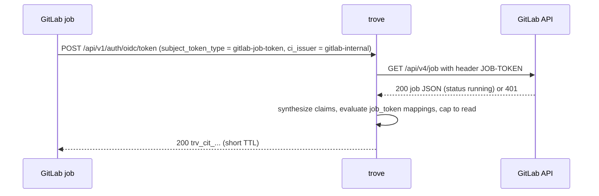

# GitLab CI OIDC federation

Status: implemented in beta phase 5 (2026-11-03) for R-CI-001 to R-CI-021 and R-CI-028 to R-CI-030 — see the contract
page [ci-oidc.md](../developer/ci-oidc.md); R-CI-022 to R-CI-027 stay P1 and P2 as marked.

This page specifies how a CI job gets trove permissions without a stored secret. A GitLab job
asks GitLab for an OIDC ID token addressed to trove. It exchanges that token at
`POST /api/v1/auth/oidc/token` for a short-lived `trv_cit_` token (INV-8, INV-10). With that
token it installs dependencies and publishes the packages it builds. The page covers the trusted
issuer configuration, ID-token validation, identity mappings (the ordered rules that turn
verified claims into grants), grant templating and package-ownership binding, token lifetime,
replay protection, audit, the optional `CI_JOB_TOKEN` fallback (P2), and GitHub Actions and generic
OIDC issuers as later uses of the same mechanism. Every `web` replica serves the exchange and every
`worker` replica runs its background tasks (INV-2); R-CI-029 states where each piece of CI state
lives, so that any replica can answer any request (INV-18) and a Valkey outage or a restore changes
no security property (INV-3, INV-19). The page specifies only the CI side of these
features. Other spec pages own the token store and token presentation
([identity-and-authentication.md](identity-and-authentication.md)), the permission model,
permission policies and the package-ownership store ([authorization.md](authorization.md)), the
audit pipeline ([operations-and-observability.md](operations-and-observability.md)), API
conventions and the UI ([api-and-ui.md](api-and-ui.md)), and client-IP and proxy handling
([architecture.md](architecture.md), [ha-and-helm.md](ha-and-helm.md)).

Covers: [oidc-ci-integration.md](../features/oidc-ci-integration.md) (CIOIDC-001 to CIOIDC-040),
the CI-related entries of [access-tokens.md](../features/access-tokens.md) and
[identity-and-access.md](../features/identity-and-access.md), the OIDC operations in
[api-admin-operations.md](../features/api-admin-operations.md) (ADMAPI-028 to ADMAPI-031), and
the CI identity screen gap in [ui-inventory.md](../features/ui-inventory.md) (UI-049).

## Two GitLab credentials, only one of them is OIDC

A GitLab job can hold two different credentials. They are often mixed up, and only the first is
the subject of the OIDC path:

| | ID token (`id_tokens:` keyword) | `CI_JOB_TOKEN` |
|---|---|---|
| What it is | An OIDC ID token: a JWT that GitLab signs with RS256 using the instance's dedicated signing key | A GitLab credential for calling GitLab itself (API, registries, Git) with the triggering user's access level, restricted to a fixed set of GitLab endpoints |
| Audience | Set by the job (`aud`); trove accepts only its own audience | None. Nothing ties it to a relying party. |
| How a third party verifies it | Offline: signature against the issuer's published JWKS, plus `iss`, `aud`, `exp`, `nbf`, `iat` ([RFC 7519](https://www.rfc-editor.org/rfc/rfc7519)) | Only by calling GitLab (`GET /api/v4/job` with the token), while the job is running |
| Format | JWT (compact JWS) | GitLab-internal. Since GitLab 19.0 job tokens use a JWT format by default (a group can switch back until 20.0), but GitLab documents neither claims nor verification keys for third parties. Observed on GitLab 19.0.1 on 2026-11-02: `glcbt-` followed by three dot-separated parts, 756 to 758 characters, in every recorded pipeline; the instance's key set does not list `ci_job_token_signing_key`, the key setting of job tokens. trove treats it as an opaque string and recognizes it by the prefix (R-CI-004 step 2). |
| Lifetime | Expires at the job's timeout, or after 5 minutes if no timeout is set | Valid while the job runs; revoked when the job finishes |
| trove use | The normal path, MVP (R-CI-001 to R-CI-021) | Optional fallback, P2, off by default (R-CI-022, Q-CI-5) |

Sources: [ID token authentication](https://docs.gitlab.com/ci/secrets/id_token_authentication/),
[CI/CD job token](https://docs.gitlab.com/ci/jobs/ci_job_token/),
[Jobs API, retrieve a job by job token](https://docs.gitlab.com/api/jobs/#retrieve-a-job-by-job-token)
(all read on 2026-10-28).

## Flow

```mermaid
sequenceDiagram
    autonumber
    participant GL as GitLab instance
    participant J as GitLab job (runner)
    participant A as trove (any web replica)
    participant VK as Valkey
    participant PG as PostgreSQL
    participant C as npm / dotnet in the job
    GL->>J: start job, inject TROVE_ID_TOKEN (JWT, aud = trove base URL)
    J->>A: POST /api/v1/auth/oidc/token (RFC 8693, subject_token = ID token)
    A->>VK: per-address rate-limit counter (cluster scope; replica share if Valkey is down)
    A->>A: parse JWT without trusting it, select CI issuer by iss
    A->>A: CI issuer, mappings and signing keys from the in-process copies of PostgreSQL rows
    opt kid unknown
        A->>PG: re-read the issuer's key row (at most once per poll interval and replica)
        A->>GL: still unknown and fetch throttle open: GET discovery document, GET jwks_uri
        A->>PG: store key set (key row only), change area ci_issuer_keys
    end
    A->>A: verify alg, signature, iss, aud, exp/nbf/iat, required claims
    A->>VK: per-subject rate-limit counter
    A->>A: cross-project (fork) guard, evaluate mappings in order, render grants, compute TTL
    A->>PG: one transaction: re-check issuer and mappings (validate again if changed), restore cut-off, record jti, insert token hash, issuance record, audit event
    A-->>J: 200 access_token = trv_cit_..., expires_in, scope
    J->>C: export TROVE_TOKEN (.npmrc / nuget.config read it from the environment)
    C->>A: npm publish / dotnet nuget push (Bearer or X-NuGet-ApiKey), any web replica
    A->>PG: resolve token hash, authorize (grants, ownership), audit with token_id
```

Valkey appears in the flow only as a rate-limit counter. It never holds a signing key, a mapping, a
replay entry or a token, so its loss or a forged entry can refuse an exchange with 429 but cannot
make trove accept one (R-CI-029, [architecture.md](architecture.md) R-ARCH-030).

Terms used on this page:

- **CI issuer**: a trusted external token issuer (one GitLab instance, GitHub Actions, or
  another OIDC issuer) and its validation settings. This is not the same as the OIDC provider
  that humans log in through (INV-7).
- **Identity mapping**: an ordered rule of one CI issuer. It has a claim condition and a grant
  specification.
- **Subject token**: the token the job presents (RFC 8693 term): normally the GitLab ID token.
- **CI token**: the `trv_cit_` token that trove issues.
- **Issuance record**: the stored link between a CI token and the verified job identity it was
  issued to.

## Requirements

### R-CI-001 · CI issuer configuration
Priority: **MVP** · Covers: CIOIDC-001, CIOIDC-002

trove MUST let a system administrator register any number of CI issuers. A CI issuer has a
unique name (`^[a-z0-9][a-z0-9._-]{1,63}$`), a kind (`gitlab` in the MVP; `github` and
`generic` in P1, see R-CI-025 and R-CI-026) and an issuer URL. The issuer URL MUST be an
`https` URL and MUST be unique across CI issuers, so that the `iss` claim of a token selects at
most one CI issuer (R-CI-005). For GitLab, the issuer URL is the instance's base URL, for example
`https://gitlab.com` or `https://gitlab.example.com`.

Settings of a CI issuer (API field names; durations over the API are integer seconds, so units
cannot be mixed up):

<details>
<summary>CI issuer settings (21)</summary>

| Field | Meaning | Value |
|---|---|---|
| `name` | Handle in the API, audit and metrics | — |
| `kind` | Closed enum of the lowercase literals `gitlab`, `github`, `generic` (R-CI-002) | — |
| `issuer` | Expected `iss`, compared exactly (no trailing-slash or case normalization) | — |
| `discovery_url` | OIDC discovery document | `null` = `<issuer>/.well-known/openid-configuration` # default (proposed) |
| `jwks_uri` | Overrides the key-set URL from discovery | `null` # default (proposed) |
| `allowed_audiences` | Accepted `aud` values, exact string match; at least one entry, so the audience is always checked (R-CI-004 step 7). The second default value serves npm-family trusted publishing (below) | `[<server.base_url>, "npm:<host name of server.base_url>"]` # default (proposed) |
| `exclusive_audience` | Every element of `aud` must be an entry of `allowed_audiences`, so the token names no recipient other than trove (Q-CI-3) | `true` # default (proposed) |
| `allowed_algorithms` | JWS algorithms accepted | `["RS256"]` # default (proposed) for `gitlab` and `github` |
| `allowed_typ` | Accepted `typ` header values, compared case-insensitively | `["JWT"]` # default (proposed) |
| `allow_missing_typ` | Accept tokens without a `typ` header | `true` # default (proposed) |
| `clock_skew_seconds` | Leeway for `exp`, `nbf`, `iat`; at most 300 | `60` # default (proposed) |
| `required_claims` | Claims that must be present and non-null | kind preset, see R-CI-006 |
| `public_issuer` | Anyone can obtain tokens from this issuer (e.g. GitLab.com, or any instance with open sign-up). Turns on the ID-pinning rule of R-CI-010. | `true` # default (proposed) |
| `pin_claims` | Claims that count as immutable identifiers for the pinning rule | `gitlab`: `project_id`, `namespace_id`, `job_project_id`, `job_namespace_id` # default (proposed) |
| `single_use_subject_tokens` | Reject a second exchange of the same `jti` (R-CI-018, Q-CI-4) | kind preset: `false` for `gitlab`, `true` for `github` and `generic` # default (proposed) |
| `max_ttl_seconds` | Upper bound for CI tokens of this issuer, between `ci.token.min_ttl` and `ci.token.max_ttl` ([Q-CI-47](#q-ci-47--a-project-tier-changes-only-what-its-own-tier-gives-a-token)) | `null` (global bound only) # default (proposed) |
| `ca_bundle_ref` | Reference to a PEM bundle for instances behind a private CA: `file:<absolute path>` or `env:TROVE_CIC_<NAME>`, a variable that holds the PEM text ([Q-CI-31](#q-ci-31--the-syntax-of-ca_bundle_ref-and-the-trust-an-issuers-fetches-use)). It adds to the installation's trust (system roots and `proxy.outbound.tls.ca_files`), never replaces it | `null` # default (proposed) |
| `use_outbound_proxy` | Route discovery, key and GitLab API calls through the system outbound proxy ([repositories-and-proxy.md](repositories-and-proxy.md)) | `false` # default (proposed) |
| `job_token_fallback` | R-CI-022 settings (P2) | `{"enabled": false}` # default (proposed) |
| `enabled` | Disabled issuers reject every exchange | `true` # default (proposed) |
| `description` | Free text | `""` |

</details>

**Default audiences.** A CI issuer created without `allowed_audiences` gets two entries, filled in
from the configuration at create time: the base URL (`https://packages.example.com`) and `npm:`
followed by its host name as `new URL(…).hostname` yields it, without port
(`npm:packages.example.com`). The second value is the audience of native trusted publishing by
npm-family clients ([formats/npm.md](formats/npm.md) R-NPM-022, Q-NPM-1, P1), checked there in the
published client sources: pnpm 11.28.6 and later and 12.12.1 and later use `NPM_ID_TOKEN` only when
its `aud` equals or contains `npm:<registry host name>`, and npm requests exactly
`npm:${new URL(registry).hostname}` on GitHub Actions (R-CI-025). Both values name this
installation and no other recipient, so `exclusive_audience` keeps its meaning: a token that also
names another service is still rejected. An administrator who sets `allowed_audiences` explicitly
and leaves out the `npm:` value breaks native trusted publishing for pnpm, which requires that
audience, and for npm on GitHub Actions, which requests it. npm and Yarn 4 in GitLab CI check no
audience on `NPM_ID_TOKEN`, and the generic exchange (R-CI-007) keeps working. Clients that reach
trove under an origin of
`server.additional_base_urls` ([operations-and-observability.md](operations-and-observability.md)
R-OPS-005) request that origin's values, which the administrator adds.

Several GitLab instances are several CI issuers (R-CI-005). trove MUST NOT accept an
`alg` of `none` or any HMAC algorithm (`HS256`, `HS384`, `HS512`) in `allowed_algorithms`
([RFC 8725 §3.1, §3.2](https://www.rfc-editor.org/rfc/rfc8725#section-3.1)). Only
`RS256/384/512`, `PS256/384/512`, `ES256/384` and `EdDSA` are valid entries.

`pin_claims` of a `gitlab` or `github` CI issuer MUST be a subset of that kind's default
`pin_claims` (the ID claims in the table above and in R-CI-025). Any other claim answers 422
`pin_claim_not_immutable`. A path or name claim in `pin_claims` would satisfy the pinning rule of
R-CI-005 with exactly the claims that rule exists to exclude. For an issuer URL that is public by
construction (`https://gitlab.com`, `https://token.actions.githubusercontent.com`),
`public_issuer: false` answers 422 `public_issuer_required`.

**Issuers from the system configuration (owner, [Q-CI-16](#q-ci-16--ci-issuers-provisioned-through-the-helm-values-are-read-only-in-trove)).**
CI issuers can also be declared in the system configuration file under `ci.issuers`, which the chart renders from its
`config` values, so that a GitOps repository provisions them. Each entry carries the fields of the table above in the
configuration's snake_case, with the same validation and defaults; `name`, `kind` and `issuer` are required.

```yaml
ci:
  issuers:
    - name: gitlab-main                        # example
      kind: gitlab
      issuer: https://gitlab.example.com       # example
      public_issuer: false                     # example: an instance without open sign-up
      allowed_audiences: ["https://packages.example.com"]   # example; without it the default audiences above
      ca_bundle_ref: file:/var/run/secrets/gitlab-ca/ca.crt  # example: an instance behind a private CA
```

- The declared issuers are applied by `trove migrate`, the step the chart runs as its pre-install and pre-upgrade Job,
  in one transaction: an issuer is created or replaced by `name` with `source = 'configuration'`. No `web` or `worker`
  replica writes them, so replicas of two releases during a rolling update never overwrite each other.
- A configuration issuer whose name is also an API-created issuer, or whose `issuer` URL another issuer already has,
  stops `trove migrate` with an error that names both; nothing is applied.
- A declared name keeps its `issuer` URL and its `kind`, which the API keeps immutable too (R-CI-002): an entry that
  changes either for an existing name stops `trove migrate` with an error that names the stored and the declared value
  and tells the operator to declare the new instance under a new name; nothing is applied. The pins, the package owners
  `ci:<issuer>:project:<id>` (R-CI-015) and the mappings of the name belong to the instance they were made for. Declared
  under a new name, the new instance is created, and the old name, no longer declared, is disabled with its tokens
  revoked as below ([Q-CI-48](#q-ci-48--a-declared-issuers-issuer-url-and-kind-never-change-under-its-name)).
- An issuer that is no longer declared is disabled (`enabled = false`) and keeps `source = 'configuration'`, so its
  mappings and issuance records stay; the API shows `removedFromConfiguration: true`, and only then may an administrator
  delete it.
- Mappings of a configuration issuer are managed through the API and the UI as for any issuer (R-CI-019); configuration
  documents (P1, below) are the declarative way for mappings.
- A list element of the configuration holds scalars, pointers to scalars (a key left out is "not set" and takes its
  default) and lists of strings, so an entry carries every field of the table above except `job_token_fallback`, which
  is P2 and refused until R-CI-022 is built (Q-CI-22).

**Data model**

```sql
CREATE TABLE ci_issuers (
  id                         uuid PRIMARY KEY,
  name                       text NOT NULL UNIQUE CHECK (name ~ '^[a-z0-9][a-z0-9._-]{1,63}$'),
  kind                       text NOT NULL CHECK (kind IN ('gitlab', 'github', 'generic')),
  issuer                     text NOT NULL UNIQUE CHECK (issuer ~ '^https://'),
  discovery_url              text,
  jwks_uri                   text,
  allowed_audiences          text[] NOT NULL CHECK (cardinality(allowed_audiences) >= 1),
  exclusive_audience         boolean NOT NULL DEFAULT true,
  allowed_algorithms         text[] NOT NULL DEFAULT '{RS256}',
  allowed_typ                text[] NOT NULL DEFAULT '{JWT}',
  allow_missing_typ          boolean NOT NULL DEFAULT true,
  clock_skew                 interval NOT NULL DEFAULT '60 seconds'
                               CHECK (clock_skew <= interval '300 seconds'),
  required_claims            text[] NOT NULL,
  public_issuer              boolean NOT NULL DEFAULT true,
  pin_claims                 text[] NOT NULL,
  single_use_subject_tokens  boolean NOT NULL,              -- kind preset: false (gitlab), true (github, generic)
  max_ttl                    interval,
  ca_bundle_ref              text,
  use_outbound_proxy         boolean NOT NULL DEFAULT false,
  job_token_fallback         jsonb NOT NULL DEFAULT '{"enabled": false}',
  enabled                    boolean NOT NULL DEFAULT true,
  description                text NOT NULL DEFAULT '',
  source                     text NOT NULL DEFAULT 'api' CHECK (source IN ('api', 'configuration')),  -- Q-CI-16
  removed_from_configuration boolean NOT NULL DEFAULT false,
  version                    bigint NOT NULL DEFAULT 1,
  mappings_version           bigint NOT NULL DEFAULT 0,     -- R-CI-009: bumped by every write of one of its mappings
  created_at                 timestamptz NOT NULL DEFAULT now(),
  updated_at                 timestamptz NOT NULL DEFAULT now()
);
```

`version` is the issuer's `ETag` (R-CI-002). `mappings_version` is internal and never shown in the
API; the exchange compares it to detect a mapping cache that lags behind PostgreSQL (R-CI-007,
Q-CI-15). Both, and the `version` columns of `ci_mappings` and `ci_delegations`, are registered with
`meta.RegisterRevisionColumn`, so a restore lifts them above every value the old installation
issued ([backup-and-restore.md](backup-and-restore.md) R-BAK-022). Without that, an `If-Match`
taken before a restore could match a different record of the same number afterwards, and a stale
`PUT` could restore grants another administrator had narrowed.

**Acceptance criteria**

- Creating a second CI issuer with `issuer = https://gitlab.com` fails with 409.
- `ci.issuers` declares `gitlab-main`; after `trove migrate`, `GET /api/v1/ci/issuers/gitlab-main` answers 200 with
  `source: "configuration"`, and an exchange with an ID token of that instance works once a mapping exists. Removed from
  `ci.issuers`, the next `trove migrate` disables it; exchanges answer `issuer_disabled`, and its issuance records stay.
- `ci.issuers` declares `gitlab-main` with another `issuer` URL than the stored one: `trove migrate` fails with an error
  naming both URLs and a new name as the remedy, and the stored issuer is unchanged (Q-CI-48).
- Creating a CI issuer with `allowed_algorithms: ["HS256"]` or `["none"]` fails with 422.
- Creating a CI issuer with `issuer = http://gitlab.example.com` fails with 422.
- Creating a `gitlab` CI issuer with `pin_claims: ["project_path"]` fails with 422
  `pin_claim_not_immutable`. Creating one with `issuer = https://gitlab.com` and
  `public_issuer: false` fails with 422 `public_issuer_required`.
- With `server.base_url: https://packages.example.com:8443`, a CI issuer created without
  `allowed_audiences` reads back
  `["https://packages.example.com:8443", "npm:packages.example.com"]`.

### R-CI-002 · CI issuer management API
Priority: **MVP** · Covers: CIOIDC-005, ADMAPI-028

All operations require the system administrator role (INV-9), declared as the capabilities `ci:read` for the reads and the dry
run and `ci:write` for the writes, which the role `admin` holds (R-AUTHZ-010, Q-CI-22). An issuer with `source: "configuration"` (R-CI-001,
Q-CI-16) is shown like any other, with its `source`, and is read-only: `PUT`, `DELETE`, enabling and disabling answer 409
`issuer_managed_by_configuration`, and the UI shows it without edit controls and names the configuration as its source.
Once it is `removedFromConfiguration`, `DELETE` is allowed. Its mappings stay writable. Pagination and the error envelope
follow [api-and-ui.md](api-and-ui.md): errors are problem details (R-API-009), and the reason names
this page gives for management operations (`pin_required`, `discovery_unreachable`, …) are their
`code` and also stand in `errors[]` with the pointer of the member, like every named rule of the
management API ([Q-CI-30](#q-ci-30--the-shape-of-a-rule-violation-on-a-ci-management-write)); a violation without a name of its own answers `validation_failed`. Optimistic concurrency follows R-API-012: GET returns `ETag: "<version>"`, PUT requires
`If-Match` (428 `precondition_required` without it, and nothing changes; `If-Match: *` for a
deliberate blind write), DELETE accepts it, and a stale tag answers 412 `precondition_failed` with
`currentEtag`. A lost update here is a grant change: a stale `PUT` of a mapping can restore
conditions or grants another administrator just narrowed ([api-and-ui.md](api-and-ui.md)
Q-API-2). Requests and acceptance criteria on this page that `PUT` an issuer or a mapping send the
`If-Match` the caller read, unless they say otherwise.

The representation is fixed so that the catalog's open points (CIOIDC-005) have one answer:

- `kind` is a closed enum of the lowercase literals `gitlab`, `github` and `generic`. Display
  names such as `GitHub` or `Generic OpenID Connect`, other spellings and other case answer 422
  `validation_failed` with pointer `/kind`. Until R-CI-025 and R-CI-026 ship (P1), `github` and
  `generic` answer 422 `kind_not_available`.
- Create answers 201 with `Location` (R-API-004), not 200.
- PUT replaces the full representation. An omitted optional field takes its default, so changing
  one setting is GET, modify, PUT; the read-only fields of a GET body (`version`, `created_at`,
  `updated_at`) are accepted and ignored (R-API-003). There is no PATCH.
- Two settings move trust that saved mappings and stored keys rest on
  ([Q-CI-50](#q-ci-50--an-issuer-change-that-moves-trust-resets-the-keys-or-is-refused)), for a PUT and for `trove migrate`
  alike. A change that switches `public_issuer` on, or removes a claim from `pin_claims`, answers 409 `mappings_unpinned`
  while a mapping of the issuer would fail the pin rule its save applies now (`pin_required` on a public issuer,
  `unpinned_write` on a private one, R-CI-010); the problem names them in `mappings`, and nothing changes. A change of
  `jwks_uri` or `discovery_url` replaces the stored key set with the fail-closed placeholder of R-CI-003 in the write's
  transaction, so no key of the old location validates a token after the commit, and fetches from the new location after
  the commit; until a fetch stores a set, exchanges answer `signing_keys_unavailable`.
- Field names: this page writes API fields in the snake_case of their database columns. On the
  wire, every management-API field of this page (issuers, mappings, conditions, grants,
  delegations, issuances, dry run) uses the lowerCamelCase form that R-API-003 requires, by
  mechanical conversion (`allowed_audiences` → `allowedAudiences`, `ignore_case` →
  `ignoreCase`). Claim names inside conditions and templates (`project_id`) are data, not field
  names, and keep the issuer's spelling. The exchange endpoint (R-CI-007, R-CI-008) keeps the
  OAuth names of RFC 8693 and its extensions `ci_issuer`, `ttl`, `mappings` and `reason`. Its
  error member `requestId` keeps the spelling it has in every other trove error body (R-API-009),
  so one key finds the matching log line and audit event everywhere.

| Method and path | Purpose | Success | Errors |
|---|---|---|---|
| `GET /api/v1/ci/issuers` | List CI issuers with mapping count and key status | 200 | 401, 403 |
| `POST /api/v1/ci/issuers` | Create; validates discovery and keys unless `"validate": false` | 201 + record | 409 duplicate name or issuer, 422 invalid or unreachable |
| `GET /api/v1/ci/issuers/{name}` | Read | 200 + `ETag` | 404 |
| `PUT /api/v1/ci/issuers/{name}` | Replace; `name` and `issuer` are immutable; `If-Match` required | 200 + new `ETag` | 404, 409 `mappings_unpinned`, 412 `precondition_failed`, 422, 428 `precondition_required` |
| `DELETE /api/v1/ci/issuers/{name}` | Delete; refuses while mappings exist unless `?cascade=true`; `If-Match` optional | 204 | 404, 409, 412 |
| `GET /api/v1/ci/issuers/{name}/keys` | Cached key set: `kid`, `kty`, `alg`, fetch time, next refresh, last error | 200 | 404 |
| `POST /api/v1/ci/issuers/{name}/keys/refresh` | Force a discovery and key refresh now | 200 + key status | 404, 502 issuer unreachable |

Request sketch for `POST /api/v1/ci/issuers`:

```json
{
  "name": "gitlab-com",
  "kind": "gitlab",
  "issuer": "https://gitlab.com",
  "allowed_audiences": ["https://packages.example.com", "npm:packages.example.com"],
  "description": "GitLab.com, groups acme and acme-labs",
  "validate": true
}
```

The response is the full record with all defaults filled in, plus `version`, `created_at` and
`updated_at`. A create with `"validate": true` (the default) fetches the discovery document and
the key set synchronously. It fails with 422 and a `code` (`discovery_unreachable`,
`issuer_mismatch`, `no_usable_keys`, `algorithms_not_offered`) when the issuer would not be
usable.

Disabling (`enabled: false`) or deleting a CI issuer revokes all unexpired CI tokens issued
through it, in the same transaction (R-CI-017). Deleting with `?cascade=true` deletes its mappings
and their principals in that transaction (R-CI-009). The change writes `ci.issuer.disabled` or
`ci.issuer.deleted`, and a cascade one `ci.mapping.deleted` per mapping; the revocation journal
keeps these across a point-in-time restore and across the restore of a trove backup (R-CI-020).

Creating an issuer with `"validate": true` and `POST …/keys/refresh` fetch on the `web` replica that
serves the request, outside any database transaction, and then store the key set as R-CI-003's
write rule says; the other replicas pick it up through the change area `ci_issuer_keys`. Every
create, update, disable, enable and delete of an issuer calls `cluster.Notify` on the change area
`ci_mappings` in its transaction, so every replica reloads the issuer together with its mappings
within the bound of [architecture.md](architecture.md) R-ARCH-018. The exchange does not depend on
that timing: it re-reads the issuer row and validates again when its copy is behind (R-CI-007).

**Configuration documents (P1).** A configuration document
([operations-and-observability.md](operations-and-observability.md) R-OPS-029) declares CI issuers
under the kind `ciIssuers`. Each entry is the request body of `POST /api/v1/ci/issuers`, with its
lowerCamelCase field names, validation and defaults, and is identified by `name`. Applying the
document (R-OPS-030) creates an issuer, replaces it as `PUT` does, or deletes it when it was pruned,
and writes the same audit events as the API. Issuers are created before `ciMappings` and deleted
after them. While an issuer is managed by a document and `config_as_code.lock_managed_objects` has
its default `true` (R-OPS-029), `PUT` and `DELETE` through the API answer 409 and name the owning
document. Configuration documents never
declare login providers; a CI issuer only ever serves the token exchange (INV-10,
[operations-and-observability.md](operations-and-observability.md) Q-OPS-6).

**Acceptance criteria**

- `curl -sS -X POST -H "Authorization: Bearer $ADMIN_PAT" -H 'Content-Type: application/json' --data @issuer.json https://packages.example.com/api/v1/ci/issuers`
  with the request above returns 201, and `GET .../keys` lists at least one RSA key.
- A non-administrator PAT receives 403 on every operation in the table.
- After `PUT` with `"enabled": false` and the current `If-Match`, a CI token issued earlier
  through the issuer gets 401 on `npm view @acme-billing/invoice-client` against trove, on every
  `web` replica within the revocation bound of
  [identity-and-authentication.md](identity-and-authentication.md) R-AUTH-023 (2 s), with Valkey
  running or stopped.
- `POST /api/v1/ci/issuers` with `"kind": "GitHub"` answers 422 with pointer `/kind`. A `PUT`
  with `If-Match: "1"` after another `PUT` raised the version to 2 answers 412 with
  `currentEtag` `"2"`.
- `curl -sS -X PUT -H "Authorization: Bearer $ADMIN_PAT" -H 'Content-Type: application/json' --data @issuer.json https://packages.example.com/api/v1/ci/issuers/gitlab-com`
  without `If-Match` answers 428 `precondition_required` and leaves the version unchanged. The
  same call with the tag of a preceding `GET` (`-H 'If-Match: "2"'` while the version is 2)
  answers 200 with `ETag: "3"`.

### R-CI-003 · Discovery, signing keys, caching and rotation
Priority: **MVP** · Covers: CIOIDC-019, CIOIDC-031

Discovery: trove MUST fetch the discovery document from `discovery_url`
([OpenID Connect Discovery 1.0 §4](https://openid.net/specs/openid-connect-discovery-1_0.html#ProviderConfig)).
It MUST reject a document whose `issuer` is not exactly the configured issuer (§4.3) and MUST
take `jwks_uri` from it unless the CI issuer overrides `jwks_uri`. The `jwks_uri` MUST be an
`https` URL. When `id_token_signing_alg_values_supported` does not intersect
`allowed_algorithms`, validation fails with `algorithms_not_offered`. GitLab.com publishes
`https://gitlab.com/.well-known/openid-configuration` with `jwks_uri`
`https://gitlab.com/oauth/discovery/keys` and RS256 (fetched 2026-10-28). Self-managed
instances serve the same paths under their own base URL.

Key set ([RFC 7517](https://www.rfc-editor.org/rfc/rfc7517)): trove MUST use only keys that
meet all of these conditions:

- `use` is absent or `sig`.
- `key_ops` is absent or contains `verify`.
- `kty` matches the algorithm family.
- RSA keys have at least 2048 bits.
- A key's own `alg`, when present, equals the token's `alg`.

Other keys are ignored and reported in the key status.

Caching and refresh (Q-CI-12):

- **One shared copy, in PostgreSQL.** The last good key set of each CI issuer is its row in
  `ci_issuer_keys`. Every replica holds an in-process copy, registered as a cache with the
  `SafetyTTL` `ci.signing_keys.cache_safety_ttl` ([architecture.md](architecture.md) R-ARCH-018).
  Storing a changed key set writes the change area `ci_issuer_keys` through `cluster.Notify`. The
  other replicas reload the row at once from the change message on Valkey, and within
  `cluster.epoch_poll_interval` from the change-log poll when Valkey is unavailable. trove issues no
  `NOTIFY` (R-ARCH-018). A restarted replica validates tokens without contacting GitLab.
- **Never in Valkey.** A key set decides whether a token is accepted. No copy of it, and nothing
  that selects one, is read from Valkey ([architecture.md](architecture.md) R-ARCH-030 rule 2): a
  key forged into Valkey would let anyone mint CI tokens.
- **Write rule.** Every fetch, whatever triggered it, runs outside any database transaction and
  holds no database connection while it waits for the issuer (R-ARCH-019). Its result is then
  written in one short transaction on the issuer's `ci_issuer_keys` row alone: it inserts the row
  or locks it `FOR UPDATE`, and keeps the stored set if a concurrent fetch has already stored one
  with a later `fetched_at`. It never locks the `ci_issuers` row, which every exchange holds
  `FOR SHARE` (R-CI-007), so a key store never waits for exchanges and never blocks them. It also
  sets `next_refresh_at`, and calls `cluster.Notify` only when the content of the key set changed.
  Several replicas that fetch the same set at once therefore cause no extra reload anywhere.
- **Scheduled refresh** is the task `ci-keys-refresh` (R-CI-030), which runs on `worker` replicas.
  It fetches every enabled CI issuer whose `next_refresh_at` has passed or that has no row yet. Its
  `exclusive` enqueue mode ([architecture.md](architecture.md) R-ARCH-016) keeps two runs from
  overlapping, so one replica fetches each due issuer. The next refresh time follows the response's
  `Cache-Control: max-age`, clamped to
  `[ci.signing_keys.min_refresh_interval, ci.signing_keys.max_refresh_interval]`, and is
  `default_refresh_interval` when no `max-age` is present. After a failed fetch, the next attempt
  is due after `min_refresh_interval`.
- **Unknown `kid`.** On the `web` replica that validates the token (a token without `kid`, for an
  issuer that has no stored key set yet, counts as an unknown `kid`):
  1. The replica re-reads the issuer's row from PostgreSQL, bypassing its copy, at most once per
     CI issuer and replica per `cluster.epoch_poll_interval`. Concurrent requests on one replica
     share one re-read (in-process single-flight), and a request that finds a re-read younger than
     the interval uses its result. A key that any replica or the task has stored is therefore
     accepted on every replica within that interval, whether or not the change message has
     arrived, and the change-log poll would apply it within the same interval anyway.
  2. If the `kid` is still unknown, the replica MUST refresh on demand, at most once per
     `ci.signing_keys.unknown_kid_refresh_interval` per CI issuer and replica. Concurrent requests
     on one replica share one fetch (in-process single-flight).
  3. If the `kid` is still unknown, or the throttle refused the fetch, the token is rejected with
     `unknown_signing_key`.

  This lets a key rotation take effect within seconds. A forged token chooses its `kid` freely and
  is refused only by the signature check, so neither step runs once per request: random `kid`
  values cause at most one row read per CI issuer, replica and `cluster.epoch_poll_interval`, and at
  most one fetch per CI issuer, replica and `unknown_kid_refresh_interval`, n of each with n `web`
  replicas. They can neither turn trove into a request amplifier against GitLab nor turn anonymous
  requests into PostgreSQL load. Both throttles are per-replica state that can change an answer
  ([architecture.md](architecture.md) R-ARCH-032): a replica whose re-read is younger than the
  interval rejects a key that another replica stored meanwhile, for at most
  `cluster.epoch_poll_interval`; a replica whose fetch throttle an earlier request has spent rejects
  a new key until some replica has stored it, for at most `unknown_kid_refresh_interval`.
- **Unknown `iss`.** The issuer of a token is resolved from the replica's in-process copy of all CI
  issuers, invalidated through the change area `ci_mappings`. A token whose `iss` the copy does not
  hold, or holds as disabled, makes the replica re-read the issuers from PostgreSQL, bypassing the
  copy, at most once per replica and `cluster.epoch_poll_interval`, shared by concurrent requests
  like the re-read of step 1 ([Q-CI-51](#q-ci-51--what-the-exchange-tells-a-caller-and-when-a-replica-learns-an-issuer)).
  A replica whose change message was lost or whose poll stalls therefore serves a just-created or
  re-enabled issuer within that interval, not after the copy's `SafetyTTL`, and made-up `iss` values
  cost one read of the issuers per replica and interval, never one per request.
- **A new key location.** A change of an issuer's `jwks_uri` or `discovery_url` replaces its stored
  key set with the placeholder of a failed first fetch (no set, `fetched_at` at the epoch) in the
  write's transaction and fetches from the new location after the commit (R-CI-002, Q-CI-50); a key
  of the old location validates no token after the commit.
- Removed keys: a key that is missing from the latest successful fetch is no longer accepted, on
  every replica within the change-area bound of R-ARCH-018. Removing a key from the JWKS is how an
  issuer revokes it.
- Fetch failures: trove keeps using the last good key set. Its age is `now − fetched_at` of the
  shared row: once the set is older than `ci.signing_keys.max_stale`, exchanges answer 503
  `signing_keys_unavailable`. A refresh that stored an unchanged set sends no change message, so a
  replica's copy can carry an older `fetched_at` than the row; before answering 503, the replica
  re-reads the row as in step 1 above. Every replica therefore fails closed at the same moment,
  within one `cluster.epoch_poll_interval`. Failures are
  recorded in `last_error` and in metrics (R-CI-020). The scheduled refresh runs only on `worker`
  replicas, so a `worker` role that is down for longer than `max_stale` stops exchanges until it is
  back; INV-12 keeps at least two `worker` replicas on different nodes.
- **Restore.** `ci_issuer_keys` has the backup export class `transient`
  ([backup-and-restore.md](backup-and-restore.md) R-BAK-004). A restored installation starts without
  key sets; the first exchange per issuer (as an unknown `kid`) or the next `ci-keys-refresh` run
  fetches the current set. A restored copy would accept, until its next refresh, a key that the
  issuer removed after the snapshot, which undoes the issuer's revocation of that key.
- Outbound requests use TLS with the installation's trust (the system roots and `proxy.outbound.tls.ca_files`, R-ARCH-022) plus the
  issuer's `ca_bundle_ref`, which adds to it and never replaces it ([Q-CI-31](#q-ci-31--the-syntax-of-ca_bundle_ref-and-the-trust-an-issuers-fetches-use)). They follow at most 3
  redirects, and only to `https` URLs. Responses are limited to
  `ci.signing_keys.max_response_bytes` and requests time out after
  `ci.signing_keys.fetch_timeout`. URLs come only from the CI issuer record and never from a
  token header: `jku`, `x5u`, `jwk` and `x5c` headers are ignored
  ([RFC 8725 §3.10](https://www.rfc-editor.org/rfc/rfc8725#section-3.10)).
- Every hop, including a `jwks_uri` taken from a discovery document and every redirect target,
  passes the egress address policy of the outbound client factory
  ([architecture.md](architecture.md) R-ARCH-022, with the address rules of
  [repositories-and-proxy.md](repositories-and-proxy.md) R-REPO-038). `last_error`, the key-status
  API and the `ci.keys.refresh_failed` event record the failure class, the HTTP status and the
  URL's host, never bytes of a response body. A discovery document that points `jwks_uri` at an
  internal service therefore cannot read that service's answer back through trove.

**Data model**

```sql
CREATE TABLE ci_issuer_keys (
  issuer_id        uuid PRIMARY KEY REFERENCES ci_issuers(id) ON DELETE CASCADE,
  jwks             jsonb NOT NULL,          -- last good key set, public keys only
  jwks_uri         text NOT NULL,           -- where it came from
  fetched_at       timestamptz NOT NULL,
  etag             text,
  next_refresh_at  timestamptz NOT NULL,
  last_error       text,
  last_error_at    timestamptz
);
CREATE INDEX ci_issuer_keys_due ON ci_issuer_keys (next_refresh_at);
```

**Configuration**

```yaml
ci:
  signing_keys:
    default_refresh_interval: 1h        # default (proposed)
    min_refresh_interval: 5m            # default (proposed)
    max_refresh_interval: 24h           # default (proposed)
    unknown_kid_refresh_interval: 60s   # default (proposed)
    max_stale: 24h                      # default (proposed)
    fetch_timeout: 5s                   # default (proposed)
    max_response_bytes: 1048576         # default (proposed)
    cache_safety_ttl: 10m               # default (proposed); SafetyTTL of the in-process copy
```

**Acceptance criteria**

- In a test with a local OIDC issuer double and one `web` replica, rotating to a new key and
  signing a token with it causes exactly one on-demand fetch. The token is accepted. 100 further
  tokens with random `kid` values within 60 s cause no further fetch from that replica, and
  `pg_stat_statements` shows at most one read of the `ci_issuer_keys` row per
  `cluster.epoch_poll_interval` for them.
- With three `web` replicas and Valkey stopped, a token signed with a new key is exchanged through
  replica A, which fetches once. The same token's next exchange on replicas B and C succeeds at
  once, without a further fetch.
- While `ci-keys-refresh` runs against an issuer double that delays its key response by 4 s,
  `pg_stat_activity` shows no trove connection `idle in transaction`. Two replicas that fetch an
  unchanged key set at the same moment leave the epoch of area `ci_issuer_keys` unchanged. A key
  store held open by a test build for 2 s delays no concurrent exchange of the same issuer.
- With the stored set 1 s short of `max_stale` on every replica's copy, a `ci-keys-refresh` run
  stores the unchanged set. Exchanges on every replica keep succeeding after the copies' age has
  passed `max_stale`.
- After the restore of a trove backup, `GET …/keys` of every issuer lists no key until the first
  exchange or the first `ci-keys-refresh` run has fetched one.
- Removing a key from the double's JWKS and forcing a refresh makes tokens signed with that key
  fail with `unknown_signing_key`.
- With the double unreachable, exchanges keep working on cached keys until `max_stale`, then
  answer 503 `signing_keys_unavailable`.
- A token whose header carries `jku: https://attacker.example/keys` makes no request to
  `attacker.example`.
- A discovery double whose `jwks_uri` is `https://169.254.169.254/keys` causes no connection to
  that address, and `GET …/keys` shows `last_error` with class `egress_denied`. A `jwks_uri` that
  answers 200 with a non-JSON body leaves no byte of that body in `last_error`.

### R-CI-004 · Subject-token validation
Priority: **MVP** · Covers: CIOIDC-019, CIOIDC-031, CIOIDC-032

trove MUST validate a subject token in this order and MUST stop at the first failure. The
reason code in brackets appears in the error response and the audit event (R-CI-008).

1. Size: at most `ci.exchange.max_subject_token_bytes` [`subject_token_malformed`].
2. Shape: compact JWS with three base64url parts. JWE (five parts), unsecured JWTs and nested
   JWTs are rejected [`subject_token_malformed`]. A value starting with `glcbt-` (GitLab's job
   token prefix) is rejected as [`wrong_subject_token_type`] with a hint to use `id_tokens:`.
3. Header: `alg` in `allowed_algorithms` [`algorithm_not_allowed`]; `typ` in `allowed_typ`,
   or absent with `allow_missing_typ` [`token_type_not_allowed`]; no `crit` parameter [`subject_token_malformed`]; `kid`, when
   present, at most 256 characters and used only as a lookup key.
4. Payload: valid UTF-8 JSON object without duplicate member names
   ([RFC 7519 §4](https://www.rfc-editor.org/rfc/rfc7519#section-4))
   [`subject_token_malformed`].
5. Issuer: the unverified `iss` selects the CI issuer (R-CI-005) [`unknown_issuer`]. A disabled
   CI issuer answers [`issuer_disabled`]. Nothing else from the unverified payload is used
   before step 6.
6. Signature: verified with the key named by `kid`. Without `kid`, every usable key of the
   matching key type is tried, at most 10 [`signature_invalid`, `unknown_signing_key`].
7. Audience: `aud` is a string or an array of strings. At least one element MUST equal an entry
   of `allowed_audiences` [`audience_invalid`]. With `exclusive_audience` (the default), every
   element MUST equal an entry of `allowed_audiences`; an element naming any other recipient is
   rejected [`audience_not_exclusive`]
   ([RFC 8725 §3.9](https://www.rfc-editor.org/rfc/rfc8725#section-3.9)).
8. Time ([RFC 7519 §4.1.4–4.1.6](https://www.rfc-editor.org/rfc/rfc7519#section-4.1.4)): `exp`
   required and `now < exp + skew` [`token_expired`]; `nbf`, when present,
   `now >= nbf - skew` [`token_not_yet_valid`]; `iat` required and `iat <= now + skew`
   [`issued_in_future`]. NumericDate values may be non-integer. A missing or `null` `exp` or
   `iat` answers [`required_claim_missing`] with the claim's name, and a time claim that is not a
   non-negative number up to 2^40 answers [`subject_token_malformed`]
   ([Q-CI-27](#q-ci-27--the-reason-of-a-missing-or-malformed-time-claim)).
9. Required claims: every claim in `required_claims` is present and not `null`
   [`required_claim_missing`, with the claim name in `error_description`].

The implementation runs the steps in two calls, because step 5 selects the issuer by a claim that is not yet verified and the
algorithm and `typ` lists of step 3 are that issuer's settings: `subject.Parse` does the structural parts of steps 1 to 4, the
caller selects the issuer (step 5), and `Unverified.Verify` does the algorithm and `typ` checks and steps 6 to 9. A token of an
unknown issuer therefore answers `unknown_issuer` even when its algorithm would be refused by every issuer, both 400
(Q-CI-19).

GitLab sets `nbf` to `iat - 5` (observed on GitLab 19.0.1 on 2026-11-02, in every recorded case),
so a token is valid from the moment GitLab issues it. The default 60-second skew absorbs normal
clock drift between runners, GitLab and trove.

The audience is always checked at the CI issuer (catalog CIOIDC-019 leaves open whether an
unconfigured audience means "no check" or whether only mapping conditions check `aud`). trove has
no unconfigured state: `allowed_audiences` has at least one entry (R-CI-001), and step 7 runs for
every token. A mapping condition MAY additionally test `aud` like any other claim (R-CI-010, array
claims are multi-valued) to narrow which of the allowed audiences a mapping accepts; it never
replaces step 7.

**Acceptance criteria**

- Unit tests cover each step with a failing token and assert the reason code. One case is a
  token signed with HS256 using the RSA public key's bytes as the HMAC secret (the PEM text of the
  key, [Q-CI-24](#q-ci-24--the-secret-of-the-algorithm-confusion-token); the algorithm-confusion attack), which must fail with `algorithm_not_allowed`.
- A GitLab ID token whose `aud` is `["https://packages.example.com", "https://vault.example.com"]`
  is rejected with `audience_not_exclusive` under the default settings. With `allowed_audiences`
  `["https://packages.example.com", "https://packages.internal.example.com"]`, a token whose `aud`
  is exactly those two values is accepted.
- Under the default `allowed_audiences` of an installation at `https://packages.example.com`,
  tokens whose `aud` is `npm:packages.example.com`, or
  `["https://packages.example.com", "npm:packages.example.com"]`, are accepted. A token whose `aud`
  is `["npm:packages.example.com", "npm:registry.npmjs.org"]` is rejected with
  `audience_not_exclusive`, and one whose `aud` is `npm:registry.npmjs.org` with
  `audience_invalid`.
- A token with `exp = now - 30` is accepted with a 60-second skew. A token with `exp = now - 61`
  is rejected.

### R-CI-005 · Several GitLab instances and public issuers
Priority: **MVP** · Covers: CIOIDC-001, CIOIDC-002, CIOIDC-033

- Each GitLab instance is its own CI issuer with its own mappings. A token from one instance can
  never be evaluated against the mappings of another, because the CI issuer is selected by
  exact `iss` and verified with that issuer's keys only.
- The exchange request MAY name the CI issuer (`ci_issuer` parameter, R-CI-007). When it does,
  the name MUST match the issuer selected by `iss`, otherwise [`issuer_mismatch`]. The parameter
  exists for clarity in scripts and is required only for the job-token fallback (R-CI-022),
  whose subject token carries no `iss`.
- Claim values such as `project_id` and `namespace_id` are only unique within one GitLab
  instance. Everything that stores them stores the CI issuer with them: issuance records,
  ownership owner keys (R-CI-015) and delegations (R-CI-023).
- Public issuers: anyone with an account on GitLab.com (or on any instance with open sign-up)
  can obtain an ID token with any `aud`. So the audience check proves nothing about who the
  caller is. For a CI issuer with `public_issuer: true`, every mapping MUST be pinned. That
  means its condition MUST contain, at the top level of an `all` combinator, a leaf with
  `equals` or `in` on one of the issuer's `pin_claims` (R-CI-010). Path claims alone are not
  enough: GitLab paths change on rename and transfer and can later be registered by someone
  else. GitLab's own guidance is to prefer `project_id` and `namespace_id` over path claims.

**Acceptance criteria**

- With CI issuers `gitlab-com` and `gitlab-internal` configured, a gitlab.com token whose claims
  equal those of an internal mapping matches only `gitlab-com` mappings.
- Saving a mapping for `gitlab-com` whose condition is only
  `{"claim": "namespace_path", "glob": "acme/**"}` fails with 422 `pin_required`.

### R-CI-006 · GitLab job configuration contract
Priority: **MVP** · Covers: CIOIDC-030, CIOIDC-031, CIOIDC-032, CIOIDC-033, CIOIDC-034

The GitLab side needs only an `id_tokens:` entry whose `aud` equals trove's base URL
(INV-10):

```yaml
publish:
  id_tokens:
    TROVE_ID_TOKEN:                       # example: any variable name works
      aud: https://packages.example.com     # example: one of the CI issuer's allowed_audiences
```

- `aud` SHOULD be a single string. GitLab also accepts an array, which addresses the same token to
  several services. trove rejects such a token by default when any listed audience is not one of
  the CI issuer's `allowed_audiences` (R-CI-004 step 7).
- Native trusted publishing of npm, pnpm and Yarn 4 ([formats/npm.md](formats/npm.md) R-NPM-022,
  P1) reads the ID token from `NPM_ID_TOKEN` instead, declared with
  `aud: npm:<host name of trove's base URL>` (for example `npm:packages.example.com`), the audience
  pnpm requires. The default `allowed_audiences` (R-CI-001) accepts both audiences, so one CI
  issuer and its mappings serve both paths.
- `id_tokens` may be set under `default:`. A job that declares its own `id_tokens` replaces the
  default entirely; GitLab does not merge them
  ([CI/CD YAML reference, `id_tokens`](https://docs.gitlab.com/ci/yaml/#id_tokens); observed on
  GitLab 19.0.1 on 2026-11-02).
- The predecessors `CI_JOB_JWT` and `CI_JOB_JWT_V2` were removed in GitLab 17.0 (catalog
  CIOIDC-030) and are not supported.
- trove never parses `sub`. Conditions SHOULD use the separate claims (`project_id`,
  `ref_type`, `ref`, …) and not a `sub` string, because a project can reconfigure the
  components of `sub`. Git forbids `:` in ref names
  ([git-check-ref-format](https://git-scm.com/docs/git-check-ref-format)), so the default `sub`
  format is unambiguous. It still adds nothing over the separate claims.

Claims trove relies on (GitLab serializes IDs and booleans as JSON strings; R-CI-010 normalizes
them). Observed on GitLab 19.0.1 on 2026-11-02 in every recorded case (push on a protected and an
unprotected branch and on a protected tag, environments with `action: start` and `prepare`, a
job timeout, schedule, API, same-project and fork merge requests;
[test/oidcstub/testdata](../../test/oidcstub/testdata), [Q-CI-25](#q-ci-25--gitlabs-behaviour-is-validated-against-a-real-instance-the-tests-run-against-the-double)):

- Every claim is a JSON string except `aud` (a string, or an array when the job lists several),
  `exp`, `iat`, `nbf` and `runner_id`, which are numbers.
- `sub` is `project_path:<path>:ref_type:<branch|tag>:ref:<ref>`, and `jti` is a random UUID.
- `exp` is `iat` plus the job's timeout: 3600 s under a project's default timeout of 60 minutes,
  900 s with `timeout: 15m`. `nbf` is `iat - 5`.
- The header is `{"kid", "typ": "JWT", "alg": "RS256"}`. `kid` is the RFC 7638 thumbprint of the
  instance's CI signing key (`ci_jwt_signing_key`), the second key of its key set.
- A merge request pipeline carries the source branch in `ref` and `refs/heads/<branch>` in `ref_path`.
- A job without an environment carries no `environment*` and no `deployment_tier` claim.
- On an instance without a licence, `environment_protected` is `"false"`, even for an environment
  that the protected environments API accepted.

| Claim | Required in the `gitlab` preset | Used for |
|---|---|---|
| `iss`, `aud`, `exp`, `iat` | yes | R-CI-004 |
| `nbf` | no (checked when present; GitLab always sends it) | R-CI-004 |
| `jti` | yes | Replay tracking (R-CI-018) |
| `sub` | yes | Audit only |
| `project_id`, `namespace_id` | yes | Pinning, ownership key (R-CI-015) |
| `project_path`, `namespace_path` | yes | Conditions, templating, display |
| `job_project_id`, `job_project_path`, `job_namespace_id`, `job_namespace_path` | no (GitLab 18.4+; present on 19.0.1) | Cross-project guard (R-CI-012) |
| `source_project_id`, `source_project_path` | no (documented for GitLab 19.5+; absent on 19.0.1) | Cross-project guard (R-CI-012) |
| `ref`, `ref_type`, `ref_path`, `ref_protected` | yes (`ref_path` no) | Conditions (R-CI-011) |
| `pipeline_source`, `pipeline_id`, `job_id` | yes | Conditions, audit |
| `job_source` | no | Audit. Equal to `pipeline_source` in every recorded case; which other values it takes is not recorded |
| `environment`, `environment_protected`, `deployment_tier`, `environment_action` | no (only for jobs with an environment) | Conditions (R-CI-011) |
| `user_id`, `user_login` | yes | Audit, user-bound grants (R-CI-024) |
| `user_email`, `user_access_level` | no | Audit. `user_access_level` is the user's role in the project the job runs in (`owner`, `maintainer`, ...) |
| `sha`, `runner_id`, `runner_environment`, `project_visibility` | no | Conditions, audit |
| `ci_config_ref_uri`, `ci_config_sha` | no | Audit. `ci_config_ref_uri` is `<host>/<project path>//.gitlab-ci.yml@<ref_path>`, without a scheme |

**Acceptance criteria**

- An ID token that the issuer double mints with the claim set GitLab issued to a job with the
  YAML above (recorded,
  [Q-CI-25](#q-ci-25--gitlabs-behaviour-is-validated-against-a-real-instance-the-tests-run-against-the-double))
  exchanges successfully. The same token with `aud: https://other.example.com` fails with
  `audience_invalid`.
- A subject token in the shape of GitLab's `CI_JOB_TOKEN` (`glcbt-` followed by a JWT, as recorded
  from GitLab 19.0.1; the double's job token), sent with the ID-token type, gets 400
  `wrong_subject_token_type` (R-CI-004 step 2). The legacy format, which a group can switch back to
  until GitLab 20.0, is not recorded. Without the prefix, the same value gets
  `subject_token_malformed`, `unknown_issuer`, `unknown_signing_key`, `signature_invalid` or
  `audience_invalid`. It never gets a 5xx and never gets a token.

### R-CI-007 · Token exchange endpoint
Priority: **MVP** · Covers: CIOIDC-018, ADMAPI-031

`POST /api/v1/auth/oidc/token` implements OAuth 2.0 Token Exchange
([RFC 8693](https://www.rfc-editor.org/rfc/rfc8693)). It requires no trove credential: the
subject token is the credential. Other methods answer 405 `method_not_allowed` with `Allow: POST`
(problem details, as every route, R-API-004). With `ci.exchange.enabled: false` the path answers 404
(problem details `not_found`) as a path that does not exist, before the address budget is counted. The
general API rate limit does not apply: the two limiters of R-CI-021 do.

Request content types: `application/x-www-form-urlencoded` (RFC 8693 §2.1, normative) and
`application/json` (an object with the same parameter names and string values, for scripts that
already send JSON; `ttl` may also be a JSON number). Any other content type answers 400
[`unsupported_content_type`]. A parameter sent twice answers 400 [`malformed_request`]
([RFC 6749 §3.2](https://www.rfc-editor.org/rfc/rfc6749#section-3.2)), `audience` and `resource` included, and so does a
JSON member that appears twice or is not a string. A parameter the exchange does not know is ignored (the same
section). A parameter sent without a value counts as omitted
([RFC 6749 §3.1](https://www.rfc-editor.org/rfc/rfc6749#section-3.1)), so an empty `subject_token` is a missing
required parameter, 400 [`malformed_request`] ([Q-CI-41](#q-ci-41--the-reason-of-a-request-that-cannot-succeed-by-its-own-parameters)).
A body larger than `ci.exchange.max_body_bytes` answers 400 [`malformed_request`].

| Parameter | Required | Accepted values |
|---|---|---|
| `grant_type` | yes | `urn:ietf:params:oauth:grant-type:token-exchange` |
| `subject_token` | yes | The GitLab ID token (or, R-CI-022, the job token) |
| `subject_token_type` | yes | `urn:ietf:params:oauth:token-type:id_token` or `urn:ietf:params:oauth:token-type:jwt` (equivalent); `urn:trove:token-type:gitlab-job-token` only with R-CI-022 enabled |
| `requested_token_type` | no | Absent or `urn:ietf:params:oauth:token-type:access_token` |
| `scope` | no | Narrows the grants: space-delimited items `<action>` or `<action>:<repository selector>`, e.g. `read:web/npm-all deploy:web/npm-internal` (grammar below, Q-CI-2) |
| `audience`, `resource` | no | When present, MUST equal trove's configured base URL (a trailing slash aside); otherwise 400 `invalid_target` [`audience_not_this_server`] |
| `actor_token`, `actor_token_type` | no | Not supported: present → 400 [`actor_token_not_supported`] |
| `ci_issuer` (trove extension) | no | CI issuer name; must match the issuer selected by `iss` (R-CI-005) |
| `ttl` (trove extension) | no | Requested lifetime in whole seconds; can only shorten (R-CI-016); below `ci.token.min_ttl` 400 [`ttl_below_minimum`] at step 1 (Q-CI-41) |

**Scope parameter.** `scope` is an OAuth scope string
([RFC 6749 §3.3](https://www.rfc-editor.org/rfc/rfc6749#section-3.3)) whose items are a compact
notation for the repository part of the token scope of
[identity-and-authentication.md](identity-and-authentication.md) R-AUTH-024. There is one scope
model; this is only its request syntax:

```text
scope     = item *( SP item )
item      = action [ ":" selector ]
action    = "read" / "annotate" / "deploy" / "overwrite" / "delete"
selector  = repository selector of an instance context, authorization.md R-AUTHZ-004
            ; project and key, their patterns, class, format filter:
            ; web/npm-internal, web/npm-team-*, */npm-remote, @any-local:npm
```

- Each item becomes one scope grant `{"repositories": [<selector>], "actions": [<action>]}`; an
  item without selector stands for `@any`. The token's stored scope is
  `{"inherit": false, "repositories": [<grants>]}`. Without `scope`, it is `{"inherit": true}`
  (the CI grants unnarrowed, [authorization.md](authorization.md) R-AUTHZ-013).
- The item is split at its first `:`; the rest, including a format filter, is the selector.
  Items are case-sensitive, duplicates are ignored, and at most 50 distinct items are accepted
  (the grant limit of R-AUTH-024).
- An unknown action, `manage` or an invalid selector answers 400 `invalid_scope` [`scope_malformed`] at
  step 1. A bare key without its project (`deploy:npm-internal`) is an invalid selector: a token's scope is an instance
  context ([Q-AUTHZ-216](authorization.md#q-authz-216--repository-selectors-name-the-project-in-instance-contexts-and-a-bare-key-inside-a-project)). An item that admits no action the matched grants hold at exchange time answers 400 `invalid_scope`
  [`scope_not_granted`] at step 8; no partial token is issued. A key selector naming no existing repository is
  such an item and answers the same, with the same description, so neither an anonymous caller nor a matched job
  learns which repositories exist ([Q-CI-51](#q-ci-51--what-the-exchange-tells-a-caller-and-when-a-replica-learns-an-issuer),
  [ci-federation.md](../security/ci-federation.md) H-418). At use time the scope is a ceiling like every token scope
  (R-AUTHZ-013).
- Package and path narrowing is not expressible in the request. The mapping's grants already
  carry it.

Processing order:

1. Parse and validate the request.
2. Validate the subject token (R-CI-004).
3. Record the `jti` (R-CI-018).
4. Classify the subject token as cross-project or not (R-CI-012).
5. Select mappings (R-CI-009).
6. Render grants (R-CI-013, R-CI-014).
7. Apply caps per matched mapping (cross-project opt-in, R-CI-012; fallback, R-CI-022).
8. Intersect with `scope`.
9. Compute the TTL (R-CI-016).
10. Issue the token.

Step 3 and step 10 run in one PostgreSQL transaction together with the issuance record and the
audit event. Steps 4 to 9 compute in memory inside it and make no call to Valkey, an issuer or any
other service ([architecture.md](architecture.md) R-ARCH-019). A failed transaction leaves no trace
of the `jti`, so a client retry is safe even with single-use enforcement, and the retry may reach
any `web` replica (INV-18). The rate limits of R-CI-021 are checked outside that transaction: the
per-address limit before step 1, the per-subject limit after step 2.

In that transaction trove MUST re-read the CI issuer row and every matched mapping row with
`FOR SHARE` and confirm that each is still enabled, that each still carries the `version` the
evaluation used, and that the issuer's `mappings_version` equals the one of the mapping set the
evaluation used (Q-CI-15). Disabling, deleting or editing a CI issuer or mapping takes `FOR UPDATE`
on its row. Every write of a mapping also takes `FOR UPDATE` on its issuer's row and increments
`mappings_version` (R-CI-009). If anything changed, the exchange discards its result and evaluates
once more inside the transaction from PostgreSQL:

- When the issuer's `version` changed, it first runs R-CI-004 steps 5 to 9 again against the
  re-read issuer row, with the key set the replica holds. Audiences, algorithms, `typ`, clock skew,
  required claims and `enabled` are issuer settings, and a token validated under settings that an
  administrator has since narrowed must not be issued. A failure there answers with that step's
  reason; single use, `max_ttl` and the restore cut-off of R-CI-018 also follow the re-read row.
- It reloads the issuer's mappings from PostgreSQL and repeats steps 4 to 9.

A second mismatch answers 503 [`configuration_changed`]. The replica replaces its cached issuer and
mappings with what it read, under the fill rule of [architecture.md](architecture.md) R-ARCH-018.
Without this check, a replica whose caches have not yet applied a change
of area `ci_mappings` (R-CI-002, R-CI-009) could:

- issue a token under a mapping that was just disabled, deleted or narrowed, which the revocation of
  R-CI-017 would not catch, because the token did not exist when the revocation ran;
- miss a mapping that was just created, enabled or moved to a lower `priority` number and now
  matches first, so that the job receives the grants of a broader mapping the administrator meant
  to shadow (R-CI-009);
- accept a token under issuer settings that were just narrowed, for example an audience removed
  because another service was found to request it, or single use switched on.

With the check, a token reflects the issuer settings and the mapping set committed when its
transaction ran, whether or not the change message has reached the replica, Valkey is available, or
the replica's change-log poll is behind.

Success response (200, `Content-Type: application/json`, `Cache-Control: no-store`,
`Pragma: no-cache` per [RFC 6749 §5.1](https://www.rfc-editor.org/rfc/rfc6749#section-5.1)):

```json
{
  "access_token": "trv_cit_3kqN8sV1pTz0WmYbR4cD7fHj2LxQe9GuA5oKs6Bn1Vw0aB3cD",
  "issued_token_type": "urn:ietf:params:oauth:token-type:access_token",
  "token_type": "Bearer",
  "expires_in": 900,
  "scope": "read:web/npm-all read:web/nuget-all read:web/npm-internal deploy:web/npm-internal read:web/nuget-internal deploy:web/nuget-internal",
  "ci_issuer": "gitlab-com",
  "mappings": ["acme-release-publish"]
}
```

- `mappings` names the contributing mappings without their issuer, a mapping of a project's tier as
  `<projectKey>/<name>` (`web/release-publish`, R-CI-009); the `mapping` filters of R-CI-020 take the same form.
- `scope` is always returned, in the request grammar above: one item per action and repository
  selector of the effective grants after narrowing, selectors as written in the grants. Package and
  path patterns are not shown. The policy and group grants come first, as the policies write their
  selectors and as the replica's grant index holds them (a contribution's cap and its project's bound
  applied, never `manage`); with `scope` they are the requested items that only a policy, a group or the
  index could decide. The inline grants follow. The authoritative grant is the issuance record (R-CI-020).
- No `refresh_token` is ever returned. CI tokens cannot be refreshed. A job that needs a new
  token exchanges its ID token again.
- The token value appears only in this response. trove stores only its SHA-256 (INV-8).

**Configuration**

```yaml
ci:
  exchange:
    enabled: true                    # default (proposed)
    expose_reason: true              # default (proposed); R-CI-008
    max_body_bytes: 65536            # default (proposed)
    max_subject_token_bytes: 16384   # default (proposed)
```

**Acceptance criteria**

- Form-encoded exchange:

  ```sh
  printf '%s' "$TROVE_ID_TOKEN" | curl -sS https://packages.example.com/api/v1/auth/oidc/token \
    --data-urlencode 'grant_type=urn:ietf:params:oauth:grant-type:token-exchange' \
    --data-urlencode 'subject_token_type=urn:ietf:params:oauth:token-type:id_token' \
    --data-urlencode 'subject_token@-'
  ```

  returns 200 with the fields above and `Cache-Control: no-store`.
- The same request as JSON (`-H 'Content-Type: application/json' -d '{"grant_type": …}'`)
  returns an equivalent response.
- `scope=deploy:web/nuget-internal` from a job whose mapping grants only npm returns 400
  `invalid_scope` with reason `scope_not_granted`. `scope=read:@any-local:npm` from a job of the
  reference mapping returns a token that installs from `web/npm-internal` and gets 403 on
  `npm publish`. `scope=manage:web/npm-internal` and `scope=read:npm-internal` (a bare key) return 400
  `scope_malformed`.
- Two parallel exchanges of one ID token on two replicas both succeed under
  `single_use_subject_tokens: false`. Under `true`, exactly one succeeds.
- With replica B's change-log poll and its Valkey subscription blocked, mapping
  `acme-release-publish` is disabled through replica A. An exchange on B whose claims match that
  mapping issues no token carrying its grants: after the reload it answers `no_matching_mapping`,
  or the grants of a later mapping.
- With the same blocks, replica A creates `acme-mr-readonly` at priority 10 above
  `acme-release-publish` (100). The next exchange on B of a merge request pipeline from a protected
  source branch receives only the read-only grants, and `trove_ci_mapping_set_stale_total` counts
  one reload on B.
- With the same blocks, replica A removes `https://vault.example.com` from the issuer's
  `allowed_audiences`. The next exchange on B of a token whose `aud` is
  `https://vault.example.com` answers 400 `audience_invalid` and issues no token.

### R-CI-008 · Exchange errors and diagnostics
Priority: **MVP** · Covers: CIOIDC-018

Errors use the OAuth error response of
[RFC 6749 §5.2](https://www.rfc-editor.org/rfc/rfc6749#section-5.2), with
`Content-Type: application/json` and `Cache-Control: no-store`, not the problem details of the
management API. RFC 8693 §2.2.2 requires `invalid_request` for a subject token that is invalid or
unacceptable by policy, so a rejected token answers 400, not 401 (Q-CI-8). trove adds two
members: a stable machine-readable `reason`, and `requestId`, which equals the `X-Request-Id`
response header (R-API-019) and links the answer to the audit event:

```json
{
  "error": "invalid_request",
  "error_description": "no identity mapping of CI issuer gitlab-com matched the token",
  "reason": "no_matching_mapping",
  "requestId": "4bf92f3577b34da6a3ce929d0e0e4736"
}
```

| HTTP | `error` | `reason` values |
|---|---|---|
| 400 | `invalid_request` | `malformed_request`, `unsupported_content_type`, `unsupported_subject_token_type`, `unsupported_requested_token_type`, `actor_token_not_supported`, `subject_token_malformed`, `wrong_subject_token_type`, `unknown_issuer`, `issuer_disabled`, `issuer_mismatch`, `algorithm_not_allowed`, `token_type_not_allowed`, `unknown_signing_key`, `signature_invalid`, `audience_invalid`, `audience_not_exclusive`, `token_expired`, `token_not_yet_valid`, `issued_in_future`, `required_claim_missing`, `subject_token_replayed`, `subject_token_predates_restore`, `cross_project_source_denied`, `no_matching_mapping`, `grant_render_failed`, `subject_token_expires_too_soon`, `ttl_below_minimum`, `job_token_rejected`, `job_not_running` |
| 400 | `unsupported_grant_type` | `grant_type_unsupported` |
| 400 | `invalid_scope` | `scope_malformed`, `scope_not_granted` |
| 400 | `invalid_target` | `audience_not_this_server` |
| 429 | `slow_down` | `rate_limited` (with `Retry-After`) |
| 503 | `temporarily_unavailable` | `signing_keys_unavailable`, `gitlab_unreachable`, `database_unavailable`, `configuration_changed` |
| 500 | `server_error` | `internal` |

- `error_description` contains no claim values and no token material. Details go to the audit
  event (R-CI-020).
- With `ci.exchange.expose_reason: false`, every 400 answers `invalid_request` without `reason`
  and with a generic description, still with `requestId`. Logs and audit still record the reason.
- No reason names Valkey. An unavailable Valkey changes no answer of this endpoint; only the 429
  budget changes to the per-replica shares of R-CI-021 (R-CI-029).

**Acceptance criteria**

- Every reason code in the table has an integration test that triggers it and asserts status,
  `error` and `reason`, except the four no consistent installation of the MVP can produce: `job_token_rejected`,
  `job_not_running` and `gitlab_unreachable` belong to the fallback of R-CI-022 (P2), and `configuration_changed`
  is the second mismatch inside one transaction, which the lock protocol of this page rules out; a unit test with a
  store that disagrees with itself proves it ([Q-CI-43](#q-ci-43--the-reasons-the-integration-tier-cannot-reach)).
- No response body or log line produced by these tests contains the subject token or any
  `trv_cit_` value (checked with a grep over the captured output).

### R-CI-009 · Identity mapping model and evaluation order
Priority: **MVP** · Covers: CIOIDC-007, CIOIDC-009

An identity mapping belongs to one CI issuer and consists of:

- a name, unique within the issuer's tier: among the issuer's system mappings, or among one project's
  mappings of the issuer ([Q-AUTHZ-214](authorization.md#q-authz-214--a-projects-ci-mappings-are-named-within-the-project-like-its-policies-and-service-accounts)), so the same name may be a system mapping and a mapping of each
  project; it carries no project prefix;
- a `priority`, a positive integer that is unique within the issuer's tier;
- `enabled`;
- `subject_kinds`: `["id_token"]` by default; R-CI-022 (P2) adds `job_token`;
- a condition `match` (R-CI-010);
- a grant specification `grants` (R-CI-013);
- an optional `max_ttl_seconds`;
- `options`: `cross_project_source` (`deny` by default, or `read_only`; R-CI-012) and
  `allow_unprotected_refs` (`false` by default; R-CI-011);
- a description.

Evaluation per exchange:

1. Consider enabled mappings of the selected CI issuer whose `subject_kinds` include the subject
   token's kind.
2. Group them into tiers: `system` (administrator mappings) and one tier `project:<projectKey>` per project that has
   mappings of the issuer, managed by the project's Owners (Q-CI-26, [Q-AUTHZ-208](authorization.md#q-authz-208--four-project-roles-reader-developer-maintainer-owner)). P1 adds one tier per delegation to a group (R-CI-023).
3. Within a tier, evaluate in ascending `priority`. The first mapping whose condition is true is
   that tier's match. Later mappings of the tier are not evaluated.
4. The token's grants are the union of the tier matches: at most one mapping per tier, so a job that matches the
   system tier and a project's tier carries both, and the principal set of its token holds each contributing mapping.
   A project's mapping can neither shadow a system mapping nor another project's, because tiers combine by union, and
   it changes nothing of what another tier gives the token ([Q-CI-47](#q-ci-47--a-project-tier-changes-only-what-its-own-tier-gives-a-token)):
   its render failure (step 6), its `max_ttl_seconds` (R-CI-016) and its disable or delete (R-CI-017) reach its own
   contribution only. The token belongs to the system tier's contributing mapping; without one, to the project
   contribution whose `max_ttl_seconds` is the longest (none is longest; a tie goes to the first in evaluation order).
5. No match in any tier → 400 [`no_matching_mapping`].
6. If rendering the grants of a matched mapping fails (R-CI-014), evaluation does not fall through to the tier's next
   mapping, because a silent fall-through would hand out a different, unintended grant. A failure of the system tier's
   match fails the exchange [`grant_render_failed`], whatever the projects' tiers give: the administrators' mapping is
   broken, and a token of the projects' grants alone would be a different token than the administrators configured. A
   failure of a project tier's match drops that tier's contribution; the exchange fails [`grant_render_failed`] only when
   no tier contributes. The dry run's trace shows the failure of every tier (R-CI-019).

First match within a tier allows narrow rules at low priority numbers to shape what broader rules
below them give. For example, "merge request pipelines of acme: read only" placed before "acme
protected refs: publish" keeps a merge request pipeline whose source branch is protected from
publishing, without a negated condition in the publish rule. The price is that a grant every
pipeline needs (typically a read policy) is listed in each mapping a job can match first. Q-CI-1
records why this beats a plain union of all matches.

Limits: at most `ci.mappings.max_per_issuer` mappings per CI issuer, and at most `ci.mappings.max_per_project` of them in
one project's tier, so a project cannot fill the issuer's limit alone; a save over either answers 422
`mapping_limit_reached` naming the key ([Q-CI-49](#q-ci-49--what-bounds-the-cost-of-an-exchange)). Every exchange of the issuer
evaluates every tier, so the conditions are bounded in size at the save as well (R-CI-010), and the exchange evaluates the
replica's copy of the mapping set, whose conditions it holds compiled, without a trace, before its transaction.

**Principal.** Every mapping is a principal of kind `ci_mapping` in the principal table of
[identity-and-authentication.md](identity-and-authentication.md) R-AUTH-016, so policies, owner
records and audit reference it like any other principal (INV-9). Its principal `name` is
`<CI issuer name>/<mapping name>` for a system mapping, for example `gitlab-com/acme-release-publish` (Q-CI-10), and
`<CI issuer name>/<projectKey>/<mapping name>` for a mapping of a project's tier, for example
`gitlab-com/web/release-publish` ([Q-AUTHZ-214](authorization.md#q-authz-214--a-projects-ci-mappings-are-named-within-the-project-like-its-policies-and-service-accounts)):

- Mapping names are unique only per CI issuer and tier. Issuer and mapping names match
  `^[a-z0-9][a-z0-9._-]{1,63}$` and project keys `^[a-z][a-z0-9-]{1,31}$`, so no part contains `/`, and the composite
  is unique under the table's `UNIQUE (kind, name)` and splits back unambiguously: two parts name a system mapping,
  three a project's.
- The API reference is `ci:<CI issuer name>/<mapping name>`, for a mapping of a project's tier
  `ci:<CI issuer name>/<projectKey>/<mapping name>` ([authorization.md](authorization.md) R-AUTHZ-002).
- Every part is immutable (R-CI-002, R-CI-019), so the principal is never renamed.
- Creating a mapping inserts its principal row in the same transaction. Deleting the mapping, or
  its CI issuer with `?cascade=true`, deletes the principal row in the same transaction. Policy
  entries, role bindings and owner entries go with it through their foreign keys (R-AUTHZ-002). A
  mapping created later under the same name is a new principal and inherits nothing.

**Data model**

```sql
CREATE TABLE ci_mappings (
  id             uuid PRIMARY KEY,
  issuer_id      uuid NOT NULL REFERENCES ci_issuers(id) ON DELETE RESTRICT,
  principal_id   uuid NOT NULL UNIQUE REFERENCES principal(id),  -- kind 'ci_mapping', name '<issuer>/<mapping>'
                                                     -- or '<issuer>/<projectKey>/<mapping>' (project tier)
  tier           text NOT NULL DEFAULT 'system',      -- 'system', 'project:<projectKey>' or 'delegation:<uuid>' (P1)
  project_id     uuid REFERENCES project(id) ON DELETE RESTRICT,  -- the project of a 'project:<projectKey>' tier
  delegation_id  uuid,                                -- R-CI-023, NULL for the system tier
  name           text NOT NULL CHECK (name ~ '^[a-z0-9][a-z0-9._-]{1,63}$'),
  priority       integer NOT NULL CHECK (priority BETWEEN 1 AND 1000000),
  enabled        boolean NOT NULL DEFAULT true,
  subject_kinds  text[] NOT NULL DEFAULT '{id_token}',
  match          jsonb NOT NULL,
  grants         jsonb NOT NULL,
  max_ttl        interval,
  options        jsonb NOT NULL DEFAULT '{}',
  description    text NOT NULL DEFAULT '',
  version        bigint NOT NULL DEFAULT 1,
  created_by     text NOT NULL,
  created_at     timestamptz NOT NULL DEFAULT now(),
  updated_at     timestamptz NOT NULL DEFAULT now(),
  UNIQUE (issuer_id, tier, name),
  UNIQUE (issuer_id, tier, priority)
);
```

`tier` is checked to be `system`, `project:<projectKey>` or `delegation:<uuid>`. A project tier names its project in `project_id`
(a foreign key `ON DELETE RESTRICT`, so a project with mappings cannot be deleted; the project service answers 409
`project_not_empty` first), and `delegation_id` has no foreign key until R-CI-023 adds its table.

Mappings are cached in memory per replica, per CI issuer, together with the issuer's
`mappings_version` they were read at. The cache is invalidated through the change area
`ci_mappings` of [architecture.md](architecture.md) R-ARCH-018: at once through Valkey, and within
`cluster.epoch_poll_interval` through the change-log poll when Valkey is unavailable. Its
`SafetyTTL` is `ci.mappings.cache_safety_ttl`. Correctness does not rest on that propagation:

- Every create, update, enable, disable and delete of a mapping, of either tier and including the
  cascades of an issuer or delegation deletion, takes `FOR UPDATE` on the issuer's row and
  increments its `mappings_version` in the same transaction, and calls `cluster.Notify` on
  `ci_mappings`.
- The exchange compares that counter under its `FOR SHARE` re-read and evaluates again from
  PostgreSQL when the cache lags behind (R-CI-007, Q-CI-15).

A mapping change therefore governs the next exchange on every replica, and mapping writes of one
issuer serialize with each other and with that issuer's exchange transactions. A create in a project's tier takes the
project's row `FOR UPDATE` before the issuer's, the lock the project's delete counts under, so a create and the delete of the
project exclude each other (Q-CI-37). A list shows the system tier first, then the projects' tiers by key, each in ascending
`priority`.

**Configuration**

```yaml
ci:
  mappings:
    max_per_issuer: 1000     # default (proposed)
    max_per_project: 100     # default (proposed); per project's tier and issuer, at most max_per_issuer (Q-CI-49)
    cache_safety_ttl: 10m    # default (proposed); SafetyTTL of the in-process mapping cache
```

**Acceptance criteria**

- Mappings `p10` (matches `pipeline_source` `merge_request_event`, read only) and `p20` (matches
  `ref_protected` true, publish): a push pipeline on a protected tag gets `p20`'s grants. A merge
  request pipeline whose source branch is protected matches both and gets only `p10`'s; its
  `npm publish` gets 403.
- A matched mapping whose template references an absent claim fails with
  `grant_render_failed`, even if a later mapping would match.
- A job that matches a system mapping and a project's mapping whose template references an absent claim gets a token
  with the system mapping's grants only; with the system mapping's template failing instead, the exchange fails with
  `grant_render_failed` (Q-CI-47).
- A project's tier holding `ci.mappings.max_per_project` mappings of an issuer refuses the next with 422
  `mapping_limit_reached`, while the system tier still saves (Q-CI-49).
- Two mappings with equal `priority` in one tier cannot be saved (409).
- Mappings `release-publish` of CI issuers `gitlab-com` and `gitlab-internal` coexist. Their
  principals are `gitlab-com/release-publish` and `gitlab-internal/release-publish`, and a policy
  entry `ci:gitlab-com/release-publish` grants nothing to tokens of the other mapping. After the
  `gitlab-com` mapping is deleted and created again, the policy no longer lists it.
- A system mapping `release-publish` of `gitlab-com` and mappings `release-publish` in the tiers of projects `web` and
  `mobile` coexist as the principals `gitlab-com/release-publish`, `gitlab-com/web/release-publish` and
  `gitlab-com/mobile/release-publish`; a second `release-publish` in the tier of `web` answers 409.

### R-CI-010 · Claim conditions: matchers and combinators
Priority: **MVP** · Covers: CIOIDC-008

A condition is a tree of combinators and leaves:

```json
{
  "all": [
    {"claim": "namespace_id", "in": ["4711", "4712"]},
    {"claim": "project_path", "glob": "acme/**"},
    {"claim": "ref_type", "equals": "tag"},
    {"claim": "ref", "regex": "v[0-9]+\\.[0-9]+\\.[0-9]+"},
    {"claim": "ref_protected", "equals": true},
    {"any": [
      {"claim": "pipeline_source", "equals": "push"},
      {"claim": "pipeline_source", "equals": "web"}
    ]},
    {"not": {"claim": "environment_action", "in": ["prepare", "verify", "access"]}}
  ]
}
```

Combinators: `all` (true if every child is true; an empty list is invalid), `any` (true if any
child is true; an empty list is invalid) and `not` (one child). The maximum depth is 4, counted
in nodes on the longest path from the root to a leaf, the leaf included (so `all` → `any` → `not` →
leaf is the deepest condition), a condition has at most 64 leaves, and an `in` list has at most 256
values ([Q-CI-28](#q-ci-28--what-a-condition-accepts-where-r-ci-010-sets-no-rule)). Every exchange of the issuer evaluates
a stored condition, so its size is bounded too ([Q-CI-49](#q-ci-49--what-bounds-the-cost-of-an-exchange)): a literal of
`equals` or `in` has at most 1,024 characters (a glob as well), a claim name and a path member at most 256, a path at most
16 members, and the JSON form of the whole condition at most 64 KiB. Over a bound the save answers 422
`condition_invalid` with the pointer of the member.

Leaves name a top-level claim with `claim`, or a nested value with `path` (an array of member
names, e.g. `["job_config", "url"]`; dots in claim names are never interpreted). Each leaf has
exactly one operator:

| Operator | True when |
|---|---|
| `equals` | The normalized claim value equals the normalized literal |
| `in` | It equals one of the literals |
| `glob` | It matches the glob pattern (below) |
| `regex` | It fully matches the regular expression (below) |
| `present` | `true`: the claim exists and is not `null`; `false`: it is absent or `null` |

Optional modifier `ignore_case: true` (`ignoreCase` on the wire; Unicode simple case folding) for
`equals`, `in`, `glob` and `regex`; on `present` it is refused with 422 (Q-CI-28). Comparison is
case-sensitive by default.

Value normalization, applied to claim values and literals alike:

- Strings are compared byte for byte, with no Unicode normalization.
- Booleans become `"true"` and `"false"`. Integers become their decimal form. So
  `{"equals": true}` matches GitLab's `"ref_protected": "true"` and `{"equals": 20}` matches
  `"project_id": "20"`. A number is an integer when it is a JSON integer literal, without
  fraction or exponent; any other number (`20.5`, `2e1`, `20.0`) contributes no value, so no
  leaf but `present` matches it, and a literal that is not an integer or is `null` is refused when
  the mapping is saved (Q-CI-28).
- `null` counts as absent.
- An array claim is multi-valued. A leaf is true if any element matches. Elements that are
  objects or arrays never match.
- An object can be reached only through `path`. A leaf on an object value is false.

Missing claims: every leaf except `present: false` is false on a missing claim. As a
consequence, `not` around a leaf on a missing claim is true. A condition that needs a claim to
exist MUST say `present: true`.

Glob semantics (explicit; the separator is always `/`):

| Token | Matches |
|---|---|
| `*` | Zero or more characters within one segment (never `/`) |
| `?` | Exactly one character other than `/` |
| `**` | Only as a whole segment. In the middle (`a/**/b`): zero or more whole segments. At the end (`a/**`): one or more segments. At the start (`**/b`): zero or more leading segments. |
| `\x` | The literal character `x` (escapes `*`, `?`, `\`, `[`, `]`, `{`, `}`); an escaped `/` is the separator like an unescaped one |

The whole value must match. There are no character classes and no `{a,b}` alternation (use `in`
or `any`). `a**`, `**b` and unescaped `[`, `]`, `{`, `}`, a trailing `\` and a glob longer than
1024 characters (the pattern limit of [authorization.md](authorization.md) R-AUTHZ-005, Q-CI-28)
are rejected when the mapping is saved.

| Pattern | Value | Match |
|---|---|---|
| `acme/*` | `acme/app` | yes |
| `acme/*` | `acme/billing/app` | no |
| `acme/**` | `acme/billing/app` | yes |
| `acme/**` | `acme` | no |
| `acme/**/app` | `acme/app` | yes |
| `acme/app-*` | `acme/app-ui` | yes |
| `acme*/**` | `acme-evil/app` | yes (the prefix trap: why R-CI-005 requires ID pins) |
| `release/\*` | `release/*` | yes |

Regular expressions are opt-in: they apply only through the `regex` operator, and a glob or
`equals` literal is never interpreted as one. The dialect is Go RE2
([syntax](https://github.com/google/re2/wiki/Syntax)), which runs in linear time. trove
anchors the expression as `^(?:…)$`, limits it to 512 characters, and compiles it when the
mapping is saved; an invalid expression answers 422.

Save-time rules (422 with a `reason` on violation):

- `catch_all_condition`: the condition has no leaf.
- `pin_required`: the CI issuer is public and the top-level `all` (or the root leaf) has no
  `equals` or `in` leaf on a `pin_claims` claim (R-CI-005).
- `unprotected_write`: see R-CI-011.
- `unpinned_write`: on a CI issuer with `public_issuer: false`, a mapping without such a pin leaf
  whose grants include `deploy`, `overwrite` or `delete` is refused, unless every one of those
  actions comes from an inline grant with `ownership: bind_project`. Writes granted through
  `policies` or `groups` need a pin on every CI issuer. Path claims change on rename and transfer;
  ownership keyed by the immutable `project_id` (R-CI-015) keeps a project that inherits a
  released path from writing to packages another project published.

Warnings (returned in the save response's `warnings` array with their `code`; the save succeeds):

- `sub_pattern`: a `glob` or `regex` on `sub`;
- `mutable_user_claim`: a condition on `user_login` or `user_email` (GitLab users can change these);
- `unguarded_template_claim`: a template that references a claim neither in `required_claims` nor
  guarded by `present: true` at the top level;
- `unpinned_condition`: a mapping of a CI issuer with `public_issuer: false` whose condition has
  no pin leaf (H-30);
- `repository_template_unconstrained`: a `repositories` template (R-CI-014) without a `require`
  filter. Every project inside the pin chooses the substituted value through its own path, so it
  can select any existing repository whose key fits the literal part;
- `shared_ownership`: an inline grant with `deploy`, `overwrite` or `delete` and an explicit
  `ownership: none`. Names it claims are owned by the mapping, so every project the mapping
  matches can publish versions of them (R-CI-013, Q-CI-6);
- `write_without_pipeline_source`: a mapping that grants `deploy`, `overwrite` or `delete` (inline
  or through its policies and groups) and has no leaf on `pipeline_source` (R-CI-011);
- `unprotected_refs_allowed`: `options.allow_unprotected_refs: true`, the visible opt-in of
  R-CI-011;
- `cross_project_read_only`: `options.cross_project_source: read_only`, the visible opt-in of
  R-CI-012.

These nine codes are the whole list; the reason names live in `internal/ci/reason`.

**Acceptance criteria**

- A table-driven unit test covers every row of the glob table, normalization of
  `"true"`/`true`/`"20"`/`20`, array claims, `null` and missing claims under `not`.
- `{"claim": "ref", "regex": "(a+)+$"}` against a 10 000-character value evaluates in under
  1 ms (no backtracking).
- A condition with depth 5 or 65 leaves is rejected with 422.
- On a CI issuer with `public_issuer: false`, a mapping with the condition
  `{"claim": "project_path", "glob": "acme/**"}` that lists a policy granting `deploy` is refused
  with 422 `unpinned_write`. The same mapping whose only write is an inline grant with
  `ownership: bind_project` is saved with the warning `unpinned_condition`.

### R-CI-011 · Protected refs, environments and pipeline sources
Priority: **MVP** · Covers: CIOIDC-035, CIOIDC-037

These conditions are ordinary leaves (R-CI-010). trove enforces when they are mandatory:

- `unprotected_write` rule: a mapping whose grants include `deploy`, `overwrite` or `delete` MUST
  contain `{"claim": "ref_protected", "equals": true}` in its top-level `all`. Otherwise the save
  fails with 422, unless `options.allow_unprotected_refs: true`. That option is visible in the
  API, the UI and the audit event of the save. On a protected ref, only users allowed to push or
  merge can run pipelines, and protected variables and runners are available only there
  ([pipeline security on protected branches](https://docs.gitlab.com/ci/pipelines/#pipeline-security-on-protected-branches)).
  A branch-name condition alone can be met by anyone who can push a branch.
- Environment gating: a mapping MAY require `environment` (exact or glob),
  `environment_protected: true`, a `deployment_tier`, and `environment_action: start` to
  distinguish real deployments from jobs that only `prepare`, `verify` or `access` an
  environment
  ([protected environments](https://docs.gitlab.com/ci/environments/protected_environments/)).
  Protected environments need a paid GitLab tier. On GitLab Free, a condition
  `environment_protected: true` never matches (inferred from GitLab's tier statement, not tested).
- Pipeline sources: the `pipeline_source` claim takes the values of `CI_PIPELINE_SOURCE`
  ([list](https://docs.gitlab.com/ci/jobs/job_rules/#ci_pipeline_source-predefined-variable)).
  A write mapping without a `pipeline_source` condition draws a warning that recommends an
  allowlist such as `push`, `web`, `schedule`. `merge_request_event`,
  `external_pull_request_event` and `trigger` should not be allowlisted for writes.
- The dry-run endpoint (R-CI-019) shows, for a given claim set, which of these conditions failed.

**Acceptance criteria**

- Saving a mapping with `actions: ["deploy"]` and no `ref_protected` leaf returns 422
  `unprotected_write`. With `options.allow_unprotected_refs: true`, it returns 201 plus a
  warning.
- A job on an unprotected branch whose project matches the publish mapping gets no deploy grant.
  `npm publish` then fails with 403.

### R-CI-012 · Fork and merge request pipelines
Priority: **MVP** · Covers: CIOIDC-036, CIOIDC-034

GitLab facts
([merge request pipelines with forks](https://docs.gitlab.com/ci/pipelines/merge_request_pipelines/#use-with-forked-projects),
[cloud services](https://docs.gitlab.com/ci/cloud_services/)):

- Where a merge request pipeline from a fork runs depends on the merge request's author. Observed
  on GitLab 19.0.1 on 2026-11-02: one opened by a user who is only a Reporter of the parent ran in
  the fork; one opened by an owner of the parent ran in the parent at once, without anyone asking.
  Other roles were not recorded.
- In the fork, every project and namespace claim names the fork, `job_project_*` and
  `job_namespace_*` included. Mappings pinned to the parent's `project_id` or `namespace_id` do not
  match it.
- A parent-project member can run it in the parent project (the merge request's pipeline API, or
  "Run pipeline"). The CI configuration then comes from the fork's branch, while the parent's
  runners and settings apply. Observed on GitLab 19.0.1 on 2026-11-02, both in this case and when
  GitLab moved the pipeline into the parent by itself:
  - `project_id`, `project_path` and `namespace_*` name the fork; `job_project_*` and
    `job_namespace_*` name the parent;
  - `ref` is the fork's branch and `ref_protected` is `"false"`;
  - `ci_config_ref_uri` names the parent's path with the fork's branch;
  - `user_*` name the user who ran or opened it;
  - there is no `source_project_*` claim, which GitLab documents from 19.5.

Cross-project guard: before mapping evaluation, a subject token is classified as
*cross-project* when two of `project_id`, `job_project_id` and `source_project_id` are both
present and differ. For a cross-project token, the opt-in is decided per matched mapping, by that
mapping's `options.cross_project_source`:

- `deny` (the default): the mapping contributes nothing. It is not recorded as one of the token's
  mappings, so it is not in the token's principal set ([authorization.md](authorization.md)
  R-AUTHZ-002) and policies naming it never apply to the token.
- `read_only`: the mapping contributes its grants. The token carries the cap `read`, which bounds
  its policy, group and inline grants at use time (R-CI-013).
- If no matched mapping contributes, the exchange fails [`cross_project_source_denied`].

There is no CI-issuer-wide switch. An opt-in covers exactly the grants of the mapping that
carries it, and never those of another mapping matched in the same exchange (from P1, one per
tier, R-CI-009). A mapping created later starts at `deny`. Setting `read_only` is visible in the
API, the UI and the audit event of the save (R-CI-019).

Fork code running in the parent pipeline controls its own CI configuration and could
exfiltrate anything the token can read. Hence the default `deny`, not `read_only` (Q-CI-9).

Older GitLab (before 18.4) has no `job_project_*` claims, so the guard cannot detect these
pipelines. The protections that remain:

- They carry the fork's `project_id`, so they match only mappings that do not pin the parent.
- `ref_protected` is `"false"`, so the `unprotected_write` rule (R-CI-011) keeps them from
  writing.

Same-project merge request pipelines (`pipeline_source = merge_request_event`) carry the source
branch in `ref`. `ref_protected` describes the source branch, so R-CI-011 governs them.

**Acceptance criteria**

- A synthetic token with `project_id = "900"` and `job_project_id = "42"` is rejected with
  `cross_project_source_denied` under the default settings. With a matched mapping that sets
  `read_only`, the issued `scope` contains only `read:` items.
- From P1 (two tiers): a cross-project token that matches a system mapping without the opt-in
  and a delegated mapping with `read_only` receives only the delegated mapping's grants, capped
  to `read`. A policy that names the system mapping grants that token nothing.
- A token that the issuer double mints with the claim set recorded from a fork merge request
  pipeline run in the parent project
  ([id-token-merge-request-fork-in-parent.json](../../test/oidcstub/testdata/id-token-merge-request-fork-in-parent.json))
  cannot publish to `web/npm-internal`.

### R-CI-013 · Grant specification
Priority: **MVP** · Covers: CIOIDC-010, CIOIDC-013, CIOIDC-014

A mapping grants permissions in three combinable ways. The token's grant is the union of all
three, before caps and `scope` narrowing:

```json
{
  "policies": ["ci-read-internal"],
  "groups": ["ci-readers"],
  "inline": [
    {
      "repositories": ["web/npm-internal"],
      "packages": {"include": ["@{{ namespace_path | slug }}/*"], "exclude": []},
      "actions": ["read", "deploy"],
      "ownership": "bind_project"
    },
    {
      "repositories": ["web/nuget-internal"],
      "packages": {
        "include": [
          "{{ project_path | replace \"/\" \".\" | replace \"-\" \"\" }}",
          "{{ project_path | replace \"/\" \".\" | replace \"-\" \"\" }}.*"
        ]
      },
      "actions": ["read", "deploy"],
      "ownership": "bind_project"
    }
  ]
}
```

- `policies`: names of permission policies ([authorization.md](authorization.md)): a system mapping names policies of no
  project, a mapping of a project's tier policies of its project by their name within it (R-CI-019). The mapping
  becomes a principal of each listed policy (INV-9 lists CI identity mappings as a principal
  kind). It receives the actions the policy grants to that principal. The binding is stored once,
  in the policy's principal list; this field reads and writes that same binding. Policy grants
  are evaluated when the token is used, so changing a policy affects tokens that were already
  issued. A save adds the missing entry with the actions `read` and removes the entry of a policy the mapping no longer
  lists; an entry that stays keeps the actions the policy gives it, which an administrator widens in the policy
  (Q-CI-35). The rules of R-CI-010 and R-CI-011 count the actions of these entries and of the listed groups.
- `groups`: trove groups whose grants the token also carries, also evaluated at use time.
- `inline`: grants defined in the mapping. Each has a set of `repositories`, selectors of
  [authorization.md](authorization.md) R-AUTHZ-004 in the form of the mapping's tier ([Q-AUTHZ-216](authorization.md#q-authz-216--repository-selectors-name-the-project-in-instance-contexts-and-a-bare-key-inside-a-project)): a
  system mapping's are an instance context (`web/npm-internal`, `web/npm-*`, `*/npm-remote`, `@any-local:npm`; a bare
  key is 422 `invalid_pattern`), as in the example above; a project tier's are a project context (`npm-internal`,
  `npm-*`, `@any-local:npm`), evaluated against the project's repositories only (R-CI-019). Each has exactly one of `packages` or `paths` (include/exclude patterns), `actions` from
  `read`, `annotate`, `deploy`, `overwrite`, `delete`, and `ownership` (`bind_project` or
  `none`, see R-CI-015). Patterns may be templated (R-CI-014). trove renders inline grants once
  at exchange time and stores them with the issuance (R-CI-020); a later mapping edit does not
  change them.
- `ownership` defaults to `bind_project` when `actions` contain `deploy`, `overwrite` or
  `delete`, and to `none` otherwise (Q-CI-6). The stored mapping always shows the resolved value.
  An explicit `none` on a writing grant makes the mapping the owner of the names it claims
  ([authorization.md](authorization.md) R-AUTHZ-018 rule 2), so every project the mapping matches
  co-owns them; the save succeeds with the warning `shared_ownership` (R-CI-010).
- `manage` is never grantable to a CI token (save fails with 422 `action_not_allowed`). CI tokens
  never carry the system administration role, and they cannot create tokens, call management
  endpoints or exchange again. They are accepted on the package-protocol endpoints, `/files/…`,
  the repository-content operations of `/api/v1` that need only repository actions, and
  `GET` and `DELETE /api/v1/tokens/current`
  ([identity-and-authentication.md](identity-and-authentication.md) R-AUTH-028, R-AUTH-029), so a
  job can inspect and revoke its own token (R-CI-017). The gate is the shared authorization step of the management API: a
  CI token is refused there with 403 `ci_token_restricted` on every operation except the public ones, the operations of
  the action form (a repository action on a coordinate) and the two that declare `x-trove-ci: admitted`, so a new
  operation is closed to CI tokens until its declaration says otherwise (Q-CI-18). The package-protocol endpoints and
  `/files/…` are not operations of that table and admit CI tokens as they admit any token.
- No user subject: a CI token's principal is the mapping, with the job identity as attributes. It
  is never a user. trove creates no transient user, and no "join automatically" group
  membership applies to CI tokens. This deliberately departs from the behavior described in
  CIOIDC-014, where user-subject CI tokens silently inherit such groups. Acting within a human's
  permissions is the explicit, narrowing option of R-CI-024.
- A mapping with an empty grant specification cannot be saved (422 `empty_grant`).

How the CI side uses this grant at request time (the evaluation itself is defined in
[authorization.md](authorization.md)): the effective permission is
`(policy grants ∪ group grants ∪ frozen inline grants) ∩ caps ∩ scope`, followed by the
ownership check of R-CI-015 on writes.

**Acceptance criteria**

- With the grant above, a job of `acme/billing/invoice-api` can `npm install` from `web/npm-all`
  through `ci-read-internal` and can `npm publish` `@acme-billing/invoice-client` to
  `web/npm-internal`. Publishing `@acme-shipping/x` gets 403.
- Removing the mapping from policy `ci-read-internal` makes the next `npm install` with an
  already issued token fail without a new exchange, as every refused read does: 404 under
  `authz.hide_existence`, the default, 403 with it off ([authorization.md](authorization.md) R-AUTHZ-016,
  [Q-CI-39](#q-ci-39--a-refused-install-of-a-ci-token-answers-as-every-refused-read)).
- Saving a mapping with `actions: ["manage"]` returns 422 `action_not_allowed`.
- An inline grant saved with `actions: ["read", "deploy"]` and no `ownership` reads back with
  `"ownership": "bind_project"`. The same grant with an explicit `"ownership": "none"` is saved
  with the warning `shared_ownership`.

### R-CI-014 · Claim templating and escaping
Priority: **MVP** · Covers: CIOIDC-011, CIOIDC-013

Templates may appear in the `repositories`, `packages` and `paths` patterns of inline grants
(and, in P1, in `groups_from_claim`, R-CI-024). The template language is deliberately small, with
no conditionals, no loops and no user-defined functions:

```text
template   = *( literal / "{{" ws expr ws "}}" )
expr       = source *( ws "|" ws filter )
source     = claim-name / string        ; claim-name: [a-z_][a-z0-9_]* (top-level claims only)
filter     = "lower" / "slug"
           / "replace" ws string ws string
           / "trim_prefix" ws string / "trim_suffix" ws string
           / "segment" ws integer       ; 0-based "/" segment, negative counts from the end
           / "require" ws string        ; RE2 full match, else render error
string     = DQUOTE *( %x20-21 / %x23-5B / %x5D-10FFFF / "\" ( DQUOTE / "\" ) ) DQUOTE
```

In `groups_from_claim` (R-CI-024), the source name `value` stands for the current array element.

- `slug`: lowercase; every run of characters outside `[a-z0-9]` becomes `-`; leading and
  trailing `-` are removed; an empty result is a render error.
- A literal `{{` is written `{{ "{{" }}`.
- Claim values are normalized as in R-CI-010. An array, object, missing or `null` claim, and a
  number that is not an integer, is a render error [`grant_render_failed`].
- `segment` with an index outside the value is a render error, and so is `require` on a value it
  does not fully match. `replace` with an empty search string, and a `require` expression longer
  than 512 characters or that does not compile, are refused on save with 422 `template_invalid`
  ([Q-CI-29](#q-ci-29--what-a-template-substitution-may-render)).

Escaping and validation by context (applied to each substituted value after its filters, before
the value is inserted into literal text):

| Context | Rule |
|---|---|
| `repositories` | The value MUST match `^[a-z0-9._-]+$`, otherwise it is a render error. No glob characters and no `/` can be inserted, so a value never adds a part: in a system mapping the `/` between project and key is literal text. |
| `packages` | Glob metacharacters (`\ * ? [ ] { }`) are backslash-escaped. The value MUST NOT contain `/`, so a claim cannot add a segment to an npm scope. |
| `paths` | Glob metacharacters are escaped. The value MUST NOT be empty, contain `..` or empty segments, or start with `/`. |
| all | The value MUST NOT be empty (Q-CI-29). Control characters (U+0000–U+001F, U+007F) are a render error. The rendered pattern is at most 1024 characters (IAM-021). |

So a claim can never widen a pattern: a value of `*` renders as the literal `\*`, and an empty
value cannot turn `{{ … }}*` into `*`. A template in
`repositories` MUST contain at least one literal character next to its substitution within the same part: in a
system mapping the project part and the key part of `<project>/<key>` count separately (for example
`web/{{ … }}-releases` or `acme-{{ … }}/npm-releases`); the wildcards `*` and `?` do not count, because `{{ … }}*` lets
the value alone select a repository (Q-CI-29). Without that rule, a claim value alone (such as a GitLab subgroup that a
group member names `npm-internal`, or a project key in `{{ … }}/npm-releases`) could select an arbitrary existing
repository or project. The save fails with 422 `template_unanchored`. A `repositories` template with a substitution never starts with
`@`, since templating never produces a class selector ([authorization.md](authorization.md)
R-AUTHZ-004): 422 `template_invalid`.

Points the catalog leaves open (CIOIDC-011), fixed for trove:

- List-valued claims: only a JSON array of strings is a list. In `groups_from_claim` (R-CI-024)
  the template runs once per element. A JSON string is one value and is never split at commas,
  spaces or any other separator, because splitting would let one claim value name several
  groups. Any other type is a render error.
- Literal text in a template is literal. Only the `require` filter takes a regular expression
  (RE2, full match), and a value that does not match it is a render error
  [`grant_render_failed`]; there is no partial or "no-op" outcome.
- Escaping inside a string argument is defined by the `string` rule above (`\"` and `\\`); `|`
  and `$` have no special meaning there.
- trove does not implement the catalog's stage-pattern language (`$n` back-references,
  `op:replaceAll`). Patterns written for it are rewritten by hand into this grammar. Literal
  text, `replace`, `segment`, `trim_prefix`, `trim_suffix` and `require` cover appending and
  stripping affixes, extracting path segments, replacing characters and rejecting values;
  rewrites that need regular-expression back-references have no equivalent (ADR-061).

Examples (GitLab project `acme/billing/invoice-api`, namespace `acme/billing`):

| Template | Result |
|---|---|
| `@{{ namespace_path \| slug }}/*` | `@acme-billing/*` |
| `{{ project_path \| replace "/" "." \| replace "-" "" }}.*` | `acme.billing.invoiceapi.*` (NuGet IDs compare case-insensitively, [formats/nuget.md](formats/nuget.md)) |
| `{{ project_path \| segment -1 }}` in `paths` | `invoice-api` |
| `web/{{ project_path \| segment 0 \| require "acme" }}-releases` in `repositories` of a system mapping | `web/acme-releases` |

**Acceptance criteria**

- A unit test renders each example row above. A claim value `a*b` in a `packages` template
  produces the pattern `a\*b`, which matches only the literal name `a*b`.
- A `paths` template fed `../etc` fails with `grant_render_failed`.
- A template with an unknown filter is rejected on save with 422 `template_invalid`.
- With `groups_from_claim` on claim `groups` (R-CI-024), a JSON array `["a", "b"]` renders two
  names; the string `"a,b"` renders the single value `a,b`, which `slug` turns into `a-b`.

### R-CI-015 · Package ownership binding
Priority: **MVP** · Covers: CIOIDC-013

Templated name patterns can overlap. For example, `@{{ namespace_path | slug }}/*` renders
`@acme-billing/*` both for namespace `acme/billing` and for a top-level group `acme-billing`. A
project path can also be taken over by another project after a rename. An inline grant with
`ownership: bind_project` therefore binds each package name to the GitLab project that first
publishes it:

- Owner identity: the CI issuer and the immutable `project_id`. It is stored by CI issuer ID and
  project ID, and referenced in the API as `ci:<CI issuer name>:project:<project_id>`
  ([authorization.md](authorization.md) R-AUTHZ-018, R-AUTHZ-019). `project_path` is kept as a
  display value and updated on every publish.
- On `deploy` or `overwrite` of package name *N* (normalized as the format defines: npm names
  case-sensitive, NuGet IDs case-insensitive) to repository *R* with such a grant:
  - *N* has no owner and no stored version in *R*'s ownership domain: the publish claims it for
    this project only. The owner record and the upload commit together. A concurrent first
    publish of the same name by another project loses on the store's primary key and gets 403
    (R-AUTHZ-018 rule 5).
  - One of the token's owner identities is an owner: the publish is allowed. These identities are
    the project identity and, as R-AUTHZ-018 rule 1 defines for every CI token, the token's
    mappings and the groups they list.
  - Only other owners, including users or service accounts: 403
    [`package_owned_by_other_owner`], plus audit event `ci.package_ownership.conflict`. This holds
    even though the grant pattern matches.
  - *N* has stored versions but no owner (imported, published before enforcement was switched
    on, or released): 403 [`package_owned_by_other_owner`]. Such a name needs `manage`
    (R-AUTHZ-018 rule 3), which a CI token never holds. A person with `manage` adds the project
    as owner (R-AUTHZ-019), and the next publish succeeds. A pattern match alone never takes over
    an existing package.
- A rename of the GitLab project keeps ownership, because `project_id` does not change. A new
  project that reuses the old path gets 403, which is the intended outcome.
- When a `bind_project` grant and another grant of the token (a policy of its mapping) both allow the
  first publish, the project alone claims the name; ownership is checked for such a write also in a
  repository whose `packageOwnership` is `off`, and a grant with `ownership: none` does not make such a
  repository checked. An owner `ci:<issuer>:project:<id>` that an administrator adds shows the project ID
  as its display value until the project's first allowed publish writes its path
  ([Q-CI-40](#q-ci-40--what-a-ci-publish-claims-when-several-grants-allow-it-and-what-an-added-ci-project-owner-shows)).
- Ownership records live in the package-ownership store of [authorization.md](authorization.md).
  That page also owns the administrator operations to pre-assign, transfer and release an owner.
  This page defines only the CI owner identity and when a CI publish claims or checks ownership.
  CI ownership is acquired by the first publish, with `bind_project` as the default of writing
  inline grants (R-CI-013, Q-CI-6, matching [authorization.md](authorization.md) Q-AUTHZ-6).

**Acceptance criteria**

- Project A (`project_id` 101) publishes `@acme-billing/client@1.0.0`. Project B (`project_id`
  202), whose grant pattern also renders `@acme-billing/*`, runs `npm publish` for
  `@acme-billing/client@1.0.1` and gets 403 with reason `package_owned_by_other_owner`.
- After renaming project A in GitLab, its next tag pipeline publishes `1.0.2` successfully.
- Two concurrent first publishes of the same new name from two projects result in exactly one
  owner.
- `@acme-billing/legacy` was imported with versions and has no owner. Project A's tag pipeline
  gets 403 `package_owned_by_other_owner` on `npm publish`. After an administrator adds the owner
  `ci:gitlab-com:project:101`, the same pipeline publishes successfully.

### R-CI-016 · CI token lifetime
Priority: **MVP** · Covers: CIOIDC-007, CIOIDC-031

The lifetime of a CI token is

```text
ttl = min( requested ttl          (if the request sent `ttl`; otherwise ci.token.default_ttl),
           owner's max_ttl        (of the mapping that owns the token, if set; R-CI-009 step 4),
           CI issuer max_ttl      (if set),
           ci.token.max_ttl,
           subject exp - now      (remaining ID-token lifetime) )

contribution window of every other contributing mapping = min( ttl, its own max_ttl (if set) )
```

- A mapping's `max_ttl_seconds` bounds what that mapping gives, never another tier's grants
  ([Q-CI-47](#q-ci-47--a-project-tier-changes-only-what-its-own-tier-gives-a-token)). The owner is the system tier's
  contributing mapping, else the project contribution whose bound is the longest, so the token never outlives its
  owner's contribution; a project's bound beside a system mapping ends the project's contribution at the end of its
  window (`expiresAt` of the contribution in the token's bundle, on the database clock of the token row's expiry), and
  the token goes on with the other tiers' grants. A mapping's or an issuer's `max_ttl_seconds` is between
  `ci.token.min_ttl` and `ci.token.max_ttl` at the save (422 otherwise).
- GitLab sets the ID token's `exp` to the job timeout, or to 5 minutes when no timeout is
  specified. The last term therefore bounds the CI token by the remaining job lifetime.
- `ttl < ci.token.min_ttl` is refused with the reason of its cause
  ([Q-CI-41](#q-ci-41--the-reason-of-a-request-that-cannot-succeed-by-its-own-parameters)): the subject token's
  remaining lifetime below the floor is 400 [`subject_token_expires_too_soon`]; a requested `ttl` below the floor is
  the caller's error, 400 [`ttl_below_minimum`], refused at step 1 before the subject token is validated; the owner's
  or the issuer's `max_ttl_seconds` below the floor (possible once `ci.token.min_ttl` was raised after the save) is
  400 [`ttl_below_minimum`] with the description naming the bound. Another contribution's window below the floor is
  not refused: it ends that contribution early.
- `ci.token.max_ttl` MUST NOT exceed `auth.tokens.cit.max_ttl`, the CI token ceiling of
  [identity-and-authentication.md](identity-and-authentication.md) R-AUTH-026 (6 h). trove
  refuses to start with a larger value. One ceiling governs every CI token, so the two pages
  cannot drift apart.
- A job that runs longer than one CI token's lifetime exchanges again. A GitLab job presents the
  same ID token, which stays valid until the job timeout; that is why single use is off by
  default for `gitlab` issuers. A GitHub job requests a fresh ID token for each exchange
  (R-CI-018, R-CI-025).
- `expires_in` in the response is the computed `ttl`. The token's stored expiry is
  `issued_at + ttl`.

**Configuration**

```yaml
ci:
  token:
    default_ttl: 15m   # default (proposed)
    max_ttl: 1h        # default (proposed); ceiling auth.tokens.cit.max_ttl (6h)
    min_ttl: 30s       # default (proposed)
# environment override, example: TROVE_CI_TOKEN_MAX_TTL=30m
```

**Acceptance criteria**

- An ID token with 10 minutes left and default settings yields `expires_in` ≤ 600.
- `ttl=60` yields `expires_in` = 60. `ttl=86400` yields at most `ci.token.max_ttl`.
- An ID token with 20 seconds left yields 400 `subject_token_expires_too_soon`; `ttl=10` yields 400
  `ttl_below_minimum` whose description names `ci.token.min_ttl`.
- Using the CI token one second after `expires_in` returns 401 on `npm view`.
- A system mapping without a bound and a project mapping with `max_ttl_seconds: 1` (with `ci.token.min_ttl: 1s`) match one
  job: `expires_in` is the default 900, and after a second the token reads the system mapping's repositories but no
  longer the project's (Q-CI-47). `max_ttl_seconds` below `ci.token.min_ttl` is refused at the save.
- `TROVE_CI_TOKEN_MAX_TTL=12h` with the default `auth.tokens.cit.max_ttl` makes startup fail
  with a message that names both keys.

### R-CI-017 · CI token identity, presentation and revocation
Priority: **MVP** · Covers: CIOIDC-010, CIOIDC-014, CIOIDC-018

- Format, hashing and storage follow INV-8 and [identity-and-authentication.md](identity-and-authentication.md)
  (prefix `trv_cit_`, SHA-256 at rest, CRC32 suffix). This page adds the issuance record
  (R-CI-020).
- Presentation per INV-8: `Authorization: Bearer <token>`, HTTP Basic with any username and the
  token as password, or `X-NuGet-ApiKey: <token>` on NuGet push.
- CI tokens do not appear in any user's token list. Administrators find them through the
  issuance API (R-CI-020).
- The token row carries what its use needs: `api_token.ci_context` holds the frozen bundle (the issuer, the project
  identity and, per contributing mapping, its tier and for a project tier its project, its groups, its rendered inline
  grants, its caps and the end of its own window when that is shorter than the token's; the bundle carries its format
  version, 2 since Q-CI-47, and the authorization epoch the exchange read, Q-CI-17), written in the exchange's
  transaction. The token cache entry of R-AUTH-023 carries it to the request, so the evaluator reads no row of
  PostgreSQL for it (R-AUTHZ-015, Q-CI-17). The issuance record holds the same bundle for the administrator.
- Revocation is immediate (INV-8) and happens:
  - when a mapping is disabled or deleted: the unexpired tokens it owns, and for a system mapping every unexpired token
    whose issuance record lists it (R-CI-009 step 4 makes it the owner of each);
  - when a CI issuer is disabled or deleted (all of its unexpired tokens);
  - through the bulk revoke operation (R-CI-020);
  - by an administrator revoking one token by ID (identity-and-authentication.md);
  - by the token itself through `DELETE /api/v1/tokens/current` (R-AUTH-029). The reference
    pipeline and the setup snippets end each job's `script` with this call (R-CI-027, R-CI-028),
    so the token of a job that succeeds dies with the job (Q-CI-7).

  Editing a mapping does not revoke its tokens. The inline grants of existing tokens stay frozen
  until they expire, and policy and group grants follow live changes.

  Every revocation writes `ci.token.revoked` (R-CI-020). The revocation journal keeps it across a
  point-in-time restore and across the restore of a trove backup, so a CI token revoked after the
  restore point stays revoked. The token row carries a reason of the token table: `mapping_deleted` for a
  mapping disabled or deleted, `admin` for an issuer and the bulk revoke, the token API's reasons for one
  token by ID and for `DELETE /api/v1/tokens/current` (`owner`); the event's cause names which of the five it
  was ([Q-CI-38](#q-ci-38--the-revocation-reason-of-a-ci-tokens-row-and-the-events-of-a-revocation)). A
  project mapping's disable or delete ends only the tokens it owns, because a token another tier owns carries that
  tier's grants too ([Q-CI-47](#q-ci-47--a-project-tier-changes-only-what-its-own-tier-gives-a-token)). In such a
  token the project's contribution ends at use time instead: the evaluator ignores a contribution whose own window has
  ended, and the contribution of a mapping that a grant index at least as fresh as the token's exchange does not hold as
  enabled with an active principal. Every write that creates, enables, disables or deletes a mapping notifies the change
  area `authz` in its transaction, so the contribution ends on every replica within the bound of
  [authorization.md](authorization.md) R-AUTHZ-028 ([ci-federation.md](../security/ci-federation.md) H-425 keeps what
  that bound means next to the revocation bound).
- A revocation is a change of the area `auth` ([architecture.md](architecture.md) R-ARCH-018) and
  takes effect on every `web` replica within the bound of
  [identity-and-authentication.md](identity-and-authentication.md) R-AUTH-023, whether Valkey is
  available or not. A job's self-revocation, its package requests and its exchange may each reach a
  different replica (INV-18).
- The `principal` row of a mapping (kind `ci_mapping`, name `<CI issuer name>/<mapping name>`,
  R-CI-009; [identity-and-authentication.md](identity-and-authentication.md) R-AUTH-016) mirrors
  `enabled`: disabling the mapping sets the principal's `status` to `disabled` in the same
  transaction, and enabling it sets it back. Token validation (R-AUTH-023) then rejects every CI token a disabled
  mapping owns with `principal_disabled`, including one that escaped the revocation sweep. Together
  with the re-check of R-CI-007, no token a disabled mapping owns is usable beyond the revocation
  latency bound, and the grant index, which reads the same status, drops the mapping's contribution to the tokens other
  tiers own (above).

**Acceptance criteria**

- The CI token works with `npm whoami --registry …` (Bearer), with a NuGet source configured
  through Basic credentials, and with `dotnet nuget push -k`.
- Disabling a mapping through replica A makes its unexpired tokens fail with 401 on replicas B and
  C within 2 s, with Valkey running and with Valkey stopped.
- A job matches a system mapping and a project's mapping: disabling or deleting the project's mapping leaves the token
  valid (`GET /api/v1/tokens/current` 200) with the system mapping's grants, and the project's grants end on every
  replica within the bound of R-AUTHZ-028; a token the project's mapping owns (no system mapping matched) is revoked
  (Q-CI-47).
- `DELETE /api/v1/tokens/current` with a CI token answers 204, and the token gets 401 on the next
  `npm view`.

### R-CI-018 · Replay protection
Priority: **MVP** · Covers: CIOIDC-018, CIOIDC-019

- trove MUST record every exchanged subject token by (`ci_issuer`, `jti`) with the exchange
  count and the subject's `exp`. This happens in the exchange transaction as an atomic upsert,
  so all replicas see the same count (INV-12).
- **Only PostgreSQL holds the replay set (Q-CI-13).** No replica keeps replay state in memory,
  Valkey holds none, and no exchange consults Valkey about a `jti`. PostgreSQL's
  `ON CONFLICT DO UPDATE` "guarantees an atomic `INSERT` or `UPDATE` outcome … even under high
  concurrency" ([INSERT](https://www.postgresql.org/docs/current/sql-insert.html#SQL-ON-CONFLICT)),
  so concurrent exchanges of one `jti` on different replicas serialize on its row, and with single
  use on exactly one of them commits. Single use is a security property, and Valkey replicates
  asynchronously: "acknowledged writes can still be lost during a failover"
  ([replication](https://valkey.io/topics/replication/)). A replay set there would reopen used
  tokens after a failover, a flush or a restart (INV-3,
  [architecture.md](architecture.md) R-ARCH-030 rule 1).
- **After a restore.** `ci_subject_token_uses` is backed up as `data`
  ([backup-and-restore.md](backup-and-restore.md) R-BAK-004), so a `jti` exchanged before the
  snapshot stays used. Exchanges after the snapshot are lost with the rest of the database. While
  `single_use_subject_tokens` is `true`, trove therefore rejects a subject token whose `iat` is not
  later than `restored_at + clock_skew` [`subject_token_predates_restore`]. `restored_at` is the
  `system_state` key that records when the last restore finished:
  - `trove backup restore` sets it in the finishing transaction of
    [backup-and-restore.md](backup-and-restore.md) R-BAK-021 step 9, which also lets replicas
    start serving (R-BAK-022). `trove admin post-restore` sets it in
    [ha-and-helm.md](ha-and-helm.md) R-HA-025 step 4, after every writer was stopped in step 1.
  - The exchange transaction reads it for single-use issuers, next to the `jti` upsert. No replica
    keeps it from start-up, so the cut-off also holds on a replica that was already running when
    `post-restore` ran, as in the failover of R-HA-026 (P1).
  - The leeway lies on the refusing side. A token that the old installation accepted before the
    restore finished has `iat ≤ now + clock_skew` at that moment (R-CI-004 step 8), so it is
    refused whatever the issuer's clock offset within `clock_skew`. The price: for up to
    2 × `clock_skew` after the restore finished, a fresh token from an issuer whose clock lags is
    refused too, and the client requests another.
  - A client that obtains a fresh subject token for each exchange, which single use requires
    anyway, is unaffected after that; a job that held a token across the restore requests a new
    one. Issuers with single use off are not affected; their exchange counts continue from the
    snapshot's.
  - Not covered: an old installation that still serves exchanges after the restore finished keeps
    its own replay set, so a token it accepts then can also be exchanged at the restored one.
    R-BAK-021 has the operator stop the old installation's Deployments before clients switch over;
    R-HA-025 stops them before the restore starts.
- With `single_use_subject_tokens: true`, a second exchange of the same `jti` fails
  [`subject_token_replayed`] and creates audit event `ci.exchange.replayed`. A subject token
  without `jti` is then rejected [`required_claim_missing`].
- With `false`, repeated exchanges are allowed and counted. The issuance list shows the count.
  Once the count exceeds `ci.replay.warn_after_exchanges`, every further exchange emits a
  `ci.exchange.repeated` audit event.
- Defaults by kind (Q-CI-4): `false` for `gitlab`, `true` for `github` and `generic`. An
  administrator may override either way per CI issuer.
- Rows are deleted by the task `ci-replay-cleanup` (R-CI-030) once
  `exp + clock_skew + ci.replay.retention_after_expiry` has passed. After that the token fails the
  time check anyway. The task compares on the database clock and the time check runs on the replica's,
  so `retention_after_expiry` is at least 1 minute (trove refuses to start with less), the margin for a
  replica clock that lags the database's; the row stores the subject's `exp` rounded up to the second
  ([Q-CI-51](#q-ci-51--what-the-exchange-tells-a-caller-and-when-a-replica-learns-an-issuer)).
- Why the default is off for GitLab: a GitLab job receives its ID tokens as the variables its
  `id_tokens:` block declares and has no documented way to request another one during the run.
  A job that exchanges in several steps, retries after a network error or outlives its first CI
  token (R-CI-016) must present the same ID token again. The exclusive audience (R-CI-004 step 7),
  the short ID-token lifetime and the masked job log limit replay there, and the exchange count
  makes repeated use visible.
- Why it is on for GitHub and generic issuers: a GitHub job requests an ID token on demand, so
  each exchange can present a fresh one and single use costs a correct job nothing. A generic
  issuer's audience is often shared with every other relying party of that issuer (R-CI-026), so
  audience binding proves nothing there, and single use is the remaining control.

**Data model**

```sql
CREATE TABLE ci_subject_token_uses (
  issuer_id           uuid NOT NULL REFERENCES ci_issuers(id) ON DELETE CASCADE,
  jti                 text NOT NULL CHECK (length(jti) <= 256),
  first_exchanged_at  timestamptz NOT NULL,
  last_exchanged_at   timestamptz NOT NULL,
  exchange_count      integer NOT NULL,
  subject_expires_at  timestamptz NOT NULL,
  PRIMARY KEY (issuer_id, jti)
);
CREATE INDEX ci_subject_token_uses_expiry ON ci_subject_token_uses (subject_expires_at);

-- exchange transaction (sketch)
INSERT INTO ci_subject_token_uses AS u
       (issuer_id, jti, first_exchanged_at, last_exchanged_at, exchange_count, subject_expires_at)
VALUES ($1, $2, now(), now(), 1, $3)
ON CONFLICT (issuer_id, jti)
DO UPDATE SET exchange_count = u.exchange_count + 1, last_exchanged_at = now()
RETURNING exchange_count;   -- > 1 with single use on: roll back and reject
```

**Configuration**

```yaml
ci:
  replay:
    retention_after_expiry: 15m   # default (proposed); at least 1m (Q-CI-51)
    warn_after_exchanges: 10      # default (proposed)
```

**Acceptance criteria**

- With single use on, exchanging the same ID token twice with `curl` returns 200 and then 400
  `subject_token_replayed`. Concurrent exchanges on two replicas yield exactly one 200.
- A `gitlab` CI issuer created without `single_use_subject_tokens` reads back `false`; a
  `github` or `generic` one (P1) reads back `true`.
- A failed exchange (for example the database rejects the token insert) does not increment the
  count, so a retry succeeds.
- With single use on, 1,000 ID tokens of a test issuer are each sent to two replicas at once while
  Valkey is stopped, then again while a Sentinel failover is forced, then again around
  `valkey-cli FLUSHALL`. Every `jti` yields exactly one 200, and no exchange answers 5xx.
- With single use on, a token issued ten minutes before the restore of a trove backup finished and
  never exchanged answers 400 `subject_token_predates_restore` after the restore; a token issued
  more than `clock_skew` after the restore finished is exchanged. With single use off, the older
  token is exchanged.
- With single use on and the default 60-second skew, a token with `iat` 30 s before the restore
  finished is refused. The same holds after `trove admin post-restore` on a replica that was
  already running when the command ran.

### R-CI-019 · Mapping management API and dry-run evaluation
Priority: **MVP** · Covers: CIOIDC-017, ADMAPI-029

System administrators manage mappings (delegates in P1, R-CI-023):

| Method and path | Purpose | Success | Errors |
|---|---|---|---|
| `GET /api/v1/ci/issuers/{issuer}/mappings` | List in evaluation order (tier, priority) | 200 | 404 issuer |
| `POST /api/v1/ci/issuers/{issuer}/mappings` | Create | 201 + record + `warnings` | 409 name or priority taken, 422 rule violation |
| `GET /api/v1/ci/issuers/{issuer}/mappings/{name}` | Read | 200 + `ETag` | 404 |
| `PUT /api/v1/ci/issuers/{issuer}/mappings/{name}` | Replace (`name` immutable); `If-Match` required | 200 + new `ETag` + `warnings` | 404, 409 priority taken, 412 `precondition_failed` (stale `If-Match`), 422, 428 `precondition_required` (no `If-Match`) |
| `DELETE /api/v1/ci/issuers/{issuer}/mappings/{name}` | Delete; revokes its unexpired tokens and deletes its principal (R-CI-009); `If-Match` optional | 204 | 404, 412 |
| `POST /api/v1/ci/issuers/{issuer}/evaluate` | Dry run against a claim set | 200 | 404, 422 |

The item routes address the mappings of the system tier by their name (with `?tier=delegation:<id>`, those of a
delegation, R-CI-023); a mapping of a project's tier is addressed under the project's routes below, which admit the
capability holder as well, because its name is unique only within the project. The list shows every tier, each record
with its `tier`.

Representation rules (closed enums, PUT as full replacement, ETag concurrency with `If-Match`
required on PUT, lowerCamelCase on the wire) are those of R-CI-002.

**Owners of a project (Q-CI-26, Q-CI-52, [Q-AUTHZ-208](authorization.md#q-authz-208--four-project-roles-reader-developer-maintainer-owner)).** An Owner of a project manages the mappings of its
project's tier through the project routes, which are these operations with the tier fixed by the path
(`/api/v1/projects/{projectKey}/ci/…`): `GET …/ci/issuers` (the issuers read-only: name, kind, issuer URL, `publicIssuer`),
`GET` and `POST …/ci/mappings` (the body names the `issuer`), `GET`, `PUT` and `DELETE …/ci/mappings/{issuer}/{name}`,
`POST …/ci/issuers/{issuer}/evaluate`, `GET …/ci/issuers/{issuer}/snippets/{kind}` and `GET …/ci/issuances`. The record of that list
shows the project's mappings only: the names, IDs and contributions of the other tiers are left out, and so are `grantedScope` and
`requestedScope` (they list every tier's items), `jti`, `userId`, `userLogin`, `clientIp`, `userAgent` and the claims `user_id`,
`user_login`, `jti`, `runner_id` and `runner_environment` of the snapshot; the job's identity, the times and the state stay (Q-CI-52).
The step admits the holder of the capability or an Owner of the path's project (`projectRole: owner`); a project the
caller is no member of answers 404, a member that is not its Owner 403 ([api-and-ui.md](api-and-ui.md) R-API-008). The bounds of a project mapping, on top of every rule of R-CI-010 and R-CI-011 (`pin_required`,
`unprotected_write`, `unpinned_write`, `catch_all_condition`):

- the name is unique among the project's mappings of the issuer and carries no prefix: the principal name
  `<issuer>/<projectKey>/<name>` keeps it apart from every other tier, so 409 `already_exists` answers only for a mapping
  of the project's own tier ([Q-AUTHZ-214](authorization.md#q-authz-214--a-projects-ci-mappings-are-named-within-the-project-like-its-policies-and-service-accounts));
- the project's tier holds at most `ci.mappings.max_per_project` mappings of an issuer (422 `mapping_limit_reached`, Q-CI-49);
- inline grants reach the project's repositories only: their selectors are the bare keys, key patterns and classes of a
  project context, which the evaluator compiles against the project's repositories, so `@any` means every repository of
  the project ([Q-AUTHZ-216](authorization.md#q-authz-216--repository-selectors-name-the-project-in-instance-contexts-and-a-bare-key-inside-a-project)); a selector with `/` is 422 `invalid_pattern`, and a key selector that names no
  repository of the project answers as in a project policy ([authorization.md](authorization.md) R-AUTHZ-026);
- `policies` name policies of the project by their name within it (422 `policy_outside_project` for a name that is no
  policy of the project, Q-CI-37), `groups` are refused (422
  `groups_not_allowed_in_project`), `manage` is never grantable (422 `action_not_allowed`);
- the dry run evaluates and traces the project's tier only, the snippet is that of a mapping of the project's tier (another
  tier's is 404), and an Owner lists only its project's mappings; the issuances it sees are those of tokens whose mappings include one of the project's, showing the project's
  mappings only. Audit events carry the project.

Issuers stay with system administrators and the Helm values (Q-CI-16). A project with CI mappings is not empty: its
delete answers 409 `project_not_empty`.

Mapping record sketch:

```json
{
  "name": "acme-release-publish",
  "description": "Protected tags of acme projects publish their own npm and NuGet packages",
  "priority": 100,
  "enabled": true,
  "subject_kinds": ["id_token"],
  "match": {"all": [
    {"claim": "namespace_id", "in": ["4711", "4712"]},
    {"claim": "ref_type", "equals": "tag"},
    {"claim": "ref_protected", "equals": true},
    {"claim": "pipeline_source", "in": ["push", "web"]}
  ]},
  "grants": {"policies": ["ci-read-internal"], "groups": [], "inline": ["… as in R-CI-013 …"]},
  "max_ttl_seconds": 1800,
  "options": {"cross_project_source": "deny", "allow_unprotected_refs": false},
  "version": 1
}
```

Dry run: the request carries a claim set, not a token, so nobody has to paste a live credential.
The response shows the decision trace. It performs no signature or time check unless `now` and
the time claims (`exp` and `iat`) are given, issues nothing and records no `jti`. The wire members are lowerCamelCase
(`failedLeaf`, `ttlSeconds`, `crossProject`); `selected` names the contributing mappings; `failedLeaf` is the pointer of
the leaf that decided a mapping's failure, `""` for a condition that is a single leaf. The dry run reads the mapping set from
PostgreSQL, and it reads no policy: a `scope` item that only a listed policy or group could hold is taken as held, with the
warning `scope_policy_grants_not_checked` (Q-CI-36):

```json
{
  "subject_kind": "id_token",
  "claims": {"iss": "https://gitlab.com", "project_id": "4242", "namespace_id": "4711",
             "project_path": "acme/billing/invoice-api", "namespace_path": "acme/billing",
             "ref": "v1.4.0", "ref_type": "tag", "ref_protected": "true",
             "pipeline_source": "push", "jti": "x", "exp": 1792940000, "iat": 1792936400},
  "scope": "deploy:web/npm-internal"
}
```

```json
{
  "cross_project": false,
  "trace": [
    {"tier": "system", "mapping": "acme-mr-readonly", "matched": false,
     "failed_leaf": "/all/1", "detail": "pipeline_source equals \"merge_request_event\": value \"push\""},
    {"tier": "system", "mapping": "acme-release-publish", "matched": true}
  ],
  "selected": ["acme-release-publish"],
  "grants": {"inline": [{"repositories": ["web/npm-internal"], "packages": {"include": ["@acme-billing/*"]},
             "actions": ["read", "deploy"], "ownership": "bind_project"}], "policies": ["ci-read-internal"]},
  "scope": "deploy:web/npm-internal",
  "ttl_seconds": 900,
  "warnings": []
}
```

Every create, update, disable, enable and delete emits an audit event with the before and after
record (R-CI-020). Disables, deletions and updates also enter the revocation journal, and its
replay after a point-in-time restore or the restore of a trove backup disables, never deletes, a
mapping (R-CI-020). Every one of these writes increments the issuer's `mappings_version`
(R-CI-009).

**Configuration documents (P1).** A configuration document
([operations-and-observability.md](operations-and-observability.md) R-OPS-029) declares mappings
under the kind `ciMappings`. Each entry is the request body of
`POST /api/v1/ci/issuers/{issuer}/mappings`, with its lowerCamelCase field names, validation,
save-time rules, warnings and defaults, plus the field `issuer`, which carries the CI issuer name
of the path parameter. An entry is identified by `issuer` and `name`, the two parts of the
mapping's principal name (R-CI-009). The issuer may be declared in the same document
(`ciIssuers`, R-CI-002) or exist already; the apply order of R-OPS-030 creates issuers before
mappings and deletes mappings before issuers. Documents declare mappings of the `system` tier only,
because the tier is a query parameter and not part of the body; delegated mappings (R-CI-023)
are managed through the API. Under the default lock of R-OPS-029, `PUT` and `DELETE` of a managed
mapping through the API answer 409 and name the owning document. Applying writes the same audit
events as the API.

**Acceptance criteria**

- The dry run for the claim set above names `acme-release-publish` and renders
  `@acme-billing/*`. The same claim set with `"ref_protected": "false"` shows the failing leaf.
- A mapping created through the API on replica A is used by the next exchange on replica B, also
  while B's change-log poll and Valkey subscription are blocked (the mapping-set check of
  R-CI-007). Without blocks, B's mapping cache holds the new mapping within 1 s (p99 over 100
  trials); with Valkey stopped, within `cluster.epoch_poll_interval` plus 1 s.

### R-CI-020 · Issuance records, audit and metrics
Priority: **MVP** · Covers: CIOIDC-018, CIOIDC-023

Every successful exchange writes an issuance record in the exchange transaction. Together with
the audit events on package operations, which carry `token_id`, it answers which job got which
token and what that token did.

- Job metadata comes only from verified claims (`project_id`, `pipeline_id`, `job_id`, `sha`,
  `ref`, …). The request carries no free-form run metadata that a caller could set, which
  replaces the purpose of CIOIDC-023 with values that can be trusted.
- The issuance record stores an allowlisted claim snapshot: the claims of R-CI-006 plus `sub`,
  without `user_email` and `user_identities`.

**Data model**

`token_id` names the token row without a foreign key, because the retention task of the token table deletes token rows
long before `ci.issuances.retention` ends and the record must outlive them; a record whose token row is gone reads as
expired or removed (the state below). `issuer_id` cascades: an issuer is deleted only when an administrator decides it, the audit events keep the
history, and a restriction would make an issuer with a single exchange undeletable (Q-CI-20).

```sql
CREATE TABLE ci_token_issuances (
  token_id           uuid PRIMARY KEY,          -- id of the token row (identity-and-authentication.md), no foreign key
  issuer_id          uuid NOT NULL REFERENCES ci_issuers(id) ON DELETE CASCADE,
  mapping_ids        uuid[] NOT NULL,
  mapping_names      text[] NOT NULL,           -- snapshot ('<name>', '<projectKey>/<name>'), survives mapping deletion
  subject_kind       text NOT NULL CHECK (subject_kind IN ('id_token', 'job_token')),
  jti                text,
  project_id         text NOT NULL,
  project_path       text,
  namespace_id       text,
  pipeline_id        text,
  job_id             text NOT NULL,
  ref                text,
  ref_type           text,
  ref_protected      boolean,
  pipeline_source    text,
  environment        text,
  sha                text,
  user_id            text,
  user_login         text,
  claims             jsonb NOT NULL,            -- allowlisted snapshot
  grants             jsonb NOT NULL,            -- rendered inline grants, policy and group names, caps
  requested_scope    text,
  granted_scope      text NOT NULL,
  cross_project      boolean NOT NULL DEFAULT false,
  issued_at          timestamptz NOT NULL,
  expires_at         timestamptz NOT NULL,
  client_ip          inet,
  user_agent         text
);
CREATE INDEX ci_issuances_project ON ci_token_issuances (issuer_id, project_id, issued_at DESC);
CREATE INDEX ci_issuances_job     ON ci_token_issuances (issuer_id, job_id);
CREATE INDEX ci_issuances_expiry  ON ci_token_issuances (expires_at);
-- the list statements (Q-CI-53), each its own CONCURRENTLY step after the table (migrations 00029 to 00031)
CREATE INDEX ci_issuances_issued         ON ci_token_issuances (issued_at DESC, token_id DESC);
CREATE INDEX ci_issuances_issuer_issued  ON ci_token_issuances (issuer_id, issued_at DESC, token_id DESC);
CREATE INDEX ci_issuances_contributions  ON ci_token_issuances USING gin ((grants -> 'contributions') jsonb_path_ops);
```

A record reads one **state** (Q-CI-52), computed by the database for the column and for the filter `active`: `revoked` (the token row
says so), `expired` (the record's expiry has passed, also when the retention task deleted the token row), `removed` (the token row is
gone before the expiry, because it went with the principal of a deleted mapping, `api_token.principal_id` cascades; no revocation time is
known) or `active`. `active` is true exactly for `active`; `?active=true` lists those and `?active=false` the others.

**API** (system administrator; read access for the auditor role, which holds `tokens:read`,
[authorization.md](authorization.md) R-AUTHZ-011)

| Method and path | Purpose |
|---|---|
| `GET /api/v1/ci/issuances?issuer=&project_id=&project_path=&pipeline_id=&job_id=&mapping=&active=&from=&to=` | List issuance records, newest first |
| `GET /api/v1/ci/issuances/{token_id}` | One record with its `state` and `active`, plus a usage summary from the audit store: request count, last use, packages deployed |
| `POST /api/v1/ci/issuances/revoke` | Revoke all unexpired CI tokens that match a filter (`issuer` required; at least one of `project_id`, `pipeline_id`, `job_id`, `mapping`). Returns `{"revoked": <n>}`. |

**Audit events** (stored and streamed per INV-16, see
[operations-and-observability.md](operations-and-observability.md)). The category is `auth` for `ci.exchange.*` and
`ci.keys.*`, `token` for `ci.token.revoked`, `identity` for the issuer and mapping events and `authz` for the ownership
events; every transactional event is written in the transaction of its change, the denials, the replay events and the
ownership conflict through the buffer (Q-CI-22):

| Event | When | Content beyond actor, time and source |
|---|---|---|
| `ci.exchange.succeeded` | Token issued | `token_id`, CI issuer, mappings, claim snapshot, granted scope, TTL |
| `ci.exchange.denied` | Any 400/429 | `reason`, and the CI issuer if one was resolved. Before the signature is verified, only the unverified `iss` and `kid` are logged and no other claims, so forged tokens cannot inject log content. After verification, the claim snapshot is logged. |
| `ci.exchange.replayed`, `ci.exchange.repeated` | R-CI-018 | `jti`, count |
| `ci.token.revoked` | Any revocation of a CI token | the revoked token IDs, at most 1,000 per event (R-OPS-014; a larger revocation writes several events), and the cause (mapping, issuer, bulk, single, self through `DELETE /api/v1/tokens/current`); the revocations of the token API (single, self) write `token.revoked` per token as well (Q-CI-38) |
| `ci.issuer.created`, `ci.issuer.updated`, `ci.issuer.disabled`, `ci.issuer.enabled`, `ci.issuer.deleted` | Create; `PUT` (below); delete | before and after record |
| `ci.mapping.created`, `ci.mapping.updated`, `ci.mapping.disabled`, `ci.mapping.enabled`, `ci.mapping.deleted` | Create; `PUT` (below); delete, including the cascades of an issuer or delegation deletion | before and after record |
| `ci.keys.refreshed`, `ci.keys.refresh_failed` | R-CI-003 | `kid` list, error |
| `ci.package_ownership.claimed`, `ci.package_ownership.conflict` | R-CI-015 | repository, package, owner, `token_id` |
| `ci.job_token.lookup` | R-CI-022 | outcome, GitLab status, latency |

A `PUT` of an issuer or mapping writes exactly one event, chosen by `enabled`: `.disabled` when it
changes `true` to `false`, `.enabled` when it changes `false` to `true`, and `.updated` otherwise.
Each carries the full before and after record, so a `.disabled` event also shows the other fields
changed with it. Applying a configuration document (R-OPS-030) writes the same events as the API.

trove never logs the subject token, the job token or the issued token, at any log level. The
HTTP client used for GitLab calls redacts the `JOB-TOKEN` and `Authorization` headers.

**Revocation journal (MVP).** A database restore to time *t* undoes every access removal made
after *t* ([ha-and-helm.md](ha-and-helm.md) H-37), and the restore of a trove backup does the same
for every removal after its snapshot. The events below are therefore flagged
`journal: revocation` in the event registry
([operations-and-observability.md](operations-and-observability.md) R-OPS-014). The audit writer
copies each one into the revocation journal of [ha-and-helm.md](ha-and-helm.md) R-HA-054, and
`trove admin post-restore` and `trove backup restore` re-apply it (Q-HA-9,
[backup-and-restore.md](backup-and-restore.md) R-BAK-024). An entry carries IDs and records, never a token
value, hash or other secret. CI issuer and mapping records hold no secret: `ca_bundle_ref` is a
reference to a PEM bundle, not key material.

| Event | The journal entry carries | Replay (R-HA-054) |
|---|---|---|
| `ci.token.revoked` | The revoked token IDs and the cause | Revoke each token as R-AUTH-029 does |
| `ci.issuer.disabled`, `ci.issuer.deleted` | The issuer's ID and name, and its record before the change | Disable the issuer as R-CI-002 does, which revokes its unexpired tokens. A deleted issuer is disabled, never deleted |
| `ci.mapping.disabled`, `ci.mapping.deleted` | The mapping's ID, CI issuer, name, tier and priority, and its record before the change | Disable the mapping as R-CI-019 does (tokens revoked, principal `disabled`, R-CI-017), never delete it, and suspend the later mappings of its tier (below) |
| `ci.issuer.updated`, `ci.mapping.updated` | The record before and after the change | Update rule of R-HA-054 with the comparators below |

- **Not journaled.** The `.created` and `.enabled` events, `ci.exchange.*`, `ci.keys.*`,
  `ci.package_ownership.*` and `ci.job_token.lookup`. They grant or only record, and replay never
  grants (R-HA-054).
- **Every path writes the event.** The API of R-CI-002 and R-CI-019, `?cascade=true` on an issuer
  (one `ci.mapping.deleted` per mapping), the deletion of a delegation (R-CI-023), a
  configuration-document apply (R-OPS-030), and every revocation cause of R-CI-017, including the
  bulk revocation above.
- **Suspended means disabled.** When the update rule suspends an issuer or a mapping (case 3 of
  R-HA-054), replay disables it as in the table, and the output prints the journaled after-state for
  review. Replay never deletes an issuer or a mapping, so a mistaken or forged entry stays
  reversible: an administrator enables the object again.
- **Replay never lifts a first-match shadow (Q-CI-11).** Within a tier, the first matching mapping
  decides (R-CI-009). Disabling a mapping therefore lets the jobs it matched fall through to a later
  mapping, which may grant more: in R-CI-009's example, disabling the read-only merge-request
  mapping lets merge request pipelines from a protected source branch publish. Whenever replay
  disables a mapping that was enabled, for a disable or delete entry or as a suspension, it also
  suspends every enabled mapping of the same tier with a higher `priority` number, disables each as
  R-CI-019 does, and prints each as `suspended`. A mapping that was already disabled needs no such
  step, because its jobs already fall through. Mappings of other tiers are not touched, because
  tiers combine by union. An issuer needs no such step: `iss` selects exactly one issuer (R-CI-005), and a disabled
  issuer answers every exchange with `issuer_disabled`.

**Comparators.** `narrows(current, after)` of R-HA-054 is true only when every field in the table
is equal in `current` and `after` or differs in the direction the table allows. Any other
difference, including a field the comparator does not know, makes it false. Case 2's test of
R-HA-054, whether the journaled before-state is contained in the after-state, is
`narrows(after, before)` under the same rules. `description` is ignored, and replay never changes
identifying fields: `name`, `issuer` and `kind` of an issuer; `name`, CI issuer and tier of a
mapping.

| Object | Field | Narrowing difference allowed |
|---|---|---|
| CI issuer | `allowed_audiences`, `allowed_algorithms`, `allowed_typ` | `after` is a non-empty subset |
| CI issuer | `required_claims` | `after` is a superset |
| CI issuer | `exclusive_audience`, `single_use_subject_tokens` | `after` is `true` |
| CI issuer | `allow_missing_typ`, `job_token_fallback.enabled` | `after` is `false` |
| CI issuer | `clock_skew_seconds`, `max_ttl_seconds` | `after` is not larger; a `null` `max_ttl_seconds` counts as unbounded |
| CI issuer | `enabled`, `discovery_url`, `jwks_uri`, `ca_bundle_ref`, `use_outbound_proxy`, `public_issuer`, `pin_claims`, every other field of `job_token_fallback` | none, must be equal |
| Mapping | `grants` | `after` is a pure removal (below) |
| Mapping | `max_ttl_seconds` | `after` is not larger; `null` counts as unbounded |
| Mapping | `options.cross_project_source` | `after` is `deny` |
| Mapping | `options.allow_unprotected_refs` | `after` is `false` |
| Mapping | `enabled`, `priority`, `subject_kinds`, `match` | none, must be equal |

- **Pure removal of grants.** Nothing was added: `policies`, `groups` and, from P1,
  `service_accounts` are subsets. Every inline grant of `after` equals an inline grant of `current`,
  except that its `repositories`, its `actions` and the `include` list of its `packages` or `paths`
  may be non-empty subsets; `exclude`, `ownership` and every template stay unchanged. From P1,
  `groups_from_claim` is unchanged or removed, and `triggering_user` is unchanged. The result is not
  empty (R-CI-013 refuses an empty grant). Removing the last include pattern never counts, because
  an empty include list is unrestricted ([authorization.md](authorization.md) R-AUTHZ-005).
  Removing `triggering_user` widens the grant, because it narrows by intersection (R-CI-024).
- **Conditions and order are never a narrowing.** Every change of `match` counts as not narrowing,
  even one that only removes a leaf: removing a leaf widens an `all`, narrows an `any` and flips
  under `not`. Changes of `enabled`, `priority` and `subject_kinds` count the same way, because each
  changes which mapping is a tier's first match and can let jobs fall through to a later mapping.
  A different key source (`discovery_url`, `jwks_uri`, `ca_bundle_ref`) cannot be ordered at all.
  For each of these R-HA-054 skips the entry or suspends the object.

**Metrics** (INV-16; labels have bounded cardinality and carry no project or user names):

- `trove_ci_exchanges_total{issuer,outcome,reason}`
- `trove_ci_exchange_duration_seconds{issuer}` (histogram)
- `trove_ci_signing_keys_refresh_total{issuer,trigger,outcome}`, `trigger` one of `scheduled`,
  `unknown_kid`, `admin`
- `trove_ci_signing_keys_age_seconds{issuer}`: a gauge read from PostgreSQL (the shared row's
  `fetched_at`) under the rule of [operations-and-observability.md](operations-and-observability.md)
  R-OPS-007, so every replica reports the same value and dashboards aggregate it with `max`
- `trove_ci_mapping_set_stale_total{issuer}`: exchanges whose mapping cache lagged behind the
  issuer's `mappings_version` and that evaluated again from PostgreSQL (R-CI-007). A steady rate
  means change propagation is slow on that replica.
- `trove_ci_tokens_active{issuer}`: unexpired, unrevoked CI tokens, a gauge read from PostgreSQL
  under the same rule (evaluated once per `metrics.db_gauge_interval` per replica, aggregated with
  `max`, never summed across replicas)
- `trove_ci_job_token_lookups_total{issuer,outcome}`
- `trove_ci_job_token_lookup_duration_seconds{issuer}`

**Configuration**

```yaml
ci:
  issuances:
    retention: 8760h   # default (proposed): one year; Go durations have no day unit
```

The task `ci-issuance-retention` (R-CI-030) deletes issuance records whose `expires_at` is older than
`ci.issuances.retention`.

**Acceptance criteria**

- After the reference pipeline (R-CI-028) runs,
  `GET /api/v1/ci/issuances?job_id=<CI_JOB_ID>` returns one record per exchange. The
  `web/npm-internal` audit entry of the publish carries the same `token_id`.
- `POST /api/v1/ci/issuances/revoke {"issuer": "gitlab-com", "pipeline_id": "<id>"}` makes all
  of that pipeline's tokens fail with 401.
- A forged token with a bad signature and a 10 kB `project_path` produces a
  `ci.exchange.denied` event without `project_path`.
- `PUT` of a mapping that changes only `enabled` from `true` to `false` writes one
  `ci.mapping.disabled` event and no `ci.mapping.updated` event.
- Each of the following is made after the restore point *t*, followed by a restore to *t* and
  `post-restore` (R-HA-025), and again after a backup's snapshot, followed by `trove backup restore`
  of that backup (R-BAK-024):
  - A CI token issued with `ttl=3600` and revoked through `POST /api/v1/ci/issuances/revoke` is
    rejected as revoked, not as expired, and the output lists `ci.token.revoked … applied`.
  - Mappings `acme-mr-readonly` (priority 10), `acme-release-publish` (100) and `acme-read` (900)
    share the `system` tier, and `acme-mr-readonly` is deleted. After replay all three are
    disabled and none is deleted: the output lists `ci.mapping.deleted … applied` and the other two
    as `suspended`. A merge request pipeline from a protected source branch then gets
    `no_matching_mapping`, not a deploy grant.
  - `deploy` is removed from an inline grant of a mapping: replay applies it. A leaf is removed
    from the `all` of that mapping's `match`: the mapping ends `suspended`, that is disabled.
  - A hand-written journal object for `ci.issuer.updated` whose after-state adds an audience, and
    one whose before-state is forged to make that addition look like a removal, end `skipped` or
    `suspended`, and the issuer accepts no new audience.

### R-CI-021 · Exchange endpoint hardening
Priority: **MVP** · Covers: CIOIDC-018

The endpoint is reachable without credentials, so the work an anonymous caller can cause must be
bounded:

- Body limit `ci.exchange.max_body_bytes`; subject-token limit (R-CI-004).
- Rate limits (Q-CI-14). Both limiters use the cluster scope of
  [architecture.md](architecture.md) R-ARCH-034, so one budget holds whatever the number of `web`
  replicas, and every replica gives the same answer (INV-18):
  - `ci_exchange_address`: per client address, checked first for every request to the endpoint,
    before the body is read. The address comes from the trusted-proxy handling of
    [architecture.md](architecture.md) R-ARCH-006. Addresses in `exempt_cidrs` skip this limiter.
    An installation whose runners reach trove through a few NAT addresses lists the runner
    networks there, because one address then carries every job of the fleet.
  - `ci_exchange_subject`: per CI issuer and subject, checked after the subject token has passed
    R-CI-004 and before the exchange transaction (R-CI-007). The subject is the value of the
    first claim of the issuer's `pin_claims` that the token carries (`project_id` for GitLab,
    `repository_id` for GitHub), or `sub` when it carries none; in the job-token fallback (P2) it
    is the synthesized `project_id`. Forged tokens never reach this limiter. On a public issuer,
    an outsider's own project spends only its own budget, never that of the projects trove
    serves. The limiter also bounds the PostgreSQL writes that one runaway pipeline can cause.
  - Exceeding either answers 429 `slow_down` [`rate_limited`] with `Retry-After`. Both run before
    the `jti` is recorded, so a retry of a single-use token after a 429 is still accepted.
  - While Valkey is unavailable, each replica answers from its share of each budget: rate and
    burst divided by the number of live `web` replicas (R-ARCH-034). No exchange fails because
    Valkey failed. A writer under trove's Valkey prefix can refuse exchanges with 429, but cannot
    make trove accept one ([architecture.md](architecture.md) H-49).
- Cost bounds: the key-row re-read and key refetch throttles (R-CI-003), so a forged `kid` costs
  no PostgreSQL query of its own; bounded condition size and RE2 (R-CI-010);
  at most `ci.mappings.max_per_issuer` mappings. Requests from an exempt address are bounded by
  the replica's `server.max_in_flight` ([architecture.md](architecture.md) R-ARCH-005) until their
  token is validated, and by the per-subject budget after that.
- Signature verification happens before any database write. An unauthenticated caller can make
  trove write only an audit row for a denial. Denials are aggregated per replica: the first
  denial of a client address and reason in a minute writes its `ci.exchange.denied` event at once,
  and the later ones of that minute are written as one event with their count when the minute
  ends. With n `web` replicas, that is at most 2n events per address, reason and minute. The
  aggregation buffer is per-replica state that requests write and never read
  ([architecture.md](architecture.md) R-ARCH-032). A crashed replica loses at most one minute of
  counts, never the first denial's event. The end of a minute is a timer the first denial arms, not a
  loop; the flush phase of a shutdown (R-ARCH-024 step 6) writes the counts left. The buffer holds at
  most 10,000 addresses; a further address is counted under its reason alone. Before the signature
  is verified the event's unverified `iss` is cut to 256 bytes.

**Configuration**

```yaml
ci:
  exchange:
    rate_limit:
      per_client_ip_per_minute: 600   # default (proposed); cluster-wide since 2026-10-28
      per_client_ip_burst: 100        # default (proposed)
      per_subject_per_minute: 300     # default (proposed); per CI issuer and subject (first pin claim), cluster-wide
      per_subject_burst: 100          # default (proposed)
      exempt_cidrs: []                # default (proposed); example: ["10.20.0.0/16"], a runner network
```

`per_issuer_per_second` of the earlier per-replica design no longer exists; trove refuses to start
when it is set and names the key and its replacement.

**Acceptance criteria**

- Three `web` replicas, every request balanced round robin: 1,000 exchange requests from one
  address within 5 s get a 200 or 400 status at most 200 times; the rest get 429 with
  `Retry-After`. The same test against one replica gives the same bound, and so does the test with
  Valkey stopped.
- An address in `exempt_cidrs` is never refused by the address limiter. Its requests with valid
  tokens of one project are refused once that project's budget is spent, while a second project's
  exchanges from the same address succeed.
- 2,000 tokens with `iss: https://gitlab.com` and invalid signatures, sent from 20 addresses
  within one minute, leave the exchanges of a legitimate `gitlab-com` project unaffected.
- 10 000 requests with garbage subject tokens produce no outbound request to GitLab and fewer
  than 100 audit rows.

### R-CI-022 · `CI_JOB_TOKEN` fallback
Priority: **P2** · Covers: CIOIDC-038, CIOIDC-039, CIOIDC-040

An optional mode for jobs that present `CI_JOB_TOKEN` instead of an ID token. It is off by
default (INV-10). It is deferred to P2 and built only when a concrete population of pipelines
cannot add an `id_tokens:` block (Q-CI-5). Until then, builds without the mode:

- answer the job-token subject type with `unsupported_subject_token_type`;
- refuse a CI issuer with `job_token_fallback.enabled: true` and a mapping whose `subject_kinds`
  contains `job_token`, with 422 `job_token_fallback_not_available`;
- refuse to start when `ci.job_token_fallback.enabled` is `true`, with a message that names the
  key.

Once built, the mode is enabled only when both the global
`ci.job_token_fallback.enabled` and the CI issuer's `job_token_fallback.enabled` are `true`, and
only for `gitlab` issuers.



Behavior:

- Request: `subject_token_type=urn:trove:token-type:gitlab-job-token` (a trove-private
  identifier; RFC 8693 §3 allows other URIs), `subject_token=$CI_JOB_TOKEN`, and `ci_issuer`
  (required, since the token carries no issuer trove can read).
- trove calls `GET <issuer>/api/v4/job` with header `JOB-TOKEN: <token>`. It never uses the
  query-string form, which ends up in proxy logs. The URL comes only from the CI issuer record
  (no SSRF). TLS, CA bundle and outbound proxy are as in R-CI-003. Timeout
  `ci.job_token_fallback.request_timeout`; one retry only on connection errors. GitLab 401/403 →
  [`job_token_rejected`]; other errors or a timeout → 503 [`gitlab_unreachable`].
- The response must have `status = "running"`, otherwise [`job_not_running`]. GitLab documents
  this endpoint only through an example response, with no field descriptions
  ([Jobs API, retrieve a job by job token](https://docs.gitlab.com/api/jobs/#retrieve-a-job-by-job-token),
  read 2026-10-28). trove synthesizes claims only from fields of that example whose meaning is
  unambiguous:

  | Synthesized claim | Source field |
  |---|---|
  | `job_id` | `id` |
  | `pipeline_id` | `pipeline.id` |
  | `project_id` | `pipeline.project_id` |
  | `ref` | `ref` |
  | `ref_type` | `tag` (`true` → `tag`, else `branch`) |
  | `sha` | `pipeline.sha` |
  | `user_id`, `user_login` | `user.id`, `user.username` |
  | `iss` | the CI issuer's issuer URL (not from GitLab) |

  The example contains no project path (only inside `web_url`, which trove does not parse), no
  namespace, no ref protection and no `job_project_*` or `source_project_*` fields; its `project`
  object holds only `ci_job_token_scope_enabled`. `project_path`, `namespace_*`,
  `ref_protected`, `environment*`, `job_project_*`, `source_project_*` and `jti` are therefore
  absent, and conditions on them behave as R-CI-010 defines for missing claims.
- The example also carries `source` (`"push"`). Its meaning is not documented for this endpoint;
  trove assumes it holds the pipeline-source values of `CI_PIPELINE_SOURCE` (not verified against
  a GitLab instance). Because that meaning is an assumption, trove never synthesizes
  `pipeline_source` from it, so no mapping can grant on it. It uses the field only to refuse: a
  job whose `source` is absent,
  `merge_request_event` or `external_pull_request_event` counts as cross-project, because the
  fallback cannot tell a fork pipeline run in the parent project from a same-project one (H-29).
  The cross-project rule of R-CI-012 then applies per matched mapping: only a `job_token`
  mapping that sets `cross_project_source: read_only` contributes, and without one the exchange
  fails [`cross_project_source_denied`].
- Only mappings with `job_token` in `subject_kinds` are evaluated. ID-token mappings never match
  fallback claims by accident. The pinning rule applies to `project_id`.
- Fallback grants are always capped to `read`. Without `ref_protected`, trove cannot tell a
  protected release pipeline from any branch push, so no write is possible in this mode.
- TTL: `min(ci.job_token_fallback.max_ttl, other bounds of R-CI-016 except the subject exp)`.
- Replay key: `jti = "job:" + hex(SHA-256(token))`. The raw token is never stored. Concurrent
  exchanges of the same token on one replica share one GitLab call (single-flight). Lookups are
  not cached across exchanges, so every exchange confirms that the job is still running. Exchanges
  of the same token that reach different replicas each make their own call; nothing about a job
  token is shared through Valkey or kept for a later request (INV-18).

Risks, per case, and their mitigations:

| Risk | When it is real | Mitigation |
|---|---|---|
| trove receives a GitLab credential that also works on GitLab's packages, releases, deployments, environments, repository-file and job-artifact APIs with the triggering user's access level | Every fallback exchange, while the job runs | Off by default. Token used in memory for one request and never stored or logged. `JOB-TOKEN` redacted in the HTTP client. A leak in trove would expose GitLab data (H-28). |
| A service that the job sends its job token to (another tool, a misconfigured upstream) can exchange it at trove | Fallback enabled and some job sends its job token elsewhere. The token has no audience, so nothing stops this. | Grants capped to `read`. Short TTL. Mappings pinned by `project_id`. Single use available through the replay key. |
| Dependency on GitLab's availability: GitLab down means no exchange | Every fallback exchange | 503 `gitlab_unreachable`. The ID-token path stays offline-verifiable and unaffected. |
| Latency: one GitLab round trip per exchange | Every fallback exchange | 5-second timeout, single-flight, metrics `trove_ci_job_token_lookup_duration_seconds`. Exchanges happen once per job step, not per package request. |
| GitLab-side scoping (job token allowlist, fine-grained permissions) does not apply to trove | Always: the allowlist governs access to GitLab resources only | trove's own mappings are the only gate. Documented in the CI issuer's UI help text. |

**Configuration**

```yaml
ci:
  job_token_fallback:
    enabled: false        # default (proposed); the CI issuer must enable it too
    max_ttl: 10m          # default (proposed)
    request_timeout: 5s   # default (proposed)
```

**Acceptance criteria**

- With the mode disabled (default), `subject_token_type=urn:trove:token-type:gitlab-job-token`
  answers 400 `unsupported_subject_token_type` and trove makes no call to GitLab.
- In a build without the mode, `PUT` of a CI issuer with `"job_token_fallback": {"enabled": true}`
  answers 422 `job_token_fallback_not_available`.
- With the mode enabled and a mapping `{"claim": "project_id", "equals": "4242"}` with
  `subject_kinds: ["job_token"]`, a running job of project 4242 gets a token whose `scope` holds
  only `read:` items. `npm install` works and `npm publish` gets 403.
- After the job has finished, an exchange with its job token answers `job_token_rejected` or
  `job_not_running`.
- A merge request pipeline job of project 4242 gets `cross_project_source_denied` under the
  default settings, and a token with only `read:` items once the mapping sets
  `cross_project_source: read_only`.
- A packet capture of the GitLab call shows the token only in the `JOB-TOKEN` header, and no
  trove log line contains it.

### R-CI-023 · Delegated mapping management
Priority: **P1** · Covers: CIOIDC-006, CIOIDC-015, ADMAPI-030

Projects exist (R-AUTHZ-026) and their Owners manage the CI mappings of their project in the MVP (R-CI-019, Q-CI-26).
What stays P1 is delegation to a user or group *outside* a project, tied to a CI issuer and to explicit bounds:

- A system administrator creates a *delegation* on a CI issuer for a user or group. It lists:
  - the GitLab `project_id`s and/or `namespace_id`s the delegate may write mappings for;
  - the repositories the delegate may grant on, as selectors of an instance context (`web/npm-team-*`,
    [authorization.md](authorization.md) R-AUTHZ-004);
  - the maximum actions (a subset of `read`, `annotate`, `deploy`, `overwrite`, `delete`);
  - a maximum TTL.
- The delegate manages mappings in the delegation's own tier through the same mapping API, with
  `?tier=delegation:<id>`. A delegated mapping:
  - MUST pin, at the top level, one of the delegation's IDs;
  - may contain inline grants only, within the delegation's repositories and actions;
  - MUST NOT reference policies or groups;
  - is subject to every save-time rule of R-CI-010 and R-CI-011.

  A violation answers 403 `outside_delegation`.
- Evaluation: first match within each tier, union across tiers (R-CI-009). A delegate can
  therefore only add grants within their bounds for their own GitLab projects. They can neither
  shadow nor reduce what system mappings give.
- Visibility: delegates list only the mappings of their own delegations. The catalog's switch for
  hiding global mappings (CIOIDC-016, IAM-040) is therefore unnecessary.
- Deleting a delegation deletes its mappings and revokes their tokens. It writes one
  `ci.mapping.deleted` per mapping, so the revocation journal covers them (R-CI-020).

**Data model**

```sql
CREATE TABLE ci_delegations (
  id                     uuid PRIMARY KEY,
  issuer_id              uuid NOT NULL REFERENCES ci_issuers(id) ON DELETE CASCADE,
  principal_kind         text NOT NULL CHECK (principal_kind IN ('user', 'group')),
  principal_id           uuid NOT NULL,
  allowed_project_ids    text[] NOT NULL DEFAULT '{}',
  allowed_namespace_ids  text[] NOT NULL DEFAULT '{}',
  allowed_repositories   text[] NOT NULL,
  allowed_actions        text[] NOT NULL,
  max_ttl                interval,
  version                bigint NOT NULL DEFAULT 1,      -- ETag, R-API-012
  created_by             text NOT NULL,
  created_at             timestamptz NOT NULL DEFAULT now(),
  CHECK (cardinality(allowed_project_ids) + cardinality(allowed_namespace_ids) >= 1),
  CHECK (NOT ('manage' = ANY (allowed_actions)))
);
```

**API**: `GET|POST /api/v1/ci/issuers/{issuer}/delegations` and
`GET|PUT|DELETE /api/v1/ci/issuers/{issuer}/delegations/{id}` (system administrator). A
delegation follows R-CI-002's concurrency rules: `GET` returns `ETag: "<version>"`, `PUT` replaces
it and requires `If-Match` (428 `precondition_required` without it, 412 `precondition_failed` when
stale, `If-Match: *` for a deliberate blind write), and `DELETE` accepts it. The bounds are arrays
replaced whole, so a stale `PUT` could silently restore a project or repository another
administrator had just removed. The mapping endpoints of R-CI-019 accept the `tier` query
parameter for delegates.

**Acceptance criteria**

- A delegate for `project_id` 4242 and repository `web/npm-team-a` can create a mapping that grants
  `deploy` on `web/npm-team-a` to project 4242. A mapping pinned to project 5000 or granting on
  `web/npm-internal` gets 403 `outside_delegation`.
- A system mapping that grants project 4242 read on `web/npm-all`, plus a delegated mapping that
  grants it deploy on `web/npm-team-a`, gives a job of project 4242 both grants.

### R-CI-024 · Grants derived from the job's subject
Priority: **P1** · Covers: CIOIDC-012, CIOIDC-010

Three additional grant kinds. They combine with R-CI-013 by union, except `triggering_user`,
which narrows:

- `service_accounts: ["<name>"]`: the token also carries the live grants of the named service
  accounts ([identity-and-authentication.md](identity-and-authentication.md)). This eases moving
  pipelines from stored service-account tokens to OIDC without rewriting policies.
- `groups_from_claim: {"claim": "groups_direct", "template": "gitlab-{{ value | slug }}", "allowed": ["gitlab-*"]}`:
  - each element of an array claim is rendered (R-CI-014, with `value` as the source);
  - names that exist as trove groups and match an `allowed` glob contribute their grants,
    while others are ignored and listed in the issuance record;
  - `allowed` is mandatory, so a claim value cannot name an arbitrary group such as an
    administrators group;
  - on a CI issuer with `public_issuer: true` the grant kind is refused with 422
    `claim_groups_on_public_issuer`. On a public instance anyone can create a group under any
    free path and join it, and `slug` maps `a/b` and `a-b` to the same name, so the claim proves
    nothing about membership in the organization.

  GitLab includes `groups_direct` only behind the feature flag `ci_jwt_groups_direct` (off by
  default, GitLab 17.3+) and omits it for users in more than 200 groups
  ([token payload](https://docs.gitlab.com/ci/secrets/id_token_authentication/#token-payload)).
- `triggering_user: {"login_provider": "<human OIDC provider name>", "if_unknown": "deny"}`:
  - trove looks up the user whose login identity is (that provider's issuer, `sub` = the
    token's `user_id`). GitLab's OIDC `sub` for a user is the user ID
    ([OpenID Connect provider](https://docs.gitlab.com/integration/openid_connect_provider/)),
    so this works when the same GitLab instance is also the human login provider (INV-7). The
    named login provider's issuer MUST equal the CI issuer's `issuer`; otherwise the save answers
    422 `login_provider_issuer_mismatch`, because the user IDs of two instances are unrelated
    numbers and would bind the job to a stranger's account.
  - The token's effective permission is then the mapping's grant intersected with that user's
    own permissions at use time, so a job can do no more than the person who triggered it.
  - `if_unknown: deny` fails the exchange [`no_matching_mapping`] when no such user exists;
    `mapping_only` skips the intersection.
  - The match uses the immutable `user_id`, never `user_login`.
  - trove deliberately offers no "act as the user" mode, which would give every job the
    triggering person's full rights.

**Acceptance criteria**

- With `triggering_user` set, a job triggered by a user without deploy on `web/npm-internal` cannot
  publish even though the mapping grants deploy. A user with deploy can.
- `groups_from_claim` with `allowed: ["gitlab-*"]` and a claim value `admins` adds no group.
- Saving a mapping with `groups_from_claim` for the `gitlab-com` issuer (public) answers 422
  `claim_groups_on_public_issuer`. Saving `triggering_user` with a login provider whose issuer is
  `https://login.example.com/realms/acme` on that issuer answers 422
  `login_provider_issuer_mismatch`.

### R-CI-025 · GitHub Actions as a CI issuer
Priority: **P1** · Covers: CIOIDC-003

Same mechanism, kind `github`:

- Issuer `https://token.actions.githubusercontent.com` (the default for this kind). Discovery
  publishes `jwks_uri` `https://token.actions.githubusercontent.com/.well-known/jwks` and RS256
  (fetched 2026-10-28). An enterprise with its own issuer URL configures that URL instead.
- Preset: `public_issuer: true`; `pin_claims`: `repository_id`, `repository_owner_id`;
  `required_claims`: `iss`, `sub`, `aud`, `exp`, `iat`, `jti`, `repository`, `repository_id`,
  `repository_owner`, `repository_owner_id`, `ref`, `ref_type`, `event_name`, `run_id`;
  `single_use_subject_tokens: true` (R-CI-018). `repository_owner_id` plays the role of an
  organization restriction. Unlike the organization name, it survives renames.
- Each exchange requests a fresh ID token from the runner, as the step below does. A workflow that
  stores one ID token and exchanges it twice gets `subject_token_replayed` on the second exchange.
- npm's native trusted publishing on GitHub Actions requests its ID token itself, with audience
  exactly `npm:${new URL(registry).hostname}`, and posts it to the exchange route of
  [formats/npm.md](formats/npm.md) R-NPM-022. The default `allowed_audiences` of R-CI-001 contains
  that value for a registry URL on trove's base URL, so no audience setting is needed for it.
- The `unprotected_write` rule uses GitHub's `ref_protected` claim (listed in GitHub's
  discovery `claims_supported`). For reusable workflows, `job_workflow_ref` can pin the called
  workflow.
- Workflow side ([GitHub OIDC](https://docs.github.com/en/actions/concepts/security/openid-connect)):

  ```yaml
  permissions:
    id-token: write
    contents: read
  jobs:
    publish:
      runs-on: ubuntu-latest
      steps:
        - name: Exchange the GitHub ID token for a trove token
          run: |
            id_token="$(curl -sS -H "Authorization: bearer ${ACTIONS_ID_TOKEN_REQUEST_TOKEN}" \
              "${ACTIONS_ID_TOKEN_REQUEST_URL}&audience=https://packages.example.com" | jq -r .value)"
            token="$(printf '%s' "$id_token" | curl -sS https://packages.example.com/api/v1/auth/oidc/token \
              --data-urlencode 'grant_type=urn:ietf:params:oauth:grant-type:token-exchange' \
              --data-urlencode 'subject_token_type=urn:ietf:params:oauth:token-type:id_token' \
              --data-urlencode 'subject_token@-' | jq -er .access_token)"
            echo "::add-mask::${token}"
            echo "TROVE_TOKEN=${token}" >> "$GITHUB_ENV"
  ```

**Acceptance criteria**

- A GitHub Actions workflow in a test repository exchanges and runs `npm publish` against
  trove. The same workflow in a fork, or in another owner's repository, gets
  `no_matching_mapping`.
- A `github` mapping without a `repository_id` or `repository_owner_id` pin is rejected with
  `pin_required`.
- Two steps of one job that each request their own ID token both exchange successfully; a
  second exchange of the same ID token answers 400 `subject_token_replayed`.

### R-CI-026 · Generic OIDC issuers
Priority: **P1** · Covers: CIOIDC-002, CIOIDC-004

Kind `generic` accepts any issuer that publishes OIDC discovery or a configured `jwks_uri` and
signs with an allowed asymmetric algorithm. Examples are Azure DevOps service connections,
Kubernetes service-account token issuers, and other CI systems.

- The administrator sets `required_claims` (at least `iss`, `aud`, `exp`, `sub`) and
  `pin_claims`. With `public_issuer: true`, `pin_claims` must not be empty.
- Azure DevOps (facts as recorded in catalog CIOIDC-004, not re-verified here):
  - issuer `https://vstoken.dev.azure.com/<organization-guid>`;
  - `sub` `sc://<organization>/<project>/<service-connection>`;
  - audience `api://AzureADTokenExchange`.

  Because that audience is shared with every other relying party of the same issuer, trove
  cannot rely on it for exclusivity. Mappings should pin `sub` exactly. `generic` issuers
  therefore default to `single_use_subject_tokens: true` (R-CI-018, Q-CI-4).
- Microsoft Entra applications that sign with application-specific keys are supported by setting
  `jwks_uri` explicitly. No separate application-ID setting exists.

**Acceptance criteria**

- A `generic` issuer backed by a local OIDC test issuer (any standard implementation) exchanges
  successfully with a mapping on `sub`.
- A `generic` issuer that offers only HS256 cannot be saved (`algorithms_not_offered`).

### R-CI-027 · CI setup snippets
Priority: **P1** · Covers: CIOIDC-024, UI-049

`GET /api/v1/ci/issuers/{issuer}/snippets/{kind}?mapping=<name>&format=npm|nuget`
(`kind` = `gitlab-ci` or `github-actions`, the latter only for `github` issuers) returns a
ready-to-paste snippet as `text/plain`:

- the `id_tokens:` block (or the GitHub permission and exchange step) with the issuer's first
  allowed audience;
- the exchange step;
- the `.npmrc` or `nuget.config` lines for the repositories named in the mapping's grants;
- the closing step that revokes the CI token through `DELETE /api/v1/tokens/current`
  (R-CI-017).

The snippet contains no secret. Required permission: system administrator, or the delegate who
owns the mapping.

The operation itself is MVP for `gitlab-ci` and the formats npm and NuGet: R-API-035 declares it and R-UI-035 shows it (an
Owner of a project reads the snippet of a mapping of its project through
`GET /api/v1/projects/{projectKey}/ci/issuers/{issuer}/snippets/{kind}`, Q-CI-37). This requirement stays P1 for what goes beyond
it: `github-actions` snippets and the delegate who owns the mapping. The `.npmrc` or
`nuget.config` lines name the repositories the mapping's inline grants name by key and whose format is the client's, at
their addresses `/api/<format>/<projectKey>/<repoKey>/`; a
mapping that names none (patterns, classes, templates, policies) gets a placeholder the administrator replaces. The UI shows it on the CI identity screen
([api-and-ui.md](api-and-ui.md), UI-049) with a copy button.

**Acceptance criteria**

- The `gitlab-ci` snippet for the reference mapping, pasted unchanged into a project of the
  matching GitLab group, produces a passing publish job.

### R-CI-028 · Reference pipeline: npm and NuGet from GitLab CI
Priority: **MVP** · Covers: CIOIDC-030

The examples in [Examples](#examples) are part of the specification. trove's end-to-end test
suite runs them against the issuer double ([test/oidcstub](../../test/oidcstub)) and a trove
deployment from the Helm chart (INV-13), never against a real GitLab or gitlab.com
([Q-CI-25](#q-ci-25--gitlabs-behaviour-is-validated-against-a-real-instance-the-tests-run-against-the-double)).
The double mints each job's ID token with the claim set GitLab issues to that job, as recorded from
a real instance. The test runs the pipeline's steps as its client steps: the exchange of
`before_script`, the `npm` and `dotnet` steps and the closing revocation, with the job's variables.
How GitLab itself issues those tokens is validated by hand against a real instance and recorded
([e2e.md](../developer/e2e.md), "Validating the double against a real GitLab"). The deployment has
the project `web` with the repositories `npm-internal` (local), `npm-all` (virtual), `nuget-internal` (local)
and `nuget-all` (virtual), the global policy `ci-read-internal` and the CI issuer and mapping shown there. It
has at least two `web` and two `worker` replicas on different nodes, and the edge balances every
request across the `web` replicas (the `scatter` profile of [architecture.md](architecture.md)
R-ARCH-032), so a job's exchange, installs, publish and self-revocation reach different replicas.

**Acceptance criteria**

- With the tokens of the two jobs on a protected tag `v1.4.0` of `acme/billing/invoice-api`, both
  jobs' steps pass: `@acme-billing/invoice-client@1.4.0` is in `web/npm-internal`, and
  `Acme.Billing.InvoiceApi 1.4.0` is in `web/nuget-internal`.
- With the tokens of the same jobs on an unprotected branch (the `rules:` removed), the steps fail
  at `npm publish` and `dotnet nuget push` with 403. The exchange itself succeeds through a
  read-only mapping, or fails with `no_matching_mapping` if none exists.
- `GET /api/v1/ci/issuances?job_id=$CI_JOB_ID` lists both jobs' tokens with the right
  `project_id`, `ref` and `sha`.
- After both jobs pass, their CI tokens are revoked (`token.revoked`, reason `owner`) and get 401
  on `npm view`, although their `expires_in` has not passed.
- A job whose exchange is refused prints `error`, `error_description`, `reason` and `requestId` of the answer and stops;
  the `requestId` leads to the denial's audit event (R-CI-020) and to the log of the request.
- No output of a job's steps contains a `trv_cit_` value or the ID token.
- The pipeline passes while the node of one `web` replica is drained with `kubectl drain` during
  its run, and again with Valkey stopped for the whole run.

### R-CI-029 · CI state across replicas, Valkey outages and restores
Priority: **MVP** · Covers: trove-only

The exchange and every request made with a CI token run on `web` replicas. Any request of a job
may reach any of them, because the Kubernetes Service distributes requests at random and without
session affinity (INV-12, INV-18). CI work that outlasts a request runs as tasks on `worker`
replicas (R-CI-030). This requirement fixes where each piece of CI state lives. A new piece of CI
state needs a row here before it ships.

| State | Lives in | Copy on a replica | Valkey unavailable | Valkey lost its data | After a restore | Specified in |
|---|---|---|---|---|---|---|
| CI issuers, mappings, delegations | PostgreSQL | In-process caches, invalidated through the change area `ci_mappings` (R-CI-002, R-CI-009) | Changes reach the cache at the next change-log poll; the exchange re-reads the issuer row and checks its `version` and `mappings_version` against PostgreSQL in any case | Unaffected | Restored (`data`); `version` and `mappings_version` lifted above the old installation's values (R-BAK-022); disables, deletions and narrowings after the snapshot replayed from the journal (R-CI-020) | R-CI-001, R-CI-007, R-CI-009, R-CI-019 |
| Signing key sets | PostgreSQL, `ci_issuer_keys` | In-process copy, change area `ci_issuer_keys` | Reloads at the next poll; an unknown `kid` re-reads the row at once | Unaffected | Not restored (`transient`); fetched again | R-CI-003 |
| Replay set | PostgreSQL, `ci_subject_token_uses`; restore cut-off in the `system_state` key `restored_at` | None; both are read in the exchange transaction | Unaffected | Unaffected | Restored as of the snapshot; single-use issuers refuse subject tokens issued up to `clock_skew` after the restore finished | R-CI-018 |
| CI tokens, issuance records | PostgreSQL | Token cache of [identity-and-authentication.md](identity-and-authentication.md) R-AUTH-023 | Revocations apply within R-AUTH-023's bound through the poll | Unaffected | Restored; tokens issued after the snapshot answer 401; revocations after it replayed | R-CI-017, R-CI-020 |
| Exchange rate-limit counters | Valkey, cluster scope | Fallback buckets | Per-replica shares of each budget | Counters restart: at most one extra window of budget | New keyspace; counters start empty | R-CI-021 |
| Unknown-`kid` re-read and refetch throttles | Replica memory; a different answer on another replica lasts at most `cluster.epoch_poll_interval` (re-read) or `unknown_kid_refresh_interval` (fetch) | — | Unaffected | Unaffected | Starts empty with the replica | R-CI-003 |
| Denial aggregation buffer | Replica memory; requests write it and never read it | — | Unaffected | Unaffected | Starts empty with the replica | R-CI-021 |
| Job-token lookups (P2) | Nowhere; concurrent exchanges on one replica share one call | — | Unaffected | Unaffected | — | R-CI-022 |

- Valkey holds no signing key, mapping, replay entry, CI token or token hash, and no exchange reads
  a positive result from it ([architecture.md](architecture.md) R-ARCH-030). This page's only
  Valkey keys are the counters of R-CI-021, and its only Valkey messages are the change messages
  of the areas `ci_issuer_keys` and `ci_mappings`.
- A Valkey outage changes no answer of the exchange except the 429 budget, and it never makes a
  replica unready (INV-12). The exchange needs PostgreSQL. It never touches object storage.
- **Drain.** An exchange is one short request. A `web` replica that receives `SIGTERM` finishes it
  within the shutdown sequence of [architecture.md](architecture.md) R-ARCH-024 like any other
  request. An on-demand key fetch still running at the deadline is cancelled, and the stored key set
  stays as it was. A retry after a refused or cut exchange may reach any replica (R-CI-007). A
  `worker` replica that drains while it runs a CI task releases the job
  ([architecture.md](architecture.md) R-ARCH-016), and the task is idempotent (R-CI-030).
- Nothing on this page needs session affinity, a volume, or a session-scoped PostgreSQL connection.
  Every PostgreSQL access of this page is transaction-scoped and works through a transaction-mode
  pooler ([architecture.md](architecture.md) R-ARCH-019).

**Acceptance criteria**

- The acceptance criteria of R-CI-001 to R-CI-021 pass in the `scatter` profile with three `web`
  replicas ([architecture.md](architecture.md) R-ARCH-032), once with Valkey running and once with
  Valkey stopped. During the second run, every replica stays ready and reports
  `"degraded":["valkey"]`.
- During 500 exchanges and 500 package requests with CI tokens, a Sentinel failover is forced and
  `valkey-cli FLUSHALL` runs on the new primary. No request answers 5xx, and every exchange answers
  as in a run without the failover, apart from 429 answers.
- After the CI suite, `valkey-cli --scan --pattern 'trove:*'` lists, for this page, only counter
  keys of the limiters `ci_exchange_address` and `ci_exchange_subject`.
- A `web` pod is deleted gracefully while 50 jobs exchange in a loop. Every exchange answers 200,
  and no client sees a reset connection or a 5xx.

### R-CI-030 · Background tasks of the CI exchange
Priority: **MVP** · Covers: trove-only

Recurring CI work runs as maintenance tasks of
[operations-and-observability.md](operations-and-observability.md) R-OPS-019 on the job queue. Only
`worker` replicas run it ([architecture.md](architecture.md) R-ARCH-001, R-ARCH-016), and a `web`
replica runs no background loop for this page. The two gauges of R-CI-020 that are read from
PostgreSQL follow the metrics rule of [operations-and-observability.md](operations-and-observability.md)
R-OPS-007, which evaluates them on every replica, and the cache reloads are those of
[architecture.md](architecture.md) R-ARCH-018.

| Task and job kind | What one run does | Default schedule | Enqueue mode |
|---|---|---|---|
| `ci-keys-refresh` | Fetches discovery and key set of every enabled CI issuer whose `next_refresh_at` has passed or that has no row in `ci_issuer_keys`, and stores them by R-CI-003's write rule | `*/5 * * * *` | `exclusive` |
| `ci-replay-cleanup` | Deletes `ci_subject_token_uses` rows whose `subject_expires_at + clock_skew + ci.replay.retention_after_expiry` has passed (R-CI-018) | `7 * * * *` | `exclusive` |
| `ci-issuance-retention` | Deletes `ci_token_issuances` rows whose `expires_at` is older than `ci.issuances.retention` (R-CI-020) | `40 3 * * *` | `exclusive` |

- `ci-keys-refresh` fetches each issuer outside any transaction, within
  `ci.signing_keys.fetch_timeout`. A failure is recorded in that issuer's `last_error` and does not
  stop the run for the other issuers.
- The deletions run in batches of at most 1,000 rows, each in its own transaction, in the order of
  the expiry index. No transaction is long, and a run that stops part-way leaves only rows that the
  next run deletes.
- All three tasks are idempotent. A run released at shutdown (R-ARCH-016) is repeated by another
  worker with no other effect. A run that overlaps an on-demand fetch on a `web` replica is safe
  through R-CI-003's write rule.
- The schedules are `maintenance.tasks.<name>` entries and use R-OPS-019's cron dialect.
- Readiness does not depend on these tasks. A key set that `ci-keys-refresh` cannot refresh fails
  closed after `ci.signing_keys.max_stale` (R-CI-003).

**Configuration**

```yaml
maintenance:
  tasks:
    ci-keys-refresh: {enabled: true, schedule: "*/5 * * * *"}        # default (proposed)
    ci-replay-cleanup: {enabled: true, schedule: "7 * * * *"}        # default (proposed)
    ci-issuance-retention: {enabled: true, schedule: "40 3 * * *"}   # default (proposed)
```

**Acceptance criteria**

- `GET /api/v1/system/tasks` lists the three tasks, and `job.locked_by` never names a `web`
  replica for one of their jobs.
- With three `worker` replicas, an issuer whose `next_refresh_at` lies in the past is fetched
  exactly once by the next `ci-keys-refresh` run.
- The node of the worker running `ci-replay-cleanup` over 100,000 expired rows is drained. The job
  is released, another worker finishes it, and no expired row remains when it ends.

## Examples

### trove side

CI issuer for GitLab.com (`POST /api/v1/ci/issuers`; values are examples):

```json
{
  "name": "gitlab-com",
  "kind": "gitlab",
  "issuer": "https://gitlab.com",
  "allowed_audiences": ["https://packages.example.com", "npm:packages.example.com"],
  "description": "GitLab.com group acme"
}
```

The two audiences are the default (R-CI-001), written out here; the second serves npm-family
trusted publishing ([formats/npm.md](formats/npm.md) R-NPM-022, P1).

Mapping (`POST /api/v1/ci/issuers/gitlab-com/mappings`). Namespace `acme/billing` has ID `4711`
in this example:

```json
{
  "name": "acme-release-publish",
  "description": "Protected tags in acme/billing publish their own npm and NuGet packages",
  "priority": 100,
  "match": {"all": [
    {"claim": "namespace_id", "equals": "4711"},
    {"claim": "ref_type", "equals": "tag"},
    {"claim": "ref_protected", "equals": true},
    {"claim": "pipeline_source", "in": ["push", "web"]}
  ]},
  "grants": {
    "policies": ["ci-read-internal"],
    "inline": [
      {"repositories": ["web/npm-internal"],
       "packages": {"include": ["@{{ namespace_path | slug }}/*"]},
       "actions": ["read", "deploy"], "ownership": "bind_project"},
      {"repositories": ["web/nuget-internal"],
       "packages": {"include": [
         "{{ project_path | replace \"/\" \".\" | replace \"-\" \"\" }}",
         "{{ project_path | replace \"/\" \".\" | replace \"-\" \"\" }}.*"]},
       "actions": ["read", "deploy"], "ownership": "bind_project"}
    ]
  },
  "max_ttl_seconds": 1800
}
```

A second mapping with a higher priority number, for example `acme-read` at priority 900, pins
the same namespace and grants only `ci-read-internal` to every other pipeline of the group.

Both are mappings of the system tier, so their inline grants name repositories with their project (`web/npm-internal`)
and `ci-read-internal` is a policy of no project. An Owner of `web` writes the same grants as a mapping of the project's
tier through `POST /api/v1/projects/web/ci/mappings` with `"issuer": "gitlab-com"`: its inline `repositories` are bare
keys (`npm-internal`, `nuget-internal`), its `policies` name policies of `web`, and its principal is
`ci:gitlab-com/web/acme-release-publish` (R-CI-009, R-CI-019).

The same CI issuer and mapping in a configuration document (P1,
[operations-and-observability.md](operations-and-observability.md) R-OPS-029). Each entry is the
request body above in its lowerCamelCase wire form (R-CI-002); a `ciMappings` entry adds `issuer`,
the path parameter of the create operation (R-CI-019):

```yaml
apiVersion: trove/v1
kind: Configuration
metadata:
  name: ci-gitlab-com                      # example
spec:
  ciIssuers:
    - name: gitlab-com
      kind: gitlab
      issuer: https://gitlab.com
      allowedAudiences: ["https://packages.example.com", "npm:packages.example.com"]
      description: GitLab.com group acme
  ciMappings:
    - issuer: gitlab-com                   # {issuer} of POST /api/v1/ci/issuers/{issuer}/mappings
      name: acme-release-publish
      description: Protected tags in acme/billing publish their own npm and NuGet packages
      priority: 100
      match:
        all:
          - {claim: namespace_id, equals: "4711"}
          - {claim: ref_type, equals: tag}
          - {claim: ref_protected, equals: true}
          - {claim: pipeline_source, in: [push, web]}
      grants:
        policies: [ci-read-internal]
        inline:
          - repositories: [web/npm-internal]
            packages: {include: ["@{{ namespace_path | slug }}/*"]}
            actions: [read, deploy]
            ownership: bind_project
          - repositories: [web/nuget-internal]
            packages:
              include:
                - '{{ project_path | replace "/" "." | replace "-" "" }}'
                - '{{ project_path | replace "/" "." | replace "-" "" }}.*'
            actions: [read, deploy]
            ownership: bind_project
      maxTtlSeconds: 1800
```

### GitLab side

`.gitlab-ci.yml` of project `acme/billing/invoice-api`. Its npm package is named
`@acme-billing/invoice-client` in `package.json`, and its NuGet package ID is
`Acme.Billing.InvoiceApi`:

```yaml
stages: [publish]

variables:
  TROVE_URL: "https://packages.example.com"          # example

# Hidden job: requests the ID token and exchanges it in before_script.
.trove:
  id_tokens:
    TROVE_ID_TOKEN:
      aud: https://packages.example.com                # must be an allowed audience of the CI issuer
  before_script:
    - |
      if ! command -v jq >/dev/null || ! command -v curl >/dev/null; then
        apt-get update -qq && apt-get install -y -qq --no-install-recommends curl jq ca-certificates >/dev/null
      fi
    - |
      response="$(printf '%s' "$TROVE_ID_TOKEN" | curl -sS --retry 3 \
        --data-urlencode 'grant_type=urn:ietf:params:oauth:grant-type:token-exchange' \
        --data-urlencode 'subject_token_type=urn:ietf:params:oauth:token-type:id_token' \
        --data-urlencode 'subject_token@-' \
        "$TROVE_URL/api/v1/auth/oidc/token")"
      TROVE_TOKEN="$(printf '%s' "$response" | jq -er '.access_token // empty')" \
        || { printf '%s\n' "$response" | jq '{error, error_description, reason, requestId}' >&2; exit 1; }
      export TROVE_TOKEN
      unset response TROVE_ID_TOKEN

publish-npm:
  stage: publish
  image: node:24-bookworm                               # example
  extends: .trove
  rules:
    - if: $CI_COMMIT_TAG && $CI_COMMIT_REF_PROTECTED == "true"
  script:
    # npm expands ${TROVE_TOKEN} at run time; the token is never written to disk.
    - |
      cat > .npmrc <<'EOF'
      registry=https://packages.example.com/api/npm/web/npm-all/
      //packages.example.com/api/npm/web/npm-all/:_authToken=${TROVE_TOKEN}
      //packages.example.com/api/npm/web/npm-internal/:_authToken=${TROVE_TOKEN}
      EOF
    - npm ci
    - npm version --no-git-tag-version --allow-same-version "${CI_COMMIT_TAG#v}"
    - npm publish --registry https://packages.example.com/api/npm/web/npm-internal/
    # Last step: revoke the CI token, so it does not outlive the job (R-CI-017).
    - |
      printf 'Authorization: Bearer %s\n' "$TROVE_TOKEN" | curl -sS -X DELETE -H @- "$TROVE_URL/api/v1/tokens/current"

push-nuget:
  stage: publish
  image: mcr.microsoft.com/dotnet/sdk:10.0              # example
  extends: .trove
  rules:
    - if: $CI_COMMIT_TAG && $CI_COMMIT_REF_PROTECTED == "true"
  script:
    # nuget.config (below) reads %TROVE_TOKEN% for restores from nuget-all.
    - dotnet restore
    - >-
      dotnet pack src/Acme.Billing.InvoiceApi/Acme.Billing.InvoiceApi.csproj
      -c Release -o out --no-restore -p:PackageVersion="${CI_COMMIT_TAG#v}"
    - >-
      dotnet nuget push "out/*.nupkg"
      --source "$TROVE_URL/api/nuget/web/nuget-internal/v3/index.json"
      --api-key "$TROVE_TOKEN"
    - |
      printf 'Authorization: Bearer %s\n' "$TROVE_TOKEN" | curl -sS -X DELETE -H @- "$TROVE_URL/api/v1/tokens/current"
```

`nuget.config` in the repository root. Developers use the same file with their personal access
token in `TROVE_TOKEN`:

```xml
<?xml version="1.0" encoding="utf-8"?>
<configuration>
  <packageSources>
    <clear />
    <add key="trove" value="https://packages.example.com/api/nuget/web/nuget-all/v3/index.json" />
    <add key="trove-internal" value="https://packages.example.com/api/nuget/web/nuget-internal/v3/index.json" />
  </packageSources>
  <packageSourceCredentials>
    <trove>
      <add key="Username" value="ci" />
      <add key="ClearTextPassword" value="%TROVE_TOKEN%" />
    </trove>
    <trove-internal>
      <add key="Username" value="ci" />
      <add key="ClearTextPassword" value="%TROVE_TOKEN%" />
    </trove-internal>
  </packageSourceCredentials>
</configuration>
```

Notes on the examples:

- `printf … | curl --data-urlencode 'subject_token@-'` keeps the ID token out of the process
  list. `printf` is a shell builtin. The closing revocation reads its header from standard input
  (`-H @-`, curl 7.55 and later) for the same reason.
- A refused exchange prints `error`, `error_description`, `reason` and `requestId`: the request ID is what an administrator
  needs to find the denial in the audit trail and the log, and it holds no claim value and no token material.
- The closing revocation is a block scalar (`- |`). A plain scalar with a colon and a space in it (`Authorization: Bearer`) is a
  YAML mapping, and GitLab refuses a `script` entry that is one.
- `--retry 3` repeats the exchange after a 429 or 503, waiting as `Retry-After` says (curl 7.66
  and later; [`--retry`](https://curl.se/docs/manpage.html#--retry), read 2026-10-28). A 429 comes
  from the cluster-wide budgets of R-CI-021, a 503 from a transient condition such as
  `configuration_changed`. Neither records the `jti`, so the repeated request is accepted even
  under single use. curl reads `subject_token@-` into memory while it parses its options
  (`data_urlencode()` in curl's `src/tool_getparam.c`, read 2026-10-28), so a retry sends the same
  body again.
- The revocation is the last line of `script`, not an `after_script`: `after_script` runs in a
  separate shell that does not see variables exported in `before_script` or `script`, so it never
  holds the CI token. It also does not run for jobs that time out, unless the runner's script
  timeouts are configured for it
  ([`after_script`](https://docs.gitlab.com/ci/yaml/#after_script), read 2026-10-28). A job that
  fails or is cancelled before the last line keeps its token until `expires_in` (H-26).
- `npm version --allow-same-version` keeps the job working when `package.json` already carries
  the tag's version; without it, npm stops with "Version not changed".
- NuGet expands `%VAR%` in `nuget.config` values on every platform, and leaves the literal text
  when the variable is unset
  ([nuget.config reference](https://learn.microsoft.com/en-us/nuget/reference/nuget-config-file#using-environment-variables)).
  An unset `TROVE_TOKEN` therefore shows up as a 401, not as anonymous access.
- `nuget-internal` is a source of `nuget.config` of its own because `dotnet nuget push` fetches the service index of its
  `--source` before it sends the API key, and an installation answers that request with 401 unless it carries credentials
  (R-AUTHZ-016). NuGet attaches the credentials of `packageSourceCredentials` to a `--source` URL that equals a configured
  source, so the push step needs no other change. Found by the end-to-end run of this pipeline on kind (Q-CI-44).
- `--api-key "$TROVE_TOKEN"` puts the token in `dotnet`'s argument list. From NuGet 7.6 the
  `NUGET_API_KEY` environment variable can carry it instead (same reference). trove accepts
  both through `X-NuGet-ApiKey` (INV-8). Pushing with the `nuget.config` Basic credentials and no
  API key depends on the 401 challenge behavior of [formats/nuget.md](formats/nuget.md).
- `npm` resolves `${TROVE_TOKEN}` in `.npmrc` at run time
  ([npmrc](https://docs.npmjs.com/cli/v11/configuring-npm/npmrc)). The auth lines are scoped to
  trove's host, so npm never sends the token to another registry.

## Deferred

- CIOIDC-016 (P2): switch hiding global mappings from the Owners of projects. Neither Owners nor
  delegates see system-tier mappings anyway (R-CI-019, R-CI-023).
- IAM-040 (P2): the same switch, as a security setting. Not needed, for the same reason.
- CIOIDC-020 (P2): reference token in the exchange response. trove's CI tokens are already
  short opaque handles (INV-8).
- CIOIDC-021 (P2): explicit mapping selection in the request. Could come later as an optional
  `mapping` parameter whose condition must still match.
- CIOIDC-022 (Later): application-scoped exchange. There is no application entity before the
  distribution features.
- CIOIDC-025 (P2): exchange command of a companion CLI. No CLI is planned; the `curl` steps and
  snippets (R-CI-027) cover it.
- CIOIDC-026 (P2): GitHub App onboarding with generated pull requests.
- CIOIDC-027 (P2): binding a cloud IAM role to a user.
- CIOIDC-028 (P2): exchange of a signed cloud caller-identity request.
- CIOIDC-029 (P2): passwordless image pulls for Kubernetes workloads. This depends on the
  container formats (P1) and on CIOIDC-027 and CIOIDC-028.
- CIOIDC-038 to CIOIDC-040 (P2): the `CI_JOB_TOKEN` fallback. R-CI-022 specifies it; it is built
  only when a concrete need appears (Q-CI-5).
- Revocation of CI tokens on job end through GitLab job webhooks, or through a job-scoped revoke
  call that presents the ID token (Q-CI-7). Not planned; the TTL bound and self-revocation apply.

## Security notes

- The exchange endpoint is anonymous. Identity mappings are the entire access control. The
  save-time rules exist so that the common mistakes cannot be saved:
  - catch-all conditions (`catch_all_condition`);
  - path-only conditions on public issuers (`pin_required`);
  - unpinned writes without ownership binding on any issuer (`unpinned_write`);
  - writes from unprotected refs (`unprotected_write`);
  - `manage` in CI grants (`action_not_allowed`).
- GitLab.com and GitHub Actions are public issuers. A validly signed token with the right
  audience proves only that some job on that platform requested it. Only conditions on
  immutable IDs bind it to an organization.
- Subject tokens and CI tokens are bearer credentials. Both are kept out of logs, error bodies
  and process lists (examples). Responses carry `Cache-Control: no-store`.
- An ID token that also names another service in `aud` is addressed to that service too, and it
  could replay the token at trove. Such tokens are rejected by default; only audiences that all
  belong to trove are accepted together (R-CI-004). Both default audiences, the base URL and
  `npm:<host name>`, name this installation only (R-CI-001): trove owns the host it runs on
  ([operations-and-observability.md](operations-and-observability.md) R-OPS-005). The `npm:` value
  carries no port, so it relies on that ownership for every port of the host name, as the
  `__Host-trv_session` cookie already does.
- Algorithm and key handling follow RFC 8725:
  - an allowlist of asymmetric algorithms and no `none` or HMAC;
  - the key type must match the algorithm;
  - no keys taken from token headers;
  - `kid` used only as a lookup key.
- Outbound calls go to administrator-configured URLs only: discovery, keys, and the GitLab Jobs
  API in fallback mode (P2). Tokens cannot make trove fetch other URLs.
- Package ownership (R-CI-015) keeps overlapping name patterns and reused project paths from
  turning into package takeover.
- Rate limits count cluster-wide (R-CI-021), so adding `web` replicas does not multiply an
  attacker's attempts. While Valkey is unavailable, the per-replica shares keep the total close to
  the configured budget. Each attempt costs at most one signature check before it is refused; an
  unknown `kid` adds no PostgreSQL query or GitLab request beyond the per-replica throttles of
  R-CI-003.
- Valkey is outside the CI trust path. It holds no signing key, mapping, replay entry, token or
  token hash, and no exchange reads a positive result from it (R-CI-029). Whoever can write under
  trove's prefix can refuse exchanges with 429 or cause extra cache reloads
  ([architecture.md](architecture.md) H-49), but cannot make trove accept a token, reopen a used
  single-use `jti` or hide a mapping change (R-CI-007, R-CI-018).
- A database restore, whether to a point in time or from a trove backup, would revive CI tokens,
  issuers and mappings that were revoked, disabled or narrowed after the restore point
  ([ha-and-helm.md](ha-and-helm.md) H-37). The revocation journal replays those changes (R-CI-020).
  Replay disables but never deletes, and it suspends the later mappings of a disabled mapping's
  tier, so a forged journal entry can deny CI access but cannot lift a first-match shadow and
  grant more (Q-CI-11). Signing keys are not restored (R-CI-003), and single-use issuers refuse
  subject tokens issued before the restore finished (R-CI-018), so a restore cannot bring back a key
  the issuer removed or reopen a token used after the snapshot. The one exception is an old
  installation that keeps serving after the restore finished; both restore procedures have the
  operator stop it ([backup-and-restore.md](backup-and-restore.md) R-BAK-021,
  [ha-and-helm.md](ha-and-helm.md) R-HA-025).

## Decisions

Each question below was decided by the development agent from the listed options; the owner reviews the choices at the walkthrough.

### Q-CI-1 · First match per tier or union of all matching mappings

Status: **Decided by the development agent** — selected from the options below; the owner reviews it at the walkthrough.

| Option | What it means | For | Against |
|---|---|---|---|
| (a) First match per tier, union across tiers | Within a tier, mappings are tried in ascending `priority` and the first true condition is the tier's match. The token gets the union of the tier matches. The MVP has one tier. | One mapping explains each tier's result. A narrow rule at a low number shapes what broader rules below it give. A misordered rule gives fewer grants, never more. Delegated mappings (P1) neither shadow system mappings nor are shadowed by them. | Order matters: a forgotten low-numbered rule can hide a broader one (the dry run, R-CI-019, shows it). A grant every pipeline needs is listed in each mapping a job can match first. |
| (b) Union of every matching mapping | Every mapping whose condition is true contributes. | No ordering to reason about; no mapping repeats another's grants. | "Merge request pipelines only read, even from a protected source branch" needs a negated condition in every write rule, and a forgotten negation hands out the write grant. Adding a mapping can only widen what some job gets. |
| (c) Strict first match across all mappings | One global order, as in the catalog (CIOIDC-009). | Simplest evaluation. | From P1, delegated and system mappings compete for priority numbers, and a delegate's rule can shadow a system grant. |
| (d) First match with an opt-in fall-through | First match, but a mapping flagged `continue` lets evaluation go on and adds later matches. | One rule can add a common read grant to every later match. | Order-dependent unions return. Trace, audit and review must explain chains. Listing the shared policy in each mapping gives the same result. |

**Choice:** (a) — first match within a tier, union across tiers.

**Rationale:** With one tier in the MVP, (a) behaves exactly like the catalog's first match, so it
costs nothing now. It already fixes the P1 property that matters: delegates add grants within
their bounds and never interfere with system mappings, the failure mode of (c). Against (b), the
difference shows in a merge request pipeline whose source branch is protected: it carries
`ref_protected: "true"` (R-CI-012), so under a union it also matches "acme protected refs:
publish" unless every write rule excludes `merge_request_event`. A forgotten exclusion fails open.
Under (a), "merge request pipelines: read only" placed above the publish rule settles it once, and
a misordered rule fails closed. Each tier's decision is also explained by exactly one mapping in
the issuance record and the dry run. The cost of (a) is repeating the common read policy in each
mapping, one name per mapping; (d) would remove that repetition at the price of explaining chains.
The development agent would revisit this if administrators end up copying the same read grant
into many mappings, which would argue for (d).

**Applied in the spec:** R-CI-009: the explanation of first match now uses protected refs instead
of protected tags (merge request pipelines never run on tags, so the old example did not need
first match) and names the cost of repeating common grants. Its first acceptance criterion now uses
a merge request pipeline from a protected source branch that matches both mappings; the earlier
criterion passed under a union too. R-CI-023 already relies on the union across tiers.

### Q-CI-2 · Grammar of the `scope` request parameter

Status: **Decided by the development agent** — selected from the options below; the owner reviews it at the walkthrough.

| Option | What it means | For | Against |
|---|---|---|---|
| (a) Own string grammar | Space-delimited `<action>` or `<action>:<repoKey>`, parsed into a CI-specific structure. | Trivial, OAuth-conformant. | A second scope model next to R-AUTH-024. Keys only: no patterns, classes or format filters. |
| (b) The JSON scope of R-AUTH-024 in the request | The job sends the same JSON structure that personal and service-account tokens use, in `scope` or in an extension parameter. | One language, including package and path narrowing. | JSON is not a valid OAuth scope ([RFC 6749 §3.3](https://www.rfc-editor.org/rfc/rfc6749#section-3.3) excludes `"`, `\` and spaces from a scope token), so standard clients cannot send it in `scope`. An extension parameter makes requests non-standard and pushes JSON quoting into shell scripts. |
| (c) OAuth string as notation for R-AUTH-024 | Items `<action>` or `<action>:<selector>` with any repository selector of R-AUTHZ-004. Each item becomes one repository grant of the R-AUTH-024 structure, which is what the token stores. | OAuth-conformant and easy to type in `curl`. One scope model, one selector syntax, one evaluator. The response's `scope` uses the same notation. | No package or path narrowing in the request. |
| (d) No `scope` parameter in the MVP | The exchange always issues the mapping's full grants; a request with `scope` answers 400. | Nothing to parse or validate; the mapping already defines what a job gets. | Every step of a job holds the job's full grants. A job cannot exchange a read-only token for `npm ci`, which runs its dependencies' install scripts, and a deploy token only for the publish step. |

**Choice:** (c) — an RFC 6749 scope string whose items are a notation for the repository part of
the R-AUTH-024 scope.

**Rationale:** Narrowing at exchange time has a concrete security use: a pipeline can give the
install step, which runs third-party install scripts, a token without `deploy`. That rules out
(d), whose saving is one small parser. (c) is what (b) aimed for, one scope model for every token,
without breaking the OAuth request format that RFC 8693 clients produce. The selector syntax is
reused unchanged, so `read:@any-local:npm` means the same thing as in a policy. Package and path
narrowing is not needed in the request, because the mapping's grants already carry it, and inside
trove the stored scope still expresses it: the package-bound token of npm trusted publishing
([formats/npm.md](formats/npm.md) R-NPM-022) uses the same structure. (a) would leave the
authorization code with a second, weaker structure. The development agent would revisit this if
one job has to narrow to individual packages at exchange time, for example a monorepo job
publishing on behalf of several projects; an extension parameter carrying the R-AUTH-024 JSON
would then be added.

**Applied in the spec:** R-CI-007: the `scope` row and a new "Scope parameter" paragraph (grammar,
translation into the stored token scope, `{"inherit": true}` when absent, limit of 50 items,
`scope_malformed` and `scope_not_granted`); the response `scope` uses the same grammar; acceptance
criteria extended.

### Q-CI-3 · Default for ID tokens with several audiences

Status: **Decided by the development agent** — selected from the options below; the owner reviews it at the walkthrough.

| Option | What it means | For | Against |
|---|---|---|---|
| (a) Reject every `aud` array with more than one element | Only a single audience is accepted. | Simple rule. | Also rejects a token that names two trove base URLs (internal and external host name), although no third party is involved. |
| (b) Accept when one element is an allowed audience | The minimum of [RFC 7519 §4.1.3](https://www.rfc-editor.org/rfc/rfc7519#section-4.1.3). | Accepts every token GitLab can produce. | A token addressed to trove and to a secrets manager reaches that secrets manager, which can then exchange it at trove ([RFC 8725 §3.9](https://www.rfc-editor.org/rfc/rfc8725#section-3.9)). |
| (c) Exclusive audience | Accept only when every element of `aud` is one of the CI issuer's `allowed_audiences`. Setting `exclusive_audience`, default `true`. | Blocks exactly the case that makes multi-audience tokens dangerous, another recipient, and accepts the harmless one. Same implementation cost as (a). | One more sentence to explain than (a). |

**Choice:** (c) — every element of `aud` must be an allowed audience of the CI issuer.

**Rationale:** The risk is not the number of audiences but a recipient other than trove that could
replay the token. (c) states that property directly. It keeps the protection of (a) and does not
reject a deployment that lists two host names of its own. (b) gives up the protection, and GitLab
lets a job declare one ID token per audience in `id_tokens:` at no cost, so nobody needs it. The
development agent would revisit this only if a client could not avoid foreign audiences; single
use (R-CI-018) would then be the compensating control.

**Applied in the spec:** R-CI-001: `reject_multiple_audiences` replaced by `exclusive_audience`
(table and data model), `allowed_audiences` states that the audience is always checked. R-CI-004
step 7 and its acceptance criteria, R-CI-006 (the `aud` bullet) and the security notes follow (c).

### Q-CI-4 · Single exchange per `jti` by default

Status: **Decided by the development agent** — selected from the options below; the owner reviews it at the walkthrough.

| Option | What it means | For | Against |
|---|---|---|---|
| (a) Off for every kind, counted | Repeated exchanges are allowed, counted and audited beyond a threshold. | Never breaks a job. | For issuers with a shared audience, every other relying party can replay the token at trove, and only an audit event records it. |
| (b) On for every kind | A second exchange of the same `jti` fails. | Strongest replay protection. | Breaks GitLab jobs that exchange per tool step, retry after a network error or re-exchange after the CI token expired, which R-CI-016 relies on for long jobs. |
| (c) Preset by kind: off for `gitlab` and `github`, on for `generic` | Single use only where the audience is shared; overridable per CI issuer. | Covers the shared-audience case. | Leaves GitHub without single use although nothing there needs repeated exchanges of one token. |
| (d) Preset by how the job obtains its subject token | Off for `gitlab`, whose job gets its ID tokens once as variables; on for `github`, whose steps request ID tokens on demand, and for `generic`, whose audiences are often shared. Overridable per CI issuer. | Each kind gets the strongest control its real clients tolerate. | The default differs between kinds and must be documented. |

**Choice:** (d) — off for `gitlab`, on for `github` and `generic`.

**Rationale:** A GitLab job receives its ID tokens as the variables its `id_tokens:` block declares,
and GitLab documents no way to request another during the run. Re-exchanging the same token is
therefore how a long GitLab job renews its CI token (R-CI-016), and (b) would break it; the
exclusive audience (Q-CI-3) already ensures that only the job and trove hold the token. A GitHub
step requests an ID token whenever it needs one (GitHub's OIDC documentation, read 2026-10-28), so
the reason that keeps single use off for GitLab does not apply, and single use costs a correctly
written workflow nothing. (c), the choice before this review, rested on "jobs exchange per tool step and
re-exchange when the CI token expires", which holds for GitLab only; it would leave a replay
control off for no benefit. For a generic issuer such as Azure DevOps with
`api://AzureADTokenExchange`, audience binding proves nothing, so single use is the only replay
control left. Not verified, and this is the gap: that every token request in one GitHub job yields
a new `jti` (RFC 7519 requires `jti` to be unique per token, and GitHub's example token lives 300
seconds, but neither was tested against a live workflow). The development agent would revisit the
GitHub default if real workflows commonly reuse one ID token across exchanges, and the GitLab
default if GitLab adds on-demand ID tokens or `ci.exchange.repeated` events show replays that job
behavior does not explain.

**Applied in the spec:** R-CI-001: `single_use_subject_tokens` preset `false` for `gitlab`, `true`
for `github` and `generic` (table and data model). R-CI-018: defaults by kind, the reasoning split
into GitLab and GitHub/generic, and the acceptance criterion. R-CI-025: the preset lists single use,
a bullet states that each exchange requests a fresh ID token, and a new acceptance criterion.
R-CI-016: the re-exchange bullet distinguishes GitLab (same ID token) from GitHub (fresh one).
R-CI-026 keeps the generic default. H-25 states where single use is on.

### Q-CI-5 · Build the `CI_JOB_TOKEN` fallback at all

Status: **Decided by the development agent** — selected from the options below; the owner reviews it at the walkthrough.

| Option | What it means | For | Against |
|---|---|---|---|
| (a) Build it in P1 as specified | Read-only, off by default, enabled per installation and CI issuer. | Ready for pipelines that cannot add `id_tokens:`. | Puts a live GitLab credential into trove (H-28), adds a runtime dependency on GitLab, can never grant writes and cannot recognize fork pipelines (H-29). Development time goes to a path nobody has asked for yet. |
| (b) Keep the specification, move it to P2 | R-CI-022 stays specified and reviewed, but is built only when a concrete population of pipelines needs it. | No exposure and no effort until there is a need; the design is ready when it comes. | A pipeline that cannot add `id_tokens:` has no CI path to trove until then; it uses a service-account token. |
| (c) Drop it | Remove R-CI-022. | Smallest surface. | Throws away a worked-out design; a later need would start from zero. |

**Choice:** (b) — R-CI-022 stays specified, priority P2, built only on a concrete need.

**Rationale:** The owner constraint asks for an OIDC procedure, and every supported GitLab version
issues ID tokens (the predecessors were removed in GitLab 17.0, CIOIDC-030). Because trove never
accepts foreign credentials on package endpoints (INV-8), the fallback still needs an exchange step
in the job; it saves only the `id_tokens:` block. In return it brings a GitLab credential into
trove and a read path that fork pipelines can use (H-28, H-29). H-29's premise was re-checked on
2026-10-28: the documented response of `GET /api/v4/job` has no project path, namespace,
`ref_protected`, `job_project_*` or `source_project_*` fields, and its `project` object holds only
`ci_job_token_scope_enabled`. (c) would discard a reviewed design that becomes useful if, for
example, shared CI templates outside the owner's control cannot be changed. The development agent
would revisit this when such a population of pipelines appears.

**Applied in the spec:** R-CI-022: priority P2 and the build condition. Until it is built, the
job-token subject type answers `unsupported_subject_token_type`, enabling the mode on a CI issuer
or listing `job_token` in a mapping answers 422 `job_token_fallback_not_available`, and the global
key stops startup, so no configuration suggests a mode that does not exist; new acceptance
criterion. R-CI-009 marks `job_token` as P2. The credential comparison table, the security notes
and the Deferred section mark it P2. INV-10 is not changed: it already calls the fallback optional
and off by default.

### Q-CI-6 · How a CI project acquires package ownership

Status: **Decided by the development agent** — selected from the options below; the owner reviews it at the walkthrough.

| Option | What it means | For | Against |
|---|---|---|---|
| (a) Claim on first publish, `bind_project` opt-in | A grant with `ownership: bind_project` claims a new name for the project; the default is `none`. | No administration for new packages. | A writing grant without the option makes the mapping the owner, so every project of a group-wide mapping co-owns everything any of them publishes, and nobody notices. |
| (b) Administrator pre-assignment only | Every name is assigned to a project before its first publish. | Full control. | Administration for every new package; pipelines fail until someone acts. |
| (c) No ownership | Rely on non-overlapping name patterns. | Nothing to build. | When slugs collide (`acme/billing` and `acme-billing` both render `@acme-billing/*`) one project silently publishes versions of another's package. |
| (d) Claim on first publish, `bind_project` by default | As (a), but writing inline grants default to `bind_project`. An explicit `none` shares names across the mapping's projects and draws a warning. Names that already have versions but no owner are never claimed by a CI publish; a holder of `manage` adds the project as owner first (R-AUTHZ-018 rule 3, R-AUTHZ-019). | Per-project ownership is the default, without administration for new names. Sharing stays possible and visible. Existing packages cannot be taken over by a pattern match. | A legacy package needs one owner assignment before CI can publish it. |

**Choice:** (d) — claim on first publish, with `bind_project` as the default of writing inline
grants: an inline grant whose `actions` contain `deploy`, `overwrite` or `delete` and that omits
`ownership` is saved as `bind_project`, any other inline grant as `none`, and an explicit `none`
on a writing grant is saved with the warning `shared_ownership` (R-CI-013, R-CI-010). This is the
same decision as [authorization.md](authorization.md) Q-AUTHZ-6 (option (b) there); the two pages
record one rule, not two.

**Rationale:** First publish keeps new packages free of administration, which rules out (b). (c) is
the slug-collision takeover that ownership exists to prevent. The difference between (a) and (d) is
the default: under (a), the common group-wide mapping quietly turns every project into a co-owner,
which defeats per-project ownership exactly where it matters. (d) makes the safe outcome the
default and keeps sharing as an explicit, warned choice. Aligning with rule 3 of
[authorization.md](authorization.md) R-AUTHZ-018 closes the remaining gap: a CI token never holds
`manage`, so it cannot claim a name that already has versions. [authorization.md](authorization.md)
decided the same default in Q-AUTHZ-6 (option (b)), so both pages state one rule, and its check of
a publishing token's owner identities (R-AUTHZ-018 rule 1) is the one R-CI-015 applies. The
development agent would revisit this if assigning owners to legacy names becomes a burden during
migrations; the answer would be a bulk assignment operation, not a weaker rule. If several GitLab projects of one
group must publish one package family, the remedy is an explicit `ownership: none` on that grant,
not a different default.

**Applied in the spec:** R-CI-013: `ownership` defaults to `bind_project` for grants with `deploy`,
`overwrite` or `delete`, `none` otherwise; explicit `none` draws `shared_ownership`; new acceptance
criterion. R-CI-010: warning `shared_ownership`. R-CI-015: owner identity stored by CI issuer ID
and project ID, referenced as `ci:<CI issuer name>:project:<project_id>`; a publish is allowed when
any owner identity of the token is an owner, as R-AUTHZ-018 rule 1 defines (project identity,
mappings, their groups), where the earlier text allowed the project alone; names with versions but
no owner need a `manage` holder to add the project as owner; the concurrency sentence follows
R-AUTHZ-018 rule 5; new acceptance criterion. Q-AUTHZ-6 on [authorization.md](authorization.md)
records the same default from the authorization side (R-AUTHZ-014); R-CI-013 and R-CI-015 already
state the `bind_project` default and the `shared_ownership` warning, so that decision needed no
further edit to their text.

### Q-CI-7 · Revoke CI tokens when the GitLab job ends

Status: **Decided by the development agent** — selected from the options below; the owner reviews it at the walkthrough.

| Option | What it means | For | Against |
|---|---|---|---|
| (a) TTL bound only | The token lives until `expires_in`: 15 minutes by default, never past the job timeout (R-CI-016). | Nothing to build or configure. | Every token outlives its job by up to its remaining lifetime (H-26). |
| (b) GitLab job webhooks | GitLab notifies trove when a job ends, and trove revokes that job's tokens. | Also covers failed, cancelled and timed-out jobs. | A webhook and its secret on every GitLab project or group, an inbound endpoint reachable from GitLab, and asynchronous best-effort delivery, all for a window of minutes. |
| (c) TTL bound plus self-revocation | The job revokes its own token through `DELETE /api/v1/tokens/current` (R-AUTH-029, already MVP) as the last command of `script`. The reference pipeline and the snippets include it. | No new server code. Closes the window for every job that succeeds, the common case. | Does not run when the job fails, is cancelled or times out before the last line. Depends on pipelines keeping the line. |
| (d) Job-scoped revoke with the ID token | A new call presents the ID token and revokes every CI token issued for that job, from `after_script`. | GitLab documents ID tokens as usable in `after_script`, which runs after a script failure and, since GitLab 17.0, on cancellation. So it also covers failed and cancelled jobs. | A new unauthenticated endpoint that revokes by job identity. `after_script` does not run after a timeout unless the runner's script timeouts are configured for it, nor after other failure types ([`after_script`](https://docs.gitlab.com/ci/yaml/#after_script), read 2026-10-28). A job that defines its own `after_script` replaces the inherited one. |

**Choice:** (c) — the TTL bound stays the guarantee, and each job revokes its own token as its last
step.

**Rationale:** (c) uses an endpoint the MVP has anyway, so the common case (a successful publish
job) ends with no live token at no cost, while the TTL bound still caps every other case. A
variable exported in `script` is not visible in `after_script`, which runs in a separate shell
(same reference), so the revocation belongs at the end of `script`. (b) needs configuration on
every GitLab project or group for a window of minutes. (d) is better grounded than it first
looked, because GitLab documents the ID token as available in `after_script`. It still needs a
new anonymous mutating endpoint, misses timeouts, and gains at most the remaining TTL of a failed
or cancelled job; a token stolen during the job can be used during the job anyway. Deferring (d)
defers hardening and does not weaken the MVP's guarantee, which is the TTL bound. The development
agent would add (d) as a P1 requirement, reusing the validation of R-CI-004 and revoking by CI
issuer and `job_id`, if audit shows CI tokens of failed or cancelled jobs in use after their job
ended.

**Applied in the spec:** R-CI-013: CI tokens may call `GET` and `DELETE /api/v1/tokens/current`.
R-CI-017: self-revocation added to the revocation causes, with an acceptance criterion. R-CI-020:
`ci.token.revoked` names self-revocation as a cause. R-CI-027: the snippet ends with the revocation
step. Examples and R-CI-028: both jobs end with the revocation, and an acceptance criterion checks
it; the notes on the examples state the verified `after_script` behavior. H-26 and the Deferred
section updated.

### Q-CI-8 · Status code for rejected subject tokens

Status: **Decided by the development agent** — selected from the options below; the owner reviews it at the walkthrough.

| Option | What it means | For | Against |
|---|---|---|---|
| (a) 400 `invalid_request` with `reason`, OAuth error body | As [RFC 8693 §2.2.2](https://www.rfc-editor.org/rfc/rfc8693#section-2.2.2) requires for invalid or unacceptable subject tokens, in the `application/json` error body of [RFC 6749 §5.2](https://www.rfc-editor.org/rfc/rfc6749#section-5.2), plus `reason` and `requestId`. | Standard behavior for token-exchange clients; `reason` gives scripts precise causes. | Differs from the catalog (CIOIDC-018); the only trove endpoint whose errors are not problem details. |
| (b) 401 | As in the catalog. | Reads like "your credential was rejected". | Contradicts RFC 8693. No client is known to depend on it. |
| (c) 400 `invalid_grant` for token failures | `invalid_grant` when the subject token fails validation or policy, `invalid_request` only for malformed requests, as some security token services answer. | Separates bad tokens from bad requests by `error`. | Deviates from the RFC's MUST; the same distinction is already in `reason`. |
| (d) 400 `invalid_request` inside a problem-details body | The management API's `application/problem+json` body (R-API-009) with `error` and `error_description` added. | One error format across `/api/v1`. | Not the `application/json` body RFC 6749 §5.2 specifies; every message is carried twice (`detail` and `error_description`); OAuth clients gain nothing from the extra members. |

**Choice:** (a) — 400 `invalid_request` with a stable `reason`, in the OAuth error body.

**Rationale:** RFC 8693 states the code as a MUST, and standard OAuth libraries follow the RFC. The
CI scripts of R-CI-028 test for `access_token` and print `reason`, so (b) and (c) give them
nothing. The body is the OAuth error JSON with `reason` and `requestId`, not problem details,
because the endpoint speaks OAuth to OAuth clients; (d) would bend that format for the benefit of
the management API's tooling, which never calls this endpoint. `requestId` keeps the spelling of
every other trove error body and links the answer to the audit event. The development agent would
revisit this only if a client used in CI pipelines turned out to depend on 401 or `invalid_grant`.

**Applied in the spec:** R-CI-008: content type, `Cache-Control: no-store` and the `requestId`
member stated; the example carries it; `expose_reason: false` keeps `requestId`. R-CI-002: the
naming rule lists `requestId` as the one member that keeps trove's spelling.

### Q-CI-9 · Default for cross-project (fork) pipelines

Status: **Decided by the development agent** — selected from the options below; the owner reviews it at the walkthrough.

| Option | What it means | For | Against |
|---|---|---|---|
| (a) `deny` by default, opt-in per CI issuer or per mapping | A cross-project subject token gets no token unless the CI issuer or a matched mapping sets `read_only`, which caps grants to `read`. | One issuer-wide switch for groups that accept fork reads everywhere. | The issuer-wide switch reaches mappings written later, including delegated ones (P1), whose authors never chose it. As specified, one opted-in mapping released the capped grants of every matched mapping. |
| (b) `read_only` by default | Cross-project tokens get read grants. | Fork merge request pipelines work out of the box. | Fork code controls its own CI configuration and can exfiltrate every package the token reads. The parent member who starts the pipeline may not have read the fork's `.gitlab-ci.yml` change. |
| (c) Always deny, no opt-in | No cross-project token under any configuration. | No configuration can expose packages to fork code. | Removes a legitimate, deliberate choice for groups whose packages behind trove are not confidential. |
| (d) `deny` by default, opt-in per mapping only | Each matched mapping decides for itself: with `read_only` it contributes its grants capped to `read`; otherwise it contributes nothing and is not one of the token's mappings. No issuer-wide switch. | The opt-in sits on the grants it exposes, is visible in API, UI and audit, and never reaches another mapping or a later one. | A group that wants the opt-in on many mappings sets it on each. |

**Choice:** (d) — `deny` by default, with an explicit opt-in to `read_only` on the mapping, applied
to that mapping's grants only.

**Rationale:** The exposure in (b) is reading, so a read-only cap does not contain it, and the
default must be the safe one. (c) removes a decision that some groups can make knowingly. The
choice before this review, (a), had two flaws. Its issuer-wide switch silently extends to every mapping created
later, the trap [authorization.md](authorization.md) R-AUTHZ-003 closes for `anonymous` by refusing
dynamic selectors. Its rule also capped and released the grants of all matched mappings once any
one opted in, so from P1 a delegate's opt-in on a delegated mapping would have exposed the system
mappings' read grants to fork code. (d) ties the decision to the grants it exposes, and the rule is
simpler to build: one option per mapping, no inheritance. A mapping that does not contribute is
left out of the token's mappings, so policies naming it cannot reach the token at use time. The
development agent would revisit this towards (c) if audits show opt-ins on mappings that cover
private repositories, and would add an issuer-wide default only if many mappings carry the opt-in
and the owner accepts that it reaches later mappings.

**Applied in the spec:** R-CI-001: `cross_project_source` removed from the CI issuer (settings
table, now 21 entries, and data model). R-CI-012: the guard classifies the token before mapping
evaluation and decides per matched mapping; a non-contributing mapping is not recorded as one of
the token's mappings; no issuer-wide switch; new P1 acceptance criterion. R-CI-007: processing
steps 4 and 7. R-CI-009: option values and defaults. R-CI-022: the per-mapping rule for job-token
subjects.

### Q-CI-10 · Principal name of an identity mapping

Status: **Decided by the development agent** — selected from the options below; the owner reviews it at the walkthrough.

| Option | What it means | For | Against |
|---|---|---|---|
| (a) `<CI issuer name>/<mapping name>` | The principal name joins both names with `/`, for example `gitlab-com/acme-release-publish`. | Unique and splittable: both parts match `^[a-z0-9][a-z0-9._-]{1,63}$`, which excludes `/`. Both parts are immutable, so the principal is never renamed. Matches the reference `ci:<issuer>/<mapping>` that [authorization.md](authorization.md) R-AUTHZ-002 already uses. Readable in audit events. | A name that is longer than either part. |
| (b) Globally unique mapping names | Mapping names unique across all CI issuers; the principal name is the mapping name. | Shortest names. | Forces coordination across GitLab instances: `release-publish` can exist only once. Contradicts the per-issuer scoping of mappings. |
| (c) Mapping UUID as principal name | The API translates `<issuer>/<mapping>` to the UUID. | No naming rule at all. | Database rows, audit events and support work show opaque IDs; a readable name is still needed for the API. |

**Choice:** (a) — the principal name is `<CI issuer name>/<mapping name>`.

**Rationale:** This question was raised while deciding this page:
[identity-and-authentication.md](identity-and-authentication.md) R-AUTH-016 makes principal names
unique per kind (`UNIQUE (kind, name)`), while mapping names are unique only per CI issuer
(R-CI-009). (a) satisfies the existing unique constraint without touching it, keeps the reference
syntax that the authorization page already uses, and needs no rename logic because both names are
immutable. (b) would impose a global namespace on a per-issuer concept, and (c) trades readability
for nothing. The development agent would revisit this only if issuer or mapping renames became a
requirement; the rename would then update the principal name in the same transaction.

**Applied in the spec:** R-CI-009: new "Principal" paragraph (name, reference, lifecycle) and the
`principal_id` column of `ci_mappings`; new acceptance criterion. R-CI-002: issuer deletion with
`?cascade=true` deletes the principals. R-CI-017 names the principal. R-CI-019: mapping deletion
deletes its principal.

### Q-CI-11 · Replaying a mapping disable under first match

Status: **Decided by the development agent** — selected from the options below; the owner reviews it at the walkthrough.

This question was raised while applying [ha-and-helm.md](ha-and-helm.md) Q-HA-9 to this page.
R-HA-054 replays a disabled or deleted mapping, and suspends one it cannot compare, by disabling
it, and promises that replay never grants access. Under first match within a tier (Q-CI-1,
R-CI-009) disabling a mapping can grant: the jobs it matched fall through to the next matching
mapping. A forged journal entry that disables the read-only merge-request mapping placed above a
publish mapping would let merge request pipelines from a protected source branch publish.

| Option | What it means | For | Against |
|---|---|---|---|
| (a) Disable only the mapping | As R-HA-054's table states | Nothing beyond the generic rule; a genuine entry reproduces the state before the restore | Breaks R-HA-054's guarantee: whoever holds the runtime S3 credential can escalate CI grants with a forged removal |
| (b) Disable the mapping and suspend every later mapping of its tier | Every enabled mapping of the same tier with a higher `priority` number is disabled too and reported `suspended` | Fails closed with the one state R-HA-054 already uses; one query per tier; no comparison between mappings | Later mappings of that tier stop matching until an administrator re-enables them, for genuine entries too |
| (c) Disable the mapping and suspend only later mappings that grant more | Compare the grants of each later mapping with those of the disabled one | Less collateral | Must compare templated grants, policies, groups and owner records of two different principals; more code and more ways to be wrong, for a procedure that runs only after a restore |
| (d) A blocking state | The replayed mapping keeps matching but contributes nothing, so nothing falls through | Precise, no collateral | A third mapping state in evaluation, API and UI, against R-HA-054's decision that suspended means disabled |

**Choice:** (b) — when replay disables a mapping that was enabled, it also suspends every later
enabled mapping of the same tier.

**Rationale:** Restores are rare, and the journal holds only the entries after the restore point,
so the collateral of (b) is limited to mapping disables made in that window, and it is visible in
the replay output. (a) turns a denial-of-service channel into an escalation channel, which is the
one thing R-HA-054 must rule out. (c) is the right shape in principle, but it needs a grant
comparison across two principals, including package ownership bound to each mapping (R-CI-015),
and an error there fails open. (d) is precise but adds a state everywhere for a recovery path.
Tiers combine by union (R-CI-009), so other tiers need no step, and issuers need none because `iss`
selects exactly one. The same fall-through is why the comparator never treats a change of
`match`, `priority`, `enabled` or `subject_kinds` as narrowing. The development agent would revisit
this towards (c) if restore drills show suspensions that administrators routinely undo.

**Applied in the spec:** R-CI-020: the revocation journal section (flagged events, entry content,
replay per event, "every path writes the event", suspended means disabled, this rule, the
comparators with the pure-removal rule for grants) and acceptance criteria, including a deleted
shadowing mapping. The journal and these criteria are MVP since [ha-and-helm.md](ha-and-helm.md)
Q-HA-9 was revisited on 2026-10-28; this choice did not change with it. R-CI-019, R-CI-002, R-CI-017 and R-CI-023 point to it. Cross-page:
[ha-and-helm.md](ha-and-helm.md) R-HA-054, whose table row for mapping disables and deletions
names this extra step and whose rule on forged entries refers to it.

### Q-CI-12 · CI issuer key sets across replicas and restores

Status: **Decided by the development agent** — selected from the options below; the owner reviews it at the walkthrough.

This question was raised on 2026-10-28 by the owner's Valkey, horizontal-scale, backup and
storage-class constraints. Until then every replica held the key set from PostgreSQL and reloaded
it on `NOTIFY trove_ci_issuer_keys`, and the scheduled refresh claimed rows with
`FOR UPDATE SKIP LOCKED` while it fetched. Four things changed. trove issues no `NOTIFY` any more
([architecture.md](architecture.md) Q-ARCH-15), and no transaction may wait on an outbound call
(R-ARCH-019). `web` replicas run no background work (INV-2). And a restore from a scheduled backup
is an MVP path (INV-19).

| Option | What it means | For | Against |
|---|---|---|---|
| (a) Shared row in PostgreSQL, in-process copies, not restored | The row of `ci_issuer_keys` is the key set; each replica holds a copy, reloaded through the change area `ci_issuer_keys`. The scheduled refresh is a `worker` task that fetches outside any transaction, and a key store locks only the key row. On an unknown `kid` a replica re-reads the row, at most once per issuer and `cluster.epoch_poll_interval`, then fetches under a per-replica throttle. The row is `transient` for backups. | Acceptance rests on PostgreSQL alone. A key that any replica has stored is accepted everywhere within one poll interval. No Valkey dependency. Forged `kid` values cause neither a query nor a fetch per request. A restore cannot revive a key the issuer removed. | With n `web` replicas, a random-`kid` flood causes up to n row reads per poll interval and n fetches per fetch interval. A replica whose throttle an attacker spent rejects a new key until another replica has stored it, for at most one interval. After a restore, the first exchange per issuer waits for a fetch and fails closed if the issuer is unreachable then. |
| (b) Shared copy in Valkey | Replicas read the key set from Valkey | One fetch for the whole cluster; no PostgreSQL row | A key written into Valkey would let anyone mint CI tokens ([architecture.md](architecture.md) R-ARCH-030 rule 2). A Valkey outage would stop exchanges or need a second copy anyway. |
| (c) (a) with a cluster-wide refetch claim in the PostgreSQL row | A conditional update claims the right to fetch; replicas that lose the claim poll the row until the winner has stored its result | At most one on-demand fetch per issuer and interval in the cluster | A wait loop on the request path that polls PostgreSQL several times per waiting request, to save fetches of a small static document. A random-`kid` flood still delays the pickup of a new key by one interval. |
| (d) (a) with the on-demand fetch collapsed through `cluster.FlightLock` | A Valkey lock and completion channel per issuer, as for proxy fetches (R-ARCH-033) | One fetch per rotation while Valkey works | A new Valkey key class and a waiter path for an event that occurs only on key rotation or under attack. The throttle cannot reuse R-ARCH-034's limiter, whose fallback would divide one fetch per interval among n replicas. |
| (e) (a), but the key row is backed up as `data` | A restored installation starts with the snapshot's keys | Exchanges work right after a restore without contacting the issuer | Until its next refresh, the restored installation accepts a key that the issuer removed after the snapshot, and removing a key is how an issuer revokes it |

**Choice:** (a) — the key set lives in one PostgreSQL row per CI issuer with in-process copies on
every replica. A worker task refreshes it outside any transaction, and a key store locks only the
key row. An unknown `kid` re-reads the row, throttled per issuer and replica to one read per
`cluster.epoch_poll_interval`, before a throttled per-replica fetch. Backups do not contain it.

**Rationale:** A key set decides whether a token is accepted, so it belongs where INV-3 puts
correctness, and R-ARCH-030 forbids reading a positive result from Valkey. That rules out (b) and
leaves (d) as an optimization. The re-read on an unknown `kid` is what keeps the per-replica
throttle harmless for INV-18. Once any replica or the task has stored a new key, every replica
accepts it within one `cluster.epoch_poll_interval`, without waiting for the change message. The
re-read itself is throttled, because a forged token picks its `kid` freely and reaches this point
before any signature has been checked; an unthrottled re-read would turn every anonymous request
into a PostgreSQL query. What remains per replica is the number of fetches: at most n per issuer
and interval, for a static document that GitLab serves to every relying party. A key store locks
only the key row, because the `ci_issuers` row is held `FOR SHARE` by every exchange (R-CI-007). (c) and (d) would remove that cost with a waiting path on the request side that runs
only during rotations and attacks. The earlier scheduled refresh held a row lock across an HTTP
fetch, which R-ARCH-019 now forbids for every transaction; an `exclusive` task gets the same "one
replica fetches" result without it. (e) loses to `transient` because a restore must not undo an
issuer's key revocation, the reasoning that moved the revocation journal to the MVP
([ha-and-helm.md](ha-and-helm.md) Q-HA-9); the cost is one fetch per issuer after a restore. The
development agent would revisit this if an issuer limits key-set requests per client address so
that n replicas behind one egress address reach that limit, or if `web` replica counts grow beyond
about 100; (c) is then the next step.

**Applied in the spec:** R-CI-003: caching and refresh rewritten (the shared row, the in-process
copy with `ci.signing_keys.cache_safety_ttl`, the change area instead of `NOTIFY`, never in Valkey,
the write rule outside transactions on the key row alone, the scheduled task, the throttled re-read
and per-replica fetch throttle for an unknown `kid`, fail-closed from the shared `fetched_at` with a
re-read before the 503, the restore), new acceptance criteria. R-CI-021 and the security notes: a
forged `kid` costs no query of its own.
R-CI-002: issuer creation and the forced refresh fetch outside transactions. R-CI-030: the task
`ci-keys-refresh`. R-CI-020: the `trigger` label. R-CI-029: the table rows. The flow diagram.
Cross-page: [architecture.md](architecture.md) R-ARCH-032 (the per-replica throttle),
[backup-and-restore.md](backup-and-restore.md) R-BAK-004 (`ci_issuer_keys` is `transient`),
[operations-and-observability.md](operations-and-observability.md) R-OPS-019 (the task).

### Q-CI-13 · Where the replay set lives

Status: **Decided by the development agent** — selected from the options below; the owner reviews it at the walkthrough.

This question was raised on 2026-10-28 by the same constraints. Single use (R-CI-018, Q-CI-4) is a
security property: it is the replay control of GitHub and generic issuers, and for a generic issuer
with a shared audience the only one. Requests reach n replicas at random, Valkey can lose
acknowledged writes in a failover, and installations restore from scheduled backups. The set of
used `jti` values must hold under all three.

| Option | What it means | For | Against |
|---|---|---|---|
| (a) PostgreSQL only, in the exchange transaction | The upsert of R-CI-018, as before | Exact on every replica; survives any loss of Valkey; atomic with the issuance | A restore loses the uses recorded after the snapshot, so a single-use token used then can be exchanged again while it is still valid |
| (b) PostgreSQL plus a Valkey marker | After commit, a marker per `jti` in Valkey; later exchanges check it before their transaction | A replay is refused one step earlier | Saves nothing: an accepted exchange runs its transaction anyway, and the refusal of a replay costs that same transaction. Adds a Valkey round trip to every exchange. |
| (c) Valkey only | `SET … NX` per `jti`, expiring with the subject token | No database write for the replay check | Valkey replicates asynchronously and "acknowledged writes can still be lost during a failover" ([replication](https://valkey.io/topics/replication/)); a flush or restart erases the set. A used token would work again, a security property in a store whose loss INV-3 allows to cost performance only. |
| (d) In replica memory | Each replica remembers the `jti` values it has seen | No round trip | The next exchange reaches another replica (INV-18); single use would hold per replica only |
| (e) (a) plus a restore cut-off | While single use is on, a subject token whose `iat` is not later than the end of the last restore plus `clock_skew` is refused; the exchange transaction reads that time | (a)'s properties, and a restore cannot reopen a token used after the snapshot, whatever the issuer's clock offset within `clock_skew`. Costs a correct single-use client nothing once the first 2 × `clock_skew` after the restore have passed, because it requests a fresh token for each exchange. | Needs the `system_state` key `restored_at` from both restore paths. A job that held a single-use token across a restore must request a new one. An old installation that keeps serving after the restore finished is not covered. |

**Choice:** (e) — the replay set lives in PostgreSQL only, in the exchange transaction, and after a
restore single-use issuers refuse subject tokens issued before it finished, with the clock leeway on
the refusing side.

**Rationale:** (c) and (d) put a security property where INV-3 and INV-18 forbid it. (b) is an
optimization without a gain, because the transaction it would save runs for every accepted
exchange anyway. That leaves (a), whose gap INV-19 makes real. A subject token used between a
backup's snapshot and the incident is unknown to the restored database, and it stays usable for
the rest of its lifetime. For GitHub that is minutes; a generic issuer chooses its own lifetime,
which can be an hour or more. The cut-off closes that gap with data trove already has: `iat` is a
required claim (R-CI-004), and the restore paths know when they finished. The leeway is added to
the cut-off rather than subtracted from it: subtracting it would accept a token issued in the last
`clock_skew` before the restore and already used by the old installation. The exchange transaction
reads the cut-off instead of each replica reading it at start-up, so it also holds on a replica that
outlives a `post-restore`, as in the cross-site failover of [ha-and-helm.md](ha-and-helm.md) R-HA-026.
It leaves issuers with single use off untouched, so a GitLab job's renewal by re-exchange (Q-CI-4)
keeps working. The
development agent would revisit this if a single-use client turns out to reuse one subject token
for a whole job that can span a restore; the cut-off would then need an issuer setting.

**Applied in the spec:** R-CI-018: the bullet on where the replay set lives, with the PostgreSQL and
Valkey sources; the restore cut-off (who sets it, read in the exchange transaction, leeway on the
refusing side, the uncovered old installation); the cleanup task; three acceptance criteria
(failover, flush and outage; restore; skew direction). R-CI-007: the cut-off follows the re-read
issuer row. R-CI-008: the reason `subject_token_predates_restore`. R-CI-029: the table row. The
security notes. Cross-page: [backup-and-restore.md](backup-and-restore.md) R-BAK-021 step 9 and
R-BAK-022 (`system_state` key `restored_at`), [ha-and-helm.md](ha-and-helm.md) R-HA-025 step 4
(`post-restore` sets it too), [architecture.md](architecture.md) R-ARCH-030 (the replay set and
issuance records in the PostgreSQL rows of the usage map).

### Q-CI-14 · Exchange rate limits across replicas

Status: **Decided by the development agent** — selected from the options below; the owner reviews it at the walkthrough.

This question was raised on 2026-10-28 by the same constraints. R-CI-021 kept its buckets in each
replica's memory, so the cluster-wide limit was the configured value times the replica count.
[architecture.md](architecture.md) Q-ARCH-17 makes cluster scope the normal mode for every limit
that limits callers. Two consequences are specific to this endpoint:

- GitLab runner fleets often reach trove through a few NAT addresses, so one address carries every
  job of the fleet. The multiplication by the replica count had hidden how small the per-address
  budget was.
- A bucket per CI issuer, counted before the token is verified, becomes n times cheaper to exhaust.
  Forged tokens that name `https://gitlab.com` would refuse every pipeline of that issuer.

| Option | What it means | For | Against |
|---|---|---|---|
| (a) Per replica, as before | In-memory buckets per address and per issuer | No round trip | The budget is the configured value times a replica count that autoscaling changes, and the answer depends on the replica (INV-18); contradicts Q-ARCH-17 |
| (b) Cluster scope with the earlier buckets and values | 60 per minute and address (burst 20), 100 per second and issuer, counted across replicas | Smallest change | A runner fleet behind one NAT address gets 60 exchanges a minute in total. Anyone can exhaust a public issuer's bucket with forged tokens from a handful of addresses. |
| (c) Cluster scope; an address bucket sized for runner fleets with exempt networks, and a per-subject bucket after validation instead of the per-issuer bucket | Per address 600 per minute (burst 100) with `exempt_cidrs`; per CI issuer and project (the first pin claim) 300 per minute (burst 100), counted only for tokens that passed R-CI-004 | One budget whatever the replica count. Forged tokens, and outsiders' projects on a public issuer, cannot spend a project's budget. A runaway pipeline is bounded per project. | Two more settings. One source address gets more attempts than one replica used to give it. |
| (d) Cluster scope, per address only | No second bucket | Simplest | Nothing bounds one project's PostgreSQL writes, and an exempt network is bounded only by the replicas' in-flight limits |

**Choice:** (c) — cluster-wide limiters per client address, with exempt networks, and per CI
issuer and subject after validation; the per-issuer bucket goes.

**Rationale:** Cluster scope follows Q-ARCH-17: a limit that changes with the replica count is not
a limit an operator can set. The new per-address default equals what the old per-replica value gave
a deployment of ten replicas, and `exempt_cidrs` serves fleets that are larger still, the same
remedy [identity-and-authentication.md](identity-and-authentication.md) R-AUTH-038 offers for its
throttle. Moving the second bucket behind validation removes the lever that (b) would hand to anyone
with a few addresses: every request that reaches it carries a valid signature of a configured
issuer. Keying it by project instead of issuer means that an outsider's project on a public issuer
spends only its own budget. (d) would leave a runaway pipeline bounded by nothing but the replicas'
in-flight limits. Both limiters run before the `jti` is recorded, so a client that retries after a
429 loses nothing under single use. The development agent would revisit this if legitimate
monorepo pipelines hit the per-subject budget, which would call for a per-mapping override, or if
floods of validly signed tokens from many projects of a public issuer show up as load, which would
call for an issuer-wide bucket that counts only signed tokens.

**Applied in the spec:** R-CI-021 rewritten: the two limiters, their keys and placement, the
defaults, `exempt_cidrs`, the fallback shares, the per-replica denial aggregation, the removed key
`per_issuer_per_second`, new acceptance criteria. R-CI-007: where the checks run. R-CI-008: no
reason names Valkey. The security notes. The examples: `--retry 3` on the exchange, with the note.
R-CI-029: the table rows. Cross-page: [architecture.md](architecture.md) R-ARCH-032 (the denial
aggregation buffer).

### Q-CI-15 · Exchange against a mapping cache that lags behind PostgreSQL

Status: **Decided by the development agent** — selected from the options below; the owner reviews it at the walkthrough.

This question was raised on 2026-10-28 by the same constraints. Mapping changes used to reach the
other replicas through `NOTIFY` on commit. Since [architecture.md](architecture.md) Q-ARCH-15 they
arrive through a Valkey message within milliseconds, or through the change-log poll within
`cluster.epoch_poll_interval` when Valkey is unavailable. R-CI-007 already re-checked the matched
mappings in the exchange transaction, which catches a disable or an edit of a matched mapping. It
does not catch a mapping that was created, enabled or moved to a lower `priority` number and would
now match first. Under first match (Q-CI-1) that is how an administrator narrows what a job gets,
and a lagging replica would hand out the broader grant. It also re-evaluated only the mappings when
the issuer row's `version` had changed, so a token validated under issuer settings that had just
been narrowed (an audience removed, single use switched on) was still issued. INV-3 says that
losing Valkey costs performance, never correctness.

| Option | What it means | For | Against |
|---|---|---|---|
| (a) Keep the matched-row check | Other mapping changes apply within the propagation bound | No change | A narrowing by a new shadowing mapping waits for the change message or the poll: milliseconds with Valkey, up to the poll interval without it |
| (b) A mapping-set counter per issuer | Every mapping write takes `FOR UPDATE` on the issuer row and increments `mappings_version`; the exchange compares it under its `FOR SHARE` re-read and evaluates again from PostgreSQL on a mismatch | Every exchange evaluates the committed mapping set, whatever the state of Valkey or the poll. One integer comparison on a row the exchange already reads. | Mapping writes of one issuer serialize with each other and wait for that issuer's running exchange transactions, which last milliseconds |
| (c) No mapping cache | Read the issuer's mappings in every exchange | Nothing to keep consistent | Up to 1,000 mapping rows with JSON conditions per exchange |
| (d) Fail closed while the change-log poll is stale | `cluster.ChangesFresh()` gates the exchange, as R-AUTHZ-028 does for policies | Bounds the window by the readiness threshold | Still leaves a window of up to the poll interval, and refuses exchanges during a PostgreSQL hiccup that (b) would serve correctly |

**Choice:** (b) — the issuer row carries `mappings_version`, every mapping write increments it, and
the exchange evaluates again from PostgreSQL when its cache is behind. When the issuer row's own
`version` differs, the exchange also validates the subject token again against the re-read row
(R-CI-004 steps 5 to 9) before it evaluates the mappings.

**Rationale:** (b) costs one comparison on a row the exchange already locks, and it closes the
window instead of shortening it. (a) would make the speed of a security-relevant narrowing depend
on Valkey, which INV-3 says must not matter. (c) pays a large read on every exchange for what (b)
gets almost for free. (d) shortens the window and adds a new refusal. The serialization that (b)
adds touches only administrative writes, which are rare, and the locks it adds to exchanges are the
`FOR SHARE` re-read R-CI-007 already takes. Validating again on an issuer change needs no I/O, so
it fits inside the transaction under R-ARCH-019. The development agent would revisit this if
mapping writes on an issuer with a very high exchange rate wait measurably for its exchange
transactions, or if the concurrent `FOR SHARE` locks of many exchanges on one issuer row show up as
MultiXact or lock-wait load in PostgreSQL; a transaction-scoped shared advisory lock per issuer,
which works through a transaction-mode pooler (R-ARCH-019), would then replace the row lock.

**Applied in the spec:** R-CI-001: the column `mappings_version` and the registration of the CI
`version` columns as revision columns. R-CI-007: the re-check names the counter, validates again on
an issuer change, the second and third bullets of what it prevents, and two new acceptance
criteria. R-CI-002: every issuer write notifies the change area `ci_mappings`. R-CI-009: the cache paragraph and
`ci.mappings.cache_safety_ttl`. R-CI-019: every mapping write increments the counter; the
acceptance criterion no longer relies on `NOTIFY`. R-CI-020: the metric
`trove_ci_mapping_set_stale_total`. Cross-page: [backup-and-restore.md](backup-and-restore.md)
R-BAK-022 (the four CI revision columns in the initial registry).

### Q-CI-16 · CI issuers provisioned through the Helm values are read-only in trove

Status: **Decided by the owner on 2026-11-02** — option (a).

Context: the owner provisions the installation from a GitOps repository and wants GitLab instances added as CI issuers
there: visible in trove, changeable only in Git. R-CI-001 made issuers objects of the management API, and configuration
documents (R-OPS-029 to R-OPS-031), the general declarative way for objects held in the database, are P1.

| Option | What it means | For | Against |
|---|---|---|---|
| (a) `ci.issuers` in the system configuration, read-only in the API and the UI (chosen) | The chart renders the issuers from its `config` values; `trove migrate` applies them; API and UI show them with source "configuration" and refuse changes | Small; the same pattern as the login providers of `auth.oidc.providers`; GitOps for what the owner named | Mappings stay objects of the API until configuration documents ship |
| (b) Configuration documents pulled forward for `ciIssuers` and `ciMappings` | The general mechanism of R-OPS-029, locked managed objects | One declarative path for issuers and mappings, later for other objects | Diff and apply, pruning, ownership and locking in phase 5 |

**Choice:** (a), the owner's decision; the development agent had recommended (b) because of the mappings.

**Rationale:** the owner's decision. The development agent records no revisit condition; configuration documents (P1)
remain the later way to declare mappings, and they never declare an issuer that `ci.issuers` declares.

**Applied in the spec:** R-CI-001 (the configuration section, `trove migrate`, removal, the columns `source` and
`removed_from_configuration`, two acceptance criteria), R-CI-002 (read-only, 409 `issuer_managed_by_configuration`).

### Q-CI-17 · How a CI token reaches the authorization evaluator at use time

Status: **Decided by the development agent** — selected from the options below; the owner reviews it at the walkthrough.

R-AUTHZ-014 gives a CI token rights that no policy row holds: the inline grants rendered at the exchange, the cap `read` of a
cross-project token and the project identity of its owner records. R-AUTHZ-015 forbids a query to PostgreSQL for grant
evaluation in the steady state, and a revocation must reach every replica within the bound of R-AUTH-023. The exchange
(W4) writes the data, the evaluator (W5) reads it, and both need one agreed carrier.

| Option | What it means | For | Against |
|---|---|---|---|
| (a) The token row carries it, the token cache entry hands it down | The exchange writes the frozen bundle (`claims.Frozen`) to `api_token.ci_context` in the transaction that inserts the token; the validator reads it into its cache entry (`token.Info.CI`); the stage and the chain pass it as `Principal.CI` to `authz.Subject.CI` | No extra read: the entry is read for authentication anyway. It dies with the token: revocation, expiry and the cache's change-area eviction are the token's own. The bundle is frozen with the token, so a mapping edit changes nothing already issued, as R-CI-013 says | The cache entry grows by the bundle (bounded by the grant limits of a mapping) |
| (b) The grant index loads the issuances | The index builder reads `ci_token_issuances` for the active CI tokens | The evaluator holds the grants in its index | The index would rebuild on every exchange (a write that is not a policy change), and holds a row per live token on every replica |
| (c) The evaluator queries the issuance record per token | A per-token cache of `ci_token_issuances.grants` | The issuance record is the one copy | A second cache with its own invalidation beside the token cache, and a PostgreSQL read for a token that is already in the cache |

**Choice:** (a). The policy grants and the group grants of the token stay live: its principal set is its mappings
(`Subject.Mappings`, resolved to principals by the index) and the groups its mappings listed (`FrozenMapping.Groups` since the amendment below, resolved by
name), so removing a mapping from a policy takes effect at once without a new exchange (R-CI-013 acceptance criterion).

**Rationale:** (a) adds no read to a hot path and no cache to keep consistent: the token cache is the one cache that
already answers "is this credential valid" within the revocation bound, and the bundle is part of the answer. The
issuance record keeps the same bundle for administrators and the audit. The development agent would revisit this if the
bundle of a token grows past a few KiB in practice (a mapping with very many inline grants times 50,000 cached tokens),
in which case the cache entry would hold a digest and the grants would load through a bounded cache of their own.

**Applied in the spec:** R-CI-017 (the token row carries the bundle). Code: `internal/ci/claims` (`Frozen`),
`internal/auth/token` (`Info.CI`, `CITRequest`, `IssueCITx`), `internal/auth` (`Result.CI`), `internal/httpserver`
(`Principal.CI`), `internal/authz` (`Subject.CI`, `CIGrantSet`, `CIProject`).

**Amended 2026-11-02 (work package W2, a finding of the manual work):** the bundle of the contracts held one project, one
group list, one list of inline grants and one list of caps for the whole token, but a token unites the match of the system
tier with the matches of any number of project tiers (R-CI-009 steps 2 to 4, Q-CI-26), and a cap `read` bounds only the
grants of the mapping that opted in (R-CI-012). With one bundle-wide project the evaluator could not bound each inline grant
by its own tier's project, and a bundle-wide cap would cap the system mapping's grants too. The choice (a) stands; the
bundle is now per contributing mapping: `claims.Frozen` keeps the identity (issuer, GitLab project), the principal set
(`Mappings`, `MappingIDs`) and the classification, and `Contributions` holds one `claims.FrozenMapping` per mapping with its
reference and ID, its tier, for a project tier its project by key and ID, its groups, its rendered inline grants (already
bounded by its caps, `claims.Freeze`) and its caps, which the evaluator applies to that mapping's policy, group and inline
grants only. The JSON carries `version` (`claims.FrozenVersion`, 1); `claims.DecodeFrozen` refuses another version and a
bundle whose contributions disagree with its mappings or whose project tier lacks its project, and the token validator
treats that as a storage fault, never as an acceptance. No row with the earlier shape exists (the exchange was not built).
Applied in the spec: R-CI-017. Code: `internal/ci/claims/grants.go` (`Frozen`, `FrozenMapping`, `FrozenProject`, `Add`,
`Check`, `DecodeFrozen`), `scope.go` (`Freeze`, `NarrowFrozen`, `InlineScope`).

**Amended 2026-11-03 by [Q-CI-47](#q-ci-47--a-project-tier-changes-only-what-its-own-tier-gives-a-token):** the bundle is version 2.
A contribution carries `expiresAt` when its mapping's `max_ttl_seconds` ends it before the token, and the bundle carries the
`authzEpoch` the exchange read; the evaluator ignores a contribution after its expiry and, on an index at least that fresh, a
contribution whose mapping is no longer active. `DecodeFrozen` reads version 1 too and refuses a version-1 bundle with a member of
version 2.

### Q-CI-18 · Where the gate lives that admits CI tokens on a few operations only

Status: **Decided by the development agent** — selected from the options below; the owner reviews it at the walkthrough.

R-CI-013 admits a CI token on the package-protocol endpoints, on `/files/…`, on the repository-content operations of
`/api/v1` that need only repository actions, and on `GET` and `DELETE /api/v1/tokens/current`; everything else must refuse
it. Today most management operations refuse it only by accident: a capability or role declaration fails because a CI
principal holds none, while an `authenticated` operation admits it and relies on its handler to refuse.

| Option | What it means | For | Against |
|---|---|---|---|
| (a) Default-deny in the shared authorization step | A CI principal is refused with 403 `ci_token_restricted` on every operation except public ones, those of the action form and those that declare `x-trove-ci: admitted` | One place, fail-closed: a new operation is closed to CI tokens until it says otherwise. The document states which operations admit them | A new declaration member |
| (b) A route table in the authentication stage | The stage refuses a CI token on every path outside a list | Refuses before any handler | A second list of routes beside the document, which the dispatcher and the document already disagree about now and then |
| (c) A check in each handler | Each handler that must not serve a CI token refuses it | No framework change | An open default: one forgotten check is a CI token on a management operation |

**Choice:** (a), as `ciGate` in `internal/api/v1/authorize.go` and the member `x-trove-ci: admitted` on `getCurrentToken`
and `revokeCurrentToken`. The action form is the repository-content operations by definition: its declaration is a
repository action on a coordinate, so a CI token passes the gate and the decision of that action (R-AUTHZ-015) is its
ceiling.

**Rationale:** the default decides what a forgotten declaration does, and a closed default is the only one that cannot
leak. The package-protocol endpoints and `/files/…` are not operations of the document's table and never meet the gate;
they admit a CI token as they admit any token, and the scope and the grants of the token bound what it may do there. The
development agent would revisit this if an operation of the action form turns out to be one that a CI token must not call
(then it gets a declaration form of its own).

**Applied in the spec:** R-CI-013 (the gate). Code: `internal/api/v1/authorize.go` (`ciGate`), `document.go`
(`Operation.CIAdmitted`), `api/openapi.yaml`; the test `TestACITokenIsRefusedOnTheManagementAPIByDefault`.

### Q-CI-19 · The JWS code of the subject-token validation and the order of its steps

Status: **Decided by the development agent** — selected from the options below; the owner reviews it at the walkthrough.

R-CI-004 needs a compact-JWS verifier with the RFC 8725 rules, and the login of R-AUTH-006 already has one in
`internal/auth/oidc/jws.go` (RSA PKCS#1 v1.5, RSA-PSS, ECDSA; no `none`, no HMAC, no `crit`, no JWE). The CI side also
needs EdDSA, the 2048-bit RSA minimum, the `key_ops` rule and a check for duplicate member names. R-CI-004 puts the
algorithm check (step 3) before the issuer selection (step 5), but the algorithm list is an issuer setting.

| Option | What it means | For | Against |
|---|---|---|---|
| (a) Share: extract the verifier into the leaf `internal/auth/jws` | The login and the CI validation both use it; the CI rules are added there | One verifier, one place where an algorithm is added or a bug fixed | A change to a package that the login depends on |
| (b) Copy it into `internal/ci/subject` | Two verifiers | No change to the login | Two verifiers that drift; the next RFC 8725 finding is fixed twice, or once |
| (c) A JOSE library | A new dependency | Maintained elsewhere | A dependency for ~300 lines the repository already has, and a second behavior to audit |

**Choice:** (a). Work package W2 moves `jws.go` (with its tests) to `internal/auth/jws`, exports what the login and the
key store need (`Parse`, `Verify`, the JWK types, `ParseJWKS`, `SelectKey`) and adds the CI rules; `internal/auth/oidc`
keeps its behavior and imports it. `internal/ci/subject` stays independent of it by taking its keys as `subject.Key`
(a `crypto.PublicKey` with its metadata), which the key store builds. The validation is two calls, `Parse` (steps 1, 2, the
shape of 3, 4) and `Verify` (the rest), because the issuer is selected between them from the unverified `iss`: a token
of an unknown issuer answers `unknown_issuer` before its algorithm is judged. Both are 400 `invalid_request` (R-CI-008).

**Rationale:** the algorithm list cannot be judged before the issuer is known, and the issuer cannot be trusted before the
signature is verified, so some order has to give; the one chosen keeps the unverified payload out of everything except the
issuer selection, which is what R-CI-004 step 5 demands. A shared verifier is the cheapest way to keep RFC 8725 handling
in one place. The development agent would revisit this if the login's verifier needs a rule that the CI side must not have.

**Applied in the spec:** R-CI-004 (the two calls). Code: `internal/ci/subject` (the contract), `internal/archtest/layers.go`
(the leaf `internal/auth/jws` is registered; the package arrives with W2).

### Q-CI-20 · Schema points where the specification's data models and the existing schema disagree

Status: **Decided by the development agent** — selected from the options below; the owner reviews it at the walkthrough.

The data models of R-CI-001, R-CI-003, R-CI-009, R-CI-018 and R-CI-020 were written before the identity, ownership and
project schema existed. Two points do not fit it: `ci_token_issuances.token_id` is described as the ID of the token row,
and `ci_token_issuances.issuer_id` references `ci_issuers` without an action.

| Option | What it means | For | Against |
|---|---|---|---|
| (a) As written | `token_id` references `api_token ON DELETE CASCADE` (or no key at all), `issuer_id` references `ci_issuers` with the default `NO ACTION` | The text of the spec | The token retention task (`auth.tokens.retention_after_end`) would delete an issuance record with its token, long before `ci.issuances.retention` (one year). A `NO ACTION` key makes an issuer undeletable after its first exchange, although R-CI-002 lets an administrator delete it |
| (b) No key on `token_id`, `ON DELETE CASCADE` on `issuer_id` | The record survives its token row; deleting an issuer deletes its records | The record lives as long as `ci.issuances.retention` says; an issuer can be deleted | A record can name a token row that no longer exists, which the read model treats as expired |
| (c) `ON DELETE RESTRICT` on `issuer_id` | An issuer with records cannot be deleted | The history stays | An issuer could never be deleted after its first exchange, defeating `DELETE` and the cascade of R-CI-002 |

**Choice:** (b), in migration `00026_ci_oidc.sql`. The same migration adds the foreign key that 00015 deferred,
`package_owner.ci_issuer_id → ci_issuers(id) ON DELETE CASCADE`, `NOT VALID`, with its index built `CONCURRENTLY` in 00027
and its validation in 00028, the shape of R-HA-018 and of 00019 to 00025. `ci_mappings.principal_id` carries the existing
`principal_kind_guard` trigger (kind `ci_mapping`, SQLSTATE `AI001`), `tier` is checked, and `delegation_id` has no key until
R-CI-023.

**Rationale:** the retention of an issuance record is a configured period and must not depend on another table's cleanup;
deleting an issuer is an explicit administrator decision, and the audit events (`ci.issuer.deleted`, one `ci.mapping.deleted`
per mapping, `ci.token.revoked`) keep what happened. The development agent would revisit (b) if an auditor needs the
issuance records of a deleted issuer; the answer would then be an export before delete, not a restriction.

**Applied in the spec:** R-CI-020 (the data model), R-CI-009 (`tier`, `delegation_id`). Code: migrations 00026 to 00028,
`internal/meta/postgres/tables_ci.go`; the test `TestCIMigration`.

### Q-CI-21 · The package structure of the federation and what runs before the work packages exist

Status: **Decided by the development agent** — selected from the options below; the owner reviews it at the walkthrough.

Seven work packages build the federation in parallel, and two packages that must not import the domain package need its
types: `internal/authz` (the evaluator reads the frozen bundle) and `internal/auth/token` (it carries the bundle).

| Option | What it means | For | Against |
|---|---|---|---|
| (a) One package `internal/ci` | Everything in it | One import | `authz` and `token` would import `ci`, which imports `authz` and `token`: a cycle |
| (b) A domain package and three leaves | `internal/ci` (types, service interfaces, stubs, metrics), and the leaves `internal/ci/reason` (the reason names), `internal/ci/claims` (condition, glob, template, grant specification, scope grammar, save-time rules, the frozen bundle) and `internal/ci/subject` (the subject-token validation) | The pure code is testable without a database and shared by the exchange, the dry run and the save; `authz` and `token` import a leaf | Four packages to learn |
| (c) A package per work package | `ci/issuers`, `ci/mappings`, `ci/exchange`, … | Each work package owns a directory | Their shared types need a fifth package anyway |

**Choice:** (b). The interfaces (`Issuers`, `Mappings`, `Exchanger`, `Revoker`, `Issuances`) are in `internal/ci/services.go`
and `exchange.go`, one file per concern, so each work package builds its implementation in files of its own; the stubs
(`StubIssuers`, …) answer 501 `ci_not_implemented` and are wired in `internal/app/wire_ci.go` until a work package replaces its
member and deletes its stub. The three tasks (`ci-keys-refresh`, `ci-replay-cleanup`, `ci-issuance-retention`) are registered
with their schedules and the exclusive mode, and their handlers treat the not-implemented answer of a stub as "nothing to do
yet", so they succeed and need no edit when the service arrives. `trove migrate` calls `Issuers.ApplyDeclared` only when
`ci.issuers` is not empty until W1 exists, so a configuration that declares issuers stops the migration loudly instead of
being ignored; W1 calls it always, so an empty list disables the issuers removed from the configuration.

**Rationale:** the cycle forces the split, and the pure functions are the part with the most acceptance criteria, which
unit tests can pin without a stack. The development agent would revisit the three leaves if one of them ends up with fewer
than a few hundred lines of production code.

**Applied in the spec:** none. Code: `internal/ci/**`, `internal/archtest/layers.go`, `internal/app/wire_ci.go`.

### Q-CI-22 · Capabilities, audit categories and the shape of a declared issuer

Status: **Decided by the development agent** — selected from the options below; the owner reviews it at the walkthrough.

R-API-035 declares the issuer and mapping operations as `admin`, the issuance operations as `admin` with `tokens:read` and
`tokens:revoke`. The document's declaration form takes a capability or a role (R-API-008), and R-AUTHZ-010 already defines
the capabilities `ci:read` and `ci:write`. The audit events of R-CI-020 name no category. R-CI-001 says a configuration issuer
carries all the fields of the issuer, but a list element of the configuration holds scalars only.

| Option | What it means | For | Against |
|---|---|---|---|
| (a) Declare `role: admin` on every operation | The role, as the text says | The text | A role is not a capability: the auditor's read of the issuers (R-AUTHZ-010 table: `ci:read` yes) would need a second declaration form, and a security administrator holding `ci:write` would be refused |
| (b) The capabilities | `ci:read` and `ci:write` for issuers, mappings, the dry run and the snippet; `tokens:read` and `tokens:revoke` for the issuances | The capability table already says who holds them (admin: both; security-admin: both; auditor: read) | R-API-035's wording says "admin" |

**Choice:** (b). The audit categories: `auth` for `ci.exchange.*`, `ci.keys.*` and `ci.job_token.lookup`, `token` for
`ci.token.revoked`, `identity` for `ci.issuer.*` and `ci.mapping.*`, `authz` for `ci.package_ownership.*`; the issuer and mapping
events, the revocation, the exchange's success, the key fetch result and the claim are transactional, the denials, the replay
events and the ownership conflict are asynchronous. The seven events of R-CI-020 that carry the journal flag are registered
with it and the default entry rule, so a producer that records one without an entry fails its transaction (R-OPS-014). A
declared issuer in the configuration carries every field of the issuer except `job_token_fallback`: the configuration's
list elements gained pointers to scalars and lists of strings (a key left out is "not set"), and `job_token_fallback` is P2.

**Rationale:** (b) keeps one table of who may do what. The spec's `admin` is the role that holds both capabilities. The
categories follow the object the event is about, so the audit API's `category` filter groups what an operator looks for.
The development agent would revisit (b) if the owner wants issuers writable by the administrator role alone; that is one
change of the role table, not of the operations.

**Applied in the spec:** R-CI-002 (the capabilities), R-CI-001 (the declared issuer), R-CI-020 (the categories and modes).
The rows `auth.ci_exchange_denied` and `identity_mapping.*` of the event table in
[operations-and-observability.md](operations-and-observability.md) (R-OPS-016) are superseded by R-CI-020's names. Code:
`internal/audit/events_ci.go`, `internal/config/ci.go`, `api/openapi.yaml`.

### Q-CI-23 · Where the issuer double's control API listens

Status: **Decided by the development agent** — selected from the options below; the owner reviews it at the walkthrough.

Context: the end-to-end tests of M4 run the issuer double (`test/oidcstub`) as a pod and need to mint tokens, rotate
keys, switch faults and read counters from outside (R-CI-003 and R-CI-004 acceptance criteria). One of the faults is
"the issuer is unreachable"; another counts requests and asserts that there were none.

| Option | What it means | For | Against |
|---|---|---|---|
| (a) A path prefix on the issuer's port, like the control API of the npm and NuGet test upstreams | `/-/stub/...` next to the discovery and key paths, same listener | One port, one Service port | The `unreachable` fault cuts the test off from the very API that heals it; every control call must be excluded from the counters by path; a bearer-token check sits on the listener that trove's own requests reach |
| (b) A second TLS listener (chosen) | The control API on its own port (`-control-listen`, 8444 in the manifest), same certificate, off without a control token | `unreachable` and the delay faults cannot touch it; the issuer listener carries nothing but what GitLab serves, so a counter never needs an exception | A second Service port, and the pod's readiness probe watches only the issuer port |
| (c) A separate pod | The control API in a sidecar or second deployment, talking to the double over a socket | Full isolation | A protocol between the two for state that is a few maps in memory; a second image |

**Choice:** (b). The control token comes from the environment variable `OIDCSTUB_CONTROL_TOKEN` (or a file), and without
it the control listener is not started.

**Rationale:** the faults of R-CI-003 include the issuer's death, and a test must still be able to end it. With (b) the
double's one reachable surface for trove is exactly the two GitLab paths, so "no request" assertions need no exceptions.
The development agent would revisit this if the cluster's network policy ever admits only one port per pod.

**Applied in the spec:** none (test tooling); [e2e.md](../developer/e2e.md) section "The OIDC issuer double".

### Q-CI-24 · The secret of the algorithm-confusion token

Status: **Decided by the development agent** — selected from the options below; the owner reviews it at the walkthrough.

Context: the first acceptance criterion of R-CI-004 asks for a token "signed with HS256 using the RSA public key's bytes
as the HMAC secret". "The bytes" of a public key are not one thing, and a unit test only proves that trove rejects the
algorithm if it uses the bytes an attacker would use.

| Option | What it means | For | Against |
|---|---|---|---|
| (a) The PEM text of the key (PKIX `PUBLIC KEY` block) | What an attacker has after saving a key from a PEM file, and the value that libraries which accept a PEM string as an HMAC secret use in the published form of the attack | The classic case; one fixed value | Misses a verifier that converts the JWK to DER first |
| (b) The DER of the key | The binary PKIX encoding | Also realistic | Rarer in practice |
| (c) Every encoding | The double mints several tokens | Complete | A list where the criterion asks for one token; the rejection happens at the algorithm check before any key is touched, so the secret does not change the outcome |

**Choice:** (a) is the default of `MintOptions.HMACSecret` (an HS256, HS384 or HS512 token with no explicit secret); any
other secret, the DER included, is passed as `HMACSecret`.

**Rationale:** the check under test is the allowlist of R-CI-004 step 3, which fails before a key is looked at, so one
representative secret is enough, and a test that wants another passes it. The development agent would revisit this if
validation ever tries an HMAC verification with a key it holds.

**Applied in the spec:** R-CI-004 (the first acceptance criterion names the secret).

### Q-CI-25 · GitLab's behaviour is validated against a real instance; the tests run against the double

Status: **Decided by the owner on 2026-11-02** — option (d).

Context: the tests of this page need GitLab ID tokens. WP4.6 had planned a real GitLab instance in
the full run of Test and Release, on the commit that closes the phase and as the M4 exit. R-CI-028
had its end-to-end suite run the reference pipeline against a GitLab test instance. The issuer
double ([test/oidcstub](../../test/oidcstub)) signs GitLab-shaped tokens and is the only way to get
the faults of R-CI-003 and the malformed tokens of R-CI-004. What keeps it GitLab-shaped is a
comparison with what a real GitLab issues.

| Option | What it means | For | Against |
|---|---|---|---|
| (a) A real GitLab instance in CI | The release workflow starts a GitLab container and a runner and runs the reference pipeline in it | The real thing on every full run | Start-up time and memory on the CI runners (the open "Not verified" of the roadmap); a root password, a runner token and an administrator's token as CI secrets; a run as flaky as the instance's start |
| (b) gitlab.com | A project on gitlab.com runs the pipeline against a trove it can reach | No instance to operate | A public issuer (R-CI-005), not the self-managed kind trove is built for; an account and its secrets in CI; rate limits; trove reachable from the internet |
| (c) A standing test instance | An instance the CI reaches, kept running | Fast; real | A server to operate, patch and secure; a long-lived credential in CI; state that drifts between runs |
| (d) The double, validated against a real instance (chosen) | Integration and end-to-end tests run against the double only. GitLab's behaviour is recorded by hand on a real instance (`make oidc-fixtures`) as fixtures, and the double's own tests check that it reproduces every fixture | Fast and deterministic; no GitLab credential in CI; the recording names the GitLab version it saw | The double is only as current as the last recording: a GitLab release that changes a claim is noticed when someone re-records |

**Choice:** (d), the owner's decision. Integration and end-to-end tests run against the issuer
double, never against a real GitLab or gitlab.com. The GitLab behaviour is validated by hand
against a real instance and recorded as fixtures
([test/oidcstub/testdata](../../test/oidcstub/testdata), first recorded on GitLab 19.0.1 on
2026-11-02). The procedure is in [e2e.md](../developer/e2e.md), "Validating the double against a
real GitLab".

**Rationale:** the owner's decision. The double was needed anyway. With the fixtures, its claim to
be "GitLab-shaped" is a test: it must reproduce every recorded claim set, header, key set and
caching header, or the double's tests fail. Option (d) costs the CI nothing.

**Revisit:** re-record when GitLab releases a version that the fixtures do not describe, among them
19.5 with the documented `source_project_*` claims, and before a phase that relies on a claim the
fixtures lack. The decision itself is revisited if a defect reaches a user that a real instance in
CI would have caught and a re-recording would not.

**Applied in the spec:** the format row of the comparison table (`CI_JOB_TOKEN`), R-CI-004 (`nbf`),
R-CI-006 (the observed claim set, the claim table, `default:` and both acceptance criteria),
R-CI-012 (the fork facts, the last acceptance criterion), R-CI-028 (runs against the double), H-27
(observed); [roadmap.md](../coverage/roadmap.md) E4.1 and WP4.6.

### Q-CI-26 · Project administrators manage the CI mappings of their project

Status: **Decided by the owner on 2026-11-02** for the direction: project administrators manage the CI mappings of their
project in the MVP. The mechanism (the switch, the tier, the bounds, the API shape) is decided by the development agent
from the options below; the owner reviews it at the walkthrough. **Superseded in part by [Q-AUTHZ-214](authorization.md#q-authz-214--a-projects-ci-mappings-are-named-within-the-project-like-its-policies-and-service-accounts) and [Q-AUTHZ-208](authorization.md#q-authz-208--four-project-roles-reader-developer-maintainer-owner)**: the mappings of a project are named within it without the prefix, and its Owner manages them instead of an administrator with `managePolicies`.

The owner's use cases: a project administrator adds the pipelines of a GitLab project to those that may write to the
project's repositories; it gives a whole GitLab instance or group read access to the whole project or to one repository of
it; a pipeline creates its token through the exchange (unchanged). R-CI-023 had delegation only as P1, to a group.

| Option | What it means | For | Against |
|---|---|---|---|
| (a) The project administrator under `managePolicies`, a tier `project:<key>`, routes under the project | Mappings grant rights like policies, so the switch that governs policies governs them; the tier of R-CI-009 keeps a project's mappings from shadowing others; the routes are `/api/v1/projects/{key}/ci/…` with the issuer in the path or the body | No new switch; one declaration mechanism (ADR-146); the project in the path makes the narrowing the one of every project operation | A second route family beside the issuer routes |
| (b) A new switch `manageCi` | A separate right | Separable from policies | A third switch for what is a policy grant by another door; the three rights of R-AUTHZ-026 were chosen to be the whole set |
| (c) The issuer routes with `?tier=project:<key>` | R-CI-019 already says the tier is a query parameter | One route family | The step cannot narrow to the project from the path; the handler would parse a query to learn which project the caller administers |

**Choice:** (a). `ci_mappings` carries `tier = 'project:<key>'` and `project_id` (foreign key `ON DELETE RESTRICT`); a project
with mappings answers `409 project_not_empty`. A project administrator sees the issuers read-only, its own tier's mappings
and dry run, and the issuances of tokens whose mappings include one of the project's (in the MVP, because an administrator
who writes the mapping must see what it issued); the token carries each contributing mapping's project (`FrozenMapping.Project`, Q-CI-17 as amended), so the evaluator compiles the inline
grants only against the project's repositories. The bounds are in R-CI-019.

**Rationale:** the owner decided the direction. The mechanism follows the project model already built: the switch that
decides who may grant through policies decides who may grant through mappings, and a mapping's inline grants are scoped like
a project policy's (Q-AUTHZ-179), so a project administrator cannot reach beyond its repositories by any door. The name
prefix keeps the principal names `<issuer>/<key>-…` unique without a coordination step. The development agent would revisit
(a) if administrators want to manage mappings without being able to write policies (then a fourth right), or if the
issuances of a shared mapping leak more than the project's mappings (the record shows the project's only; what that leaves out of the
scopes, the person and the claim snapshot is Q-CI-52).

**Applied in the spec:** R-CI-009 (tiers, the project tier, `project_id`), R-CI-019 (the project routes and bounds), R-CI-023
(what stays P1), R-AUTHZ-026 (the table), R-API-035, R-UI-035. Code: migration 00026 (`project_id`), `internal/ci` (the
`…In` methods of `Mappings`, `Issuers.Choices`, `Issuances.ListForProject`, `MappingSet.OnlyTier`), `claims.FrozenMapping.Project`,
`claims.IssuerFacts.Project`, `internal/api/v1/ci_project_api.go`, `api/openapi.yaml`.

**Amended 2026-11-03 by [Q-CI-47](#q-ci-47--a-project-tier-changes-only-what-its-own-tier-gives-a-token) and
[Q-CI-49](#q-ci-49--what-bounds-the-cost-of-an-exchange):** the project tier is bounded in what it reaches of a token as well as in what
it grants. Its render failure drops its own contribution, its `max_ttl_seconds` ends its own contribution, and its disable or delete
revokes only the tokens it owns (a job no system mapping matched) and ends its contribution to the others at use time; it never owns
a token the system tier contributes to. Its tier holds at most `ci.mappings.max_per_project` mappings of an issuer, and its
administrator's create checks the prefix before the name is looked up ([Q-CI-51](#q-ci-51--what-the-exchange-tells-a-caller-and-when-a-replica-learns-an-issuer)).

### Q-CI-27 · The reason of a missing or malformed time claim

Status: **Decided by the development agent** — selected from the options below; the owner reviews it at the walkthrough.

Context: R-CI-004 step 8 requires `exp` and `iat` and names `token_expired`, `token_not_yet_valid` and `issued_in_future` in
its brackets, but not the reason of a token whose `exp` is missing, `null` or a string. The steps stop at the first failure
and step 8 runs before step 9 (`required_claims`), so the preset's `exp` and `iat` entries of step 9 never decide it.

| Option | What it means | For | Against |
|---|---|---|---|
| (a) The time reasons of the step | A missing `exp` is `token_expired`, a missing `iat` `issued_in_future`, a string `nbf` `token_not_yet_valid` | Only the reasons in the step's brackets | The answer names a clock problem that is not there: an operator compares clocks for a token whose claim is simply absent |
| (b) Name the defect, still at step 8 | A missing or `null` `exp` or `iat` is `required_claim_missing` with the claim's name; a present `exp`, `nbf` or `iat` that is not a non-negative number up to 2^40 is `subject_token_malformed`; a `null` `nbf` is absent | The reason says what is wrong; both reasons are in R-CI-008's table and both are 400 `invalid_request`; the order of the steps is unchanged | A step answers with a reason outside its own brackets |
| (c) `subject_token_malformed` for every unusable time claim | One reason | Simplest | A token without a claim is not a malformed JWS, and `required_claim_missing` exists for exactly this case |

**Choice:** (b).

**Rationale:** the reason is read by the person behind a failed job and in the audit event, so it should point at the claim.
No status, no step order and no security property changes: every variant is refused at step 8, before any claim is used.
The bound of 2^40 seconds is the login's (R-AUTH-006), the largest time the standard library represents. The development
agent would revisit this if a client keys a retry on `token_expired` (requesting a fresh ID token) and needs a missing `exp`
to look the same.

**Applied in the spec:** R-CI-004 step 8. Code: `internal/ci/subject` (`checkTimes`, `numericDate`); the cases "8 no exp",
"8 a null iat", "8 an exp that is a string" and "8 a negative nbf" of `TestR_CI_004_EachStepRefusesWithItsReason`.

### Q-CI-28 · What a condition accepts where R-CI-010 sets no rule

Status: **Decided by the development agent** — selected from the options below; the owner reviews it at the walkthrough.

Context: R-CI-010 bounds the depth (4), the leaves (64), an `in` list (256) and a regular expression (512 characters), and it
normalizes "integers". It leaves open what the depth counts, how a number that is not an integer (`20.5`, `2e1`, `20.0`) compares,
how long a glob may be and whether `ignore_case` goes with `present`. A glob's match costs at most the product of the pattern's
and the value's length, so without a bound it is the one matcher whose cost a stored mapping does not limit; the exchange runs
it on every leaf of every mapping it evaluates.

| Option | What it means | For | Against |
|---|---|---|---|
| (a) Permissive | Depth as combinator nesting; numbers compared by value (`20.0` equals `20`); globs of any length; `ignore_case` ignored on `present` | Accepts the most | Exact decimal comparison of attacker-chosen numbers (`1e100000000`) inside the exchange; an administrator's glob of megabytes is evaluated on every exchange; a modifier that silently does nothing |
| (b) Strict and bounded | Depth counts the nodes on the longest path from the root to a leaf, the leaf included; a number is an integer only as a JSON integer literal (no fraction, no exponent), any other number contributes no value and is refused as a literal; a glob has at most 1024 characters, the pattern limit of R-AUTHZ-005; `ignoreCase` only with `equals`, `in`, `glob` and `regex`, otherwise 422 `condition_invalid` | Every open point refuses instead of guessing, with a 422 the administrator fixes by writing `20`; no arithmetic on claim values; the glob bound is the one the evaluator applies to every policy pattern | `20.0` in a hand-written condition is refused although it means 20 |
| (c) Numbers by their text | A number compares as written (`20.0` is not `20`); globs bounded at 512 like a regular expression | No arithmetic either | `{"equals": 20.0}` matches nothing and is accepted, a silent miss; a glob of a long path pattern hits a bound tighter than the policies' |

**Choice:** (b).

**Rationale:** GitLab writes IDs and booleans as JSON strings and `runner_id` as an integer, so no claim GitLab sends is affected;
refusing a literal at save time beats a condition that silently never matches. Counting the leaf keeps the deepest example of
the spec (`all` → `any` → `not` → leaf) inside the limit and the "depth 5" criterion meaningful. The development agent would
revisit this if an issuer sends identifiers as non-integer JSON numbers, or a real condition needs a glob longer than 1024
characters.

**Applied in the spec:** R-CI-010 (the depth, the normalization of numbers and literals, `ignore_case` on `present`, the glob
length, the escaped separator). Code: `internal/ci/claims` (`integerText`, `scalar`, `literal`, `Node.Validate`, `GlobValid`,
`MaxGlobLength`); `TestR_CI_010_Normalization`, `TestR_CI_010_TheLimitsOfACondition`, `TestR_CI_010_TheShapeOfANode`.

### Q-CI-29 · What a template substitution may render

Status: **Decided by the development agent** — selected from the options below; the owner reviews it at the walkthrough.

Context: R-CI-014 promises that a claim can never widen a pattern and gives the escaping and validation of each context. It
leaves open an empty substituted value (`{{ name }}*` with an empty `name` renders `*`, every unscoped package), a `segment` index
outside the value, `replace` with an empty search string (which inserts the replacement between every character), the length
of a `require` expression, whether a wildcard counts as the literal anchor of a `repositories` template (`{{ group }}*` with the
value `npm-internal` selects `npm-internal`), and a `repositories` template whose literal text starts with `@`, a class.

| Option | What it means | For | Against |
|---|---|---|---|
| (a) The context rules as written | Whatever the table admits renders: an empty value in `packages`, an empty out-of-range segment, `*` as an anchor | Nothing beyond the text | An empty or out-of-range value widens a pattern, the very thing R-CI-014 rules out; `{{ group }}*` passes the anchor rule and selects any repository whose key starts with the value |
| (b) Every gap closes toward a refusal | An empty value after its filters is a render error in every context; `segment` outside the value is a render error; `replace ""` is 422 `template_invalid`; a `require` expression has at most 512 characters and compiles at save; the anchor is a literal character other than `*` and `?`; a `repositories` template with a substitution never starts with `@` (422 `template_invalid`) | Each case becomes a visible failure: the exchange answers `grant_render_failed` and does not fall through (R-CI-009), the save answers 422 | A mapping that relied on an empty value matching "nothing extra" fails its exchanges instead |
| (c) Clamp | An out-of-range `segment` gives the nearest segment, an empty value a placeholder | Fewer failed exchanges | A partial or substituted outcome, which R-CI-014 excludes ("there is no partial or no-op outcome") |

**Choice:** (b).

**Rationale:** the template language exists to narrow grants by claims, so every value it cannot render as written must stop the
exchange; the failure is the job's, visible in its log, and an administrator sees the reason in the dry run. The 512
characters are the limit of the other regular expressions of a mapping. The development agent would revisit this if a real
mapping needs an optional segment; the answer would be an explicit filter such as a default value, never an implicit empty one.

**Applied in the spec:** R-CI-014 (the render errors, the `template_invalid` refusals, the anchor). Code:
`internal/ci/claims/template.go` (`substitute`, `filter.apply`, the parser, `Anchored`), `check.go` (`checkRepositories`);
`TestR_CI_014_RenderErrors`, `TestR_CI_014_TheGrammar`, `TestR_CI_014_TheAnchorOfARepositoriesTemplate`.

### Q-CI-30 · The shape of a rule violation on a CI management write

Status: **Decided by the development agent** — selected from the options below; the owner reviews it at the walkthrough.

R-CI-002 says the reason names of a management write (`pin_claim_not_immutable`, `discovery_unreachable`, …) are the problem's
`code`. `internal/errs` and the other management areas put a rule violation into `errors[]` of a `validation_failed` problem
(R-API-009); projects, policies and repositories also make a rule that the specification names by its code the top-level
`code` (`project_prefix_required`, `reserved_name`, `repository_outside_project`).

| Option | What it means | For | Against |
|---|---|---|---|
| (a) Top-level `code` only | The named rule is the `code`, no `errors[]` | Literal reading of R-CI-002 | No pointer for a form; breaks the shape of every other 422 |
| (b) `validation_failed` with the rule in `errors[]` only | The generic shape | One rule for all | A client that matches on `code` as R-CI-002 says never sees `pin_claim_not_immutable` |
| (c) Both: every violation in `errors[]` with its pointer and code, and a rule that the specification names by its code is also the top-level `code` (chosen) | The shape projects, policies and repositories already use (`isTopLevelCode`) | One shape across the API; the client matches on `code`, a form reads `errors[]` | A request with several violations answers the first named rule as `code` and the others only in `errors[]` |

**Choice:** (c). The named rules of the issuers are `pin_claim_not_immutable`, `public_issuer_required`, `kind_not_available`,
`job_token_fallback_not_available` and the four validation codes `discovery_unreachable`, `issuer_mismatch`, `no_usable_keys`,
`algorithms_not_offered` (pointer `/issuer`); every other violation (`invalid_name`, `invalid_kind`, `algorithm_not_allowed`,
`invalid_issuer`, `immutable`, …) answers `validation_failed`. The mapping rules of R-CI-010 to R-CI-014 follow the same shape
(work package W3): the rules of R-CI-019 that the specification names (`pin_required`, `catch_all_condition`, …) are the `code` and
stay in `errors[]` with the pointer of the member.

**Rationale:** it is what the rest of the management API does, so the UI's handling by `code` (R-UI-042) and by pointer works
unchanged. The development agent would revisit this if a client needs every violation of a request as a top-level code.

**Applied in the spec:** R-CI-002 (the representation list names the shape). Code: `internal/ci/issuers_validate.go`
(`validationError`), [docs/developer/ci-oidc.md](../developer/ci-oidc.md) (the contract for W3).

### Q-CI-31 · The syntax of `ca_bundle_ref` and the trust an issuer's fetches use

Status: **Decided by the development agent** — selected from the options below; the owner reviews it at the walkthrough.

R-CI-001 calls `ca_bundle_ref` a reference to a PEM bundle, "file or environment variable (INV-15)", and gives one example,
`file:/var/run/secrets/gitlab-ca/ca.crt`. The existing references of trove are the `secretRef` of a remote repository (a file name
under `config_as_code.secrets_dir`, or a variable `TROVE_CAC_<NAME>`, so that trove's own variables and files cannot be routed to an
upstream, R-REPO-033) and the `*_file` and `*_env` keys of the configuration. A CA bundle holds certificates, no secret, but a
reference that names any variable of the process would still let an administrator of issuers read trove's own variables into a
trust store and so observe them through the TLS error classes.

| Option | What it means | For | Against |
|---|---|---|---|
| (a) `file:` only | An absolute path | The example of R-CI-001; the trust store re-reads a changed file without a restart | No environment form, which R-CI-001 promises |
| (b) `file:<absolute path>` and `env:TROVE_CIC_<NAME>` (chosen) | The file form as in the example; the variable holds the PEM text and must carry the prefix | Both forms; trove's own variables cannot be named; the prefix follows the `TROVE_CAC_` precedent | An environment form needs a restart to change, because a variable is fixed for the life of a process |
| (c) Any variable | `env:<NAME>` | Simplest | A reference to `TROVE_DATABASE_PASSWORD_FILE` or a key ring path becomes a probe |

**Choice:** (b). The trust store of an issuer's fetch is the system roots and `proxy.outbound.tls.ca_files` (the installation's
trust, R-ARCH-022, with `proxy.outbound.tls.use_system_roots` as it is set) **plus** the issuer's bundle; the bundle adds, it
never replaces, and the installation's `ca_files` always apply to discovery and key fetches of every issuer. A file is re-read by
the trust store when it changes (R-ARCH-035). A variable is written once to a private file of the process (mode 0600 in a 0700
directory) because the trust store reads files. A reference that does not load fails the fetch with the class
`trust_store_unavailable` and the next fetch tries again.

**Rationale:** the choice keeps R-CI-001's two promises and the precedent that a reference cannot name trove's own state. The
development agent would revisit the prefix if the chart gains a values key that renders the variables, and the environment form if
rotating a bundle without a restart is needed (then the file form is the answer).

**Applied in the spec:** R-CI-001 (the `ca_bundle_ref` row and the TLS paragraph of R-CI-003). Code: `internal/ci/keys_fetch.go`
(`validBundleRef`, `bundleFile`).

### Q-CI-32 · Where the issuer service stands in the contract: the failed first fetch, the cascade and the revoker

Status: **Decided by the development agent** — selected from the options below; the owner reviews it at the walkthrough.

Three points of the contract page could not be built as written. (1) `ci_issuer_keys.jwks` is `NOT NULL`, so an issuer whose first
fetch fails has no row to carry `last_error`, yet R-CI-003 expects `GET …/keys` to show the class. (2) `?cascade=true` must delete
the mappings in the issuer's transaction, but `Mappings` had only methods that open their own. (3) Disabling or deleting an issuer
must revoke its tokens in the same transaction, but the revoker is work package W5's and a stub answers 501.

| Option | What it means | For | Against |
|---|---|---|---|
| (1a) Record the failure only on an existing row | A never-fetched issuer shows nothing | No placeholder | The case an operator needs most (a new issuer that cannot be reached) is invisible, and the task retries every run |
| (1b) A placeholder row: an empty set and `fetched_at` at the epoch (chosen) | The failure is stored; the placeholder has no keys and is older than `max_stale`, so it fails closed | `last_error` and `next_refresh_at` work for every issuer | A row without a set: the status, the age gauge and the due query treat `fetched_at <= epoch` as "no set" |
| (2) `Mappings.DeleteForIssuerTx` (chosen) | W3's store deletes the issuer's mappings and principals on the caller's transaction | One transaction, one event per mapping | Adds a method to the contract; the stub answers 501 until W3 |
| (3a) Always call the revoker | A stub answers 501 for every disable and delete | Simple | An issuer that never issued a token cannot be disabled until W5 |
| (3b) Call it when the issuer has an issuance record (chosen) | A token exists only with its issuance record, written in the exchange transaction | Nothing to revoke without a record; fails closed (501, nothing written) with one | A second place that knows how tokens are found; W5's revoker still decides what to revoke |

**Choice:** (1b), (2), (3b).

**Rationale:** each keeps the write atomic and fails closed. The development agent would revisit (3b) if a token can exist without
an issuance record (then always call the revoker).

**Applied in the spec:** R-CI-003 (the failure record). Code: `queries/ci_issuers.sql` (`CiKeysRecordError`), `internal/ci/services.go`
(`Mappings.DeleteForIssuerTx`), `internal/ci/issuers_write.go` (`revokeTokens`).

### Q-CI-35 · What a mapping save writes into a policy's principal list

Status: **Decided by the development agent** — selected from the options below; the owner reviews it at the walkthrough.

R-CI-013 says the binding of a mapping to a policy is stored once, in the policy's principal list, and that `grants.policies` reads
and writes that same binding. An entry of a principal list carries actions (R-AUTHZ-021), and the body of a mapping carries none
for a policy, only its name. A mapping that is being created cannot be in a list yet, so an administrator cannot add the entry
first.

| Option | What it means | For | Against |
|---|---|---|---|
| (a) The save adds an entry with `read`; an entry that exists keeps its actions (chosen) | The policy's actions are the policy's: an administrator widens the entry in the policy | Least privilege by default; one place for what a policy grants; the policy's own API and audit keep their meaning | A write through a policy takes two steps, and the save-time rules (R-CI-010, R-CI-011) see the widening only at the next save (H-412) |
| (b) The entry gets every action but `manage` | The mapping receives what the policy could give | One step | A mapping that lists a policy silently receives writes; every such save would need the write rules of R-CI-011 for a grant its author never wrote |
| (c) `policies` becomes a list of `{name, actions}` | The body states the actions | Explicit | Changes the wire form of R-CI-013, the spec's examples and the UI; two statements of one grant (the body's and the policy's) |
| (d) The save only checks that the policy already lists the mapping | No write into the policy | No side effect | Impossible on create |

**Choice:** (a). A save adds the missing entries with the actions `["read"]`, removes the entry of a policy the mapping no longer
lists, and leaves an entry that stays as it is. The rules `unprotected_write` and `unpinned_write` count the actions of the entries
the mapping has (or, for an entry the save adds, `read`) and of the groups it lists. A policy that lists the mapping but that the
body omits loses the entry on a PUT: the PUT is a full replacement of the grants, which a read shows including the policies.
Each change of a list moves the policy's `version` and notifies the change area `authz` in the transaction of the save; the
mapping's event shows the policies in its before and after record.

**Rationale:** it keeps the one rule that a policy says what it grants and a mapping only joins it, and it makes the default the
safe one. The development agent would revisit (a) for (c) if administrators routinely need the policy to grant writes in the same
request that creates the mapping, or if the review at the walkthrough wants the policy's own audit event for the change.

**Applied in the spec:** R-CI-013 (the first bullet: what the save writes and what it keeps), R-CI-010 and R-CI-011 (the write rules
count the entries' actions). Gap: [H-412](../security/ci-federation.md#h-412--a-policy-or-group-widened-after-the-save-is-not-held-to-the-write-rules),
[H-414](../security/ci-federation.md#h-414--a-binding-removed-by-a-mapping-save-is-not-in-the-policys-own-journal). Code: `internal/ci/mappings_bind.go`
(`resolveGrants`, `applyBindings`), `queries/ci_mappings.sql` (`CiMappingPolicyBindings`, `CiPoliciesLock`, `CiPolicyEntryDelete`).

### Q-CI-36 · What the dry run answers where it cannot know

Status: **Decided by the development agent** — selected from the options below; the owner reviews it at the walkthrough.

The dry run (R-CI-019) evaluates the mapping set of the issuer on a claim set. Three of its answers need something it does not
have: whether a `scope` item is held through a policy or a group (the authorization index is the use-time evaluator's, work package
W5), what the lifetime is (`ComputeTTL` is the exchange's, work package W4), and what a request without `now` should do with
the time claims.

| Option | What it means | For | Against |
|---|---|---|---|
| (a) Refuse a `scope` that only a policy could hold | `scope_not_granted` | Never claims more than it knows | The claim tester cannot test the usual mapping (policy plus inline grants) with a scope |
| (b) Take such an item as held and warn `scope_policy_grants_not_checked` (chosen) | The answer shows the item and says the policies were not read | Useful for the usual mapping; the warning says what is unknown | The answer can promise an item the token will not hold |
| (c) Read the policies in the dry run | The dry run asks the index | Exact | Couples the dry run to the use-time evaluator and its freshness; a dry run is a read of the mapping set |

**Choice:** (b) for the scope. The lifetime is the formula of R-CI-016 without a requested `ttl`: the minimum of
`ci.token.default_ttl`, the mappings' and the issuer's `max_ttl`, `ci.token.max_ttl` and, when the request carries `now` and `exp`,
the remaining life of the subject token; below `ci.token.min_ttl` the failure is `subject_token_expires_too_soon`. The time claims
are checked only when the request carries `now` and both `exp` and `iat`, by the rule of the exchange (`subject.CheckTimes`).
`selected` names the contributing mappings by their name, as the specification's sketch shows. A mapping that did not match has
`failedLeaf` (the pointer of the leaf, `""` for a condition that is a single leaf), and the dry run reads the mapping set from
PostgreSQL and not from the replica's copy, so an administrator who just saved a mapping sees it.

**Rationale:** the dry run is a tool for the author of a mapping, and a mapping that lists a policy is the normal one; an answer
that says what it did not check is more useful than a refusal, and (c) would make a read depend on an index it does not own. The
development agent would revisit (b) when the evaluator of W5 can answer the held question without a request, and the lifetime when
W4 exports `ComputeTTL` (the dry run then calls it).

**Applied in the spec:** R-CI-019 (the dry run's answer: `selected`, `failedLeaf`, the warning, the time check). Code:
`internal/ci/mappings_evaluate.go`, `internal/ci/subject/times.go`.

### Q-CI-37 · The edges of a project's mapping: the policies it sees, the project lock and a system administrator's edit

Status: **Decided by the development agent** — selected from the options below; the owner reviews it at the walkthrough.

Q-CI-26 bounds a project's mapping. Four edges were open: what a project administrator learns about policies that are not its
project's (R-CI-019 names `policy_outside_project`, and R-AUTHZ-026 promises a project administrator no oracle on the names of
others, Q-AUTHZ-176, Q-AUTHZ-197); what its view of a mapping's policies and its PUT do with a binding in a global policy that a
system administrator made; how a mapping create and the delete of its project exclude each other; and what a system administrator
who edits a project's mapping through the issuer routes may do.

| Option | What it means | For | Against |
|---|---|---|---|
| (a) `unknown_policy` for a name that does not exist, `policy_outside_project` for one that is not the project's | The literal reading | Precise message | A project administrator learns which names of policies of other projects and of global policies exist |
| (b) `policy_outside_project` for both, with a detail that says the project has no such policy (chosen) | The answer of a name that is not the project's is the same whether or not the name exists | No oracle; the detail still says what to do | A typo of a project policy name is reported as outside the project |

**Choice:** (b) for the policy names. Further: a project's mapping lists, and a PUT of it changes, only the bindings in the
project's own policies; a binding that a system administrator made in a global policy is neither shown to nor removed by the
project administrator. A create in a project takes the project row `FOR UPDATE` before the issuer row, the lock the project delete
counts under, so a create and a delete serialize: either the delete answers 409 `project_not_empty`, or the create answers 404.
A system administrator who replaces a project's mapping through the issuer routes keeps the bounds of its tier (the rules follow the
stored tier, not the route). `GET …/ci/issuers/{issuer}/snippets/{kind}` is also a project route (a finding: a project
administrator who writes a mapping needs the pipeline for it).

**Rationale:** a project administrator's reach ends at its project, as for repositories and policies. The development agent would
revisit (b) if administrators of projects complain about the message, which a detail per case can mend without a second code.

**Applied in the spec:** R-CI-019 (the project bounds: the policy answer, the snippet route), R-AUTHZ-026 (Deleting a project and the
table row name the CI mappings), R-API-035. Gap: [H-413](../security/ci-federation.md#h-413--a-project-administrator-can-probe-the-mapping-names-of-the-system-tier-below-its-prefix).
Code: `internal/ci/mappings_bind.go`, `internal/ci/mappings_write.go` (`create`, `lockMapping`), `internal/project` (`Project.CIMappings`),
`internal/api/v1/ci_project_api.go`, `api/openapi.yaml` (`getProjectCiSnippet`).

### Q-CI-38 · The revocation reason of a CI token's row and the events of a revocation

Status: **Decided by the development agent** — selected from the options below; the owner reviews it at the walkthrough.

R-CI-017 names five causes of a CI token's revocation (mapping, issuer, bulk, single, self) and R-CI-020 records each as
`ci.token.revoked` with at most 1,000 token IDs per event. The token row's `revocation_reason` has a closed list in
[identity-and-authentication.md](identity-and-authentication.md) R-AUTH-023 (`owner`, `admin`, `mapping_deleted`, …) without an
issuer or a bulk reason, and R-AUTH-029 says every revocation writes `token.revoked`. A revocation of an issuer with 10,000 live tokens
would write 10,000 events in one transaction if both rules applied to it.

| Option | What it means | For | Against |
|---|---|---|---|
| (a) New reasons in the token table | A migration widens the `CHECK` with `issuer_disabled`, `ci_bulk`, `mapping_disabled` | The row names the cause | A schema change for what the event already records; the reasons of the token API grow by CI-only values |
| (b) The reasons of the token table, the cause in the event (chosen) | `mapping_deleted` for a mapping disabled or deleted, `admin` for an issuer and the bulk revoke, `admin` or `owner` for one token by ID as the token API decides it, `owner` for `DELETE /tokens/current`, `leaked` by value; `ci.token.revoked` carries the cause and the journal entry for every cause; `token.revoked` per token only for the revocations of the token API (single, self, by value), as R-AUTH-029 writes it for every type | No migration; one event per 1,000 tokens for the causes that end many; the token API keeps one rule for all types | A row revoked by an issuer's disable reads `admin`; the cause is in the event, not the row |
| (c) `token.revoked` per token for every cause as well | Both events always | One trail for every token | An issuer's disable writes one event per token, which R-CI-020's limit of 1,000 IDs per event exists to avoid |

**Choice:** (b). The revoker ([internal/ci/revoke.go](../../internal/ci/revoke.go)) writes `ci.token.revoked` for the mapping, the issuer
and the bulk causes; the token service ([internal/auth/token/cit.go](../../internal/auth/token/cit.go), `recordCIRevoked`) adds it with
the cause `self` (reason `owner`) or `single` to the `token.revoked` events of its own revocations.

**Rationale:** the event is what a reviewer and the journal read (R-HA-054 revokes each ID again on replay, whatever the reason), and
the cause it carries is more precise than any row reason could be. The development agent would revisit this if an operator needs to
filter the token list by the CI cause (then the reasons of (a) in a migration of their own).

**Applied in the spec:** R-CI-017 (the reason of the row), R-CI-020 (the event row), [identity-and-authentication.md](identity-and-authentication.md)
R-AUTH-029 (the common rule names the exception). Code: `internal/ci/revoke.go`, `internal/auth/token/cit.go`, `queries/ci_issuances.sql`
(`CiRevokeTokens`).

### Q-CI-39 · A refused install of a CI token answers as every refused read

Status: **Decided by the development agent** — selected from the options below; the owner reviews it at the walkthrough.

R-CI-013's criterion says that removing the mapping from policy `ci-read-internal` makes the next `npm install` fail "with 403".
R-AUTHZ-016 answers a refused read with `404` while `authz.hide_existence` is on, the default, and with `403` only where it is off; a
CI token has no rule of its own there.

| Option | What it means | For | Against |
|---|---|---|---|
| (a) `403` for a CI token | A refused read of a CI token answers `403` whatever `hide_existence` says | Matches the criterion's words | A pipeline could probe which repositories and packages exist, which the default hides from every other credential |
| (b) As R-AUTHZ-016 says (chosen) | `404` under the default, `403` with `hide_existence` off; the criterion reads "fails" | One rule for every subject; the hidden existence holds for CI tokens too | The criterion's text changes |

**Choice:** (b).

**Rationale:** a pipeline runs third-party install scripts, so it is the last credential that should learn more than a person does. The
development agent would revisit this if a CI client turns out to need the `403` to tell a lost right from a missing package (then
`hide_existence: false` on the repository is the answer).

**Applied in the spec:** R-CI-013 (the criterion). Code: none; the evaluator and R-AUTHZ-016's mapping decide it
(`TestR_AUTHZ_014_RemovingAMappingFromAPolicyFailsTheNextInstall`).

### Q-CI-40 · What a CI publish claims when several grants allow it, and what an added CI project owner shows

Status: **Decided by the development agent** — selected from the options below; the owner reviews it at the walkthrough.

R-AUTHZ-018 rule 2 says the project alone claims a name "if a CI inline grant with `ownership: bind_project` allowed the write", and
the principals of the grants otherwise. A token can hold both: a `bind_project` inline grant and a policy of its mapping that allow
`deploy` on the same name. And an administrator who adds `ci:<issuer>:project:<id>` as an owner (R-AUTHZ-019) knows the ID, not the
project path that R-CI-015 makes the display value.

| Option | What it means | For | Against |
|---|---|---|---|
| (a) `bind_project` decides (chosen) | When a `bind_project` grant of any contribution allows `deploy`, the project alone claims; an added CI project owner shows its project ID until the project's first allowed publish writes its path | The narrowest claim: the name follows the GitLab project, as R-CI-015 promises for templated patterns; the display is never a guess | A policy grant that also allowed the write gives its principal no co-ownership |
| (b) The union | The project and the policy's principals claim together | Nobody loses a claim | A mapping's policy would co-own every name the project claims, which reopens the takeover R-CI-015 closes |
| (c) The policy decides | A policy grant wins over the inline grant | Policies are the administrators' | The inline grant's `bind_project` has no effect whenever a policy also matches |

**Choice:** (a). The check also applies in a repository whose `packageOwnership` is `off` whenever a `bind_project` grant allows the
write (R-AUTHZ-018 "When ownership is checked"); a grant with `ownership: none` does not make such a repository checked.

**Rationale:** R-CI-015 exists because templated name patterns overlap; a claim that also names the policy's principals would let every
project of the mapping publish the names, which is what `ownership: none` asks for explicitly. The development agent would revisit
this if a mapping needs both a project-bound and a shared namespace in one grant (then two inline grants, one with each value, are the
answer, and no rule change).

**Applied in the spec:** R-CI-015 (the claim and the display). Code: `internal/authz/ci.go` (`ciWriteOf`), `internal/authz/ownership_ci.go`
(`ciFacts`, `ciAddProjectOwner`, `ciTouchDisplay`).

### Q-CI-41 · The reason of a request that cannot succeed by its own parameters

Status: **Decided by the development agent** — selected from the options below; the owner reviews it at the walkthrough.

Context: R-CI-016 answered every lifetime below `ci.token.min_ttl` with `subject_token_expires_too_soon`, so a job that sent
`ttl=10` was told that its ID token expires too soon, and a mapping whose `max_ttl_seconds` lies below a later raised floor refused
every exchange with the same wrong cause. An empty `subject_token` had no stated reason; it would have reached the JWS parser as
`subject_token_malformed`.

| Option | What it means | For | Against |
|---|---|---|---|
| (a) One reason, `subject_token_expires_too_soon` | As written | No new name | Names the wrong cause for the request and for the configuration; an operator compares clocks for a parameter |
| (b) `malformed_request` for a low `ttl` | The request's generic reason, the cause in the description | No new name | `expose_reason: false` replaces the description, and the audit event records only the reason, so the cause is lost where it is looked for |
| (c) A reason per cause: `ttl_below_minimum` for the request and a configuration bound, `subject_token_expires_too_soon` for the subject token; an empty parameter is omitted (chosen) | The request's own floor is refused at step 1, before a signature check; the formula names the term that fell below the floor; an empty `subject_token` is a missing parameter, `malformed_request` | The reason says who must act: the pipeline's author, the administrator or the job's timing; a request that cannot succeed costs no signature check; RFC 6749 §3.1 says a parameter without a value counts as omitted | A new reason in R-CI-008's table |
| (d) Clamp a low `ttl` up to the floor | Issue `ci.token.min_ttl` | No refusal | A longer token than the caller asked for, against "can only shorten" |

**Choice:** (c).

**Rationale:** the reason is what a failed job prints and what the audit event keeps; it has to point at the party that can fix
it. A requested `ttl` below the floor is the caller's error and can be refused before the token is parsed; the subject token's
remaining life is the job's timing; a bound of the configuration is the administrator's. The development agent would revisit this if
a client keys a retry on `subject_token_expires_too_soon` and treats `ttl_below_minimum` as fatal although the floor was just raised.

**Applied in the spec:** R-CI-007 (the `ttl` row, an empty parameter), R-CI-008 (the table), R-CI-016 (the floor's reasons and the
criterion). Code: `internal/ci/ttl.go` (`ComputeTTL`), `internal/ci/exchange_request.go` (`checkRequest`), `internal/ci/reason`
(`TTLBelowMinimum`); the dry run calls `ComputeTTL` too (Q-CI-36).

### Q-CI-42 · One implementation of the key rules, the shared leaf

Status: **Decided by the development agent** — selected from the options below; the owner reviews it at the walkthrough.

Context: R-CI-003's key rules existed twice: in `internal/ci/keys_jwks.go`, written by W1 while the shared leaf did not exist, and in
`jws.ParseJWKS` of `internal/auth/jws` (W2, Q-CI-19). They disagreed in places: W1 ignored a second key of the same `kid` and kept a
key whose private half was published (it only stripped the members), W2 refused the private key and a key whose own `alg` names
another curve, and the reasons were different texts. The key status showed W1's verdict while the validation fitted W2's.

| Option | What it means | For | Against |
|---|---|---|---|
| (a) Keep W1's rules, remove `ParseJWKS` | The issuer store's parser stays | No change to the key store | The login keeps a parser of its own or moves onto W1's, which lives in a domain package the login must not import |
| (b) Keep `ParseJWKS`; the key store reduces a fetched set entry by entry with it and reads the stored form with it again (chosen) | A usable key is stored with its public members, an ignored one with its `kid`, `kty`, `alg` and the stable reason; the candidates are `jws.Candidates` | One implementation for the login, the key status and the validation; the stable reason names; a private key is never usable | The reasons in the key status change (`rsa_key_too_small` instead of a sentence); a repeated `kid` is no longer a rule |
| (c) Both, with a test that holds them equal | Two parsers and a comparison | No migration of code | Two places to fix the next RFC 8725 finding, which Q-CI-19 chose against |

**Choice:** (b). Two keys of one `kid` are both candidates: R-CI-003 names no rule against it, and the validation tries what the
status shows.

**Rationale:** the key status exists so that an administrator sees why a key is not used; it is only true if it is the validation's own
verdict. The leaf is the one the login already trusts. The development agent would revisit the repeated `kid` if an issuer publishes
two keys under one `kid` and the extra verification shows up as cost.

**Applied in the spec:** none (R-CI-003's rules are unchanged). Code: `internal/ci/keys_jwks.go` (`reduceJWKS`, `parseStored`, `find`),
`TestR_CI_003_TheKeyRulesIgnoreAndReport`, `TestR_CI_003_TheKeyStatusAndTheValidationAgree`.

### Q-CI-43 · The reasons the integration tier cannot reach

Status: **Decided by the development agent** — selected from the options below; the owner reviews it at the walkthrough.

Context: R-CI-008 asks for an integration test of every reason in its table. Three belong to the job-token fallback of R-CI-022,
which is P2 and not built (Q-CI-5). `configuration_changed` is the second mismatch inside one transaction: the transaction holds the
issuer row `FOR SHARE`, and every mapping write takes that row `FOR UPDATE` first (R-CI-009), so the mapping set the transaction reads
cannot change before it compares it again.

| Option | What it means | For | Against |
|---|---|---|---|
| (a) A fault-injection hook in the production code | A test build makes the store answer inconsistently | An integration test per reason | Code in the exchange whose only purpose is a test, on the path of every exchange |
| (b) Unit tests with a store that disagrees with itself; the criterion names the exceptions (chosen) | `TestR_CI_007_TheExchangeWithoutADatabase` gives the exchange a mapping store and statements that answer inconsistently; the P2 reasons wait for R-CI-022 | The answer is proven where it can be produced; no test-only path in production | The integration tier does not show the second mismatch |
| (c) Drop `configuration_changed` | Treat a second mismatch as `internal` | One reason less | A writer outside the lock protocol (a restore replay, a hand-made SQL change) would be a 500 instead of a retryable 503 |

**Choice:** (b).

**Rationale:** the second mismatch exists for a writer outside the protocol, which a consistent test installation does not have; a
retryable 503 is the right answer for it, and a unit test can make the store disagree. The development agent would revisit this when
R-CI-022 is built (its three reasons then get their integration tests) or if a second mismatch is ever observed in the metrics
(`trove_ci_exchanges_total{reason="configuration_changed"}`).

**Applied in the spec:** R-CI-008 (the criterion names the four exceptions and the unit test). Code:
`internal/ci/exchange_service_test.go`; `test/integration/ci/exchange_errors_test.go` (the other reasons).

### Q-CI-44 · The Examples' nuget.config names the push source

Status: **Decided by the development agent** — selected from the options below; the owner reviews it at the walkthrough.

Context: the end-to-end run of the reference pipeline on kind ran the Example's `dotnet nuget push "out/*.nupkg" --source
"$TROVE_URL/api/nuget/nuget-internal/v3/index.json" --api-key "$TROVE_TOKEN"` and got `401` on the service index of the source. The
.NET client fetches the index of its `--source` before it sends the API key, trove answers an unauthenticated request with 401 and a
challenge (R-AUTHZ-016, [formats/nuget.md](formats/nuget.md)), and the `nuget.config` of the Examples carried credentials for the
source `trove` (`nuget-all`) only. NuGet attaches `packageSourceCredentials` to a `--source` URL that equals a configured source.

| Option | What it means | For | Against |
|---|---|---|---|
| (a) A second source in the `nuget.config` (chosen) | `trove-internal` for `nuget-internal`, with the same credentials; the push step stays as written | One file, no change to the push command, works for a repository that requires authentication | A restore also asks `nuget-internal`, which `nuget-all` already contains |
| (b) Push through `nuget-all` | The virtual repository forwards the push to its deployment target | One source | The CI token's inline grant names `nuget-internal`; a virtual repository authorizes a publish on its target (R-AUTHZ-009), an extra rule to rely on |
| (c) Let the service index of `nuget-internal` answer anonymous requests | A repository that does not require authentication serves its index | No client configuration | R-AUTHZ-016 challenges every anonymous request; the repository would need an anonymous grant for a document that carries no package |

**Choice:** (a).

**Rationale:** it is the smallest change that keeps the specified push step and the specified authorization rules. The development
agent would revisit it if NuGet clients send the API key with the index request, or if the Examples gain a source mapping that makes
a restore ask `nuget-all` only.

**Applied in the spec:** the `nuget.config` of the Examples and the note under it. Also in
[user/gitlab-ci-pipelines.md](../manual/user/gitlab-ci-pipelines.md). Code: `test/e2e/ci_env_test.go` reads the file from the Examples.

### Q-CI-45 · curl and jq in the client images of the end-to-end tests

Status: **Decided by the development agent** — selected from the options below; the owner reviews it at the walkthrough.

Context: the exchange step of the Examples runs `curl` and `jq`; a GitLab job image gets them from the step's `apt-get`. The client pods
of the npm and NuGet suites run as a non-root user on a read-only root file system, and the npm image has neither tool, the NuGet image
curl only.

| Option | What it means | For | Against |
|---|---|---|---|
| (a) Install both in the two images with exact apt versions (chosen) | `E2E_CLIENTS_CURL_VERSION`, `E2E_CLIENTS_JQ_VERSION`, `E2E_NUGETCLIENTS_JQ_VERSION` in `tools/versions.env`, checked by `make versions-check` | The step runs as written, with the real tools | Three pins; a superseded package fails the image build, as the Mono pin does |
| (b) A third image for the exchange step | A pod with curl and jq runs the step | The two client images stay as they are | The job's shell would have to hand its environment from one pod to another; the step is no longer one shell |
| (c) The test posts the exchange itself | Go replaces `curl` and `jq` | No pin | The Examples are not run as written |

**Choice:** (a).

**Rationale:** the criterion is that the pipeline's steps run as the specification writes them. The development agent would revisit it
when Renovate can update the apt pins of the images.

**Applied in:** `tools/versions.env`, `test/e2e/clients/Dockerfile` and `nugetclients/Dockerfile`, `build.sh`, `check-pins.mjs`,
`make versions-check`.

### Q-CI-46 · How the end-to-end tests take the pipeline and the issuers

Status: **Decided by the development agent** — selected from the options below; the owner reviews it at the walkthrough.

Context: three choices of the harness. Where the steps come from; which job variables a pipeline without `rules:` has on an unprotected
branch (`CI_COMMIT_TAG` is empty there, and `npm version ""` stops the job before the publish that R-CI-028 wants refused); and the
issuer of the single-use tests (an issuer URL is unique, and the double announces one).

| Option | What it means | For | Against |
|---|---|---|---|
| (a) The tests read the Examples from this page; the unprotected-branch job gets `CI_COMMIT_TAG` as a pipeline variable; a second double instance is the single-use issuer (chosen) | `specExamples` parses the issuer and mapping bodies, the `.gitlab-ci.yml` and the `nuget.config`; `deploy/dev/oidcstub.yaml` is applied once per double (`STUB=oidcstub`, `oidcstub-single`) | The page and the tests cannot drift; the refusal is proven at `npm publish`, not at `npm version`; the single-use issuer has its own keys and counters | The tests depend on the layout of the page; a second pod in the nightly set |
| (b) Copies of the steps in the tests | Go strings | Independent of the page | Two copies |
| (c) Switch the one issuer to single use for the test | `PATCH` the issuer | No second pod | The default setting is not what the other tests meet; no second issuer, against the wording of E4.7 |

**Choice:** (a).

**Rationale:** the specification says the Examples are part of it (R-CI-028). The development agent would revisit the variable if the
Examples gain a rule for branch pipelines.

**Applied in:** `test/e2e/ci_env_test.go` (`specExamples`, `runJob`), `ci_ha_test.go`, `deploy/dev/oidcstub.yaml`, `deploy/dev/e2e.sh`.

### Q-CI-47 · A project tier changes only what its own tier gives a token

Status: **Decided by the development agent** — selected from the options below; the owner reviews it at the walkthrough.

Context: the security audit of phase 5 (2026-11-03, HIGH). R-CI-009 says that tiers combine by union and that a project's mapping
can shadow no other tier, but a project tier's mapping reached the whole token of every job it matched. Its `max_ttl_seconds`
bounded the token (the smallest bound of all contributing mappings; 1 s refused every exchange with `ttl_below_minimum`), a render
failure of its template failed the exchange after the system tier had contributed, and its disable or delete revoked every token
whose issuance record listed it, the system tier's included. A project administrator could thereby deny every job a system mapping
serves, and shorten what the administrators grant.

| Option | What it means | For | Against |
|---|---|---|---|
| (a) Keep one lifetime and one revocation per token, document it | As built | No change | Contradicts R-CI-009's union; a project administrator can deny service to every job the system tier serves |
| (b) Each contribution is its tier's (chosen) | The system tier's render failure fails the exchange, a project tier's drops its contribution; the token belongs to the system tier's mapping (else the longest-lived project contribution), whose bound is the token's lifetime, and every other contribution ends at its own bound (`expiresAt`); a project mapping's disable or delete revokes the tokens it owns, and the evaluator drops its contribution to the others once the grant index no longer holds it active | A project changes its own contribution and nothing else; no write to another tier's token; the system tier keeps R-CI-009 step 6 and its revocation | The bundle grows a version; a dropped contribution follows the index's bound, not the revocation bound (H-425); the grant index rebuilds on every mapping create, enable, disable and delete |
| (c) One token per tier | The exchange issues a token per contributing tier | Isolation by construction | RFC 8693 answers one `access_token`; a client would have to choose; R-CI-009's union is gone |
| (d) Rewrite the other tokens on a disable | Remove the contribution from `api_token.ci_context` and evict the tokens | Immediate on every replica | A write to every live token of the issuer under the issuer's lock, from the mapping store into the token table; the record and the token diverge |

**Choice:** (b), precisely:

- **Render failure.** The system tier's match that does not render fails the exchange with `grant_render_failed` whatever the
  projects' tiers give (R-CI-009 step 6 as written): the administrators' mapping is broken, and the projects' grants alone would be a
  token the administrators did not configure. A project tier's match that does not render drops that tier's contribution and does
  not fall through; the exchange fails with `grant_render_failed` only when no tier contributes, naming the first such mapping. The
  dry run's trace shows the failure (`Selection.Dropped`).
- **Lifetime.** The token's owner is the system tier's contributing mapping, else the project contribution whose `max_ttl_seconds` is
  the longest (none is longest; a tie goes to the first in evaluation order), so the token never outlives its owner's contribution.
  The token's lifetime is R-CI-016's formula with the owner's bound only; every other contribution lives for the token's lifetime or
  its own bound, whichever is shorter, frozen as `FrozenMapping.ExpiresAt` on the database clock that the token row's expiry counts
  from (`CiExchangeClock`). A contribution's window below `ci.token.min_ttl` is not refused; the owner's is, as before. Saves refuse a
  `max_ttl_seconds` of a mapping or an issuer below `ci.token.min_ttl`.
- **Bundle version 2.** `claims.FrozenVersion` is 2: `expiresAt` per contribution and the `authzEpoch` the exchange read in its
  transaction. `DecodeFrozen` still reads version 1, because a token issued before the upgrade lives on for up to
  `ci.token.max_ttl` and needs no expiry of its own (its lifetime was the minimum over all its mappings); it refuses a version-1
  bundle with a member of version 2 and every other version. The version moved instead of adding optional members, because a reader
  of version 1 would ignore `expiresAt` and grant a project's contribution beyond its bound; it now refuses the bundle, as a storage
  fault (H-427).
- **Revocation.** A system mapping's disable or delete revokes as before: the tokens it owns and those whose record lists it (it owns
  every token it contributes to). A project mapping's revokes the tokens it owns only. For the other tokens, the evaluator
  (`Index.CIGrants`) ignores a contribution after its expiry, and a contribution whose mapping a grant index at least as fresh as the
  bundle's `authzEpoch` does not hold as enabled with an active principal (`CiMappingsActive` in the index's snapshot). Every mapping
  create, enable, disable and delete notifies the area `authz` in its transaction, after which the exchange reads the epoch under the
  issuer row `FOR SHARE`, so an index at that epoch knows every contributing mapping; an older index keeps every contribution, because
  it cannot know a mapping created just before the exchange.

**Rationale:** the union of R-CI-009 is only a union if each tier's input stays its own: the frozen bundle was already per
contribution (Q-CI-17 as amended), and lifetime and liveness are two more things that belong to a contribution. Keeping the system
tier's render failure fatal and its revocation unchanged leaves the administrators' semantics as specified; the project tiers lose
their reach into the other tiers. Deciding liveness in the evaluator reuses the index every request already confirms (R-AUTHZ-028)
instead of a second write path into tokens. The development agent would revisit this if the index rebuilds caused by mapping writes
show up as load (many project administrators toggling mappings on a large index), or if an installation needs a project mapping's
end to take effect within the revocation bound rather than the index's (H-425); option (d) would then be the next step.

**Applied in the spec:** R-CI-001 (`max_ttl_seconds` between the two bounds), R-CI-009 (steps 4 and 6, the owner, an acceptance
criterion), R-CI-016 (the formula, the contribution window, the floor at the save, an acceptance criterion), R-CI-017 (the bundle,
revocation per tier, the contribution dropped at use time, the principal mirror, an acceptance criterion), Q-CI-17 and Q-CI-26
(amended). Code: `internal/ci/select.go` (`Select`, `SelectTraced`, `Dropped`), `internal/ci/ttl.go` (`ComputeLifetime`,
`tokenOwner`), `internal/ci/exchange_tx.go` (`mint`), `internal/ci/revoke.go`, `internal/ci/mappings_write.go`
(`notifyMappingState`), `internal/ci/claims/grants.go` (version 2), `internal/authz/ci.go` (`ciContributes`),
`internal/authz/index.go` and `source.go` (`Snapshot.CIMappings`), `queries/ci_exchange.sql` (`CiExchangeClock`),
`queries/ci_mappings.sql` (`CiMappingsActive`), `queries/ci_issuances.sql` (`CiIssuanceTokensOfMapping`'s `contributed`). Tests:
`TestQ_CI_47_*` (`test/integration/ci/tiers_test.go`, `internal/authz/ci_test.go`, `internal/ci/exchange_service_test.go`,
`internal/ci/claims/bounds_test.go`), `TestR_CI_009_AProjectTiersRenderFailureDropsOnlyItsContribution`,
`TestR_CI_016_AMappingsBoundEndsOnlyItsOwnContribution`, `TestR_CI_016_ABoundBelowTheFloorIsRefusedAtTheSave`.

### Q-CI-48 · A declared issuer's issuer URL and kind never change under its name

Status: **Decided by the development agent** — selected from the options below; the owner reviews it at the walkthrough.

Context: the security audit of phase 5 (2026-11-03, MEDIUM). `trove migrate` replaced a declared issuer by name with whatever the
entry said, `issuer` URL and `kind` included, although the API refuses both as `immutable`. The pins of its mappings, the package owners
`ci:<issuer>:project:<id>` (stored by issuer ID) and the unpinned mappings of a private issuer moved under the same ID to another
GitLab instance, whose projects with the same IDs then held what the old instance's had; the old key set stayed valid until the next
refresh, and nothing was revoked.

| Option | What it means | For | Against |
|---|---|---|---|
| (a) Refuse the change, name both values and the remedy (chosen) | `trove migrate` stops with an error naming the stored and the declared value and telling the operator to declare the new instance under a new name; nothing is applied | The same rule as the API; the operator decides the move consciously; the removal path that exists (disable, revoke, keep records) handles the old name | A GitOps change of an instance's URL takes two names |
| (b) Treat the change as removal and creation under the same name | Disable and revoke the old, create a new ID | One step for the operator | The name would denote two issuers in the audit trail and in the issuance records; package owners and mappings would have to be dropped or migrated by a rule nobody reviews |
| (c) Allow it and revoke everything | Keep the ID, revoke the tokens, reset the keys | Simple for the operator | The mappings and owners still move to the new instance, which is the exposure itself |

**Choice:** (a), for the `issuer` URL and for the `kind`.

**Rationale:** an issuer's identity is what every pin and every owner record of it means; a change of identity is a new issuer. The
API already says so, and a declaration is the same object from another source (Q-CI-16). The development agent would revisit this if
GitLab instances are routinely moved to new URLs with the same project IDs (a renamed host of one instance), in which case an
explicit, audited rename operation would be the way, not an in-place edit.

**Applied in the spec:** R-CI-001 (the configuration section, an acceptance criterion). Code: `internal/ci/issuers_declared.go`
(`sameIdentity`). Tests: `TestR_CI_001_ADeclaredIssuerKeepsItsIssuerURL` (`test/integration/ci/declared_test.go`),
`TestR_CI_001_ADeclaredNameKeepsItsIdentity` (`internal/ci/issuers_validate_test.go`).

### Q-CI-49 · What bounds the cost of an exchange

Status: **Decided by the development agent** — selected from the options below; the owner reviews it at the walkthrough.

Context: the security audit of phase 5 (2026-11-03, MEDIUM). Every validly signed token of an issuer, whichever project it comes from,
evaluated up to `ci.mappings.max_per_issuer` (1,000) mappings shared by all tiers, each to its end with a trace, its regular
expressions compiled twice per evaluation and its literals decoded per evaluation, with no bound on a literal's size, while the
exchange held the issuer row `FOR SHARE` and a connection. One project's administrator could fill the issuer's limit and make every
exchange of every other project expensive.

| Option | What it means | For | Against |
|---|---|---|---|
| (a) Lower `max_per_issuer` | One limit | No new key | Bounds neither one project's share nor the size of a condition |
| (b) A per-project quota, size bounds at save, a compiled evaluation without trace before the transaction (chosen) | `ci.mappings.max_per_project` (100) per project's tier and issuer; a literal and a glob at most 1,024 characters, a claim name and a path member 256, a path 16 members, a condition 64 KiB; the replica's mapping set holds each condition compiled (`claims.Condition`: literals normalized, regexes compiled once, object state of the set, R-ARCH-032) and in evaluation order; the exchange runs `Select` (short-circuit, no trace) on the copy before its transaction, which only confirms the versions | Each cost has its bound; the transaction holds its locks only for the confirmation and the writes; the dry run keeps its trace (`SelectTraced`) | A second evaluator beside the traced one (held equal by `FuzzR_CI_010_Condition`) |
| (c) Evaluate inside the transaction as before, with the compiled conditions | Keep `Select` after `FOR SHARE` | The decision is visibly taken under the lock | The lock and the connection are held for the evaluation of every tier |

**Choice:** (b). `Select` before the transaction keeps Q-CI-15's guarantee: the selection is a pure function of the mapping set and the
claims, and the transaction confirms that the set it was made on is the committed one (the issuer row's `version` and
`mappings_version` under `FOR SHARE`, which every mapping write moves under `FOR UPDATE`, and the contributing rows `FOR SHARE`); equal
versions mean no mapping write committed since the copy was read, and none can commit before the exchange does. On a mismatch the
transaction reads the set `FOR SHARE` and evaluates it, as before: at most once per exchange, over at most `max_per_issuer` mappings of
bounded size, with the compiled conditions and without a trace.

**Rationale:** the exchange is an anonymous endpoint whose per-request cost a project administrator configures; each input of that
cost needs its own bound, and the shared lock should not wait for work that needs no lock. The development agent would revisit this
if evaluations still show up in the exchange's duration (`trove_ci_exchange_duration_seconds`) at the limits, in which case an index
of the conditions by their pin values (an `in` on `project_id` decides most mappings) would skip the mappings a token cannot match.

**Applied in the spec:** R-CI-009 (the limits, the configuration), R-CI-010 (the size bounds), R-CI-019 (the project's quota). Code:
`internal/ci/claims/match.go` (`Condition`, `CompileCondition`), `internal/ci/claims/condition.go` (the size bounds),
`internal/ci/types.go` (`newMappingSet`), `internal/ci/select.go`, `internal/ci/exchange_service.go`, `internal/ci/exchange_tx.go`
(`evaluateCached`), `internal/ci/mappings_write.go` (`checkProjectQuota`), `internal/config/ci.go` (`ci.mappings.max_per_project`),
`queries/ci_mappings.sql` (`CiMappingCountOfTier`). Tests: `TestR_CI_010_TheSizeBoundsOfACondition`,
`TestR_CI_010_TheCompiledConditionDecidesAsTheTrace`, `TestR_CI_010_TheCompiledConditionCompilesNothingPerEvaluation`,
`FuzzR_CI_010_Condition`, `TestR_CI_009_TheExchangesSelectionHasNoTraceAndDecidesAsTheDryRun`,
`TestR_CI_009_AProjectCannotFillTheIssuersLimit`, `TestR_CI_010_TheSizeOfAConditionIsBoundedOverHTTP`,
`TestR_CI_009_TheMappingQuotaOfAProject`.

### Q-CI-50 · An issuer change that moves trust resets the keys or is refused

Status: **Decided by the development agent** — selected from the options below; the owner reviews it at the walkthrough.

Context: the security audit of phase 5 (2026-11-03, LOW). A changed `jwks_uri` or `discovery_url` kept the stored key set of the old
location until the next refresh (up to `ci.signing_keys.max_refresh_interval`, 24 h), so keys the administrator meant to stop trusting
kept validating tokens. Switching `public_issuer` on, or removing a claim from `pin_claims`, left the mappings saved under the old
settings in force, although their saves would now be refused (`pin_required`, `unpinned_write`).

| Option | What it means | For | Against |
|---|---|---|---|
| (a) A changed key location resets the set to the placeholder and fetches; a pin change that unpins a mapping is refused with 409 listing the mappings (chosen) | In the write's transaction: `CiKeysReset` (the fail-closed placeholder of R-CI-003, refresh due at once) and the change area `ci_issuer_keys`; after the commit, a fetch from the new location; `409 mappings_unpinned` with `mappings` before anything is written | No key of the old location after the commit; no mapping that its save would refuse; the administrator sees which mappings to pin | Exchanges fail closed between the commit and the first successful fetch |
| (b) Fetch from the new location inside the write | One step | No fail-closed window | A network call inside a transaction that holds the issuer row (R-ARCH-019) |
| (c) Disable the unpinned mappings | The issuer change applies | No refusal | A silent grant change the administrator did not ask for; a disabled narrow mapping can let jobs fall through to a broader one |

**Choice:** (a), for the API's `PUT` and for `trove migrate` (the error stops the migration).

**Rationale:** the stored key set and the saved mappings are both derived from the issuer's settings; when the settings move, the
derived state must move with them or the write must not happen. Failing closed until the new set arrives is the rule R-CI-003 already
applies to a first fetch. The development agent would revisit this if administrators need to stage a key location change (for
example a mirror that serves the set before the issuer switches), in which case a validated change, like the `validate` of a create,
would fetch before the commit.

**Applied in the spec:** R-CI-002 (the two settings, the 409 in the table), R-CI-003 (a new key location). Code:
`internal/ci/issuers_trust.go` (`checkPinsTx`, `resetKeysTx`, `unpinnedMappings`), `internal/ci/issuers_write.go`
(`writeUpdate`, `fetchMoved`), `internal/ci/claims/check.go` (`PinViolation`), `queries/ci_issuers.sql` (`CiKeysReset`),
`internal/errs/codes.go` (`mappings_unpinned`). Tests: `TestR_CI_003_AChangedKeyLocationFailsClosedUntilItsSetIsFetched`,
`TestR_CI_005_AnIssuerChangeThatUnpinsMappingsIsRefused` (`test/integration/ci/issuer_changes_test.go`).

### Q-CI-51 · What the exchange tells a caller, and when a replica learns an issuer

Status: **Decided by the development agent** — selected from the options below; the owner reviews it at the walkthrough. **Superseded in part by [Q-AUTHZ-214](authorization.md#q-authz-214--a-projects-ci-mappings-are-named-within-the-project-like-its-policies-and-service-accounts)**: a project's mappings are named within the project without a prefix, so the check of the prefix before the lookup goes; the 409 answers only for a name of the project's own tier because the name is scoped to it.

Context: the security audit and the code review of phase 5 (2026-11-03, LOW). Four edges of the exchange and the mapping writes:
a `scope` key that names no repository answered `scope_malformed` and one that exists `scope_not_granted`, an oracle of repository
existence for every job a mapping matches, so for every project administrator who controls a pipeline; a project administrator's
create answered `409 already_exists` before it checked the project's prefix, so it learnt whether any mapping of any tier had any
name; `ci.replay.retention_after_expiry: 0` let the cleanup, which compares on the database clock, delete the `jti` of a single-use
token that a replica with a lagging clock still accepts, and the stored `exp` was truncated to the second; and a replica whose copy
of the issuers lagged refused a just-created or re-enabled issuer until the copy's `SafetyTTL` (10 min), because a miss was answered
from the copy.

| Option | What it means | For | Against |
|---|---|---|---|
| (a) Close each edge where it is (chosen) | An unknown key answers `scope_not_granted` with the description of every item that is not granted; the project's prefix is checked before the name is looked up; `retention_after_expiry` at least 1 minute and the stored `exp` rounded up; a miss or a disabled hit of the issuer copy re-reads the issuers, at most once per replica and `cluster.epoch_poll_interval` | No existence oracle; the 409 only for the caller's own namespace; a margin for clock skew; a new issuer within one poll interval on any replica | A typo in a scope key reads as "not granted"; made-up `iss` values cost one read of the issuers per interval and replica |
| (b) Document the edges | Widen H-413 and H-418 | No change | An oracle and a probe stay open to every project administrator |
| (c) Reserve the project prefixes against the system tier too | A system mapping's name never starts with a project's key and a hyphen, as Q-AUTHZ-200 does for global policies | H-413 would close completely | The project create would have to check the mapping names of every issuer; the system tier's administrators are trusted with any name |

**Choice:** (a). The finding "project key prefixes overlap" is not reachable: no project key is another's followed by a hyphen
([authorization.md](authorization.md) Q-AUTHZ-176, `project_key_overlap` both ways), so a mapping of project `ab` named `ab-c-…`
can never be project `ab-c`'s; `TestQ_CI_51_AProjectAdministratorProbesNoNameOutsideItsPrefix` holds it. What the probe could reach
beyond the prefix was the order of the checks, which (a) fixes; what remains under the prefix is H-413.

**Rationale:** an anonymous endpoint and a delegated write answer only what the caller may know; the re-read follows the protocol R-CI-003
already uses for an unknown `kid`, with the same bound. The development agent would revisit the scope answer if clients need to tell a
typo from a missing grant (a dry run with the `scope` tells them, R-CI-019), and the re-read if the reads of the issuers under a flood
of made-up `iss` values show up in PostgreSQL.

**Applied in the spec:** R-CI-003 (an unknown `iss`), R-CI-007 (the scope item naming no repository), R-CI-018 (the cleanup's margin,
the configuration), R-CI-019 (the prefix before the lookup). Code: `internal/ci/exchange_scope.go` (`narrow`, `GrantIndex` without
`UnknownKey`), `internal/authz/ci_scope.go`, `internal/ci/mappings_write.go` (`create`), `internal/ci/claims/check.go`
(`CheckProjectName`), `internal/config/ci.go`, `internal/ci/exchange_tx.go` (`ceilUnix`), `internal/ci/issuers_read.go` (`Resolve`,
`rereadIssuers`). Tests: `TestQ_CI_51_AnUnknownScopeKeyAnswersAsANotGrantedOne`, the scope cases of
`TestR_CI_008_EveryReasonOfTheErrorTable` (`exchange_errors_test.go`), `TestQ_CI_51_AProjectAdministratorProbesNoNameOutsideItsPrefix`, `TestR_CI_018_TheReplayRetentionHasAFloor`,
`TestR_CI_018_TheStoredSubjectExpiryRoundsUp`, `TestR_CI_003_ALaggingReplicaLearnsANewIssuerWithinThePollInterval`.

### Q-CI-52 · The state of an issuance record, and what a project's view of one shows

Status: **Decided by the development agent** — selected from the options below; the owner reviews it at the walkthrough.

Context: the record joins the token row without a foreign key (Q-CI-20), and the token row belongs to the principal of its mapping
(`api_token.principal_id … ON DELETE CASCADE`). Deleting a mapping revokes its tokens and then deletes the principal, which takes
the token rows with it. Such a record has no token row to read `revoked_at` from and, until its `expires_at`, was shown as
`active: true` without a `revokedAt`, while `?active=true` left it out and `?active=false` listed it with `active: true`. The
project administrator's view (Q-CI-26) cut the contributions down to the project's tier but kept `grantedScope` and
`requestedScope`, which list the items of every tier, and the claim snapshot with the person who started the pipeline.

| Option | What it means | For | Against |
|---|---|---|---|
| (a) `active` computed by the database for the column and the filter, a fourth state `removed` beside `active`, `revoked`, `expired` (chosen) | One CASE expression (a lateral subquery of the three read statements) gives `state`; `active` is `state = 'active'`; a missing token row is `expired` after the record's expiry and `removed` before it | One definition for what the filter selects and what the record shows; the reason is in the representation | A new enum in the representation |
| (b) Fix only `active` (a missing row is not active) | `state` stays implicit in `revokedAt` and `expiresAt` | No new field | The record then shows `active: false`, no `revokedAt` and a future `expiresAt`, which reads as a contradiction |
| (c) Keep the token row of a deleted mapping (set null or no cascade) | The row survives with `revoked_at` | The revocation time is known | Changes the token table of identity-and-authentication.md for CI's sake; the cascade is what keeps a deleted principal from leaving usable tokens |

For the project view of a record the options were: (d) keep the scope strings and the claim snapshot as stored; (e) rebuild
`grantedScope` from the kept contributions; (f) omit both scope strings and the person and client fields (chosen).

**Choice:** (a) for the state, (f) for the project view. `GET /api/v1/ci/issuances` and the read of one record carry `state`
(`active`, `revoked`, `expired`, `removed`) beside `active` (true exactly for `active`); `removed` means the token row is gone before
the expiry because it went with its mapping, and has no `revokedAt`. A project administrator's view of a record keeps the
mappings, the contributions, the cross-project flag and the identity of the job its mapping matched (GitLab project, pipeline, job,
ref, sha, environment, pipeline source, the times and the state), and leaves out `grantedScope`, `requestedScope`, `jti`,
`userId`, `userLogin`, `clientIp`, `userAgent` and, from the claim snapshot, `user_id`, `user_login`, `jti`, `runner_id` and
`runner_environment`. `grantedScope` stays a required string of the representation (a nullable member would break the clients of the released contract) and is empty in that view; `requestedScope` is absent as it is for a record without one.

**Rationale:** the filter and the column read the same computed value, so they cannot disagree again. The scope strings are the
result of the evaluation over every contributing tier and carry no per-tier part to rebuild (the caps and the intersection with the
request make the string no sum of its tiers); the inline grants of the kept contributions show what the project's mapping gave,
which is what its administrator needs. The person who started a pipeline and the address of the runner belong to the job of another
GitLab project when the mapping matched more than the project's own pipelines, and a project administrator manages mappings, not
people. The development agent would revisit (f) if project administrators need to find who started a job (then `userLogin` returns
for records of projects they administer in GitLab, which needs a link between a trove project and a GitLab project that does not
exist), and (a) if the revocation time of a deleted mapping's tokens is asked for (then (c) with a journal read).

**Applied in the spec:** R-CI-020 (the state and the project's view, in the API paragraph), Q-CI-26 (the record shows the project's
mappings only: the rule above). Code: `internal/meta/postgres/queries/ci_issuances.sql` (`CiIssuanceList`, `CiIssuanceGet`,
`CiIssuanceListForProject`), `internal/ci/issuance.go`, `internal/ci/issuances.go` (`onlyProject`), `internal/api/v1/ci_issuances_api.go`,
`api/openapi.yaml` (`CiIssuance.state`), `web/src/app/features/ci/issuance-list.ts`.

### Q-CI-53 · The indexes of the issuance statements and the bound of the mapping's token question

Status: **Decided by the development agent** — selected from the options below; the owner reviews it at the walkthrough.

Context: `ci_issuances_project` leads with `issuer_id, project_id`, so the list without a project filter sorted every record per
page; a project's list tests `grants -> 'contributions' @> …` without an index; the usage summary filters `audit_event` by `token_id`;
and `CiMappingHasIssuances`, which runs while the issuer row is locked `FOR UPDATE`, read every record of the issuer within the
retention.

| Option | What it means | For | Against |
|---|---|---|---|
| (a) Three expand indexes on `ci_token_issuances` (`(issued_at DESC, token_id DESC)`, `(issuer_id, issued_at DESC, token_id DESC)`, a GIN on `grants -> 'contributions'`), none on `audit_event`; the mapping question bound to unexpired records (chosen) | Each index is its own `CREATE INDEX CONCURRENTLY` step (R-HA-018); the issuer filter becomes an equality on the issuer's ID | The three list shapes stop sorting the table; the exchange's inserts are not blocked; the lock is held for the unexpired records only | Three more indexes to maintain on the exchange's insert |
| (b) The same plus a partial index `audit_event (token_id, occurred_at) WHERE token_id IS NOT NULL` | The usage summary by index | Exact lookup | `audit_event` is partitioned and `CREATE INDEX CONCURRENTLY` is refused on a partitioned table; a plain `CREATE INDEX` on it locks the inserts of the audit writer of every partition for the build, on the busiest table |
| (c) One index only (`issued_at, token_id`) | The unfiltered order | Cheapest | A small issuer is found by walking all records newest first |

**Choice:** (a). Migrations 00029 (`ci_issuances_issued`), 00030 (`ci_issuances_issuer_issued`) and 00031 (`ci_issuances_contributions`).
The usage summary stays without an index: its window is the token's lifetime plus a minute, a range of the primary key
`(occurred_at, id)` of the partitions it touches, and the plan on a seeded table (200,000 events) reads that range and filters it
(`test/integration/postgres/ci_issuance_plans_test.go`).

**Rationale:** a record is unexpired for at most the token lifetime (R-CI-016), so the bound makes the locked read independent of
the retention (`ci.issuances.retention`). The two revocation statements are the revoker's and select by token state already. The
development agent would revisit the audit decision if a token's lifetime grows to days or the event rate makes a window of minutes
hold millions of rows (then an index per partition by the audit maintenance function, which is also the place a partitioned index is
attached without the lock), and the number of indexes if the exchange's insert rate shows the maintenance cost.

**Applied in the spec:** R-CI-020 (the data model lists the three indexes). Code: migrations 00029 to 00031,
`internal/meta/postgres/queries/ci_issuances.sql`, `internal/meta/postgres/queries/ci_mappings.sql` (`CiMappingHasIssuances`).

## What this does not cover

### H-24 · Trust in the GitLab instance and its signing key

trove trusts every token signed with the issuer's published keys. A GitLab administrator, a
compromise of GitLab's signing key, or a takeover of the issuer's domain or TLS can mint ID tokens
for any project, ref and protection state. trove cannot detect this. Mappings can narrow
whose tokens count, but not whether the issuer itself is honest. Exposure is bounded by the
CI token TTL, package ownership (R-CI-015), and the audit trail that links each publish to the
claimed job.

### H-25 · Bearer tokens without sender constraint

Both the ID token and the issued CI token are bearer credentials. Anyone who reads them while
they are valid can use them: from a runner shared between jobs, a privileged container, or a
debug log printed with `set -x`. Where single use is on (R-CI-018: by default for GitHub and
generic issuers, not for GitLab), the ID token is limited to one exchange; a GitLab ID token can
be exchanged again until it expires, and only the exchange count shows it. A stolen CI token
works until it expires or is revoked. Sender-constrained tokens (DPoP,
[RFC 9449](https://www.rfc-editor.org/rfc/rfc9449), or mutual TLS) are not specified.

### H-26 · CI tokens outlive the job

Component: CI token lifetime and revocation (R-CI-016, R-CI-017). Subject: the CI token of a job
that fails, is cancelled or times out before its closing `DELETE /api/v1/tokens/current`, or of a
pipeline that omits that step. Live with the MVP. Such a token stays valid until its
`expires_in` after the job has finished: by default at most 15 minutes, never more than
`ci.token.max_ttl` or the ID token's remaining lifetime. trove learns nothing about the job's end
(Q-CI-7). What makes it real: someone who read the token during the job (H-25) and uses it after a
failed or cancelled run.

### H-27 · Group hierarchies cannot be pinned by immutable ID

GitLab ID tokens carry the immediate `namespace_id` but no ID of the root group or of ancestor
groups. Observed on GitLab 19.0.1 on 2026-11-02 for a project two levels below a top-level group,
in every recorded case: the only namespace IDs among the 33 to 37 claims are `namespace_id` and
`job_namespace_id`, and both name a direct namespace (the project's, and the one of the project the
job runs in). The ancestors appear only in paths: `namespace_path`, `project_path`, their `job_`
forms, `ci_config_ref_uri` and `sub`. No claim of that version closes this gap.
A mapping meant for "every project below group `acme`" on a public issuer must either
list every subgroup's `namespace_id` or project ID, or fall back on `namespace_path` globs. Path
globs can be satisfied by a group created later under a released path. The pinning rule forces at
least one ID, so the exposure is limited to subgroups added later and not yet listed. Keeping
those ID lists current is a manual task. Resolving a group's ID to its subgroups through the GitLab API is parked in
[FULL.md](../projektplan/FULL.md#m10--identity-access-and-ci-breadth) as a topic the owner wants to discuss first
(2026-11-02), not as a decided feature: a lookup with a credential of trove's own could show a user groups and projects
that the user cannot see in GitLab, so each user would likely bring their own GitLab token.

### H-28 · The fallback hands trove a GitLab credential

With R-CI-022 enabled, every fallback exchange gives trove a live `CI_JOB_TOKEN`. That token
can call GitLab's API with the triggering user's access level, within the job-token resource
list, until the job ends. A memory disclosure or a logging defect in trove would turn into
GitLab access. Mitigations (in-memory only, header redaction, off by default) reduce but do not
remove this. The mode is dormant unless an administrator enables it globally and on the CI
issuer.

### H-29 · The job-token fallback cannot recognize fork pipelines

Component: the `CI_JOB_TOKEN` fallback (R-CI-022, P2). Subject: a merge request pipeline from a
fork that a member of the parent project runs in the parent project. Dormant: the fallback is not
built before P2, and once built it is live only when it is enabled globally and on a CI issuer and
a `job_token` mapping matches the parent's `project_id`.

The response of `GET /api/v4/job` carries no `job_project_*` or `source_project_*` fields and no
project path. Verified on 2026-10-28 against the example response of
[Jobs API, retrieve a job by job token](https://docs.gitlab.com/api/jobs/#retrieve-a-job-by-job-token),
the only description GitLab gives of that response. Its `project` object holds only
`ci_job_token_scope_enabled`. The ID-token claims that do separate the two projects are documented
only for ID tokens
([token payload](https://docs.gitlab.com/ci/secrets/id_token_authentication/#token-payload):
`job_project_*` since GitLab 18.4, `source_project_*` since 19.5). So the cross-project guard of
R-CI-012 cannot compare projects, and the synthesized `project_id` (`pipeline.project_id`) names
the parent.

R-CI-022 narrows this with the response's `source` field: a job whose `source` is absent or a
merge-request source counts as cross-project and is denied unless a mapping opts into
`read_only`. Two cases remain:

- A mapping that opts in hands the fork author's CI configuration the parent's read grants. The
  fallback's cap to `read` does not help, because reading is the exposure.
- `source` is undocumented for this endpoint. If GitLab reports a fork pipeline under another
  value, the guard does not fire.

What makes it real: a parent project that runs fork pipelines in its own context, plus a fallback
mapping on that project, and either an opt-in or a change in what GitLab reports as `source`.

### H-30 · Path-only read mappings on private issuers follow released paths

Component: identity mappings of CI issuers with `public_issuer: false` (R-CI-005, R-CI-010).
Subject: a GitLab project created later under a path that a mapping's `project_path` or
`namespace_path` condition matches, after a rename, transfer or deletion released it, or under a
new group whose name fits a glob prefix. Live with the MVP for read grants: `unpinned_write`
(R-CI-010) keeps such mappings from writing without ownership binding, but read-only mappings may
still be path-only, and they hand the newcomer every package the grant can read. What makes it
real: an internal GitLab where ordinary users may create groups or projects, combined with an
unpinned read mapping. The `unpinned_condition` warning is the only signal.
